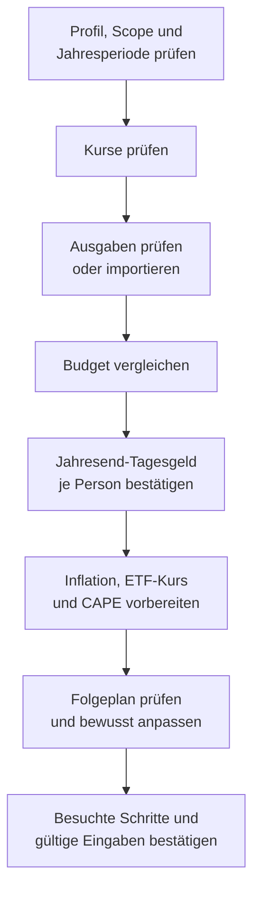
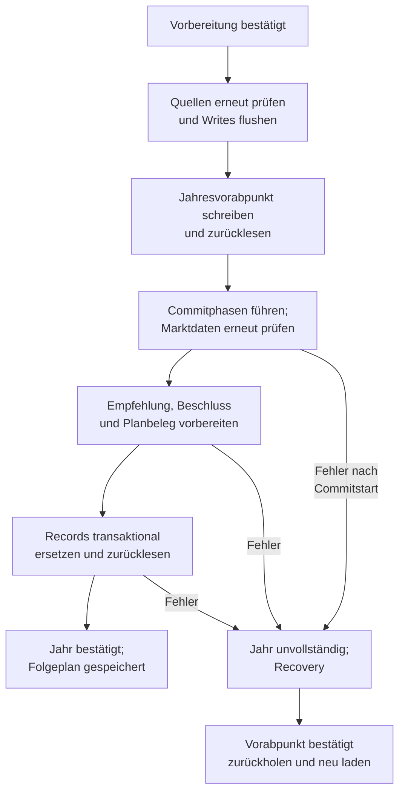
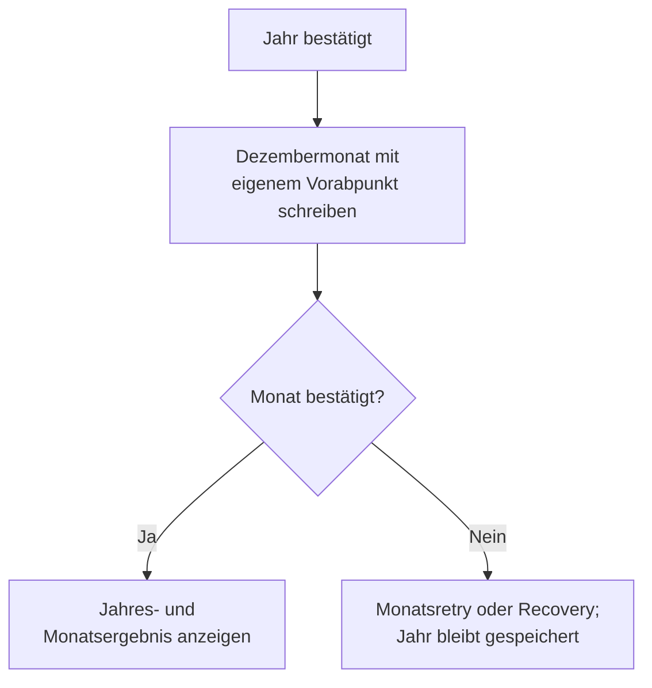
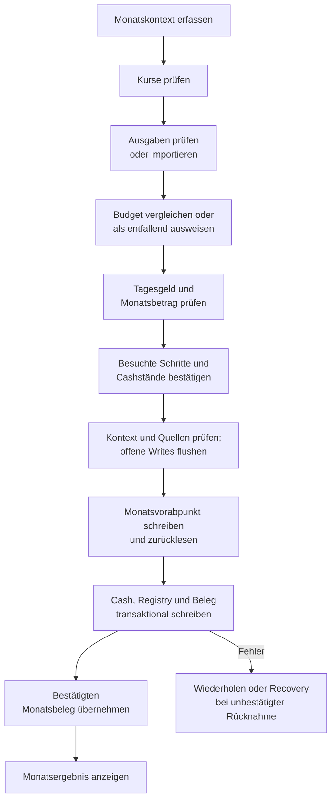

# Balance, Übersicht und Ausgaben

[balance-main.js](../../app/balance/balance-main.js) verbindet Eingabeprojektion, Jahresrechnung und Anzeige in [Balance](../../Balance.html). [Übersicht](../../index.html) und [Ausgaben](../../Ausgaben.html) haben eigene Controller. Sie nutzen dieselben Personen-, Plan- und Abschlussdienste, starten aber keine zweite Balance-Seite.

Die [technische Architektur](TECHNICAL.md) erklärt Laufzeiten und Seitendienste. [FACHKONZEPT](FACHKONZEPT.md) führt Modelle und Fachregeln, [DATENVERTRAEGE](DATENVERTRAEGE.md) Records und Schreibgrenzen. Die [Engine-Referenz](../../engine/README.md) legt Aufruf und Ergebnis fest. Bedienabläufe stehen im [Handbuch](../../Handbuch.html).

## Einstieg und Modulgrenzen

| Modul unter `app/balance/` | Zuständigkeit |
| --- | --- |
| [balance-main.js](../../app/balance/balance-main.js) | Start, Update, Fehlerstatus und Verbindung der Featuremodule |
| [balance-config.js](../../app/balance/balance-config.js) | Seitenkonfiguration, Engineversionsanforderung und Fehlertypen |
| [balance-reader.js](../../app/balance/balance-reader.js) | Formularwerte lesen, Werte anzeigen und Planpatch vorbereiten |
| [balance-input-storage.js](../../app/balance/balance-input-storage.js) | bestätigte Speicherquellen in Engineinputs projizieren |
| [balance-planning-horizon.js](../../app/balance/balance-planning-horizon.js) | ausgewählte Personen und Plan in die gemeinsame Restdauerrechnung projizieren |
| [parity-balance-records.js](../../app/balance/parity-balance-records.js), [parity-balance-replay.js](../../app/balance/parity-balance-replay.js) | private Replayrecords bauen und den echten Balance-Rechenweg ohne Persistenzwrite prüfen |
| [parity-case.js](../../app/balance/parity-case.js), [parity-year-comparison.js](../../app/balance/parity-year-comparison.js) | isolierte Jahre beider Wege nachrechnen, Felder nach Phase vergleichen und `ParityCaseV1` bereitstellen |
| [balance-update-pipeline.js](../../app/balance/balance-update-pipeline.js) | explizite Updatemodi, Kopien, Fingerprints, Ergebnisstatus und Stateübergang |
| [balance-storage.js](../../app/balance/balance-storage.js) | Balance-State lesen/schreiben und Snapshotanschlüsse führen |
| [balance-main-profile-sync.js](../../app/balance/balance-main-profile-sync.js) | Profilprojektion mit der Seite synchronisieren |
| [balance-main-profilverbund.js](../../app/balance/balance-main-profilverbund.js) | Haushaltsrechnung und personenbezogene Attribution anschließen |
| [balance-plan-trial.js](../../app/balance/balance-plan-trial.js) | flüchtigen Planversuch und dessen Aktualisierung führen |
| [balance-inflation-source.js](../../app/balance/balance-inflation-source.js) | Jahresinflation aus bestätigter Quelle lesen und kennzeichnen |
| [balance-binder.js](../../app/balance/balance-binder.js) | Ereignisse an Update und Featurebinder anschließen |
| `balance-binder-annual.js`, `balance-binder-diagnosis.js`, `balance-binder-imports.js`, `balance-binder-snapshots.js` | Jahresdialog, Diagnose, Import- und Wiederherstellungsanschlüsse |
| [balance-renderer.js](../../app/balance/balance-renderer.js) | spezialisierte Renderer koordinieren |
| [balance-presentation-controls.js](../../app/balance/balance-presentation-controls.js) | Darstellungswahl und Feldansichten führen |

`init` wartet auf den gemeinsamen Profilstart und gesicherte Seitenbereitschaft. Bei Recovery oder ungeklärten Personendaten bleibt die Fachrechnung gesperrt. Reader, StorageManager, Renderer und Binder werden verbunden, bevor ein Jahresretry oder ein Übersichtseinstieg fortgesetzt wird. Die erste Rechnung verwendet `preview`.

Die gemeinsame Persistenz löst den Bereich vor Daten- und Archivzugriffen auf. Jahresretry und Kurssitzungen folgen diesem Bereich; der alte Verzeichnishandle-Zugang des StorageManagers bleibt im Spielbereich gesperrt. Die [technische Referenz](TECHNICAL.md#speicher-und-schreibgrenzen) beschreibt Steuerung und Ablagen. Start und Beenden verwenden den getrennten Spielbereich; ein alter Probelauf wird beim Update einmalig zurückgeholt.

Bei allen vier Beispielhaushalten sowie nach Datumssprüngen zeigt Beenden die kurze Bestätigung mit „Im Spielbereich gemacht“ und den Knöpfen Weiter spielen und Spielbereich beenden. Dafür liest und berechnet der Controller keinen echten Bestand. Eigene Änderungen zählen nur gegen `initialDomain`; Monatsreihen und Jahre erscheinen in Alltagssprache, offene Monate entfallen.

Bei Kopien ohne Datumssprung rechnet der gemeinsame Dialog die Vorschau heute für beide Bereiche frisch aus Rohrecord-Kopien, ohne Balance zu öffnen. Er nutzt den DOM-freien Eingabebau und `evaluateStoredAnnualHousehold`, beim einzelnen aktiven Profil den Engine-Jahresaufruf. Er zeigt Monatsbudget samt Differenz, Handlungsanweisung mit Betrag und Liquidität in Prozent des Ziels vor Umsetzung. Abweichende festgeschriebene Planwerte stehen im ⓘ. Der Dialog öffnet sofort mit „wird gerechnet …“; Fehler zeigen „nicht berechenbar“ mit Grund im ⓘ. Die Rechnung schreibt in keinen Bereich. Monte Carlo bleibt beim letzten gespeicherten Beleg mit Datum. Die fachliche Änderungsübersicht beginnt zugeklappt. „Übernehmen …“ öffnet die Bestätigung aller Änderungen. Nur Kopien ohne Datumssprung mit unverändertem echtem Bestand können übernommen werden. Bei echtem Fremdwrite bleibt der Vergleich mit dem Sperrgrund oben sichtbar; der Übernehmen-Knopf entfällt. Der Controller bestätigt zuerst den echten Rückkehrpunkt, übernimmt transaktional und zeigt den Erfolg vor der Startseite. „Verwerfen“ nutzt den bisherigen Rückweg.

Beim Bereichs- oder Datumswechsel beendet der gemeinsame Guard die alte Seite nach bestätigter Mutation, ohne den Planversuchsadapter erneut lesen zu lassen. Der Ausgabenbeobachter pausiert während des Wechsels und bleibt danach bis zum Neuladen inaktiv.

Die aktive Einzelperson und die Haushaltsauswahl sind verschiedene Kontexte. Die Kopfzeile liest sie über die gemeinsamen Profildienste. Ein Profilwechsel muss deren bestätigten Handoff verwenden; einzelne Renderer dürfen keine weitere Profilidentität anlegen.

## Eingaben und Rechnung

`buildBalanceEngineInputFromStorage` in [balance-input-storage.js](../../app/balance/balance-input-storage.js) liest den Planbereich, zentrale Personenprojektionen, Profilwerte, Depotstatus und Jahresquellen. Es liefert die Rechenbasis samt Fingerprints. Bei Dynamic Flex ermittelt [planning-horizon.js](../../app/shared/planning-horizon.js) die Restdauer für das jeweilige Planungsjahr aus den ausgewählten Personen und den Langlebigkeitswerten. Mittelwert und Überlebensquantil verwenden dieselbe Sterbetafel wie die Simulatorrunner. Die konfigurierte Jahreszahl bleibt im Plan; die Altersableitung löst keinen Reset aus. Ein fehlender Plan, beschädigter Bestand oder nicht lesbare Personendaten wird als Status bzw. Fehler weitergegeben.

Die Verkaufssteuer wird in [profilverbund-action-attribution.js](../../app/profile/profilverbund-action-attribution.js) mit `settleTaxYear` je Person ermittelt und vom Bruttoerlös abgezogen. Verwendungen erhalten nur den Nettoerlös. Balance führt keine spätere Jahresendzahlung samt Zinssteuer aus und hat dafür keine persönliche Deckungsregel. Der Simulator verwendet dieselbe Steuerberechnung und Haushaltsreihenfolge; seine zusätzliche [Steuerdeckung](SIMULATOR_MODULES_README.md#ein-simulatorjahr) folgt FR-16 für die tatsächliche Jahresabrechnung: Partner-Liquidität vor eigenem Notverkauf.

Die separate [Paritätsnachrechnung](PARITY_REPLAY.md#balance-records-und-nachrechnung) verwendet denselben Reader mit einer privaten Recordkopie. Balance bestimmt Personenalter, Rentenbezugsmonate, Aggregatwerte, Reset und Verteilung selbst. Herkunft und entfernte Statefelder stehen beim Ergebnis. Der [Feldvergleich](PARITY_REPLAY.md#feldvergleich-und-einzelfall) prüft zusätzlich den Monatsbetrag aus `evaluateAnnualDraft` und die Seitenprojektion getrennt. Persönliches Cash und persönliche Steuertöpfe stammen aus dem jeweils fortgeschriebenen Simulatorstand. Der getrennte unabhängige Folgelauf hat dagegen noch keinen Adapter für persönliche Jahresendbuchungen und hält deshalb nach der ersten Entscheidung an. Gleiche Entscheidungen im Jahresreplay beweisen keine unabhängige Mehrjahresparität. Kein Seitencontroller importiert diese Prüfmodule. Die [Abschlussmessung](PARITY_REPLAY.md#jahresvergleich-und-restklassen) nennt Ergebnisse und Restklassen.

[guardrail-history.js](../../app/shared/guardrail-history.js) entscheidet gemeinsam mit dem Simulator über den Reset. Jede bewusste Änderung eines Bedarfs-, Flex-Budget-, Reserve-, Strategie-, Dynamik- oder Verteilungswerts zählt, auch um einen Euro. Marktwerte einschließlich CAPE, Bestände, Einkommen und Jahreswechsel erhalten die Historie. Die Jahresindexierung verschiebt die historische Bedarfsbasis um denselben Faktor; ein bereits abweichender Plan bleibt erkennbar. `prepareEngineLastState` vergleicht die rohen Planentscheidungen vor dem CAPE-Gate und erhält beim Reset die Steuerstände. Die Eingabebestätigung bewahrt die alte Planevidenz; erst der Jahrescommit bestätigt die neue Basis. Das gilt auch bei geöffneter Außenperson.

[balance-reader.js](../../app/balance/balance-reader.js) ergänzt den Formular- bzw. Versuchspatch. Die gemeinsamen Planfelder bleiben beim [Planmodul](../../app/profile/household-plan.js). Ein Feld darf beim Lesen keine zweite fachliche Planquelle aufbauen. Gespeicherte Jahresinflation wird über `balance-inflation-source.js` eingelesen; der Versuch kann davon abweichen, ohne den bestätigten Jahreswert zu ersetzen.

Die Ansicht Bedarf & Strategie zeigt Grundbedarf, Wunschbedarf und Mindest-Flex offen nebeneinander sowie je eine volle Kartenbreite für Übernommen und Marktdaten. Nur hier ausprobieren gibt die übernommenen Planfelder auch unter Alle Parameter für einen lokalen Versuch frei; Zurück zum Plan verwirft ihn. Die zentrale Pflege bleibt in Haushalt & Plan. Die weiteren Planwerte folgen Weitere Planwerte in Haushalt & Plan: Flex-Budget, Reserven und Entnahme & Umschichten stehen in der ersten Zeile, Dynamik und Marktdaten darunter. Beschriftung und kurzer Hinweis stehen links, Wert und Einheit rechts. Der Kopf fasst die aktuellen Werte zusammen. Voreinstellungen halten die Dynamikdetails geschlossen; Benutzerdefiniert öffnet sie. 3-Töpfe zeigt seine drei Werte in Entnahme & Umschichten. Alle Parameter startet geschlossen. Die Verteilung im Haushalt gehört in Entnahme & Umschichten. Reichweite und Verteilung zeigen eine kurze Zeile mit 14 px; die Erklärung steht im ⓘ. Das gilt auch für den gemeinsamen Planbaustein im Jahresabschluss. Darunter folgen abgesetzt drei Spalten: Marktdaten-Korrektur, Steuern sowie Gold und Haushalt mit Profilwahl untereinander. Beide Seiten projizieren die Beschriftungen aus `household-plan-fields.js`, ergänzen die Darstellung mit `household-plan-presentation.js` und teilen Karten und Zeilen in `css/components.css` mit dem Plan. Die fünf Dynamiksegmente stehen bei beiden Zielauflösungen vollständig in einer Zeile. Unter 1600 Pixel Fensterbreite umbrechen sie innerhalb der Karte; alle Beschriftungen bleiben vollständig. Beim Sparer-Pauschbetrag steht Summe aus den Profilen; das ⓘ nennt die unveränderte Herkunft. Kirchensteuer und Sparer-Pauschbetrag erscheinen rechtsbündig in einheitlichen übernommenen Kästen; das native Auswahlfeld und seine Sperre bleiben erhalten. Marktdaten-Korrektur bewahrt die bisherigen Eingabefelder; die offene Kachelreihe zeigt ihre Werte, Jahreszahlen, Zeit seit Hoch, CAPE und Inflation. `renderBalanceStrategyValues` in [balance-presentation-controls.js](../../app/balance/balance-presentation-controls.js) projiziert die vorhandene Rechenbasis in diese Kacheln. Ein Hoch mit null Jahren Abstand heißt aktuell. Marktdaten im Jahresabschluss prüfen öffnet den geführten Jahresabschluss, wie der Kopfknopf Jahresabschluss. Der frühere zusätzliche Kopfzugang entfällt. Ohne Herkunftsbeleg nennt die Karte Quelle und Stand als noch nicht bestätigt; die Erläuterung bleibt im ⓘ. Bei ausgeschaltetem Gold steht dort Gold aus im übernommenen Wertkasten; im lokalen Versuch bleibt das Band änderbar.

Planfelder verwenden Beschriftungen aus [household-plan-fields.js](../../app/shared/household-plan-fields.js). Die Balance bindet Zahlen ohne angehängte Einheit, weil der Feldrahmen sie separat zeigt. Prozentanzeigen lesen weiterhin die kanonischen Anteile. Der gemeinsame Stil in `css/components.css` zeichnet übernommene Werte ruhig; ihre Herkunft steht im Kopf, der Feldgrund bleibt über `aria-describedby` zugänglich. Öffnen und Schließen speichert keinen Ansichtsstand.

Der Updatepfad arbeitet in dieser Reihenfolge:

1. Updateauftrag und Planversuch bestimmen; Speicher- und Formularbasis erfassen.
2. Engineinputs und passenden Vorjahresstate projizieren und validieren.
3. Einzelprofil oder Haushalt rechnen; für die Anzeige den optionalen Flex-Trace anfordern.
4. Die bereits finalisierte Aktion für die Darstellung aufbereiten.
5. Bedarf, Handlung, Kennzahlen und Diagnose rendern.
6. Bei einem ausdrücklich schreibenden Modus die Quellen erneut lesen und ihre Fingerprints prüfen, dann den dafür erlaubten Write ausführen.

[balance-file-service.js](../../app/balance/balance-file-service.js) stellt mit `evaluateBalanceFileInputs` die lesende Rechnung bereit. Die Oberfläche darf ein erfolgreiches Rechenergebnis erst nach dessen Prüfung verwenden. `BALANCE_UPDATE_STATUS` unterscheidet `success`, `validation_error`, `engine_error` und `blocked`; ein Fehler liefert keinen bestätigten Folgestate.

### Vorschau und Jahresstate

[balance-update-pipeline.js](../../app/balance/balance-update-pipeline.js) kennt drei Modi:

| Modus | Wirkung |
| --- | --- |
| `preview` | Ergebnis anzeigen, ohne den Balance-Vorjahresstate fortzuschreiben |
| `persist_inputs` | erlaubte Eingaben sichern, den Vorjahresstate bewahren |
| `commit_period` | mit gültiger Perioden-ID den geprüften Kandidaten als Jahresstate bestätigen |

`mode` und der alte Parameter `persist` dürfen nicht kombiniert werden; der alte Parameter allein wird ebenfalls zurückgewiesen. `periodId` ist nur für `commit_period` zulässig und dort Pflicht. Fingerprints beziehen sich auf fachlich wirksame JSON-Werte, nicht auf Anzeigezeitstempel. Nicht endliche oder nicht eindeutig serialisierbare States werden zurückgewiesen.

Eine neue Vorschau wird wieder aus der bestätigten Basis gerechnet. Sie darf nicht die Glättungs-, Budget-, Steuer- oder Safetyanker der vorherigen Vorschau übernehmen. Der Jahresabschluss prüft zusätzlich Perioden- und Quellenfrische. Die genaue Belegform steht unter [Abschlüsse](DATENVERTRAEGE.md#abschlüsse-und-ausgaben).

### Haushaltsrechnung

[profilverbund-balance.js](../../app/profile/profilverbund-balance.js) lädt die beteiligten Profile und baut Vermögens-, Einkommens- und Bedarfsprojektionen. [balance-main-profilverbund.js](../../app/balance/balance-main-profilverbund.js) führt eine Engine-Jahresrechnung für den Haushalt aus. [profilverbund-action-attribution.js](../../app/profile/profilverbund-action-attribution.js) ordnet die finalen Quellen, Verwendungen und Steuerbeträge wieder den Profilen zu.

Ist die persönliche Verkaufssteuer höher als im Haushaltsplan, decken freies Tagesgeld und danach weitere vorhandene Tranchen die Differenz. Die Steuer bleibt je Person getrennt. Ein nicht gedeckter Rest begrenzt Auffüllung und Käufe mit dem vorhandenen Engine-Baustein; er bricht die Empfehlung nicht ab. Die Aktion hält den Grund unter `personalTaxFunding` fest. Der [Simulatorjahrespfad](SIMULATOR_MODULES_README.md#ein-simulatorjahr) verwendet dieselbe Zuordnung und prüft danach die tatsächliche Auszahlung.

Die Entnahmeverteilung unterstützt intern `tax_optimized`, `proportional` und `runway_first`. Der gültige gemeinsame Plan liefert den Modus vorrangig; der alte Speicherschlüssel bleibt ein Kompatibilitätspfad. Die Verteilung ist kein Auftrag, ein fremdes Profildepot zu verändern.

Die Goldaggregation verwendet die zentrale Berechnung aus [profile-asset-values.js](../../app/profile/profile-asset-values.js). Die [Tranchenreferenz](TRANCHEN_MODULES_README.md#projektionen-für-balance-und-simulator) führt ihre profilbezogene Basis und den Pflegeabzug. Die fachlichen Reservegrenzen stehen im [Fachkonzept](FACHKONZEPT.md#standard-gold-und-drei-töpfe).

[balance-action-postprocessor.js](../../app/balance/balance-action-postprocessor.js) übernimmt die finalisierte Aktion und die Drei-Topf-Diagnose. Es führt für das Einzelprofil keine zweite Drei-Topf-Rechnung aus. Die gemeinsame Engine zieht geplante Anleihenverkäufe vor der Zielberechnung ab; deshalb kann die Empfehlung mehr Aktien in Anleihen umschichten. Als Verlustschwelle gilt Kursrendite minus Inflation. Im Haushalt setzt es die attribuierten Teilergebnisse zusammen. Balanceempfehlungen schreiben keine Detailtranchen; reale Ausführungen gehören nach [Personen & Vermögen](TRANCHEN_MODULES_README.md#depot-und-ausgeführte-verkäufe).

Im aktiven Spielbereich ergänzt [balance-play-execution-ui.js](../../app/balance/balance-play-execution-ui.js) im Handlungsdialog Als ausgeführt eintragen und Gutschrift bestätigen. Der Renderer übergibt die dargestellten Profilaktionen samt Cashaufteilung. [balance-play-execution.js](../../app/balance/balance-play-execution.js) bereitet normale Verkaufs-, Kauf- und Cashbuchungen auf privaten Rohrecords vor. Erst die Bestätigung schreibt alle betroffenen Personen gemeinsam. Bestandskurse gelten auch für Käufe desselben Instruments; fehlt die Anlageklasse im Haushalt, entsteht eine neue Spieltranche mit deterministischem Spielkurs. Die Gutschrift bleibt offen und enthält die Käufe bereits im vorbelegten Tagesgeld-Stand. Ein Neustart erhält diesen Auftrag. Herkunft, Kontextprüfung und Speichergrenze stehen unter [Reconciliation](DATENVERTRAEGE.md#reconciliation-und-cashnachweis).

## Anzeige und Diagnose

| Modul | Angezeigte Werte |
| --- | --- |
| [balance-renderer-summary.js](../../app/balance/balance-renderer-summary.js) | Bedarf, Entnahme, Liquidität und Zusammenfassung |
| [balance-renderer-action.js](../../app/balance/balance-renderer-action.js), [balance-action-summary.js](../../app/balance/balance-action-summary.js) | finale Handlung und Kurzfassung |
| [balance-action-origin.js](../../app/balance/balance-action-origin.js) | Herkunft eines Handlungsvorschlags |
| [balance-renderer-diagnosis.js](../../app/balance/balance-renderer-diagnosis.js) | Diagnosehost und aufbereitete Enginewerte |
| `balance-diagnosis-format.js`, `balance-diagnosis-chips.js`, `balance-diagnosis-decision-tree.js` | lesbare Diagnose, Statusmarker und Entscheidungsbaum |
| `balance-diagnosis-guardrails.js`, `balance-diagnosis-keyparams.js`, `balance-diagnosis-transaction.js` | Guardrails, Parameter und Transaktionsdetails |
| [balance-flex-trace.js](../../app/balance/balance-flex-trace.js) | Monatswirkung der tatsächlich durchlaufenen Flex-Schritte |
| [balance-health-bucket.js](../../app/balance/balance-health-bucket.js) | Pflegebucket als Balance-Diagnose |
| [balance-next-steps.js](../../app/balance/balance-next-steps.js) | Anschlüsse für nächste Aufgaben |

Renderer lesen `modelResult` und die zugehörigen Inputs. Sie berechnen keine neue Verkaufsempfehlung.

Der kompakte Kopf zeigt Balance und das Planungsjahr. Bei einem gültigen Jahresbeleg nennt `renderBudgetOrigin` die heutige Rechnung direkt an Monatsbudget und Vermögensentnahme als Vorschau heute mit fachlichem Datum. Daneben stehen der beschlossene Betrag, sein Belegdatum und die Differenz Vorschau minus Plan; bei Platzmangel stehen sie darunter. Das Monatsbudget ist mit 44 px Newsreader die einzige Leitzahl der Seite. Budgetteile, Reserven, Vorher-/Nachherwerte, Leitplanken und der Handlungsdetails-Betrag verwenden 17 px Newsreader. Tabellen, Herleitungen, Parameterfelder und Zahlen in Quellenzeilen verwenden 16 px IBM Plex Sans. Ohne passenden Jahresbeleg bleiben die bisherigen Bezeichnungen erhalten. Die Anzeige liest den bestehenden Planvergleich und ändert keinen Beleg.

Die Kürzung steht als Satz und Legende beim Monatsbudget; der Grund bleibt über Warum erreichbar. `projectBalanceFlexTrace` zeigt den aus Vermögen finanzierten Flex-Anteil mit den gelieferten Monatswirkungen. Ein verbleibender Netto-Floor liegt außerhalb der Treppe und wird im Label kenntlich. Der finanzierte Haushalts-Flex steht getrennt: Monatsbudget minus Grundbedarf, mindestens 0, einschließlich Rentenanteil. Die Prozentangabe bezieht sich auf den Haushalts-Wunsch-Flex. Eine Einschränkung bleibt bezahlter Haushalts-Flex unter positivem Mindest-Flex.

Die gelieferte `ui.runway.months` gilt nach dem Transaktionsvorschlag und vor Auszahlung. Die Vorheranzeige teilt freie operative Liquidität durch dieselbe finanzierte monatliche Vermögensentnahme. Das ⓘ nennt beide Formeln; eine fehlende Seite bleibt fehlend. Reservekarte und Diagnose kennzeichnen den Nachherzustand. Liquiditätsdeckung und Netto-Floorreichweite bleiben eigene Größen. Rentenhinweise stehen je Person in einer eigenen Zeile; der Jahresstatus erscheint dort einmal als Text. Details & Drucken öffnet die Vorschau-Details; der Kopf enthält keinen Druckknopf.

Im Überblick steht die Vorläufige Empfehlung mit vorgeschlagenem Kauf, Verkauf oder Transfer und einem Betrag in `--value-md`. Der Jahresblock nennt die Handlungsanweisung als festgeschrieben; ihre Umsetzung bleibt freiwillig. `balance-action-origin.js` liefert dieselbe Herkunftsformulierung auch an die Übersicht. ⓘ neben dem kurzen Vorbehalt öffnet die vollständige Erklärung. Ohne offene Schritte ersetzt eine Statuszeile mit dem nächsten Abschlusstermin die Schrittkarte; bei erledigtem Jahr und im Erstjahr ist der Startknopf verborgen.

Der Reservebalken liest `liquiditaet.deckungVorher`, die Betragsdeckung vor der vorgeschlagenen Umsetzung. Reichweitenziel und `runway.months` nach dem Vorschlag sind getrennt beschriftet. Die heiße Marktphase verwendet die vorhandene Warnfarbe.

Alle Kennzahlen gliedert die vorhandenen Werte in Vermögensstand, Flex und Entnahme sowie Dynamische Berechnung. Leere Gruppen entfallen; Werte, Erläuterungen und Trendfarben bleiben erhalten.

Diagnoseanzeigen heißen Transaktionsvorschlag und Empfehlung ausgelöst; verletzte Leitplanken behalten ihre Rohwert-Regelrichtung. Engine-Sätze werden erst am Anzeigehost mit deutschen Prozent-/Euroformaten und → formatiert. Die Flexanzeige nutzt den angeforderten Engine-Trace; er gelangt nicht in persistierte States oder Ergebnisexporte. Die Entscheidungsstufen erklärt [ENGINE_DECISION_LOGIC](ENGINE_DECISION_LOGIC.md#bedarf-und-flex-trace).

`balance-health-bucket.js` behandelt die Reserve als `diagnostic_only`. Die reale Pflegebucketdefinition stammt aus den Personen-/Haushaltsprojektionen; Balance entnimmt daraus kein Geld. Die operativ simulierte Nutzung liegt in den Simulatorportfoliomodulen.

## Monats- und Jahresabschluss

Der Jahreswrite liegt im gemeinsamen [annual-coordinator.js](../../app/shared/annual-coordinator.js). Balance, Übersicht und Ausgaben stellen eigene UI-Adapter bereit, aber keinen voneinander unabhängigen Jahresabschluss.

Der Zeitraffer im Spielbereich nutzt dieselben Abschlussdienste über [overview-timelapse.js](../../app/overview/overview-timelapse.js). Nach dem Jahreswrite trägt er dessen konkrete Profilaktionen mit den vorhandenen Spielbuchungs- und Gutschriftwritern ein. `splitPlayLiquidity` aus [balance-play-execution.js](../../app/balance/balance-play-execution.js) liefert dafür dieselbe Cashaufteilung wie der Balance-Renderer. Unterjährige Vorschauen werden nicht ausgeführt.

| Quelle | Aufgabe im Jahrespfad |
| --- | --- |
| [balance-close-coordinator.js](../../app/balance/balance-close-coordinator.js), [balance-annual-orchestrator.js](../../app/balance/balance-annual-orchestrator.js) | Balanceadapter und Anschluss des gemeinsamen Dienstes |
| [balance-annual-modal.js](../../app/balance/balance-annual-modal.js), [annual-close-dialog.js](../../app/shared/annual-close-dialog.js) | Jahresdialog und Bestätigung |
| [annual-close-session.js](../../app/shared/annual-close-session.js) | Vorbereitung, lokale Prüfschritte und anschließende Monatsphase |
| [annual-operation-lock.js](../../app/shared/annual-operation-lock.js) | konkurrierende Jahresoperationen sperren |
| [balance-annual-period.js](../../app/balance/balance-annual-period.js) | Zielperiode, Altbestätigung und Recoverystatus prüfen |
| [annual-marketdata.js](../../app/shared/annual-marketdata.js), `balance-annual-inflation.js`, `balance-annual-marketdata.js` | Inflation, ETF-Jahreskurs und CAPE vorbereiten |
| [balance-annual-storage.js](../../app/balance/balance-annual-storage.js) | Jahresdraft ohne DOM aus bestätigten Quellen bauen |
| [balance-annual-preview.js](../../app/balance/balance-annual-preview.js) | Vorschau und Vergleich des Folgeplans projizieren |
| [balance-annual-storage-commit.js](../../app/balance/balance-annual-storage-commit.js) | Empfehlung/Übernahme rechnen, gemeinsame Records vorbereiten und nach Write zurücklesen |

Vorbereitung kann Marktdaten laden, ohne bereits die Jahresperiode zu bestätigen. Der Koordinator prüft Scope und Ausgangsbasis, bestätigt einen Wiederherstellungspunkt und führt die Metadaten durch die Schreibphasen. Ein unvollständiger Vorlauf verlangt Recovery oder Retry. Erfolgsanzeigen folgen dem bestätigten Readback.

Der bewusste Folgeplan und der ursprüngliche Rechenvorschlag bleiben unterscheidbar. Tagesgeldstände werden pro Person bestätigt. Beide Abschlüsse schreiben das Prüfdatum getrennt als `profile_tagesgeld_confirmed_date`. Ein unveränderter Betrag gilt damit bis zur nächsten Fälligkeit als aktuell, ohne neuen Tagesgeld-Verlaufspunkt. Die Feldhinweise zeigen die neuere Bestätigung; ältere Daten ohne dieses Feld bleiben unverändert lesbar. Personendaten stammen weiterhin aus der zentralen Projektion; der Abschluss schreibt kein Alter hoch. Nach dem Jahreswrite folgt die bestätigte Monatsphase über die gemeinsame Session. Ein Besuch einer Seite oder eine neue Balancevorschau ersetzt keinen Abschluss.

Die Recordformen und Wiederholungsgrenzen stehen in [DATENVERTRAEGE](DATENVERTRAEGE.md#abschlüsse-und-ausgaben), die fachlichen Regeln in [FACHKONZEPT](FACHKONZEPT.md). Der technische Ablauf der Sperren und Recoverydienste gehört zu [TECHNICAL](TECHNICAL.md#monats--und-jahresabschluss).

### Jahresabschluss

Die Planprüfung zeigt zuerst Monatsbudget, Renten im Jahresdurchschnitt und Vermögensentnahme, dann den Planvergleich und die Änderungen der Bedarfe gegenüber dem Vorjahr. Rentenbezugsmonate stehen offen, Altersherleitungen unter Berechnungsgrundlagen. Monats- und Jahresvollständigkeit werden getrennt mit fehlenden Monaten und Personen gezeigt, auch nach dem Speichern. Die festgeschriebene Handlungsanweisung erklärt direkt die freiwillige Umsetzung.

[balance-annual-storage.js](../../app/balance/balance-annual-storage.js) schreibt Bedarf und Flex-Budget mit ungerundeten Zwischenwerten fort. Inflation, CAPE und ETF-Schlusskurs behalten die Quellpräzision. [balance-annual-storage-commit.js](../../app/balance/balance-annual-storage-commit.js) rechnet wie die Balance-Vorschau mit dem ungerundeten Einkommen im Monatsbudget. Anzeige und gebuchte Beträge dürfen runden; die Entnahmequantisierung der Engine bleibt eine eigene Fachregel. Neue Jahresbelege speichern die Rechenpräzision. Gerundete Altbelege bleiben gültig und werden nicht umgeschrieben.

[annual-close-dialog.js](../../app/shared/annual-close-dialog.js) bündelt die Herkunft der Jahresmarktdaten über drei KPI-Kacheln. [annual-close-result.js](../../app/shared/annual-close-result.js) zeigt nach dem Erfolg die Handlungsanweisung mit geschlossenen Details, das Monatsbudget als Leitzahl und zwei Kacheln für Jahresausgaben und Jahresbedarf. Herleitung Plan enthält Bedarfsänderungen, Renten und Vollständigkeit; Dezember enthält Monatswerte und Tagesgeld je Person. Als dritte geschlossene Karte folgt Abschlussbeleg mit Wiederherstellungspunkten, Entnahmehinweis und dem zurückhaltenden Knopf Protokoll anzeigen. Alle drei Klappen beginnen geschlossen. Auch in anderen Ergebniszuständen steht der Protokollknopf in dieser Kartenform. Bewusste Anpassungen stehen unter der Leitzahl; die Herleitung vergleicht die ursprüngliche Empfehlung aus dem passenden Jahresbeleg mit dem beschlossenen Wert. Im festen Fuß stehen Sicherungsempfehlung, nächste Handlung und Abschlussknopf. Abschlussbedingungen, Belegerläuterung und Protokoll liegen im einzigen scrollbaren Inhalt. Das Kopfkreuz schließt die Vorbereitung mit derselben Verwerfprüfung wie bisher.

Der Dialog führt durch Kurse, Ausgaben, Budgetvergleich, Tagesgeld, Marktdaten und Folgeplan. Alle Pflichtschritte müssen besucht und ihre Eingaben gültig sein. Nach der Bestätigung prüft der Koordinator die Ausgangsquellen und sichert einen Jahresvorabpunkt. Er führt die Commitphasen, prüft die Marktdaten erneut und lässt Empfehlung, übernommenen Plan und Planbeleg im privaten Entwurf rechnen. Der transaktionale Write bestätigt Plan, Beleg, Balance-State, Registry, Cash und Ausgabenjahr; erst der Readback bestätigt das Jahr.

Ein Fehler nach dem Commitstart liefert `incomplete_recovery`. Der Jahresvorabpunkt dient dann zum Zurückholen. Bei einem fehlgeschlagenen ETF-Jahreskurs kann der bestätigte Restore mit einem geprüften manuellen Kurs und einem einmaligen Wiederaufnahmeauftrag verbunden werden. Die Quellen werden nach dem Reload erneut geprüft. Scheitert dagegen die anschließende Monatsphase, bleibt das Jahr gespeichert; Monatsretry oder Monatsrecovery behandeln nur diese Phase.

Die drei Diagramme zeigen Vorbereitung, Jahreswrite und Dezembermonat. Nach einer bestätigten Jahresrecovery beginnt die Kontextprüfung erneut. Monatsretry oder Monatsrecovery setzen nur die Monatsphase fort.

Die bestätigte Vorbereitung führt zum Jahreswrite.

Nach dem bestätigten Jahr folgt der Dezembermonat mit eigener Speichergrenze.

Quellen: [annual-close-dialog.js](../../app/shared/annual-close-dialog.js) für Dialogschritte und Bestätigung; [annual-coordinator.js](../../app/shared/annual-coordinator.js) für Kontext, Vorabpunkt, Commitphasen und Jahresretry; [balance-annual-storage-commit.js](../../app/balance/balance-annual-storage-commit.js) für Planbeleg, Write und Readback; [annual-close-session.js](../../app/shared/annual-close-session.js) und [overview-annual-close.js](../../app/overview/overview-annual-close.js) für die anschließende Monatsphase und ihre Wiederholung.

### Monatsabschluss

Der Monatsdialog führt durch Kurse, Ausgaben, Budgetvergleich und Tagesgeld. CSV auswählen … öffnet das verborgene Dateifeld je Person; der Dateiname steht daneben. Vorhandene Monatsausgaben zeigen Betrag und Importstatus. Unter Import ersetzen … liegt die erneute Auswahl. Der Weiterknopf nennt den Budgetvergleich direkt. Erledigte Schritte klappen mit sichtbarer Zusammenfassung kompakt zusammen. Kopf und Abschlussbereich bleiben fest; der Inhalt scrollt, die Hintergrundseite bleibt stehen. CSV-Zeile und Panelregeln werden auch im Jahresdialog verwendet. Ein fehlendes Vergleichsbudget kann als entfallender Schritt ausgewiesen werden. Der Abschluss verlangt einen passenden Monatsbetrag, besuchte Pflichtschritte und bestätigte Tagesgeldwerte. Der Controller bindet den Auftrag an Profil, Scope, Datum und gelesene Quellen.

Haken und „angesehen“ zeigen im Monatsdialog den Besuch eines Vorbereitungsschritts. Drei Budgetkacheln zeigen Ausgaben, Monatsbudget mit Herkunft und Abweichung; eine Überschreitung erscheint gelb. Zugeklappt bleibt nur die Ergebniszeile farbig. Der Kursabruf zählt bearbeitete Tranchen und behauptet keine Nutzerprüfung.

Die Herkunft des Tagesgelds steht einmal vor den Personen. Jede Person beginnt mit einem Lesewert und „noch nicht bestätigt“. „Stand stimmt“ bestätigt diese Person; „Ändern“ öffnet das Feld mit „Übernehmen“. Danach steht „bestätigt“ oder „geändert“ am Wert. Beim Bearbeiten bleibt der Abschluss gesperrt. Die Entnahme aus dem Vermögen bezieht sich auf den laufenden Monat und stammt aus dem passenden Plan. Das Monatsbudget bleibt die eigene Vergleichsgröße. Nach bestätigtem Write ersetzt der Beleg die Vorbereitung. Das Monatsergebnis zeigt drei Kacheln und die geschlossene „Herleitung anzeigen“; im Fuß stehen der nächste Monatsabschlusstermin und „Fertig“. Regeln und Speicherhinweise bleiben hinter ⓘ erreichbar.

Der Cashwriter flusht offene Änderungen und bestätigt einen Monatsvorabpunkt. Danach schreibt er Cash, Registry und Monatsbeleg gemeinsam über `replaceRecordsTransactional`. Ein vorhandener Beleg wird nicht erneut ausgeführt. Fehler führen zur Wiederholung nach erneuter Kontextprüfung; bei unbestätigter Rücknahme ist Recovery nötig. Die Ergebnisanzeige folgt dem bestätigten Write.

Das Diagramm zeigt den Monatsdialog bis zum bestätigten Monatsbeleg. Nach Klärung eines Speicherfehlers beginnt die Kontextprüfung erneut.

Quellen: [overview-month-confirmation.js](../../app/overview/overview-month-confirmation.js) und [close-dialog.js](../../app/shared/close-dialog.js) für Schritte, Besuchsnachweise und Bestätigung; [overview-main.js](../../app/overview/overview-main.js) für Monatskontext und Ergebnis; [overview-storage.js](../../app/overview/overview-storage.js) für Vorabpunkt, transaktionalen Write und Monatsbeleg.

## Übersicht

[overview-main.js](../../app/overview/overview-main.js) initialisiert die gemeinsame Profil-/Planbereitschaft, verbindet Kurse, Historie und Abschlusscontroller und rendert daraus das Übersichtsmodell. [overview-model.js](../../app/overview/overview-model.js) projiziert Registry, Livewerte, Belege und Archiv; [overview-renderer.js](../../app/overview/overview-renderer.js) zeigt den Arbeitsstand an.

| Modul unter `app/overview/` | Zuständigkeit |
| --- | --- |
| [overview-storage.js](../../app/overview/overview-storage.js) | bestätigte Balancezusammenfassung, Monatsbeleg und letzten Vollsicherungsstand lesen/schreiben |
| [overview-month-confirmation.js](../../app/overview/overview-month-confirmation.js) | lokale Monatsprüfschritte, Tagesgeldbestätigung und Ergebnis |
| [overview-cash-proposal.js](../../app/overview/overview-cash-proposal.js) | Tagesgeld-Spielvorschläge für beide Abschlüsse; zeitanteilige Herleitung ohne Writes |
| [overview-annual-close.js](../../app/overview/overview-annual-close.js) | Jahresdienst und Dialog an die Übersicht anbinden |
| [overview-example-expenses.js](../../app/overview/overview-example-expenses.js) | Beispielimport und Vermögenserfassung über gemeinsame Dienste verbinden |
| [overview-history.js](../../app/overview/overview-history.js) | gewählten Vermögenszeitraum und Historienstatus führen |
| [overview-simulation-summary.js](../../app/overview/overview-simulation-summary.js) | Simulatoraussagen aus abgeschlossenen Läufen projizieren |

Die Übersicht zeigt den nächsten Abschluss, dann Vermögen, Monatsbudget und Plan. Personen & Vermögen steht links unter der Vermögenskarte, Ausgaben rechts daneben. Beide stehen vor dem Verlaufsdiagramm mit 176 Pixel Höhe. Dort bleiben der letzte Tagesabschluss und die Veränderung mit Bezugszeitraum sichtbar. Der Link Zum Verlauf → führt zu Personen & Vermögen. Dessen Gruppe Aus Tageskursen enthält Aufteilung, Entnahmen, Ohne Entnahmen gerechnet, Höchststand und größten Rückgang sowie die Lesehilfe im ⓘ. Die Kennzahlen aus erfassten Ständen bleiben getrennt.

Bestandsdatum und Budgetjahr stehen bei den Zahlen. Die vier Jahreskennzahlen zeigen Beschriftung und Wert; Ausgabenzeitraum und Erklärungen stehen im ⓘ neben der Beschriftung. Bis 85 rem Inhaltsbreite stehen die Kennzahlen in zwei Spalten, damit Knöpfe und Popups im Fenster bleiben. Fehlende Werte erscheinen als — mit dem Grund im Popup. `renderOverviewYear` bindet die Knöpfe nach jedem Rendern über [designsystem-info-popover.js](../../app/shared/designsystem-info-popover.js) für Hover, Fokus, Klick und Escape. `aria-describedby` erhält den Detailtext für Bildschirmleser. Der Jahresvergleich benötigt belegte Jahresgrenzstände für den damaligen Umfang; Schema 1 belegt diesen Umfang nicht. Der Tagesverlauf verwendet dagegen den ersten bewertbaren Tagesabschluss des gewählten Zeitraums bis zum Vortag. Ein fehlender Jahresvergleich sagt deshalb nichts über die Verfügbarkeit des Tagesvergleichs aus.

Das Übersichtsmodell bestimmt den nächsten Anlass aus Uhr, Planungsbeginn und bestätigten Belegen. Die Historie und die gespeicherten Rechenaussagen haben eigene Quellen; ein fehlender Beleg wird nicht durch eine frische Enginevorschau ersetzt. Die Monatssteuerung in `overview-main.js` schützt den aktiven Dialog und dessen Write gegen Profil-, Zeit- und Scopewechsel.

Im laufenden Jahr ohne fälligen Monat zeigt `overview-renderer.js` einen Jahresanfang mit dem ersten Monatsabschluss ab 1. Februar. Ausgabenlücken werden erst für fällige Monate gemeldet. Ein vorhandenes Budget wird auch ohne auswertbaren Budget-Prozentwert benannt; nur eine fehlende Budgetquelle erzeugt den Budgethinweis. Der Vorjahresrückblick vor dem Jahresabschluss und die Rechnungen in `projectOverviewYear` bleiben erhalten.

Eine erfolgreiche Balancevorschau kann eine Zusammenfassung für die Übersicht bereitstellen. Das ist weiterhin kein Jahresbeschluss. Budgetkarte und Budgetlinie verwenden den Jahresbeleg, sobald er für ihr jeweiliges Jahr vorliegt; sonst zeigen sie die gespeicherte Vorschau als vorläufig. Im Januar-Rückblick bleibt die Linie beim Vorjahresbudget. Der Renderer nennt eine veraltete Vorschau direkt am Betrag und an der gestrichelten Linie; der Kartenlink führt zur neuen Rechnung in Balance. Die Plankarte zeigt den Belegstatus als Hauptinhalt und das Jahr daneben. Die Kurspille beginnt bei Abruffehlern mit dem ältesten gespeicherten Kursdatum; Fehlerzeit und technische Gründe bleiben in den Abrufdetails. Nach einem Datumssprung nennen Kurspille und Vermögenskarte im Spielbereich „Testkurse, nicht echt“. Bei „Stand heute“ gelten echte Kursabrufe und die normale Kursanzeige; ihre Writes bleiben im Spielbereich. Die ⓘ-Erklärung aus `probelauf-price-ui.js` benennt künstliche Kurse und die unveränderte Herkunft von Stückzahlen und Tagesgeld.

Gespeicherte Simulatoraussagen kommen nur aus einem fertigen Lauf und bleiben an dessen Annahmen gebunden. Die Formen führt [DATENVERTRAEGE](DATENVERTRAEGE.md).

## Ausgaben und Vermögensverlauf

[expenses-main.js](../../app/expenses/expenses-main.js) wartet auf Profilbereitschaft und prüft Recovery-/Migrationssperren. [expenses-controller.js](../../app/expenses/expenses-controller.js) führt Auswahl, Import und Refresh; [expenses-model.js](../../app/expenses/expenses-model.js) projiziert Monats-/Jahreswerte sowie Budgetbelege. [expenses-renderer.js](../../app/expenses/expenses-renderer.js) zeigt sie an. [expenses-close.js](../../app/expenses/expenses-close.js) verbindet die Seite mit den Abschlussdiensten.

Die noch unter `app/balance/` liegenden Ausgabenmodule werden gemeinsam genutzt:

| Modul | Grenze |
| --- | --- |
| [balance-expenses-csv.js](../../app/balance/balance-expenses-csv.js) | CSV zerlegen, Zahlen lesen und Importfehler melden |
| [balance-expenses-import.js](../../app/balance/balance-expenses-import.js) | Vorschau, Bestätigung, Schreibreihenfolge und Kontextprüfung |
| [balance-expenses-storage.js](../../app/balance/balance-expenses-storage.js) | Ausgabenrecord und Monats-/Jahreszugriff |
| [balance-expenses-metrics.js](../../app/balance/balance-expenses-metrics.js) | Summen, Budgetvergleich und Jahresstatistik |
| `balance-expenses-renderer.js`, `balance-expenses-history-renderer.js` | Anzeigen aus vorbereiteten Ausgabenwerten |
| [balance-expenses-wealth-capture.js](../../app/balance/balance-expenses-wealth-capture.js) | Import mit der erlaubten Vermögenserfassung verbinden |

Die Monatsmatrix stellt Beträge vor rahmenlose, gedämpfte Aktionssymbole. Die Klickflächen bleiben erhalten; ⓘ im Kartenkopf öffnet die Bedienhinweise. Jahr und Personenfilter verwenden gleich große Segmente. Jahres-KPIs verwenden 17 px Newsreader; ihre Unterzeilen, Tabellen und Kategorien verwenden 16 px IBM Plex Sans. Die Ausgabenseite hat höchstens 1460 px Inhaltsbreite, damit die Monatsmatrix bei den Referenzbreiten ohne waagerechtes Scrollen passt. Die Kategorienanzeige skaliert die größte positive Kategorie auf volle Spurbreite; die Prozentanteile rechts bleiben auf die Ausgabensumme bezogen. Der Jahresrenderer zeigt ein importiertes Jahr als Zusammenfassung, ab zwei Jahren das Diagramm mit höchstens 64 Pixel breiten Säulen und Beschriftungen in 14 px IBM Plex Sans. Die Wertetabelle bleibt in beiden Ansichten erreichbar.

Datei-, Einzel- und Sammelimporte laufen über `importExpenses` und `requestExpensesPreview`. Derselbe Monatsbestand wird erst nach Vorschau und Bestätigung ersetzt. Importfortsetzungen werden nacheinander ausgeführt und prüfen ihren Personen-/Periodenkontext vor dem Write erneut. CSV-Format und Beleggrenzen stehen in [DATENVERTRAEGE](DATENVERTRAEGE.md#abschlüsse-und-ausgaben).

Die Vermögensanzeige in Balance verwendet `balance-wealth-history.js` samt Metrics-, Preview- und Renderermodulen. Die Tagesbewertung kommt dagegen aus [tranchen-history-model.js](../../app/tranches/tranchen-history-model.js), die bestätigten Altstände aus dem Vermögensrecord. Verlauf und Kennzahlen dürfen Datenlücken oder fehlenden historischen Personenbezug nicht durch heutige Haushaltszuordnung verdecken. Manuelle Erfassung, Ausgabenimport und beide Jahresabschlusswege ergänzen über [profile-wealth-captures.js](../../app/profile/profile-wealth-captures.js) den globalen Record `rs_household_wealth_captures_v1`. Haushalt und jedes Haushaltsmitglied werden zusammen bestätigt. Der [Vertrag](../../types/wealth-capture-contract.js) prüft ihre komponentenweise Summe. Die bisherige Haushaltskopie bleibt für ältere Leser erhalten. Der Manager vereinigt verteilte Altlisten nach Datum und zeigt bei Personen ausschließlich eigene neue Stände. Die Tageskurve und Aus Tageskursen verwenden weiterhin ihre bisherigen Quellen. Quellen und Kursgrenzen führt die [Tranchenreferenz](TRANCHEN_MODULES_README.md#vermögensverlauf-und-kurse).

## Schnittstellen und Pflege

UI-Ereignisse gehören in die Binder und Controller, Jahreswrites in den gemeinsamen Koordinator, Recordänderungen in ihre Eigentümer. Reine Aufbereitung bleibt in den Metrics-/Projektionsmodulen. Gemeinsame Formatter und Feldzustände kommen aus `app/shared/`; Layoutvorgaben stehen im [Designsystem](../design/designsystem.md).

Beim Ändern eines Rechenpfads sind sowohl Speicherprojektion als auch Formularversuch und Jahresdraft zu beachten. Sie müssen denselben Enginevertrag erfüllen. Verhalten und gezielte Prüfgruppen sind im [Test-README](../../tests/README.md) eingeordnet; Fach-, Daten- und Fehlerfälle brauchen die jeweils passenden Node-Prüfungen.
