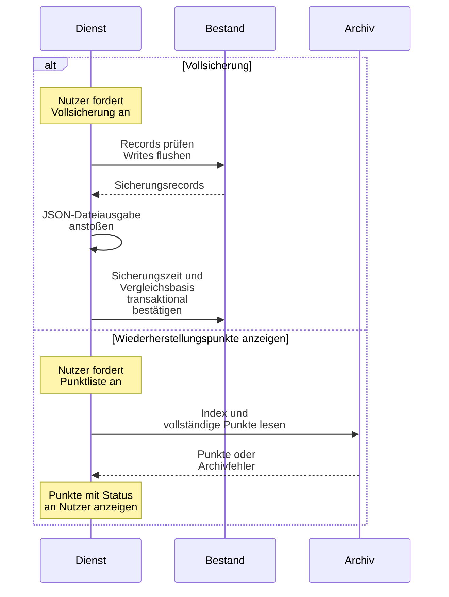
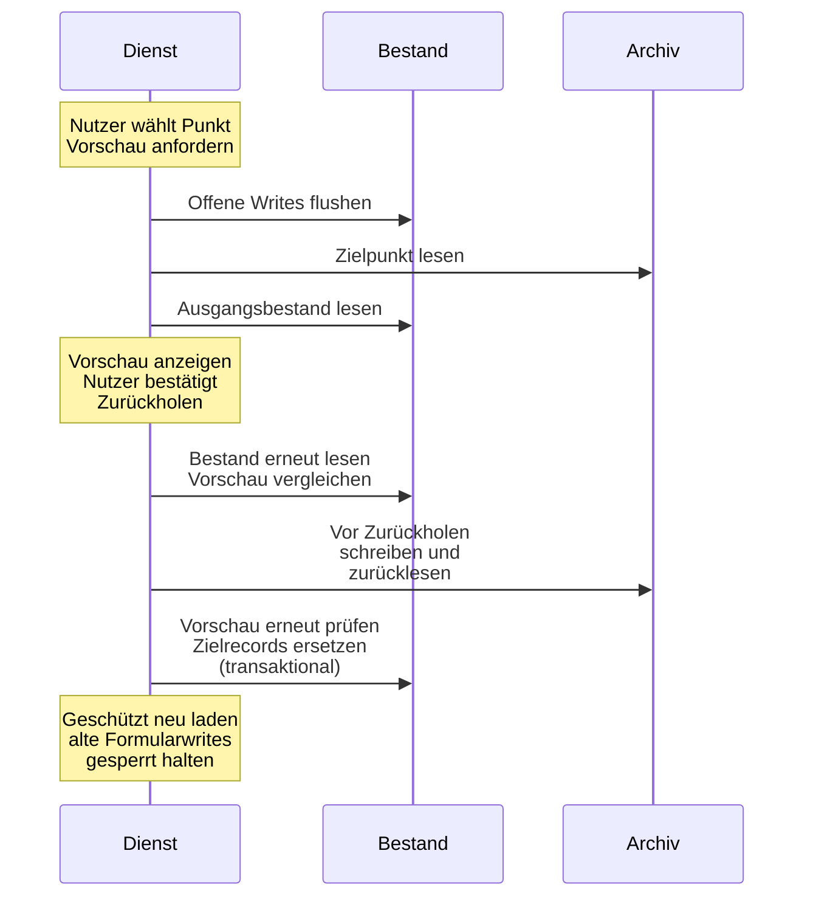
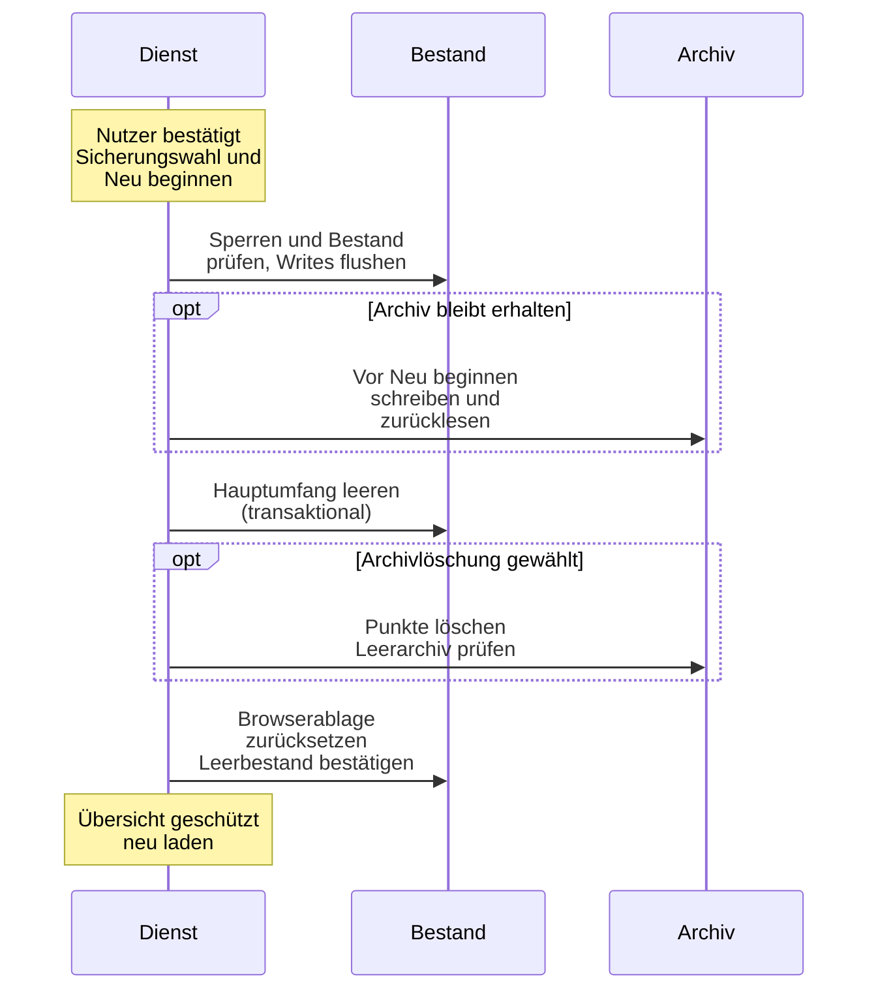

# Datenverträge

Die Persistenz speichert Schlüssel und Stringwerte. Ein String kann einen Einzelwert oder ein versioniertes JSON-Objekt enthalten. Domänenmodule prüfen dessen Inhalt; der Adapter allein bestätigt nur die Ablage. Ein vorbereiteter Cachewrite ist noch kein bestätigter Bestand.

Die [technische Architektur](TECHNICAL.md#speicher-und-schreibgrenzen) beschreibt Adapter und Writebesitz. Das [Fachkonzept](FACHKONZEPT.md) erklärt die Bedeutung der Beträge. Der [Engine-Aufrufvertrag](../../engine/README.md) ist von gespeicherten Records und Austauschdateien getrennt.

## Schlüssel und Speicherumfang

[persistence-key-policy.js](../../app/shared/persistence-key-policy.js) definiert den erlaubten Vollimport und die engeren Snapshotumfänge. [profile-key-policy.js](../../app/profile/profile-key-policy.js) bestimmt, welche Werte zum aktiven Profil gehören. Diese Policies sind verschieden; eine Zulassung zum Vollimport bedeutet keine Zulassung zur normalen Snapshotwiederherstellung.

| Schlüssel oder Gruppe | Inhalt und Umfang |
| --- | --- |
| `rs_profiles_v1` | Registry aller Personen mit Metadaten und Stringrecords je Profil |
| `rs_current_profile`, `rs_active_profile` | geöffnete Person und Besitzer der derzeit geladenen profilgebundenen Livewerte |
| `household_plan_v1` | gemeinsame Pläne nach kanonischem Bereich |
| `annual_plan_record_v1` | festgeschriebene Jahrespläne mit Empfehlung und Beschluss |
| `depot_tranchen`, `profile_*` | aktive Profilbestände und Personendaten nach der jeweiligen Policy |
| `ruhestandsmodellValues_v29_guardrails` | Balance-State einschließlich Vorstate und Jahresmetadaten |
| `balance_expenses_*` | Ausgabenrecords; globaler Importumfang, fachliche Personenzuordnung im Record |
| `overview_balance_summary_v1`, `overview_month_provision_v1`, `overview_simulation_summary_v1` | profilgebundene Anzeige- und Abschlussbelege |
| `overview_last_full_backup_v1`, `rs_data_backup_summary_v1` | Zeitpunkt und Kurzbeleg einer Vollsicherung |
| `rs_wealth_history_start_v1`, `rs_daily_prices_v1` | bestätigter Messbeginn und globale Tagesschlusskurse |
| `sim_*`, `sim.*` | Simulatorwerte und gesonderte Lauf-/Replayverträge |
| `rs_probelauf_state_v1` | Steuerrecord für Probelauf und Rückkehr, außerhalb normaler Sicherungsrecords |

Die Vollimportpolicy erlaubt außerdem definierte Proxy-, Feature- und Migrationsschlüssel sowie Legacy-Snapshotkeys. Sie erlaubt keine beliebigen Browserdaten. Normale Snapshots schließen technische UI-/Layout-/Debugrecords, Legacy-Snapshotkeys und `sim.stressReplay.active.v1` aus. Der Probelauf hat einen eigenen Rohumfang einschließlich technischer Apppräferenzen. „Neu beginnen“ erfasst den Hauptspeicher umfassender; Steuerrecord und Archivcontainer bleiben gesondert.

### Adapterhüllen

Im Browser liegt der reguläre Bestand in IndexedDB `ruhestand-suite`, Datenbankversion 2. `kv` hält Records, `metadata` die Adaptermetadaten, `snapshots` das Archiv. Der localStorage-Ersatz verwendet Stringrecords und `rs_snapshot_archive_v1` für das gesonderte Archiv.

Der [Tauri-Adapter](../../app/shared/persistence-adapter-tauri.js) schreibt `ruhestand_suite_data.json` mit `schemaVersion: 1`, `savedAt`, `records` und `metadata`. `ruhestand_suite_snapshots.json` enthält `schemaVersion: 1`, `savedAt` und `snapshots`. Eine Adapterhülle ist keine Vollimportdatei. Browser und Desktop synchronisieren diese Bestände nicht automatisch.

Die Tauri-Kennung bestimmt den App-Datenordner: `de.vermoegen-ruhestand.suite` für Produktivbauten, `de.vermoegen-ruhestand.entwicklung` für Entwickler und `de.vermoegen-ruhestand.entwicklung.kandidat` für Prüfkandidaten. Die alte `RuhestandSuite.exe` behält `com.dieter.ruhestandsapp`. Interne Dateinamen, IndexedDB-Name, `rs_*`-Schlüssel und Austauschformate bleiben bei der Umbenennung erhalten. Die Bereiche teilen keine Daten; eine Übernahme braucht eine Vollsicherung.

## Haushalt, Personen und Plan

### Registry und aktive Projektion

[profile-registry.js](../../app/profile/profile-registry.js) schreibt `{ version: 1, profiles: { ... } }`. Jeder Profileintrag enthält `meta` und `data`. Metadaten nennen Identität, Namen, Zeitstempel und `belongsToHousehold`. Das Profilfeld `data` hält Stringwerte. Ein explizites `belongsToHousehold: false` kennzeichnet ein Außenprofil.

Die aktive Person besitzt eine Liveprojektion profilgebundener Schlüssel. Vor einem Wechsel wird sie ins entsprechende Registryprofil zurückgesichert und bestätigt. Verbraucher dürfen deshalb nicht beliebig Registrykopie und aktive Livewerte mischen. [profile-context-reader.js](../../app/profile/profile-context-reader.js) und [profile-storage.js](../../app/profile/profile-storage.js) führen diese Grenze.

Lesestatus unterscheiden einen fehlenden/leer angelegten Bestand von `valid`, `corrupt` und `unavailable` nach dem jeweiligen Modul. Beschädigte Rohtexte bleiben erhalten und Writes gesperrt. Ein nicht erreichbarer Speicher ist kein explizit leeres Depot.

### Verbundprojektionen

[profilverbund-balance.js](../../app/profile/profilverbund-balance.js) und [simulator-profile-inputs.js](../../app/simulator/simulator-profile-inputs.js) lesen profilweise Records. Ihre aggregierten Rechenobjekte sind keine neue Registryperson und werden nicht als reale Depotlots zurückgeschrieben. Zuständigkeiten und Mergefolge stehen in der [Tranchenreferenz](TRANCHEN_MODULES_README.md#projektionen-für-balance-und-simulator).

Für den Simulator unterscheidet die Trancheneingabe `absent`, `empty`, `valid` und `corrupt`. Ein ausdrücklich gespeichertes leeres Array bleibt leer; ein fehlender Detailpayload kann im reinen Aggregathaushalt kompatibel sein. Sobald der Haushalt Detailrepräsentationen enthält, blockieren positive Depot-/Geldmarktaggregate ohne Detailherkunft mit `SIMULATOR_PROFILE_ASSET_PROVENANCE_MISSING`. Beschädigte Detaildaten liefern `SIMULATOR_PROFILE_TRANCHES_CORRUPT`. Tagesgeld benötigt keine Investmentlots und bleibt eine separat belegte Liquiditätsquelle.

Kombinierte Lots sind tiefe Kopien. Ihre `trancheId` erhält den Profilpräfix; `sourceProfileId` hält den Eigentümer fest. Diese Herkunft bleibt in Enginequellen, simulierten Verkäufen und reservierten Pflegebucketlots erhalten. Sie ersetzt keine reale profilbezogene Ausführungsbestätigung.

`profile_health_bucket` hält die profilbezogene Reservekonfiguration. Die Hauptprofilauswahl und der Reserve-Carve-Out gehören zum [Simulator-Merge](SIMULATOR_MODULES_README.md#haushaltsmerge). Die Goldprojektion liefert mit `goldStrategyDiagnostics` profilweise Herkunftswerte für Vermögensbasis, operative Liquidität, Pflegeabzug, Ziel und Floor. Das sind abgeleitete Rechenwerte. Die [Tranchenreferenz](TRANCHEN_MODULES_README.md#projektionen-für-balance-und-simulator) führt deren Erzeuger, das [Fachkonzept](FACHKONZEPT.md#standard-gold-und-drei-töpfe) die Reservegrenzen.

### Personenschlüssel

[profile-person-data.js](../../app/profile/profile-person-data.js) führt `PERSON_VALUE_KEYS`:

| Schlüssel | Inhalt |
| --- | --- |
| `profile_geburtsdatum` | bestätigtes Kalenderdatum oder fehlende Angabe |
| `profile_geschlecht` | `m`, `w` oder `d` |
| `profile_rentenbeginn` | Kalenderbeginn der Rente |
| `profile_rentenanpassung_art` | `wage`, `cpi` oder `fix` |
| `profile_rentenanpassung_pct` | jährlicher Prozentwert der festen Anpassung |
| `profile_kirchensteuer_pct` | Prozentwert für die Personeneingabe |
| `profile_sparer_pauschbetrag` | jährlicher Eurobetrag |
| `profile_rente_steuerquote_pct` | Prozentwert der pauschalen Rentensteuerannahme |
| `profile_person_schema_version` | String `1` für bestätigte zentrale Personendaten |
| `profile_person_migration_v1` | JSON-Herkunft und datierte Altannahmen |

Rentenstatus, Monatsrente, sonstige Einkünfte und Tagesgeld liegen weiterhin in `profile_rente_aktiv`, `profile_rente_monatlich`, `profile_sonstige_einkuenfte` und `profile_tagesgeld`. `profile_aktuelles_alter` bleibt ein unterstützter Altwert; bestätigte Datumsangaben haben Vorrang. Ein lesender Jahreswechsel schreibt ihn nicht hoch.

Kalenderdaten werden als `YYYY-MM-DD` auf echte Tage geprüft. Das Planungsalter ist `january-1-completed-years`. Die Jahresrente umfasst den Beginnmonat unabhängig vom Tag. Prozentwerte an der Personengrenze dürfen nicht mit bereits normalisierten Engineverhältnissen verwechselt werden.

### Kanonischer Planbereich

[household-plan.js](../../app/profile/household-plan.js) erzeugt `scope` mit `kind`, sortierten eindeutigen `ids` und `key = JSON.stringify([kind, ids])`. `kind` ist `household` oder `single`; `single` hat genau eine Person. Ein Bereichsschlüssel ist keine Anzeigezeichenfolge.

`household_plan_v1` enthält `version: 1` und `entries`. Jeder Eintrag steht unter `scope.key` und enthält genau `scope`, `updatedAt` und `values`. Planwerte werden vollständig validiert; unbekannte Felder und beschädigte Records erzeugen `invalid`. Ein fehlender Bereich liefert `missing` und keine still bestätigte Migration.

`values` hält Floor, Flex, `minimumFlexAnnual`, Flex-Budget, Reichweite, Mindestpuffer, Abschöpfungs-/Refillgrenzen, `decumulation`, Dynamic-Flex-/Horizont-/Langlebigkeitswerte, Haushaltsentnahmemodus und `cape`. `decumulation` enthält `mode`, `bondTargetFactor`, `drawdownTrigger`, `bondRefillThreshold`; `cape` enthält `value`, `asOf`, `source`. Die vollständige Feldliste und Bereiche stehen in `PLAN_FIELDS`, `PLAN_FIELD_PATHS` und `assertPlanValues`.

`minimumFlexAnnual` ist endlich, nicht negativ und höchstens `flexBedarf`. Der Writer validiert statt zu begrenzen. Ein Scopewechsel oder fremd veränderter Ausgangsrecord verhindert den Patch. Neue Bereiche entstehen im Umstellungskoordinator und werden nicht durch einen zufälligen Formularwrite angelegt.

### Simulatorabweichungen

`SIMULATOR_PLAN_FIELD_MAP` projiziert unter anderem `floorBedarf` nach `startFloorBedarf`, `flexBedarf` nach `startFlexBedarf` und `cape.value` nach `marketCapeRatio`. Das ist eine Grenzprojektion; der gemeinsame Plan hält keine zweite Simulatorwertkopie.

`household_simulator_needs_v1` und `household_simulator_needs_warning_ack_v1` bleiben kompatible Alt-/Umstellungsrecords. [simulator-household-needs-persistence.js](../../app/simulator/simulator-household-needs-persistence.js) liest den gültigen gemeinsamen Plan vorrangig. Aktuelle Planwrites gehören dem zentralen Planrecord.

Personenalternativen sind flüchtig. [simulator-person-overrides.js](../../app/simulator/simulator-person-overrides.js) friert `personDataContext` mit `schemaVersion: 1`, `referenceYear`, `ageRule`, `deviationApplied` und `persons` am Lauf ein. Die Rollen und geänderten Werte gehören zu diesem Laufbeleg. JSON-Dateien erhalten ihn als Objekt, CSV-Dateien die Felder `personDataReferenceYear`, `personDataDeviationApplied` und `personDataChanges`. Spätere Eingaben verändern diese Downloads nicht.

## Tranchen und ausgeführte Verkäufe

### Lotformat

`depot_tranchen` bleibt ein JSON-Array. [tranche-contract.js](../../types/tranche-contract.js) schreibt `schemaVersion: 2` je Lot, unterstützt fehlende Version/0 und Version 1 und weist andere Versionen zurück.

| Gruppe | Felder und Vertrag |
| --- | --- |
| Identität | `trancheId`, `name`, `isin`, `ticker` |
| Bestand | `shares`, `purchasePrice`, `currentPrice`; positive Stücke/Preise im aktuellen persistierten Lot |
| Zeit | `purchaseDate`, `asOf` nach dem jeweiligen Validator |
| Klassifikation | `category`, `type`; `equity` mit `aktien_alt`/`aktien_neu`, `bonds` mit `anleihe`, `money_market` mit `geldmarkt`, `gold` mit `gold` |
| Steuer | `tqf` als Teilfreistellungsverhältnis, `taxExempt` als ausdrückliches Flag |
| Weitere Werte | `notes`; abgeleitet `marketValue`, `costBasis`, `instrumentId` |
| Engineherkunft | `sourceProfileId` im Haushaltspool; kein persistiertes Lotfeld |

Die gesamte Collection und eindeutige IDs werden geprüft. Legacykorrekturen hängen von Version und Klassifikation ab. Unversionierte Engineaggregate lockern den persistierten Stück-/Preisvertrag nicht.

[tranchen-price-service.js](../../app/tranches/tranchen-price-service.js) bestätigt erfolgreiche Kursänderungen gemeinsam. Ein Quote benötigt Symbol, positiven Preis, EUR, UTC-Zeit und Quelle; Fehler erhalten den alten Kurs.

### Reconciliation und Cashnachweis

[tranche-reconciliation.js](../../app/tranches/tranche-reconciliation.js) verwendet Schema 1 im Registryfeld `trancheReconciliation`. `profileId`, `trancheId` und `actionId` binden die bestätigte Ausführung an den Livebestand.

Ereignisse heißen `sale_reconciled`, `cash_posting_confirmed`, `cash_posting_corrected`. Cashstatus sind `pending_manual_posting`, `confirmed_already_reflected`, `legacy_unknown`, `confirmed_manual_posting`, `confirmed_corrected`.

Stücke, Profilwerte und Ausführungsbeleg werden gemeinsam bestätigt. Identische Wiederholung ist ein No-op; widersprüchliche Identität, Profilwechsel oder fremde Mutation bricht ab. Ein Flushfehler führt zur Rücknahme oder sichtbaren Recovery-Sperre.

Der Erlös erhöht Tagesgeld nicht automatisch. Der absolute Stand und ein bereits berücksichtigter Erlös werden ausdrücklich belegt; Bestätigung und Korrektur ergänzen den Cashnachweis.

Erzeugte Spielverkäufe tragen `source: spielwert` und optional `actual.taxes`. Der Nettoerlös ist dann Brutto minus Gebühren minus Steuern. Ohne Steuerfeld gilt der bisherige Vertrag. Der normale Verkaufswriter erlaubt die Spielwertherkunft ausschließlich im Speicherbereich `spiel`; Cashbestätigungen übernehmen sie vom Verkauf. Spielkäufe tragen dieselbe Herkunft an der Tranche und deren Verlaufskopie.

Das Registryfeld `playActionExecutions` hält je bestätigter Spielanweisung eine Kennung, Datum und Personen mit Verkaufskennungen, Nettoerlös, Kaufsumme sowie Tagesgeld vor und nach der Gutschrift. Solange Verkäufe offen sind, bleiben die zugehörigen Tagesgeldstände unverändert. Die separate Gutschrift bestätigt die normalen Verkaufsbelege und setzt den Tagesgeld-Stand nach Abzug der Käufe. Reine Käufe ändern Tagesgeld sofort. Vorbereitung und Abbruch schreiben nichts; Rohvergleich, Jahresbesitz, Navigationsschutz und transaktionaler Replace mit Readback schützen den gemeinsamen Write. Eine zwischenzeitliche Tagesgeldänderung oder externe Teilbestätigung verweist zur manuellen Prüfung im Vermögensbereich.

## Abschlüsse und Ausgaben

### Jahresperiode und Planbeleg

[balance-annual-period.js](../../app/balance/balance-annual-period.js) führt `calendar-year:<Jahr>` und Metadaten `schemaVersion: 1`, `lastCommittedPeriod`, `pendingCommit`. `snapshot_confirmed`, `writes_started`, `validating` markieren einen begonnenen Commit. `incomplete_recovery` sperrt weitere Abschlüsse. Altperioden brauchen belegte Zuordnung oder ausdrückliche Altentscheidung.

`annual_plan_record_v1` enthält `version: 1`, `entries` und Schlüssel `JSON.stringify([Planjahr, scope.key])`. Ein Eintrag hält `year`, `scope`, `periodId`, `committedAt`, `recommended`, `adopted`, `adjusted`, `adjustedFields`. Beim regulären Abschluss J ist das Planjahr J+1 und die Periode `calendar-year:J`.

[annual-plan-record.js](../../app/profile/annual-plan-record.js) verlangt Ergebnisbeträge, Marktphase und vollständige Aktion. `adopted.snapshot` hält Inflation, Plan und Alter am 1. Januar je Person. Vorhandene Belege desselben Jahres/Bereichs werden nicht überschrieben.

Neue Jahresbelege behalten ungerundete Bedarfe, Inflation, CAPE und Monatsbudgets. Die Jahresfortschreibung erhält auch die Präzision des ETF-Schlusskurses. Rundung gehört an die Anzeige und an gebuchte Beträge; die fachliche Entnahmequantisierung bleibt bestehen. Gerundete ältere Belege sind weiter gültige Schema-1-Einträge und werden beim Lesen oder Ergänzen eines Folgejahres nicht normalisiert.

Jahr und anschließender Dezembermonat haben eigene Vorabpunkte und Speichergrenzen. Ein Monatsfehler hebt das bestätigte Jahr nicht auf; die Wiederholung schließt die fehlende Phase.

### Übersicht und Monatsbeleg

[overview-storage.js](../../app/overview/overview-storage.js) hält `overview_balance_summary_v1` mit `version: 1`, `entries` nach Jahr/Scope, Monatsentnahme, Monatsbudget und `createdAt`. Vorschauen dürfen diesen Anzeigeeintrag ersetzen; er ist kein Jahresbeschluss.

`overview_month_provision_v1` hält `version: 1`, `entries` unter `JSON.stringify([YYYY-MM, scope.key])` und Einträge mit `month`, `scope`, `completedAt`. Cashstände, aktive Liveprojektion und Registry werden zusammen bestätigt. Ein belegter Monat wird nicht als neue Ausführung wiederholt.

`overview_last_full_backup_v1` ist ein Zeitstempelstring; `rs_data_backup_summary_v1` der Kurzbeleg aus [data-backup-summary.js](../../app/data/data-backup-summary.js). Beide gehören zum Sicherungsexport. Ein Snapshot ersetzt den Vollsicherungszeitpunkt nicht.

### Ausgaben

[balance-expenses-storage.js](../../app/balance/balance-expenses-storage.js) hält `balance_expenses_v1` mit `version: 1`, `activeYear`, `years` und Monats-/Personenzuordnung. Der Loader unterscheidet `ok`, `empty`, `corrupt` und erhält beschädigten Rohtext.

[balance-expenses-import.js](../../app/balance/balance-expenses-import.js) prüft CSV, Periode und Person vor dem Write. [balance-expenses-metrics.js](../../app/balance/balance-expenses-metrics.js) saldiert vorzeichenbehaftete EUR-Kategorien vor der Betragsanzeige. Erstattungen mindern den Nettoabfluss; Bruttoausgaben werden nicht getrennt behauptet.

## Verlauf und Datenqualität

### Tagesschlusskurse und Beginn

[tranchen-history-store.js](../../app/tranches/tranchen-history-store.js) validiert `rs_wealth_history_start_v1` als `{ version: 1, startDate }`. Erst ein bestätigter Beginn legt die Messgrenze fest. Ein vorläufig gezeigter Beginn ist kein gespeicherter Nachweis.

`rs_daily_prices_v1` enthält `version: 1` und `symbols`. Pro normalisiertem Symbol stehen `currency`, aufsteigende eindeutige UTC-Tagesnummern `days`, gleich lange positive `closes`, kanonisch zusammengeführte Abfrageintervalle `queried`, `failures` und `lastError`. Ein erfolgreich abgefragtes Intervall kann Tage ohne Kurs enthalten. Abfrageabdeckung ist deshalb keine tägliche Preisabdeckung.

### Profilhistorien

[profile-wealth-history.js](../../app/profile/profile-wealth-history.js) führt `profile_cash_history_v1` mit `version: 1`, `baselineValue` und datierten absoluten Cashständen in `entries`. `appendCashHistory` ersetzt den geschriebenen Tag durch dessen letzten Stand. Entspricht er dem Stand vor diesem Tag, entfällt der Tageseintrag. Personenänderungen, Monats-/Jahresabschlüsse und Verkaufsbuchungen nutzen denselben Schreibweg. Der aktuelle Betrag muss vor dem Ersetzen zum letzten gespeicherten Stand passen, auch bei unverändertem Betrag. Das Datum bleibt das fachliche Datum der App-Uhr, im Probelauf das Testdatum.

Bei unverändertem Betrag bleibt ein Tag mit höchstens einem Eintrag unberührt, auch vor dem letzten Verlaufsdatum. Alte Mehrfacheinträge bleiben lesbar. Erst ein Schreiben auf ihren Tag fasst sie zusammen; andere Tage bleiben erhalten. Ohne Wertänderung zählt dabei der letzte gespeicherte Wert dieses Tages. Entspricht er dem Stand vor dem Tag, entfällt der Eintrag. Schlüssel und Speicherformat der Historie ändern sich nicht, eine Migration gibt es nicht. Abschlussbelege und Verkaufsnachweise wie `cashBalanceAfterPostingEur` behalten ihre bestätigten Beträge. Neue Auditereignisse hängen weiter an, auch wenn der Tagesgeld-Verlauf denselben Tag ersetzt oder entfernt.

Monats- und Jahresabschluss speichern zusätzlich `profile_tagesgeld_confirmed_date` je Person als optionalen String `YYYY-MM-DD`. Er nennt den Tag der ausdrücklichen Bestätigung aus der App-Uhr, auch wenn der fachliche Stichtag im Jahresdialog der 31.12. ist. Betrag und Verlauf bleiben bei einer reinen Bestätigung unverändert. Die Übersicht prüft das spätere Datum aus Bestätigung und letztem Verlaufspunkt; nach mehr als 35 lokalen Kalendertagen erscheint die Prüfaufforderung wieder. Der Hinweis nennt dann beide vorhandenen Daten. Ohne das neue Feld bleibt das bisherige Verhalten erhalten. Profilwechsel, Vollsicherung und Snapshotwiederherstellung übernehmen den String; der Vollimport prüft sein Kalenderdatum.

`profile_wealth_history_lots_v1` hält `version: 1` und `lots`. Eine Lotkopie enthält `capturedAt`, kanonische `tranche`, `remainingShares` und `status` (`present`, `sold`, `unknown`). Optional halten `uncertainty` mit `fromDate`/`originalTranche` und `manualCorrectionAt` die Grenze einer Bestandsänderung fest. Ein vollständig verkauftes Lot bleibt mit null Reststücken im Verlauf nachvollziehbar.

[tranchen-history-model.js](../../app/tranches/tranchen-history-model.js) bewertet diese Quellen lesend. Fehlendes Kaufdatum, unbekannte Bestandshistorie, fehlende Preise oder Währungslücken bleiben Datenqualitätsgründe. Ein bekannter Teilbetrag darf gezeigt werden, ohne ihn als vollständig bewertet auszugeben. Lesen, Personenauswahl und Chartdarstellung schließen keine fehlenden Tage durch neue Bestandswrites.

### Balance-Messpunkte

[wealth-history-contract.js](../../types/wealth-history-contract.js) führt die bisherige `wealthHistory` im Balance-State mit `schemaVersion: 1` und `entries`. Manuelle Punkte verwenden `manual:<Datum>`, Jahrespunkte eine Periodenidentität; Komponenten und Summe werden validiert. Die Messpunkte beginnen frühestens am 1. Januar 2026. Neue Erfassungen behalten hier eine Haushaltskopie im alten Format, damit ältere Leser die bisherigen Felder weiter verwenden können.

[wealth-capture-contract.js](../../types/wealth-capture-contract.js) ergänzt den globalen Record `rs_household_wealth_captures_v1` mit `schemaVersion: 1` und `captures`. Jede Erfassung enthält `capturedAt`, `household` und `people` mit Einträgen je Profil-ID. Haushalt und Personen haben dieselbe Standidentität und denselben Stichtag. Zusätzlich zu den bisherigen Beträgen stehen `goldWert` und `anleihen` separat; das Neu-Depot enthält hier nur Aktien. `total` summiert Tagesgeld, Geldmarkt, Aktien, Gold und Anleihen. Der Vertrag prüft jede Komponente und die Summe aller Personen zum Haushalt. Ein manueller Tag wird gemeinsam ersetzt; ein bestätigter Jahresstand bleibt erhalten. Erfassungs- und Abschlussdienste schreiben diesen Record atomar mit ihren übrigen Records. Vollsicherung, Wiederherstellung und Spielbereich behandeln ihn als globale Fachdaten. Fehlende Records in älteren Sicherungen sind gültig und erzeugen keine rückwirkenden Personenstände.

Dieser Verlauf enthält bestätigte Messpunkte. Der aus Tagesschlusskursen bewertete Depotverlauf verwendet einen anderen Datenpfad. Die beiden Formen dürfen nicht still zusammengefügt oder als tägliche vollständige Buchführung bezeichnet werden.

## Sicherung, Austausch und Wiederherstellung

Die Vollsicherung prüft die zugelassenen Records, flusht offene Writes und stößt die JSON-Dateiausgabe an. Erst danach bestätigt sie Sicherungszeit und Vergleichsbasis im Speicher. Ein Downloadaufruf beweist nicht, dass der Nutzer die Datei aufbewahrt hat. Wiederherstellungspunkte liegen im separaten lokalen Archiv; die Datenseite liest Index und vollständige Punkte für ihre Anzeige.

Zurückholen beginnt mit einer Vorschau. Vor dem Write müssen Punkt und Ausgangsbestand noch zur Vorschau passen. Der Dienst bestätigt „vor Zurückholen“ durch Schreiben und Rücklesen, prüft die Vorschau erneut und ersetzt dann den erlaubten Umfang transaktional. Der geschützte Reload hält alte Formularwrites gesperrt. Bei „Neu beginnen“ verlangt der Dienst eine bestätigte Sicherungswahl. Wenn das Archiv erhalten bleibt, bestätigt er vorher „Vor Neu beginnen“. Bei gewählter Archivlöschung entfällt dieser Punkt; nach dem Leeren des Hauptspeichers werden auch die Archivpunkte gelöscht. Beide Wege prüfen den Leerbestand und laden die Übersicht neu.

Die drei Sequenzen trennen Sicherung und Punktanzeige, Zurückholen sowie Neu beginnen. „Bestand“ bezeichnet den Hauptspeicher, „Archiv“ die Wiederherstellungspunkte. Nutzeraufträge und Rückmeldungen stehen als Notizen beim Dienst; die Speichergrenzen bleiben getrennt.

Beim Zurückholen sieht der Nutzer zuerst den Umfang als Vorschau und bestätigt danach den Write.

Neu beginnen verlangt eine bestätigte Sicherungswahl und behandelt die Archivoption vor und nach dem Leeren des Hauptspeichers.

Quellen: [persistence-backup.js](../../app/shared/persistence-backup.js), Funktion `downloadFullPersistenceBackup`; [data-model.js](../../app/data/data-model.js), Funktion `readDataModel`; [data-restoration.js](../../app/data/data-restoration.js) für Vorschau und Bestätigung; [snapshot-restore.js](../../app/shared/snapshot-restore.js) für Vorabpunkt, Replace und Reload; [snapshot-archive.js](../../app/shared/snapshot-archive.js) für Archivzugriffe; [data-new-beginning.js](../../app/data/data-new-beginning.js) für Sicherungswahl, Archivoption und Leerprüfung; [persistence-facade.js](../../app/shared/persistence-facade.js) für die bestätigten Speicheroperationen.

### Vollsicherung

[persistence-backup.js](../../app/shared/persistence-backup.js) schreibt das importierbare Format:

| Feld | Wert oder Bedeutung |
| --- | --- |
| `backupType`, `app` | `ruhestand-suite-full-persistence-backup`, `ruhestand-suite` |
| `schemaVersion` | Export 2, Import zusätzlich 1 |
| `exportedAt`, `runtime` | Exportzeit und Laufzeit |
| `recordScope` | `authorized-application-records` |
| `records`, `localStorage` | Stringrecords und inhaltsgleicher Kompatibilitätsalias |
| `recordCount` | Recordanzahl, beim Import vor Versionsmigration geprüft |
| `excludedRecordCount`, `excludedKeys` | ausgelassene Exportkeys |

Schema 2 weist unerlaubte Keys zurück; Schema 1 filtert den unterstützten Altumfang und normalisiert auf 2. Nicht-Stringwerte, Prototype-Keys, falsche Anzahl, abweichender Alias oder beschädigte Domänenrecords verhindern Import. Das separate Snapshotarchiv und beliebige Browserpräferenzen gehören nicht zur Vollsicherung.

Vor Vollimport: offene Writes flushen, Ausgangsbestand prüfen, Recoverypunkt dauerhaft bestätigen und zurücklesen. Danach ersetzt der Writer den zugelassenen Umfang und validiert erneut. Fehlende Zielrecords können bisherige zugelassene Records entfernen. `rollback_failed` meldet eine unbestätigte Rücknahme samt Recoveryhinweis. Jeder Probelauf-Steuerrecord sperrt Vollsicherung und Import.

### Personen- und Profilbundle

[profile-bundle-io.js](../../app/profile/profile-bundle-io.js) führt `bundleType: ruhestand-suite-profile-bundle`, `app: ruhestand-suite`, `schemaVersion: 1`, Profilversion, Exportzeit, Anzahl, `registry`, `currentProfileId`, erlaubte `globals` und eine unterstützte Altform.

[profile-person-file.js](../../app/profile/profile-person-file.js) begrenzt Ein-Person-Dateien auf genau ein Profil ohne Globals. Eigene Person, Depot, Cash und Verlauf werden exportiert; Haushalts-/Balance-/Simulator-/Monatsbelege entfallen. Import erzeugt konfliktfreie ID/Namen und zunächst ein Außenprofil. Aktive Person und Plan werden nicht ersetzt. Vorschau und Commit vergleichen den bestätigten Bestand; im Probelauf ist Austausch gesperrt.

Vor der Importfilterung übernimmt die bestehende Personenmigration eigene ältere `sim_*`-Angaben und Balance-Personenwerte. Relative Rentenbeginne beziehen sich auf das Exportjahr oder, falls weiter fortgeschritten, auf das Planungsjahr der gespeicherten Jahresmetadaten. Der Beginn bleibt als datierte Herkunft erhalten, ohne ein bestätigtes Kalenderdatum zu erfinden.

Widersprüchliche Quellen, nicht zuordenbare Partnerwerte und aktive oder ungültige Partnerschalter verhindern die Vorschau mit einer verständlichen Meldung. Das gilt auch für Dateien, die bestehende Migrationsherkunft mit erneut umzustellenden Angaben mischen. Abgeschaltete oder leere Partnerschalter entfallen. Bereits umgestellte Personendaten ohne neue Altangaben durchlaufen keine erneute Migration; ihre Datenstrings bleiben beim Import und anschließenden Export bytegleich.

### Snapshotvertrag und Restoreumfang

[snapshot-archive.js](../../app/shared/snapshot-archive.js) hält `schemaVersion: 1`, `snapshotType: persistence-records-v1`, `id`, `kind`, `createdAt`, `label`, aktive Profilangaben, `recordCount`, `records`, `restoreScope`. Der Index ohne Records beweist keinen Restore.

Anlässe sind `annual-close-pre-mutation`, `monthly-close-pre-mutation`, `balance-import-recovery`, `full-backup-import-recovery`, `person-data-migration-recovery`, `household-plan-migration-recovery`, `probelauf-before`, `probelauf-transfer-before`, `new-beginning-before`, `before-restore-recovery`, `manual`.

[snapshot-restore.js](../../app/shared/snapshot-restore.js) bildet denselben Plan für Vorschau und Write. Standardrestore bewahrt die Registry und verlangt ein noch vorhandenes Zielprofil. Ein expliziter Recoveryumfang kann Registry/Livekeys umfassender ersetzen. Fremde Außenprofile bleiben beim Standardrestore erhalten.

Vor Restore entsteht ein bestätigter Vorabpunkt. Bestand und Punkt werden gegen die Vorschau verglichen; danach folgen Replace und geschützter Reload. Ein fehlgeschlagener Reload lässt alte Formularwrites gesperrt. `probelauf-before` gehört ausschließlich der Ablösung alter Probeläufe. „Vor Übernahme aus dem Spielbereich“ verwendet `probelauf-transfer-before` mit `liveKeyMode: play-transfer` und vollständigem Registry-/Live-Rollback. Der Punkt enthält den Hauptspeicher einschließlich Altschlüsseln; Spielsteuerrecord und Archivcontainer bleiben getrennt. Er lässt sich unter Daten & Sicherung auch ohne aktives Profil zurückholen und bleibt bei der Archivpflege dauerhaft erhalten. Dabei wird der bytegleiche Vorher-Stand durch denselben Restoreweg bestätigt, ohne Gerätepräferenzen oder Sitzungen zu bereinigen.

[snapshot-retention.js](../../app/shared/snapshot-retention.js) erhält Dauer-, Recovery-, unbekannte/defekte und benötigte Punkte. Vergleichbare manuelle/Monatspunkte bleiben einschließlich 30 Tagen; für ältere Monate bleibt ein repräsentativer Stand je Umfang. Vorschau und bestätigter Aufräumwrite bestimmen die Löschung.

## Probelauf, Neustart und Laufbelege

### Spielbereichszustand

[probelauf-state.js](../../app/shared/probelauf-state.js) führt neue Sitzungen mit `version: 2`, `active: true`, `phase` (`starting`, `active`), `source` (`copy`, `demo`), `runtime`, `testDate` und `hasDateJump`. Die Records liegen ausschließlich im getrennten Spielbereich. `startedAt`, `realDomainChecksum`, `initialDomain` und `initialMonteCarloRuns` belegen den Startvergleich. Die Bereichssteuerung liegt außerhalb der Fachrecords. Fremde Zustände sperren Writes. Version 1 mit `snapshotId`, `archiveIds` und `sessions` dient nur noch der einmaligen Ablösung alter Probeläufe.

`app-clock.js` liefert das Testdatum. Ein Datumssprung aktiviert dauerhaft synthetische Kurse, ohne Abschlüsse zu bestätigen. Verwerfen entfernt ausschließlich die Spielkopie. Übernehmen verlangt eine Kopie ohne Sprung und unveränderten echten Fachbestand. Nach Bestätigung des echten Rückkehrpunkts ersetzt der gemeinsame Transaktionskern die fachlichen Records und liest sie zurück. Technische Schlüssel und Sitzungen bleiben echt. Erst danach wird der Bereich gewechselt; Fehler erhalten Spielkopie und echten Vorher-Stand.

### Neu beginnen

[data-new-beginning.js](../../app/data/data-new-beginning.js) verlangt die bestätigte Sicherungswahl. Ohne Archivlöschung entsteht „Vor Neu beginnen“ mit `liveKeyMode: new-beginning`; mit Archivlöschung entfällt dieser interne Rückweg. Der Hauptumfang wird geleert, optional das Archiv, dann zurückgelesen und geschützt neu geladen. Probelauf, Recovery und ungeklärter Speicher sperren den Vorgang.

### Simulationskurzfassung

[overview-simulation-summary.js](../../app/overview/overview-simulation-summary.js) hält `overview_simulation_summary_v1` mit `version: 1`, `entries` unter `JSON.stringify([scope.key, kind])`. `kind` ist `backtest`, `montecarlo`, `workshop`. Ein Eintrag enthält `scope`, `completedAt`, `statement`, `priceBasis`, `fingerprintVersion`, `sourceFingerprint`, `runFingerprint`, `deviationApplied`, kleine `metrics`.

Der aktuelle Quellfingerprint hat Version 2 und SHA-256. Er bindet Fachannahmen; Namen, Anzeigepräferenzen und Workerwahl sind ausgeschlossen. Die Kurzfassung ist kein Rohlauf oder restartfähiger State. FR-6 ergänzt optional Startminimum, Jahresanteil, Backtestzähler/-nenner, Anteil betroffener MC-Läufe und nominale Flexbeträge. Fehlend beziehungsweise `null` wird nicht durch heutige Formulareingaben ersetzt.

### Ergebnisdateien

| Format | Hauptquelle | Umfang |
| --- | --- | --- |
| `HistoricalBacktestExportV2`, `HistoricalBacktestCsvV2` | [historical-backtest-export.js](../../app/simulator/historical-backtest-export.js) | Request, Resultat, inklusive Periode, Provenienz, Einheiten, Quantisierung, Fingerprints; Portfoliogrenzen nicht restartfähig |
| `MonteCarloExportV2` | [monte-carlo-export.js](../../app/simulator/monte-carlo-export.js), [monte-carlo-contracts.js](../../app/simulator/monte-carlo-contracts.js) | eingefrorene Daten-/Seed-/Request-/Resultverträge, Outcomes und Missingness |
| `ScenarioLogExportV2` | `monte-carlo-export.js` | ausgewählter Pfad samt Laufannahmen, Personenbeleg und Geldbasis |
| Replayexport | [stress-replay-export.js](../../app/simulator/stress-replay-export.js) | materialisierter Markt-/Ereignispfad und Varianten |

Ergebnisdateien ersetzen keine Vollsicherung und ändern beim Download keine Realbestände. Fehlende saubere Commitprovenienz verhindert die Behauptung eines commitgebundenen Rohlaufs. Trace- und Jahresfelder führt die [Simulatorreferenz](SIMULATOR_MODULES_README.md).
