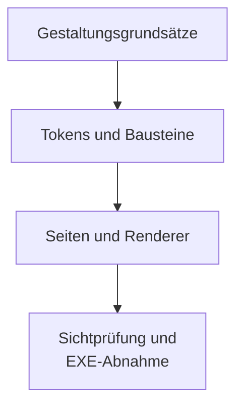

# Designsystem „Stein & Messing“

Verbindliche Bausteine für Entwickler und Agenten. Stand: 27.10.2026. Die [Gestaltungsgrundsätze](GESTALTUNGSGRUNDSAETZE.md) bestimmen das Ziel; hier stehen Tokens, Darstellungsverträge und begrenzte Ausnahmen.

## Grundlagen

### Tokens

Gestaltung ändert keine Fachregel, Kennzahl oder Persistenz. [Jahresbeschluss und Vorschau](HANDLUNGSANWEISUNG.md#beschluss) sowie [Einschränkung nach Mindest-Flex](SIMULATION_LESEN.md#mindest-flex) behalten ihre Bedeutung. PC-Ziele: 1920×1080 und 2560×1440, Mindestbreite 1280 px. Keine neuen schmalen Ansichten oder Druckarbeiten.

Tokens, Markup und Renderer gemeinsam pflegen. Keine Prototyp-Overlays übernehmen. Reihenfolge: `css/tokens.css`, `css/fonts.css`, `css/components.css`, Seitenregeln, `css/suite-frame.css`. Kanonische Werte stehen nur in [tokens.css](../../css/tokens.css); alte Namen sind azyklische Rollenaliase. Keine neuen `!important`-Regeln. Schriften und Symbole werden lokal ausgeliefert, bestehende Tauri-CSP-Quellen bleiben erhalten.

| Token | Wert |
|---|---|
| `--page` | `#f1f2ee` |
| `--surface` | `#ffffff` |
| `--surface-sunken` | `#f4f5f1` |
| `--text-main` | `#1d2830` |
| `--text-muted` | `#56626a` |
| `--accent` | `#7a5a1f` |
| `--accent-soft` | `#f2e9d4` |
| `--accent-line` | `#b8954f` |
| `--good` | `#2b6e50` |
| `--good-soft` | `#dcefe5` |
| `--warn` | `#8a5a12` |
| `--warn-soft` | `#f6e7cc` |
| `--bad` | `#9c3b33` |
| `--bad-soft` | `#f5dcd8` |
| `--border` | `#d8dbd3` |
| `--border-strong` | `#c3c8bf` |
| `--backdrop` | `color-mix(in srgb, var(--text-main) 45%, transparent)` |

`--backdrop` dient dem textfreien Navigationshintergrund.
Der Token gehört nicht zu den opaken Textkontrastrollen; Dialogfläche und Texte bleiben opak.

Text und Texteltern bleiben opak. Linien-/Serienfarben sind keine Textrollen. Alle Kombinationen der folgenden auswertbaren Rollenliste erreichen ungerundet mindestens 4,5:1.

| Vordergrund | Zulässiger Hintergrund | Zweck |
|---|---|---|
| `--text-main`, `--text-muted` | `--page`, `--surface`, `--surface-sunken`, `--accent-soft`, `--good-soft`, `--warn-soft`, `--bad-soft` | Standardtext und Hilfetext |
| `--accent` | `--page`, `--surface`, `--surface-sunken`, `--accent-soft` | Links und Akzentbeschriftung |
| `--good` | `--page`, `--surface`, `--surface-sunken`, `--good-soft` | vorhandene positive Bewertung |
| `--warn` | `--page`, `--surface`, `--surface-sunken`, `--warn-soft` | vorhandene Warnung |
| `--bad` | `--page`, `--surface`, `--surface-sunken`, `--bad-soft` | vorhandener Fehler oder Verlust |
| `--surface` | `--text-main`, `--accent`, `--good`, `--warn`, `--bad` | heller Text auf dunkler Aktion |

Links bleiben auch besucht messingfarben. Navigation und Linkknöpfe behalten ihre eigenen Rollen. Statusfarben setzen eine fachlich vorhandene Einstufung voraus; fehlende Werte, leere Datenmonate und unbewertete Zahlen bleiben neutral.

### Typografie

Lokale WOFF2-Schnitte: Newsreader 400/500 und kursiv 400, IBM Plex Sans 400/500/600, IBM Plex Mono 400/500; `font-display: swap`. Serif für Überschriften und hervorgehobene Hauptwerte, Sans für Text, Tabellen und Kontrollen, Mono für kleine technische Etiketten. Kein synthetisches Serifgewicht 700. Zahlenkolonnen verwenden tabellarische Ziffern.

| Familie | Rollen |
|---|---|
| Abstand | `--space-1/2/3/4/6/8`: .25/.5/.75/1/1.5/2 rem |
| Radius | `--radius-sm/md/lg`: .375/.75/1 rem |
| Text | `--text-sm/base/lg/title`: .875/1/1.25/2 rem; Zeilenhöhe 1.5, Überschriften 1.2 |
| Fokus | `--ring-width/offset`: 2 px, `--ring-color`: Akzent |
| Planung | `--plan-*`: Kartenradius 18 px, Innenabstand 28/30 px, Raster 24 px, Feldhöhe 44 px |
| Zahlen | `--value-lg/md/xl`: 30/17/44 px |
| Balance | h1/h2/h3 30/22/18 px, Text/Hilfe 16/14 px, Budget 52/60 px, Handlung 28/30 px, große Zwischenwerte 26/22 px |

Die Breitskala beginnt bei 2300 px nutzbarer Inhaltsbreite, nach Leiste und Innenabstand. Keine Skalierung allein nach Fensterbreite. Diagrammtexte verwenden die 14-px-Hilferolle und wachsen nicht mit dem SVG. Heatmapzellen verwenden die 16-px-Lesetextrolle; das Raster wird bei Breitenänderung neu gezeichnet.

### Formate

Deutsch anzeigen, Eingaben getrennt parsen. Dezimalkomma, Tausenderpunkte und geschütztes Leerzeichen vor Einheiten; Ratio-/Prozentwert-Skalierung nicht verwechseln. Null, fehlend mit Grund, nicht anwendbar und fachlich erlaubtes Unendlich bleiben getrennt. Rohwerte erst nach Summen und Differenzen formatieren.

Reguläre sichtbare Balance-Geldbeträge, Handlungsdialog und dessen bestehender Druck zeigen ganze Euro. Berechnete Beträge in Balance-Überblick, Jahresabschluss und Übersicht laufen vorher durch `app/shared/display-rounding.js`: aufrunden, was gebraucht wird, abrunden, was verfügbar ist ([Gerundete Anzeige](HANDLUNGSANWEISUNG.md#gerundete-anzeige)). Diagnosekopie, andere Kopierwege, technische Details, Exporte und Eingaben behalten ihre genaue Präzision. Die getrennte Handlungstextprojektion bleibt centgenau. Formattertexte niemals zurückparsen; SVG-Geometrie nicht lokalisieren.

## Bausteine

### Karten

[components.css](../../css/components.css) liefert additive `ds-`-Klassen. IDs, Listener und Datenanker bleiben Funktionsbesitzern zugeordnet.

| Aufgabe | Bausteine |
|---|---|
| Aktionen | `ds-button` mit primary/secondary/quiet/danger; benannter `ds-icon-button` |
| Eingabe | `ds-input`, `ds-select`, `ds-checkbox`, `ds-field`, `ds-unit-frame`, `ds-field-grid` |
| Gliederung | `ds-card`, `ds-plan-card`, `ds-row`, `ds-kpi-strip`, `ds-metric` |
| Abläufe | `ds-steps`, `ds-decision-tree`, `ds-decision-step`, `ds-process-strip` |
| Daten | `ds-table`, `ds-table-scroll`, `ds-table-box`, `ds-chart-surface` |
| Hilfe | `ds-note`, `ds-hint`, `ds-banner`, `ds-badge`, native Details/Summary |

Hauptaktionen dunkel mit heller Schrift. Symbolknöpfe haben einen Namen und sichtbaren Tastaturfokus. Gesperrte Kontrollen bleiben lesbar. Vollständige Erklärungen müssen erreichbar sein, nicht ausschließlich als `title` oder abgeschnittener Text. `ds-info` mit Knopf und Popup unterstützt Hover, Fokus, Klick, Escape mit Rückfokus und Außenklick; Pflichtwarnungen bleiben offen sichtbar. Alle Infofenster bleiben mit acht Pixeln Rand im sichtbaren Fenster; bei Scrollen und Größenänderungen folgt die Position dem Knopf. Text bricht linksbündig in normaler Schriftstärke um; Vermögensaufteilungen verwenden eine Liste mit eigenen rechtsbündigen Betrag- und Anteilspalten. Ein ⓘ enthält höchstens drei Sätze (etwa 50 Wörter); längere Erklärungen folgen über „Mehr im Handbuch“.

### Felder

`setFieldState` aus [field-state.js](../../app/shared/field-state.js) zeigt getroffene Entscheidungen: `adopted`, `inactive`, `empty`, `unrated`, `warning`, `error` benötigen einen Grund; `editable` optional. Eigene Beschreibungs-IDs ergänzen fremde Bezüge. Werte, native Sperren, Attribute und Speicherung bleiben unverändert. Busy und Recovery sind keine fachliche Nichtanwendbarkeit.

Gemeinsame Planfelder verwenden `household-plan-more`, Gruppen und Wertzeilen: links Beschriftung/Hilfe, rechts 38-px-Wertkasten, rechtsbündiger Wert mit Einheit. Übernommene Kästen gestrichelt ohne weiße Füllung. Alle Segmentoptionen bleiben sichtbar; die gewählte ist hervorgehoben. Fünf Dynamikoptionen stehen bei Zielbreiten vollständig in einer Zeile, unter 1600 px dürfen sie umbrechen. Voreinstellung verbirgt Details, Benutzerdefiniert öffnet sie. Klappen sind flüchtig und schreiben keine Finanzwerte.

### Tabellen

Neue Spalten erhalten `minmax(0, …)`/`min-width: 0`. Breite Tabellen und Grafiken scrollen lokal in benannten, fokussierbaren Regionen; kein globales Abschneiden. Hinweise erscheinen nur bei tatsächlichem Überlauf. Native Auswahlen bleiben erhalten; die Auswahlhilfe zeigt Volltext nur bei gemessener Kürzung, ohne Wert-, Ereignis- oder Speicheränderung.

### Dialoge

Abschlüsse verwenden ein mittiges Fenster mit `min(1200px, 94vw)` Breite, `min(900px, 92vh)` Höhe und `radius-lg`. Kopf, gleich breite Reiter und Fuß bleiben fest; nur der aktuelle Inhalt scrollt. Der aktuelle Reiter trägt `aria-current="step"` mit `accent` auf `accent-soft`; Warnstände behalten `warn`. Namen umbrechen. Weiter und Hauptaktion stehen rechts im Fuß, Sicherung und Status links. Ergebnisse zeigen zwei Spalten ohne Reiter, das Spielbereichsende bleibt einspaltig.

Die [Navigationswache](../../app/shared/navigation-guard.js) trennt abbrechbare Vorbereitung, geschützte Writes und Recovery. Während Schreiben, Validieren, Finalisieren und Wiederherstellen sind Appnavigation und Fachdialogschließen gesperrt. Fehler nach Schreibbeginn gelten nicht als folgenloser Abbruch. Browsernavigation hat den begrenzten `beforeunload`-Schutz; Tauri nutzt sein Schließprotokoll.

Der native Nachfragedialog bündelt Verlustgründe, Erstfokus „Bleiben“, Escape bedeutet Bleiben. Verwerfen und Seitenwechsel haben passende Texte. Neue Schutzrevisionen entwerten eine Zustimmung. Im Jahresabschluss erhöhen unveränderte Dirty-Meldungen der Planvorschau die Schutzrevision nicht. Die Verwerfprüfung läuft dort vor dem Schließen der Rückfrage; bei einem Fehler bleibt sie mit dem Grund offen. Fehler und Wiederholung bleiben ortsfest erreichbar. Manager-Retry verwendet bestehende Daten/IDs ohne neuen Submit; Erfolg erst nach Adapterbestätigung. Ergebnis und aktuelle Annahmen bleiben getrennt. Ergebniserhalt über Seitenwechsel ist kein zugesicherter Sitzungscache.

### Diagramme

Vermögenshauptzahlen und Verteilungen enthalten Immobilien. Entwicklung und Rendite, Ruin, Deckung sowie Strategiequoten benennen Geldvermögen. Gestapelte Vermögensgrafiken trennen Geldbestand und Immobilien, Legenden nennen nur gezeichnete Reihen. Datenlücken bleiben sichtbar.

Portfoliofarben stammen aus `--chart-*` und `--history-*`: Aktien dunkel, Gold Messing, Anleihen/Puffer gedämpft, selbst genutzte Immobilien `--history-homeSelf`, vermietete `--history-homeRented`. Beide Immobilientokens sind helle Tönungen ihrer Farbfamilie; Flächen ohne Randlinie, Legenden und Tabellenmarken verwenden denselben Token. Die Linien des Geldvermögens bleiben führend. Heatmaps interpolieren Hell → Messing → Schiefer aus `--heatmap-low/mid/high`; fehlende Zellen bleiben neutral mit Grund. Beschriftungen liegen auf opaken hellen Platten, auch über kritischer Überlagerung. Serienfarben bedeuten keine zusätzliche Bewertung. Für Grafiktexte gelten ergänzend diese Kontrastpaare:

| Vordergrund | Zulässiger Hintergrund | Zweck |
|---|---|---|
| `--text-main` | `--surface` | Opake Grafiklabels, Achsen und Legenden |
| `--text-muted`, `--warn`, `--bad` | `--surface` | Grafikfußnoten und vorhandene Warnungen |
| `--text-main` | `--accent-line`, `--surface-sunken` | Fortschrittszahl über Balken und Restfläche |
| `--surface` | `--good`, `--warn`, `--bad` | Vorhandene Stabilitätsstufen |
| `--good`, `--bad` | `--good-soft`, `--bad-soft` | Selbsttestmeldungen |

#### Von der Regel zur Ansicht

Die Pfeile zeigen, wie Regeln zur geprüften Ansicht führen.

## Seitenmuster

### Rahmen

Getrennte HTML-Seiten teilen Kopf und Seitenleiste. Profilübergabe, bestätigtes Speichern und Rückkehr aus dem Browsercache bleiben beim bestehenden Besitzer. Keine gemeinsame Seitenlaufzeit, kein clientseitiges Routing. Bei instabilem Rahmen dient ein einfacher Kopf mit Navigation als Rückweg.

Der Suite-Kopf enthält aktive Identität und Seitenkontext jeweils einmal. Aktiver Navigationslink mit `aria-current`, kompakte Links behalten Namen und Tooltips. Unter 82 rem Rahmenbreite ist die Leiste automatisch 4 rem breit; darüber gilt die manuelle Wahl 12/4 rem. Nur manuelle Änderungen speichern die Gerätepräferenz. Profilwechsel wartet den vorhandenen Flush ab.

### Planung

Übersicht: Fokusaufgabe vor Kennzahlen, Vermögenskarte mit Verteilung, Plankarte und zwölfmonatiges Jahresband. Budgetlinie nur mit passendem gespeichertem Beleg, fehlend/offen/teilweise als Text unterscheiden. Sicherungsalter warnt, sperrt allein keinen Jahresabschluss. Die eigene Sicherungsseite ist der aktuelle Ort; die Übersicht liest Bestände und Belege. Recovery steht außerhalb geschlossener Technikklappen.

Personen & Vermögen: eine Reiterleiste vor Inhaltskarten. Gesamtvermögen als Hauptkachel, Bestandsarten additiv, Depotwert/Einstand/Buchgewinn getrennt. Tagesgeld als erste Anlageform; Enter/Verlassen speichert, Escape verwirft. Karten mit Kurzstand und zeigen/ausblenden; im Reiter Pflege und bei erfassten Vermögensständen dieselben Aufklappzeilen, zugeklappt mit den aktuellen Werten, bei jedem Seitenaufruf geschlossen. Einkünfte und Ausgaben mit Einheiten, Feldfehlern und gemeinsamen Segmenten. Große Zahlen linksbündig in Karten, Tabellenbeträge rechtsbündig. Ungültige Personendaten heißen unvollständig. Gewinn null bleibt neutral; offene Cashbestätigung ist Warnung, Bestands-/Auditfehler Fehler.

Überblick priorisiert Monatsbudget und Handlung. Bedarf trennt Grundbedarf, Wunsch-Flex und Mindest-Flex. Reserven unterscheiden operative Liquidität und gebundene Pflegebestände. Handlungskurzfassung nutzt dieselbe numerische Projektion wie Details; zusätzliche Cashtransfers bleiben getrennt. Fehlende Herkunft erzeugt allein keine Sperre.

Bedarf & Strategie zeigt übernommene Daten und Marktdaten offen; Alle Parameter startet geschlossen. Die gemeinsamen Planfelder, Versuch und Rückkehr zum Plan behalten ihre Speichergrenzen. Diagnose zeigt Entscheidungsfolge, Transaktion, Leitplanken und Kennzahlen; Filter verbirgt nur inaktive Schritte und erfüllte Leitplanken. Technische Details geschlossen, vollständige Kopie unabhängig davon. Eine Auslösung tönt die Karte, bloße Nähe nur den Chip.

Handlungsdialog: eine Kontextzeile, Quellentabelle mit Brutto/Steuer/Netto, relevante Steuerdetails, interne Transfers, sämtliche Verwendungen, Ziel/Deckung, Erfassungs- und Kopieraktion. Keine technischen IDs, keine erfundenen Nettowerte. Profilspalten nur im Haushalt. Jahresdialog rechts, maximal 600 px; vorhandene Prozesszustände erst nach bestätigtem Speichern abgeschlossen. Fehler, Handkurs-Retry und Pflege-/Planprüfung behalten ihren Besitzer.

Ausgaben unterscheiden fehlenden Import, gültige Null und unvollständigen Haushalt. Vergleich nur mit passendem Budget; kein erfundener Vergleichsstand. Verlauf bleibt nominal, mit tatsächlichen Datumsabständen und vollständiger Tabelle. Keine zusätzliche Realwert- oder Renditeableitung aus den gespeicherten Ständen.

### Ergebnisse

Annahmen zeigen Bedarf offen, weitere Parameter, Personendetails und Pflegeannahmen initial geschlossen. Profilherkunft erklärt übernommene Werte, ohne zusätzliche Sperren einzuführen. Ergebnisse trennen gültigen Laufstand, veraltete Annahmen und technischen Fehler. Fallzahlen, Nenner, Wilsonintervall, Quantile, Missingness und reale/nominale Basis bleiben erhalten. Floor-Deckung und Drawdowns haben ohne vorhandene Bewertung neutrale Zahlenrollen.

Werkstatt: Einstiegskarten für Replay, Sweep und Auto-Optimize; Öffnen zeigt Wechselnavigation und bestehende Toolhosts. Lokale Scrollregionen erhalten Geometrie und Exporte. Backtest-Endvermögen enthält die Pflegereserve; Portfoliochart und Krisentiefstände schließen sie aus und nennen diese Grenze. Referenzzahlen sind keine Finanz-Sollwerte.

Handbuch: 20 Aufgaben-/Begriffskapitel, mitlaufende Navigation, lokale Suche, erhaltene Aliasanker und Kontextsprünge. Bilder zeigen synthetische Appzustände mit Bildtext; Abschlüsse als nummerierte Folgen. Markdown-Leseseiten teilen lokale Typografie, Tabellen und Handbuchrücklink; sie schreiben keine Appdaten.

## Ausnahmen und Prüfung

### Begründete Abweichung

Nur die folgenden belegten Deklarationen sind ausgenommen; keine zusätzliche Textdeckkraft oder Altpalette. Tooltip im sichtbaren Endzustand opak. Grafische Transparenz darf keine Textkinder betreffen.

| Quelle | Selektor | Deklaration | Begründung |
|---|---|---|---|
| css/components.css | `.navigation-guard-dialog::backdrop` | `background: var(--backdrop)` | Grafische Ausnahme: textfreier Navigations-Backdrop; keine Text- oder Elterndeckkraft. |
| css/balance.css | `.btn:not(:disabled):not(.ds-button-primary):not(.ds-button-danger):hover` | `box-shadow: 0 4px 12px rgba(197, 160, 89, 0.15)` | Bestehender Dekorschatten außerhalb der Textfläche. |
| css/balance.css | `.expenses-dialog` | `box-shadow: 0 24px 60px rgba(0, 0, 0, 0.35)` | Bestehender Dialogschatten. |
| css/balance.css | `.expenses-dialog::backdrop` | `background: rgba(0, 0, 0, 0.45)` | Grafischer Dialoghintergrund ohne Text. |
| css/balance.css | `.annual-update-steps .step-dot` | `box-shadow: inset 0 0 0 1px rgba(0, 0, 0, 0.08)` | Rein grafischer Fortschrittspunkt. |
| css/balance.css | `.help-tooltip .tooltip-text` | `box-shadow: 0 8px 24px rgba(0, 0, 0, 0.3)` | Bestehender Tooltipschatten. |
| css/balance.css | `.profilverbund-header-group` | `background: linear-gradient(to right, rgba(197, 160, 89, 0.05), transparent)` | Bestehende opake Textdarstellung über minimalem Dekor auf heller Fläche. |
| css/balance.css | `.basiswerte-divider` | `opacity: 0.6` | Leere dekorative Trennlinie. |
| css/balance.css | `.help-tooltip .tooltip-text` | `opacity: 0` | Bestehender verborgener Tooltip; im Hoverzustand Deckkraft 1. |
| simulator.css | `.chart-svg .area-band` | `opacity: 0.15` | Reine Datenfläche ohne Textkinder. |

Sweep-/Pareto-Kontextpunkte mit Deckkraft .6 und kritische Heatmapflächen mit .12 sind rein grafisch; Labelunterlagen bleiben opak.

`PRIORITY_EXCEPTIONS` in [designsystem-source-contract.mjs](../../tests/designsystem-source-contract.mjs) bindet jede Ausnahme an Quelle, normalisierten Selektor und exakte Deklaration. Entfallene Ausnahmen sind kein neues Kontingent. Bestehende schmale Ansichten und Drucköffnungen begründen keine neue Arbeit an solchen Ansichten.

| Quelle | Selektor | Bestehende Deklaration |
|---|---|---|
| Simulator.html | `.log-export-buttons button` | `width: auto !important` |
| Simulator.html | `.log-export-buttons button` | `min-width: 0 !important` |
| Simulator.html | `.log-export-buttons button` | `flex: 0 0 auto !important` |
| Simulator.html | `.ao-preset-btn:hover` | `border-color: var(--secondary-color) !important` |
| Simulator.html | `.form-grid, .form-grid-three-col, .form-grid-four-col, .form-grid-compact` | `grid-template-columns: minmax(0, 1fr) !important` |
| Simulator.html | `.care-sections, .care-section-grid, .care-duration-group, .care-grade-row` | `grid-template-columns: minmax(0, 1fr) !important` |
| depot-tranchen-manager.html | `[aria-invalid="true"]` | `border-color: var(--bad) !important` |
| depot-tranchen-manager.html | `[aria-invalid="true"]` | `box-shadow: 0 0 0 3px var(--bad) !important` |
| css/balance.css | `.input-error` | `border-color: var(--danger-color) !important` |
| css/balance.css | `.input-error` | `box-shadow: 0 0 0 3px var(--bad) !important` |
| css/balance.css | `.tab-panel` | `display: block !important` |
| simulator.css | `.mc-setup-disclosure:not([open]) > .mc-setup-content > :not(#mcButton)` | `display: none !important` |
| simulator.css | `.visually-hidden` | `position: absolute !important` |
| simulator.css | `.visually-hidden` | `width: 1px !important` |
| simulator.css | `.visually-hidden` | `height: 1px !important` |
| simulator.css | `.visually-hidden` | `padding: 0 !important` |
| simulator.css | `.visually-hidden` | `margin: -1px !important` |
| simulator.css | `.visually-hidden` | `overflow: hidden !important` |
| simulator.css | `.visually-hidden` | `clip: rect(0, 0, 0, 0) !important` |
| simulator.css | `.visually-hidden` | `white-space: nowrap !important` |
| simulator.css | `.visually-hidden` | `border: 0 !important` |
| simulator.css | `#mcSetupDisclosure, #mcSetupDisclosure > .mc-setup-content, .mc-view-panel[hidden], [data-stress-replay-comparison-panel][hidden]` | `display: block !important` |
| simulator.css | `.stress-replay-diagnostics > dl` | `display: grid !important` |
| simulator.css | `.mc-view-nav, .tab-buttons, .mc-settings-actions, .stress-replay-comparison-tabs, .stress-replay-expert-toggle, #mcShowReplayButton, #mcShowScenarioLogsButton` | `display: none !important` |
| simulator.css | `#mcSetupDisclosure, #mcSetupDisclosure > .mc-setup-content, .mc-view-panel, #monteCarloResults, #simulationLog, #scenarioLogOutput, .stress-replay-table-scroll` | `width: auto !important` |
| simulator.css | `#mcSetupDisclosure, #mcSetupDisclosure > .mc-setup-content, .mc-view-panel, #monteCarloResults, #simulationLog, #scenarioLogOutput, .stress-replay-table-scroll` | `max-width: 100% !important` |
| simulator.css | `#mcSetupDisclosure, #mcSetupDisclosure > .mc-setup-content, .mc-view-panel, #monteCarloResults, #simulationLog, #scenarioLogOutput, .stress-replay-table-scroll` | `height: auto !important` |
| simulator.css | `#mcSetupDisclosure, #mcSetupDisclosure > .mc-setup-content, .mc-view-panel, #monteCarloResults, #simulationLog, #scenarioLogOutput, .stress-replay-table-scroll` | `max-height: none !important` |
| simulator.css | `#mcSetupDisclosure, #mcSetupDisclosure > .mc-setup-content, .mc-view-panel, #monteCarloResults, #simulationLog, #scenarioLogOutput, .stress-replay-table-scroll` | `overflow: visible !important` |
| simulator.css | `#tab-montecarlo th` | `position: static !important` |
| simulator.css | `#simulationLog table, #scenarioLogOutput table, .stress-replay-table-scroll table` | `width: 100% !important` |
| simulator.css | `#simulationLog table, #scenarioLogOutput table, .stress-replay-table-scroll table` | `min-width: 0 !important` |
| simulator.css | `#simulationLog th, #simulationLog td, #scenarioLogOutput th, #scenarioLogOutput td, .stress-replay-table-scroll th, .stress-replay-table-scroll td` | `min-width: 0 !important` |
| simulator.css | `#simulationLog th, #simulationLog td, #scenarioLogOutput th, #scenarioLogOutput td, .stress-replay-table-scroll th, .stress-replay-table-scroll td` | `white-space: normal !important` |
| simulator.css | `#tab-montecarlo, #tab-werkstatt, #workshopReplayPanel[hidden], #workshopReplayPanel, #tab-sweep, #tab-sweep[hidden], #tab-auto-optimize, #tab-auto-optimize[hidden]` | `display: block !important` |
| simulator.css | `.sim-workshop-cards` | `display: none !important` |
| simulator.css | `#stressReplayExpertFields[hidden]` | `display: grid !important` |
| simulator.css | `#tab-werkstatt .ds-table-scroll, #tab-werkstatt .ds-tool-output` | `overflow: visible !important` |
| simulator.css | `#tab-werkstatt .ds-table-scroll, #tab-werkstatt .ds-tool-output` | `max-height: none !important` |
| simulator.css | `#tab-werkstatt > .sim-page-head, #tab-werkstatt button` | `display: none !important` |
| simulator.css | `#mcSetupDisclosure::details-content, .stress-replay-diagnostics::details-content` | `display: contents !important` |
| simulator.css | `#mcSetupDisclosure::details-content, .stress-replay-diagnostics::details-content` | `content-visibility: visible !important` |
| simulator.css | `#mcSetupDisclosure:not([open]) > .mc-setup-content > :not(button)` | `display: block !important` |
| simulator.css | `#mcSetupDisclosure:not([open]) > .mc-setup-content` | `display: grid !important` |
| simulator.css | `#tab-montecarlo .kpi-description, #tab-montecarlo .summary-description` | `display: block !important` |
| simulator.css | `.mc-more-metrics > :not(summary)` | `display: block !important` |
| simulator.css | `.mc-more-metrics::details-content` | `display: contents !important` |
| simulator.css | `.mc-more-metrics::details-content` | `content-visibility: visible !important` |
| simulator.css | `#tab-montecarlo .ds-info, .mc-settings-actions, #mcRunHead button, #mcSetupDisclosure #mcRecalculateButton` | `display: none !important` |
| simulator.css | `.ds-info-pop` | `display: none !important` |
| simulator.css | `.stress-replay-table-scroll th` | `position: static !important` |

### Abnahme

Prüflücken nach Änderungsrisiko bearbeiten: Typografie übernimmt nicht die gesamte Testschuld eines Elements. Neue Hosts brauchen Bediennachweise, Zustandsänderungen entsprechende Zustandsbelege. Allgemeine Testschuld bleibt im [Funktionsinventar](../design/funktionsinventar.md). Quelle und Lesefassung über den vorhandenen Generator gemeinsam pflegen.

Node- und Quellprüfungen belegen weder Browserbild noch EXE-Abnahme. Die gesteuerte Sitzung prüft den fertigen Stand mit gefüllten synthetischen Zuständen bei 1920×1080 und 2560×1440; der Nutzer prüft die Kandidaten-EXE. Offene Bild-, Browser-, Offline- und EXE-Prüfungen gelten durch den Dokuumbau nicht als bestanden. Fünf Alltagswege bleiben Maßstab: Tranche korrigieren, Verkauf samt Cash, Simulationsannahme ändern, Ausgaben importieren/auswerten, Jahresabschluss.

Kandidat an Prüfcommit und SHA-256 binden; eigener Tauri-Bezeichner und Fenstertitel oder getrenntes Testkonto. Alltagsdaten und Archiv bleiben getrennt, ihre Datei-Hashes vor/nach Abnahme gleich. Keine Beispieldaten zurückschreiben.

Härtung bleibt offen für große Personenbestände, lange Namen, Providerheuristiken, Mehrfensterkonflikte über den Mindestschutz hinaus, schmale Fenster, Screenreader und kombinierte Recovery-/Dialogzustände. Schreibbesitz, Deadline, Nichtüberschreiben fremder Daten, Rohdatenerhalt, Flushbestätigung und Recovery sind bereits Pflicht. Laufzeitbehauptungen brauchen Messungen auf Abnahmehardware; Quelltests versprechen weder Beschleunigung noch Speichergipfel.
