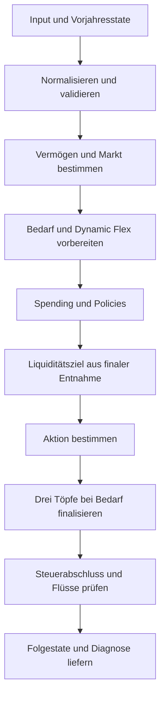
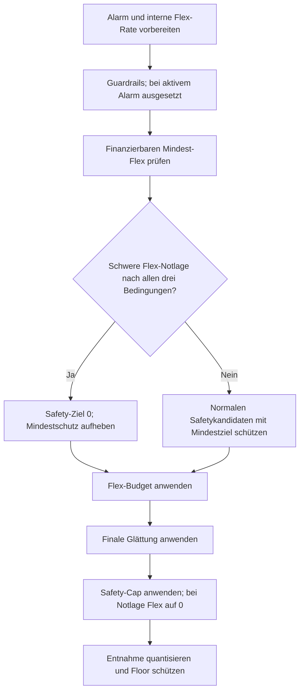
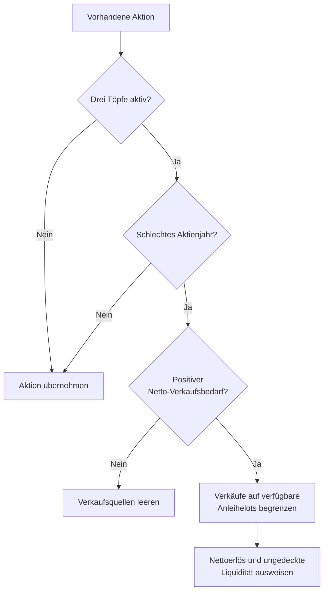

# Entscheidungsfolge der Engine

[core.mjs](../../engine/core.mjs) koordiniert die Jahresentscheidung. Sie liefert Bedarf, Ziel-Liquidität, Aktion und Diagnose. Ein Liquiditätsziel allein löst noch keine Auffüllung aus; die Transaktionsregeln entscheiden, ob gehandelt wird.

Eingabe- und Ergebnisformen stehen in der [Engine-Referenz](../../engine/README.md). [FACHKONZEPT](FACHKONZEPT.md) erklärt Formeln, Policies und Aussagegrenzen. [DATENVERTRAEGE](DATENVERTRAEGE.md) führt persistierte States und Belege. Die Entscheidungen hier betreffen den Rechenvorschlag, keine bestätigte Broker-Ausführung.

## Jahresfolge

Core normalisiert und validiert Eingaben, bestimmt Vermögen und Markt und bereitet den Bedarf vor. Spending-Policies liefern die finale Entnahme; daraus entstehen Liquiditätsziel und Aktion. Auf Wunsch folgt die Drei-Topf-Finalisierung. Steuerabschluss und Flussprüfung gehen dem Folgestate und der Diagnose voraus. Das Diagramm zeigt diese Jahresfolge.

Quellen: [core.mjs](../../engine/core.mjs), [InputValidator.mjs](../../engine/validators/InputValidator.mjs), [MarketAnalyzer.mjs](../../engine/analyzers/MarketAnalyzer.mjs), [SpendingPlanner.mjs](../../engine/planners/SpendingPlanner.mjs), [transaction-utils.mjs](../../engine/transactions/transaction-utils.mjs), [transaction-action.mjs](../../engine/transactions/transaction-action.mjs), [three-bucket-logic.mjs](../../engine/transactions/three-bucket-logic.mjs) und [tax-settlement.mjs](../../engine/tax-settlement.mjs).

| Schritt | Quelle und Ergebnis |
| --- | --- |
| Normalisierung/Validierung | `core.mjs`, `InputValidator.mjs`; ungültige Felder liefern `ValidationError` |
| Vermögen/Markt | `core.mjs`, `MarketAnalyzer.mjs`; aktuelle Liquidität, Gesamtvermögen, Regime und Renditesignale |
| Bedarf | `core.mjs`; Rentenabzug, statischer oder wirksamer dynamischer Flex, vorläufige Reichweite |
| Entnahme | `SpendingPlanner.mjs`; finale finanzierte Entnahme und nächster Plannerstate |
| Liquiditätsziel | `transaction-utils.mjs`; Ziel aus der final geplanten Nettoentnahme |
| Aktion | `transaction-action.mjs`; keine Aktion, Auffüllung oder Umschichtung |
| Drei Töpfe | `three-bucket-logic.mjs`; finalisierte Quellen/Verwendungen und Diagnose |
| Jahresabgleich | `tax-settlement.mjs`, `core.mjs`; finale Steuer, Quellenattribution und geprüfte Flüsse |
| Ausgabe | `core.mjs`; normalisierter Input, Kandidatenstate, Diagnose und UI-Werte |

Die vorläufige Runway wird vor den Spending-Policies aus dem noch ungekürzten Bedarf berechnet. Das finale Liquiditätsziel verwendet dagegen die geprüfte geplante Jahresentnahme. So kann eine Kürzung die spätere Transaktionsbasis ändern. Der geplante Entnahmevertrag wird über [planned-withdrawal-contract.js](../../types/planned-withdrawal-contract.js) aufgelöst; widersprüchliche Resultate werden zurückgewiesen.

## Bedarf und Flex-Trace

Core rechnet Renteneinkommen zuerst gegen den Floor, einen Überschuss gegen den statischen Flex. Wirksames Dynamic Flex berechnet den Flex danach aus Vermögen, Horizont und erwarteter realer Rendite. Angeforderte Aktivierung, Safetyunterdrückung und Wiederanlauf bleiben in `ui.vpw` getrennt sichtbar.

[SpendingPlanner.mjs](../../engine/planners/SpendingPlanner.mjs) bereitet Rohziel, Vermögensdämpfung und interne Flex-Glättung vor. Die anschließende [spending-policy-pipeline.mjs](../../engine/planners/spending-policy-pipeline.mjs) prüft die feste Reihenfolge `SpendingPolicyOrderV2`:

1. `alarm` verarbeitet das Alarmsignal.
2. `guardrails` wendet Spending-Grenzen an.
3. `minimum_flex` hebt die Rate auf das finanzierbare Mindestziel an.
4. `flex_budget` begrenzt sie durch das verfügbare Budget.
5. `final_smoothing` wendet die abschließenden Änderungsgrenzen an.
6. `safety_cap` prüft die strukturelle Obergrenze und eine schwere Flex-Notlage.

Danach ermittelt der Planner die quantisierte Jahresentnahme und den tatsächlich finanzierten Flex. Floor-Schutz und Rundung gehören zum Endergebnis. Die Policy-Diagnose nennt unter anderem `finalLimitingPolicy`, Mindeststatus und Safetybindung. Ein Mindestziel ist deshalb nicht gleichbedeutend mit einer garantierten Auszahlung. Die fachlichen Bedingungen und FR-6 stehen im [Fachkonzept](FACHKONZEPT.md).

Ein aktiver Safetykandidat hält Rohziel, Policy-Ziel, wirksamen Cap und Herkunft getrennt fest. Bestehende Abwärtsgrenzen können das Ziel schrittweise wirksam machen. Bei schwerer Flex-Notlage wird die Flex-Rate auf null gesetzt; der geplante Floor bleibt unverändert. Der nächste Glättungsanker kann dabei die Rate vor dem Notlageneingriff bewahren. Diagnose und Folgestate sind gemeinsam zu lesen.

Das Notlage-Gate wird nach Mindest-Flex ausgewertet. Es verlangt gleichzeitig einen tiefen Bärenmarkt, einen realen Gesamtvermögensdrawdown über der Schwelle und eine kritische geschützte Portfolioentnahmequote. Es bereitet den Safetykandidaten vor; Flex-Budget und finale Glättung laufen anschließend weiterhin. Erst der abschließende Safety-Cap setzt bei aktiver Notlage Flex auf null. Ohne Notlage schützt ein normaler Safetykandidat das zulässige Mindestziel und respektiert die Änderungsgrenzen.

Das Diagramm zeigt die Entnahme-Kette und die Vorbereitung des Safety-Caps durch das Notlage-Gate.

Quellen: [SpendingPlanner.mjs](../../engine/planners/SpendingPlanner.mjs) und [alarm-policy.mjs](../../engine/planners/alarm-policy.mjs) für Alarm und Entnahme; [spending-policy-pipeline.mjs](../../engine/planners/spending-policy-pipeline.mjs) für Reihenfolge, Notlage-Gate und Safety-Cap; [spending-guardrails.mjs](../../engine/planners/spending-guardrails.mjs), [minimum-flex-policy.mjs](../../engine/planners/minimum-flex-policy.mjs), [flex-budget-policy.mjs](../../engine/planners/flex-budget-policy.mjs) und [final-rate-policy.mjs](../../engine/planners/final-rate-policy.mjs) für die einzelnen Policies; [spending-policy-helpers.mjs](../../engine/planners/spending-policy-helpers.mjs) für die geschützte Quantisierung.

[flex-trace.mjs](../../engine/planners/flex-trace.mjs) zeichnet nur auf, wenn der Aufrufer die Diagnose ausdrücklich anfordert. Die Momentaufnahmen enthalten Rohziel-/Vermögenswirkung, interne Glättung und Grenzen, Policywirkung und geschützte Rundung. Positive Monatswirkung bedeutet Anhebung, negative Kürzung. Ein nicht endlicher Diagnosewert wird `null`; das ändert die Policyrechnung nicht.

Der Trace endet beim finanzierten Netto-Flex aus dem Vermögen. Er ist keine Messreihe des ausgezahlten Haushalts-Flex über mehrere Simulatorjahre. [balance-flex-trace.js](../../app/balance/balance-flex-trace.js) liest ihn für die Diagnose; Persistenz- und Exportpfade übernehmen ihn nicht. Die Option und die Fehlerformen führt die [Engine-Referenz](../../engine/README.md#optionaler-flex-trace).

## Liquidität und Transaktionsbedarf

[transaction-action.mjs](../../engine/transactions/transaction-action.mjs) verbindet aktuelle Liquidität, Ziel, Markt und finale Entnahme. [transaction-utils.mjs](../../engine/transactions/transaction-utils.mjs) berechnet Ziele und Handelsgrenzen; [liquidity-runway-contract.js](../../types/liquidity-runway-contract.js) liefert die kanonische Reichweitenpolicy.

| Prüfstelle | Folge |
| --- | --- |
| Puffer-/Runway-Unterschreitung in Bär oder Recovery | Notauffüllung und begrenzte Verkaufsplanung prüfen |
| harte Runway-Unterschreitung im neutralen Pfad | neutrale Notauffüllung prüfen |
| geeigneter Markt und ausreichender Handelsbetrag | opportunistische Auffüllung prüfen |
| Gold unter Zielband | Kaufbedarf prüfen, bei fehlender Liquidität blockieren oder auf Überschuss begrenzen |
| Gold über Zielband | Verkauf/Umschichtung prüfen |
| überschüssige Liquidität | Surplus-Rebalancing prüfen |
| Trigger oder Handelsgrenze nicht erfüllt | keine Aktion mit Blockgrund |

[transaction-opportunistic.mjs](../../engine/transactions/transaction-opportunistic.mjs) berechnet die opportunistische Auffüllung. [transaction-surplus.mjs](../../engine/transactions/transaction-surplus.mjs) prüft die Investition eines Überschusses. Ein geringer Abstand zum Ziel kann in der Toleranz bleiben. Notfallpfade können andere Handelsgrenzen anwenden als reguläre Umschichtungen.

Die Transaktionsdiagnose hält Trigger, Blockgrund, blockierten Betrag, Schwellen und potenzielle Aktion fest. `action.type` unterscheidet `NONE` und `TRANSACTION`. Die Anzeige muss einen unterdrückten Handel von einem fehlgeschlagenen Rechenvertrag unterscheiden.

## Quellenwahl und Jahressteuer

[sale-engine.mjs](../../engine/transactions/sale-engine.mjs) normalisiert verfügbare Tranchen, ordnet die Quellen und berechnet steuerliche Rohwerte. IDs und `sourceProfileId` bleiben im Breakdown erhalten. Innerhalb der Anlagegruppen gelten die dort implementierten Steuer-/Datumsordnungen.

| Kontext der Sale-Engine | Reihenfolge im ausgeführten Code |
| --- | --- |
| defensiver Kontext oder Emergency Sale | Gold, Anleihen, Aktien |
| Gold über Obergrenze | Gold, Aktien |
| Standard | Anleihen, Aktien, Gold |

Die Standardreihenfolge enthält Anleihen vor Aktien, obwohl ein Quellkommentar Aktien zuerst nennt. Auch der defensive Kommentar verkürzt die tatsächliche Reihenfolge. Für die Referenz gilt die ausführbare Quellenliste. Der Überbandpfad für Gold nimmt Anleihen nicht in diese Liste auf.

Gold-Floor begrenzt reguläre Verkäufe. Notfallaufrufe können ihn umgehen. Goldziel, Band und Steuerannahme sind eigene Regeln; Gold und Anleihen werden nicht durch einen gemeinsamen Quotensolver geordnet. Die Modellgrenzen stehen im [Fachkonzept](FACHKONZEPT.md).

Die Sale-Engine liefert Rohaggregate und vorläufige Steuerwerte. [tax-settlement.mjs](../../engine/tax-settlement.mjs) verrechnet den Jahresverlustvortrag, den Pauschbetrag und die steuerpflichtigen Gewinne. Core verteilt die finale Steuer auf Quellen, passt den Vorschlag an und prüft anschließend die Quellen-/Verwendungsflüsse. `taxSettlementDeferred` kennzeichnet eine ausdrücklich verschobene Finalisierung; sie ist kein bestätigter Jahresabschluss.

Der Haushaltsweg kann eine nachgelagerte profilweise Steuerattribution benötigen. Der Simulator sammelt außerdem Rohwerte tatsächlich ausgeführter Pfadtransaktionen. Aufrufer dürfen eine vorläufige Sale-Steuer deshalb nicht zusätzlich zur finalen Jahressteuer abbuchen. Die Aufrufgrenzen führt das [Engine-README](../../engine/README.md#ergebnisse-und-diagnose).

## Drei Töpfe

[three-bucket-logic.mjs](../../engine/transactions/three-bucket-logic.mjs) ergänzt eine vorhandene Aktion. `decumulation.mode = 3_bucket_jilge` aktiviert den Pfad; Aktienrendite und `drawdownTrigger` bestimmen das schlechte Jahr.

Das Diagramm zeigt den Quellenersatz in `applyThreeBucketLogic`; der anschließende Refill hat einen eigenen Aufruf.

Quelle: [three-bucket-logic.mjs](../../engine/transactions/three-bucket-logic.mjs), Funktion `applyThreeBucketLogic`.

`applyThreeBucketLogic` ersetzt im schlechten Jahr die betroffenen Verkaufsquellen durch Anleihen. Reichen sie nicht, wird `unmetLiquidity` ausgewiesen. Die Funktion selbst lässt im normalen/guten Jahr den Refill einem anderen Schritt. `appendBondReplenishment` und `finalizeThreeBucketAction` führen die ergänzende Auffüllung und finale Prüfung aus.

Die Diagnose hält Modus, schlechtes Jahr, Anleihebestand vor/nach der Aktion, Verkäufe, Refill und ungedeckte Liquidität fest. Balance zeigt die bereits finalisierte Aktion und attribuiert sie im Haushalt; der Simulator hat nach der Auszahlung einen eigenen Refillanschluss. Die jeweilige Modulreferenz legt fest, wer den Schritt ausführt.

## Nachgelagerte Simulator- und Balancepfade

[simulator-engine-direct.js](../../app/simulator/simulator-engine-direct.js) prüft und führt den Vorschlag auf seinem kopierten Portfolio aus. Die finale Jahresentnahme und ein zusätzlicher Netto-Floormonat bilden die Liquiditätsdeckung vor der Auszahlung. Erst wird ein zulässiger Pflegebucketbeitrag geprüft, dann ein Forced Sale. Ein weiterer Verkaufspfad kann einen Auszahlungsausfall behandeln. Anleihe-Refill, Cashzinsen und Steuerabgleich folgen danach.

Forced Sales besitzen eigene Quellenregeln. Ohne Drei-Topf-Sonderfall können Aktien und Gold dienen; im schlechten Drei-Topf-Jahr arbeitet der Deckungspfad mit Anleihen. Das ist nicht dieselbe Quellenfolge wie im regulären Standardverkauf. Der Jahrespfad unterscheidet technischen Fehler von finanzieller Zahlungsunfähigkeit. Details stehen in der [Simulatorreferenz](SIMULATOR_MODULES_README.md#ein-simulatorjahr).

Balance rechnet den Haushalt einmal und attribuiert die finalisierte Aktion auf die Eigentümerprofile. Das [Postprocessing](../../app/balance/balance-action-postprocessor.js) nimmt diese Aktion für die Anzeige entgegen, ohne einen zweiten Einzelprofil-Drei-Topf-Lauf auszuführen. Ein Vorschauergebnis schreibt keine reale Verkaufsausführung. [TRANCHEN_MODULES_README](TRANCHEN_MODULES_README.md#depot-und-ausgeführte-verkäufe) führt den Bestätigungsweg.

## Grenzen der Entscheidung

Die wichtigsten Unterschiede für die Codepflege sind Quellenfolge, Gold-Floor, Drei-Topf-Ersatz und Simulator-Forced-Sale. Sie dürfen nicht zu einer vermeintlich einheitlichen Reservepolicy zusammengezogen werden. Eine geplante Entnahme, ein finanzierter Flexbetrag und eine tatsächlich bestätigte Auszahlung sind ebenfalls unterschiedliche Werte.

Fachliche Spannungen und Modellgrenzen werden in [FACHKONZEPT](FACHKONZEPT.md) bewertet. Der [wissenschaftliche Rahmen](WISSENSCHAFTLICHER_RAHMEN.md#guardrails-und-erholung) erklärt den Forschungsbezug der Entnahmeregeln und die [Grenze von Mindest-Flex](WISSENSCHAFTLICHER_RAHMEN.md#mindest-flex-und-einschränkung). Änderungen an der Reihenfolge oder an Fluss-/Steuerverträgen benötigen die betroffenen Aufrufer und Vertragsprüfungen aus dem [Test-README](../../tests/README.md#schutzprüfungen). Eine reine Diagnoseänderung darf die Entnahme, Aktion und Stateanker nicht verändern.
