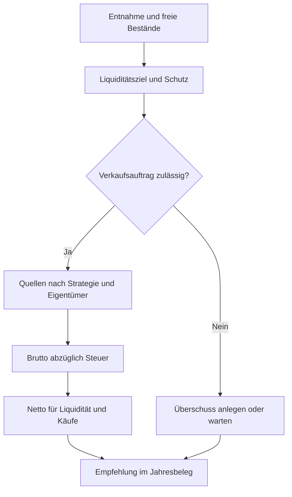

# Rechenweg der Handlungsanweisung

Wie die App eine geplante Entnahme finanziert und freie Mittel anlegt. Für fachlich Interessierte. Codeprüfung: 12.11.2026.

## Auf einen Blick

- Das [Jahresbudget](JAHRESBUDGET.md) bestimmt die Auszahlung; die Handlungsanweisung plant ihre Finanzierung.
- Liquiditätsziel, harte Mindestreserve und sofort verfügbares Tagesgeld erfüllen verschiedene Aufgaben.
- Bruttoverkauf minus Steuer ergibt Netto für Auffüllung und Käufe. Ein Kauf ist keine zusätzliche Entnahme.
- Der Haushalt plant gemeinsam; Tranchen, Gewinne und Steuern behalten ihre Eigentümer.
- Erst der passende Jahresbeleg hält die Empfehlung fest. Die Karte „Was zu tun ist“ verfolgt ihn über deine eingetragenen Verkäufe; reale Geschäfte erfasst du getrennt.

## Geld bereitstellen

### Liquiditätsziel

Freie Liquidität umfasst Tagesgeld und Geldmarkt abzüglich gesperrter Pflege-Rücklage. Sie enthält keine Aktien, Anleihen oder Gold. Alle Handelsquoten verwenden Geldvermögen; Immobilien werden erst nach [Verkauf](IMMOBILIEN.md#verkauf) zu einer Geldquelle.

```text
Jahresbasis = max(geplante Entnahme, Grundbedarf + Wunsch-Flex − Einkommen, 0)
Reichweitenziel = Jahresbasis × eingestellte Jahre
Brutto-Mindestpuffer = (Grundbedarf + Wunsch-Flex) / 12 × Mindestpuffermonate
Basisziel = größerer Betrag, auf 100 € aufgerundet
Liquiditätsziel = Basisziel + ungerundete fällige Ausgabenreserve
```

Zusätzlich werden die offenen einmaligen geplanten Ausgaben des Planjahres einmal bereitgehalten, ohne Multiplikation mit Zieljahren. Feste Posten bekommen keine eigene Reserve: Sie zählen für jeden gültigen Monat zum Grundbedarf, bei gewählter Anpassung mit Inflation, und erhöhen das Ziel nur über den Grundbedarf. Einmalige Posten werden ab ihrem Preisbezugsjahr inflationiert; eine Betragsänderung setzt diesen Bezug neu. Bis zum Simulationsstart zählen bestätigte Jahresinflationen, danach die Raten des jeweiligen Pfads. Bestätigte Zahlungsnachweise geben die Reserve in Balance frei. Einmalige Einkünfte zählen dort erst im bestätigten Tagesgeldstand. Der Simulator bucht sie am Jahresanfang und bezahlt einmalige geplante Ausgaben im Jahreslauf.

Eine Flex-Kürzung senkt das Ziel nicht; eine höhere dynamische Entnahme kann es erhöhen. Zieldeckung ist freie Liquidität / Euroziel. Operative Reichweite ist freie Liquidität / geplante Monatsentnahme; ohne Entnahme ist sie unbegrenzt. „Danach“ gilt vor Jahresauszahlung.

### Tagesgeldanteil

Die Liquiditätsreserve wird in Tagesgeld und Geldmarkt aufgeteilt (FR-66). „davon im Tagesgeld“ bezeichnet ganze Monate, mit Vorgabe zwölf und höchstens der eingestellten Reichweite. Die eiserne Reserve bleibt vollständig Tagesgeld:

`Tagesgeldziel = max(Reserveziel ÷ Reichweitenmonate × Tagesgeldmonate, Brutto-Monatsbedarf × Mindestpuffermonate)`

Bei Paaren verteilt sich das Ziel nach dem persönlichen Bedarf der kommenden zwölf Monate: Ausgaben abzüglich Rente und sonstiger Einkünfte, mindestens null. Ausgabenbasis sind die letzten zwölf vollständigen Importmonate je Person; bei einer Lücke gilt ihr gleicher Anteil am Planbudget. Einkünfte zählen nach Beginn und Ende monatsgenau. Jede Person behält mindestens ihren gleichen Anteil an der eisernen Reserve; die persönlichen Ziele ergeben centgenau das Haushaltsziel. Ist beider Bedarf null oder der Ausgabenbereich beschädigt, wird gleich verteilt.

Verkaufserlöse füllen zuerst Tagesgeld bis zum Ziel, der Rest fließt in den Geldmarkt. Danach folgen persönliche Umschichtungen:

| Richtung | Grenze und Steuer |
|---|---|
| Geldmarkt → Tagesgeld | Die Nachfüllschwelle gilt für den Fehlbetrag; verfügbare Bestände begrenzen den abgerundeten Transfer. Verkaufsgewinne teilen die persönliche Jahressteuerrechnung mit übrigen Verkäufen. |
| Tagesgeld → Geldmarkt | Steuerfrei. Erst nach Zuflüssen, Kaufdeckung und Steuern abschöpfen; ungedeckte Partnerfehlbeträge mindern den freien Überschuss. Das Haushaltsziel bleibt geschützt. |

Gegenläufige Transfers bleiben je Person getrennt; zwischen Partnerkonten wird nichts automatisch übertragen. Interne Transfers erhöhen weder Verkaufs- noch Zugangssummen. Die [Steuerrechnung](STEUERN.md#persönliche-jahresrechnung) berücksichtigt eine aktive Zusammenveranlagung; Transfersteuer und Kaufdeckungssteuer bleiben getrennt ausgewiesen.

Fehlt der Geldmarkteinstand, bleibt die Anweisung mit Hinweis sichtbar. Ohne Zusammenveranlagung ist nur die betroffene Person für die automatische Spielbuchung gesperrt; die andere kann buchen und steuerfrei abschöpfen, soweit das Haushaltsziel geschützt ist. Bei Zusammenveranlagung gilt die Sperre gemeinsam. Der Zeitraffer nennt ausgelassene Personen mit Grund. Simulator und gespeicherter Jahresbeleg enthalten keine interne Umschichtung. Bedienung und Fehlermeldungen: [Balance lesen](../../Handbuch.html#balance).

### Trigger

Eine Zielunterdeckung führt nicht automatisch zum Verkauf. Zuerst prüft die App den Grundbedarfspuffer und Notauffülllücken. Im tiefen Bär und bei Erholung im Bär entfällt reguläres Rebalancing. Außerhalb können Mindesthandel, Rundung und Verkaufsgrenzen kleine Aufträge verhindern. Ohne notwendigen Verkauf folgt die Prüfung auf Überschussanlage; sonst heißt die Handlung warten.



### Reihenfolge

C1–C9 bestimmen den ersten passenden Handelspfad. C10–C13 verkaufen und verteilen; Drei Töpfe und Steuerabschluss folgen in C14–C17. D1–D3 ordnen Personen zu, E1–E4 unterscheiden Beschluss und Anzeige. S1–S5 beschreiben die anschließende Simulatorausführung. Die [Steckbriefe](#c1) erhalten diese Kennungen; technische Aufrufketten stehen unter [Stufen und Codebesitz](TECHNICAL.md#stufen-und-codebesitz).

## Quellen und Verwendung

### Verkäufe

<a id="verkaufsreihenfolge"></a>
Die Anlageklasse bestimmt die erste Reihenfolge; innerhalb einer Klasse folgen Steuer- und Tranchenauswahl.

| Anlass | Reihenfolge |
|---|---|
| Defensiver Verkauf im Bär oder Pufferschutz | Gold → Anleihen → Aktien |
| Gold über dem Band | Gold → Anleihen → Aktien |
| Standardverkauf | Anleihen → Aktien → Gold |

Gold-Untergrenze und Verkaufsbudgets begrenzen Quellen; Notpfade können die Untergrenze freigeben. Aktien folgen zunächst der geschätzten Steuer je Brutto-Euro, dann Gewinnquote, älterem Kaufdatum und Tranchenschlüssel. Ein Verlust hat deshalb keinen garantierten Vorrang vor einem steuerfreien Gewinn. Persönliche Zuordnung kann innerhalb der Anlageklasse andere Lots wählen. Das ist keine Broker-FIFO-Abrechnung.

### Überschuss

Der Nettoerlös bedient geplanten Goldkauf, Liquidität und Aktien in dieser Reihenfolge; verbleibender Mehrerlös erhöht Liquidität. Vorhandenes Cash kann selbst eine Quelle für Käufe sein. Es entsteht dabei kein neues Vermögen. Steuer wird vom Brutto abgezogen; in „Plan nach Zweck“ steht die Steuerzahlung zusätzlich zum Netto und darf nicht nochmals abgezogen werden.

### Drei Töpfe

Anleihen können im schlechten Aktienjahr Verkaufsquellen ersetzen. Freigegebenes Tagesgeld füllt zuerst den Anleihentopf, dann Gold und Aktien. Verkäufe aus Aktien zum Wiederauffüllen sind gesperrt, wenn der Anleihentopf die Auszahlung trägt, der Renditeauslöser unterschritten wird oder im selben Jahr Anleihen verkauft wurden. [Strategien](STRATEGIEN.md) erklärt die Auswahl; C14/C15 führen die Rechenbedingungen.

## Haushalt

### Eigentümer

Bei „Nicht verheiratet“ gehen Einkünfte aufs persönliche Tagesgeld; gemeinsame Ausgaben folgen den Vermögensanteilen zu Jahresbeginn. Pflegekosten trägt zuerst die gepflegte Person. Das gilt in Backtest und Monte Carlo auch ohne Lebensereignisse. Auszahlungsverteilung und Verkaufsverteilung sind verschieden. „Steueroptimiert“ nutzt für die Auszahlung die Personenreihenfolge aus „Haushalt & Plan“, je Person Tagesgeld vor Geldmarkt. Verkäufe folgen dagegen den persönlichen Steuerkosten. „Proportional“ gewichtet Vermögensanteile; „Reichweite zuerst“ die Zieljahre bei positivem Vermögen. Geld für Käufe wird seinen tatsächlichen Eigentümern zugeordnet.

### Netto und Steuerverweis

Eine vorläufige Plansteuer reserviert Geld. Die persönliche Jahresrechnung berücksichtigt Verlustvortrag, Pauschbetrag und den gewählten Partnerausgleich. Das kann Bruttoverkauf und Steuer ändern, während das geplante Netto gleich bleibt. Die Handelsrundung wird danach nicht wiederholt. [Steuern](STEUERN.md#persönliche-jahresrechnung) erklärt die Abrechnung und ihre Grenzen.

## Beleg

### Beschluss

| Stand | Bedeutung |
|---|---|
| Folgejahresprojektion | Aktuelle Bestände und letzter VWCE.DE-Tagesschluss mit Jahresfortschreibung von Bedarf, Alter und Einkünften. Die Annahmenzeile nennt Quellen und Datenstände; Restentnahmen sind nicht abgezogen. Bei Projektionsfehler bleibt die bisherige Vorschau verfügbar. |
| Verdeckter Bärenmarkt · Mit dem Jahreshoch | Anzeigevergleich mit identischem Vermögen und sonst gleichen Eingaben: Jahresendregel gegenüber höchstem gespeicherten Schlusskurs. Sichtbar nur, wenn die Engine gemessen am Jahreshoch den Flex kürzt (`FLEX_BUDGET.ACTIVE_REGIMES`: tiefer Bär, Erholung im Bärenmarkt), nach der Jahresendregel nicht. Dann zeigen Balance und Jahresabschluss Abstand, drei Kurse und die Folgen; im Schritt „Plan“ wählst du ohne Vorauswahl. Übernommen wird ohne Wahl die Regel. |
| Seite Übersicht | Budget, Marktphase und Handlung aus der Basisrechnung mit gespeicherten Jahresmarktdaten. In Balance steht die Marktphase unter „Diagnose“. |
| Festgeschriebene Handlungsanweisung | Empfehlung und Beschluss für passendes Planjahr und denselben Personenbereich. |
| Tatsächliches Geschäft | Bestätigte Änderung der Tranchen und getrennt gepflegter Tagesgeldstand. |
| Spielbereich | Ausführung ausschließlich auf getrennten Spielbeständen. |
| Simulator | Modellbuchung auf kopierten Beständen mit zusätzlichen Deckungs- und Steuerprüfungen. |

Die Karte „Was zu tun ist“ (FR-77) steht in Balance rechts oben, darunter „Deine Reserven“. Liegt ein passender Jahresbeleg vor, zeigt sie oben diesen Plan mit dem Chip „Plan ‹Jahr›“, dem Beschlussdatum und einem Stand je Planzeile (Person × Anlageklasse): gezählt werden bestätigte Verkäufe derselben Person und Anlageklasse ab dem Beschlusstag im Planjahr, netto gegen Plan netto. Der Stand heißt „Offen“, „Teilweise erledigt“ oder „Erledigt“. Erledigt ist eine Zeile, sobald etwas verkauft ist und höchstens eine halbe Rundungsstufe des Planbetrags fehlt oder mehr verkauft ist; Zeilen derselben Person und Anlageklasse zählen zusammen; die Stufen sind dieselben wie bei Verkäufen (unter 10.000 € 1.000 €, unter 50.000 € 5.000 €, unter 200.000 € 10.000 €, darüber 25.000 €). Bei 9.362 € Plan reichen also 8.862 €. Ein Verkauf ohne Gutschrift aufs Tagesgeld zählt als verkauft; die Karte zeigt „Gutschrift nachtragen“, die Reservekarte nennt den fehlenden Betrag. Käufe tragen im Beleg keine Person und haben keinen Stand. Ein Beleg ohne Verkaufszeile rechnet Reserven und Diagnose mit der Neuberechnung zu heutigen Beständen. Das Verb der Hauptzeile nennt bei reinen Anleiheverkäufen „Anleihen verkaufen“. „Verkauf eintragen“ wählt die Tranche der Planzeile vor; der Beleg trägt sie mit Personenpräfix, der Link ohne. Bedienung: [Quellen und Verwendung lesen](../../Handbuch.html#handlungsanweisung).

Planbeleg und Vorschau bleiben getrennt. Der Beleg oben ist der Stand vom Beschlusstag; heutige Bestände ändern weder seine Beträge noch die festgeschriebene Erlösverwendung. Ohne passenden Beleg steht dort ein Satz, dass der Plan im nächsten Jahresabschluss entsteht. Unten in der Karte steht zugeklappt „Vorschau auf den Plan ‹J+1›“ mit Hauptaktion und Betrag: der Plan, den „Jahr ‹J› abschließen“ beschließen würde. Sie rechnet mit heutigen Beständen, als wäre heute der 31.12., und „Details der Vorschau“ führt zu Quellen, Steuer und Verwendung. Verbindlich wird sie erst im Jahresabschluss.

„Tagesgeld auffüllen“ erscheint, wenn das Tagesgeld weniger als sechs Monate Entnahme deckt und kein Planverkauf offen ist: je Person bis zum Tagesgeldziel des Routings, höchstens aus ihrem Geldmarkt. Ein Monat Entnahme ist dabei derselbe Betrag wie in der Reservekarte: Liquiditätsziel geteilt durch die Reichweite in Monaten (162.000 € ÷ 60 = 2.700 €). Die Schwelle ist 6 solcher Monate, das Ziel die Tagesgeldmonate. Liegt die eiserne Reserve des Haushalts (Bruttobedarf je Monat × Mindest-Liquidität) darüber, gilt sie wie in der Reservekarte als Ziel und als Schwelle; der Satz nennt dann die Reserve statt der Monate. Die Summe aller Personen reicht höchstens bis zum Ziel des Haushalts; sonst sinkt jeder Personenbetrag im selben Verhältnis. Im Haushalt hat jede Person mit Umschichtung eine eigene Zeile mit Namen und Knopf, auch wenn es nur eine ist.

Der Projektionsentwurf rückt die vier Jahresstände einmal nach und vergleicht den Schlusskurs mit dem gespeicherten Hoch. Ein offener Vorjahresabschluss begrenzt Kurs und Altersprüfung auf Ende des Abschlussjahrs. Kurse am Bezugsjahresende oder davor sind bereits in der Jahresbasis enthalten und rücken nicht nochmals nach. Bei Vorschaufehlern bleibt die Basisrechnung verfügbar. Der Jahresabschluss verwendet weiterhin seinen bestätigten Jahresendkurs. Die reine Marktprojektion vergleicht zusätzlich den höchsten gespeicherten Schlusskurs der gesamten Historie. Nur bei einem echt höheren Hoch zählt dessen Datum als Bruchteilalter; bei gleichem Wert verwenden beide Varianten das Regelalter. Die zweite Rechnung ändert weder Plan noch Jahresbeleg oder Handlungsanweisung.

Der Block „Bärenmarkt, den die Jahresregel nicht sieht“ nennt den Abstand zum Jahreshoch, Ende Vorjahr, Jahreshoch und heutigen Kurs und vergleicht Marktlage, Monatsbudget und Verkauf beider Lesarten. Eine Zusatzzeile „Mit Hoch vom …“ beim Monatsbudget erscheint nur in diesem Fall. Kleinere Abstände, andere Umschichtungen ohne Bär und das Grundrauschen zeigt die App nicht; die interne Einstufung bleibt. Fehlen im Jahresabschluss die Kurse für die Prüfung und sieht die Jahresendregel keinen Bären, nennt der Schritt „Marktdaten“ den Grund. In der Balance steht dann genau eine Zeile „Kurse älter als 10 Tage – verdeckter Bärenmarkt nicht prüfbar · Kurse holen →“, bei fehlenden oder lückenhaften Kursen „Kurse fehlen oder sind lückenhaft – …“; andere Gründe einer fehlenden Vorschau zeigen sie nicht. Liegt seit dem Jahresende noch kein Kurs vor und ist es höchstens 10 Tage her, gibt es noch kein Jahreshoch und keine Zeile.

Die Folgejahresanzeige nutzt einen privaten Jahresentwurf mit Inflation, Rentenbeginn und geplanten Folgejahresposten. Bestände bleiben auf heutigem Stand; Restentnahmen bis Dezember sind nicht abgezogen. Monatsbudget, Jahreshochvergleich und Vorschau verwenden denselben Entwurf. Bedarfskarten, Strategie, Reserven und Diagnose beziehen sich auf das laufende Planjahr; auch Eingaben und Speicherung bleiben bei dessen Planwerten. Die Gründe nennen Bedarf, Einkünfte, geplante Zahlungen oder Budget ohne Gesamtsumme; Inflation und Rundung bleiben getrennt. Scheitert der Entwurf, bleibt die bisherige Vorschau verfügbar. Im Jahresabschluss steht der Vergleich nur bei verdecktem Bärenmarkt im Schritt „Plan“; ohne Wahl wird die Regel übernommen. Solange die Wahl offen ist, zeigt der Schritt „Monatsbudget ‹J+1› · nach deiner Wahl“. Ändern sich dort die Planwerte, rechnen auch die Beträge an der Wahl mit ihnen neu, ebenso nach späteren Änderungen von Tagesgeld oder Pflegewerten. [Technischer Vertrag](TECHNICAL.md#balance-und-abschluss).

### Gerundete Anzeige

Gerechnet wird ungerundet; gerundet wird nur, was die App von berechneten Beträgen zeigt. Was du ausgibst oder brauchst, rundet sie auf: Bedarf, Liquiditäts- und Tagesgeldziele, Steuer, Verkäufe des Plans und „Tagesgeld auffüllen“. Was dir zur Verfügung steht, rundet sie ab: Monatsbudget, finanzierten Flex und Käufe aus der Liquidität; so unterschreitet ein angezeigter Kauf nie die Reserve. Die Liquidität nach Umsetzung entsteht aus den angezeigten Beträgen und kann deshalb über dem genauen Wert liegen. Das gilt für den Balance-Überblick, „Was zu tun ist“, „Deine Reserven“, den Jahresabschluss und die Übersicht. Genau bleiben Renten und andere Einkünfte, Kontostände, Kurse, eingetragene Verkäufe, beschlossene Planwerte wie der Bedarf im Jahresabschluss, „Details & Drucken“, Diagnose, Exporte und Protokolle.

| Betrag | Stufen |
|---|---|
| Jahres- und Bestandswerte | unter 10.000 € auf 500 €, unter 25.000 € auf 1.000 €, unter 50.000 € auf 2.500 €, unter 200.000 € auf 5.000 €, unter 1 Mio. € auf 10.000 €, darüber auf 25.000 € |
| Monatswerte | unter 2.000 € auf 50 €, unter 5.000 € auf 100 €, darüber auf 250 € |

Ein Betrag genau auf einer Stufe bleibt. Das Jahresbudget ist das abgerundete Monatsbudget × 12; beschlossene Planwerte wie der Bedarf im Jahresabschluss stehen genau. Käufe stehen in jedem Status abgerundet, auch wenn sie aus einem Verkaufserlös bezahlt werden. Summen, Stände nach Umsetzung und Differenzen bildet die Anzeige aus den gezeigten Beträgen, damit jede Karte in sich aufgeht; erreicht ein Stand sein Ziel genau gerechnet, steht er nicht unter dem gezeigten Ziel (Tagesgeld, Liquidität, finanzierter Flex); das Monatsbudget wird nie angehoben; eine echte Lücke bleibt sichtbar. Sähen zwei Optionen der Wahl gerundet gleich aus, zeigt die Wahl beide genau. Teile, die genau bleiben müssen, stehen ohne Summe, etwa „Einkünfte 3.100 € · aus dem Vermögen 2.000 €“ unter dem gerundeten Monatsbudget. Max und Erika am 23.10.2026: Das Liquiditätsziel von 162.000 € steht als 165.000 €, der Plan als 9.500 € + 80.000 € = 89.500 €, die Liquidität nach Umsetzung als 90.000 € + 89.500 € = 179.500 € mit dem Tagesgeld auf dem Ziel von 32.500 €, das Budget 2027 von 5.100 € als 5.000 € im Monat und 60.000 € im Jahr.

### Reale Ausführung

Ein Jahresabschluss verkauft nichts beim Broker. Reale Bestandsänderungen folgen erst aus bestätigten Ausführungen; der Tagesgeldstand wird getrennt abgeglichen. Die [Tagesgeldaufteilung](#tagesgeldanteil) ergänzt die heutige Anweisung. Der Abschlussdialog verwendet dazu die Bestände zur Abschlusszeit; der gespeicherte Beleg hält lediglich das Liquiditätsziel fest. Seine Anzeige lautet deshalb „Liquidität (Tagesgeld bis zum Ziel, Rest Geldmarkt)“. Die Verkaufssteuerschätzung nimmt einen noch vollen Pauschbetrag an.

## Nachschlagen

### C-Steckbriefe

<a id="c1"></a>
### C1 Liquiditätsziel bilden

- Zweck: Vorrat für die gewünschte Reichweite bestimmen.
- Wann sie greift: Nach dem Jahresbudget.
- Rechnung: Ziel wie [oben](#liquiditätsziel), plus fällige Ausgabenreserve. Ist diese offen und das Gesamtziel ungedeckt, wird die volle Lücke ohne Mindesthandel oder Abschöpfgrenze finanziert; bei Drei Töpfen auch aus Aktien im Bär.
- Parameter: Entnahme, Einkommen, Bedarf und Reichweite.
- Beispiel: [Auffüllung](#max-und-erika-mit-auffüllung-und-persönlicher-steuer).
- Gedächtnis: Ziel wird neu berechnet; Zahlungsbelege vermindern die offene Reserve.
- Name: „Liquiditätsziel“.
- Quelle: [Codebesitz](TECHNICAL.md#stufen-und-codebesitz).

<!-- docs:parameter {"target":"#c1","keys":["THRESHOLDS.STRATEGY.minCashBufferMonths"]} -->
<!-- docs:parameter {"target":"#c1","status":"ungenutzt für das heutige Ziel","keys":["THRESHOLDS.STRATEGY.recoveryLiquidityTargetFactor","PROFIL_MAP.sicherheits-dynamisch.isDynamic","PROFIL_MAP.sicherheits-dynamisch.minRunwayMonths","PROFIL_MAP.sicherheits-dynamisch.runway.peak.total","PROFIL_MAP.sicherheits-dynamisch.runway.hot_neutral.total","PROFIL_MAP.sicherheits-dynamisch.runway.bear.total","PROFIL_MAP.sicherheits-dynamisch.runway.stagflation.total","PROFIL_MAP.sicherheits-dynamisch.runway.recovery_in_bear.total","PROFIL_MAP.sicherheits-dynamisch.runway.recovery.total","REGIME_SMOOTHING.TARGETS_ENABLED","REGIME_SMOOTHING.RUNWAY_TARGETS.NEUTRAL_REGIME","REGIME_SMOOTHING.RUNWAY_TARGETS.STRESS_REGIME"]} -->

<a id="c2"></a>
### C2 Schutzgrößen und Notauffülllücke prüfen

- Zweck: Akuten Mangel erkennen.
- Wann sie greift: Vor der Pfadwahl.
- Rechnung: Krisenpuffer = max(offener Monatsgrundbedarf × harte Mindestmonate, absolutes Minimum). Notziel = max(Mindestmonate × geplante Monatsentnahme, Mindestdeckung × Liquiditätsziel). Lücke muss über 1 € liegen. Reichweitenlücke oder zu geringe Zieldeckung aktivieren. Bei gedecktem Grundbedarf nur unter absolutem Minimum. Hoch/seitwärts sperrt die Notlücke, außer unter absolutem Minimum oder bei offenem Grundbedarf und weniger als 25 % Zieldeckung.
- Parameter: Mindestreichweite und Deckungsschwellen.
- Beispiel: [Auffüllung](#max-und-erika-mit-auffüllung-und-persönlicher-steuer) nutzt den regulären Pfad.
- Gedächtnis: Keines.
- Name: Schutzpuffer.
- Quelle: [Codebesitz](TECHNICAL.md#stufen-und-codebesitz).

<!-- docs:parameter {"target":"#c2","keys":["THRESHOLDS.STRATEGY.absoluteMinLiquidity","THRESHOLDS.STRATEGY.runwayGuardrailActivationPct","THRESHOLDS.STRATEGY.runwayCoverageMinPct"]} -->

<a id="c3"></a>
### C3 Grundbedarfspuffer im Bär sichern

- Zweck: Grundbedarfsvorrat schützen.
- Wann sie greift: Bärenphase und Liquidität höchstens Krisenpuffer.
- Rechnung: Pufferlücke über 1 € auffüllen; sonst einen ganzen offenen Jahresgrundbedarf anfordern. Kein Gold-Floor oder Mindesthandel. Bei Grundbedarf null entsteht daraus kein Auftrag.
- Parameter: Grundbedarf und Puffer.
- Beispiel: [Bärenjahr](#max-und-erika-im-bärenjahr) ohne Verkauf.
- Gedächtnis: Keines.
- Name: „Puffer-Sicherung“.
- Quelle: [Codebesitz](TECHNICAL.md#stufen-und-codebesitz).

<a id="c4"></a>
<a id="c5"></a>
### C4 und C5 Notauffüllung begrenzen

- Zweck: Notlücke innerhalb der Verkaufsgrenze decken.
- Wann sie greift: Nach C3; C4 im Bär, C5 sonst.
- Rechnung: Aufgerundete Lücke gegen abgerundete Aktiengrenze. Kritisch mindestens 10 % Aktienkorridor, ohne Aktienbasis die Lücke; dann kein Mindestauffüllbetrag. Steueraufschlag erlaubt Bruttospielraum, verkauft wird für das Nettoziel. Kritisch ist C4 unter 1,5 Krisenpuffern oder Mindestdeckung, C5 bei Unterdeckung oder Reichweitenlücke. Mit heutigen Schwellen ist jeder erreichte C5-Pfad kritisch; ein normaler C5 bleibt unerreichbar.
- Parameter: Auffülllimits und Mindestbeträge.
- Beispiel: [Technischer Neutralfall](TECHNICAL.md#jan-und-lena-mit-gold-über-dem-band).
- Gedächtnis: Kein Nachholkonto; fehlende Quellen lassen eine Restlücke.
- Name: „Runway-Notfüllung“.
- Quelle: [Codebesitz](TECHNICAL.md#stufen-und-codebesitz).

<!-- docs:parameter {"target":"#c4","keys":["THRESHOLDS.STRATEGY.minRefillAmount"]} -->

<a id="c6"></a>
<a id="c7"></a>
### C6 und C7 Regulären Bedarf und Mindesthandel prüfen

- Zweck: Liquidität und Gold innerhalb ihrer Vorgaben halten.
- Wann sie greift: Außerhalb Bärenphasen ohne vorrangigen Notauftrag.
- Rechnung: Goldziel und Band bestimmen Kauf-/Verkaufsbedarf. Cashüberschuss mindert Goldkaufbedarf; bei knappem Puffer wird dieser begrenzt. Gesamtbedarf ist max(Liquiditätslücke + offener Goldkauf, Goldverkaufsbedarf), aufgerundet. Ohne Zwangseingriff unterdrückt Hysterese kleine Bedarfe. Zwangseingriff gilt unter Mindestdeckung, unter absolutem Minimum oder bei offener Jahresgrundbedarfsdeckung. Unter absolutem Minimum ist das Eingangstor null. Sonst gilt unter Mindestdeckung max(Mindestauffüllung, Cashumschichtschwelle), bei Grundbedarfsnot null, sonst max(statischer Mindesthandel, dynamischer Geldvermögensanteil). Bei positivem Liquiditätsbedarf sinkt dieses normale Tor auf höchstens die Mindestauffüllung. Bedarf muss das Tor erreichen. Das Ergebnistor C12 bleibt getrennt.
- Parameter: Goldquote, Band, Mindesthandel und Ausnahmen; kein aktives 90-%-Tor.
- Beispiel: [Goldgegenprobe](TECHNICAL.md#jan-und-lena-mit-gold-über-dem-band).
- Gedächtnis: Keine angesammelten Kleinstlücken.
- Name: Reguläre Auffüllung.
- Quelle: [Codebesitz](TECHNICAL.md#stufen-und-codebesitz).

<!-- docs:parameter {"target":"#c7","keys":["THRESHOLDS.STRATEGY.minTradeAmountStatic","THRESHOLDS.STRATEGY.minTradeAmountDynamicFactor","ANTI_PSEUDO_ACCURACY.HYSTERESIS_MIN_REFILL_AMOUNT"]} -->
<!-- docs:parameter {"target":"#c7","status":"ungenutzt; kein aktives 90-%-Tor","keys":["THRESHOLDS.STRATEGY.liquidityBufferZonePercent"]} -->

<a id="c8"></a>
### C8 Verkaufsbudgets und Bruttorundung

- Zweck: Nettoauftrag in Bruttoverkauf übersetzen.
- Wann sie greift: Nach bestandenem Eingangstor.
- Rechnung: Goldüberschuss und begrenztes Aktienbudget liefern Probequellen. Der Aktienkorridor wird vom Hoch bis 20 % Abstand linear abgeschwächt; kritische Liquidität lockert ihn. Mit Goldverkaufsbedarf G und effektivem Liquiditätsbedarf L entfällt Aktienbedarf, wenn G > 1,5×L oder bei ausreichender Deckung G ≥ L. Unter Mindestdeckung oder absolutem Minimum wird er wieder zugelassen, wenn Aktienbedarf unter L und 0,8×G < L liegen. Kritisch ist der Abschöpfkorridor mindestens der theoretische Bruttobedarf. Brutto für Bedarf einschließlich Plansteuer wird aufgerundet. Mehrerlös fließt zur Liquidität.
- Parameter: Abschöpflimit, Goldband, Steuerfaktor und Handelsstufen.
- Beispiel: [Auffüllung](#max-und-erika-mit-auffüllung-und-persönlicher-steuer).
- Gedächtnis: Probe verbraucht keine echten Bestände.
- Name: Auffüllverkauf.
- Quelle: [Codebesitz](TECHNICAL.md#stufen-und-codebesitz).

<!-- docs:parameter {"target":"#c8","keys":["ANTI_PSEUDO_ACCURACY.ENABLED","ANTI_PSEUDO_ACCURACY.QUANTIZATION_TIERS.0.limit","ANTI_PSEUDO_ACCURACY.QUANTIZATION_TIERS.0.step","ANTI_PSEUDO_ACCURACY.QUANTIZATION_TIERS.1.limit","ANTI_PSEUDO_ACCURACY.QUANTIZATION_TIERS.1.step","ANTI_PSEUDO_ACCURACY.QUANTIZATION_TIERS.2.limit","ANTI_PSEUDO_ACCURACY.QUANTIZATION_TIERS.2.step","ANTI_PSEUDO_ACCURACY.QUANTIZATION_TIERS.3.limit","ANTI_PSEUDO_ACCURACY.QUANTIZATION_TIERS.3.step"]} -->

<a id="c9"></a>
### C9 Überschuss anlegen oder warten

- Zweck: Freie Mittel investieren.
- Wann sie greift: Ohne positiven Verkaufsauftrag.
- Rechnung: Liquide bleibt mindestens das höhere Ziel aus C1 und Jahresauszahlung beziehungsweise Grundbedarf plus zusätzlichem Grundbedarfsmonat und fälligen Ausgaben. Ansparjahre investieren ab 500 €, ohne Marktsperre, centweise abgerundet. Sonstige Jahre verlangen Überschuss streng über Mindesthandel und erlaubte Marktlage; bei ausgeschalteter Handelsrundung gilt 500 €. Gold bis zum Ziel, dann Aktien; Goldrundungsrest bleibt liquide. Drei Töpfe ergänzt zuerst Anleihen. Abschöpflimit null sperrt Käufe nicht. Im Simulator bleibt bei nicht verheirateten Paaren je Person der eigene Ausgabenanteil nach Anrechnung ihrer Einkünfte liquide. Nur ihr persönlicher Rest steht für Käufe bereit. Im Sterbejahr kauft bei einem Erbanteil unter 100 % nur die lebende Person, mit dem, was ihr nach dem [Nachlass](TOD_UND_ERBE.md#sterbejahr) bleibt; danach gelten Mindesthandel und Rundung erneut.
- Parameter: Überschuss, Goldziel und Handelsstufen.
- Beispiel: [Überschussgegenprobe](TECHNICAL.md#jan-und-lena-legen-überschuss-an).
- Gedächtnis: Keine feste Aktienzielquote.
- Name: „Runway-Überschuss investieren“ oder warten.
- Quelle: [Codebesitz](TECHNICAL.md#stufen-und-codebesitz).

<a id="c10"></a>
<a id="c11"></a>
### C10 und C11 Quellen verkaufen und Plansteuer rechnen

- Zweck: Nettoauftrag aus vorhandenen Tranchen finanzieren.
- Wann sie greift: Bei Verkaufsauftrag und Probe.
- Rechnung: [Quellenfolge](#verkaufsreihenfolge), Bestände, Budgets und Gold-Floor begrenzen jede Tranche. Bruttoziel direkt, Nettoziel unter Steuer auf tatsächlichen Teilgewinn zurückrechnen. Einzelverkäufe unter 1 € entfallen. [Steuern](STEUERN.md#gewinn-und-teilfreistellung) erklärt die Gewinnbasis.
- Parameter: Marktwert, Einstand und persönliche Steuerdaten.
- Beispiel: [Persönliche Verkaufszeilen](#max-und-erika-mit-auffüllung-und-persönlicher-steuer).
- Gedächtnis: Planreserve, noch kein dauerhafter Steuerverbrauch.
- Name: Quellen brutto und netto.
- Quelle: [Codebesitz](TECHNICAL.md#stufen-und-codebesitz).

<a id="c12"></a>
<a id="c13"></a>
### C12 und C13 Netto prüfen und verteilen

- Zweck: Mindestnetto und vollständige Verwendung sichern.
- Wann sie greift: Nach Verkauf.
- Rechnung: Ergebnis unter geltendem Mindesthandel wird verworfen. Pufferschutz, Grundbedarfsnot und die erreichten Notauffüllpfade setzen das Ergebnistor auf null; ebenso reguläre Pfade unter absolutem Minimum oder Mindestdeckung. Sonstige Liquiditätspriorität verwendet min(normaler Mindesthandel, Mindestauffüllung). Ohne Ausnahme gilt der normale Mindesthandel. Sonst Wasserfall Gold → Liquidität → Aktien, Rest zur Liquidität. Unterdeckung begrenzt Verwendungen. „Investitionsziele erreicht“ kann allein einen Rundungsrest bezeichnen und beweist keine erreichte Zielquote.
- Parameter: Ergebnistor und Nettoziele.
- Beispiel: [Auffüllung](#max-und-erika-mit-auffüllung-und-persönlicher-steuer).
- Gedächtnis: Noch keine Buchung.
- Name: „Wohin es fließt“.
- Quelle: [Codebesitz](TECHNICAL.md#stufen-und-codebesitz).

<a id="c14"></a>
<a id="c15"></a>
### C14 und C15 Drei Töpfe

- Zweck: Anleihen nutzen und wieder aufbauen.
- Wann sie greift: Bei „3-Töpfe“ vor Steuerabschluss.
- Rechnung: Der Auslöser ist stets eine Prozentangabe: 0,5 bedeutet 0,5 %, intern 0,005. Reale Aktienjahresrendite unter dem negativen Auslöser ersetzt Verkaufsquellen durch Anleihen; reichen sie nicht, sinken Verwendungen. Anleihenziel = Faktor × Jahresentnahme. Freies Cash füllt zuerst den Fehlbetrag. Aktienauffüllung verlangt erlaubte Marktlage, keinen tatsächlichen Anleihen-Auszahlungsbedarf und keine gegenläufigen Käufe. Fehlbetrag muss die Zielschwelle streng überschreiten; leerer Topf darf auch bei 100 % Schwelle aufgefüllt werden. Geschützt bleibt in Aktien der höhere Betrag aus einer Jahresauszahlung und dem Jahresgrundbedarf nach Abzug aktiver Rente. Freier Aktienrest begrenzt Nettoauftrag und Bruttobudget ohne Steueraufschlag. Gegenläufige Geschäfte derselben Person und Klasse werden vor jeder Buchung und vor dem Steuerabschluss verrechnet; nur die Restverkäufe ändern den Verlustvortrag.
- Parameter: Zielfaktor, Renditeauslöser und Auffüllschwelle.
- Beispiel: [Pflege-Rücklage und Drei Töpfe](TECHNICAL.md#helga-und-werner-mit-pflege-rücklage-und-drei-töpfen).
- Gedächtnis: Tatsächliche Lots bleiben ihren Eigentümern zugeordnet.
- Name: Anleihenauffüllung.
- Quelle: [Codebesitz](TECHNICAL.md#stufen-und-codebesitz).

<!-- docs:parameter {"target":"#c15","keys":["SPENDING_MODEL.THREE_BUCKET.DEFAULT_BOND_TARGET_FACTOR","SPENDING_MODEL.THREE_BUCKET.DEFAULT_DRAWDOWN_TRIGGER","SPENDING_MODEL.THREE_BUCKET.DEFAULT_BOND_REFILL_THRESHOLD"]} -->
<!-- docs:parameter {"target":"#c15","status":"ungenutzter Konfigurationswert; Simulator nutzt seinen Jahresproxy","keys":["SPENDING_MODEL.THREE_BUCKET.BOND_NOMINAL_RETURN"]} -->

<a id="c16"></a>
### C16 Jahressteuer abschließen

- Zweck: Plansteuer durch Jahresrechnung ersetzen.
- Wann sie greift: Einzelperson; im Haushalt nach D2 verschoben.
- Rechnung: [Jahressteuer](STEUERN.md#verlusttopf-und-pauschbetrag); frei gewordene Steuerreserve erhöht Liquidität. Mehrsteuer über einen Cent gegenüber der Reserve ist im Rechenkern ein Fehler.
- Parameter: Verlustvortrag und Jahresaggregate.
- Beispiel: [Steuergegenprobe](TECHNICAL.md#steuer-mit-verlustvortrag).
- Gedächtnis: Persönlicher Verlustvortrag.
- Name: „Steuern“.
- Quelle: [Codebesitz](TECHNICAL.md#stufen-und-codebesitz).

<a id="c17"></a>
### C17 Flüsse und Nachherwerte prüfen

- Zweck: Einen ausgeglichenen Plan liefern.
- Wann sie greift: Nach Steuer.
- Rechnung: Brutto − Steuer = Netto = Verwendungen. Liquidität danach berücksichtigt neue Liquidität und vorhandenes Cash als Quelle, vor Jahresauszahlung. Negative oder widersprüchliche Flüsse sind Fehler.
- Parameter: Endgültige Flüsse.
- Beispiel: [Auffüllung](#max-und-erika-mit-auffüllung-und-persönlicher-steuer).
- Gedächtnis: Vorschau speichert keinen Jahresbeschluss.
- Name: Zieldeckung und Reichweite danach.
- Quelle: [Codebesitz](TECHNICAL.md#stufen-und-codebesitz).

### D-Steckbriefe

<a id="d1"></a>
### D1 Auszahlung verteilen

- Zweck: Jahresentnahme auf Personen aufteilen.
- Wann sie greift: Nach gemeinsamem Budget.
- Rechnung: [Haushaltsmodus](#eigentümer), vorhandene persönliche Liquidität zuerst, verbleibende Haushaltsliquidität danach, zuletzt Verkaufsrest. Je Person Tagesgeld vor Geldmarkt.
- Parameter: Modus und Bestände nach Umschichtungen.
- Beispiel: [Auffüllung](#max-und-erika-mit-auffüllung-und-persönlicher-steuer).
- Gedächtnis: Keine reale Abbuchung.
- Name: Auszahlungsverteilung.
- Quelle: [Codebesitz](TECHNICAL.md#stufen-und-codebesitz).

<a id="d2"></a>
### D2 Persönliche Quellen und Steuer

- Zweck: Gemeinsames Netto mit persönlichen Beständen finanzieren.
- Wann sie greift: Bei mindestens zwei Personen.
- Rechnung: Innerhalb vorgegebener Anlageklassen wählt steueroptimiert die geringste zusätzliche Steuer; Gleichstand nach Gewinnquote, Personenkennung, Kaufdatum und Tranche. Andere Modi gewichten Bestände oder Zieljahre. Für Cashquellen gilt getrennt: steueroptimiert alphabetische Personenkennung, sonst persönliche Liquiditätsanteile. Persönliche Steuer kann Brutto ändern; fehlen Quellen, folgen Cash, Zusatzverkäufe oder kleinere Verwendungen.
- Parameter: Eigentum und [persönliche Steuerdaten](STEUERN.md#persönliche-jahresrechnung).
- Beispiel: [Drei Verkaufszeilen](#max-und-erika-mit-auffüllung-und-persönlicher-steuer).
- Gedächtnis: Getrennte Verlustvorträge; kein gemeinsamer Verlusttopf.
- Name: „Vorgeschlagene Verkäufe nach Person“.
- Quelle: [Codebesitz](TECHNICAL.md#stufen-und-codebesitz).

<a id="d3"></a>
### D3 Verwendungen und Deckung abgleichen

- Zweck: Persönliche Summen zusammenführen.
- Wann sie greift: Nach D2.
- Rechnung: Centweise nach persönlichen Nettoquellen verteilen; Rundungsreste je Verwendung ausgleichen. Auszahlung an verbleibende persönliche Liquidität anpassen. Größere oder unzuordenbare Abweichungen bleiben Fehler.
- Parameter: Finale Quellen und Verwendungen.
- Beispiel: [Auffüllung](#max-und-erika-mit-auffüllung-und-persönlicher-steuer).
- Gedächtnis: Persönliche Steuerstates.
- Name: Persönliche Verwendungen.
- Quelle: [Codebesitz](TECHNICAL.md#stufen-und-codebesitz).

### E-Steckbriefe

<a id="e1"></a>
### E1 Jahresplan festschreiben

- Zweck: Empfehlung und Beschluss belegen.
- Wann sie greift: Nach bestätigtem Jahresabschluss.
- Rechnung: Gleiche historische Basis; abweichende Planfelder gesondert ausweisen. Anzeige liest den Beleg ohne Neuberechnung.
- Parameter: Planjahr und Personenbereich.
- Beispiel: [Auffüllung](#max-und-erika-mit-auffüllung-und-persönlicher-steuer) ist nur Vorschau.
- Gedächtnis: Beleg, Budgetanker, Steuerstände.
- Name: Festgeschriebene Handlungsanweisung.
- Quelle: [Codebesitz](TECHNICAL.md#stufen-und-codebesitz).

<a id="e2"></a>
### E2 Tagesgeld und Geldmarkt aufteilen

- Zweck: Sofort verfügbaren Tagesgeldteil planen.
- Wann sie greift: In der Balance, bei der Spiel-Eintragung und im Zeitraffer.
- Rechnung: [Ziel, persönliche Aufteilung und Transfers](#tagesgeldanteil). Genau auf der Umschichtschwelle entsteht kein Transfer.
- Parameter: Tagesgeldmonate und Cashumschichtschwelle.
- Beispiel: [Helga und Werner](BEISPIELHAUSHALTE.md#helga-und-werner).
- Gedächtnis: Kein zusätzlicher Belegstate; Anzeige und Spielbuchung verwenden aktuelle Bestände.
- Name: Interne Umschichtung.
- Quelle: [Codebesitz](TECHNICAL.md#stufen-und-codebesitz).

<!-- docs:parameter {"target":"#e2","keys":["THRESHOLDS.STRATEGY.cashRebalanceThreshold"]} -->

<a id="e3"></a>
<a id="e4"></a>
### E3 und E4 Kurzfassung und Herkunft

- Zweck: Handlung und Verbindlichkeit zeigen.
- Wann sie greift: Bei Anzeige oder Kopieren.
- Rechnung: Persönliche Aktionen bestimmen die Kurzfassung. Tabelle zeigt ganze Euro, Kopiertext Cent. Nur passender Jahresbeleg heißt festgeschrieben.
- Parameter: Fertige Aktion und Herkunft.
- Beispiel: [Auffüllung](#max-und-erika-mit-auffüllung-und-persönlicher-steuer).
- Gedächtnis: Keine Bestandsänderung.
- Name: Verkäufe, Steuern und Verwendung.
- Quelle: [Codebesitz](TECHNICAL.md#stufen-und-codebesitz).

<!-- docs:parameter {"target":"#e4","status":"ungenutzter Rechenschalter; nur Beschreibung","keys":["ANTI_PSEUDO_ACCURACY.METRIC_DISPLAY_ROUNDING"]} -->

### S-Steckbriefe

<a id="s1"></a>
### S1 Simulatorjahr vorbereiten

- Zweck: Jahresanfang herstellen.
- Wann sie greift: Vor der Entscheidung.
- Rechnung: Renditen, einmalige Einkünfte und [Lebensereignisse](TOD_UND_ERBE.md) anwenden; [Immobilienverkauf](IMMOBILIEN.md#verkauf) kann Geld bereitstellen. Im Sterbejahr mit Erbanteil unter 100 % entscheiden C1–C15 Kauf und Auffüllung mit Liquidität und Wertpapieren, die der lebenden Person [bleiben](TOD_UND_ERBE.md#sterbejahr); die Ausgabenentscheidung bleibt beim Haushalt.
- Parameter: Jahreswerte und Personenereignisse.
- Beispiel: [Bärenjahr](#max-und-erika-im-bärenjahr).
- Gedächtnis: Kopiertes Vorjahresportfolio.
- Name: Modelljahr.
- Quelle: [Codebesitz](TECHNICAL.md#stufen-und-codebesitz).

<a id="s2"></a>
### S2 Verkäufe ausführen

- Zweck: Vorgeschlagene Quellen buchen.
- Wann sie greift: Nach persönlicher Zuordnung.
- Rechnung: Identifizierte Lots vermindern; knappe Bestände begrenzen Verkäufe und Käufe. Erlös bleibt beim Eigentümer.
- Parameter: Quellen und verfügbare Bestände.
- Beispiel: [Verkaufszeilen](#max-und-erika-mit-auffüllung-und-persönlicher-steuer).
- Gedächtnis: Gewinne fürs Steuerjahr.
- Name: Modellverkäufe.
- Quelle: [Codebesitz](TECHNICAL.md#stufen-und-codebesitz).

<a id="s3"></a>
### S3 Auszahlung und Grundbedarfsmonat decken

- Zweck: Finanzierung vor Auszahlung sichern.
- Wann sie greift: Nach regulären Verkäufen.
- Rechnung: Jahresauszahlung plus zusätzlicher Netto-Grundbedarfsmonat und fällige Ausgaben werden gebunden. Zulässige [Pflege-Rücklage](PFLEGE.md#reserve-und-flex) und Zusatzverkäufe decken Lücken. Drei Töpfe nutzt im schlechten Jahr Anleihen; echte Grundversorgungsnot kann Schutz übersteuern.
- Parameter: Cash, Reservefreigabe und Anlagen.
- Beispiel: [Bärenjahr](#max-und-erika-im-bärenjahr) ohne Zusatzverkauf.
- Gedächtnis: Zusätzliche realisierte Gewinne.
- Name: Deckungsprüfung.
- Quelle: [Codebesitz](TECHNICAL.md#stufen-und-codebesitz).

<a id="s4"></a>
### S4 Käufe und Auszahlung

- Zweck: Nur finanzierbare Buchungen ausführen.
- Wann sie greift: Nach Deckungsprüfung.
- Rechnung: Käufe vor Auszahlung, Restfehlbetrag mit zulässigen Verkäufen prüfen. Ungedeckte Grundversorgung kann als Ruin enden. Geplante Ausgaben werden vor Flex reserviert und einmal bezahlt.
- Parameter: Verfügbare Liquidität.
- Beispiel: [Bärenjahr](#max-und-erika-im-bärenjahr).
- Gedächtnis: Tatsächlich ausgeführte Modellbestände.
- Name: Jahresauszahlung.
- Quelle: [Codebesitz](TECHNICAL.md#stufen-und-codebesitz).

<a id="s5"></a>
### S5 Jahressteuer und Folgejahr

- Zweck: Tatsächliches Modelljahr abrechnen.
- Wann sie greift: Nach Auszahlung und Zinsen.
- Rechnung: Gewinne, Geldmarktverbrauch und positive Guthabenzinsen gemeinsam abrechnen. Offene Steuer nutzt Haushaltsliquidität vor Zusatzverkäufen; deren Gewinne zählen mit. [Nachlasszahlungen](TOD_UND_ERBE.md#steuer) schützen durch Depotverkäufe das Reserveziel der hinterbliebenen Person auch im Bär; geerbtes Steuergeld hat Vorrang. Reicht das Depot nicht, steht die übrige Liquidität bereit.
- Parameter: Jahresaggregate und persönliche Steuerstände.
- Beispiel: [Steuergegenprobe](TECHNICAL.md#steuer-mit-verlustvortrag).
- Gedächtnis: Verlustvorträge, Bedarf und Einkommen fürs Folgejahr.
- Name: Jahresendsteuer.
- Quelle: [Codebesitz](TECHNICAL.md#stufen-und-codebesitz).

<a id="parameter"></a>
<a id="erzeugte-parametertabelle"></a>
### Parameter

Die erzeugten Tabellen zeigen die heutigen Vorgaben. Persönliche Steuern, Goldquoten und Verkaufsgrenzen sind Eingaben. Ungenutzte historische Vorgaben und sämtliche Rohwerte stehen in der [technischen Zuordnung](TECHNICAL.md#technische-handelsparameter).

<!-- docs:parameter:start -->
| Parameter | Vorgabe | Stufe |
| --- | --- | --- |
| davon im Tagesgeld · Planwert | 12 Monate, höchstens Reichweite × 12 | [E2](#e2) |
| Brutto-Mindestpuffer | 2 Monate | [C1](#c1) |
| Mindestauffüllung | 10.000 € | [C4](#c4) |
| Normaler Mindesthandel · Betrag / Anteil | 25.000 € / 0,5 % | [C7](#c7) |
| Cashumschichtung · Abweichung über | 2.500 € | [E2](#e2) |
| Absolute Mindestliquidität | 10.000 € | [C2](#c2) |
| Notauffüllung · Aktivierung unter / Zieldeckung | 69 % / 75 % | [C2](#c2) |
| Drei Töpfe · Zielfaktor / Renditeauslöser / Auffüllschwelle | 5 / -15 Prozent / keine Vorgabe | [C15](#c15) |
| Handelsrundung · Schalter | ein | [C8](#c8) |
| Hysterese · Bedarf unter | 2.000 € | [C7](#c7) |
| Handelsstufe 1 · Betrag unter / Schritt | 10.000 € / 1.000 € | [C8](#c8) |
| Handelsstufe 2 · Betrag unter / Schritt | 50.000 € / 5.000 € | [C8](#c8) |
| Handelsstufe 3 · Betrag unter / Schritt | 200.000 € / 10.000 € | [C8](#c8) |
| Handelsstufe 4 · Betrag unter / Schritt | ∞ / 25.000 € | [C8](#c8) |
<!-- docs:parameter:end -->

<a id="harte-mindestreichweite"></a>
### Harte Mindestreichweite

<!-- docs:runway:start -->
Standardziel: 5 Jahre. Wählbar sind Halbjahresschritte.

| Liquiditätsziel in Jahren | Zielmonate | Harte Mindestreichweite in Monaten |
| ---: | ---: | ---: |
| 1 | 12 | 12 |
| 1,5 | 18 | 18 |
| 2–10 | 24–120 | 24 |
<!-- docs:runway:end -->

### Zwei Beispiele

<!-- docs:beispiele:start -->
### Max und Erika mit Auffüllung und persönlicher Steuer

Synthetischer Jahresabschlussentwurf 2026 für Plan 2027, geprüft am 27.10.2026: 24.000,00 € Grundbedarf, 18.000,00 € Wunsch-Flex, 6.000,00 € Mindest-Flex und 18.000,00 € Rente jährlich. Dynamik und Go-Go aus, stabiler Höchststand, keine Inflation, kein Gold und keine Pflege-Rücklage. Zusammenveranlagung und Kirchensteuer aus.

Aktienbestand 700.000,00 €, freie Liquidität 90.000,00 €. Fünf Jahre Reserve und 5 % Abschöpfgrenze. Die [vollständigen Ausgangstranchen und Steuerdaten](TECHNICAL.md#max-und-erika-mit-auffüllung-und-persönlicher-steuer) gehören zu demselben Beispiel.

| Wert | Ergebnis |
| --- | ---: |
| Jahresentnahme | 24.000,00 € |
| Liquiditätsziel | 120.000,00 € |
| Freie Liquidität vorher | 90.000,00 € |
| Deckung vorher / nachher | 75,00 % / 103,68 % |
| Reichweite vorher / nachher, vor Auszahlung | 45,00 / 62,21 Monate |
| Bruttoquellen / Steuer / Netto | 34.906,10 € / 486,35 € / 34.419,75 € |
| Verwendung Liquidität | 34.419,75 € |

Die ursprüngliche Lücke von 30.000,00 € führt durch Plansteuer und Handelsrundung zunächst zu 35.000,00 € Bruttoverkauf und 580,25 € Plansteuer. Persönliche Abrechnung verändert Brutto und Steuer; das Netto bleibt 34.419,75 €.

| Person und Tranche | Brutto | Steuer | Netto |
| --- | ---: | ---: | ---: |
| Max Mustermann · Aktienfonds Neu | 10.000,00 € | 0,00 € | 10.000,00 € |
| Max Mustermann · Aktienfonds Alt | 1.020,41 € | 0,00 € | 1.020,41 € |
| Erika Mustermann · Aktienfonds Erika | 23.885,70 € | 486,35 € | 23.399,34 € |

Die getrennte Auszahlung nutzt Max Mustermann: 24.000,00 €. Die Tabellen gelten vor Auszahlung; gerundete Einzelanzeigen können um einen Cent abweichen.

### Max und Erika im Bärenjahr

Musterbestände vom 17.10.2026 im historischen Lauf mit 0,5 % Fondskosten auf Aktien, Beschluss nach der Rendite 2002. Die Rente deckt den Grundbedarf. Der Bärenpfad wartet bei ausreichender Liquidität; eine Kürzung erzwingt keinen Verkauf.

| Wert | Ergebnis |
| --- | ---: |
| Jahresentnahme | 12.000,00 € |
| Liquiditätsziel | 68.200,00 € |
| Freie Liquidität vorher | 96.971,30 € |
| Deckung vorher / nachher | 142,19 % / 142,19 % |
| Reichweite vorher / nachher, vor Auszahlung | 96,97 / 96,97 Monate |
| Bruttoquellen / Steuer / Netto | 0,00 € / 0,00 € / 0,00 € |

Anweisung: „Tiefer Bär (Kein Handlungsbedarf)“. Gold, Überschussanlage, Pflege-Rücklage und isolierte Steuergegenproben stehen in den [vollständigen technischen Beispielen](TECHNICAL.md#vollständige-handelsbeispiele).
<!-- docs:beispiele:end -->

## Wo du es in der App siehst

Balance zeigt rechts „Was zu tun ist“ mit dem Plan aus dem Jahresabschluss und seinem Stand. „Details & Drucken“ öffnet den Beleg mit Wertpapier, Brutto, Steuer, Netto und Tranche. „Details der Vorschau“ zeigt Quellen brutto, Steuer, Netto und „Wohin es fließt“ für die Vorschau. „Deine Reserven“ darunter vergleicht Liquidität, Tagesgeld und Geldmarkt heute und nach Umsetzung derselben Empfehlung; ohne Vorschlag zeigt sie nur heute. Bei festgeschriebener Anweisung zählt nur ihr offener Rest: Bestätigte Verkäufe derselben Person und Anlageklasse seit dem Beschluss im Planjahr gehen netto ab, ab 98 % gilt eine Zeile als erledigt. Ist alles erledigt, entspricht „nach Umsetzung“ dem heutigen Stand. Im Planversuch rechnet die Karte mit dem Versuch. Zieldeckung und Reichweite gelten vor Auszahlung. Die Marktphase steht unter „Diagnose“, das Jahreshoch nur bei verdecktem Bärenmarkt in „Was zu tun ist“. Der Jahresabschluss zeigt im Schritt „Plan“ den Stand des alten Plans und den neuen Plan als Karte „Was zu tun ist“; Simulatorprotokolle zeigen ausgeführte Modellbuchungen. Bedienung: [Handlung lesen](../../Handbuch.html#handlungsanweisung), [Verkauf erfassen](../../Handbuch.html#verkauf-schritte).

## Modellgrenzen

- Warten trotz Zielunterdeckung kann aus Marktschutz, Mindesthandel oder begrenzten Quellen entstehen.
- Ein Hinweis auf erreichte Investitionsziele kann einen Rundungsrest meinen; Quellen und Verwendung prüfen.
- Vorschau, Jahresbeleg und Simulator erfassen verschiedene Zeitpunkte. Interne Cashumschichtung und Jahresendsteuer erzeugen begründete Unterschiede.
- Modellsteuer, Kurs und Quellenwahl ersetzen keine Brokerabrechnung. Gebühren und tatsächliche Ausführbarkeit sind nicht eingerechnet.
