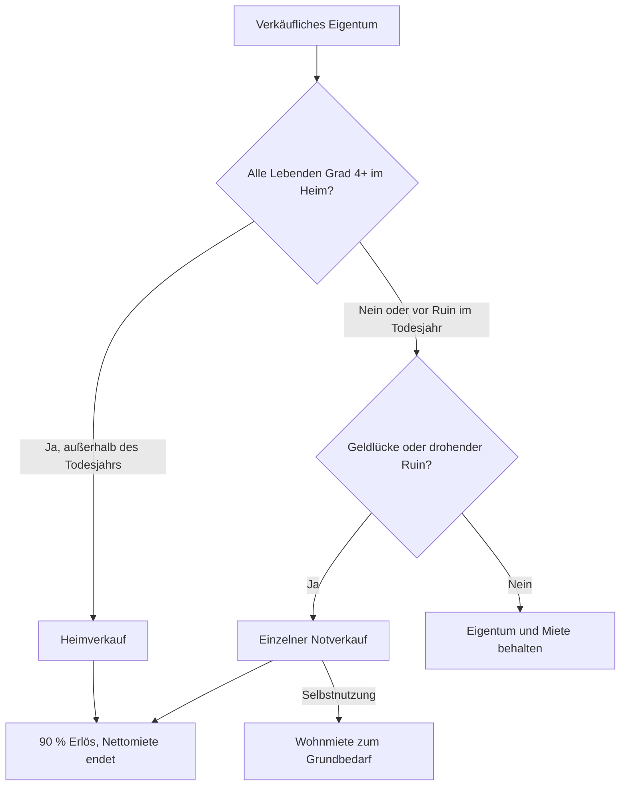

# Immobilien

Wie Immobilienwert, Miete und Verkauf in der Haushaltsplanung wirken. Für Nutzer und fachlich Interessierte. Appstand geprüft am 01.11.2026.

## Auf einen Blick

- Trage je Person nur ihren eigenen Wert- und Mietanteil ein.
- Gesamtvermögen enthält Immobilien; die Budget- und Ruinrechnung verwendet Geldvermögen.
- Ein Verkauf macht Immobilienwert zu verfügbarem Geld und beendet die zugehörige Nettomiete.
- Heimverkauf und Notverkauf haben unterschiedliche Bedingungen und Wohnkostenfolgen.

## Wert und Einkommen

### Eigener Anteil und Wertbasis

Eine Immobilie gehört in der App zu einer Person. „Wert meines Anteils“ und Nettomiete beziehen sich auf deren Anteil, nicht auf das gesamte Objekt. Bei hälftigem Eigentum erfassen beide Personen je eine Hälfte. Bezeichnung, Nutzung, Wert und Stand müssen gültig sein; Wert und Miete dürfen null sein, aber nicht negativ.

Der eingetragene Stand datiert die Kaufkraft. Für Simulatorbewertung, Verkauf und Erbe werden ältere Werte zunächst mit der eingebauten deutschen Inflation bis zum Rechenbeginn fortgeschrieben, im ersten historischen Jahr monatsanteilig. Danach wirkt die Inflation des gerechneten Pfads. Das ist kein eigenes Immobilienpreis- oder Renditemodell.

### Miete

Nur vermietete Immobilien erzeugen die eingetragene monatliche Nettomiete als feste persönliche Einkunft. Sie deckt wie andere Einkünfte den Bedarf. Du wählst „keine“ oder „Inflation“ als Anpassung. Eigennutzung erzeugt keine rechnerische Mieteinnahme.

Die optionale ortsübliche Monatsmiete selbst genutzter Immobilien dient ausschließlich der [Wohnrechtsteuer](STEUERN.md#wohnrecht-und-jährliche-zahlung). Sie ist weder Einkommen noch die Ersatzmiete nach Notverkauf. Leer und ausdrücklich 0 € haben bei der Wohnrechtbewertung unterschiedliche Wirkung.

### Gesamtvermögen

Die Übersicht zeigt „Gesamtvermögen“, darunter Geldvermögen und Immobilien. Auch selbst genutzte und vermietete Immobilien gehören in die Bestandsverteilung. Im Simulator zählt am Jahresende nur der noch im Haushalt verbliebene Eigentumsanteil. Ein bloßes Wohnrecht zählt nicht als Immobilieneigentum.

Das ⓘ „Aufteilung des Vermögens“ erklärt in „Personen & Vermögen“ unter der Verteilung, dass Geldvermögen Tagesgeld und Depot enthält und Immobilien zum Gesamtvermögen zählen. In der Übersicht nennt es bei Immobilien zusätzlich die vereinfachte Darstellung des heutigen Immobilienwerts über den ganzen Zeitraum; Veränderung, Entnahmen und Rendite beziehen sich auf Geldvermögen.

Ruin, Deckung, Entnahmequoten und Strategieentscheidungen beziehen sich auf Geldvermögen. Ein wertvolles Haus verhindert Ruin deshalb nur, wenn es nach den Modellregeln verkauft werden kann und der Erlös reicht. Bis dahin wird sein Wert nicht als Depotbestand oder Reserve ausgegeben.

## Verkauf

### Heimverkauf

Der Simulator verkauft verfügbare eigene und geerbte Immobilienanteile, sobald alle noch lebenden Personen mindestens Pflegegrad 4 haben und „im Heim“ gepflegt werden. Externe Unterstützung zu Hause reicht nicht. Nur aktive Lebenszeitregeln sperren den Verkauf; eine gespeicherte, inaktive Wohnrechtsregel sperrt ihn nicht. Einzelheiten unter [Tod und Erbe](TOD_UND_ERBE.md#wohnrecht-und-eigentum).

Der Erlös beträgt 90 % des fortgeschriebenen Anteilswerts und fließt aufs persönliche Tagesgeld des Eigentümers. Es fällt im Modell keine Einkommensteuer auf den Immobilienverkauf an. Der Pflegeverkauf erzeugt keine neue Wohnmiete. Balance führt solche Verkäufe nicht automatisch aus. Der Backtest zieht keine neuen Pflegeereignisse und führt diesen regulären Pflegeverkauf nicht aus.

### Einzelner Notverkauf

Liegt das gemeinsame Geldvermögen strikt unter einem offenen Jahresgrundbedarf einschließlich Pflege, prüft der Simulator einen Notverkauf. Laufende Renten und sonstige Einkünfte mindern die Schwelle. Zum Geldvermögen zählen hier auch Anleihen, Gold und Pflege-Rücklage. Gleichheit an der Schwelle löst keinen Jahresanfangsverkauf aus.

Es wird zu Jahresbeginn und erneut vor drohendem Ruin geprüft. Die App verkauft einzelne verfügbare Immobilien, bis die angepasste Deckung reicht beziehungsweise Ruin vermieden wird. Unverkaufte Immobilien behalten Wert, Miete und Erbfolge. Auch der Notverkauf verwendet 10 % Abschlag. Er wirkt im historischen Backtest und in Monte Carlo.

### Verkaufsreihenfolge und Todesjahr

Beim Notverkauf kommen im Todesjahr zuerst Immobilien der verstorbenen Person, innerhalb dieser Gruppen vermietete vor selbst genutzten. In anderen Jahren gilt ebenfalls vermietet vor selbst genutzt; bei gleicher Nutzung entscheidet die Eingabereihenfolge. Der reguläre Heimverkauf verwendet die Eingabereihenfolge.

Im Todesjahr wartet der reguläre Jahresanfangsverkauf auf den Nachlass am Jahresende. Droht vorher Ruin, darf ein Notverkauf stattfinden. Sein Erlös gehört zunächst dem bisherigen Eigentümer und geht danach in dessen Nachlass ein. Nach einem früheren Todesjahr kann nur der im Haushalt verbliebene Anteil verkauft werden. Bei ungeklärtem Eigentümer bleibt eine Immobilie im Paar unverkauft; das Protokoll nennt die fehlende Zuordnung.

### Entscheidung im Überblick

## Danach

### Erlöszuordnung und Erbe

Der Verkaufserlös wird je Person und Immobilie nominal vorgemerkt. Diese Zuordnung ist für die Nachlasswahl „Immobilien und Steuergeld“ relevant; sie reserviert kein Geld gegen späteren Verbrauch. Die [Nachlassrechnung](TOD_UND_ERBE.md#andere-erben-und-steuergeld) begrenzt die Übertragung auf das noch vorhandene Geldvermögen.

Die Nettomiete der verkauften Immobilie endet im Verkaufsjahr vollständig. Ohne Verkauf zählt die Miete der verstorbenen Person im Sterbejahr halb. Ab dem Folgejahr erhält der Partner den zur geerbten Immobilie gehörenden Mietanteil; der an andere Erben abgegebene Anteil fällt weg. Bei Ehe nimmt die App nur die wertvollste erworbene selbst genutzte Immobilie je verstorbener Person als Familienheim an; weitere selbst genutzte Immobilien bleiben steuerpflichtig. Erbquote: [Tod und Erbe](TOD_UND_ERBE.md#nachlass); Steuer und Voraussetzungen: [Familienheim](STEUERN.md#klassen-und-befreiungsannahmen).

### Wohnmiete

Nach Notverkauf einer selbst genutzten Immobilie erhöht eine jährliche Wohnmiete von 4 % ihres fortgeschriebenen Anteilswerts vor Abschlag den Grundbedarf, ab dem Verkaufsjahr. Danach steigt sie mit Inflation. Die Hinterbliebenenprozentsätze kürzen sie nicht.

Die Miete entfällt, sobald alle Lebenden ab Grad 4 im Heim sind oder die letzte Person stirbt. Beim Tod eines Partners mittelt das Jahresmodell den Zustand vor und nach dem Tod; fällt die Mietpflicht dadurch weg, zählt noch die Hälfte. Ein Heimverkauf erzeugt keine Ersatzmiete. Ein Wohnrechtsende erzeugt ebenfalls keine neue Miete.

## Beispiel und Grenzen

### Max und Erika

Die vorhandene Variante „Haus und vermietete Wohnung“ enthält 450.000 € selbst genutztes Eigentum bei Max und 210.000 € vermietetes Eigentum mit 650 € Nettomiete monatlich bei Erika. Synthetische Rechenprobe, geprüft am 27.10.2026, ohne Inflation: Ein Notverkauf der Wohnung bringt 189.000 € und beendet 7.800 € jährliche Nettomiete. Max’ Haus bleibt erhalten, wenn das Geld danach reicht. Wird später auch das Haus notverkauft, bringt es 405.000 € und ergänzt 18.000 € jährliche Wohnmiete. Diese Zahlen isolieren die Verkaufsregel, sie sind kein vollständiges Simulationsergebnis.

### Wo du es in der App siehst

„Personen & Vermögen“ führt die Immobilien je Person. Übersicht und Simulator zeigen die Vermögensanteile. Das Jahresprotokoll nennt tatsächlichen „Immobilienverkauf“, Verkaufsjahr und „Miete nach Notverkauf“. Die [Handbucheingabe](../../Handbuch.html#immobilien-eintragen) erklärt den Klickweg; [technische Belege](TECHNICAL.md#lebensereignisse-und-steuer-belegen) führen zu den vorhandenen Grenzprüfungen.

### Modellgrenzen

- Keine Beleihung, Kreditbedienung, Maklerabrechnung oder frei geplante Verkaufszeit.
- Inflation ersetzt keine regionale Marktwertermittlung; 10 % Abschlag und 4 % Ersatzmiete sind feste Modellannahmen.
- Selbstnutzung spart im Modell keine zusätzlich berechnete Miete. Dein eingegebener Grundbedarf muss die heutige Wohnsituation bereits enthalten.
