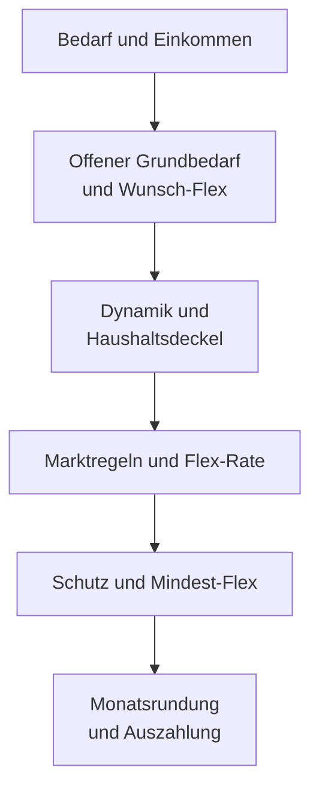
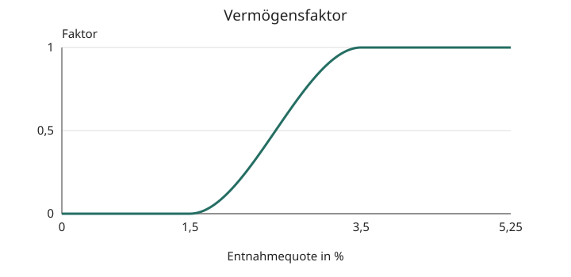
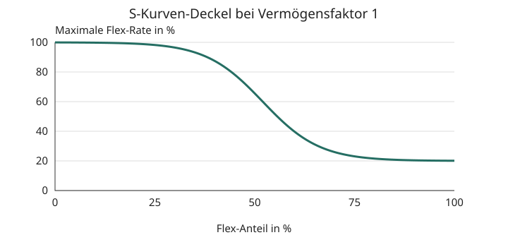

# Rechenweg des Jahresbudgets

Wie aus deinem Bedarf eine monatliche Entnahme wird. Für fachlich Interessierte. Codeprüfung: 29.10.2026.

## Auf einen Blick

- Einkommen deckt zuerst den Grundbedarf und dann den Wunsch-Flex.
- Dynamic Flex verändert den berechneten Bedarf; die Flex-Rate bestimmt den auszahlbaren Anteil.
- Der Grundbedarf wird rechnerisch nicht gekürzt. Seine Finanzierung braucht trotzdem genügend Geldvermögen.
- Mindest-Flex ist ein Ziel. Spätere Grenzen und Rundung können es unterschreiten.
- Der Jahresabschluss hält den Beschluss fest; eine Vorschau verändert ihn nicht.

## Vom Bedarf zum Budget

### Einkommen

Alle Beträge gelten für das Planjahr. Es gilt der [Haushalt aus „Personen & Vermögen“](FACHKONZEPT.md#haushalt). „Grundbedarf“ und „Wunsch-Flex“ beschreiben den Haushalt vor Einkommen; „Mindest-Flex“ ist die gewünschte Untergrenze des Haushalts-Flex. Im Jahresabschluss ist der Plan mit Inflation vorausgewählt; bei Grundbedarf und Wunsch-Flex steht zusätzlich der Ist-Wert aus aufgeteilten Monaten mit Inflation zur Wahl. Beide Vorschläge und der hochgerechnete Mindest-Flex werden auf volle 1.000 € aufgerundet, etwa 30.750 € auf 31.000 €. Eigene Eingaben bleiben frei. Ist-Ausgaben ersetzen den Plan nur nach Auswahl und Abschluss. Eine importierte Floor/Flex-Aufteilung ordnet die App nicht selbst zu; sie verändert keine Budgetstufe. Die Ausgabenhochrechnung verwendet den Mittelwert positiver, vollständiger und abgelaufener Monate. Floor/Flex mitteln davon nur Monate mit Aufteilung; Gesamt bleibt die Hochrechnung aller gezählten Monate.

Mit Jahreseinkommen R, offenem Grundbedarf F und berechnetem Flex-Bedarf X gilt vor Rundung:

```text
F = max(0, Grundbedarf − R)
Offener Wunsch-Flex = max(0, Wunsch-Flex − max(0, R − Grundbedarf))
Jahresentnahme = F + X × Flex-Rate / 100
```

R umfasst Rente und feste persönliche Einkünfte mit ihren gültigen Monaten. Nettomieten sind [Immobilieneinkünfte](IMMOBILIEN.md#miete). [Pflege](PFLEGE.md#kosten-im-bedarf), auch der [Heimaufenthalt](PFLEGE.md#heim), und [Tod](TOD_UND_ERBE.md#einkommen-und-bedarf) verändern die Eingangsbedarfe und Einkommen vor dieser Rechnung. Ihre Regeln stehen im jeweiligen Thema. Die [Erbschaftsteuerzahlung](TOD_UND_ERBE.md#zahlung) folgt nach dem Budget und ändert dessen Beschluss nicht.

### Dynamik

Ohne „Dynamic Flex“ ist X der offene Wunsch-Flex. Mit Dynamik entsteht ein Entnahmerahmen aus aktivem Geldvermögen, angenommener Realrendite und Resthorizont. Nach „Go-Go“, Sicherheitsstufen und Haushaltsdeckel bleibt X übrig. Eine geringe Flex-Rate kann auf dieser größeren Basis trotzdem mehr als den Wunschbetrag liefern.

Das aktive Geldvermögen umfasst freie Liquidität, Aktien, Anleihen und aktives Gold; eine gesperrte Pflege-Rücklage gehört nicht dazu. Immobilien zählen zum Gesamtvermögen, aber nicht zur Budget- oder Strategiequote.



### Ansparjahr

Einkommen über dem beschlossenen Bedarf wird gespart. Mit Dynamik kann daneben eine Depotentnahme anfallen; der gesamte Haushalts-Flex bleibt begrenzt. Der beschlossene Einkommens-Flex entscheidet über den Überschuss. Ohne wirksame Dynamik entspricht er dem Wunsch-Flex. Mit wirksamer Dynamik ist er höchstens der dynamische Bedarf vor Einkommensverrechnung und höchstens doppelter Wunsch-Flex minus Depot-Flex, mindestens null. Gespart wird max(0, R − Grundbedarf − beschlossener Einkommens-Flex). Der Simulator schreibt den Rest dem persönlichen Tagesgeld gut. Balance zählt tatsächliche Eingänge im erfassten Tagesgeld. Die anschließende [Anlage](HANDLUNGSANWEISUNG.md#c9) folgt eigenen Regeln.

Feste geplante Ausgaben zählen in ihren Monaten zum Grundbedarf und werden nie gekürzt. Das Monatsbudget eines Monats ist (Jahresbudget − feste Ausgaben des Jahres) / 12 plus die festen Ausgaben dieses Monats. Einmalige geplante Ausgaben stehen außerhalb von Grundbedarf und Flex. Ihre Jahresreserve erhöht erst nach dem Budgetbeschluss das [Liquiditätsziel](HANDLUNGSANWEISUNG.md#c1). Einmalige Einkünfte verändern dieses Monatsbudget nicht.

## Flex-Rate

### Normalzweig

Die Folge lautet B0 → B2–B8 → B9–B13. Der Vorjahresanker startet ohne Vorgeschichte mit 100 %. Markt, Glättung und Änderungsgrenzen bestimmen zunächst die Rate; Schutzregeln können sie anschließend senken oder heben. Die endgültige Rate ist deshalb kein einzelner Marktabschlag.

Der Vermögensfaktor w liegt zwischen 0 und 1. Bei niedriger Quote der realen Vorjahresentnahme zum realen Depot schwächt er Kürzungen ab. Depot bedeutet hier Aktien, Anleihen und aktives Gold, ohne freie Liquidität. Zwischen sicherer und voller Quotenschwelle steigt w weich:

```text
t = auf 0 bis 1 begrenzte Position zwischen den Quotenschwellen
w = t² × (3 − 2t)
```



### Marktphasen

Der Hochabstand ist der nominale Rückgang vom verwendeten Hoch. Im Jahresabschluss stehen Jahresendregel und Jahreshoch nur bei einem verdeckten Bärenmarkt ohne Vorauswahl zur Wahl: Gemessen am Jahreshoch kürzt die Engine den Flex (tiefer Bär, Erholung im Bärenmarkt), nach der Jahresendregel nicht (FR-71, geändert durch FR-77). Das Jahreshoch ist der höchste gespeicherte Schluss des Referenz-ETF seit Ende des Vorjahrs. Nur die ausdrückliche Jahreshochwahl speichert Wert, Datum und Bruchteilsalter für die Folgejahre. Ohne Wahlmöglichkeit oder belastbaren Vergleich gilt die Jahresendregel. Simulator, Backtest und Monte Carlo behalten Jahresendstände. Die App prüft diese Marktphasen in Tabellenfolge:

| Phase | Bedingung |
|---|---|
| Heißer / stabiler Höchststand | Am Hoch oder darüber; heiß ab 10 % Jahresgewinn. |
| Tiefer Bär | Mehr als 20 % unter dem Hoch. |
| Bestätigte Erholung | Sonst mehr als 10 % Abstand, über 10 % Jahresgewinn, mehr als sechs Monate seit dem Hoch. |
| Junge Korrektur | Sonst höchstens 15 % Abstand und sechs Monate seit dem Hoch. |
| Lange Seitwärtsphase | Übrige Fälle; auch Ersatz bei fehlender Hochbasis. |
| Erholung im Bär | Ersetzt tiefen Bär oder bestätigte Erholung: mindestens 15 % Jahresgewinn oder 30 % über dem tiefsten der bis zu vier verfügbaren Jahresendstände, weiter mehr als 15 % Hochabstand. |

Bei Abstand und null Jahren seit dem Hoch setzt die App zwölf Monate an. Junge Korrektur erfordert deshalb eine positive Jahresbruchzahl bis 0,5. Stagflation ist ein zusätzliches Handelssignal, keine achte Budgetphase.

### Alarm

Im Alarm gilt B0 → B1 → B8–B13. B2–B7 entfallen, B8 bleibt ausgesetzt. B9 darf ein offenes Mindestziel nicht anheben. Der Alarm bleibt über Jahre erhalten, bis seine Ausstiegsbedingungen erfüllt sind.

### Schutz und Minimum

Die S-Kurve schützt bei niedriger geschützter Entnahmequote den offenen Wunsch-Flex, begrenzt aber dynamischen Mehrbedarf. Ihr Deckel gilt innerhalb B5; spätere Regeln wirken weiter. Die Budgetuntergrenze in B8 kann die Rate wieder erhöhen. Ihr Anhebungsziel ist bei positivem Depot auf Einkommen plus vorsichtige Depotquote begrenzt; schon höhere Auszahlungen werden dadurch nicht abgesenkt.



Die Kurve zeigt den Basisdeckel bei vollem Vermögensfaktor vor Wunschschutz. Mindest-Flex schützt den Haushaltsbetrag einschließlich Einkommensbeitrag. Das Minimum darf nicht über dem Wunsch-Flex liegen; die App weist ungültige Eingaben ab. Eine schwere Flex-Notlage kann Mindestziel und normale Änderungsgrenze durchbrechen.

### Rundung

Die App rundet die Monatsentnahme ab und rechnet sie wieder aufs Jahr hoch. Der offene Grundbedarf bleibt die Untergrenze. Die ausgezahlte Flex-Rate sinkt dadurch; der nächste Ratenanker bewahrt den Wert vor Rundung. Das verhindert, dass Rundungsreste jedes Jahr eine neue Kürzung erzeugen.

## Jahresgedächtnis

### Fortschreibung

Die App übernimmt Ratenanker, tatsächliche reale Entnahme, realen Höchststand, Alarm, Flex-Budget-Vorrat, Sicherheitsstufe und geglättete Rendite ins Folgejahr. Höchststand und Rückgang beziehen sich auf aktives Geldvermögen. Eine geänderte Pflege-Rücklage verschiebt auch die Höchststandsbasis; sie gilt dadurch nicht als Marktverlust.

Normale Jahres-, Inflations-, Renten- und Marktwechsel bewahren dieses Gedächtnis. Balance schreibt den Inflationsfaktor des berechneten Bereichs einmal je Abschluss fort, im Zweipersonenhaushalt auch in allen Kopien des gemeinsamen Zustands. Balance rechnet mit erfassten Daten, der Simulator mit seinem jeweiligen Vorjahr. Dessen Jahreszeile zeigt den Beschluss nach der Jahresrendite.

### Bewusster Neustart

Eine bewusste Planänderung setzt das Budgetgedächtnis zurück: etwa Bedarf, Mindest-Flex, Flex-Budget, Reserveziel, Strategie, Dynamik oder Haushaltsverteilung. Auch kleine Betragsänderungen zählen. Die reine Aufteilung der Reserve in Tagesgeld und Geldmarkt erhält das Budgetgedächtnis. Bestände, CAPE oder Rente allein lösen keinen Neustart aus. Persönliche Steuerstände bleiben erhalten. Ein Neustart kann deshalb eine nachwirkende Kürzung beenden.

### Beschluss

Der Abschluss von J beschließt den Plan für J+1. Offene Jahre werden nacheinander verarbeitet; jeder Beschluss verwendet die zugehörigen Jahresdaten und persönlichen Tagesgeldstände. Empfehlung und eigener Beschluss bleiben getrennt belegt. „Monatsbudget“ umfasst Einkommen plus Vermögensentnahme abzüglich gesparten Einkommens; die Vermögensentnahme allein ist ein anderer Betrag. Der [Jahresbeleg](HANDLUNGSANWEISUNG.md#beleg) hält die Empfehlung fest. Der Schritt „Pflegewerte“ zeigt die [fortgeschriebenen Pflegepreise](PFLEGE.md#heim) für J+1, sobald die Inflation des Jahres vorliegt; „Unverändert bestätigen“ übernimmt sie, eigene Werte bleiben ohne weitere Erhöhung. Bedienung: [Jahr abschließen](../../Handbuch.html#jahr-abschliessen).

## Nachschlagen

### A-Steckbriefe

Die tatsächliche Bedarfsfolge ist A4-Schalter → A1 → A2 → A3 → A4-Boden/Rückkehr → A5. F bezeichnet offenen Grundbedarf, X den anschließenden Flex-Bedarf, R das Jahreseinkommen. Ratenänderungen stehen in Prozentpunkten. Die [Parameter](#parameter) liefern die aktuellen Konstanten.

<a id="a1"></a>
### A1 Einkommen verrechnen

- Zweck: Nur ungedeckten Bedarf aus Geldvermögen finanzieren.
- Wann sie greift: Vor jeder Budgetrechnung.
- Rechnung: R deckt zuerst Grundbedarf, danach Wunsch-Flex; negative Bedarfe werden null. Die Eingangsprojektion berücksichtigt [Pflege](PFLEGE.md#reserve-und-flex) und [Hinterbliebene](TOD_UND_ERBE.md#einkommen-und-bedarf). Im Heim ersetzen in Monte Carlo [Heimkosten und eigene Ausgaben](PFLEGE.md#heim) den Grundbedarfsanteil der Person. Endet akute Heimpflege, gilt wieder der Grundbedarf zu Hause, auch in der Folgejahresvorschau für das Liquiditätsziel. Die [Erbschaftsteuerzahlung](TOD_UND_ERBE.md#zahlung) bleibt außerhalb des Budgets.
- Parameter: Grundbedarf, Wunsch-Flex und gültige Einkünfte der einen oder zwei Haushaltspersonen. Im Simulator ergänzt die gemeinsame [Pflegerechnung](PFLEGE.md#kosten-im-bedarf) heutige und künftige Pflege automatisch; der Grundbedarf beschreibt alle Personen zu Hause ohne Pflege. Heimpflege ersetzt ihren Anteil, Flex und Mindest-Flex folgen dem absoluten Pflege-Level. Das Liquiditätsziel nutzt bei Pflege den vollen Folgejahresbedarf. Balance rechnet seit FR-73 mit derselben Funktion wie der Simulator im ersten Jahr: Grundbedarf zu Hause, Pflege zu Hause, Heimkosten und eigene Ausgaben im Heim aus dem bestätigten Plan (Grundbedarf und Flex ohne Pflege), dem heutigen Pflegezustand der Personen und den Pflegepreisen des Haushalts; Wunsch- und Mindest-Flex folgen dem absoluten Pflege-Level, das Pflegegeld zählt nach dem Angehörigenausfall als Einkunft. Das Liquiditätsziel und die Vorschau des Folgejahres nutzen Heimjahr + 1, Folgejahrespreise und die Einkünfte des Folgejahrs mit Kalendergrenzen und Fortschreibung (Rentenanpassung des Hauptprofils für beide Renten wie im Simulator, Anpassung fester Einkünfte, Pflegegeld mit Inflation). Ohne bestätigten Plan bleibt die gespeicherte Bedarfsbasis.
- Beispiel: [Max und Erika](#max-und-erika-im-jahresvergleich).
- Gedächtnis: Einkommen und Bedarf werden fürs Folgejahr fortgeschrieben.
- Name: Offener Grundbedarf und Wunsch-Flex.
- Quelle: [Technischer Stufenbesitz](TECHNICAL.md#stufen-und-codebesitz).

<a id="a2"></a>
### A2 Dynamic Flex

- Zweck: Vermögen über die verbleibenden Jahre verteilen.
- Wann sie greift: Angefordert, zugelassen, mit positivem Horizont.
- Rechnung: Annuitätenfaktor bei Realrendite r und h Jahren: r / (1 − (1 + r)^(−h)); bei |r| < 0,001 gilt 1/h. Die Aktienrendite e folgt linear den CAPE-Stützpunkten. Davon gehen die Fondskosten k ab, (1 + e) × (1 − k) − 1, danach die langfristige Inflation. Tatsächliche Anlageanteile gewichten Aktien, Gold und sichere Anlagen einschließlich Anleihen. Grenzen und Vorjahresglättung folgen vor der Annuität. Der alternative stetige CAPE-Pfad verwendet eigene Grenzen und zieht k ebenso ab.
- Parameter: Renditeannahmen, Fondskosten aus Haushalt & Plan (Vorgabe 0,5 % pro Jahr), Zusammensetzung und Horizont. Sterbetafel (seit FR-75 die Kohortentafel V2 des Geburtsjahrs), Überlebensquantil oder direkte Eingabe bestimmen h; optionale Langlebigkeitsaufschläge gelten einmal im Haushalt. Bei Tod kann der Simulator den Horizontübergang glätten.
- Beispiel: [Dynamischer Haushalt](#dynamic-flex-mit-greifender-haushaltsobergrenze).
- Gedächtnis: Geglättete Rendite und letzter dynamischer Bedarf.
- Name: „Dynamic Flex“.
- Quelle: [Technischer Stufenbesitz](TECHNICAL.md#stufen-und-codebesitz).

<!-- docs:parameter {"target":"#a2","keys":["SPENDING_MODEL.DYNAMIC_FLEX.RETURN_POLICY","SPENDING_MODEL.DYNAMIC_FLEX.LONG_TERM_INFLATION","SPENDING_MODEL.DYNAMIC_FLEX.SAFE_ASSET_REAL_RETURN","SPENDING_MODEL.DYNAMIC_FLEX.GOLD_REAL_RETURN","SPENDING_MODEL.DYNAMIC_FLEX.MIN_HORIZON_YEARS","SPENDING_MODEL.DYNAMIC_FLEX.MAX_HORIZON_YEARS","SPENDING_MODEL.DYNAMIC_FLEX.FALLBACK_REAL_RETURN","SPENDING_MODEL.DYNAMIC_FLEX.MIN_REAL_RETURN","SPENDING_MODEL.DYNAMIC_FLEX.MAX_REAL_RETURN","SPENDING_MODEL.DYNAMIC_FLEX.EXPECTED_RETURN_SMOOTHING_ALPHA","MARKET_VALUATION.DEFAULT_CAPE","MARKET_VALUATION.EXPECTED_RETURN_CAPE_POINTS.0.0","MARKET_VALUATION.EXPECTED_RETURN_CAPE_POINTS.0.1","MARKET_VALUATION.EXPECTED_RETURN_CAPE_POINTS.1.0","MARKET_VALUATION.EXPECTED_RETURN_CAPE_POINTS.1.1","MARKET_VALUATION.EXPECTED_RETURN_CAPE_POINTS.2.0","MARKET_VALUATION.EXPECTED_RETURN_CAPE_POINTS.2.1","MARKET_VALUATION.EXPECTED_RETURN_CAPE_POINTS.3.0","MARKET_VALUATION.EXPECTED_RETURN_CAPE_POINTS.3.1","MARKET_VALUATION.UNDERVALUED_CAPE","MARKET_VALUATION.FAIR_VALUE_CAPE","MARKET_VALUATION.OVERVALUED_CAPE","MARKET_VALUATION.EXTREME_OVERVALUED_CAPE","MARKET_VALUATION.EXPECTED_RETURN_BY_SIGNAL.undervalued","MARKET_VALUATION.EXPECTED_RETURN_BY_SIGNAL.fair","MARKET_VALUATION.EXPECTED_RETURN_BY_SIGNAL.overvalued","MARKET_VALUATION.EXPECTED_RETURN_BY_SIGNAL.extreme_overvalued","CAPE_CONTINUOUS.DEFAULT_CAPE","CAPE_CONTINUOUS.MIN_CAPE","CAPE_CONTINUOUS.MAX_CAPE","CAPE_CONTINUOUS.MIN_REAL_RETURN","CAPE_CONTINUOUS.MAX_REAL_RETURN","CAPE_CONTINUOUS.MIN_EQUITY_REAL_RETURN","CAPE_CONTINUOUS.MAX_EQUITY_REAL_RETURN","CAPE_CONTINUOUS.EQUITY_PREMIUM_ADJUSTMENT","CAPE_CONTINUOUS.SAFE_REAL_RETURN_MODE"]} -->

<a id="a3"></a>
### A3 Go-Go

- Zweck: Frühen Ruhestand höher gewichten.
- Wann sie greift: Wirksame Dynamik, Go-Go eingeschaltet, Sicherheitsstufe 0, älteste lebende Person höchstens 80.
- Rechnung: Gesamte Annuität mit dem begrenzten Go-Go-Faktor multiplizieren, erst danach F abziehen.
- Parameter: Faktor und Alter lebender Personen.
- Beispiel: [Dynamischer Haushalt](#dynamic-flex-mit-greifender-haushaltsobergrenze).
- Gedächtnis: Kein eigener Zähler; nach Alter 80 endet der Zuschlag ohne Rampe.
- Name: „Go-Go“.
- Quelle: [Technischer Stufenbesitz](TECHNICAL.md#stufen-und-codebesitz).

<!-- docs:parameter {"target":"#a3","keys":["SPENDING_MODEL.DYNAMIC_FLEX.MAX_GO_GO_MULTIPLIER"]} -->

<a id="a4"></a>
### A4 Sicherheitsstufen und Rückkehr

- Zweck: Zusatzdynamik bei anhaltendem Stress zurücknehmen.
- Wann sie greift: Bei angeforderter Dynamik; neue Signale gelten fürs Folgejahr.
- Rechnung: Stufe 0 erlaubt Dynamik und Go-Go, Stufe 1 nur Dynamik, Stufe 2 einen statischen Bedarf mit dem Maximum aus offenem Wunsch, Grundbedarfsanteil und Anteil des letzten dynamischen Bedarfs. Rückkehr aus Stufe 2 mischt Wunsch und Dynamik über eine Rampe. Alarm zählt zwei Stresspunkte, Depotquote ab Vorsichtsquote, realer Rückgang ab Alarmgrenze, Reichweitenkrise und starke Ratenkürzung je einen. Kritische Folgejahre oder schwerer Stress erhöhen die Stufe. Stufe 2 verlangt zusätzlich kritischen Stress. Stabile Folgejahre ohne Alarm, mit Quote, Rückgang und Ratenkürzung innerhalb der Rückkehrgrenzen sowie Reichweite mindestens auf harter Mindestreichweite plus Zusatzpuffer senken sie. Stufe 0 beendet die Rampe sofort; neutrale Jahre löschen die Folgenzähler. Selbst verursachte Kürzungen ohne kritischen Stress verhindern die Rückkehr aus Stufe 2 nicht; bei Drei Töpfen wird dort auch der Rückgang ausgeblendet.
- Parameter: Schwellen und Zähler in der Tabelle; Sicherheitsreichweite ist freie Liquidität nach der geplanten Transaktion / ungekürzter Monatsbedarf.
- Beispiel: [Technische Gegenproben](TECHNICAL.md#vollständige-budgetbeispiele).
- Gedächtnis: Stufe, Jahresfolgen, Rampenrest und dynamischer Vorbedarf.
- Name: Sicherheitsstufe und Rückkehrgewicht.
- Quelle: [Technischer Stufenbesitz](TECHNICAL.md#stufen-und-codebesitz).

<!-- docs:parameter {"target":"#a4","keys":["SPENDING_MODEL.DYNAMIC_FLEX_SAFETY.ENABLED","SPENDING_MODEL.DYNAMIC_FLEX_SAFETY.MAX_STAGE","SPENDING_MODEL.DYNAMIC_FLEX_SAFETY.BAD_SCORE_THRESHOLD","SPENDING_MODEL.DYNAMIC_FLEX_SAFETY.SEVERE_SCORE_THRESHOLD","SPENDING_MODEL.DYNAMIC_FLEX_SAFETY.ESCALATE_STREAK_YEARS","SPENDING_MODEL.DYNAMIC_FLEX_SAFETY.DEESCALATE_STREAK_YEARS","SPENDING_MODEL.DYNAMIC_FLEX_SAFETY.HARD_CUT_PCT","SPENDING_MODEL.DYNAMIC_FLEX_SAFETY.GOOD_WITHDRAWAL_RATE","SPENDING_MODEL.DYNAMIC_FLEX_SAFETY.GOOD_DRAWDOWN","SPENDING_MODEL.DYNAMIC_FLEX_SAFETY.GOOD_CUT_PCT","SPENDING_MODEL.DYNAMIC_FLEX_SAFETY.RUNWAY_HEADROOM_MONTHS","SPENDING_MODEL.DYNAMIC_FLEX_SAFETY.REENTRY_RAMP_YEARS","SPENDING_MODEL.DYNAMIC_FLEX_SAFETY.STAGE2_REQUIRE_CRITICAL_STRESS","SPENDING_MODEL.DYNAMIC_FLEX_SAFETY.STAGE2_MIN_FLEX_OF_FLOOR_RATIO","SPENDING_MODEL.DYNAMIC_FLEX_SAFETY.STAGE2_MIN_FLEX_OF_PREV_DYNAMIC_RATIO"]} -->

<a id="a5"></a>
### A5 Haushaltsobergrenzen

- Zweck: Dynamischen Mehrbedarf begrenzen.
- Wann sie greift: Bei angeforderter Dynamik, auch während Unterdrückung durch Stufe 2.
- Rechnung: Haushalts-Flex höchstens zweimal aktueller Wunsch-Flex. Für den Depotanteil bleibt dieser Rahmen abzüglich Einkommensüberschuss, mindestens null. Für Hinterbliebene zählt ihr angepasster Wunsch.
- Parameter: Wunsch-Flex und Einkommen.
- Beispiel: [Dynamischer Haushalt](#dynamic-flex-mit-greifender-haushaltsobergrenze).
- Gedächtnis: Kein eigener Zähler.
- Name: „Dynamic-Flex-Obergrenze“.
- Quelle: [Technischer Stufenbesitz](TECHNICAL.md#stufen-und-codebesitz).

### B-Steckbriefe

Vier Quoten haben unterschiedliche Nenner. Die reale Vorjahresquote steuert w; die vorläufige Quote verwendet F + X × Vorjahresanker / 100 und das Depot. Die geschützte Quote teilt F plus offenen Mindest-Flex durch aktives Geldvermögen einschließlich Liquidität. Die Notlage verwendet die normale geplante Entnahme nach Rundung auf derselben Geldvermögensbasis. Ohne positives Depot gelten für w 100 % Ersatzquote und für die vorläufige Quote 0 %. Leeres aktives Geldvermögen bei positivem Bedarf ergibt 100 % Ersatzquote, keine verfügbare Auszahlung.

<a id="b0"></a>
### B0 Vorjahresanker und Bezugsgrößen

- Zweck: Gemeinsamen Startpunkt festlegen.
- Wann sie greift: Jährlich vor der Rate.
- Rechnung: Gespeicherter Anker, ersatzweise Vorjahresrate; ohne Vorgeschichte 100 %. Fehlt die reale Vorjahresentnahme, verwendet w aktuellen ungekürzten Bedarf / Depot. Freie Liquidität / ungekürzter Monatsbedarf ergibt die vorläufige Reichweite.
- Parameter: Sichere und volle Quotenschwelle.
- Beispiel: [Jahresvergleich](#max-und-erika-im-jahresvergleich).
- Gedächtnis: Anker, reale Entnahme und bereinigter Höchststand.
- Name: „Vorjahresanker“.
- Quelle: [Technische Bezugsgrößen](TECHNICAL.md#jahreszustand).

<!-- docs:parameter {"target":"#b0","keys":["SPENDING_MODEL.WEALTH_ADJUSTED_REDUCTION.SAFE_WITHDRAWAL_RATE","SPENDING_MODEL.WEALTH_ADJUSTED_REDUCTION.FULL_WITHDRAWAL_RATE"]} -->
<!-- docs:parameter {"target":"#b0","keys":["THRESHOLDS.STRATEGY.stagflationInflation"]} -->

<a id="b1"></a>
### B1 Alarm

- Zweck: Kritische Bärenphase behandeln.
- Wann sie greift: Tiefer Bär, w mindestens 0,5 und entweder kritischer realer Rückgang oder kritische Depotquote zusammen mit kurzer Reichweite.
- Rechnung: Neuer Alarm senkt den Anker um 10 × w Punkte, mindestens auf 35 %. Fortgesetzter Alarm wiederholt den Abzug nicht. Am Hoch/seitwärts genügen unkritische Quote oder höchstens 15 % Rückgang zum Ausstieg. Erholung im Bär verlangt einen höheren Jahresendstand als das niedrigere der beiden Vorjahre sowie unkritische Quote, ausreichende Reichweite oder erholten Rückgang. Andere Erholungsphasen beenden ihn nicht.
- Parameter: Alarmschwellen; bei w unter 0,5 endet der Alarm im tiefen Bär.
- Beispiel: [2002](#max-und-erika-im-jahresvergleich).
- Gedächtnis: Alarmzustand.
- Name: „Alarmgrenze“.
- Quelle: [Technischer Stufenbesitz](TECHNICAL.md#stufen-und-codebesitz).

<!-- docs:parameter {"target":"#b1","keys":["THRESHOLDS.ALARM.withdrawalRate","THRESHOLDS.ALARM.realDrawdown","THRESHOLDS.STRATEGY.runwayThinMonths"]} -->

<a id="b2"></a>
### B2 Rohziel

- Zweck: Marktabhängigen Ausgangswert bilden.
- Wann sie greift: Ohne Alarm.
- Rechnung: Im tiefen Bär 100 − (50 + max(0, Hochabstand − 20)) × w, sonst 100 %.
- Parameter: Marktphase und w.
- Beispiel: [Normaljahr](#max-und-erika-im-jahresvergleich).
- Gedächtnis: Keines.
- Name: „Bärenmarkt“.
- Quelle: [Stufenbesitz](TECHNICAL.md#stufen-und-codebesitz).

<a id="b3"></a>
### B3 Glättung

- Zweck: Neues Rohziel schrittweise übernehmen.
- Wann sie greift: Ohne Alarm.
- Rechnung: Gewicht α + (1 − w) × (1 − α) fürs Rohziel, Rest für den Anker.
- Parameter: Glättungsgewicht α.
- Beispiel: [Normaljahr](#max-und-erika-im-jahresvergleich).
- Gedächtnis: Gemeinsamer Anker.
- Name: „Glättung“.
- Quelle: [Stufenbesitz](TECHNICAL.md#stufen-und-codebesitz).

<!-- docs:parameter {"target":"#b3","keys":["SPENDING_MODEL.FLEX_RATE_SMOOTHING_ALPHA"]} -->

<a id="b4"></a>
### B4 Änderungsgrenze

- Zweck: Jahressprünge begrenzen.
- Wann sie greift: Ohne Alarm nach Glättung.
- Rechnung: Auf-/Abwärtsgrenzen relativ zum Anker; am Hoch, seitwärts und bei Erholung im Bär größerer Anstieg. Niedrige Vorjahresquote erlaubt schnellere Rückkehr. Abwärts lockert (1 − w)² die Grenze.
- Parameter: Erste Änderungsgrenzen und Rückkehrquote.
- Beispiel: [Dynamischer Haushalt](#dynamic-flex-mit-greifender-haushaltsobergrenze).
- Gedächtnis: Gemeinsamer Anker.
- Name: „Änderungsgrenze“.
- Quelle: [Stufenbesitz](TECHNICAL.md#stufen-und-codebesitz).

<!-- docs:parameter {"target":"#b4","keys":["SPENDING_MODEL.RATE_CHANGE_MAX_UP_PP","SPENDING_MODEL.RATE_CHANGE_AGILE_UP_PP","SPENDING_MODEL.RATE_CHANGE_MAX_DOWN_PP","SPENDING_MODEL.RATE_CHANGE_MAX_DOWN_IN_BEAR_PP","SPENDING_MODEL.RATE_CHANGE_RELAX_MAX_DOWN_PP","SPENDING_MODEL.RATE_CHANGE_RELAX_UP_WITHDRAWAL_RATE","SPENDING_MODEL.RATE_CHANGE_RELAX_MAX_UP_PP"]} -->

<a id="b5"></a>
### B5 S-Kurve

- Zweck: Hohen Flex-Anteil begrenzen.
- Wann sie greift: Ohne Alarm bei positivem Bedarf und w.
- Rechnung: Mit x = X/(F+X) gilt s = 1/(1+exp(−A×(x−B))) und Deckel 100 − 100×K×s×w. Bis zur Schutzquote gewinnt der höhere Wert aus Deckel und Wunschrate. Nur Senkungen über 0,05 Punkte werden übernommen.
- Parameter: Kurve und Schutzquote.
- Beispiel: [Dynamischer Haushalt](#dynamic-flex-mit-greifender-haushaltsobergrenze).
- Gedächtnis: Keines.
- Name: „Begrenzung nach Flex-Anteil“ oder „S-Kurve für dynamischen Flex“.
- Quelle: [Stufenbesitz](TECHNICAL.md#stufen-und-codebesitz).

<!-- docs:parameter {"target":"#b5","keys":["SPENDING_MODEL.FLEX_SHARE_MIN_PROTECTED_WITHDRAWAL_RATE","SPENDING_MODEL.FLEX_SHARE_S_CURVE.ENABLED","SPENDING_MODEL.FLEX_SHARE_S_CURVE.K","SPENDING_MODEL.FLEX_SHARE_S_CURVE.A","SPENDING_MODEL.FLEX_SHARE_S_CURVE.B"]} -->

<a id="b6"></a>
### B6 Bären-Obergrenze

- Zweck: Rate im tiefen Bär begrenzen.
- Wann sie greift: Ohne Alarm im tiefen Bär.
- Rechnung: Basisdeckel plus Entlastung × (1−Flex-Anteil), höchstens 100 %; w schwächt die Senkung ab.
- Parameter: Bärendeckel und Entlastung.
- Beispiel: [2002](#max-und-erika-im-jahresvergleich) überspringt B6.
- Gedächtnis: Sicherheitskandidat.
- Name: „Bärenmarkt-Obergrenze“.
- Quelle: [Stufenbesitz](TECHNICAL.md#stufen-und-codebesitz).

<!-- docs:parameter {"target":"#b6","keys":["SPENDING_MODEL.FLEX_RATE_HARD_CAPS.BEAR_DEEP_MAX_RATE","SPENDING_MODEL.FLEX_RATE_HARD_CAPS.FLEX_SHARE_RELIEF_MAX_PP"]} -->

<a id="b7"></a>
### B7 Liquiditäts-Obergrenze

- Zweck: Kurze Reichweite berücksichtigen.
- Wann sie greift: Ohne Alarm bei Unterdeckung.
- Rechnung: Vorläufige Reichweite / harte Mindestmonate; die erste strikt unterschrittene Deckungsschwelle bestimmt den Basisdeckel. Entlastung und w wirken wie B6.
- Parameter: Deckungsschwellen und Raten; [Mindestreichweite](HANDLUNGSANWEISUNG.md#harte-mindestreichweite).
- Beispiel: [Normaljahr](#max-und-erika-im-jahresvergleich).
- Gedächtnis: Sicherheitskandidat; noch kein Auffüllverkauf.
- Name: „Liquiditäts-Obergrenze“.
- Quelle: [Stufenbesitz](TECHNICAL.md#stufen-und-codebesitz).

<!-- docs:parameter {"target":"#b7","keys":["SPENDING_MODEL.FLEX_RATE_HARD_CAPS.RUNWAY_COVERAGE_CAPS.0.maxCoverage","SPENDING_MODEL.FLEX_RATE_HARD_CAPS.RUNWAY_COVERAGE_CAPS.0.maxRate","SPENDING_MODEL.FLEX_RATE_HARD_CAPS.RUNWAY_COVERAGE_CAPS.1.maxCoverage","SPENDING_MODEL.FLEX_RATE_HARD_CAPS.RUNWAY_COVERAGE_CAPS.1.maxRate","SPENDING_MODEL.FLEX_RATE_HARD_CAPS.RUNWAY_COVERAGE_CAPS.2.maxCoverage","SPENDING_MODEL.FLEX_RATE_HARD_CAPS.RUNWAY_COVERAGE_CAPS.2.maxRate"]} -->

<a id="b8"></a>
### B8 Leitplanken

- Zweck: Erholung vorsichtig behandeln und Kaufkraft stützen.
- Wann sie greift: Ohne Alarm.
- Rechnung: Erholung im Bär liefert einen hochabstandsabhängigen Deckel; unter 30 Monaten Reichweite mindestens 20 Punkte Kürzung, jeweils mit w gedämpft. Eine bindende Erholungsregel sperrt die Budgetanhebung. Deren Ziel entsteht aus laufendem Bedarf: F/i×(1+b)+X/i+R, mit i = 1+max(0, Inflation)/100 und b = begrenzter Anhebungswert/100. w dämpft den Zielabstand; die vorsichtige Depotquote begrenzt das Anhebungsziel. Über 1 € Abstand darf die Rate bis 100 % steigen. In Bärenphasen verlangt die Anhebung höchstens 10 % Hochabstand, keinen neuen niedrigeren Jahresendstand und mindestens max(30 Monate, harte Mindestreichweite + 6 Monate) Reichweite; die heutigen Phasengrenzen schließen sie dort aus.
- Parameter: Erholungsstaffel, Vorsichtsquote und Anhebungswert.
- Beispiel: [Dynamischer Haushalt](#dynamic-flex-mit-greifender-haushaltsobergrenze).
- Gedächtnis: Ziel ist kein garantiertes Vorjahresbudget.
- Name: „Leitplanken“, begrenzt auch „Guardrail (Vorsicht)“.
- Quelle: [Stufenbesitz](TECHNICAL.md#stufen-und-codebesitz).

<!-- docs:parameter {"target":"#b8","keys":["THRESHOLDS.CAUTION.withdrawalRate","RECOVERY_GUARDRAILS.description","RECOVERY_GUARDRAILS.CURB_RULES.0.minGap","RECOVERY_GUARDRAILS.CURB_RULES.0.maxGap","RECOVERY_GUARDRAILS.CURB_RULES.0.curbPercent","RECOVERY_GUARDRAILS.CURB_RULES.1.minGap","RECOVERY_GUARDRAILS.CURB_RULES.1.maxGap","RECOVERY_GUARDRAILS.CURB_RULES.1.curbPercent","RECOVERY_GUARDRAILS.CURB_RULES.2.minGap","RECOVERY_GUARDRAILS.CURB_RULES.2.maxGap","RECOVERY_GUARDRAILS.CURB_RULES.2.curbPercent","RECOVERY_GUARDRAILS.CURB_RULES.3.minGap","RECOVERY_GUARDRAILS.CURB_RULES.3.maxGap","RECOVERY_GUARDRAILS.CURB_RULES.3.curbPercent","RECOVERY_GUARDRAILS.getCurb"]} -->

<a id="b9"></a>
### B9 Mindest-Flex

- Zweck: Offenes Mindestziel finanzieren.
- Wann sie greift: Positives Ziel, noch ungedeckt.
- Rechnung: Erforderliche Rate = 100 × offenes Mindestziel / X, höchstens 100 %. Alarm oder fehlendes Geldvermögen für Jahresgrundbedarf samt Minimum und harter Mindestreserve sperren die Anhebung. Spätere Stufen können erneut senken.
- Parameter: Gültiger Mindest-Flex; null ist inaktiv.
- Beispiel: [2002](#max-und-erika-im-jahresvergleich) deckt das Minimum bereits aus Rente.
- Gedächtnis: Für die Einschränkungsmessung zählt das damalige positive Minimum; [Messdefinition](SIMULATION_LESEN.md#mindest-flex).
- Name: „Mindest-Flex“.
- Quelle: [Stufenbesitz](TECHNICAL.md#stufen-und-codebesitz).

<a id="b10"></a>
### B10 Flex-Budget

- Zweck: Zeitlich begrenzten Sparrahmen nutzen.
- Wann sie greift: Positives Jahresbudget, tiefer Bär oder Erholung im Bär.
- Rechnung: Jahresdeckel = Budget × Phasenfaktor; w lockert ihn. Der Regeljahresvorrat sinkt phasenabhängig und lädt außerhalb der Phasen um Auffüllbetrag / Jahresbudget bis zur maximalen Jahreszahl auf. Null Jahre bedeuten einen leeren Vorrat ohne Jahresdeckel; nur eine fehlende Einstellung verwendet die Vorgabe. Danach gilt mindestens (Basisrate + Steigung × Bruttogrundbedarfsanteil) × w, auch bei leerem Vorrat.
- Parameter: Jahresbetrag, Jahre, Auffüllbetrag und Phasenwerte.
- Beispiel: [Normaljahr](#max-und-erika-im-jahresvergleich) ohne Eingriff.
- Gedächtnis: Regeljahre, kein getrenntes Geldkonto.
- Name: „Flex-Budget“.
- Quelle: [Stufenbesitz](TECHNICAL.md#stufen-und-codebesitz).

<!-- docs:parameter {"target":"#b10","keys":["SPENDING_MODEL.FLEX_BUDGET.ENABLED","SPENDING_MODEL.FLEX_BUDGET.DEFAULT_MAX_YEARS","SPENDING_MODEL.FLEX_BUDGET.DEFAULT_RECHARGE_FRACTION","SPENDING_MODEL.FLEX_BUDGET.ACTIVE_REGIMES.0","SPENDING_MODEL.FLEX_BUDGET.ACTIVE_REGIMES.1","SPENDING_MODEL.FLEX_BUDGET.REGIME_WEIGHTS.bear_deep","SPENDING_MODEL.FLEX_BUDGET.REGIME_WEIGHTS.recovery_in_bear","SPENDING_MODEL.FLEX_BUDGET.REGIME_CAP_MULTIPLIER.bear_deep","SPENDING_MODEL.FLEX_BUDGET.REGIME_CAP_MULTIPLIER.recovery_in_bear","SPENDING_MODEL.FLEX_BUDGET.MIN_RATE_BASE_PCT.bear_deep","SPENDING_MODEL.FLEX_BUDGET.MIN_RATE_BASE_PCT.recovery_in_bear","SPENDING_MODEL.FLEX_BUDGET.MIN_RATE_FLOOR_SLOPE_PCT.bear_deep","SPENDING_MODEL.FLEX_BUDGET.MIN_RATE_FLOOR_SLOPE_PCT.recovery_in_bear"]} -->

<a id="b11"></a>
### B11 Letzte Änderungsgrenze

- Zweck: Auch späte Eingriffe glätten.
- Wann sie greift: Nach B10, auch im Alarm.
- Rechnung: Letzte Auf-/Abwärtsgrenzen gegen denselben Anker; Lockerung und schnelle Rückkehr wie B4. Eine tiefe Zwischenrate kann wieder steigen, ein Minimum unerreicht bleiben.
- Parameter: Letzte Änderungsgrenzen.
- Beispiel: [Dynamischer Haushalt](#dynamic-flex-mit-greifender-haushaltsobergrenze).
- Gedächtnis: Noch kein neuer Anker.
- Name: „Letzte Änderungsgrenze“.
- Quelle: [Stufenbesitz](TECHNICAL.md#stufen-und-codebesitz).

<!-- docs:parameter {"target":"#b11","keys":["SPENDING_MODEL.FLEX_RATE_FINAL_LIMITS.MAX_UP_PP","SPENDING_MODEL.FLEX_RATE_FINAL_LIMITS.MAX_DOWN_PP","SPENDING_MODEL.FLEX_RATE_FINAL_LIMITS.MAX_DOWN_IN_BEAR_PP","SPENDING_MODEL.FLEX_RATE_FINAL_LIMITS.RELAX_MAX_DOWN_PP"]} -->

<a id="b12"></a>
### B12 Sicherheitsgrenze und schwere Flex-Notlage

- Zweck: Strukturelle Grenzen erneut prüfen.
- Wann sie greift: Nach B11.
- Rechnung: Niedrigster Sicherheitskandidat gewinnt; bei Gleichheit Erholung vor hartem Deckel, Alarm und Rohkürzung. Er beachtet erreichbares Minimum und normale Senkungsgrenze. Schwere Notlage verlangt Bärenphase, kritischen realen Rückgang und normale gerundete Entnahmequote mindestens auf voller Quotenschwelle. Dann gilt Depot-Flex höchstens max(0, volle Quote × aktives Geldvermögen − F). Minimum und Glättung verhindern das nicht; F bleibt geschützt.
- Parameter: Rückgangs- und volle Quotenschwelle.
- Beispiel: [2002](#max-und-erika-im-jahresvergleich) ohne schwere Notlage.
- Gedächtnis: Bei Notlage bleibt der Anker vor B12 erhalten.
- Name: „Sicherheitsgrenze“ oder „Schwere Flex-Notlage“.
- Quelle: [Stufenbesitz](TECHNICAL.md#stufen-und-codebesitz).

<a id="b13"></a>
### B13 Monatsrundung

- Zweck: Auszahlbaren Monatsbetrag bilden.
- Wann sie greift: Nach der Rate.
- Rechnung: Monatlich abrunden, auf zwölf Monate hochrechnen, mindestens F. Genau auf einer Stufengrenze gilt die nächste Rundungsstufe. Fehlt dem Budget nur dieser Rundungsbetrag zum Plan, zeigt Balance keine Kürzung; greift eine andere Stufe, nennt sie den ganzen Abstand zum Plan. Balance teilt die Liquiditätsreserve nach dem Planwert „davon im Tagesgeld“ auf; das ändert weder Monatsbudget noch Auszahlung, die weiter je Person zuerst Tagesgeld und dann Geldmarkt nutzt. Die eiserne Reserve bleibt vollständig Tagesgeld. Persönliche Tagesgeldziele folgen dem Bedarf aus Ausgaben abzüglich Rente und Einkünften der kommenden zwölf Monate, mindestens dem eigenen Anteil an der eisernen Reserve; ihre Summe bleibt das Haushaltsziel. Ausgabenquelle sind zwölf vollständige Importmonate je Person, ersatzweise der gleiche Anteil am Haushaltsbudget nach Plan. Rente und feste Einkünfte zählen monatsgenau nach Beginn und Ende; ohne Bedarf oder bei beschädigtem Ausgabenbereich werden die Ziele gleich verteilt. Abschöpfen wahrt das Haushaltsziel nach Steuern und ungedeckten Partnerfehlbeträgen. Umschichtungen folgen persönlichen Zielabständen; Transfer und Kaufdeckung werden getrennt besteuert, bei Zusammenveranlagung über beide Personen. Spiel-Eintragung und Zeitraffer nutzen dieselbe Aufteilung. Ausführlich unter [Handlungsanweisung](HANDLUNGSANWEISUNG.md#e2).
- Parameter: Monatsstufen und Rundungsschalter; der Tagesgeldanteil umfasst als Vorgabe zwölf Monate, höchstens die eingestellte Liquiditätsreichweite.
- Beispiel: [2002](#max-und-erika-im-jahresvergleich).
- Gedächtnis: Auszahlungsrate und Anker vor Rundung getrennt.
- Name: „Rundung“.
- Quelle: [Stufenbesitz](TECHNICAL.md#stufen-und-codebesitz).

<!-- docs:parameter {"target":"#b13","keys":["ANTI_PSEUDO_ACCURACY.ENABLED","ANTI_PSEUDO_ACCURACY.QUANTIZATION_TIERS_MONTHLY.0.limit","ANTI_PSEUDO_ACCURACY.QUANTIZATION_TIERS_MONTHLY.0.step","ANTI_PSEUDO_ACCURACY.QUANTIZATION_TIERS_MONTHLY.1.limit","ANTI_PSEUDO_ACCURACY.QUANTIZATION_TIERS_MONTHLY.1.step","ANTI_PSEUDO_ACCURACY.QUANTIZATION_TIERS_MONTHLY.2.limit","ANTI_PSEUDO_ACCURACY.QUANTIZATION_TIERS_MONTHLY.2.step","ANTI_PSEUDO_ACCURACY.WITHDRAWAL_ROUNDING.phase","ANTI_PSEUDO_ACCURACY.WITHDRAWAL_ROUNDING.monthlyMode","ANTI_PSEUDO_ACCURACY.WITHDRAWAL_ROUNDING.annualizationFactor","ANTI_PSEUDO_ACCURACY.WITHDRAWAL_ROUNDING.floorProtection"]} -->

<a id="parameter"></a>
### Parameter

Erzeugte Werte mit verständlichen Namen; Prozentpunkte sind Ratenabstände. Reine Codebeschreibungen und ungenutzte Vorgaben stehen in der [vollständigen technischen Zuordnung](TECHNICAL.md#technische-budgetparameter). Handelsparameter stehen in der [Handlungsanweisung](HANDLUNGSANWEISUNG.md#parameter).

<!-- docs:parameter:start -->
#### Ratensteuerung

| Parameter | Vorgabe | Stufe |
| --- | --- | --- |
| Glättung · Rohzielgewicht | 35 % | [B3](#b3) |
| Erster Anstieg · normal / zügig | 2,5 Punkte / 4,5 Punkte | [B4](#b4) |
| Erste Senkung · normal / Bär / gelockert | 3,5 Punkte / 6 Punkte / 20 Punkte | [B4](#b4) |
| Schnelle Rückkehr · Quote / Anstieg | 2,5 % / 20 Punkte | [B4](#b4) |
| Vermögensdämpfung · sichere / volle Quote | 1,5 % / 3,5 % | [B0](#b0) |
| Flex-Budget · Schalter / Jahre / Auffüllanteil | ein / 5 Jahre / 70 % | [B10](#b10) |
| Flex-Budget · aktive Phasen | Tiefer Bär / Erholung im Bär | [B10](#b10) |
| Flex-Budget · Jahresverbrauch, Bär / Erholung | 1 / 0,5 | [B10](#b10) |
| Flex-Budget · Deckelfaktor, Bär / Erholung | 1 / 1,5 | [B10](#b10) |
| Flex-Budget · Mindestrate, Bär / Erholung | 5 Punkte / 5 Punkte | [B10](#b10) |
| Flex-Budget · Grundbedarfs-Steigung, Bär / Erholung | 60 Punkte / 60 Punkte | [B10](#b10) |
| S-Kurve · Wunschschutzquote | 2 % | [B5](#b5) |
| S-Kurve · Schalter / Stärke K / Steilheit A / Mitte B | ein / 0,8 / 14 / 0,52 | [B5](#b5) |
| Bärendeckel / Entlastung | 70 Punkte / 15 Punkte | [B6](#b6) |
| Reichweitendeckel 1 · Deckung unter / Rate | 120 % / 70 Punkte | [B7](#b7) |
| Reichweitendeckel 2 · Deckung unter / Rate | 105 % / 60 Punkte | [B7](#b7) |
| Reichweitendeckel 3 · Deckung unter / Rate | 90 % / 50 Punkte | [B7](#b7) |
| Letzte Änderung · Anstieg / Senkung / Bär / gelockert | 12 Punkte / 12 Punkte / 10 Punkte / 20 Punkte | [B11](#b11) |

#### Dynamik und Sicherheit

| Parameter | Vorgabe | Stufe |
| --- | --- | --- |
| Dynamik · Renditeverfahren | CAPE-Stützpunkte | [A2](#a2) |
| Dynamik · Inflation / sichere Anlagen / Gold | 2 % / 0,5 % / 1 % | [A2](#a2) |
| Dynamik · Horizont von / bis | 1 Jahr / 60 Jahre | [A2](#a2) |
| Dynamik · Realrendite von / bis | 0 % / 5 % | [A2](#a2) |
| Dynamik · Renditeglättung | 35 % | [A2](#a2) |
| Go-Go · höchster Faktor | 1,5 | [A3](#a3) |
| Sicherheit · Schalter / höchste Stufe | ein / 2 | [A4](#a4) |
| Sicherheit · kritische / schwere Punktzahl | 2 / 5 | [A4](#a4) |
| Sicherheit · kritische / stabile Jahresfolge | 2 Jahre / 2 Jahre | [A4](#a4) |
| Sicherheit · starke Ratenkürzung | 35 Punkte | [A4](#a4) |
| Rückkehr · Quote / Rückgang / Kürzung höchstens | 5 % / 25 % / 45 Punkte | [A4](#a4) |
| Rückkehr · Zusatzreichweite / Rampe | 3 Monate / 3 Jahre | [A4](#a4) |
| Stufe 2 · kritischer Stress erforderlich | ein | [A4](#a4) |
| Stufe 2 · Bodenanteil Grundbedarf / dynamischer Vorbedarf | 25 % / 20 % | [A4](#a4) |

#### Markt und Rundung

| Parameter | Vorgabe | Stufe |
| --- | --- | --- |
| Alarm · Depotquote / realer Rückgang | 5,5 % / 25 % | [B1](#b1) |
| Vorsicht · Anhebungsquote | 4,5 % | [B8](#b8) |
| Alarm · knappe Reichweite | 24 Monate | [B1](#b1) |
| Erholung 1 · Hochabstand über / bis / Kürzung | 25 Prozent / ∞ / 25 Punkte | [B8](#b8) |
| Erholung 2 · Hochabstand über / bis / Kürzung | 15 Prozent / 25 Prozent / 20 Punkte | [B8](#b8) |
| Erholung 3 · Hochabstand über / bis / Kürzung | 10 Prozent / 15 Prozent / 15 Punkte | [B8](#b8) |
| Erholung 4 · Hochabstand über / bis / Kürzung | 0 Prozent / 10 Prozent / 10 Punkte | [B8](#b8) |
| Monatsrundung · Schalter | ein | [B13](#b13) |
| Monatsstufe 1 · Betrag unter / Schritt | 2.000 € / 50 € | [B13](#b13) |
| Monatsstufe 2 · Betrag unter / Schritt | 5.000 € / 100 € | [B13](#b13) |
| Monatsstufe 3 · Betrag unter / Schritt | ∞ / 250 € | [B13](#b13) |

#### Bewertung

| Parameter | Vorgabe | Stufe |
| --- | --- | --- |
| CAPE · Ersatzwert | 20 | [A2](#a2) |
| CAPE-Stützpunkt 1 · Bewertung / Nominalrendite | 7,5 / 8 % | [A2](#a2) |
| CAPE-Stützpunkt 2 · Bewertung / Nominalrendite | 22,5 / 7 % | [A2](#a2) |
| CAPE-Stützpunkt 3 · Bewertung / Nominalrendite | 32,5 / 5 % | [A2](#a2) |
| CAPE-Stützpunkt 4 · Bewertung / Nominalrendite | 37,5 / 4 % | [A2](#a2) |
| Stetiger CAPE-Pfad · Ersatz / Minimum / Maximum | 20 / 0 / 100 | [A2](#a2) |
| Stetiger Pfad · Portfoliorealrendite von / bis | -1,5 % / 7 % | [A2](#a2) |
| Stetiger Pfad · Aktienrealrendite von / bis / Zuschlag | -3 % / 8 % / 1,5 % | [A2](#a2) |
| Stetiger Pfad · sichere Realrendite | Vorgabe oder 0 % | [A2](#a2) |
<!-- docs:parameter:end -->

### Zwei Beispiele

<!-- docs:beispiele:start -->
<a id="max-und-erika-im-normalen-jahr"></a>
<a id="max-und-erika-2002"></a>
### Max und Erika im Jahresvergleich

Synthetische Musterbestände vom 17.10.2026, historischer Lauf 2000–2025. Die Jahreszeile zeigt den Beschluss nach der Rendite, keine damalige Lebensgeschichte. Dynamic Flex ist aus. Aktien rechnen wie im Simulator mit 0,5 % Fondskosten pro Jahr. Alle Bedarfe und Renten gelten pro Jahr.

| Größe | Normaljahr 2000 | Bärenjahr 2002 |
| --- | ---: | ---: |
| Grundbedarf | 30.000,00 € | 30.997,80 € |
| Wunsch-Flex | 30.000,00 € | 30.997,80 € |
| Mindest-Flex | 7.500,00 € | 7.749,45 € |
| Rente | 27.600,00 € | 48.356,57 € |
| Offener Grundbedarf | 2.400,00 € | 0,00 € |
| Offener Wunsch-Flex | 30.000,00 € | 13.639,03 € |
| Depot | 701.754,79 € | 393.927,22 € |
| Freie Liquidität | 90.000,00 € | 96.971,30 € |
| Vermögensentnahme pro Monat | 2.700,00 € | 1.000,00 € |
| Haushaltsbudget pro Monat mit Rente | 5.000,00 € | 5.029,71 € |

2002 beginnt die Rate bei 100,00 %. Alarm senkt auf 90,00 %; Rundung ergibt 87,98 % und 1.000,00 € monatliche Entnahme. Der nächste Anker bleibt 90,00 %. Die Rente deckt das Minimum schon vollständig; die niedrige Depotrate bedeutet hier kein Unterschreiten des Mindest-Flex.

### Dynamic Flex mit greifender Haushaltsobergrenze

Synthetischer Jahresbeschluss, geprüft am 27.10.2026: 1.000.000,00 € Depot, 200.000,00 € Liquidität, 24.000,00 € Grundbedarf, 30.000,00 € Wunsch- und Mindest-Flex, 30.000,00 € Jahresrente. Alter 65/63, Horizont 20 Jahre, CAPE 25, Inflation null, Markt am Hoch. Go-Go-Faktor 1,20, Fondskosten 0,5 % pro Jahr.

| Schritt | Ergebnis |
| --- | ---: |
| Portfoliorealrendite | 3,39 % |
| Annuität vor Go-Go | 83.591,93 € |
| Dynamischer Depot-Flex vor / nach Haushaltsdeckel | 100.310,32 / 54.000,00 € |
| Geschützte Geldvermögensquote | 2,00 % |
| B5 S-Kurve · Rate danach | 44,44 % |
| B8 Leitplanken · Rate danach | 83,33 % |
| B11 Letzte Änderungsgrenze · Rate danach | 88,00 % |
| B13 Rundung · Rate danach | 86,67 % |
| Vermögensentnahme pro Monat | 3.900,00 € |

Ohne Dynamik lässt B5 2.000,00 € Depot-Flex monatlich stehen. Mit Dynamik schützt es denselben Wunsch, begrenzt aber Mehrbedarf. Danach heben Kaufkraftregel und letzte Änderungsgrenze wieder an. Der Deckel einer Zwischenstufe ist deshalb keine endgültige Auszahlung. Alle Trace-Zeilen und Gegenvarianten stehen in den [technischen Beispielen](TECHNICAL.md#vollständige-budgetbeispiele).
<!-- docs:beispiele:end -->

## Wo du es in der App siehst

Balance zeigt „Monatsbudget“, Vermögensentnahme und bei wirksamer Kürzung die Warum-Treppe. Die Treppe zeigt nur Schritte mit Monatswirkung. Der Kürzungsgrund nennt die größte bis zum Endergebnis verbleibende Senkung; eine bindende schwere Notlage hat Vorrang. Eine durch Vorsicht begrenzte Anhebung kann den Grund bestimmen. Im Simulator findest du die Jahresbeträge im Protokoll. Bedienung: [Budget lesen](../../Handbuch.html#monatsbetrag), [Jahr abschließen](../../Handbuch.html#jahr-abschliessen).

## Modellgrenzen

- Quoten mit und ohne freie Liquidität reagieren verschieden; Immobilien finanzieren das Budget erst nach modelliertem Verkauf.
- Hohe Inflation allein erzeugt keinen nominalen Bärenmarkt. Balance verwendet HVPI, der Simulator VPI; [Datenquellen](DATA_SOURCES.md) erklären den Unterschied.
- <a id="grenze-zickzack"></a>S-Kurve, Kaufkraft-Anhebung und Vorjahresanker können wechselnde Monatsbeträge erzeugen. Ein unveränderter Wunsch garantiert keine glatte Auszahlung.
- Rendite, Horizont und Sicherheitsstufen sind Modellannahmen. Mindest-Flex und ungekürzter Grundbedarf garantieren keine Deckung.
- Die Regeln sind intern kalibriert; offene Übertragbarkeitsnachweise stehen im [Forschungsrahmen](WISSENSCHAFTLICHER_RAHMEN.md).
