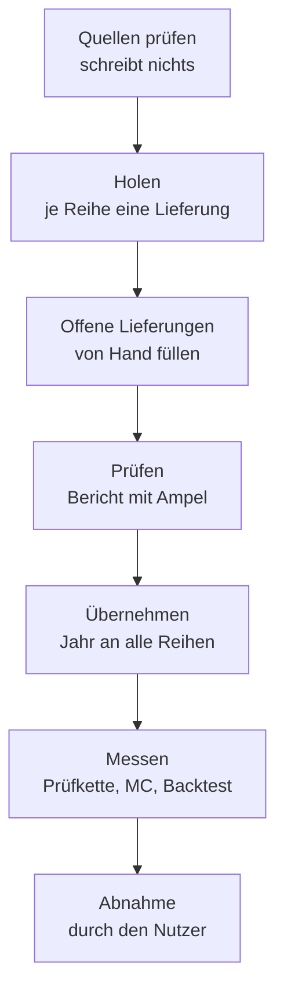

# Jahresdaten pflegen

Wie ein neues Datenjahr in die historischen Reihen kommt und wie die amtlichen Jahreswerte im Code aktuell bleiben. Für Entwickler, Steuerung und Agenten, die Daten liefern. Stand: 17.11.2026.

## Auf einen Blick

- Backtest und Monte Carlo rechnen mit sechs historischen Reihen ab 1925. Ein neues Jahr kommt als Jahreslieferung je Reihe dazu, ohne Änderung an Code, Oberfläche oder Tests.
- Der Ablauf hat drei Befehle: holen, prüfen, übernehmen. Davor zeigt ein Testmodus, ob alle Quellen erreichbar sind. Danach folgen Messung und Abnahme durch den Nutzer.
- Alte Jahre bleiben eingefroren. Ein Jahr kommt ganz oder gar nicht, deshalb kommt 2026 erst im März 2027.
- Scheitert ein Abruf, entsteht eine offene Lieferung mit Anleitung. Ein Agent oder der Nutzer füllt sie mit Beleg aus.
- Pflegegeld, Rentenwert und andere amtliche Werte stehen in einem eigenen Register. `npm run jahreswerte:pruefen` zeigt, was fällig ist.

Herkunft, Lizenz und Methode jeder Reihe stehen unter [Datenquellen](DATA_SOURCES.md#historische-reihen). Dieses Kapitel beschreibt nur den jährlichen Ablauf.

## Was jedes Jahr neu kommt

| Reihe | Quelle für das Jahr Y | Endgültig ab | Lieferweg |
|---|---|---|---|
| Aktien | OECD-Aktienkursindizes Dezember Y−1 und Y für 16 Länder, EZB-Monatskurse; Ersatz Bundesbank | Februar | Skript |
| Inflation | Destatis, Verbraucherpreisindex, Jahrestabelle | Mitte Januar | Skript, Agent als Ersatz |
| Geldmarkt | EZB, €STR-Tageswerte; Gegenprüfung Bundesbank-Monatsmittel | 4. Januar | Skript |
| Lohn | Destatis, Index der Bruttomonatsverdienste | Anfang März | Skript, Agent als Ersatz |
| Gold | Weltbank Pink Sheet, Jahrespreis; Bundesbank USD/EUR | Januar, sicher Februar | Skript |
| CAPE | Shiller, `ie_data.xls`, Dezember Y−1 | im laufenden Jahr | Skript |

Der Lohnwert ist erst Anfang März endgültig. Weil ein Jahr nur vollständig übernommen wird, ist März der Termin für das neue Datenjahr. Die amtlichen Jahreswerte haben eigene Termine, siehe [Amtliche Jahreswerte](#amtliche-jahreswerte).

## Ablauf

1. `npm run jahresdaten -- --quellen 2026` prüft vor dem Holen jede Quelle samt Ersatz und Gegenprüfung: erreichbar mit HTTP-Status, Format erkannt, neuester Stand. Mit Jahr meldet der Modus je Reihe, ob 2026 fehlt, vorläufig oder endgültig ist. Er nutzt dieselben Leser wie `--holen`, schreibt aber nichts. Exit 0 heißt alles erreichbar und lesbar, 1 eine Quelle nicht lesbar, 2 eine nicht erreichbar. Ohne Jahr prüft er nur Erreichbarkeit und Stand. Die Liveprobe `npm run probe:jahreswechsel` ruft ihn mit dem Prüfjahr auf.
2. `npm run jahresdaten -- 2026 --holen` ruft die sechs Quellen ab und legt je Reihe den Ordner `data/historical/<kette>/jahre/2026/` an. Eine vorläufige Lieferung des Skripts holt jeder Lauf neu, eine endgültige bleibt stehen.
3. Offene Lieferungen füllt ein Agent oder der Nutzer, siehe [Anleitung für Agenten](#anleitung-für-agenten).
4. `npm run jahresdaten -- 2026 --pruefen` schreibt nur den Bericht `data/historical/jahresdaten-bericht-2026.md` und `.json`. Exit 0 heißt grün, 1 gelb, 2 rot.
5. `npm run jahresdaten -- 2026 --uebernehmen` läuft nur bei grüner oder gelber Prüfung. Der Befehl baut alle Ketten, den Datenstand, das Datenmodul, `Simulator.html` und die Sollwerte erst in einer Staging-Kopie. Erst danach schaltet er über ein Journal um. Bricht er ab, schließt der nächste Aufruf das Journal vollständig ab.
6. Messen: Prüfkette mit `npm run test:schwer`, Monte Carlo mit 2.000 Pfaden alt gegen neu, Backtest.
7. Der Nutzer nimmt das neue Jahr ab. Danach kommt ein Satz in das [CHANGELOG](../../CHANGELOG.md).

Ob der Weg mit echten Quellen trägt, zeigt die Rückwärtsprobe. `npm run jahresdaten:rueckwaertsprobe` entfernt 2025 in einer Wegwerfkopie und übernimmt es aus den gespeicherten Originalen neu. Mit `-- --live` holt sie 2025 aus den heutigen Quellen und vergleicht Feld für Feld. Mit `-- --behalten` bleiben zwei Kopien zur Durchsicht liegen: der Stand vor der Übernahme mit Endjahr 2024 und den Lieferungen 2025 und der Stand danach. Das Ergebnis vom 17.11.2026 steht in [rueckwaertsprobe-live-2025.md](../../data/historical/rueckwaertsprobe-live-2025.md). Fünf Reihen lieferten genau die gespeicherten Werte, CAPE wich nur im Rundungsrauschen ab.

## Lieferformat

Jede Lieferung ist ein Ordner mit `lieferung.json` und den Belegen. `npm run jahresdaten -- --schema` zeigt das Schema mit den Feldern je Reihe.

| Feld | Inhalt |
|---|---|
| `jahr`, `perioden` | Datenjahr und Beobachtungsperioden, etwa `2026-12` und `2025-12` bei Aktien |
| `werte`, `einheit`, `basis` | Eingangswerte für Y mit Einheitenkennung, bei Indizes die Basis wie `2020=100` |
| `anschluss` | dieselben Werte für Y−1 aus derselben Quelle |
| `quelle` | Name, URL, Abrufdatum, Veröffentlichungsstand |
| `methode`, `lieferant`, `status` | wie der Wert entstand; `skript`, `agent` oder `hand`; `endgueltig` oder `vorlaeufig` |
| `rohdaten` | Belegdateien im Ordner mit SHA-256 |
| `alteJahre` | optional, frühere Jahre laut Quelle, nur für den Bericht |

Das Skript speichert Antworten der Schnittstellen und Destatis-Seiten unverändert. Von der Shiller-Datei kommt nur ein Auszug der zwei Zeilen mit dem SHA-256 der Datei ins Repo. Von den Weltbank-Arbeitsmappen speichert es ebenfalls nur einen Auszug, weil jede Datei mehrere Megabyte groß ist. Lieferungen von Agent und Hand prüft der Befehl genauso wie die des Skripts.

## Prüfregeln

Rot sperrt die Übernahme. Das gilt, wenn eine Lieferung fehlt oder offen ist, das Schema verletzt ist, ein Beleg nicht zum SHA-256 passt, der Status vorläufig ist oder ein Wert fehlt. Rot sind auch eine falsche Einheit oder Periode, eine andere Indexbasis, ein Anschluss außerhalb der Toleranz und ein Jahr, das nicht an das Endjahr anschließt.

`--pruefen` liest die Rohdateien mit dem Leser der Reihe neu. Es vergleicht `werte` und `anschluss` nach der Anschlusstoleranz der Reihe mit `lieferung.json`. Eine vorläufige Angabe im Rohbeleg, eine abweichende Indexbasis oder mehrere CAPE-Dezemberwerte für dasselbe Jahr sperren `--uebernehmen` auch bei endgültigem Lieferstatus. Auch plausible Werte können abweichen, etwa eine gelieferte Inflation von 2,6 % bei 2,2 % im Beleg.

Die Prüfung erkennt Abrufbelege von `--holen` und Auszüge aus den Originalen. Ein alter Lohn-Auszug mit reinen Jahreszeilen belegt nur die Zahlen. Die vollständige Destatis-Seite liefert auch die Indexbasis.

Passt der Beleg zu keinem Leser, ist die Reihe rot mit dem Hinweis „Beleg passt nicht zum Leser – Wert von Hand bestätigen“. Wer den Wert gegen den Beleg selbst geprüft hat, gibt bei `--pruefen` und `--uebernehmen` den Schalter `--beleg-bestaetigt <reihe>` an, etwa `--beleg-bestaetigt lohn`. Bericht und Ausgabe nennen jede so bestätigte Reihe.

Gelb erlaubt die Übernahme mit Hinweis. Gelb sind Plausibilitätsgrenzen und frühere Jahre, die eine Quelle heute anders meldet.

| Reihe | Anschluss Y−1 gegen den gespeicherten Stand | Plausibilität |
|---|---|---|
| Aktien | Index 0,00005, Kurs 0,0000005 | je Land −60 bis +100 %, gesamt −50 bis +60 % |
| Inflation | Rate und Index 0,05 | Index Y/Y−1 gegen Rate höchstens 0,05 |
| Geldmarkt | Jahresmittel 0,005 | zwei Stellen, Monatsmittel höchstens 0,005 entfernt |
| Lohn | Veränderung und Index 0,05 | Index Y/Y−1 gegen Rate höchstens 0,1 |
| Gold | Preis 0,005, Kurs 0,00005 | Rendite −40 bis +60 %, USD/EUR 0,8 bis 1,6 |
| CAPE | 0,05 | 5 bis 60, Sprung unter 30 % |

Den Status setzt der Leser selbst. Er nimmt das Merkmal der Quelle, wo es eines gibt, sonst die Frist „endgültig ab“. Maßgeblich ist das Abrufdatum im Folgejahr. Eine vorläufige Lieferung ist rot.

| Reihe | Endgültig, wenn |
|---|---|
| Aktien | Abruf ab 1. Februar und alle OECD- und EZB-Werte mit Status A |
| Inflation | Abruf ab 15. Januar und kein „vorläufig“ in den Jahrestabellen |
| Geldmarkt | Tageswerte bis zum letzten TARGET-Geschäftstag des Jahres (meist 31.12., veröffentlicht am ersten Geschäftstag danach) und mindestens 250 Tage, für Y und Y−1 |
| Lohn | Abruf ab 1. März und kein „vorläufig“ auf der Seite |
| Gold | Abruf ab 1. Februar und Gegenprüfung bestanden: zwölf Monatswerte der Weltbank, deren Mittel weniger als 0,5 % vom Jahrespreis abweicht |
| CAPE | sofort, sobald die Mappe mindestens einen Monat nach Dezember Y−1 enthält |

Ohne Monatsdatei gibt es bei Gold keine Gegenprüfung, die Lieferung ist dann vorläufig. Der Geldmarkt rechnet bei fehlenden Tagen das Mittel trotzdem, markiert es aber als vorläufig: 2024 ohne den 31.12. ergäbe 3,65 statt 3,64.

## Wenn eine Quelle ausfällt

Scheitert ein Abruf, fehlt der Wert noch oder kann der Leser die Antwort nicht lesen, legt `--holen` statt der Lieferung zwei Dateien an: `ANLEITUNG.md` mit Grund, Seite, Zahl und Beleg und `lieferung-vorlage.json` mit allen Pflichtfeldern ohne Werte. Das gilt auch für HTML statt einer Arbeitsmappe, ein umbenanntes Blatt, eine leere oder nicht numerische Zelle und eine doppelte Zeile. Das Skript erfindet nichts und liest keine leere Zelle als 0. Betroffen ist nur die eine Reihe; die übrigen holt der Lauf weiter und endet mit Exit 1 („teilweise offen“). Die Prüfung meldet die Reihe rot mit Verweis auf die Anleitung.

Offene Ordner und vorläufige Lieferungen des Skripts versucht jedes `--holen` neu. Einen Serverfehler (HTTP 5xx) wiederholt der Abruf einmal nach kurzer Pause. Bei einem Wert, der noch nicht veröffentlicht ist, genügt es, später erneut zu holen. Ist die EZB nicht erreichbar, nimmt der Aktienleser die Monatsmittel der Bundesbank (BBEX3, A02). Die Bundesbank rundet auf fünf Stellen, deshalb ist der Anschluss Dezember Y−1 dann rot. Dann später `--holen --ersetzen aktien` versuchen. Hat Destatis eine Seite umgebaut, bleibt die Reihe offen, bis ein Agent die Zahlen von Hand liefert.

Eine endgültige Lieferung ersetzt nur `--ersetzen` mit den Namen der Reihen, etwa `--ersetzen aktien gold`. Erlaubt sind aktien, inflation, geldmarkt, lohn, gold und cape. Scheitert der Neuabruf, bleibt die alte Lieferung stehen. Eine Lieferung von Agent oder Nutzer überschreibt der Befehl nur mit dem zweiten Schalter `--auch-hand`. Vorsicht: Damit ist die Handarbeit weg, wenn der neue Abruf gelingt.

Das Skript ruft nur öffentliche Endpunkte von OECD, EZB, Bundesbank, Weltbank, shillerdata.com und Destatis ab. Dazu kommt `img1.wsimg.com`, der Dateispeicher, auf den shillerdata.com für `ie_data.xls` verlinkt. Es nutzt keine Zugangsdaten und kein GENESIS-Konto.

## Anleitung für Agenten

Ein Agent liefert Jahresdaten nur nach diesem Kapitel. Er ändert keinen Code, keine Tests und keine Ketten-Ausgaben.

1. `ANLEITUNG.md` im offenen Ordner lesen.
2. Die genannte Seite öffnen und die Werte für Y und Y−1 ablesen. Fehlt ein Wert, bleibt die Lieferung offen. Schätzen ist nicht erlaubt.
3. Den Beleg in den Ordner legen, bei Seiten die ganze HTML-Datei, bei CAPE nur den Auszug. SHA-256 mit `sha256sum <datei>` bestimmen.
4. `lieferung-vorlage.json` als `lieferung.json` speichern und ausfüllen. Lieferant ist `agent`, beim Nutzer `hand`. Der Status steht auf `vorlaeufig`; auf `endgueltig` erst umstellen, wenn die Regel aus [Prüfregeln](#prüfregeln) erfüllt ist. Die Vorlage nennt sie im Feld `hinweis`.
5. `ANLEITUNG.md` und `lieferung-vorlage.json` löschen.
6. `npm run jahresdaten -- <Y> --pruefen` ausführen und den Bericht weitergeben.

Die Übernahme startet erst, wenn der Nutzer sie freigibt. Ändert eine Quelle frühere Jahre, meldet der Bericht das nur. Eine Revision alter Jahre ist ein eigener Vorgang mit Messung.

## Amtliche Jahreswerte

Neben den Reihen veralten amtliche Werte im Code. `data/jahreswerte.json` hält je Wertgruppe Stand, Gültigkeitsbeginn, Quelle, Rhythmus und die Orte im Code. Jeder Ort trägt einen Suchtext, der den Stand belegt. Ändert jemand den Wert im Code, muss er das Register mitziehen, sonst schlägt `tests/jahreswerte-register.test.mjs` fehl.

| Wertgruppe | Stand | Rhythmus |
|---|---|---|
| Pflegegeld und Kassenleistungen | 2026 | jährlich zum 1. Januar |
| Heim-Eigenanteile (vdek) und Pflegepreise | 07/2026 | halbjährlich |
| Aktueller Rentenwert | 42,52 € ab 01.07.2026 | jährlich zum 1. Juli |
| BMF-Vervielfältiger Wohnrecht | 2027 | jährlich, Schreiben im Herbst |
| Periodensterbetafel | 2023/2025 | jährlich im Sommer |
| Pflegestatistik | 2023 | alle zwei Jahre |
| Kohortensterbetafel | 1926–2026 | selten |

Sterbetafel und Pflegestatistik stehen getrennt im Register, weil ihr Rhythmus verschieden ist. `npm run jahreswerte:pruefen` listet Überfälliges zuerst, dann was demnächst fällig ist. Fällig ist ein neuer Stand am Gültigkeitsbeginn plus Rhythmus. Mit `-- --datum JJJJ-MM-TT` lässt sich ein Stichtag vorgeben. Exit 1 heißt, etwas ist überfällig. Die Liveprobe `npm run probe:jahreswechsel` am 1. Dezember und 2. Januar gibt dieselbe Liste aus. Die App zeigt das Register nicht an. Einen Wert selbst zu ändern bleibt eine eigene Arbeit mit Quelle.

## Grenzen

Die Shiller-Datei hat keine offene Lizenz. Keine weitere Fassung der Shiller-Datei kommt ins Repo, auch nicht in Lieferungen; die festgeschriebene Originalfassung vom 01.08.2026 liegt bereits im Repo. Shiller speichert die Arbeitsmappe regelmäßig neu. Dabei ändern sich alte CAPE-Werte in der vierzehnten Nachkommastelle, was den Inhaltshash ändern würde. Weil alte Jahre eingefroren sind, wirkt das nur in der Rückwärtsprobe.

Beim Geldmarkt wechselt die Methode. Bis 2025 gilt der veröffentlichte Jahreswert der Bundesbank, ab 2026 das eigene Mittel der €STR-Tageswerte. Für 2020 bis 2025 sind beide auf zwei Stellen gleich; nahe einer halben Stelle sind 0,01 Abstand möglich. Der Vermerk steht im [README der Kette](../../data/historical/german-cash-money-market-chain/README.md).

Der Lohnindex hat 2022 einen Methodenbruch, und jeder neue Stand ersetzt die ganze Reihe. Der Verbraucherpreisindex wird voraussichtlich um 2028 auf 2025=100 umgestellt. Eine andere Basis ist rot und braucht eine eigene Umbasierung. Bei Aktien kommen deshalb nur Dezember Y−1 und Y als Änderung ins Spiel; der Anschluss deckt eine Basisumstellung der OECD auf.

Endpunkte können sich ändern, etwa die Version der OECD-Datenstruktur, die Weltbank-Adresse oder die Datei-Links bei Shiller. Dann bleibt die Reihe offen, bis jemand den Leser anpasst oder von Hand liefert.
