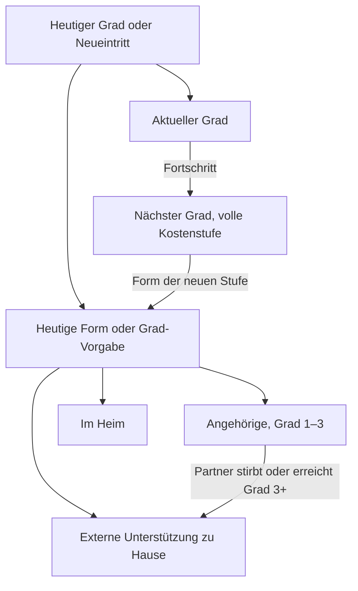

# Pflege

Wie heutige Pflege und mögliche spätere Kosten den Haushalt verändern. Für Nutzer und fachlich Interessierte. Codeprüfung: 29.10.2026; Quellenprüfung: 27.10.2026.

## Auf einen Blick

- Heutige Pflegekosten gehören in deinen Grundbedarf und Flex; der eingetragene Pflegegrad gilt ab Jahr 1.
- Pflegegrad und Pflegeform sind zwei getrennte Angaben.
- Fällt bei Paaren der pflegende Partner aus, kann die App bereits im selben Jahr Pflegegeld streichen und Zusatzkosten ansetzen.
- Die Pflegewahrscheinlichkeiten sind intern abgestimmt, aber nicht extern validiert.

## Heute

### Grad und Form

Ein heutiger Pflegegrad gilt auch unter 65 Jahren und bei ausgeschaltetem Zufallsmodell. Die App zieht dafür keinen neuen Eintritt. Ohne heutigen Grad beginnt die Person ohne Pflege. „Pflegeform heute“ gilt bis zum ersten Gradwechsel; danach wirkt die Form aus der Kostenstaffel des erreichten Grads.

| Pflegeform | Bedeutung im Modell | Pflegegeld als Einkunft |
|---|---|---|
| „zu Hause durch Angehörige“ | Eigene Mehrausgaben ohne Abzug des Pflegegelds eintragen. | Ab Grad 2 |
| „zu Hause mit externer Unterstützung“ | Eigenanteil nach Kassenleistungen eintragen. | Keines |
| „im Heim“ | Eigenanteil nach Kassenleistungen eintragen. | Keines |

Vorgaben der eigenen Staffel sind Angehörige in Grad 1–2, externe Unterstützung zu Hause in Grad 3 und Heim in Grad 4–5. Externe Unterstützung zu Hause bedeutet keinen Heimaufenthalt. Bei „Amtlicher Durchschnitt (Destatis/vdek)“ gibt es keine wählbare Pflegeform und kein zusätzliches Pflegegeld.

### Pflegegeld

Mitgeliefert sind monatlich 0 / 347 / 599 / 800 / 990 € für Grad 1–5. Die [BMG-Leistungsübersicht 2026](https://www.bundesgesundheitsministerium.de/fileadmin/Dateien/3_Downloads/P/Pflegeversicherung_Leistungsbeitraege/Uebersicht_Leistungsbetraege_2026_VA.pdf), Stand 11.12.2025, belegt die Beträge. Gemeinsame Haushaltswerte kannst du pflegen und beim Jahresabschluss bestätigen.

Die App rechnet das Pflegegeld automatisch als persönliche feste Einkunft. Es wächst im Simulator nur mit Inflation, deckt den Bedarf und wird bei Überschuss gespart. Im Sterbejahr der empfangenden Person zählt die Hälfte; danach endet es. Die Inflationsfortschreibung ist keine gesetzliche Leistungszusage.

Die [BMG-Erklärung](https://www.bundesgesundheitsministerium.de/pflegegeld) nennt gesicherte häusliche Pflege und mindestens Grad 2 als Voraussetzungen. Rechtlich sind Kombinationen mit ambulanten Sachleistungen möglich. Die App bildet diese Kombination nicht ab; „externe Unterstützung“ erhält im Modell kein Pflegegeld. Andere Kassenleistungen in der Übersicht werden nicht nochmals als frei verfügbares Einkommen addiert.

### Kosten im Bedarf

Pflege, die heute schon bezahlt wird, muss im eingegebenen Grundbedarf und Flex enthalten sein. Im unveränderten heutigen Grad ergänzt die App keine Kosten. Zwei Ausnahmen sind wichtig: Nach einem Gradfortschritt wird der volle Staffelbetrag des neuen Grads angesetzt, ohne heutige Pflegekosten abzuziehen. Beim Ausfall des pflegenden Partners gilt der volle aktuelle Staffelbetrag auch ohne Gradwechsel.

## Verlauf

### Eintritt und Fortschritt

Monte Carlo zieht Pflege vor dem möglichen Tod. Neue Pflege beginnt modellhaft in Grad 1 oder 2; Fortschritt führt um einen Grad weiter. Chronische Pflege läuft bis zum Tod. Akute Pflege verwendet eine gezogene ganzzahlige Dauer aus deinem Bereich. Ein heutiger Pflegegrad bleibt unabhängig davon dauerhaft.

„Langsamer“ und „deutlich langsamer“ multiplizieren die Fortschrittswahrscheinlichkeit mit 0,5 beziehungsweise 0,25, auch nach einem Gradwechsel. Die zusätzliche Sterblichkeit wird nur im heutigen Grad entsprechend vermindert; danach gilt der Faktor des neuen Grads. Im ersten Jahr eines heutigen Pflegegrads wird noch kein Fortschritt gezogen. Diese Auswahl ist eine Vergleichsannahme, keine medizinische Einstufung.

Der Backtest hält heutige Grade fest, zieht weder Tod noch Fortschritt und führt die Preise fort. Ein bereits ausgefallener Pflegepartner kann dort trotzdem den Formwechsel auslösen.

### Ausfall der Angehörigen

Bei Paaren nimmt die App an, dass der Partner pflegt. Stirbt er oder erreicht selbst mindestens Pflegegrad 3, wechselt Angehörigenpflege der betroffenen Person in Grad 1–3 ab demselben Jahr dauerhaft zu externer Unterstützung zu Hause. Ihr Pflegegeld entfällt für dieses ganze Jahr; der volle Staffelbetrag ihres aktuellen Grads kommt unter den bestehenden Preis-, Deckel- und Rampenregeln hinzu. Ein späteres Ende akuter Partnerpflege setzt den Wechsel nicht zurück.

Alleinstehende, Grad 4–5 und der amtliche Durchschnitt erhalten diesen zusätzlichen Wechsel nicht. Das Protokoll-ⓘ nennt den aktuellen Grund; Tod hat Vorrang vor einem Pflegegrad.

### Planübersicht und Backtest

Die Planübersicht zeigt heutiges Pflegegeld als eigene Einkunft je Person und schreibt es mit Inflation fort. Bei Angehörigenpflege in Grad 1–3 und heutigem Partnergrad ab 3 entfällt es ab Jahr 1. Zusätzliche Pflegekosten entstehen in dieser Anzeige nicht; heutige Kosten gehören in den eingegebenen Bedarf. Der Backtest berücksichtigt denselben Partnerausfall und kann dadurch den vollen Pflegezusatz ansetzen. Balance berechnet heutiges Pflegegeld ohne diese simulierte Ausfallfolge.

### Grad und Form im Verlauf

## Finanzierung

### Kostenstaffel

Eigene Jahreszusätze und „Maximaler Pflege-Floor“ sind Beträge in heutigen Preisen. Beide wachsen ab Simulationsstart mit kumulierter Inflation und zusätzlichem Kostenanstieg. Jahr 1 hat noch keinen zusätzlichen Driftanstieg; Jahr 9 verwendet acht Jahre. Ein Gradwechsel startet die Preisrechnung nicht neu. Der Regionalzuschlag erhöht den Kostenbetrag.

Vom fortgeschriebenen maximalen Pflege-Floor wird der laufende Grundbedarf abgezogen, mindestens null. Das ist der Deckel für den Zusatz. Liegt der rohe Zusatz darunter, gilt er sofort vollständig. Nur oberhalb eines positiven Deckels wirkt die Rampe nach Pflegejahren: höchstens der Deckel und höchstens der rohe Zusatz mal bereits erreichter Rampenanteil. Ein Deckel von null erlaubt keinen Zusatz.

„Amtlicher Durchschnitt (Destatis/vdek)“ setzt bei mitgelieferten Werten jährlich 200 / 2.300 / 7.100 / 15.000 / 18.900 € Zusatz für Grad 1–5 an. Er gewichtet den Heimanteil je Grad aus Destatis 2023 mit dem gespeicherten Heim-Eigenanteil und rundet auf 100 €. Zu Hause setzt er null Zusatz an. Mitgeliefert sind 3.364 € monatlich im ersten Heimjahr, laut [vdek-Auswertung zum 01.07.2026](https://www.vdek.com/presse/pressemitteilungen/2026/stationaere-pflege-eigenanteile-juli-2026.html), einschließlich Unterkunft, Verpflegung und Investitionskosten. Das ist keine individuelle Heimkostenprognose. Andere gespeicherte Heimwerte ändern die Staffel.

### Reserve und Flex

Die Pflege-Rücklage hält Geld für die gewählte Zweckbindung zurück; sie ist keine Versicherung und kein zusätzliches Vermögen. Aktivierte Beträge beider Personen werden addiert. Bei abweichenden Einstellungen gibt die erste aktivierte Rücklage die Regeln vor. Die gesperrte Reserve steht dem normalen Budget nicht frei zur Verfügung; die [Handlungsanweisung](HANDLUNGSANWEISUNG.md) erklärt die Geldquellen.

Der gewählte Mindestgrad und „Haushalts-Trigger“ lösen ihre Nutzung aus. „P1 oder P2“ verlangt eine passende Person, „P1 und P2“ zwei lebende Personen mit entsprechendem Grad. „Nur Pflege-Mehrkosten“ deckt eine offene Finanzierungslücke höchstens bis zum Pflegezusatz; „Floor-Shortfall bei Pflege“ erlaubt auch den übrigen offenen Grundbedarf. Die Reserve wirkt vor zusätzlichen Deckungsverkäufen und wird nicht automatisch aufgefüllt.

Negative Rücklagenzinsen mindern den Bestand, höchstens bis null. Nutzung und Erschöpfung zählen auch im Ruinjahr. Die [Ergebnisreferenz](SIMULATION_LESEN.md#pflege) erklärt Bezugsgruppen, Euro-Basis und Rücklagenzusammenfassung.

Die Flex-Vorgaben je Grad sind 100 / 100 / 50 / 0 / 0 %. Bei heutiger Pflege bleibt der eingetragene Flex im unveränderten Grad erhalten. Nach einem Gradwechsel gilt höchstens das Verhältnis neuer zu heutigem Staffelwert: von 50 % auf 25 % halbiert den heutigen Flex. Ist der heutige Staffelwert null, bleibt der eingetragene Flex als Ausgangsbudget erhalten.

Bei Paaren wirkt eine Mischung aus gemeinsamem und persönlichem Anteil, nicht einfach der niedrigere Personenwert. Höhere Pflegekosten können Flex zusätzlich über das Jahresbudget mindern. Im Todesjahr zählt für das erste Halbjahr der Pflege-Flex des Paars, danach der eingestellte Hinterbliebenenanteil mal Pflegefaktor der lebenden Person. Ab dem Folgejahr gilt nur dieses Produkt; ein zusätzlicher Deckel aus der früheren Pflege der verstorbenen Person greift nicht. Pflegekosten der verstorbenen Person zählen im Todesjahr halb und entfallen danach. Die [Hinterbliebenenregeln](TOD_UND_ERBE.md#einkommen-und-bedarf) definieren die getrennten Bedarfsanteile.

### Heim und Immobilie

Der reguläre [Immobilienverkauf](IMMOBILIEN.md#heimverkauf) setzt voraus, dass alle Lebenden mindestens Grad 4 haben und im Heim gepflegt werden. Ein Ausfall der Angehörigen allein erfüllt das nicht. Ein Wohnrecht kann bereits bei Heimpflege unter Grad 4 enden; seine [Steuerfolgen](STEUERN.md#wohnrecht-und-jährliche-zahlung) haben eine eigene Grenze.

## Annahmen und Beispiel

### Interne Abstimmung und Grenzen

Eintritt nach Alter und Geschlecht, Fortschritt und Sterblichkeitsfaktoren wurden intern per Simulation auf Destatis 2023 abgestimmt (FR-41). Die amtliche Prävalenz ist ein Bestandsanteil, keine jährliche Eintrittswahrscheinlichkeit. Nur die Abstimmkohorte startet mit statistischem Pflegebestand; Simulatorpersonen übernehmen ausschließlich ihren eingetragenen Grad.

Mangels Kreuztabelle Alter × Grad nutzt die Abstimmung Gradanteile aller Altersgruppen. Die Sterblichkeitsfaktoren 1,5 / 2 / 3 / 4 / 5 wirken ab dem aktuellen Grad, ohne Kostenrampe. Diese interne Abstimmung ist keine unabhängige Validierung. [Datenquellen](DATA_SOURCES.md#lebensereignisse) führen Herkunft, Transformation und offene Nachweise.

Modellgrenzen:

- Kein medizinischer Verlauf und keine persönliche Leistungsprüfung.
- Keine eigene Berechnung von Kassenleistungen oder Zuschlägen nach Aufenthaltsdauer; Staffelbeträge sind Szenarioannahmen.
- Pflege-Rücklage und bestandene Rechentests belegen keinen Versicherungsschutz oder extern bestätigte Pflegewahrscheinlichkeiten.

### Max und Erika

Synthetische Rechenvariante, geprüft am 27.10.2026: Erika hat heute Grad 2 und Angehörigenpflege; Max pflegt sie. Ohne Inflation erhält sie 347 × 12 = 4.164 € jährlich. Ihre heutigen Kosten sind bereits im Bedarf enthalten. Für Grad 2 sind beispielhaft 6.000 € jährlicher Zusatz gespeichert; der Deckel lässt ihn vollständig zu. Erreicht Max Grad 3, entfallen Erikas 4.164 € Pflegegeld und die 6.000 € kommen ab diesem Jahr hinzu. Der Finanzierungsbedarf steigt dadurch um 10.164 € gegenüber unveränderter Pflege. Ein Heimverkauf folgt daraus nicht. Max’ eigene Pflegekosten wären zusätzlich zu betrachten.

### Wo du es in der App siehst

„Personen & Vermögen“ führt „Pflegegrad heute“, „Pflegeform heute“, Verlauf und Kassenleistungen. Im Simulator stehen Staffel und Pflegeannahmen; die Jahresprotokoll-ⓘ erklären Grad, Zusatz, Pflegegeld und Wechselgrund. Klickwege: [Handbuch](../../Handbuch.html#person-pflegen). [Technische Belege](TECHNICAL.md#lebensereignisse-und-steuer-belegen) verbinden die Grenzen mit bestehenden Prüfungen.
