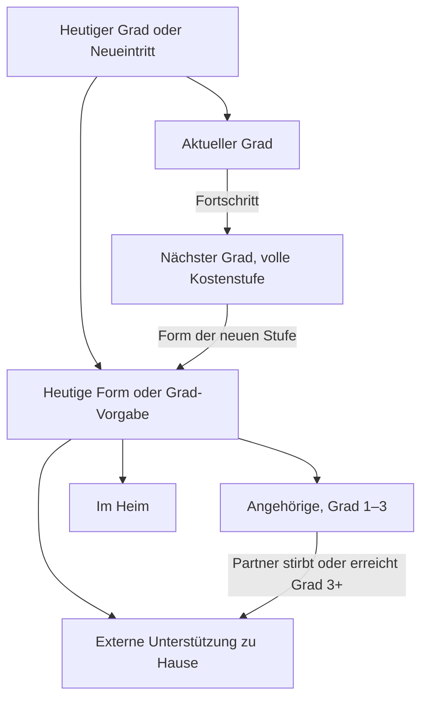

# Pflege

Wie die App heutige und künftige Pflege für Bedarf, Einkommen und Finanzierung rechnet. Für Nutzer und fachlich Interessierte. Codeprüfung 21.11.2026, Quellenprüfung 27.10.2026.

## Auf einen Blick

- Grundbedarf und Flex gelten für den Haushalt ohne Pflege. Heutige Pflege kommt ab Jahr 1 hinzu.
- Der Pflegegrad bestimmt die Kostenstufe. Die Pflegeform bestimmt, welche Kosten und Einkünfte die App ansetzt.
- Im Heim ersetzen Heimkosten und eigene Ausgaben den Anteil am Grundbedarf zu Hause.
- Reichen Geldvermögen und verwertbare Immobilien für die Pflege nicht aus, übernimmt der Staat im Modell den Rest als Hilfe zur Pflege. Der Lauf geht weiter, solange der Grundbedarf gedeckt ist.
- Die Pflegewahrscheinlichkeiten sind intern abgestimmt. Eine externe Validierung fehlt.

## Pflege heute

### Grad und Pflegeform

Ein eingetragener Pflegegrad gilt ab dem ersten Jahr, auch unter 65 Jahren und bei ausgeschaltetem Zufallsmodell. Die App übernimmt den Grad. Ohne Eintrag startet die Person gesund. Die heutige „Pflegeform“ gilt bis zum ersten Gradwechsel. Danach greift die Form der neuen Stufe oder die Regel für den [amtlichen Durchschnitt](#amtlicher-durchschnitt).

| Pflegeform | Kosten im Modell | Vorgabe der eigenen Staffel |
|---|---|---|
| „zu Hause durch Angehörige“ | Eigene Mehrausgaben vor Abzug des Pflegegelds | Grad 1–2 |
| „zu Hause mit externer Unterstützung“ | Eigenanteil nach Leistungen der Pflegekasse | Grad 3 |
| „im Heim“ | Heimkosten aus den Pflegewerten nach Heimjahr | Grad 4–5 |

Fehlt bei Grad 4 oder 5 die heutige Form, setzt die App „im Heim“ an. Das gilt auch bei „Amtlicher Durchschnitt (Destatis/vdek)“. In dessen Staffel gibt es keine wählbare Pflegeform.

### Pflegegeld als Einkunft

Mitgeliefert sind monatlich 0 / 347 / 599 / 800 / 990 € für Grad 1–5. Du kannst die Beträge für den Haushalt ändern und im Jahresabschluss bestätigen. Quelle der Vorgaben ist die [BMG-Leistungsübersicht 2026 vom 11.12.2025](https://www.bundesgesundheitsministerium.de/fileadmin/Dateien/3_Downloads/P/Pflegeversicherung_Leistungsbeitraege/Uebersicht_Leistungsbetraege_2026_VA.pdf).

Pflegegeld zählt als persönliche feste Einkunft. Es deckt den Bedarf, ein Überschuss wird gespart. Im Simulator folgt es der Inflation als Modellannahme. Im Sterbejahr zählt es halb und endet danach. Für den gesetzlichen Anspruch nennt das BMG mindestens Grad 2 und gesicherte häusliche Pflege. Das Modell setzt Pflegegeld ab Grad 2 bei Angehörigenpflege an. Bei externer Unterstützung, im Heim und beim amtlichen Durchschnitt setzt es 0 € an. Rechtlich mögliche Kombinationen mit Sachleistungen bleiben außerhalb des Modells. Andere Kassenleistungen erscheinen nicht zusätzlich als Einkommen. [Pflegegeld beim BMG](https://www.bundesgesundheitsministerium.de/pflegegeld).

### Pflege im Bedarf

Trage Grundbedarf und Flex so ein, als lebten alle zu Hause und hätten keine Pflegekosten. Die App lässt den gespeicherten Grundbedarf stehen. Sie ergänzt bei heutiger Pflege zu Hause den Staffelbetrag bis zum Deckel sofort. Ein eigener Monatswert unter „Kosten über die Kasse hinaus“ ersetzt die Staffel im heutigen Grad, auch mit 0 €. Er folgt Inflation und Kostenanstieg ohne Regionalzuschlag. Nach einem Gradwechsel gilt die neue Stufe. Beim amtlichen Durchschnitt bleibt der eigene Wert ohne Wirkung.

Im Heim zählen die Heimkosten und eigenen Ausgaben anstelle des Grundbedarfsanteils. Unter „Im Heim seit“ kannst du Monat und Jahr bis zum heutigen Monat wählen. Die App zählt volle Jahre bis zum Stichtag plus eins. Bei Werner ergeben sich am Testdatum 23.10.2026 seit Januar 2023 45 Monate und damit Heimjahr 4. Ohne Datum setzt die App Heimjahr 1 an. Beim Abschluss merkt sie sich das erste Planjahr und zählt von dort weiter. Historische Marktjahre ändern den Stichtag nicht.

Simulator, Backtest und Balance nutzen dieselbe Bedarfsrechnung. Balance nimmt den heutigen Haushalt und den bestätigten Plan, ersatzweise die gespeicherte Bedarfsbasis. Sie prüft den Angehörigenausfall vor der Anrechnung des Pflegegelds. Die [Jahresbudget-Referenz](JAHRESBUDGET.md#a1) erklärt, wie die App Einkünfte ins Folgejahr fortschreibt.

## Verlauf und Ausfall

### Eintritt, Fortschritt und Verlaufswahl

Monte Carlo zieht Pflege vor Tod. Ein neuer Pflegefall beginnt in Grad 1 oder 2. Fortschritt führt jeweils einen Grad weiter. Chronische Pflege läuft bis zum Tod. Bei akuter Pflege zieht die App aus deinem Bereich eine Dauer in ganzen Jahren. Ein heutiger Grad gilt dauerhaft. Im ersten Jahr zieht die App dafür noch keinen Fortschritt.

„Langsamer“ und „Deutlich langsamer“ setzen die Fortschrittswahrscheinlichkeit auf die Hälfte beziehungsweise ein Viertel, auch nach einem Gradwechsel. Die zusätzliche Sterblichkeit sinkt nur im heutigen Grad entsprechend. Danach gilt der Faktor des neuen Grads. Bei beiden langsameren Verläufen bleibt die Sterbewahrscheinlichkeit mindestens so hoch wie in der Jahrgangstafel. Die Auswahl dient dem Vergleich von Modellverläufen.

Der Backtest hält heutige Grade fest und führt Preise und Heimjahre fort. Er zieht weder Tod noch Fortschritt. Ein bereits ausgefallener Pflegepartner kann trotzdem einen Formwechsel auslösen. Die Planübersicht zeigt von der Pflege nur das heutige Pflegegeld als Einkunft je Person. Sie prüft den Partnergrad ab Jahr 1 und schreibt das Pflegegeld mit Inflation fort.

### Ausfall der Angehörigen

Für Paare nimmt die App an, dass der Partner pflegt. Stirbt er oder erreicht er mindestens Grad 3, wechselt Angehörigenpflege in Grad 1–3 im selben Jahr dauerhaft zu externer Unterstützung zu Hause. Das Pflegegeld entfällt für das ganze Jahr. Der Kostenbetrag bleibt gleich, bei heutiger Pflege weiterhin ohne Rampe. Der Wechsel bleibt auch nach Ende einer akuten Partnerpflege bestehen.

Für Alleinstehende, Grad 4–5 und den amtlichen Durchschnitt entfällt diese Zusatzregel. Das Protokoll-ⓘ nennt den Grund. Tod hat Vorrang vor einem Pflegegrad.

Beim Heimwechsel nennen die Spalte „Pflege“ und das ⓘ bei „Ausgaben“ den Grund. Dort steht „Heim laut Staffel“, „Heim (ausgelost nach amtlichem Heimanteil … %)“ oder „Heim (wie heute)“.

## Kosten und Pflegereserve

### Kostenstaffel und Kostenanstieg

Die eigene Staffel für Pflege zu Hause setzt für Grad 1–5 jährlich 3.600 / 6.000 / 18.000 / 32.000 / 60.000 € an. Steht eine Stufe auf „im Heim“, zeigt ihr Betragsfeld „Heimkosten“. Lebt jemand mit diesem Grad heute zu Hause, bleibt der Betrag sichtbar und änderbar. Simulator und Balance lesen die Pflegewerte des Haushalts.

Die Vergleichswerte stammen aus der freigegebenen Recherche vom 08.11.2026. Sie dienen der Planung. Die Preise eines Pflegediensts können abweichen.

| Grad | Angehörige €/Monat | Pflegedienst €/Monat | 24-Stunden-Betreuung €/Monat |
|---|---:|---:|---:|
| 1 | 300 | 600 | – |
| 2 | 500 | 700 | – |
| 3 | 800 | 1.500 | 3.600 |
| 4 | 1.200 | 2.667 | 4.200 |
| 5 | 1.800 | 4.000 | 4.500 |

Staffel und Deckel stehen in heutigen Preisen. Ab dem zweiten Simulationsjahr steigen sie mit Inflation und zusätzlichem Kostenanstieg. Vorgabe sind 5 % bis einschließlich 2035 und 2 % ab 2036. Jeder Preisschritt nimmt die Rate des erreichten Kalenderjahrs. Auch im Backtest läuft die Preisrechnung ab dem Bezugsjahr der Personendaten. Ein Gradwechsel setzt den Preisstand nicht zurück. Ohne Inflation ergeben sich ab Bezugsjahr 2026 Preisfaktoren von 1,2155 für 2030, 1,5513 für 2035, 1,5824 für 2036 und 1,8911 für 2045.

Unter „Pflege“ kannst du beide Raten und das Bis-Jahr ändern. Eine neue Eingabe in „Zusätzl. Kostenanstieg bis“ beginnt im laufenden Jahr, im Spielbereich im Jahr des Testdatums. Ein früher gespeichertes Jahr bleibt gültig. Danach gilt die zweite Rate. Die [Datenverträge](DATENVERTRAEGE.md#pflegedaten-im-altbestand-und-jahresabschluss) erklären Felder und Altwerte.

Der regionale Zuschlag erhöht den Staffelbetrag. Für den Deckel je Person zieht die App den laufenden Grundbedarf vom fortgeschriebenen „Maximaler Grundbedarf mit Pflege je Person“ ab. Ist das Ergebnis null oder negativ, bleibt kein Pflegezusatz. Bis zum Deckel zählt der ganze Betrag sofort. Überschreitet der rohe Zusatz nach einem neuen Eintritt oder Gradwechsel einen positiven Deckel, begrenzt ihn die Rampe auf den nach Pflegejahren erreichten Anteil des rohen Betrags und höchstens auf den Deckel. Bei zwei Personen kann jede ihren Deckel ausschöpfen. Für Heimkosten und eigene Ausgaben im Heim gelten volle Beträge.

### Amtlicher Durchschnitt

Monte Carlo zieht je Person einmal eine Zahl und vergleicht sie in jedem Pflegegrad mit dessen Heimanteil. Laut Destatis 2023 beträgt er für Grad 1–5 gerundet 0,6 / 5,8 / 17,7 / 37,1 / 46,8 %. Die heutige Form hat Vorrang. Wer bei einem Grad im Heim ist, bleibt beim Anstieg dort. Zu Hause setzt die App 0 € Zusatz und kein Pflegegeld an. Hausverkauf, Miete und Wohnrecht folgen der verwendeten Form.

Backtest und Balance rechnen ohne Ziehung mit der heutigen Form. Im Heim zählt das Heimjahr, zu Hause gilt ebenfalls der Zusatz von 0 €. Die angezeigte Mittelwertstaffel für künftige Eintritte beträgt mit den mitgelieferten Heimwerten jährlich 200 / 2.300 / 7.100 / 15.000 / 18.900 €. Sie multipliziert den Heimanteil mit den Kosten des ersten Heimjahrs und rundet auf 100 €. Andere Heimwerte ändern diese Modellstaffel. In Monte Carlo zählt der Aufwand der tatsächlich gezogenen Form. [Datenquellen](DATA_SOURCES.md#pflege).

### Heimkosten und Jahresabschluss

Leben alle Personen im Heim, fällt der Grundbedarf zu Hause weg. Bleibt bei einem Paar jemand zu Hause, gilt dort der Hinterbliebenenanteil, als Vorgabe 75 %. Dazu kommen die Heimkosten und eigenen Ausgaben jeder Person im Heim.

Mitgeliefert sind monatlich 2.088 € Pflegeanteil, 1.068 € für Unterkunft und Verpflegung und 521 € Investitionskosten. Die App wendet den Zuschuss nach § 43c SGB XI nur auf den Pflegeanteil an. Die Tabelle gilt für Grad 2–5. Bei Grad 1 rechnet sie ohne Zuschuss mit 3.677 € im Monat. Quelle der Bestandteile ist die [vdek-Auswertung zum 01.07.2026](https://www.vdek.com/presse/pressemitteilungen/2026/stationaere-pflege-eigenanteile-juli-2026.html).

| Heimjahr | Zuschuss auf den Pflegeanteil | Eigenanteil im Monat | Im Jahr |
|---|---:|---:|---:|
| 1 | 15 % | 3.364 € | 40.368 € |
| 2 | 30 % | 3.051 € | 36.612 € |
| 3 | 50 % | 2.633 € | 31.596 € |
| ab 4 | 75 % | 2.111 € | 25.332 € |

Die drei Bestandteile folgen Inflation, Kostenanstieg und Regionalzuschlag. Eigene Ausgaben im Heim decken etwa persönlichen Bedarf, weiterlaufende Versicherungen wie die private Krankenversicherung und freiwillige Extras. Vorgabe sind 500 € im Monat je Person, fortgeschrieben nur mit Inflation. Beim Heimeintritt startet der Zähler bei 1 und läuft bei Gradwechseln im Heim weiter. Nach Ende akuter Heimpflege gilt wieder der Bedarf zu Hause. Ein späterer Heimeintritt beginnt erneut mit Heimjahr 1.

Im Schritt „Pflegewerte“ schreibt der Jahresabschluss Heim-Bestandteile, Staffel, Deckel und wirksame persönliche Pflegekosten mit der Inflation des alten Jahres und dem Kostenanstieg des neuen Planjahrs fort, die eigenen Ausgaben im Heim nur mit der Inflation. Er rundet auf ganze Euro. Pflegegeld bleibt in diesem Schritt gleich. Ein teureres Heim kannst du dort eintragen. [Bedienung im Handbuch](../../Handbuch.html#pflege).

Im Todesjahr zählt der Grundbedarf zu Hause je ein halbes Jahr vor und nach dem Tod. Heimkosten und eigene Ausgaben der verstorbenen Person zählen halb, die der lebenden Person ganz. Für das Liquiditätsziel nimmt die Vorschau den vollen Bedarf des Folgejahrs mit dessen Preisen, Deckel und Heimjahr. Sie verändert weder Zähler noch Zufallszustand.

### Pflegereserve und Flex

Die Pflegereserve bindet vorhandenes Geld. Die App addiert die aktivierten Beträge beider Personen. Hat nur eine Person eine Reserve angelegt, füllt der Simulator sie aus ihrem zuordenbaren Geldmarkt und ihrem Tagesgeld. Reicht ihr Geld dafür nicht, bleibt eine Ziellücke. Haben beide ein persönliches Ziel, trägt jede Person ihren Anteil zuerst aus zuordenbarem Geldmarkt und eigenem Tagesgeld. Den übrigen Betrag teilt die App nach verfügbarem Tagesgeld auf. Das gilt auch für den ganzen Baranteil in alten Plänen ohne persönliche Zuordnung. Bei unterschiedlichen Einstellungen gelten die Regeln der ersten aktivierten Reserve. Zur Freigabe müssen Mindestgrad und „Haushalts-Trigger“ erfüllt sein, im Todesjahr nach dem Zustand vor dem Tod. „P1 oder P2“ braucht eine passende Person, „P1 und P2“ zwei lebende Personen mit passendem Grad.

Bei „Nur Pflege-Mehrkosten“ deckt die Pflegereserve offene Zahlungen bis zur Summe aus Pflegezusatz zu Hause und Heimkosten. Eigene Ausgaben im Heim bleiben bei dieser Grenze außen vor. Die Grenze gilt auch bei eingespartem Grundbedarf in voller Höhe. Im Todesjahr setzt die App die Pflegekosten der verstorbenen Person zur Hälfte an.

„Offener Grundbedarf bei Pflege“ gibt die Reserve zusätzlich für den übrigen offenen Grundbedarf frei.

Die App greift auf die Pflegereserve zu, bevor sie zusätzlich Wertpapiere verkauft, um den Bedarf zu decken. Sie füllt die Reserve nach einer Entnahme nicht automatisch auf. Negative Zinsen können sie bis auf null senken. Die Statistik zählt Nutzung und Erschöpfung auch in dem Jahr, in dem der Lauf abbricht. [Statistik zur Pflegereserve](SIMULATION_LESEN.md#pflege) und [Geldquellen](HANDLUNGSANWEISUNG.md#quellen-und-verwendung).

Für Grad 1–5 sind 100 / 100 / 50 / 0 / 0 % des Flex voreingestellt. Du kannst sie im Reiter „Pflege“ ändern. Das absolute Level begrenzt ab Jahr 1 Wunsch-Flex, Mindest-Flex und Dynamic Flex. Bei einem Paar zählt der höhere Personenwert zur Hälfte und jeder Personenwert zu einem Viertel. Pflegekosten können Flex über das Budget weiter senken.

Im Todesjahr zählt ein halbes Jahr der Pflege-Flex des Paars und ein halbes Jahr der eingestellte Hinterbliebenenanteil mal Pflegefaktor der lebenden Person. Danach gilt allein dieses Produkt. [Hinterbliebenenbedarf](TOD_UND_ERBE.md#einkommen-und-bedarf).

## Wenn das Geld nicht reicht

### Grundbedarf, Pflege und Erfolg

Jede Kasse deckt zuerst den Grundbedarf einschließlich fester geplanter Ausgaben, dann die Pflege. Danach folgen fällige Steuerschulden, geplante Einmalausgaben und zuletzt Flex. Zu diesen Schulden zählen offene Steuern aus dem Vorjahr und die zu Jahresbeginn ungedeckte Wohnrechtsteuer. Die App prüft Einmalausgaben nach Datum und bei gleichem Datum in Eingabereihenfolge. Jeder Posten wird ganz bezahlt oder entfällt. Ein späterer, kleinerer Posten kann noch bezahlt werden. Das gilt auch bei persönlichen Anteilen.

Die App kürzt Flex, bevor der Staat einspringt. „Vermögen aufgebraucht“ meldet sie, wenn Tagesgeld, Geldmarkt und Wertpapiere des Haushalts den offenen Grundbedarf ohne Pflege samt festen geplanten Ausgaben nach Renten und Einkünften nicht mehr decken. Die Pflegereserve zählt nur im freigegebenen Umfang. Die Rechnung lässt einen Rundungsrest bis zu 1 € zu. Hilfe zur Pflege und entfallene Einmalausgaben zählen weiter als Erfolg, solange der Grundbedarf gedeckt ist. Der Haushalt lebt bei Hilfe zur Pflege im Modell auf Sozialhilfeniveau. [Kennzahlen und Protokoll](SIMULATION_LESEN.md#deckung-und-aufgebrauchtes-vermögen).

### Verwertbare Immobilien vor der Hilfe

Bevor Hilfe zur Pflege fließt, verkauft der Simulator bei Bedarf die vermieteten Immobilien der pflegebedürftigen Person. Die selbst genutzte Immobilie kommt hinzu, sobald niemand mehr darin wohnt. Wohnt der Partner noch darin, bleibt sie geschützt. 90 % des Werts gehen aufs Tagesgeld der Person. Die Mieteinnahmen entfallen. Bei mehreren Betroffenen kommen in der gemeinsamen Kasse die höheren Pflegekosten zuerst, bei Unverheirateten der höhere Hilfebetrag. Es gibt keinen Schonbetrag. Der Simulator wiederholt das Jahr mit jeweils einem weiteren Verkauf, bis die Hilfe entfällt oder keine geeignete Immobilie bleibt.

Der reguläre Heimverkauf greift, wenn alle Lebenden im Heim sind und mindestens Grad 4 haben. Der Notverkauf dient offenem Grundbedarf ohne Pflege oder einer fälligen Steuerschuld. Für die Pflege gilt der Verkauf vor der Hilfe. Wohnmiete aus einem Notverkauf endet, sobald alle Lebenden im Heim wohnen. Heimpflege beendet ein Wohnrecht unabhängig vom Pflegegrad. [Verkaufsarten](IMMOBILIEN.md#verkauf) und [Wohnrechtsteuer](STEUERN.md#wohnrecht-und-jährliche-zahlung).

### Wer zahlt was

| Zahlung | Verheiratete und Alleinstehende | Unverheiratete zu Hause | Unverheiratete mit einer Person im Heim |
|---|---|---|---|
| Grundbedarf | Gemeinsame Kasse oder eigene Kasse bei Alleinstehenden | Persönliche Anteile, Partner deckt die Lücke | Person zu Hause trägt ihn, übriges Geld der Person im Heim deckt eine Lücke |
| Pflege | Aus derselben Kasse | Jede Person aus ihrem Geld | Einkünfte im Heim zuerst fürs Heim, Pflege getrennt |
| Einmalausgaben | Aus derselben Kasse | Persönliche Anteile, ganze Posten | Für die Person zu Hause nur aus ihrer Kasse |
| Steuerschuld | Aus derselben Kasse, Schuld bleibt bei der Person | Partner kann aus Haushaltsgeld mitzahlen | Partner kann aus Haushaltsgeld mitzahlen |
| Staatliche Hilfe | Für den Rest der Pflege nach Einsatz der Kasse und verwertbarer Immobilien | Für ungedeckte Pflege je Person | Für ungedeckte Pflege je Person |

Deckt der Partner offenen Grundbedarf, kann ihm danach Geld für die eigene Pflege fehlen. Das Protokoll nennt „Partner deckt Grundbedarf“. Die Pflege bleibt auch im Modus „Eine Person trägt“ getrennt. Die App behandelt den Heimeintritt als Ende der eheähnlichen Gemeinschaft und zieht den unverheirateten Partner im Modell für die Pflege nicht heran (§ 20 SGB XII).

Auch im Todesjahr trägt die Person zu Hause den Grundbedarf zunächst allein. Übrige Einkünfte und Geldvermögen der Person im Heim decken nur eine Lücke im Grundbedarf zu Hause. Die Person zu Hause zahlt Flex und Einmalausgaben aus der eigenen Kasse. Für die Verkaufssteuer greift sie zuerst auf eigenes Geld und Depot zurück. Leben beide im Heim, zahlt jede Person nach ihrer Pflege höchstens den eigenen Anteil an einer Einmalausgabe. Reicht es für einen geplanten Posten nicht, entfallen die Anteile beider Personen.

### Steuerschuld und Tod

Der Simulator schreibt Zinsen auf Tagesgeld, Geldmarkt und Pflegereserve vor der Jahresentscheidung gut. Er versteuert auch die Zinsen auf den bar gehaltenen Teil der Reserve. Fließt Geld samt Zins ins Heim, zählt auch die darauf entfallende offene Zinssteuer zur Hilfe. Die App folgt damit der Annahme, dass Steuern das einzusetzende Einkommen mindern (§ 82 Abs. 2 Nr. 1 SGB XII). Für „Steuer aus Verkäufen oder Zinsen für die Pflege“ übernimmt der Staat höchstens den Pflegeanteil der neuen Jahressteuer. Bei Unverheirateten zählt die persönliche Pflegequote. Das Ausgaben-ⓘ weist den staatlichen Anteil aus. [Jahresablauf](HANDLUNGSANWEISUNG.md#s1).

Übrige offene Steuer bleibt bei der schuldenden Person, auch auf Verkäufe für andere Ausgaben, Erbschaft oder Wohnrecht. Sie mindert das Nettovermögen und wird ab dem Folgejahr nach Grundbedarf und Pflege fällig. Erst dann kann sie den Notverkauf einer Immobilie dieser Person auslösen. Wohnrechtsteuer zu Jahresbeginn verwendet nur Geld oberhalb von Grundbedarf und Pflege. Der Rest wird am Jahresende gezahlt oder bleibt als Schuld. Wurde beim Verkauf Steuer einbehalten, haben Grundbedarf und Pflege trotzdem Vorrang. Die Regeln zur offenen Steuer gelten auch in der Ansparphase. [Steuerbeleg und Kennzahlen](SIMULATION_LESEN.md#deckung-und-aufgebrauchtes-vermögen).

Die verstorbene Person schließt ihre eigene Pflege vor der Nachlassverteilung ab, bei Bedarf mit Hilfe zur Pflege. Die lebende Person kann das Erbe ab dem Folgejahr für ihre Pflege einsetzen. Bei Ehe oder eingetragener Partnerschaft berücksichtigt der Simulator den Versorgungsfreibetrag abzüglich des Kapitalwerts der eingetragenen Hinterbliebenenrente. Den steuerpflichtigen Erwerb rundet er nach den Abzügen auf volle 100 € ab. [Versorgungsfreibetrag](STEUERN.md#versorgungsfreibetrag) und [Nachlass und Zahlung](TOD_UND_ERBE.md#zahlung).

### Schätzung in Balance und Jahresabschluss

Die App schätzt die Hilfe für das Planjahr und für das Folgejahr. Sie rechnet den Erlös aus Wertpapieren nach Verkaufssteuer mit Teilfreistellung, Sparer-Pauschbetrag, Verlustvortrag und bei gemeinsamer Veranlagung mit beiden Personen. Bei Unverheirateten ordnet sie erst den Grundbedarf und die persönlichen Pflegekosten zu und zieht dann die Einkünfte je Person ab. Im Vorgabemodus zählen für den Grundbedarfsanteil die Vermögensanteile samt Pflegereserve.

„Hilfe zur Pflege, voraussichtlich … €“ steht in der Budgeterklärung und unter „Was zu tun ist“. Muss zuerst eine Immobilie verkauft werden, nennt der Hinweis für diese Person den Verkauf. Den voraussichtlichen staatlichen Anteil zieht die App vor der Budgetentscheidung ab, auch fürs Liquiditätsziel des Folgejahrs. Fehlt Grundbedarf zu Hause, weisen Hinweis und Jahresbeleg den Mangel aus. Die Rechnung kürzt den nicht finanzierbaren Flex.

Das Folgejahr startet mit dem Restbestand nach Verkaufssteuer und bezahltem Flex bis zum Planbetrag. Einstand der übrigen Wertpapiere und fortgeschriebener Verlustvortrag fließen in die Schätzung ein. Die persönlichen Anteile richten sich nach diesem Bestand. Die Liquiditätsaufteilung füllt Tagesgeld je Person bis zum eigenen Ziel und weist den übrigen Zufluss ihrem Geldmarkt zu. [Liquiditätsaufteilung](HANDLUNGSANWEISUNG.md#tagesgeldanteil).

## Annahmen, Beispiele und Sichtbarkeit

### Modellannahmen und Grenzen

Die Pflegequoten nach Alter und Geschlecht sowie die Gradverteilung sind intern auf Destatis 2023 abgestimmt. Der statistische Bestand beschreibt einen Stichtag. Die Abstimmung verwendet dafür die Periodentafel 2023/25. Nur die Abstimmkohorte startet mit statistisch verteilten Pflegegraden. Die Simulation startet mit den eingetragenen Graden und zieht Todesfälle nach der Tafel des jeweiligen Jahrgangs.

Die App senkt bei aktiviertem Zufallsmodell die Grundsterblichkeit gesunder Personen so ab, dass sie mit späteren Pflegefällen im Mittel der Zieltafel folgen. Das gilt für chronische und akute Pflege. Im Pflegefall wirken die Faktoren 1,5 / 2 / 3 / 4 / 5 ab dem aktuellen Grad ohne Rampe. Ein heutiger Pflegegrad kann die Lebenserwartung zusätzlich verkürzen. Die Tabelle zeigt Modellwerte ab Gesundheit für chronische Pflege und Vorgabefaktoren, nachgerechnet am 21.11.2026. Im Sterbejahr zählt ein halbes Pflegejahr. [Daten und interne Abstimmung](DATA_SOURCES.md#lebensereignisse).

| Person | Wird pflegebedürftig | Jahre je Pflegefall | Pflegejahre je Person |
|---|---:|---:|---:|
| Frau, 64, Jahrgang 1961 | 74 % | 8,9 | 6,6 |
| Frau, 55, Jahrgang 1971 | 73 % | 9,3 | 6,9 |
| Mann, 67, Jahrgang 1958 | 58 % | 6,4 | 3,7 |
| Mann, 76, Jahrgang 1950 | 61 % | 5,3 | 3,2 |

Die App prüft weder den medizinischen Verlauf noch persönliche Leistungsansprüche. Die Staffel legt Annahmen für das Szenario fest. Als Kassenleistungen rechnet die App nur mit Pflegegeld nach Pflegegrad und Pflegeform und mit dem Heimzuschuss nach Heimjahr. Heimpreise nach Bundesland und Steuerentlastungen für Heimkosten fehlen. Das Modell vereinfacht die Vermögensprüfung für die Hilfe zur Pflege. Schonvermögen, Einkommensgrenzen, Barbetrag, Kinderunterhalt und Rückforderungen von Schenkungen bleiben dabei außen vor. Für Immobilienverkäufe und den Abzug der Verkaufssteuer gelten die Regeln [zur Finanzierung](#wenn-das-geld-nicht-reicht). Eine Pflegereserve bietet keinen Versicherungsschutz.

Der Simulator rechnet bei der Jahresentscheidung mit dem vollen Pflegebedarf des Haushalts. Deshalb kann er Flex auch kürzen, wenn der Staat die Pflege später bezahlt. Bei getrennten Kassen kann er Flex auch für die Person ohne Pflegebedarf kürzen.

Bei getrennten Kassen kann eine Altschuld der Person im Heim den Flex des Partners kürzen. Im Modell kann die Steuer auf einen Geldmarktverkauf des Partners bei der Person im Heim stehen. Die Steuersumme des Haushalts bleibt dabei korrekt.

Der Simulator prüft geplante Einmalausgaben vor der Finanzierung. Er berücksichtigt je Jahr zusammen höchstens 70.368.744.177.663 € in nominalen Euro, damit die Rechnung Centbeträge noch abbilden kann. Posten oberhalb dieser Grenze weist er im Jahresprotokoll als abgelehnt aus. Die Rechnung läuft mit den berücksichtigten Posten weiter.

### Beispiel Max und Erika

Rechenprobe mit Max und Erika Mustermann, Testdatum 15.11.2026. Erika hat Grad 2 und Max pflegt sie. Der Deckel von 120.000 € lässt beide Zusätze zu. Die Beträge gelten jeweils für ein volles Jahr ohne Inflation, Kostenanstieg und Regionalzuschlag.

| Bestandteil pro Jahr | Heute | Max erreicht Grad 3 |
|---|---:|---:|
| Grundbedarf ohne Pflege | 30.000 € | 30.000 € |
| Erikas Pflegezusatz | 6.000 € | 6.000 € |
| Max’ Pflegezusatz | 0 € | 18.000 € |
| Grundbedarf und Pflege zusammen | 36.000 € | 54.000 € |
| Erikas Pflegegeld | 4.164 € | 0 € |
| Nach Pflegegeld zu decken | 31.836 € | 54.000 € |

Erikas 347 € Pflegegeld im Monat zählen getrennt als Einnahme. Erreicht Max Grad 3, wechselt Erika zu externer Unterstützung. Ihr Zusatz bleibt gleich, das Pflegegeld entfällt. Zusammen mit Max’ Zusatz sind 22.164 € mehr zu decken. Renten und Flex werden getrennt verrechnet. Erika bleibt zu Hause.

### Beispiel Helga und Werner

Rechenprobe mit Helga und Werner, Testdatum 07.11.2026. Sie planen 36.000 € Grundbedarf. Ziehen beide mit Grad 4 ins Heim, fällt der Grundbedarf zu Hause weg. Im ersten Heimjahr kosten Heim und eigene Ausgaben je Person 40.368 € plus 6.000 €, zusammen 92.736 €. Ab dem vierten Heimjahr sind es zusammen 62.664 €. Zieht nur Werner ins Heim, bleiben für Helga 27.000 € zu Hause. Mit Werners 46.368 € sind es 73.368 €. Gerechnet ohne Preisfortschreibung und Regionalzuschlag. [Übung mit Helga und Werner](BEISPIELHAUSHALTE.md#helga-und-werner).

### Wo du es in der App siehst

In „Personen & Vermögen“ pflegst du im Band „Pflege heute“ Grad, Form und Verlauf. „Angesetzt“ nennt den Monatsbetrag. Den Pflegehinweis kannst du für den Haushalt als „Erledigt“ markieren. Im Reiter „Pflege“ stehen die heutigen Kosten und die gemeinsamen Annahmen.

In Balance findest du unter „Dein Bedarf“ den Grundbedarf zu Hause und je Person „Pflege“ oder „Heim“. Das Heim-ⓘ nennt Heimjahr, Heimkosten und eigene Ausgaben. Im Jahresabschluss zeigt „Pflegewerte“ die fortgeschriebenen Beträge. Der Simulator verlinkt auf diese Werte. Dort stellst du Verlauf und Simulationsannahmen ein. Für Marktpfade ist „Stationary Bootstrap“ die Vorgabe. Der Vermögensfächer zeichnet Beträge unter 1 € als 0 €. [Simulationsergebnisse lesen](SIMULATION_LESEN.md).

Im Jahresprotokoll zeigt das ⓘ bei „Ausgaben“ Grundbedarf zu Hause, Pflegezusatz, Heimkosten und eigene Ausgaben im Heim. Das ⓘ bei „Einnahmen“ erklärt Pflegegeld und Wechselgrund. [Klickwege im Handbuch](../../Handbuch.html#pflege), [Protokoll und Kennzahlen](SIMULATION_LESEN.md#pflege) und [technische Belege](TECHNICAL.md#lebensereignisse-und-steuer-belegen).
