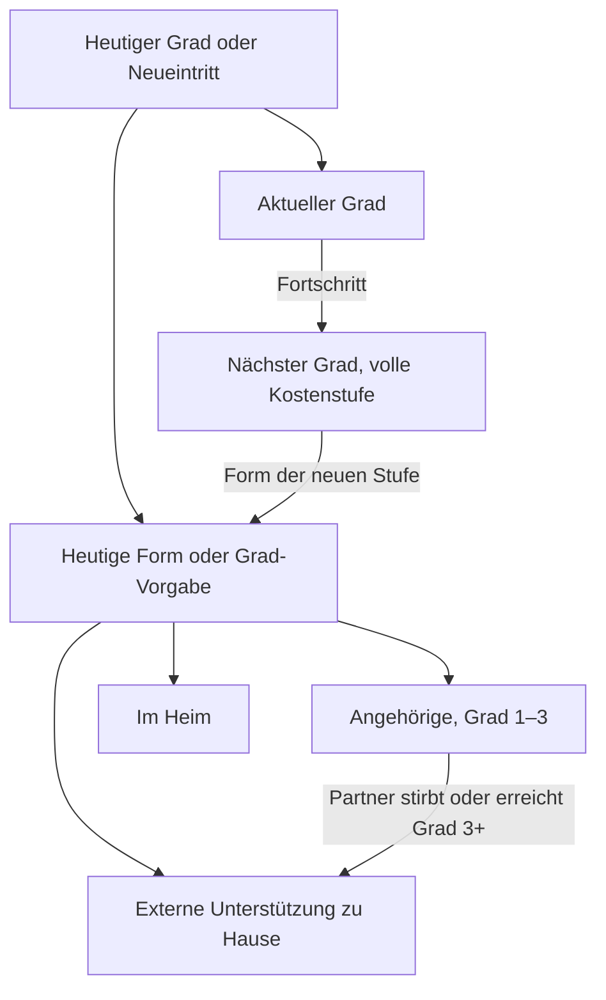

# Pflege

Wie heutige Pflege und mögliche spätere Kosten den Haushalt verändern. Für Nutzer und fachlich Interessierte. Codeprüfung: 08.11.2026; Quellenprüfung: 27.10.2026.

## Auf einen Blick

- Im Simulator gelten Grundbedarf und Flex ohne Pflege; die App ergänzt heutige Pflege ab Jahr 1 selbst.
- Pflegegrad und Pflegeform sind zwei getrennte Angaben.
- Wer heute oder später im Heim lebt, fällt im Simulator aus dem Grundbedarf heraus. Statt seines Anteils zählen Heimkosten und eigene Ausgaben im Heim.
- Fällt bei Paaren der pflegende Partner aus, kann die App bereits im selben Jahr Pflegegeld streichen und Zusatzkosten ansetzen.
- Die Pflegewahrscheinlichkeiten sind intern abgestimmt, aber nicht extern validiert.

## Heute

### Grad und Form

Ein heutiger Pflegegrad gilt auch unter 65 Jahren und bei ausgeschaltetem Zufallsmodell. Die App zieht dafür keinen neuen Eintritt. Ohne heutigen Grad beginnt die Person ohne Pflege. Die „Pflegeform“ im Band „Pflege heute“ gilt bis zum ersten Gradwechsel; danach wirkt die Form aus der Kostenstaffel des erreichten Grads.

| Pflegeform | Bedeutung im Modell | Pflegegeld als Einkunft |
|---|---|---|
| „zu Hause durch Angehörige“ | Eigene Mehrausgaben ohne Abzug des Pflegegelds eintragen. | Ab Grad 2 |
| „zu Hause mit externer Unterstützung“ | Eigenanteil nach Kassenleistungen eintragen. | Keines |
| „im Heim“ | Simulator und Backtest: Heimkosten aus den Pflegewerten nach Heimjahr. | Keines |

Vorgaben der eigenen Staffel sind Angehörige in Grad 1–2, externe Unterstützung zu Hause in Grad 3 und Heim in Grad 4–5. Externe Unterstützung zu Hause bedeutet keinen Heimaufenthalt. Trägst du bei Grad 4–5 keine eigene Form ein, gilt „im Heim“ als heutige Form, auch beim amtlichen Durchschnitt. Bei „Amtlicher Durchschnitt (Destatis/vdek)“ gibt es keine wählbare Pflegeform in der Staffel und kein zusätzliches Pflegegeld.

### Pflegegeld

Mitgeliefert sind monatlich 0 / 347 / 599 / 800 / 990 € für Grad 1–5. Die [BMG-Leistungsübersicht 2026](https://www.bundesgesundheitsministerium.de/fileadmin/Dateien/3_Downloads/P/Pflegeversicherung_Leistungsbeitraege/Uebersicht_Leistungsbetraege_2026_VA.pdf), Stand 11.12.2025, belegt die Beträge. Gemeinsame Haushaltswerte kannst du pflegen und beim Jahresabschluss bestätigen.

Die App rechnet das Pflegegeld automatisch als persönliche feste Einkunft. Es wächst im Simulator nur mit Inflation, deckt den Bedarf und wird bei Überschuss gespart. Im Sterbejahr der empfangenden Person zählt die Hälfte; danach endet es. Die Inflationsfortschreibung ist keine gesetzliche Leistungszusage.

Die [BMG-Erklärung](https://www.bundesgesundheitsministerium.de/pflegegeld) nennt gesicherte häusliche Pflege und mindestens Grad 2 als Voraussetzungen. Rechtlich sind Kombinationen mit ambulanten Sachleistungen möglich. Die App bildet diese Kombination nicht ab; „externe Unterstützung“ erhält im Modell kein Pflegegeld. Andere Kassenleistungen in der Übersicht werden nicht nochmals als frei verfügbares Einkommen addiert.

### Kosten im Bedarf

Im Simulator beschreiben Grundbedarf und Flex den gesamten Haushalt ohne Pflege, so als lebten alle zu Hause (FR-73). Bei heutiger Pflege zu Hause gilt ab Jahr 1 der volle Staffelbetrag des heutigen Grads, unter dem Deckel und ohne Rampe. Trägst du in der Personenkarte „Kosten über die Kasse hinaus“ ein, gilt dieser Betrag statt der Staffel, auch 0 €; er wächst wie die Staffel mit Inflation und Kostenanstieg, aber ohne Regionalzuschlag. Nach einem Gradwechsel gilt wieder die Staffel des neuen Grads. Bei „Amtlicher Durchschnitt“ wirkt das Feld nicht. Das Pflegegeld zählt getrennt als Einkunft. Die App verändert deinen gespeicherten Grundbedarf nicht.

Heutige Heimpflege ersetzt den Anteil am Grundbedarf wie ein späterer Heimaufenthalt. Dazu kommen Heimkosten und eigene Ausgaben. In der Personenkarte kannst du bei „im Heim“ freiwillig „Im Heim seit“ als Monat und Jahr eintragen. Der Monat darf nicht nach heute liegen. Leer beginnt die Rechnung vorsichtig mit Heimjahr 1; der erste Jahresabschluss merkt sich dieses Planjahr an der Person (`profile_care_residential_first_year`), damit Vorschau, Abschluss und Folgejahr das Heimjahr weiterzählen (1 → 2 → …). Beispiel: am 23.10.2026 ergeben 45 Monate seit Januar 2023 Heimjahr 4. November 2025 ergibt noch Heimjahr 1, Oktober 2025 bereits Heimjahr 2. Balance und Simulator samt Backtest und Monte Carlo zählen gleich: „seit“ immer bis heute, den gemerkten Anker nach dem Planjahr (Planjahr − Anker + 1). Wer 2026 schon am 1.12.2026 abschließt, rechnet für 2027 mit Anker 2026 in Heimjahr 2. Oktober 2025 ergibt an diesem Tag 14 Monate, also ebenfalls Heimjahr 2, und erst ab Oktober 2027 Heimjahr 3.

Die hier beschriebene automatische Bedarfsrechnung gilt für Simulator, Backtest und Balance. Balance rechnet mit dem heutigen Haushaltszustand ohne Todesfälle und zeigt im Monatsbudget den Grundbedarf zu Hause und je Person eine Zeile „Pflege“ oder „Heim“; das ⓘ der Heimzeile nennt Heimkosten, eigene Ausgaben und das Heimjahr aus „Im Heim seit“. Pflegegeld zählt erst nach dem Angehörigenausfall des Haushalts. Jahresbudget, Liquiditätsziel und Folgejahresvorschau rechnen mit Heimjahr + 1, Folgejahrespreisen und den Einkünften des Folgejahrs wie im Simulator: Kalendergrenzen (Rentenbeginn, befristete Einkünfte) und Fortschreibung (Rentenanpassung des Haushalts, also die des Hauptprofils für beide Renten wie im Simulator, inflations- oder lohngebundene Einkünfte, Pflegegeld mit der Inflation). Die Inflation ist die der Balance, die Lohnrate die Annahme der Planübersicht (eingetragener Wert, sonst Mittel der Lohnreihe). Grundlage ist der bestätigte Haushaltsplan, ohne Plan die gespeicherte Bedarfsbasis von Balance; gerechnet wird in beiden Fällen, und der Pflegehinweis in Personenkarte und Haushalt & Plan nennt dieselben Beträge. Bei unverheirateten Paaren ordnet Balance erst den gemeinsamen Bedarf und die persönlichen Pflegekosten zu und zieht dann die eigenen Einkünfte der Person ab.

## Verlauf

### Eintritt und Fortschritt

Monte Carlo zieht Pflege vor dem möglichen Tod. Neue Pflege beginnt modellhaft in Grad 1 oder 2; Fortschritt führt um einen Grad weiter. Chronische Pflege läuft bis zum Tod. Akute Pflege verwendet eine gezogene ganzzahlige Dauer aus deinem Bereich. Ein heutiger Pflegegrad bleibt unabhängig davon dauerhaft.

„Langsamer“ und „deutlich langsamer“ multiplizieren die Fortschrittswahrscheinlichkeit mit 0,5 beziehungsweise 0,25, auch nach einem Gradwechsel. Die zusätzliche Sterblichkeit wird nur im heutigen Grad entsprechend vermindert; danach gilt der Faktor des neuen Grads. Mit diesen beiden Verläufen stirbt die Person jedes Jahr mindestens so wahrscheinlich wie die Zieltafel ihres Jahrgangs: Ein Pflegegrad heute verkürzt das Leben, er verlängert es nie. Ohne diese Untergrenze lebte etwa eine Frau mit 85, Grad 2 und „deutlich langsamer“ 7,9 Jahre statt der 7,0 Jahre der Tafel; jetzt sind es 6,6 Jahre. Im ersten Jahr eines heutigen Pflegegrads wird noch kein Fortschritt gezogen. Diese Auswahl ist eine Vergleichsannahme, keine medizinische Einstufung.

Der Backtest hält heutige Grade fest, zieht weder Tod noch Fortschritt und führt die Preise fort. Ein bereits ausgefallener Pflegepartner kann dort trotzdem den Formwechsel auslösen.

### Ausfall der Angehörigen

Bei Paaren nimmt die App an, dass der Partner pflegt. Stirbt er oder erreicht selbst mindestens Pflegegrad 3, wechselt Angehörigenpflege der betroffenen Person in Grad 1–3 ab demselben Jahr dauerhaft zu externer Unterstützung zu Hause. Ihr Pflegegeld entfällt für dieses ganze Jahr; für ihre Kosten gilt weiterhin derselbe Staffelbetrag, bei heutiger Pflege ohne Rampe. Ein späteres Ende akuter Partnerpflege setzt den Wechsel nicht zurück.

Alleinstehende, Grad 4–5 und der amtliche Durchschnitt erhalten diesen zusätzlichen Wechsel nicht. Das Protokoll-ⓘ nennt den aktuellen Grund; Tod hat Vorrang vor einem Pflegegrad.

### Planübersicht und Backtest

Die Planübersicht zeigt heutiges Pflegegeld als eigene Einkunft je Person und schreibt es mit Inflation fort. Bei Angehörigenpflege in Grad 1–3 und heutigem Partnergrad ab 3 entfällt es ab Jahr 1. Die Planübersicht stellt nur das Pflegegeld dar. Der Backtest berücksichtigt Pflegekosten und denselben Partnerausfall mit der gemeinsamen Bedarfsrechnung. Balance prüft den Ausfall im heutigen Haushalt ebenso, bevor sie Pflegegeld ansetzt.

### Grad und Form im Verlauf

## Finanzierung

### Kostenstaffel

Die eigene Staffel gilt für Pflege zu Hause. Staffel, Deckel, Kostenanstieg, eigene Ausgaben im Heim, regionaler Zuschlag und Flex-Level je Grad gehören zu den Pflegewerten des Haushalts. Du pflegst sie in „Personen & Vermögen › Pflege“; Simulator und Balance lesen dieselben Beträge, der Jahresabschluss schreibt sie fort. Eigene Jahreszusätze und „Maximaler Pflege-Floor“ sind Beträge in heutigen Preisen. Beide wachsen ab Simulationsstart mit kumulierter Inflation und zusätzlichem Kostenanstieg. Jahr 1 hat noch keinen zusätzlichen Driftanstieg; Jahr 9 verwendet acht Jahre. Ein Gradwechsel startet die Preisrechnung nicht neu. Der Regionalzuschlag erhöht den Kostenbetrag. Steht eine Zeile auf „im Heim“, ruht ihr Betragsfeld und zeigt „Heimkosten“. Nutzt eine Person diesen Grad heute zu Hause, bleibt der Betrag sichtbar und änderbar.

Die Vorgaben für Grad 1–5 sind 3.600 / 6.000 / 18.000 / 32.000 / 60.000 € im Jahr; der zusätzliche Kostenanstieg beträgt 5 % jährlich. Gespeicherte alte Vorgaben von 6.000 € in Grad 1, 12.000 € in Grad 2 und 3,5 % Kostenanstieg werden beim Lesen durch die neuen Vorgaben ersetzt. Eigene Beträge und bewusst eingetragene Nullen bleiben erhalten. Lesen schreibt keine Werte zurück.

Die Vergleichswerte aus der freigegebenen Recherche vom 08.11.2026 sind Planungsansätze, keine amtliche Kostenstaffel. Die oben verlinkte BMG-Übersicht belegt Kassenleistungen; Heimwerte und Heimanteile stammen aus vdek und Destatis. Die häuslichen Vergleichsbeträge sind keine zugesagten Preise eines Pflegediensts.

| Grad | Angehörige €/Monat | Pflegedienst €/Monat | 24-Stunden-Betreuung €/Monat |
|---|---:|---:|---:|
| 1 | 300 | 600 | – |
| 2 | 500 | 700 | – |
| 3 | 800 | 1.500 | 3.600 |
| 4 | 1.200 | 2.667 | 4.200 |
| 5 | 1.800 | 4.000 | 4.500 |

Der Deckel gilt je Person und nur für den Zusatz zu Hause. Vom fortgeschriebenen maximalen Pflege-Floor wird der laufende Grundbedarf abgezogen, mindestens null. Liegt der rohe Zusatz darunter, gilt er sofort vollständig. Nur bei künftigem Eintritt oberhalb eines positiven Deckels wirkt die Rampe nach Pflegejahren: höchstens der Deckel und höchstens der rohe Zusatz mal bereits erreichter Rampenanteil. Ein Deckel von null erlaubt keinen Zusatz. Zwei Personen zu Hause kommen zusammen also bis zu zweimal Deckel minus Grundbedarf. Heimkosten und eigene Ausgaben im Heim sind weder gedeckelt noch durch die Rampe verzögert.

„Amtlicher Durchschnitt (Destatis/vdek)“ zieht in Monte Carlo für jede Person einmal, ob sie bei Pflege ins Heim kommt. Bei Grad 1–5 liegt der Heimanteil nach Destatis 2023 bei 0,6 / 5,8 / 17,7 / 37,1 / 46,8 %. Weil der Anteil mit dem Grad steigt, bleibt ein erreichtes Heim bei weiteren Gradwechseln. Eine bekannte heutige Form hat Vorrang. Im Heim gelten die Heimkosten aus den Pflegewerten; zu Hause setzt die App keinen Zusatz und kein Pflegegeld an. Hausverkauf, Miete und Wohnrecht folgen der gezogenen Form.

Der Backtest zieht keine Form: Die bekannte heutige Form gilt, im Heim nach Heimjahr, zu Hause netto 0 € ohne Pflegegeld. Balance rechnet die heutige Pflege unter „Amtlicher Durchschnitt“ genauso (Sollfälle M und N). Die Mittelwertstaffel dieses Presets, bei mitgelieferten Werten jährlich 200 / 2.300 / 7.100 / 15.000 / 18.900 € Zusatz für Grad 1–5 (Heimanteil mal erstes Heimjahr, auf 100 € gerundet), gilt nur für künftige Eintritte und ist keine individuelle Heimkostenprognose. Andere gespeicherte Heimwerte ändern die Staffel.

### Heim

Wer im Heim gepflegt wird, fällt aus dem Grundbedarf heraus. Leben alle im Heim, auch Alleinstehende, bleibt kein Grundbedarf zu Hause. Lebt einer im Heim und einer zu Hause, bleibt der Hinterbliebenenanteil, Vorgabe 75 %. Dazu kommen je Person im Heim die Heimkosten und die eigenen Ausgaben im Heim. Ein Pflegezusatz entsteht nur bei Pflege zu Hause.

Die Heimkosten kommen aus den Pflegewerten des Haushalts und gelten gleich für Grad 2–5. Mitgeliefert sind drei Bestandteile laut [vdek-Auswertung zum 01.07.2026](https://www.vdek.com/presse/pressemitteilungen/2026/stationaere-pflege-eigenanteile-juli-2026.html): 2.088 € Pflegeanteil, 1.068 € Unterkunft und Verpflegung, 521 € Investitionskosten im Monat. Die Kasse bezuschusst nur den Pflegeanteil, gestaffelt nach Heimjahren (§ 43c SGB XI):

| Heimjahr | Zuschuss auf den Pflegeanteil | Eigenanteil im Monat | Im Jahr |
|---|---:|---:|---:|
| 1 | 15 % | 3.364 € | 40.368 € |
| 2 | 30 % | 3.051 € | 36.612 € |
| 3 | 50 % | 2.633 € | 31.596 € |
| ab 4 | 75 % | 2.111 € | 25.332 € |

Bei künftigem Heimeintritt beginnt Heimjahr 1. Für heutige Heimpflege zählen volle Jahre bis zum Simulationsbeginn plus eins; danach steigt das Heimjahr jährlich um eins. Auch im Backtest gilt der Simulationsbeginn, nie der historische Marktjahrgang. Ein Gradwechsel setzt den Zähler nicht zurück. Inflation, Pflege-Kostenanstieg ab Simulationsstart und Regionalzuschlag wirken auf alle drei Bestandteile. Für Grad 1 im Heim rechnet die App vorsichtig ohne Zuschuss, also mit 3.677 € im Monat. Ein teureres Heim trägst du im Jahresabschluss bei den Pflegewerten ein.

Beim Jahreswechsel schreibt der Schritt „Pflegewerte“ die drei Heim-Bestandteile, die Staffel zu Hause und den Deckel „Maximaler Pflege-Floor“ mit der Inflation des abgelaufenen Jahres und dem Kostenanstieg fort, die eigenen Ausgaben im Heim nur mit der Inflation; alles auf ganze Euro, Herkunft „fortgeschrieben“. Beispiel mit 2 % und 5 %: Staffel Grad 3 18.000 → 19.278 € im Jahr, Bestandteile 2.088 / 1.068 / 521 → 2.236 / 1.144 / 558 € im Monat, Heimjahr 1 3.603 €, eigene Ausgaben 500 → 510 €. Gerundet wird kaufmännisch ohne Gleitkommarest (3.600 × 1,025 × 1,05 = 3.874,50 → 3.875 €). Ein eigener Wert „Pflegekosten heute über die Kasse hinaus“ wird je Person genauso fortgeschrieben (200 → 214 €/Monat); unter „Werte ändern …“ steht er je Person als Feld, ein dort eingegebener Betrag wird gespeichert und nicht nochmals erhöht. Das gilt nur, solange der Wert wirkt: bei Pflege zu Hause und nicht beim amtlichen Durchschnitt. Ein nach dem Umzug ins Heim stehen gebliebener Wert bleibt gespeichert, erscheint aber nicht und wird nicht fortgeschrieben. Ein bewusst eingegebener Kostenanstieg (auch 3,5 %) steht im Preisblock des Haushalts, bei Außenpersonen in ihrem eigenen Preisblock, und wird nicht mehr umgedeutet. Der Abschluss schreibt immer die Preise des Haushalts fort, auch wenn zuletzt eine Außenperson geöffnet war; nur im Einzelprofil einer Außenperson schreibt er ihren eigenen Preisblock fort. Pflegegeld bleibt. Die Werte werden aus der eingefrorenen Ausgangsbasis genau einmal gerechnet; eine geänderte Inflation rechnet neu und hebt die Bestätigung auf. Eigene oder amtliche Eingaben im Dialog ersetzen den Vorschlag und werden nicht nochmals erhöht. Die Folgejahresvorschau in Balance nutzt denselben Stand. Die Rundung auf ganze Euro erklärt kleine Unterschiede zum fortlaufenden Simulator, etwa 7,45 € im Jahr bei Heimjahr 2.

„Eigene Ausgaben im Heim“ stehen in „Personen & Vermögen › Pflege“, Vorgabe 500 € im Monat je Person. Gemeint sind persönlicher Bedarf, weiterlaufende Versicherungen, auch eine private Krankenversicherung, und freiwillige Extras für bessere Pflege. Sie steigen nur mit der Inflation.

Im Todesjahr rechnet die App den Grundbedarf zu Hause je ein halbes Jahr vor und nach dem Tod. Heimkosten und eigene Ausgaben der verstorbenen Person zählen halb, die einer überlebenden ganz. Endet akute Pflege, enden auch Heimkosten und eigene Ausgaben; der Grundbedarf zu Hause gilt wieder. Das Liquiditätsziel verwendet den vollen Bedarf des Folgejahrs mit Folgejahrespreisen, fortgeschriebenem Deckel und nächster Zuschussstufe. Die Vorschau verändert keine Zähler oder Zufallszustände. Der Backtest hält die heutige Pflege fest und erhöht Heimjahr und Preise jährlich.

### Reserve und Flex

Die Pflege-Rücklage hält Geld für die gewählte Zweckbindung zurück; sie ist keine Versicherung und kein zusätzliches Vermögen. Aktivierte Beträge beider Personen werden addiert. Bei abweichenden Einstellungen gibt die erste aktivierte Rücklage die Regeln vor. Die gesperrte Reserve steht dem normalen Budget nicht frei zur Verfügung; die [Handlungsanweisung](HANDLUNGSANWEISUNG.md) erklärt die Geldquellen.

Der gewählte Mindestgrad und „Haushalts-Trigger“ lösen ihre Nutzung aus, im Todesjahr nach dem Zustand vor dem Tod. „P1 oder P2“ verlangt eine passende Person, „P1 und P2“ zwei lebende Personen mit entsprechendem Grad. „Nur Pflege-Mehrkosten“ deckt eine offene Finanzierungslücke höchstens bis zur Summe aus Pflegezusätzen zu Hause und Heimkosten. Eigene Ausgaben im Heim zählen dabei nicht, der eingesparte Grundbedarf wird nicht abgezogen, Beträge einer verstorbenen Person zählen halb. „Floor-Shortfall bei Pflege“ erlaubt auch den übrigen offenen Grundbedarf. Die Reserve wirkt vor zusätzlichen Deckungsverkäufen und wird nicht automatisch aufgefüllt.

Negative Rücklagenzinsen mindern den Bestand, höchstens bis null. Nutzung und Erschöpfung zählen auch im Ruinjahr. Die [Ergebnisreferenz](SIMULATION_LESEN.md#pflege) erklärt Bezugsgruppen, Euro-Basis und Rücklagenzusammenfassung.

Die Flex-Vorgaben je Grad sind 100 / 100 / 50 / 0 / 0 %; du änderst sie in „Personen & Vermögen › Pflege“. Eine gespeicherte frühere Vorgabe 75 / 25 / 10 / 0 / 0 % zeigen Pflegebereich und Simulator als 100 / 100 / 50 / 0 / 0 % an. Erst eine Änderung im Pflegebereich oder der Simulatorstart speichert die neue Staffel. Auch heutige Pflege verwendet das absolute Level des Grads für Wunsch-Flex und Mindest-Flex. Dieselbe Kürzung begrenzt Dynamic Flex: gesund plus Grad 3 ergibt im Paar Faktor 0,875; gesund plus Grad 4 ergibt 0,75; beide ab Grad 4 ergibt 0.

Bei Paaren wirkt eine Mischung aus gemeinsamem und persönlichem Anteil, nicht einfach der niedrigere Personenwert. Höhere Pflegekosten können Flex zusätzlich über das Jahresbudget mindern. Im Todesjahr zählt für das erste Halbjahr der Pflege-Flex des Paars, danach der eingestellte Hinterbliebenenanteil mal Pflegefaktor der lebenden Person. Ab dem Folgejahr gilt nur dieses Produkt; ein zusätzlicher Deckel aus der früheren Pflege der verstorbenen Person greift nicht. Pflegekosten der verstorbenen Person zählen im Todesjahr halb und entfallen danach; mit Heim gilt die Halbjahresrechnung unter [Heim](#heim). Die [Hinterbliebenenregeln](TOD_UND_ERBE.md#einkommen-und-bedarf) definieren die getrennten Bedarfsanteile.

### Heim und Immobilie

Der reguläre [Immobilienverkauf](IMMOBILIEN.md#heimverkauf) setzt voraus, dass alle Lebenden mindestens Grad 4 haben und im Heim gepflegt werden. Ein Ausfall der Angehörigen allein erfüllt das nicht. Lebt einer im Heim und einer zu Hause, verkauft die App nicht regulär; ein Notverkauf bleibt möglich. Die [Miete nach einem Notverkauf](IMMOBILIEN.md#wohnmiete) endet, sobald alle Lebenden tatsächlich im Heim wohnen, bei jedem Grad. Ein Wohnrecht kann bereits bei Heimpflege unter Grad 4 enden; seine [Steuerfolgen](STEUERN.md#wohnrecht-und-jährliche-zahlung) haben eine eigene Grenze.

## Annahmen und Beispiel

### Interne Abstimmung und Grenzen

Eintritt nach Alter und Geschlecht und Fortschritt sind intern auf Destatis 2023 abgestimmt (FR-41). Seit FR-75 rechnet `scripts/retune-care-model.mjs` die Abstimmkohorte exakt als Markov-Kette: Eintritt je Altersband skaliert, bis die Pflegequote der Statistik entspricht (Faktor 0,56–0,98 gegenüber vorher), fallende Summen auf das vorige Band angehoben, Fortschritt × 0,75. Die Prüfung mit 200.000 Personen je Geschlecht (`scripts/calibrate-care-model.mjs`) besteht; nur Männer ab 95 liegen mit 86,7 % über 84,7 %, innerhalb der Toleranz. Ziel der Abstimmung ist die Periodentafel 2023/25, weil die Pflegestatistik ein Querschnitt ist. Die amtliche Prävalenz ist ein Bestandsanteil, keine jährliche Eintrittswahrscheinlichkeit. Nur die Abstimmkohorte startet mit statistischem Pflegebestand; Simulatorpersonen übernehmen ausschließlich ihren eingetragenen Grad.

Die Sterblichkeitsfaktoren wirken auf eine abgesenkte Grundsterblichkeit. Sie wird je Person so gewählt, dass die Gesamtsterblichkeit jedes Alters der Zieltafel entspricht (FR-75): Wer zum Start ohne Pflegegrad ist, lebt im Mittel wie die Tafel, auch mit Zufallseintritt; nur ein eingetragener Grad verkürzt zusätzlich. Das gilt für „chronisch“ und „akut“, bei „akut“ mit der Dauer aus deinem Bereich. Weil Menschen in Pflege damit länger leben als vorher, dauert ein Pflegefall länger. In der Abstimmung mit der Periodentafel sind es ab 65 Männer rund 6,4 statt 5,1 Jahre, Frauen rund 8,2 statt 6,1 Jahre. Gezogen wird aber mit der Kohortentafel des Jahrgangs, und der lebt länger in den Altern mit hoher Pflegequote. Für eine Person, die heute ohne Pflegegrad ist, exakt gerechnet (chronisch, Vorgabefaktoren, 12.11.2026):

| Person | wird pflegebedürftig | Jahre je Pflegefall | Pflegejahre je Person |
|---|---|---|---|
| Frau, 64, Jahrgang 1961 | 74 % | 8,9 | 6,6 |
| Frau, 55, Jahrgang 1971 | 73 % | 9,4 | 6,9 |
| Mann, 67, Jahrgang 1958 | 58 % | 6,4 | 3,7 |
| Mann, 76, Jahrgang 1950 | 61 % | 5,3 | 3,2 |

Das ist eine Folge der Regeln, keine Statistik: Eintritt je Alter und Überleben je Jahrgang stehen fest, also auch die Pflegejahre. Im Sterbejahr zählt ein halbes Pflegejahr.

Mangels Kreuztabelle Alter × Grad nutzt die Abstimmung Gradanteile aller Altersgruppen. Die Sterblichkeitsfaktoren 1,5 / 2 / 3 / 4 / 5 wirken ab dem aktuellen Grad, ohne Kostenrampe. Diese interne Abstimmung ist keine unabhängige Validierung. [Datenquellen](DATA_SOURCES.md#lebensereignisse) führen Herkunft, Transformation und offene Nachweise.

Modellgrenzen:

- Kein medizinischer Verlauf und keine persönliche Leistungsprüfung.
- Außer dem Zuschuss nach Heimjahren keine eigene Berechnung von Kassenleistungen; Staffelbeträge sind Szenarioannahmen.
- Keine Steuerentlastung für Heimkosten, keine Hilfe zur Pflege, keine Heimkosten nach Bundesland. Verlässt jemand das Heim und kehrt zurück, beginnt das Heimjahr wieder bei 1.
- Pflege-Rücklage und bestandene Rechentests belegen keinen Versicherungsschutz oder extern bestätigte Pflegewahrscheinlichkeiten.

### Max und Erika

Synthetische Rechenvariante, geprüft am 27.10.2026: Erika hat heute Grad 2 und Angehörigenpflege; Max pflegt sie. Ohne Inflation erhält sie 347 × 12 = 4.164 € jährlich. Ihre heutigen Kosten sind bereits im Bedarf enthalten. Für Grad 2 sind beispielhaft 6.000 € jährlicher Zusatz gespeichert; der Deckel lässt ihn vollständig zu. Erreicht Max Grad 3, entfallen Erikas 4.164 € Pflegegeld und die 6.000 € kommen ab diesem Jahr hinzu. Der Finanzierungsbedarf steigt dadurch um 10.164 € gegenüber unveränderter Pflege. Ein Heimverkauf folgt daraus nicht. Max’ eigene Pflegekosten wären zusätzlich zu betrachten.

### Helga und Werner im Heim

Synthetische Rechenprobe ohne Inflation, Kostenanstieg und Regionalzuschlag, geprüft am 07.11.2026: Helga und Werner planen 36.000 € Grundbedarf. Kommen beide im selben Jahr mit Grad 4 ins Heim, fällt dieser Grundbedarf weg. Je Person kostet das erste Heimjahr 40.368 € Heimkosten und 6.000 € eigene Ausgaben, zusammen 92.736 €. Ab dem vierten Heimjahr sind es 62.664 €. Kommt nur Werner ins Heim, bleiben 27.000 € Grundbedarf für Helga, dazu 46.368 € für Werner, also 73.368 €. Die Übung im Steckbrief zeigt dasselbe in einem Monte-Carlo-Pfad.

### Wo du es in der App siehst

„Personen & Vermögen“ führt im Band „Pflege heute“ der Personenkarte „Pflegegrad“, „Pflegeform“, „Im Heim seit“, „Kosten über die Kasse hinaus“, Verlauf und Kassenleistungen; die Zeile „Angesetzt“ nennt den gerechneten Monatsbetrag. Hat eine Person einen Pflegegrad heute, zeigen Personenkarte, Haushalt & Plan und Balance einmal den Hinweis „Die App rechnet Pflegekosten jetzt selbst …“ mit den angesetzten Kosten je Person; „Erledigt“ merkt sich der Haushalt mit der Regelversion (`household_care_hint_v1`), auch über Sicherung und Spielbereich. Balance zeigt unter „Dein Bedarf“ je Person „Pflege“ oder „Heim“. Der Reiter „Pflege“ zeigt den heutigen Zustand je Person mit dem angesetzten Monatsbetrag. Darunter stehen die Annahmen in fünf Aufklappzeilen, zugeklappt mit ihren aktuellen Werten: Staffel, übliche Form und Deckel, Heim mit Bestandteilen, Heimjahren und eigenen Ausgaben, Flex je Grad, Kostenanstieg mit Zuschlag sowie das Pflegegeld. Pflegegeld je Grad und die drei Heim-Bestandteile änderst du dort jederzeit; sie gelten sofort, erhalten die Herkunft „von Hand“ mit dem laufenden Monat und erscheinen im nächsten Jahresabschluss als Ausgangswerte. Der Simulator zeigt diese Werte in einer Zeile mit Link und führt nur Verlauf und Simulationsannahmen. Staffel, Deckel und Heimkosten prüfst du im Jahresabschluss unter „Pflegewerte“, bereits fortgeschrieben. Im Jahresprotokoll trennt das ⓘ bei „Ausgaben“ Grundbedarf zu Hause, Pflege zu Hause, Heimkosten und eigene Ausgaben; Beträge unter 0,50 € in der gewählten Eurobasis (nominal oder heutige Kaufkraft) bilden keine Zeile. Darunter stehen je Person Grad, tatsächlich verwendete Form, Heimjahr und Zuschuss. „Änderung Pflegebedarf“ zeigt nur den nichtnegativen Anstieg des Pflegezusatzes zu Hause. Sinkende Heimkosten stehen als Änderung zum Vorjahr im Ausgaben-ⓘ. Das ⓘ bei „Einnahmen“ erklärt Pflegegeld und Wechselgrund. Klickwege: [Handbuch](../../Handbuch.html#person-pflegen). [Technische Belege](TECHNICAL.md#lebensereignisse-und-steuer-belegen) verbinden die Grenzen mit bestehenden Prüfungen.
