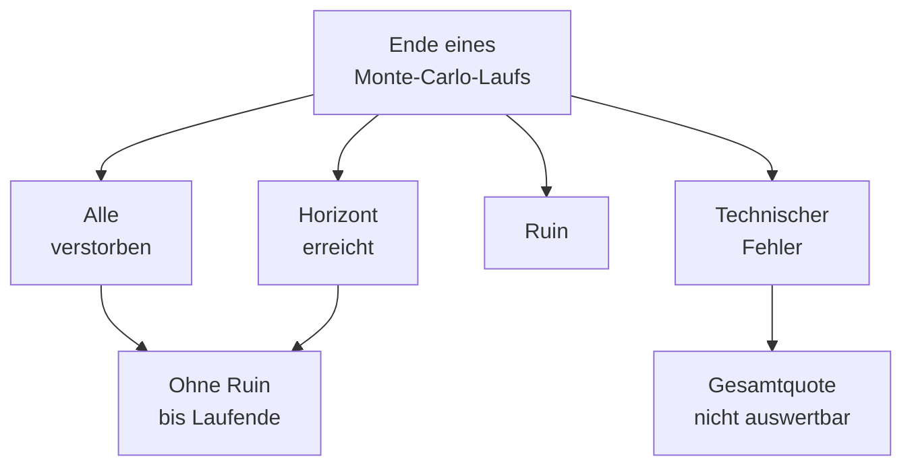

# Simulationsergebnisse lesen

Wie du Backtest, Monte Carlo und Varianten beurteilst. Für Nutzer und fachlich Interessierte. Codeprüfung: 29.10.2026.

## Auf einen Blick

- Prüfe zuerst Annahmen, Laufende und technische Fehler.
- Grundbedarfsdeckung und Mindest-Flex beantworten verschiedene Fragen.
- Ein Perzentil beschreibt eine Verteilung; ein gewählter Pfad zeigt einen zusammenhängenden Verlauf.
- Vergleiche Geldbeträge nur bei gleicher Kaufkraft-, Vermögens- und Zeitbasis.
- Modellanteile sind keine Zusagen für deinen Haushalt.

## Frage und Verfahren

### Historischer Pfad

Der Backtest beantwortet: Wie hätte mein heutiger Plan die gewählte historische Marktfolge durchlaufen? Renditen, Inflation und Lohnentwicklung folgen aufeinander; das CAPE-Entscheidungssignal stammt aus dem Vorjahr. Aus der Jahresbasis 1925–2025 sind wegen des nötigen Rückblicks Starts ab 1929 möglich.

Deine heutigen Personenangaben werden auf diese Marktjahre gelegt. Niemand stirbt im Backtest. Eingetragene Pflege besteht mit fortgeschriebenen Kosten weiter; neue Pflegefälle und Gradfortschritte werden nicht gezogen. Ein erfolgreicher Lauf prüft daher weder die tatsächliche Lebensdauer noch damaliges Renten- und Steuerrecht. Überlappende historische Startfenster sind keine unabhängigen Versuche.

### Monte Carlo

Monte Carlo beantwortet: Wie verteilt sich das Ergebnis über viele mögliche Modellpfade? Die App zieht historische Jahresdaten neu zusammen. Je nach Verfahren bleiben zusammenhängende Abschnitte erhalten oder Marktklassen steuern die Auswahl. Tod und Pflege können die Haushaltsentwicklung und das Laufende verändern.

Das letzte Ergebnis bleibt bis zum Schließen der App erhalten, solange Eingaben und Speicherbereich gleich bleiben. Die Jahresprotokolle der Szenarien rechnet die App beim Zurückkommen aus der Laufnummer nach. Passt der Lauf nicht mehr zu den Eingaben, zeigt die App nichts an und bittet um eine neue Rechnung.

Mehr Läufe machen die Anteile im gewählten Modell stabiler. Sie beseitigen weder Datenlücken noch falsche Annahmen. Zusätzlicher Stress und Tail-Risk sind eingestellte Belastungen; ihre Häufigkeit ist keine gemessene Crashwahrscheinlichkeit. Methoden und offene Nachweise erklärt der [wissenschaftliche Rahmen](WISSENSCHAFTLICHER_RAHMEN.md#historische-marktpfade-und-monte-carlo).

### Gleiche Vergleichsannahmen

Für einen zurechenbaren Vergleich müssen Haushalt, Anfangsbestände, Bedarf, Einkünfte, Laufdauer, Datenfilter, Sampling, Stress und Kostenbasis übereinstimmen. Halte auch Seed und Laufzahl fest. Ein Seed allein sichert keine Gleichheit, wenn Daten oder Verfahren wechseln. Ändere zunächst eine Entscheidung und lies Deckung, Konsum und Restvermögen gemeinsam.

Nur die Planübersicht nutzt ohne eigenen Inflations- oder Lohnwert das arithmetische Mittel der letzten 25 vollständigen Jahre der eingebauten Reihe, derzeit 2001–2025. Diese Anzeigeannahme wird weder gespeichert noch an Backtest oder Monte Carlo weitergegeben. Eingetragene 0 % bleiben wirksam.

## Ergebnisse

### Deckung und Ruin

„Floor“ bedeutet Grundbedarf. Die Floor-Deckungsquote zählt Monte-Carlo-Läufe ohne modellierten Ruin bis zu ihrem jeweiligen Ende: Tod aller Personen oder gewählter Horizont. Der Nenner sind alle angeforderten Läufe. Schon ein technischer Fehler sperrt die Gesamtquote; ein solcher Fehler ist kein schlechter Marktpfad. 100,0 % erscheint nur bei Erfolg in sämtlichen Läufen. Ein angezeigtes Unsicherheitsintervall beschreibt die begrenzte Laufstichprobe innerhalb des Modells.

Lebt am Horizontende noch jemand, ist nur die Zeit bis dahin geprüft. Beim Tod aller Personen endet Monte Carlo vor dem nächsten Finanzschritt; der Vermögenswert stammt dann aus dem letzten errechneten Stand, bei sofortigem Tod aus dem Anfangsbestand. Vorheriger Ruin bleibt Ruin.

Ruin ist ein finanzieller Modellabbruch: Geldvermögen oder Auszahlung reichen nicht für den offenen Grundbedarf, eine fällige geplante Ausgabe oder eine modellierte Steuerpflicht. Er bedeutet keine rechtliche Insolvenz. Unverkaufte Immobilien verhindern ihn nicht automatisch. Im historischen Backtest sind außerdem unvollständige oder abgebrochene Rechnungen von einem vollständig durchlaufenen Zeitraum zu unterscheiden.

„Depoterschöpfung“ ist eine andere Kennzahl: Sie umfasst Ruin oder einen Rest von höchstens 100 € in Aktien und Gold. Freie Liquidität und Pflege-Rücklage gehören nicht zu dieser Schwelle. Auch die operative Liquiditätsreichweite misst etwas Eigenes: freie Mittel gegenüber der Portfolioentnahme am angegebenen Messzeitpunkt. Sie ist keine Restlebensdauer des Geldvermögens. Ohne Entnahme aus dem Vermögen steht in der Protokollspalte „Liquidität reicht“ ein „—“.

### Mindest-Flex

Ein abgeschlossenes Entnahmejahr zählt als eingeschränkt, wenn der tatsächlich bezahlte Haushalts-Flex einschließlich Einkommensbeitrag streng unter dem angewandten positiven Mindest-Flex liegt (FR-6). Gleichheit und ein Jahresminimum von null zählen nicht als Unterschreitung. Eine Kürzung gegenüber dem Wunsch-Flex allein genügt ebenfalls nicht. Die [Budgetregel](JAHRESBUDGET.md#b9) beschreibt, wie die App das Mindestziel zu finanzieren versucht.

| Anzeige | Zähler und Nenner |
|---|---|
| Backtest-Anteil | Einschränkungsjahre geteilt durch alle auswertbaren abgeschlossenen Entnahmejahre dieses Pfads. |
| Typischer Jahresanteil in Monte Carlo | Erst derselbe Anteil je Lauf, danach der Median dieser Anteile; keine Zusammenlegung aller Jahre. |
| Betroffene Monte-Carlo-Läufe | Läufe mit mindestens einem Einschränkungsjahr geteilt durch die auswertbaren Läufe. |

Zum Jahresnenner gehören auch abgeschlossene Entnahmejahre mit Mindestwert null. Ansparjahre, terminale Todes-, Ruin- und Fehlerzeilen zählen nicht. Fehlende benötigte Jahresbeträge machen den Lauf für diese Messung unauswertbar; sie werden nicht als null ergänzt. Die Stichprobengröße nennt den tatsächlich ausgewerteten Nenner. Technische Fehler sperren die Gesamtantwort.

Die Messung vergleicht die damaligen nominalen Jahresbeträge. Der beim Start eingefrorene Mindest-Flex wird jährlich fortgeschrieben; spätere Formulareingaben ändern das Ergebnis nicht. Die Euro-Anzeige kann Beträge in heutige Kaufkraft umrechnen, ohne die damalige Unterschreitung neu zu bestimmen.

Ein Median von 0 % kann mit betroffenen Läufen zusammenfallen. Lies deshalb beide Anteile sowie typisch bezahlten Flex und das schwächste Jahr. Bei Start-Mindest-Flex null oder älteren Resultaten ohne diese Messung erscheint die Altanzeige „mehr als 10 % unter Wunsch-Flex“. Sie zählt rechnerisch auch genau 10 % und beantwortet eine andere Frage.

### Vermögen und Kaufkraft

„Nominal · Kontowert“ zeigt Euro des jeweiligen Modelljahrs. Real rechnet auf Preise des Laufstarts zurück. Im Backtest heißt diese Einheit überall „Euro von [Startjahr]“, etwa „Euro von 2000“. Monte Carlo verwendet „Real · heutige Kaufkraft“. Neue Läufe beginnen mit der realen Anzeige. Jahreszahlungen und Jahresendbestände können unterschiedliche Inflationszeitpunkte verwenden; gleiche Euro-Beschriftung allein macht daraus keine gleiche Messung.

Gesamtvermögen umfasst Geldvermögen und Immobilien. Die Aufteilung unter der Hauptzahl und die gestapelten Flächen zeigen diese Bestandteile. Im Jahresprotokoll zeigt das ⓘ an „Geldvermögen“ nur die Geldteile. Das ⓘ an „Geldvermögen plus Immobilien“ nennt auch die Immobilien. „Durch die Krisen“ nennt den tiefsten Jahresendstand des Gesamtvermögens in der gewählten Euro-Basis und darunter den Geldanteil einschließlich Pflegevorsorge. Die Veränderung vergleicht denselben Gesamtstand mit dem Startbestand oder dem Jahresende vor der Krise. Rendite, Risiko, Ruin, Deckung und Strategiequoten beziehen sich auf Geldvermögen. Ein Immobilienverkauf verschiebt Wert ins Geldvermögen; ein hoher unverkaufter Immobilienwert ist noch keine verfügbare Auszahlung.

Die Endwerte von Monte Carlo, Backtest und Replay zählen die verbleibende Pflege-Rücklage zum Geldvermögen. Für gewöhnliche Entnahmen bleibt sie gesperrt. Die [Rücklagenstatistik](#pflege) weist die Betragsbasis je Kennzahl aus. Nach Geldruin wird ein verbliebener Immobilienwert ohne weitere Marktjahre fortgezeigt.

Ein höheres Endvermögen kann aus geringeren Auszahlungen oder einem späteren Messzeitpunkt entstehen. Die „Entnahme aus dem Vermögen in schwachen Jahren“ verwendet zunächst P10 der jährlichen Vermögensentnahmen jedes Laufs, danach P10 dieser Laufwerte. Einkünfte wie Renten fehlen darin; nach Ruin ergänzte Nullentnahmen bleiben enthalten. Das gesamte Haushaltsbudget ist eine andere Größe.

### Perzentil und gewählter Pfad

P10 ist die untere Zehntelposition, P50 der Median und P90 die obere Zehntelposition. Der Bereich P25–P75 enthält die mittlere Hälfte der Endwerte. Die Endwertverteilung verwendet auswertbare Läufe einschließlich Ruin und beobachteter Nullwerte; technische Fehler sind ausgeschlossen. Ein nur über erfolgreiche Läufe berechneter Median verwendet ausschließlich Läufe ohne Ruin.

Eine Perzentilkurve kann in jedem Jahr aus einem anderen Lauf stammen. Auch die Mediane verschiedener Kennzahlen beschreiben nicht zwingend denselben Haushaltspfad. Um eine Geschichte zu lesen, brauchst du das Jahresprotokoll eines gewählten Szenarios.

„Worst Case des Geldendvermögens“, „Median des Geldendvermögens“ und die übrigen Vermögensperzentile ordnen nach dem nominalen Geldvermögen am Ende. Lange Läufe, Erbteile an Dritte und Steuern verschieben diese Reihenfolge. Ein „P10 des Geldendvermögens“-Szenario muss deshalb nicht am P10 der sichtbaren realen oder gesamten Endwertverteilung liegen. Die Euro-Wahl verändert die Auswahl nicht.

Für „Typischer Marktverlauf“ wird je Lauf das geometrische Mittel der Aktienjahresfaktoren berechnet und der Lauf mit der mittleren Rendite gewählt. Nur vollständig gerechnete Finanzjahre zählen; Todes- und Ruinjahre bleiben außen vor. Bei gleicher Rendite entscheidet die Laufnummer. So liest du einen mittleren Börsenverlauf, dessen Endvermögen trotzdem durch Auszahlungen und Lebensereignisse geprägt ist. Protokoll und Export zeigen denselben Pfad. Pfadnummer und Quelllauf helfen, doppelt gewählte oder verschieden lange Pfade zu erkennen.

## Ursachen

### Jahreslog

Lies zuerst „Was im Lauf auffällt“ beziehungsweise „Was im gewählten Pfad auffällt“. Die Jahresverweise führen zum Beleg für Grundbedarfsdeckung, Mindest-Flex, Kürzungsphasen und Vermögenstiefs. Danach prüfst du die zugehörige Auszahlung, Einkünfte, Verkäufe, Steuern und Liquidität. Die [Handlungsanweisung](HANDLUNGSANWEISUNG.md#quellen-und-verwendung) erklärt den Geldfluss.

Ein Ereignis neben einem Vermögensrückgang belegt noch keine alleinige Ursache. Mehrere Regeln und Lebensereignisse können im selben Jahr wirken. Ein Pfad zeigt seinen Verlauf, keine Häufigkeit über alle Läufe. Der Ergebnisexport bewahrt den Laufbeleg; das Jahresprotokoll liefert die Einzelwerte in seiner ausgewiesenen Betragsbasis.

### Pflege

Eintrittsquoten beziehen sich auf angeforderte Läufe. Eintrittsalter, Pflegejahre und Pflege-Mehrbedarf verwenden jeweils die Gruppe mit beobachteter Pflege der betreffenden Person. Ohne Beobachtungen bleibt ein Median unbekannt. Mehrbedarf bezeichnet modellierten Zusatzbedarf, nicht automatisch eine ebenso hohe Entnahme aus dem Depot. Er ist netto: Pflegezusatz zu Hause, im Heim Heimkosten und eigene Ausgaben, abzüglich des Grundbedarfs, den der Heimaufenthalt einspart. Ein Jahr, in dem das Heim weniger kostet als der eingesparte Grundbedarf, zählt mit null. „Bedingte Shortfall-Rate“ bezieht sich auf Pflege-Läufe und verwendet die oben erklärte Ruin-/Depoterschöpfungsgrenze.

Zur Gruppe „mit Pflege“ gehören Läufe, in denen bei mindestens einer Person Pflege aktiv war, einschließlich bereits eingetragener Pflege; „ohne Pflege“ enthält die übrigen auswertbaren Läufe, gemessen wird jeweils am eigenen Laufende. In der [Musteraufnahme mit Max und Erika](../ui/monte-carlo-pflege.png), Testdatum 20.10.2026, stehen 2,98 Mio. € mit gegenüber 2,16 Mio. € ohne Pflege: Pflege tritt häufiger in langen Lebensläufen auf, deren Vermögen später gemessen wird; solche Auswahleffekte können den Pflegegruppenmedian erhöhen. Die Geldvermögens-Differenz rechnet ohne minus mit Pflege, hier rund −0,82 Mio. €; sie ist kein paarweiser Vergleich und bedeutet keinen Vermögensgewinn durch Pflege.

Die Rücklagenstatistik trennt Nutzung, Bestand und Ertrag:

| Kennzahl | Bezugsgruppe und Euro-Basis |
|---|---|
| Genutzte Rücklage | Median und P90 der Läufe mit positiver Nutzung; ohne Nutzung bei aktiver Rücklage 0. Nominal oder Startkaufkraft nach Euro-Wahl. Reale Zahlungen werden mit dem Jahresanfangsfaktor umgerechnet. |
| Restbestand und Ziellücke | Läufe mit aktivierter Rücklage, auch ohne Nutzung. Die Euro-Wahl gilt; reale Endwerte verwenden den Jahresendfaktor, auch bei Ruin. |
| Rücklagenzins | Summe der nominalen Jahreszinsen je aktiviertem Rücklagenlauf, einschließlich null und negativer Werte. Die Euro-Wahl ändert diese Statistik nicht. |
| Backtest-Zusammenfassung | Restbestand, reale Deckung und Ziellücke aus der letzten Jahreszeile mit aktivierter Rücklage, auch vor einer späteren Endzeile. Restbestand und Ziellücke sind nominal; reale Deckung ist ein Prozentwert. |

Die Gruppen können verschieden groß sein. Bestandswerte ersetzen keine Auflistung der Jahresbewegungen.

Kosten, Angehörigenausfall und Reservenutzung erklärt [Pflege](PFLEGE.md). Die interne Modellabstimmung ersetzt keine externe Validierung.

### Erbe und Immobilien

Tod kann Bedarf, Einkommen, Eigentum und Steuerpflichten verändern. Ein sinkender Haushaltsbestand kann einen Abfluss an andere Erben enthalten; ein Immobilienverkauf kann Liquidität zuführen und später Wohnmiete auslösen. Vergleiche daher die Ereignis- und Geldflusszeilen, bevor du eine Veränderung der Anlagestrategie zuschreibst. Die Regeln stehen unter [Tod und Erbe](TOD_UND_ERBE.md), [Immobilien](IMMOBILIEN.md) und [Steuern](STEUERN.md).

## Varianten

### Eine Entscheidung vergleichen

„Vergleich“ untersucht eine Budgetänderung, eine einmalige Ausgabe oder einen verschobenen Einkommensbeginn. Ausgangsplan und Variante erhalten aufgezeichnete gemeinsame Markt- und Todesziehungen; Pflegeziehungen bleiben getrennt. Das reduziert zufällige Vergleichsunterschiede, kontrolliert aber nicht jede Folge einer Planänderung.

„Wo die Änderung schadet“ zählt Läufe, in denen der Ausgangsplan Ruin vermeidet und die Variante Ruin oder zusätzliche Jahre unter Mindest-Flex bringt. Die übrigen Tabellenwerte vergleichen Kennzahlen beider Pläne; ihre Differenz ist keine Medianwirkung je gepaartem Haushalt. „Verfügbares Budget“ meint Grundbedarf plus bezahlten Flex, zunächst als Median je Lauf, dann als P10/P50 über diese Laufmediane. Die Vermögenswerte verwenden Geldvermögen in heutiger Kaufkraft.

Der Vergleich kann weniger Läufe als die Standardrechnung verwenden; die tatsächliche Zahl steht am Ergebnis. Die Übernahme in einen Planversuch beschließt keinen zentralen Plan.

### Zielwertsuche

Die Suche fragt nach einem monatlichen Wunschbudget bei gleichzeitig ausreichender Deckungsquote und höchstens dem gewählten Anteil betroffener Läufe. Sie verändert Wunsch-Flex, hält Grundbedarf und Mindest-Flex fest und prüft ein 50-€-Raster. Ein Ausgangsbetrag zwischen zwei Rasterstufen bleibt als Vergleich erhalten; der Suchstart wird abgerundet, mindestens aber auf die aufgerundete Mindest-Flex-Grenze gesetzt. Die Kennzahlen gehören stets zur tatsächlich gerechneten Stufe. Das gefundene Wunschbudget ist Grundbedarf plus Wunsch-Flex in heutigen Euro, keine zugesagte Auszahlung.

Eine Endprobe verwendet die volle eingestellte Laufzahl für Ausgangsplan und Kandidat. Hält der erste Fund nicht, prüft die Suche niedrigere Beträge. „Endprobe nicht bestätigt“ bedeutet, dass auch die geprüfte Untergrenze die Ziele verfehlt. Eine erreichte Suchobergrenze beweist kein Maximum; auch sonst ist kein global höchster Betrag garantiert. Suchstufen und Endprobe stammen aus derselben Modellwelt.

### Werkstatt

| Werkzeug | Frage und Aussage | Grenze |
|---|---|---|
| Replay | Wie ändern andere Einstellungen diesen festgehaltenen Markt- und Ereignispfad? Zeigt Ausgangsrechnung und Variante. | Ein einzelner Pfad liefert keine Erfolgswahrscheinlichkeit. |
| Sweep | Wie reagieren Kennzahlen auf festgelegte Parameterkombinationen? Zeigt Unterschiede im gewählten Raster. | Ungeprüfte Zwischenwerte und Bereiche bleiben offen. |
| Auto-Optimize | Welche zulässige Konfiguration findet die Suche für Ziel und Grenzen? Liefert einen Champion und Vergleichswerte. | Bester gefundener Kandidat im Suchraum; experimentell, kein allgemeiner Strategievorteil. |

Auto-Optimize bestätigt führende Kandidaten auf getrennten Seeds und wählt daraus den Champion. Der Vergleich „gegenüber aktuell“ verwendet deinen unveränderten Ausgangsplan. Für die Übernahme muss Dynamic Flex im Planversuch dem Bewertungsmodus entsprechen; eine Abweichung sperrt die Übernahme. Diese Seeds verwenden dieselben historischen Daten und denselben Generator. Sie sind keine unabhängigen Marktdaten außerhalb der Entwicklung. Bewertungsziel und Nebenbedingungen können Konsum gegen Restvermögen tauschen. [Methodische Grenzen](FORSCHUNGSABGLEICH_EVIDENZREGISTER.md#map-13).

## Grenzen

### Daten und Modell

- Historische Reihen sind teils Forschungsproxies; Herkunft und Transformationen stehen unter [Datenquellen](DATA_SOURCES.md).
- Jahresschritte, Steuervereinfachungen und Annahmen zu Lebensdauer und Pflege begrenzen die Übertragung. Nicht erfasste Vermögen und künftige Zugänge fehlen.
- Fremdwährung, Produktkosten, Spread und Slippage sind nicht vollständig als eigene Zahlungsströme modelliert. Ein grüner Test bestätigt keine persönliche Eignung.

### Keine Prognosegarantie

Lies Deckung, Einschränkung, bezahlten Konsum, Liquidität und Restvermögen zusammen. Eine bessere Einzelzahl kann durch einen schlechteren anderen Zielwert erkauft sein. Historische und simulierte Anteile gelten für die untersuchten Bedingungen; sie sind keine gemessenen Zukunftswahrscheinlichkeiten deines Haushalts. [Offene Nachweise](FORSCHUNGSABGLEICH_EVIDENZREGISTER.md#offene-nachweise).

### Wo du es in der App siehst

Im Simulator unter „Ergebnis“, „Monte Carlo“ und „Werkstatt“: Kernantworten, Risiko und Verteilung, Pflege, Szenario-Logs und Varianten. Die Klickwege stehen im [Handbuch](../../Handbuch.html#simulator) sowie unter [Monte Carlo](../../Handbuch.html#monte-carlo) und [Werkstatt](../../Handbuch.html#werkstatt).
