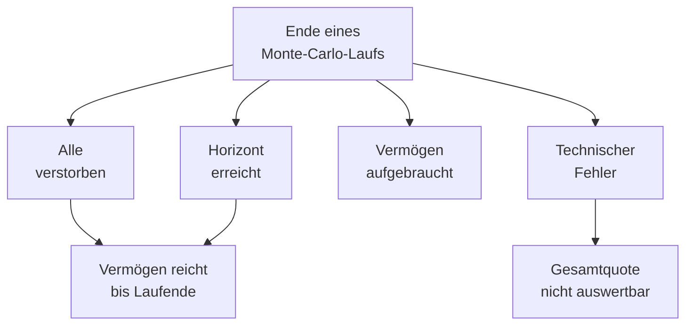

# Simulationsergebnisse lesen

Wie du Backtest, Monte Carlo und Varianten beurteilst. Für Nutzer und fachlich Interessierte. Codeprüfung: 19.11.2026.

## Auf einen Blick

- Prüfe zuerst Annahmen, Laufende und technische Fehler.
- Grundbedarfsdeckung und Mindest-Flex beantworten verschiedene Fragen.
- Ein Perzentil beschreibt eine Verteilung; ein gewählter Pfad zeigt einen zusammenhängenden Verlauf.
- Vergleiche Geldbeträge nur bei gleicher Kaufkraft-, Vermögens- und Zeitbasis.
- Modellanteile sind keine Zusagen für deinen Haushalt.

## Frage und Verfahren

### Historischer Pfad

Der Backtest beantwortet: Wie hätte mein heutiger Plan die gewählte historische Marktfolge durchlaufen? Renditen, Inflation und Lohnentwicklung folgen aufeinander; das CAPE-Entscheidungssignal stammt aus dem Vorjahr. Aus der Jahresbasis 1925–2025 sind wegen des nötigen Rückblicks Starts ab 1929 möglich.

Deine heutigen Personenangaben werden auf diese Marktjahre gelegt. Niemand stirbt im Backtest. Eingetragene Pflege besteht mit fortgeschriebenen Kosten weiter; neue Pflegefälle und Gradfortschritte werden nicht gezogen. Ein erfolgreicher Lauf prüft daher weder die tatsächliche Lebensdauer noch damaliges Renten- und Steuerrecht. Überlappende historische Startfenster sind keine unabhängigen Versuche.

### Monte Carlo

Monte Carlo beantwortet: Wie verteilt sich das Ergebnis über viele mögliche Modellpfade? Die App zieht historische Jahresdaten neu zusammen. Je nach Verfahren bleiben zusammenhängende Abschnitte erhalten oder Marktklassen steuern die Auswahl. Tod und Pflege können die Haushaltsentwicklung und das Laufende verändern.

Vorgabe ist „Stationary Bootstrap“ mit Blocklänge 5. Die App zieht zusammenhängende Jahresblöcke, im Mittel fünf Jahre lang. Erreicht ein Block das letzte Jahr des gewählten Zeitraums, geht er mit dessen erstem Jahr weiter. So kommt jedes Jahr des Zeitraums gleich oft vor, auch bei „Startjahr ab“ 1951 oder 1970. Mit „Startjahre nach CAPE“ wählt der CAPE-Wert nur den ersten Block; jeder weitere Block beginnt in einem beliebigen Jahr des Zeitraums. „Block-Bootstrap“ zieht Blöcke fester Länge nach derselben Regel. Die bisherige Vorgabe „Marktregime mit Übergängen“ bleibt wählbar. Mit „Startjahr ab“ 1951 oder 1970 stützt sie sich auf wenige Krisenjahre und wird unzuverlässig. Ohne eigene Wahl rechnet auch ein gespeicherter Plan mit der neuen Vorgabe.

Das letzte Ergebnis bleibt bis zum Schließen der App erhalten, solange Eingaben und Speicherbereich gleich bleiben. Die Jahresprotokolle der Szenarien rechnet die App beim Zurückkommen aus der Laufnummer nach. Passt der Lauf nicht mehr zu den Eingaben, zeigt die App nichts an und bittet um eine neue Rechnung.

Mehr Läufe machen die Anteile im gewählten Modell stabiler. Sie beseitigen weder Datenlücken noch falsche Annahmen. Zusätzlicher Stress und Tail-Risk sind eingestellte Belastungen; ihre Häufigkeit ist keine gemessene Crashwahrscheinlichkeit. Der historische Stagflationsfilter unter „Start-Szenario“ zieht in den ersten sieben Jahren, der hybride in den ersten acht nur Marktjahre mit mindestens 6,5 % Inflation und höchstens −2 % realer Aktienrendite: 1946, 1947, 1948, 1973, 1974 und 2022. Methoden und offene Nachweise erklärt der [wissenschaftliche Rahmen](WISSENSCHAFTLICHER_RAHMEN.md#historische-marktpfade-und-monte-carlo).

### Gleiche Vergleichsannahmen

Für einen zurechenbaren Vergleich müssen Haushalt, Anfangsbestände, Bedarf, Einkünfte, Laufdauer, Datenfilter, Sampling, Stress und Kostenbasis übereinstimmen. Halte auch Zufallsstartwert und Laufzahl fest. Ein Zufallsstartwert allein sichert keine Gleichheit, wenn Daten oder Verfahren wechseln. Ändere zunächst eine Entscheidung und lies Deckung, Konsum und Restvermögen gemeinsam.

Nur die Planübersicht nutzt ohne eigenen Inflations- oder Lohnwert das arithmetische Mittel der letzten 25 vollständigen Jahre der eingebauten Reihe, derzeit 2001–2025. Diese Anzeigeannahme wird weder gespeichert noch an Backtest oder Monte Carlo weitergegeben. Eingetragene 0 % bleiben wirksam.

## Ergebnisse

### Deckung und aufgebrauchtes Vermögen

Die Kennzahl „Grundbedarf gedeckt“ zählt Monte-Carlo-Läufe, in denen das Vermögen bis zu ihrem jeweiligen Ende reicht: Tod aller Personen oder gewählter Horizont. Der Nenner sind alle angeforderten Läufe. Schon ein technischer Fehler sperrt die Gesamtquote; ein solcher Fehler ist kein schlechter Marktpfad. 100,0 % erscheint nur bei Erfolg in sämtlichen Läufen. Ein angezeigtes Unsicherheitsintervall beschreibt die begrenzte Laufstichprobe innerhalb des Modells. Mit Pflegelogik steht direkt unter der Quote „davon mit Hilfe zur Pflege“, auch bei 0 %. Diese Läufe zählen als gedeckt, weil der Grundbedarf ohne Pflegekosten bezahlt ist; die Pflege zahlt dort am Ende die [Hilfe zur Pflege](PFLEGE.md#grundbedarf-pflege-und-erfolg). Unter der Quote steht, womit gerechnet wurde: Rentenanpassung, Fondskosten, Anstieg der Pflegekosten über der Inflation und Lebensdauer nach der Sterbetafel des Jahrgangs (Destatis), simuliert bis Alter 110 der jüngsten Person oder über die selbst gewählte Dauer. Der Pflegekostenanstieg steht auch da, wenn nur ein Pflegegrad heute gerechnet wird. Bei „wie Löhne“ folgt der Hinweis aus Personen & Vermögen. Ein Satz nennt, wie viele der Läufe mit aufgebrauchtem Vermögen oder Depot einen Pflegefall hatten. Die Kennzahl „Ø Laufzeit“ zählt bis zum Tod oder bis das Geld nicht mehr reicht. „Gesamtvermögen zu Beginn“ zählt Anleihen einmal, auch wenn sie im Depotwert stecken.

Lebt am Horizontende noch jemand, ist nur die Zeit bis dahin geprüft. Beim Tod aller Personen endet Monte Carlo vor dem nächsten Finanzschritt; der Vermögenswert stammt dann aus dem letzten errechneten Stand, bei sofortigem Tod aus dem Anfangsbestand. War das Vermögen vorher aufgebraucht, bleibt es bei diesem Ergebnis.

„Vermögen aufgebraucht“ heißt, dass der Haushalt seinen offenen Grundbedarf ohne Pflege samt festen geplanten Ausgaben nicht mehr decken kann. Ein Rundungsrest bis zu 1 € ist zulässig. Unverkaufte Immobilien können im Gesamtvermögen stehen bleiben. Der Modellabbruch erlaubt keine Aussage über eine rechtliche Insolvenz. Im Backtest erkennst du am Laufende, ob der ganze Zeitraum gerechnet wurde.

Hilfe zur Pflege, gekürzter Flex, entfallene Einmalausgaben und offene Steuer können in einem erfolgreichen Lauf vorkommen. Monte Carlo zeigt für „Läufe mit Hilfe zur Pflege“ und „Läufe mit entfallener Ausgabe“ den Anteil, das erste Jahr und die Summe je betroffenem Lauf. Jahr und nominale Summe stehen jeweils als Median. Im Backtest findest du unter „Weitere Kennzahlen“ für „Hilfe zur Pflege“ und „Entfallene Ausgabe“ das erste Jahr, die Zahl der Jahre und die nominale Summe. Das Jahresprotokoll nennt den Betrag, bei entfallenen Ausgaben auch die Posten. [Zahlungsreihenfolge und Erfolg](PFLEGE.md#grundbedarf-pflege-und-erfolg).

Endvermögen und Kennzahlen berücksichtigen offene Steuerschulden. Das Protokoll nennt Brutto- und Nettovermögen. Der Backtest zeigt „Steuern (festgesetzt)“, wenn am Ende Steuer offen ist oder die Hilfe zur Pflege einen Steueranteil getragen hat. Er weist diese Beträge getrennt aus. [Steuerschuld und Pflegeanteil](PFLEGE.md#steuerschuld-und-tod).

„Depoterschöpfung“ ist eine andere Kennzahl: Sie umfasst aufgebrauchtes Vermögen oder einen Rest von höchstens 100 € in Aktien und Gold. Freie Liquidität und Pflegereserve gehören nicht zu dieser Schwelle. Auch die operative Liquiditätsreichweite misst etwas Eigenes: freie Mittel gegenüber der Portfolioentnahme am angegebenen Messzeitpunkt. Sie ist keine Restlebensdauer des Geldvermögens. Ohne Entnahme aus dem Vermögen steht in der Protokollspalte „Liquidität reicht“ ein „—“.

„Max. Rückgang“ misst den größten Verlust des Geldvermögens gegenüber seinem vorherigen Hoch. Ein Lauf mit aufgebrauchtem Vermögen zählt dort mit 100 %, auch wenn das Geld schon im ersten Jahr fehlt. In der Stressphase gilt das ebenso, wenn das Vermögen dort aufgebraucht ist. „Erholung nach Stress“ zählt die Jahre, bis die Entnahmerate nach der Stressphase wieder unter 3,5 % fällt. Der Median nimmt nur Läufe, die sich erholen. Endet ein Lauf vorher, weil das Vermögen aufgebraucht ist, alle Personen gestorben sind oder der Horizont erreicht ist, steht er darunter bei „keine Erholung“ mit Anteil und Zahl der Läufe.

### Versorgung je Person

Die Karte „Wie es jeder Person ergeht“ steht im Monte-Carlo-Überblick. „Reicht, solange sie lebt“ zählt unter allen Läufen, wie oft der Grundbedarf ohne Pflegekosten bis einschließlich Todesjahr oder Planende gedeckt ist. Das ist auch die einzige Kennzahl für Einzelhaushalte.

„Woran es lag“ bezieht sich auf die Fehlschläge zu Lebzeiten der jeweiligen Person. Die Karte zählt, ob der Partner gestorben ist oder bei mindestens einer Person ein Pflegegrad bestand oder begann. Beide Ereignisse zählen bis einschließlich Fehlschlagjahr. Heutige Pflege zählt ab Jahr 1. Ein Lauf kann in beiden Anteilen vorkommen. Die Ereignisse zeigen, was bis dahin im Lauf passiert ist. Ihre Wirkung auf das Geld lässt sich an den Anteilen allein nicht ablesen.

„Stirbt zuerst: reicht für den Partner“ prüft die Deckung des Partners im gesamten Lauf bis zu seinem Todesjahr oder bis Planende. „Partner lebt danach noch (Jahre, Median)“ zeigt für dieselben Läufe die mittlere Zahl der Jahre, die der Partner nach dem ersten Tod bis zu seinem Tod oder bis zum Planende noch lebt. „Stirbt zuerst (alle Läufe)“ verwendet alle Läufe als Vergleich. Sterben beide im selben Jahr, zählt der Lauf unter „Gleichzeitig“. Ein „—“ steht für eine leere Bezugsgruppe.

### Mindest-Flex

Ein abgeschlossenes Entnahmejahr zählt als eingeschränkt, wenn der tatsächlich bezahlte Haushalts-Flex einschließlich Einkommensbeitrag streng unter dem angewandten positiven Mindest-Flex liegt (FR-6). Gleichheit und ein Jahresminimum von null zählen nicht als Unterschreitung. Eine Kürzung gegenüber dem Wunsch-Flex allein genügt ebenfalls nicht. Die [Budgetregel](JAHRESBUDGET.md#b9) beschreibt, wie die App das Mindestziel zu finanzieren versucht.

| Anzeige | Zähler und Nenner |
|---|---|
| Backtest-Anteil | Einschränkungsjahre geteilt durch alle auswertbaren abgeschlossenen Entnahmejahre dieses Pfads. |
| Typischer Jahresanteil in Monte Carlo | Erst derselbe Anteil je Lauf, danach der Median dieser Anteile; keine Zusammenlegung aller Jahre. |
| Betroffene Monte-Carlo-Läufe | Läufe mit mindestens einem Einschränkungsjahr geteilt durch die auswertbaren Läufe. |

Zum Jahresnenner gehören auch abgeschlossene Entnahmejahre mit Mindestwert null. Ansparjahre, terminale Zeilen zu Tod, aufgebrauchtem Vermögen und Fehlern zählen nicht. Fehlende benötigte Jahresbeträge machen den Lauf für diese Messung unauswertbar; sie werden nicht als null ergänzt. Die Stichprobengröße nennt den tatsächlich ausgewerteten Nenner. Technische Fehler sperren die Gesamtantwort.

Die Messung vergleicht die damaligen nominalen Jahresbeträge. Der beim Start eingefrorene Mindest-Flex wird jährlich fortgeschrieben; spätere Formulareingaben ändern das Ergebnis nicht. Die Euro-Anzeige kann Beträge in heutige Kaufkraft umrechnen, ohne die damalige Unterschreitung neu zu bestimmen.

Ein Median von 0 % kann mit betroffenen Läufen zusammenfallen. Lies deshalb beide Anteile sowie typisch bezahlten Flex und das schwächste Jahr. Bei Start-Mindest-Flex null oder älteren Resultaten ohne diese Messung erscheint die Altanzeige „mehr als 10 % unter Wunsch-Flex“. Sie zählt rechnerisch auch genau 10 % und beantwortet eine andere Frage.

### Vermögen und Kaufkraft

„Nominal · Kontowert“ zeigt Euro des jeweiligen Modelljahrs. Real rechnet auf Preise des Laufstarts zurück. Im Backtest heißt diese Einheit überall „Euro von [Startjahr]“, etwa „Euro von 2000“. Monte Carlo verwendet „Real · heutige Kaufkraft“. Neue Läufe beginnen mit der realen Anzeige. Zahlungen des Jahres und Anfangsbestände rechnen Backtest und Monte Carlo mit dem Preisfaktor vom Ende des Vorjahrs um. Im ersten Jahr ist dieser Faktor 1. Endbestände und die Zinsen von Tagesgeld und Pflegereserve, die am Jahresende gutgeschrieben werden, verwenden den Faktor vom Ende des angezeigten Jahres. Endet ein Backtest mit aufgebrauchtem Vermögen, gilt für die letzte Zeile der Faktor vom Ende des Vorjahrs. Ein gleichbleibender realer Grundbedarf steht so in jedem Jahr mit demselben Betrag im Protokoll. Das ⓘ neben der Euro-Wahl erklärt den Unterschied.

Gesamtvermögen umfasst Geldvermögen und Immobilien. Die Aufteilung unter der Hauptzahl und die gestapelten Flächen zeigen diese Bestandteile. Im Jahresprotokoll zeigt das ⓘ an „Geldvermögen“ nur die Geldteile. Das ⓘ an „Geldvermögen plus Immobilien“ nennt auch die Immobilien. „Durch die Krisen“ nennt den tiefsten Jahresendstand des Gesamtvermögens in der gewählten Euro-Basis und darunter den Geldanteil einschließlich Pflegevorsorge. Die Veränderung vergleicht denselben Gesamtstand mit dem Startbestand oder dem Jahresende vor der Krise. Rendite, Risiko, aufgebrauchtes Vermögen, Deckung und Strategiequoten beziehen sich auf Geldvermögen. Ein Immobilienverkauf verschiebt Wert ins Geldvermögen; ein hoher unverkaufter Immobilienwert ist noch keine verfügbare Auszahlung.

Die Endwerte von Monte Carlo und Backtest zählen die verbleibende Pflegereserve zum Geldvermögen. Für gewöhnliche Entnahmen bleibt sie gesperrt. Die [Statistik zur Pflegereserve](#pflege) weist die Betragsbasis je Kennzahl aus. Ist das Geldvermögen aufgebraucht, wird ein verbliebener Immobilienwert ohne weitere Marktjahre fortgezeigt.

Ein höheres Endvermögen kann aus geringeren Auszahlungen oder einem späteren Messzeitpunkt entstehen. Die „Entnahme aus dem Vermögen in schwachen Jahren“ verwendet zunächst P10 der jährlichen Vermögensentnahmen jedes Laufs, danach P10 dieser Laufwerte. Einkünfte wie Renten fehlen darin; ist das Vermögen aufgebraucht, zählen die ergänzten Nullentnahmen mit. Das gesamte Haushaltsbudget ist eine andere Größe.

### Perzentil und gewählter Pfad

P10 ist die untere Zehntelposition, P50 der Median und P90 die obere Zehntelposition. Der Bereich P25–P75 enthält die mittlere Hälfte der Endwerte. Die Endwertverteilung verwendet auswertbare Läufe einschließlich aufgebrauchten Vermögens und beobachteter Nullwerte; technische Fehler sind ausgeschlossen. Ein nur über erfolgreiche Läufe berechneter Median verwendet ausschließlich Läufe, in denen das Vermögen reicht.

Eine Perzentilkurve kann in jedem Jahr aus einem anderen Lauf stammen. Auch die Mediane verschiedener Kennzahlen beschreiben nicht zwingend denselben Haushaltspfad. Um eine Geschichte zu lesen, brauchst du das Jahresprotokoll eines gewählten Szenarios.

Der Vermögensfächer zeichnet Werte unter 1 € als 0 €. Achse und Endmarken beziehen sich auf die gezeichneten Werte.

„Niedrigstes Geldendvermögen“, „Median des Geldendvermögens“ und die übrigen Vermögensperzentile ordnen nach dem nominalen Geldvermögen am Ende. Lange Läufe, Erbteile an Dritte und Steuern verschieben diese Reihenfolge. Ein „P10 des Geldendvermögens“-Szenario muss deshalb nicht am P10 der sichtbaren realen oder gesamten Endwertverteilung liegen. Die Euro-Wahl verändert die Auswahl nicht.

Für „Typischer Marktverlauf“ wird je Lauf das geometrische Mittel der Aktienjahresfaktoren berechnet und der Lauf mit der mittleren Rendite gewählt. Nur vollständig gerechnete Finanzjahre zählen; Todesjahre und Jahre, in denen das Vermögen aufgebraucht ist, bleiben außen vor. Bei gleicher Rendite entscheidet die Laufnummer. So liest du einen mittleren Börsenverlauf, dessen Endvermögen trotzdem durch Auszahlungen und Lebensereignisse geprägt ist. Protokoll und Export zeigen denselben Pfad. Pfadnummer und Quelllauf helfen, doppelt gewählte oder verschieden lange Pfade zu erkennen. „Todesfall“ zeigt aus den vorhandenen Szenario-Protokollen alle Pfade, in denen eine Person stirbt und danach noch mindestens zwei Jahre gerechnet sind. Jeder Lauf erscheint dort einmal.

## Ursachen

### Jahreslog

Lies zuerst „Was im Lauf auffällt“ beziehungsweise „Was im gewählten Pfad auffällt“. Die Jahresverweise führen zum Beleg für Grundbedarfsdeckung, Mindest-Flex, Kürzungsphasen und Vermögenstiefs. Danach prüfst du die zugehörige Auszahlung, Einkünfte, Verkäufe, Steuern und Liquidität. Die [Handlungsanweisung](HANDLUNGSANWEISUNG.md#quellen-und-verwendung) erklärt den Geldfluss.

Ein Ereignis neben einem Vermögensrückgang belegt noch keine alleinige Ursache. Mehrere Regeln und Lebensereignisse können im selben Jahr wirken. Ein Pfad zeigt seinen Verlauf, keine Häufigkeit über alle Läufe. Der Ergebnisexport bewahrt den Laufbeleg; das Jahresprotokoll liefert die Einzelwerte in seiner ausgewiesenen Betragsbasis.

### Pflege

Eintrittsquoten beziehen sich auf angeforderte Läufe. Eintrittsalter, Pflegejahre und Pflege-Mehrbedarf verwenden jeweils die Gruppe mit beobachteter Pflege der betreffenden Person. Ohne Beobachtungen bleibt ein Median unbekannt. Mehrbedarf bezeichnet modellierten Zusatzbedarf, nicht automatisch eine ebenso hohe Entnahme aus dem Depot. Er ist netto: Pflegezusatz zu Hause, im Heim Heimkosten und eigene Ausgaben, abzüglich des Grundbedarfs, den der Heimaufenthalt einspart. Ein Jahr, in dem das Heim weniger kostet als der eingesparte Grundbedarf, zählt mit null. „Anteil mit Fehlbetrag (mit Pflege)“ bezieht sich auf Pflege-Läufe und verwendet die oben erklärte Grenze „Vermögen aufgebraucht oder Aktien/Gold ≤ 100 €“.

Zur Gruppe „mit Pflege“ gehören Läufe, in denen bei mindestens einer Person Pflege aktiv war, einschließlich bereits eingetragener Pflege; „ohne Pflege“ enthält die übrigen auswertbaren Läufe, gemessen wird jeweils am eigenen Laufende. In der [Musteraufnahme mit Max und Erika](../ui/monte-carlo-pflege.png), Testdatum 20.10.2026, stehen 2,98 Mio. € mit gegenüber 2,16 Mio. € ohne Pflege: Pflege tritt häufiger in langen Lebensläufen auf, deren Vermögen später gemessen wird; solche Auswahleffekte können den Pflegegruppenmedian erhöhen. Die Geldvermögens-Differenz rechnet ohne minus mit Pflege, hier rund −0,82 Mio. €; sie ist kein paarweiser Vergleich und bedeutet keinen Vermögensgewinn durch Pflege.

Die Statistik zur Pflegereserve trennt Nutzung, Bestand und Ertrag.

| Kennzahl | Bezugsgruppe und Euro-Basis |
|---|---|
| Genutzte Pflegereserve | Median und P90 der Läufe mit positiver Nutzung. Bei aktiver Reserve ohne Nutzung steht 0. Nominal oder Startkaufkraft nach Euro-Wahl. Reale Zahlungen werden mit dem Jahresanfangsfaktor umgerechnet. |
| Restbestand und Ziellücke | Läufe mit aktivierter Reserve, auch ohne Nutzung. Die Euro-Wahl gilt; reale Endwerte verwenden den Jahresendfaktor, auch bei aufgebrauchtem Vermögen. |
| Zinsen der Pflegereserve | Summe der nominalen Jahreszinsen je Lauf mit aktiver Reserve, einschließlich null und negativer Werte. Die Euro-Wahl ändert diese Statistik nicht. |
| Backtest-Zusammenfassung | Restbestand, reale Deckung und Ziellücke aus der letzten Jahreszeile mit aktivierter Pflegereserve, auch vor einer späteren Endzeile. Restbestand und Ziellücke sind nominal; reale Deckung ist ein Prozentwert. |

Bei aktiver Pflegereserve zeigt „Details“ im Backtest-Protokoll die Spalten „Pflegereserve Beginn“, „Pflegereserve Ende“ und „Pflegebucket Zinsen“. Steht zu Jahresbeginn nominal derselbe Betrag wie am Vorjahresende, zeigt das Protokoll für beide auch denselben realen Betrag. Beginnt das Jahr mit einer Pflegereserve und kommen nur Zinsen hinzu, ergibt Anfangsbestand plus Zinsen nominal den Endbestand. Die Zinsen stehen wie der Endbestand in Euro vom Jahresende. Der Unterschied in „Euro von 2000“ entspricht dem Kaufkraftverlust des Anfangsbestands im Jahresverlauf.

Die Gruppen können verschieden groß sein. Bestandswerte ersetzen keine Auflistung der Jahresbewegungen.

Das ⓘ bei „Ausgaben“ listet die Pflegebestandteile ab 0,50 € in der gewählten Euro-Basis auf. Je Person nennt es Grad, verwendete Form, Heimjahr und Zuschuss, soweit sie zutreffen. „Änderung Pflegebedarf“ zeigt den Anstieg des Pflegezusatzes zu Hause, mindestens 0 €. Sinkende Heimkosten stehen als Vorjahresdifferenz im Ausgaben-ⓘ. [Kosten, Angehörigenausfall und Reservenutzung](PFLEGE.md).

Die interne Modellabstimmung ersetzt keine externe Validierung.

### Erbe und Immobilien

Tod kann Bedarf, Einkommen, Eigentum und Steuerpflichten verändern. Ein sinkender Haushaltsbestand kann einen Abfluss an andere Erben enthalten; ein Immobilienverkauf kann Liquidität zuführen und später Wohnmiete auslösen. Vergleiche daher die Ereignis- und Geldflusszeilen, bevor du eine Veränderung der Anlagestrategie zuschreibst. Die Regeln stehen unter [Tod und Erbe](TOD_UND_ERBE.md), [Immobilien](IMMOBILIEN.md) und [Steuern](STEUERN.md).

## Varianten

### Eine Entscheidung vergleichen

„Vergleich“ untersucht eine Budgetänderung, eine einmalige Ausgabe oder einen verschobenen Einkommensbeginn. Ausgangsplan und Variante erhalten aufgezeichnete gemeinsame Markt- und Todesziehungen; Pflegeziehungen bleiben getrennt. Das reduziert zufällige Vergleichsunterschiede, kontrolliert aber nicht jede Folge einer Planänderung.

„Wo die Änderung schadet“ zählt Läufe, in denen das Vermögen im Ausgangsplan reicht, in der Variante aber aufgebraucht ist oder zusätzliche Jahre unter Mindest-Flex entstehen. Die übrigen Tabellenwerte vergleichen Kennzahlen beider Pläne; ihre Differenz ist keine Medianwirkung je gepaartem Haushalt. „Verfügbares Budget“ meint Grundbedarf plus bezahlten Flex, zunächst als Median je Lauf, dann als P10/P50 über diese Laufmediane. Die Vermögenswerte verwenden Geldvermögen in heutiger Kaufkraft.

Der Vergleich kann weniger Läufe als die Standardrechnung verwenden; die tatsächliche Zahl steht am Ergebnis. Die Übernahme in einen Planversuch beschließt keinen zentralen Plan.

### Zielwertsuche

Die Suche fragt nach einem monatlichen Wunschbudget bei gleichzeitig ausreichender Deckungsquote und höchstens dem gewählten Anteil betroffener Läufe. Sie verändert Wunsch-Flex, hält Grundbedarf und Mindest-Flex fest und prüft ein 50-€-Raster. Ein Ausgangsbetrag zwischen zwei Rasterstufen bleibt als Vergleich erhalten; der Suchstart wird abgerundet, mindestens aber auf die aufgerundete Mindest-Flex-Grenze gesetzt. Die Kennzahlen gehören stets zur tatsächlich gerechneten Stufe. Das gefundene Wunschbudget ist Grundbedarf plus Wunsch-Flex in heutigen Euro, keine zugesagte Auszahlung.

Eine Endprobe verwendet die volle eingestellte Laufzahl für Ausgangsplan und Kandidat. Hält der erste Fund nicht, prüft die Suche niedrigere Beträge. „Endprobe nicht bestätigt“ bedeutet, dass auch die geprüfte Untergrenze die Ziele verfehlt. Eine erreichte Suchobergrenze beweist kein Maximum; auch sonst ist kein global höchster Betrag garantiert. Suchstufen und Endprobe stammen aus derselben Modellwelt.

## Grenzen

### Daten und Modell

- Historische Reihen sind teils Forschungsproxies; Herkunft und Transformationen stehen unter [Datenquellen](DATA_SOURCES.md).
- Jahresschritte, Steuervereinfachungen und Annahmen zu Lebensdauer und Pflege begrenzen die Übertragung. Nicht erfasste Vermögen und künftige Zugänge fehlen.
- Fremdwährung, Produktkosten, Spread und Slippage sind nicht vollständig als eigene Zahlungsströme modelliert. Ein grüner Test bestätigt keine persönliche Eignung.

### Keine Prognosegarantie

Lies Deckung, Einschränkung, bezahlten Konsum, Liquidität und Restvermögen zusammen. Eine bessere Einzelzahl kann durch einen schlechteren anderen Zielwert erkauft sein. Historische und simulierte Anteile gelten für die untersuchten Bedingungen; sie sind keine gemessenen Zukunftswahrscheinlichkeiten deines Haushalts. [Offene Nachweise](FORSCHUNGSABGLEICH_EVIDENZREGISTER.md#offene-nachweise).

### Wo du es in der App siehst

Im Simulator unter „Ergebnis“ und „Monte Carlo“: Kernantworten, Risiko und Verteilung, Pflege, Szenario-Protokolle und der Vergleich einer Entscheidung. Die Klickwege stehen im [Handbuch](../../Handbuch.html#simulator) und unter [Monte Carlo](../../Handbuch.html#monte-carlo).
