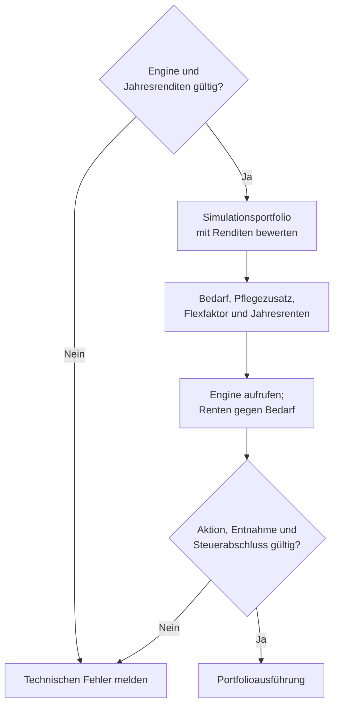
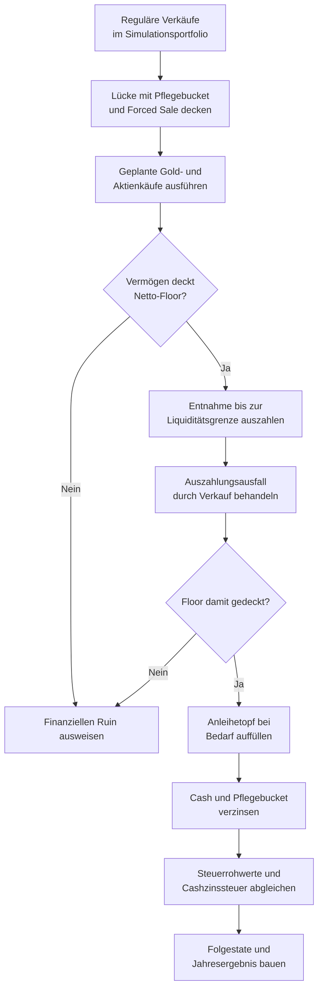

# Simulator, Runner und Worker

[simulator-main.js](../../app/simulator/simulator-main.js) verbindet die Seite [Simulator](../../Simulator.html) mit Personen, Plan, Modellannahmen und Rechenpfaden. Backtest und Monte Carlo erzeugen getrennte Laufresultate; die Werkstatt nutzt darauf aufbauende Vergleichswerkzeuge.

Die [Architektur](TECHNICAL.md#rechenpfade) erklärt die Schichten. Die [Engine-Referenz](../../engine/README.md) führt den Jahresaufruf, [FACHKONZEPT](FACHKONZEPT.md) Modelle und Kennzahlen, [DATENVERTRAEGE](DATENVERTRAEGE.md) gespeicherte Annahmen und Austauschformen. Bedienung und Ergebnisdeutung stehen im [Handbuch](../../Handbuch.html).

## Inputs und Seitenstart

| Modul unter `app/simulator/` | Zuständigkeit |
| --- | --- |
| [simulator-main.js](../../app/simulator/simulator-main.js), [simulator-main-init.js](../../app/simulator/simulator-main-init.js) | dokumentgebundener Start, Engineprüfung und Featureinitialisierung |
| [simulator-main-profiles.js](../../app/simulator/simulator-main-profiles.js) | Profile auswählen und Inputs aktualisieren |
| [simulator-profile-inputs.js](../../app/simulator/simulator-profile-inputs.js) | Profilrecords projizieren und ausgewählte Profile zusammenführen |
| [simulator-person-overrides.js](../../app/simulator/simulator-person-overrides.js) | flüchtige Personenalternativen und eingefrorenen Laufbeleg führen |
| [simulator-portfolio-inputs.js](../../app/simulator/simulator-portfolio-inputs.js), [simulator-input-dom.js](../../app/simulator/simulator-input-dom.js) | aktuelle Modellannahmen aus den Bedienelementen lesen |
| [simulator-input-validation.js](../../app/simulator/simulator-input-validation.js) | Recheneingaben vor dem Lauf prüfen |
| [simulator-main-input-persist.js](../../app/simulator/simulator-main-input-persist.js) | erlaubte Modellannahmen sichern |
| [simulator-household-needs-persistence.js](../../app/simulator/simulator-household-needs-persistence.js) | gemeinsame Planwerte vorrangig lesen und Altbestände behandeln |
| [simulator-plan-trial.js](../../app/simulator/simulator-plan-trial.js) | flüchtigen Planversuch mit den gemeinsamen Planfeldern verbinden |
| [simulator-run-assumptions.js](../../app/simulator/simulator-run-assumptions.js) | effektive Laufannahmen und Vergleich mit aktuellen Eingaben führen |
| [simulator-main-tabs.js](../../app/simulator/simulator-main-tabs.js) | Ansichten und Werkstattwahl schalten |
| `simulator-main-dynamic-flex.js`, `simulator-main-partner.js`, `simulator-main-3bucket.js` | Feldzustände der jeweiligen Eingabegruppen führen |

Der dokumentgebundene Start wartet auf den gemeinsamen Profil-/Persistenzstart. Migration, Recovery und fehlende Personendaten dürfen nicht durch Formularstandards verdeckt werden. Übersichtseinstiege werden erst nach Bereitschaft geöffnet. Der gemeinsame Startdienst und die fachliche Uhr stehen unter [Seitendienste](TECHNICAL.md#seitenstart-und-fachliche-uhr).

Planwerte stammen aus dem gemeinsamen Planbereich. Personenwerte werden je Profil aus der zentralen Personenquelle projiziert. Modellannahmen wie Sampling und Pflegekonfiguration haben eigene Zuständigkeiten. Ein Finanzmerge schreibt keine Personendaten zurück. Die Inputadapter übersetzen UI-Namen in die technischen Enginefelder.

Annahmen zeigt Grundbedarf, Wunschbedarf und Mindest-Flex mit den gemeinsamen Bedarfsrollen. Alle Parameter startet geschlossen und ordnet Flex-Budget, Reserven, Entnahme & Umschichten, Dynamik und Marktdaten wie Balance. CAPE liegt unter Marktdaten; ausgeschaltetes Gold zeigt Gold aus. Die erhaltenen Gold- und 3-Bucket-Felder sowie Monte Carlo, Zeitraum und Stresstest stehen ebenfalls im 3-Spalten-Raster. Einstellungen anzeigen im Monte-Carlo-Reiter öffnet diesen Bereich unter Annahmen. Nur hier ausprobieren gibt die übernommenen Planfelder auch im geöffneten Parameterbereich frei; Zurück zum Plan verwirft den Versuch. Klappzustände werden nicht gespeichert und ändern keine Rechenwerte. Die frühere Karte Simulator-Werte zurücksetzen entfällt; Laufzahl, Methode und Seed liegen unter Alle Parameter.

### Haushaltsmerge

`buildSimulatorInputsFromProfileData` projiziert jede Person vor dem Merge. `combineSimulatorProfiles` führt die ausgewählten Finanzbestände zusammen. Als Hauptprofil gilt die gewählte aktuelle Person, sonst das erste ausgewählte Profil. Ein weiteres Profil wird als Partner geführt; bei mehr als zwei ausgewählten Profilen warnt der Merge vor der auf zwei Personen begrenzten Demografie.

Die Planprojektion kann die profilweisen Bedarfswerte bereits vor dem Merge ersetzen. Wenn ein gemeinsamer Plan vorliegt, wird dessen Haushaltsbedarf verwendet; alte profilweise Bedarfe sind kein zweiter Plan. SPB wird summiert, Kirchensteuer nach Vermögensmaß gewichtet. Rentenanpassung und Pflegekonfiguration folgen dem Hauptprofil. Abweichende Pflegebucketdefinitionen werden gemeldet und nicht gemischt.

Der Merge prüft den Detailstatus jeder Person vor der Aggregation. Er kopiert zulässige Lots und erhält ihre profilbezogene Herkunft. Gemischte Detail-/Aggregatbestände brauchen einen belegten Investmentbestand; der Merge darf keine fehlenden Lots aus dem aktiven Depot ergänzen. Status, Herkunftsfelder und Fehlercodes stehen unter [Verbundprojektionen](DATENVERTRAEGE.md#verbundprojektionen).

[simulator-portfolio-init.js](../../app/simulator/simulator-portfolio-init.js) gliedert den Pflegebucket erst aus dem zusammengeführten Haushaltsportfolio aus. Die reservierten Lots behalten ihre Herkunft. Freie Liquidität und Reserve dürfen beim Engineinput nicht doppelt zählen. Die Datenzustände führt [DATENVERTRAEGE](DATENVERTRAEGE.md#verbundprojektionen), die gemeinsame Goldaggregation die [Tranchenreferenz](TRANCHEN_MODULES_README.md#projektionen-für-balance-und-simulator).

### Personenalternativen und Laufannahmen

[simulator-person-overrides.js](../../app/simulator/simulator-person-overrides.js) hält Abweichungen im Dokument. Abschalten, Profilwechsel oder Reload verwerfen die Abweichungen ohne Personenwrite. Am Lauf bleibt `personDataContext` als Beleg der wirksamen Personenprojektion vor dem Merge eingefroren.

Die offene Personenübersicht zeigt je Person eine fette Namensüberschrift ohne eigene Karte. Darunter stehen Rentenbeginn und monatliche Rente in zwei festen Spalten mit `--value-lg`. Sonstige Einkünfte zählen nur in der Balance; der Simulator zeigt sie auch bei aktiver Abweichung nicht an. Vorhandene gespeicherte Einkommensabweichungen werden beim Laden ignoriert. Details zur Person enthält die weiteren Projektionen als kompakte Zeilen je Person und die gemeinsame Rentenanpassung. Einschalten der Abweichung öffnet den Bereich und versetzt dieselben Editor-Knoten in die jeweiligen Hosts. Pflege zeigt Titel, Zusammenfassung, Annahmen zeigen und Schalter in einer Zeile. Reservebetrag und Erhaltungshinweis stehen im ⓘ direkt am Schalter; der bestehende Werthost wird weiter aus dem letzten Backtest aktualisiert. Kosten, Dauer, Staffel und Modellannahmen liegen unter Annahmen zeigen. Beide Klappen sind beim Seitenaufruf geschlossen.

Ergebnis, Protokoll und Downloads lesen diesen Laufbeleg auch nach späteren Eingaben. Die [Datenverträge](DATENVERTRAEGE.md#simulatorabweichungen) definieren seine Form und die additiven CSV-Felder. Ein Renderer darf für ein vorhandenes Ergebnis nicht den aktuellen Formularzustand als neue Herkunft ausgeben.

Übernommene Feldwerte verwenden den gemeinsamen Stil in `css/components.css`. Gesamtvermögen, Depotwert, Tagesgeld und Gold-Bestand in Wer und womit verwenden wie die Bedarfsfelder `ds-need-values`: `--value-lg` (30 px Serif), rechtsbündig im 60 px hohen Feld. Die Darstellung gilt auch bei freigegebenen Eingaben. Die feldweise Plakette entfällt; der Herkunftsgrund bleibt über `aria-describedby` zugänglich. Hinweise stehen außerhalb des Rahmens aus Wert und Einheit. Die seitenbezogenen Übernahmestile in `simulator.css` entfallen.

`simulator-run-assumptions.js` vergleicht effektive Eingaben mit der Laufbasis. Ein neuer Formularwert ändert ein fertig gerechnetes Ergebnis nicht rückwirkend. Planversuch, Personenalternative und bestätigte zentrale Werte bleiben als unterschiedliche Quellen erkennbar.

## Ein Simulatorjahr

[simulator-engine-direct.js](../../app/simulator/simulator-engine-direct.js) führt `simulateOneYear` aus. Der Aufrufer liefert Pfadstate, Inputs, Jahresdaten, Index und Lebensereigniskontext; die Engine kann ausdrücklich injiziert werden. [simulator-engine-wrapper.js](../../app/simulator/simulator-engine-wrapper.js) bündelt die Jahres- und Hilfsfunktionen für die Runner.

| Modul | Aufgabe |
| --- | --- |
| [simulator-year-portfolio.js](../../app/simulator/simulator-year-portfolio.js) | Jahresrenditen auf das Portfolio anwenden und aktuelle Marktstände bauen |
| [simulator-household-pension.js](../../app/simulator/simulator-household-pension.js), [simulator-portfolio-pension.js](../../app/simulator/simulator-portfolio-pension.js) | wirksame Renten im Haushaltsjahr ermitteln |
| [simulator-engine-input.js](../../app/simulator/simulator-engine-input.js) | Engineinput des laufenden Jahres projizieren |
| [simulator-portfolio.js](../../app/simulator/simulator-portfolio.js) | Portfoliofunktionen bündeln |
| `simulator-portfolio-init.js`, `simulator-portfolio-tranches.js`, `simulator-portfolio-inventory.js` | kopierte Lots initialisieren, Stücke ändern und Bestände auswerten |
| [simulator-forced-sale.js](../../app/simulator/simulator-forced-sale.js) | Liquiditätslücke und Auszahlungsausfall durch Verkäufe behandeln |
| [simulator-bond-refill.js](../../app/simulator/simulator-bond-refill.js) | Anleihetopf nach der Auszahlung auffüllen |
| [simulator-health-bucket.js](../../app/simulator/simulator-health-bucket.js) | Reserve triggern, nutzen, verzinsen und diagnostizieren |
| [simulator-tax-recompute.js](../../app/simulator/simulator-tax-recompute.js) | Rohwerte der ausgeführten Simulationstransaktionen zum Jahresabschluss zusammenführen |
| [simulator-year-result.js](../../app/simulator/simulator-year-result.js) | Jahreswerte für Ergebnis und Protokoll aufbereiten |
| [simulator-engine-helpers.js](../../app/simulator/simulator-engine-helpers.js) | Datenversion, Inflation und gemeinsam genutzte Laufhilfen liefern |

Der Jahrespfad prüft Enginezugang und Renditedaten, bewertet die kopierten Bestände, projiziert Personen und Bedarf und ruft die Engine auf. Er prüft die geplante Aktion und deren Steuerabschluss vor der Portfolioausführung. Danach folgen reguläre Transaktionen, Pflegebucket-/Forced-Sale-Deckung, Auszahlung, Anleihe-Refill, Zinsen und der Abgleich der tatsächlich im Pfad entstandenen Steuerrohwerte.

`SIMULATOR_YEAR_OUTCOME_KINDS` unterscheidet `success`, `ruin` und `technical_error`. Fehlerhafte Jahresdaten, ein fehlender Enginevertrag oder ein inkonsistenter Steuerabschluss sind technische Fehler. Sie dürfen nicht als finanzieller Ruin in die Erfolgsquote eingehen. Die Runner führen diese Fälle in ihrer technischen Ergebnisinventur.

Renten werden im Engineaufruf gegen den Bedarf verrechnet, nicht zusätzlich auf Cash gebucht. Vor der Auszahlung prüft der Pfad die Deckung der geplanten Jahresentnahme samt einem zusätzlichen Netto-Floormonat. Pflegebucket und Forced Sale können die Lücke decken. Käufe folgen dieser Deckung; danach prüft der Pfad den Floor, zahlt aus und behandelt einen verbliebenen Auszahlungsausfall. Auf einem erfolgreichen Pfad folgen Anleihe-Refill, Cash-/Reservezinsen und der finale Steuerabgleich. Der Ergebnisbauer schreibt Portfolio, Bedarfsbasis, Renten, Markthistorie und Inflationsfaktor für das nächste Jahr fort.

Die beiden Diagramme zeigen die Vertragsprüfung und die Portfolioausführung eines Entnahmejahres. Technische Fehler beenden die Vertragsprüfung; finanzieller Ruin entsteht bei fehlender Floor-Deckung im ausgeführten Pfad.

Die Portfolioausführung verwendet die geprüfte Aktion und Entnahme.

Quellen: [simulator-engine-direct.js](../../app/simulator/simulator-engine-direct.js) für Reihenfolge, Prüfungen und Ausgänge; [simulator-year-portfolio.js](../../app/simulator/simulator-year-portfolio.js) für Renditen; [simulator-household-pension.js](../../app/simulator/simulator-household-pension.js) und [simulator-engine-input.js](../../app/simulator/simulator-engine-input.js) für Bedarf und Renteninput; [core.mjs](../../engine/core.mjs) für den Rentenabzug; [simulator-health-bucket.js](../../app/simulator/simulator-health-bucket.js) und [simulator-forced-sale.js](../../app/simulator/simulator-forced-sale.js) für Deckung und Auszahlungsausfall; [simulator-bond-refill.js](../../app/simulator/simulator-bond-refill.js), [simulator-tax-recompute.js](../../app/simulator/simulator-tax-recompute.js) und [simulator-year-result.js](../../app/simulator/simulator-year-result.js) für Refill, Steuer und Fortschreibung.

Teilverkauf und Vollverkauf ändern ausschließlich Simulationslots. Neue Käufe erzeugen Simulationslots; das Profildepot bleibt unverändert. Ansparen ist im Profilmerge deaktiviert. Interne Kompatibilitätsfunktionen unter `simulator-accumulation-year.js` sind kein verfügbarer Oberflächenworkflow.

## Historischer Backtest

[simulator-backtest.js](../../app/simulator/simulator-backtest.js) bindet den Backtest an die Seite. Der DOM-freie [historical-backtest-runner.js](../../app/simulator/historical-backtest-runner.js) rechnet den festgelegten historischen Pfad über dieselbe Jahresfunktion.

| Modul | Zuständigkeit |
| --- | --- |
| [historical-backtest-contract.js](../../app/simulator/historical-backtest-contract.js) | Request-/Ergebnisbelege und kanonische Werte |
| [historical-backtest-runner.js](../../app/simulator/historical-backtest-runner.js) | Jahresfolge und Erfolgs-/Fehlerausgänge |
| [historical-backtest-metrics.js](../../app/simulator/historical-backtest-metrics.js) | Kennzahlen des einzelnen Pfads |
| [historical-backtest-cohorts.js](../../app/simulator/historical-backtest-cohorts.js) | historische Startkohorten und Vergleich |
| [historical-backtest-ui.js](../../app/simulator/historical-backtest-ui.js) | Backtestresultat und Protokoll anzeigen |
| [historical-backtest-export.js](../../app/simulator/historical-backtest-export.js) | Ergebnisdateien aus dem vorhandenen Laufbeleg erstellen |

Request und Ergebnis verwenden `BacktestRequestV1` und `BacktestRunResultV1`. Der Lauf bindet wirksame Inputs und historische Daten an sein Ergebnis. Die Oberfläche nennt den erfolgreichen Abschluss Backtest fertig; Fehlercodes bleiben für die Diagnose sichtbar. Zeitbasis, Betragsbasis und Grenzen historischer Vergleiche stehen im [Fachkonzept](FACHKONZEPT.md). Die Mindest-Flex-Auswertung verwendet [minimum-flex-metrics.js](../../app/simulator/minimum-flex-metrics.js) für denselben FR-6-Vertrag wie Monte Carlo, aber mit dem Nenner dieses einen Pfads.

## Monte Carlo

[simulator-monte-carlo.js](../../app/simulator/simulator-monte-carlo.js) besitzt den dokumentgebundenen Lauf: Vorbereitung, Workerwahl, Fortschritt, Abbruch, Finalisierung und Ergebnisveröffentlichung. [monte-carlo-runner.js](../../app/simulator/monte-carlo-runner.js) rechnet DOM-frei die angeforderten globalen Laufbereiche.

| Modul | Aufgabe im Runner |
| --- | --- |
| [monte-carlo-parameters.js](../../app/simulator/monte-carlo-parameters.js) | kanonische Laufparameter normalisieren |
| [mc-run-context.js](../../app/simulator/mc-run-context.js) | Pfadkontext und Startwerte bauen |
| [mc-year-sampling.js](../../app/simulator/mc-year-sampling.js), [stationary-bootstrap-sampler.js](../../app/simulator/stationary-bootstrap-sampler.js) | Startjahr, Jahresauswahl und Samplingdiagnose |
| [mc-life-events.js](../../app/simulator/mc-life-events.js) | Pflege, Tod und Haushaltsfortsetzung behandeln |
| [dynamic-flex-runner-horizon.js](../../app/simulator/dynamic-flex-runner-horizon.js) und angrenzende Horizontmodule | wirksamen Horizont für die Jahresinputs ableiten |
| [tail-risk-contract.js](../../app/simulator/tail-risk-contract.js), [tail-risk-overlay.js](../../app/simulator/tail-risk-overlay.js) | Tail-Risk-Annahmen prüfen und Jahresüberlagerung anwenden |
| [mc-stress-tracker.js](../../app/simulator/mc-stress-tracker.js) | Stress- und Entnahmemesswerte sammeln |
| [mc-run-metrics.js](../../app/simulator/mc-run-metrics.js) | Beobachtungen, Pflegebedarf und Pfadausgang zusammenführen |
| [mc-log-builder.js](../../app/simulator/mc-log-builder.js) | Jahres-, Todes- und Ruinzeilen bilden |
| [minimum-flex-metrics.js](../../app/simulator/minimum-flex-metrics.js) | angewandtes Mindestziel und auswertbare Entnahmejahre messen |
| [monte-carlo-chunk-result.js](../../app/simulator/monte-carlo-chunk-result.js) | Chunk-, Pfad- und Fehlerinventar validieren und zusammenführen |
| [monte-carlo-statistics.js](../../app/simulator/monte-carlo-statistics.js), [monte-carlo-aggregates.js](../../app/simulator/monte-carlo-aggregates.js) | Laufwerte zu Quantilen und Ergebniskennzahlen aggregieren |
| [wealth-fan-aggregation.js](../../app/simulator/wealth-fan-aggregation.js) | jährlichen Vermögensfächer sammeln und übertragen |

Im Modus `per-run-seed` erhält jeder Pfad seinen Seed aus dem gemeinsamen Seed und globalen Laufindex. Ein Worker darf nicht mit einem lokalen Chunkindex einen anderen Zufallspfad erzeugen. `legacy-stream` verwendet dagegen einen gemeinsamen Zufallsstrom und läuft seriell. Jahresrechnung, Lebensereignisse und Messwerte werden innerhalb desselben Pfads fortgeschrieben. Nach finanziellen Abbrüchen gelten die dafür definierten Lebens-/Messfortsetzungen; ein Renderer ergänzt keine fehlenden Finanzjahre.

Serielle Rechnung und Workerrechnung benutzen `runMonteCarloChunk`. Logs für ausgewählte Indizes und Replay-Captures können gezielt über denselben Pfad erzeugt werden. Die Sampling- und Demografiemodelle stehen im [Fachkonzept](FACHKONZEPT.md); Datenherkunft und Lizenzen in [DATA_SOURCES](DATA_SOURCES.md).

## Worker und Laufabschluss

| Quelle | Grenze |
| --- | --- |
| [workers/mc-worker.js](../../workers/mc-worker.js) | Engine direkt importieren, Datenversion prüfen und MC-/Sweepjobs rechnen |
| [workers/worker-pool.js](../../workers/worker-pool.js) | Worker, Queue, Job-ID und Generation verwalten |
| [worker-job-runner.js](../../app/simulator/worker-job-runner.js) | Jobs in Laufbereiche schneiden, Fortschritt und Zeitgrenzen steuern |
| [workers/worker-telemetry.js](../../workers/worker-telemetry.js) | Laufzeit-/Jobdiagnose führen |
| [monte-carlo-chunk-result.js](../../app/simulator/monte-carlo-chunk-result.js) | Ergebnisbereiche prüfen und vollständig finalisieren |

Initialisierung überträgt die Jahresdaten-/Regimeversion. Jobs und Antworten tragen Job-ID und Generation. Ein veralteter oder falsch zugeordneter Rücklauf darf keinen neuen Ergebnisbestand verändern. MC-Ergebnisse übertragen Typed-Array-Puffer; danach besitzt der Empfänger die übertragenen Daten.

`MonteCarloChunkResultV1` enthält Laufbereich, Messpuffer, Pfadzusammenfassungen, Missingness, Heatmap, Summen und technische Inventur. Der Accumulator kopiert sie an den globalen Laufindex. Überlappende Bereiche oder unvollständige Resultate werden zurückgewiesen. Finalisierung verlangt jeden angeforderten Lauf genau einmal und verarbeitet die Beiträge in globaler Reihenfolge, unabhängig vom Fertigstellungszeitpunkt der Worker.

Finanziell auswertbare Pfade und technische Fehler werden getrennt gezählt. Fehlende Beobachtungen sind keine Nullwerte. Das Ergebnis kann einen nicht verfügbaren Vermögensfächer kennzeichnen, ohne daraus einen erfundenen Verlauf zu erzeugen. Die Kennzahlenregeln führt [FACHKONZEPT](FACHKONZEPT.md).

Abbruch sperrt die Generation, beendet zugehörige Worker und wartet offene Fortsetzungen ab. Bestätigte Navigation wartet auf das Laufende. Ein regulärer Workerfehler kann den seriellen Ersatzpfad verwenden; Benutzerabbruch darf ihn nicht starten. Ein vorheriges fertiges Ergebnis bleibt von einem abgebrochenen Folgelauf unterscheidbar. Allgemeine Navigations- und Ergebnisbesitzregeln stehen unter [TECHNICAL](TECHNICAL.md#planversuche-und-ergebnisbesitz).

## Ergebnisansichten, Protokolle und Downloads

| Modul | Zuständigkeit |
| --- | --- |
| [simulator-results.js](../../app/simulator/simulator-results.js), [results-metrics.js](../../app/simulator/results-metrics.js) | Kennzahlen aus Laufwerten projizieren |
| [results-renderers.js](../../app/simulator/results-renderers.js), [simulator-result-overview.js](../../app/simulator/simulator-result-overview.js) | Ergebnis und Einschränkungsanzeige rendern |
| [monte-carlo-ui.js](../../app/simulator/monte-carlo-ui.js), [mc-result-cockpit.js](../../app/simulator/mc-result-cockpit.js) | MC-Einstellungen, Ansichten und Startzustand führen |
| [scenario-analyzer.js](../../app/simulator/scenario-analyzer.js) | repräsentative bzw. ausgewählte Pfade verwalten |
| [protocol-columns.js](../../app/simulator/protocol-columns.js), [protocol-renderer.js](../../app/simulator/protocol-renderer.js) | gemeinsame Protokollspalten, Anwendbarkeit und Anzeige |
| [scenario-log-view.js](../../app/simulator/scenario-log-view.js), [scenario-wealth-chart.js](../../app/simulator/scenario-wealth-chart.js) | Einzelpfadprotokoll und Vermögenslinie |
| [wealth-distribution.js](../../app/simulator/wealth-distribution.js), [simulator-heatmap.js](../../app/simulator/simulator-heatmap.js) | Endwertverteilung und Jahresverteilung |
| [monte-carlo-export.js](../../app/simulator/monte-carlo-export.js), [monte-carlo-contracts.js](../../app/simulator/monte-carlo-contracts.js) | Ergebnisexport und Validierung seiner Laufdaten |
| [simulator-overview-summary.js](../../app/simulator/simulator-overview-summary.js) | abgeschlossene Simulatoraussagen für die Übersicht bereitstellen |

Deckung und Einschränkung bilden den Einstieg in Monte Carlo; Endvermögen und Entnahmen folgen als Hauptwerte. Die zweite Deckungsanzeige, Laufstatus, technische Zähler und ergänzende Kennzahlen stehen kompakt darunter. Steuerersparnis bleibt neutral. Die Monte-Carlo-Startkarte auf Ergebnis richtet sich oben aus und behält ihre eigene Höhe. Pflege vergleicht die Personenkennzahlen in einer Tabelle; Haushalts- und Reservewerte folgen als Zeilen. Namen stammen aus dem eingefrorenen Anzeigebeleg des jeweiligen Laufs und gelten auch für Szenarioereignisse und Protokollspalten.

Die gemeinsame Spaltentabelle ordnet Backtest- und MC-Werte ihren Quellen zu. Nicht anwendbare Felder, fehlende Beobachtungen und technische Fehler erhalten die dafür vorgesehenen Anzeigen. Personenzeilen lesen den eingefrorenen Laufbeleg. JSON und CSV verwenden die Ergebniswerte samt deren Herkunft; ihre Schemata gehören zu [DATENVERTRAEGE](DATENVERTRAEGE.md).

Die Einschränkungsanzeige projiziert FR-6 aus den gemessenen Mindest-Flex-Werten. Backtest und MC haben unterschiedliche Aggregationen; null oder ein Altresultat wird nicht als neuer positiver Mindest-Flex-Vertrag umgedeutet. Typischer Jahresanteil und Anteil betroffener Läufe stehen gleichwertig nebeneinander. Die Deckung nennt erfolgreiche und angeforderte Läufe; ihre Prozentformatierung verhindert einen auf 100,0 % gerundeten Teilerfolg. Regeln, Nenner und Betragsbasis stehen im [Fachkonzept](FACHKONZEPT.md).

`wealth-distribution.js` projiziert sämtliche Perzentile aus derselben nominalen oder realen Endwertpopulation. Die getrennte Liste Ausgewählte Szenarien behält die nominale Rangwahl und den Quelllauf für Jahresprotokoll, Export und Replay. Der Euro-Schalter verändert Verteilung, Vermögensfächer und Szenarioverläufe samt Auswahl; feste Geldbasen anderer Bereiche bleiben sichtbar bezeichnet. Histogramm, Vermögensfächer, Szenarioauswahl und Geldbereiche der Werkstatt verwenden gerundete Diagrammtexte aus `results-formatting.js`. Tooltips und Details zeigen genaue Werte. Im Histogramm starten nur Median und P25–P75 sichtbar. Weitere Marken zeigt ein nativer Schalter; Verteilungskennzahlen stehen in einer geschlossenen Detailklappe. Beide Zustände bleiben beim Euro-Wechsel erhalten und starten mit einem neuen Ergebnis wieder geschlossen.

## Werkstatt

### Stress-Pfad-Replay

[simulator-monte-carlo.js](../../app/simulator/simulator-monte-carlo.js) fordert den Capture im Runner an. `stress-replay-contract.js` und `stress-replay-path-materializer.js` prüfen den eingefangenen Pfad und dessen materialisierte Jahresdaten. [stress-replay-runner.js](../../app/simulator/stress-replay-runner.js) rechnet Baseline und Variante. `stress-replay-comparison.js` und `stress-replay-transactions.js` bereiten Vergleich und Transaktionen auf.

[stress-replay-ui.js](../../app/simulator/stress-replay-ui.js) führt den Workspace; `stress-replay-renderer.js`, `stress-replay-export.js` und `stress-replay-persistence.js` besitzen Anzeige, Download und erlaubte Ablage. Die Variante verwendet den erfassten Pfad mit ihren ausdrücklich geänderten Annahmen. Ein beschädigter Capture oder unvereinbarer Kontext wird nicht durch einen frischen Zufallspfad ersetzt. Der Lauf bleibt von zentralen Plan-/Personenwrites getrennt.

### Parameter-Sweep

[simulator-sweep.js](../../app/simulator/simulator-sweep.js) verbindet Parameterraum, Laufsteuerung und Anzeige. [sweep-runner.js](../../app/simulator/sweep-runner.js) rechnet Kandidaten DOM-frei; `simulator-sweep-utils.js` projiziert Inputs und Vergleichsannahmen. Worker nutzen denselben MC-/Sweepworker.

Sweepresultate tragen Parameter-, Sampling- und Datenherkunft. Der Vergleich verwendet den festgelegten gemeinsamen Zufallsvertrag. Neue Parameter dürfen nicht nur ein Formular verändern; sie müssen in den Kandidateninput und den Rechenpfad gelangen. Metrikdefinitionen und Modellgrenzen stehen im [Fachkonzept](FACHKONZEPT.md).

### Auto-Optimize

[auto_optimize.js](../../app/simulator/auto_optimize.js) sucht Kandidaten, `auto_optimize_ui.js` besitzt den Dokumentlauf und `auto-optimize-worker.js` führt die darunterliegenden MC-Batches aus. Suchstufen, Constraints, Seedverträge, Abbruch und Übernahme stehen in [AUTO_OPTIMIZE_DETAILS](AUTO_OPTIMIZE_DETAILS.md). Eine Ergebnisübernahme füllt den Planversuch; die zentrale Planbestätigung bleibt ein eigener Vorgang.

## Historische Daten und Änderungen

[simulator-data.js](../../app/simulator/simulator-data.js) verbindet die historischen Reihen. Eigene Loader führen globale Aktien, deutsche Inflation, Cash-/Geldmarkt, Gold, Löhne, US-Shiller-CAPE sowie Demografie/Pflege/Hinterbliebene. [simulation-data-inventory.js](../../app/simulator/simulation-data-inventory.js) stellt die Modell-/Dateninventur für die Oberfläche bereit. Quellen und Rekonstruktionsgrenzen werden in [DATA_SOURCES](DATA_SOURCES.md) und den dort verlinkten Daten-READMEs gepflegt.

Rechenlogik gehört in DOM-freie Runner und Portfoliomodule. Eingabeprojektionen bleiben bei den Inputadaptern, Anzeigen bei Renderern. Eine neue Ergebnisgröße braucht denselben Messvertrag im seriellen Pfad, im Workerchunk und in der Finalisierung, bevor eine Ansicht sie verwenden kann. Befehle, Fixturepflege und Plattformgrenzen stehen im [Test-README](../../tests/README.md).
