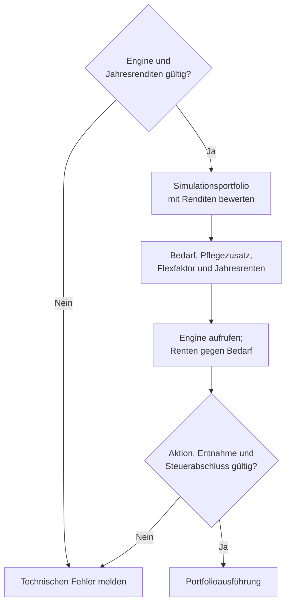
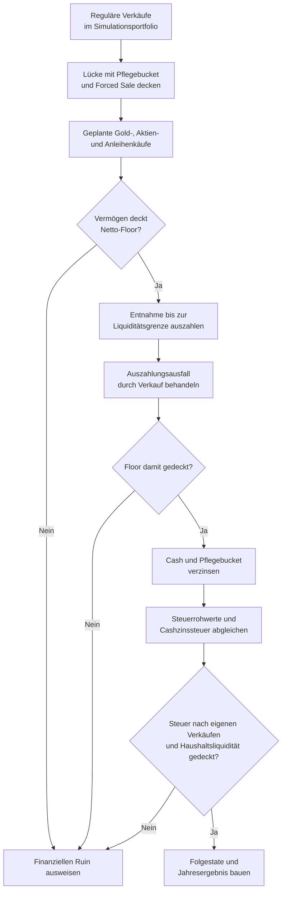

# Simulator, Runner und Worker

[simulator-main.js](../../app/simulator/simulator-main.js) verbindet die Seite [Simulator](../../Simulator.html) mit Personen, Plan, Modellannahmen und Rechenpfaden. Backtest und Monte Carlo erzeugen getrennte Laufresultate; die Werkstatt nutzt darauf aufbauende Vergleichswerkzeuge.

Die [Architektur](TECHNICAL.md#rechenpfade) erklärt die Schichten. Die [Engine-Referenz](../../engine/README.md) führt den Jahresaufruf, [FACHKONZEPT](FACHKONZEPT.md) Modelle und Kennzahlen, [DATENVERTRAEGE](DATENVERTRAEGE.md) gespeicherte Annahmen und Austauschformen. Bedienung und Ergebnisdeutung stehen im [Handbuch](../../Handbuch.html).

## Inputs und Seitenstart

| Modul unter `app/simulator/` | Zuständigkeit |
| --- | --- |
| [simulator-main.js](../../app/simulator/simulator-main.js), [simulator-main-init.js](../../app/simulator/simulator-main-init.js) | dokumentgebundener Start, Engineprüfung und Featureinitialisierung |
| [simulator-main-profiles.js](../../app/simulator/simulator-main-profiles.js) | Profile auswählen und Inputs aktualisieren |
| [simulator-profile-inputs.js](../../app/simulator/simulator-profile-inputs.js) | Profilrecords projizieren und ausgewählte Profile zusammenführen |
| [simulator-person-overrides.js](../../app/simulator/simulator-person-overrides.js) | flüchtige Personenalternativen und eingefrorenen Laufbeleg führen |
| [simulator-portfolio-inputs.js](../../app/simulator/simulator-portfolio-inputs.js), [simulator-input-dom.js](../../app/simulator/simulator-input-dom.js) | aktuelle Modellannahmen aus den Bedienelementen lesen |
| [simulator-input-validation.js](../../app/simulator/simulator-input-validation.js) | Recheneingaben vor dem Lauf prüfen |
| [simulator-main-input-persist.js](../../app/simulator/simulator-main-input-persist.js) | erlaubte Modellannahmen sichern |
| [simulator-household-needs-persistence.js](../../app/simulator/simulator-household-needs-persistence.js) | gemeinsame Planwerte vorrangig lesen und Altbestände behandeln |
| [simulator-plan-trial.js](../../app/simulator/simulator-plan-trial.js) | flüchtigen Planversuch mit den gemeinsamen Planfeldern verbinden |
| [simulator-run-assumptions.js](../../app/simulator/simulator-run-assumptions.js) | effektive Laufannahmen und Vergleich mit aktuellen Eingaben führen |
| [simulator-main-tabs.js](../../app/simulator/simulator-main-tabs.js) | Ansichten und Werkstattwahl schalten |
| `simulator-main-dynamic-flex.js`, `simulator-main-partner.js`, `simulator-main-3bucket.js` | Feldzustände der jeweiligen Eingabegruppen führen |

Der dokumentgebundene Start wartet auf den gemeinsamen Profil-/Persistenzstart. Migration, Recovery und fehlende Personendaten dürfen nicht durch Formularstandards verdeckt werden. Übersichtseinstiege werden erst nach Bereitschaft geöffnet. Der gemeinsame Startdienst und die fachliche Uhr stehen unter [Seitendienste](TECHNICAL.md#seitenstart-und-fachliche-uhr).

Planwerte stammen aus dem gemeinsamen Planbereich. Personenwerte werden je Profil aus der zentralen Personenquelle projiziert. Modellannahmen wie Sampling und Pflegekonfiguration haben eigene Zuständigkeiten. Ein Finanzmerge schreibt keine Personendaten zurück. Die Inputadapter übersetzen UI-Namen in die technischen Enginefelder.

Annahmen zeigt Grundbedarf, Wunschbedarf und Mindest-Flex mit den gemeinsamen Bedarfsrollen. Alle Parameter startet geschlossen. Die weiteren Planwerte folgen Weitere Planwerte in Haushalt & Plan: Flex-Budget, Reserven und Entnahme & Umschichten stehen in der ersten Zeile, Dynamik und Marktdaten darunter. Beschriftung und kurzer Hinweis stehen links, Wert und Einheit rechts. Der Kopf fasst die aktuellen Werte zusammen. Voreinstellungen halten die Dynamikdetails geschlossen; Benutzerdefiniert öffnet sie. Unter 1600 Pixel Fensterbreite umbrechen die fünf Dynamiksegmente mit vollständigen Beschriftungen innerhalb ihrer Karte. 3-Töpfe zeigt seine drei Werte in Entnahme & Umschichten. Gold folgt abgesetzt. Karten und Zeilen teilen die Planrollen in `css/components.css`; `app/shared/household-plan-presentation.js` liefert die Darstellung und Zusammenfassung. Mindest-Liquidität gehört zu `SIMULATOR_PLAN_FIELD_MAP`: aus dem Plan übernommen, im Versuch änderbar und bewusst übernehmbar. Der Monatswert erreicht die Engine; ohne Vorgabe gelten zwei Monate. Die Haushaltsverteilung bleibt vom Formular ausgeschlossen. CAPE liegt unter Marktdaten; ausgeschaltetes Gold zeigt Gold aus. Die erhaltenen Felder bleiben unter `simPlanParameters` erreichbar. Einstellungen anzeigen öffnet und schließt `mcSetupDisclosure` in der Karte Einstellungen des Monte-Carlo-Reiters. Dort liegen Simulation, Zeitraum & Daten und Stresstest im gemeinsamen Feldraster; Erweitert enthält die technischen Optionen und am Ende Worker-Diagnose. Unter 1600 Pixel Fensterbreite ist das Feld Simulationsmethode breiter als die vier benachbarten Simulationsfelder; alle Methodenbezeichnungen bleiben vollständig. Einheiten stehen im Feld, längere Erklärungen im ⓘ. Seed bleibt ohne Tausenderpunkt und Blockgröße im Eingabekasten. Der Reiter bleibt beim Aufklappen aktiv; die Einstellungen starten geschlossen. Die Zahlenanzeige unter Annahmen erfasst die Monte-Carlo-Felder nicht. Nur hier ausprobieren gibt die übernommenen Planfelder auch im geöffneten Parameterbereich frei; Zurück zum Plan verwirft den Versuch. Klappzustände werden nicht gespeichert und ändern keine Rechenwerte. Die frühere Karte Simulator-Werte zurücksetzen entfällt.

### Haushaltsmerge

`buildSimulatorInputsFromProfileData` projiziert jede Person vor dem Merge. `combineSimulatorProfiles` führt die ausgewählten Finanzbestände zusammen und hält ihre Tagesgeldherkunft in `simulationPeople` fest. Als Hauptprofil gilt die gewählte aktuelle Person, sonst das erste ausgewählte Profil. Ein weiteres Profil wird als Partner geführt; bei mehr als zwei ausgewählten Profilen warnt der Merge vor der auf zwei Personen begrenzten Demografie.

Die Planprojektion kann die profilweisen Bedarfswerte bereits vor dem Merge ersetzen. Wenn ein gemeinsamer Plan vorliegt, wird dessen Haushaltsbedarf verwendet; alte profilweise Bedarfe sind kein zweiter Plan. SPB wird summiert, Kirchensteuer nach Vermögensmaß gewichtet. Die eingetragenen Renten sind verfügbare Nettobeträge für beide Personen, auch nach dem Profilmerge. Eine gespeicherte `steuerquotePct` bleibt lesbar, beeinflusst die Rechnung aber nicht. Sweep-Invarianten ignorieren auch alte Referenzquoten. Ihre Felder bleiben im Simulator und in Personen & Vermögen verborgen und gesperrt; auch die Personenübernahme fragt nicht mehr danach. Rentenanpassung und Pflegekonfiguration folgen dem Hauptprofil. Abweichende Pflegebucketdefinitionen werden gemeldet und nicht gemischt.

Der Merge prüft den Detailstatus jeder Person vor der Aggregation. Er kopiert zulässige Lots und erhält ihre profilbezogene Herkunft. Gemischte Detail-/Aggregatbestände brauchen einen belegten Investmentbestand; der Merge darf keine fehlenden Lots aus dem aktiven Depot ergänzen. Status, Herkunftsfelder und Fehlercodes stehen unter [Verbundprojektionen](DATENVERTRAEGE.md#verbundprojektionen).

[simulator-portfolio-init.js](../../app/simulator/simulator-portfolio-init.js) gliedert den Pflegebucket erst aus dem zusammengeführten Haushaltsportfolio aus. Die reservierten Lots behalten ihre Herkunft. Freie Liquidität und Reserve dürfen beim Engineinput nicht doppelt zählen. Die Datenzustände führt [DATENVERTRAEGE](DATENVERTRAEGE.md#verbundprojektionen), die gemeinsame Goldaggregation die [Tranchenreferenz](TRANCHEN_MODULES_README.md#projektionen-für-balance-und-simulator).

### Personenalternativen und Laufannahmen

[simulator-person-overrides.js](../../app/simulator/simulator-person-overrides.js) hält Abweichungen im Dokument. Abschalten, Profilwechsel oder Reload verwerfen die Abweichungen ohne Personenwrite. Am Lauf bleibt `personDataContext` als Beleg der wirksamen Personenprojektion vor dem Merge eingefroren.

Die offene Personenübersicht zeigt je Person eine fette Namensüberschrift ohne eigene Karte. Darunter stehen Rentenbeginn und monatliche Rente in zwei festen Spalten mit `--value-lg`. Sonstige Einkünfte zählen nur in der Balance; der Simulator zeigt sie auch bei aktiver Abweichung nicht an. Vorhandene gespeicherte Einkommensabweichungen werden beim Laden ignoriert. Details zur Person enthält die weiteren Projektionen als kompakte Zeilen je Person und die gemeinsame Rentenanpassung. Einschalten der Abweichung öffnet den Bereich und versetzt dieselben Editor-Knoten in die jeweiligen Hosts. Pflege zeigt Titel, Zusammenfassung, Annahmen zeigen und Schalter in einer Zeile. Reservebetrag und Erhaltungshinweis stehen im ⓘ direkt am Schalter; der bestehende Werthost wird weiter aus dem letzten Backtest aktualisiert. Kosten, Dauer, Staffel und Modellannahmen liegen unter Annahmen zeigen. Beide Klappen sind beim Seitenaufruf geschlossen. Bedingungen der Hinterbliebenenrente, Pflegekostenverlauf und Mortalitätsfaktor zeigen jeweils eine kurze Erklärzeile mit 14 px. Der unveränderte Langtext liegt im ⓘ und öffnet sich bei Mausberührung, Fokus oder Klick; Escape schließt ihn.

Ergebnis, Protokoll und Downloads lesen diesen Laufbeleg auch nach späteren Eingaben. Die [Datenverträge](DATENVERTRAEGE.md#simulatorabweichungen) definieren seine Form und die additiven CSV-Felder. Ein Renderer darf für ein vorhandenes Ergebnis nicht den aktuellen Formularzustand als neue Herkunft ausgeben.

Übernommene Feldwerte verwenden den gemeinsamen Stil in `css/components.css`. Gesamtvermögen, Depotwert, Tagesgeld und Gold-Bestand in Wer und womit verwenden wie die Bedarfsfelder `ds-need-values`: `--value-lg` (30 px Serif), rechtsbündig im 60 px hohen Feld. Die Darstellung gilt auch bei freigegebenen Eingaben. Die feldweise Plakette entfällt; der Herkunftsgrund bleibt über `aria-describedby` zugänglich. Hinweise stehen außerhalb des Rahmens aus Wert und Einheit. Die seitenbezogenen Übernahmestile in `simulator.css` entfallen.

`simulator-run-assumptions.js` vergleicht effektive Eingaben mit der Laufbasis. Ein neuer Formularwert ändert ein fertig gerechnetes Ergebnis nicht rückwirkend. Planversuch, Personenalternative und bestätigte zentrale Werte bleiben als unterschiedliche Quellen erkennbar.

## Ein Simulatorjahr

[simulator-engine-direct.js](../../app/simulator/simulator-engine-direct.js) führt `simulateOneYear` aus. Der Aufrufer liefert Pfadstate, Inputs, Jahresdaten, Index und Lebensereigniskontext; die Engine kann ausdrücklich injiziert werden. [simulator-engine-wrapper.js](../../app/simulator/simulator-engine-wrapper.js) bündelt die Jahres- und Hilfsfunktionen für die Runner.

| Modul | Aufgabe |
| --- | --- |
| [simulator-year-portfolio.js](../../app/simulator/simulator-year-portfolio.js) | Jahresrenditen auf das Portfolio anwenden und aktuelle Marktstände bauen |
| [simulator-household-pension.js](../../app/simulator/simulator-household-pension.js), [simulator-portfolio-pension.js](../../app/simulator/simulator-portfolio-pension.js) | wirksame Renten im Haushaltsjahr ermitteln |
| [simulator-engine-input.js](../../app/simulator/simulator-engine-input.js) | Engineinput des laufenden Jahres projizieren |
| [parity-replay-collector.js](../../app/simulator/parity-replay-collector.js), [parity-replay-contract.js](../../app/simulator/parity-replay-contract.js) | optionale Kopien am Engineaufruf, JSON-Beleg und lesende Validierung |
| [simulator-personal-accounts.js](../../app/simulator/simulator-personal-accounts.js) | Tagesgeld und Geldmarkt je Person fortschreiben, Auszahlung verteilen und Finanzierungsbesitzer erhalten |
| [simulator-portfolio.js](../../app/simulator/simulator-portfolio.js) | Portfoliofunktionen bündeln |
| `simulator-portfolio-init.js`, `simulator-portfolio-tranches.js`, `simulator-portfolio-inventory.js` | kopierte Lots initialisieren, Stücke ändern und Bestände auswerten |
| [simulator-forced-sale.js](../../app/simulator/simulator-forced-sale.js) | Liquiditätslücke und Auszahlungsausfall durch Verkäufe behandeln |
| [simulator-bond-refill.js](../../app/simulator/simulator-bond-refill.js) | Geplante Anleihenkäufe vor der Auszahlung ausführen |
| [simulator-health-bucket.js](../../app/simulator/simulator-health-bucket.js) | Reserve triggern, nutzen, verzinsen und diagnostizieren |
| [simulator-personal-tax.js](../../app/simulator/simulator-personal-tax.js) | Balance-Quellenwahl und Steuerjahresbücher je Person, einschließlich Geldmarktrealisierungen |
| [simulator-tax-recompute.js](../../app/simulator/simulator-tax-recompute.js) | Rohwerte der ausgeführten Simulationstransaktionen zum Jahresabschluss zusammenführen |
| [simulator-year-result.js](../../app/simulator/simulator-year-result.js) | Jahreswerte für Ergebnis und Protokoll aufbereiten |
| [simulator-engine-helpers.js](../../app/simulator/simulator-engine-helpers.js) | Datenversion, Inflation und gemeinsam genutzte Laufhilfen liefern |

[guardrail-history.js](../../app/shared/guardrail-history.js) liefert dieselbe Resetregel wie für Balance. Der Pfadstate hält die rohen Planentscheidungen in `guardrailPlanInputs`. Bewusst geänderte Bedarfs-, Budget-, Reserve-, Strategie-, Dynamik- oder Verteilungswerte verwerfen die Leitplanken und erhalten den Steuerstand. Automatische Inflation, Kurse, CAPE, Renten und Bestandsänderungen erhalten die Historie. Die Runner reichen die konfigurierte Dauer als `guardrailPlanHorizonYears` getrennt von der jährlich berechneten Restdauer weiter. Alte Pfadstates ohne Planevidenz bleiben lesbar.

Der Jahrespfad prüft Enginezugang und Renditedaten, bewertet die kopierten Bestände, projiziert Personen und Bedarf und ruft die Engine auf. Er prüft die geplante Aktion und deren Steuerabschluss vor der Portfolioausführung. Danach folgen reguläre Transaktionen, Pflegebucket-/Forced-Sale-Deckung, Auszahlung, Zinsen und der Abgleich der tatsächlich im Pfad entstandenen Steuerrohwerte.

`simulateOneYear(..., engineAPI, replayCollector)` zeichnet nur bei ausdrücklich übergebenem Collector auf. Ohne Collector entstehen keine zusätzlichen Aufzeichnungskopien. Der [Replayvertrag](PARITY_REPLAY.md) beschreibt Jahresanfang, Entscheidungsphase, Renten, Cash-/Lotwerte, Marktfenster, Horizont und Resetevidenz. Der separate [Feldvergleich](PARITY_REPLAY.md#feldvergleich-und-einzelfall) startet das isolierte Jahr erneut und prüft die unveränderte frühe Entscheidung vor dem Vergleich mit Balance. Er wird von keinem Runner geladen. Der vollständige Drei-Töpfe-Plan liegt vor der Auszahlung vor; die frühere pauschale Loglücke entfällt. Cashkonten, Auszahlungen, persönliche Quellenwahl, geplante Steuer und Verlustvorträge werden verglichen. Die Jahresendsteuer bleibt eine spätere Rechenphase. Der [Abgleich 2000–2025](PARITY_REPLAY.md#jahresvergleich-und-restklassen) trennt gleiche Entscheidungen und Personenpläne von den verbleibenden Ausführungs- und Herkunftslücken. Beidseits ausgeschaltete Dynamik und eine beidseits nicht ausgeführte Mindest-Flex-Notfallprüfung haben keine berechneten Diagnosewerte; diese Felder sind nur dann nicht anwendbar.

`SIMULATOR_YEAR_OUTCOME_KINDS` unterscheidet `success`, `ruin` und `technical_error`. Fehlerhafte Jahresdaten, ein fehlender Enginevertrag oder ein inkonsistenter Steuerabschluss sind technische Fehler. Sie dürfen nicht als finanzieller Ruin in die Erfolgsquote eingehen. Die Runner führen diese Fälle in ihrer technischen Ergebnisinventur.

Renten werden im Engineaufruf gegen den Bedarf verrechnet, nicht zusätzlich auf Cash gebucht. Teiljahresmonate und die gemeinsame Anpassung gelten für die vollen Nettobasen; Hinterbliebenenrenten werden ohne weiteren Abschlag addiert. Das aktuelle Marktfenster enthält bereits vor dem Engineaufruf das neue Allzeithoch und den Jahresabstand. Ein erreichter oder übertroffener Höchststand setzt den Abstand auf 0, ein Jahr darunter erhöht ihn einmal. Der Engine-Eingang erhält auch den Nullwert. Vor der Auszahlung prüft der Pfad die Deckung der geplanten Jahresentnahme samt einem zusätzlichen Netto-Floormonat. Pflegebucket und Forced Sale können die Lücke decken. Gold-, Aktien- und geplante Anleihenkäufe folgen dieser Deckung; danach prüft der Pfad den Floor, zahlt aus und behandelt einen verbliebenen Auszahlungsausfall. Der Core verwendet für Drei Töpfe denselben Finalizer wie Balance: Kursrendite minus Inflation, Anleihenziel nach Abzug geplanter Verkäufe und eine gemeinsame Steuerreserve. Nach Auszahlung folgen Cash-/Reservezinsen und der finale Steuerabgleich. Der Ergebnisbauer schreibt Portfolio, Bedarfsbasis, Renten, Markthistorie und Inflationsfaktor für das nächste Jahr fort.

`simulator-personal-accounts.js` übernimmt die Balance-Verteilung aus dem Entscheidungsbestand. Tagesgeld kommt je ausgewählter Person vor Geldmarkt; dessen Lots verlieren Stücke und Kosten proportional zur Auszahlung. Erlöse und neue Käufe behalten ihren Finanzierungsbesitzer. Jahreszinsen erhöhen die jeweiligen Konten, Steuerabgleich und Erstattungen werden dort gebucht. `simulator-personal-tax.js` übernimmt die Quellenwahl direkt aus `attributeHouseholdAction`. Persönliche Auszahlungslücken werden durch eigene Anlagen gedeckt. Verhindert eine Bestands- oder Drei-Töpfe-Grenze dies, nennt `personalPayout.restCause` den Grund `personal_payout_exceeds_owned_liquidity`. Die Jahressteuer nutzt denselben `settleTaxYear`-Baustein wie Balance. Freibetrag, Kirchensteuer und Verlustvortrag bleiben getrennt; Teilfreistellung und Steuerfreiheit stammen aus den ausgeführten Lots. Tagesgeldzins wird jährlich, Geldmarktgewinn bei Verkauf erfasst. Steuerfinanzierte Verkäufe bleiben unter `tax_funding_sale_gross` sichtbar. Das Protokoll hält geplante und tatsächlich ausgezahlte Beträge getrennt fest. Ansparen und Pflegebucket verwenden dieselben Personenkonten; die gemeinsame Sparrate wird dem Hauptprofil zugerechnet. Altinputs ohne persönliche Steuerparameter bleiben im bisherigen Rechenweg ohne Migration lesbar; ihr Steuerstand gilt im Replay als unbelegt. Ältere Haushaltsinputs nutzen vorhandene persönliche Liquiditätsbelege; fehlt die Cashherkunft, erhält der Replay keine vollständige Herkunftsbestätigung.

Persönliche Steuerlücken deckt derselbe Jahresabschluss im Entnahme- und Ansparpfad nach FR-16: Nach der eigenen Liquidität folgen zuerst die anderen Haushaltspersonen in der Balance-Haushaltsreihenfolge, je Konto Tagesgeld vor Geldmarkt. Erst danach verkauft die steuerpflichtige Person eigene Anlagen nach der Notverkaufsregel. Neue Geldmarktgewinne werden beim Eigentümer nachgerechnet. Die Steuertöpfe bleiben getrennt. Erst eine verbleibende Steuerlücke liefert `taxShortfall` und führt zum finanziellen `ruin`; MC zählt diesen Pfad regulär. Diese zusätzliche Deckungsregel folgt der Nutzerentscheidung vom 15.10.2026; Balance führt keine tatsächlichen Jahresendzahlungen aus.

Die beiden Diagramme zeigen die Vertragsprüfung und die Portfolioausführung eines Entnahmejahres. Technische Fehler beenden die Vertragsprüfung; finanzieller Ruin entsteht bei fehlender Floor- oder Steuerdeckung im ausgeführten Pfad.

Die Portfolioausführung verwendet die geprüfte Aktion und Entnahme.

Quellen: [simulator-engine-direct.js](../../app/simulator/simulator-engine-direct.js) für Reihenfolge, Prüfungen und Ausgänge; [simulator-year-portfolio.js](../../app/simulator/simulator-year-portfolio.js) für Renditen; [simulator-household-pension.js](../../app/simulator/simulator-household-pension.js) und [simulator-engine-input.js](../../app/simulator/simulator-engine-input.js) für Bedarf und Renteninput; [core.mjs](../../engine/core.mjs) für den Rentenabzug; [simulator-health-bucket.js](../../app/simulator/simulator-health-bucket.js) und [simulator-forced-sale.js](../../app/simulator/simulator-forced-sale.js) für Deckung und Auszahlungsausfall; [simulator-bond-refill.js](../../app/simulator/simulator-bond-refill.js), [simulator-tax-recompute.js](../../app/simulator/simulator-tax-recompute.js) und [simulator-year-result.js](../../app/simulator/simulator-year-result.js) für geplante Anleihenkäufe, Steuer und Fortschreibung. Der Kompatibilitätsadapter für isolierte Auffüllaufrufe verwendet ebenfalls den Enginebaustein; der Jahrespfad ruft ihn nicht auf.

Teilverkauf und Vollverkauf ändern ausschließlich Simulationslots. Neue Käufe erzeugen Simulationslots; das Profildepot bleibt unverändert. Ansparen ist im Profilmerge deaktiviert. Interne Kompatibilitätsfunktionen unter `simulator-accumulation-year.js` sind kein verfügbarer Oberflächenworkflow.

## Historischer Backtest

[simulator-backtest.js](../../app/simulator/simulator-backtest.js) bindet den Backtest an die Seite. Der DOM-freie [historical-backtest-runner.js](../../app/simulator/historical-backtest-runner.js) rechnet den festgelegten historischen Pfad über dieselbe Jahresfunktion.

| Modul | Zuständigkeit |
| --- | --- |
| [historical-backtest-contract.js](../../app/simulator/historical-backtest-contract.js) | Request-/Ergebnisbelege und kanonische Werte |
| [historical-backtest-runner.js](../../app/simulator/historical-backtest-runner.js) | Jahresfolge und Erfolgs-/Fehlerausgänge |
| [historical-backtest-metrics.js](../../app/simulator/historical-backtest-metrics.js) | Kennzahlen des einzelnen Pfads |
| [historical-backtest-ui.js](../../app/simulator/historical-backtest-ui.js) | Backtestresultat und Protokoll anzeigen |
| [backtest-euro-display.js](../../app/simulator/backtest-euro-display.js) | Anzeigeprojektion realer Geldkennzahlen und Portfolioflächen aus protokollierten Inflationsfaktoren |
| [historical-backtest-export.js](../../app/simulator/historical-backtest-export.js) | Ergebnisdateien aus dem vorhandenen Laufbeleg erstellen |

Request und Ergebnis verwenden `BacktestRequestV1` und `BacktestRunResultV1`. Der Lauf bindet wirksame Inputs und historische Daten an sein Ergebnis.

Die Zeitraumkarte enthält Datenhinweis, Startjahr, Endjahr und Neu rechnen. Sie belegt vier, die Kennzahlen daneben acht Spalten. Beide Karten sind gleich hoch; die Felder und Neu rechnen bleiben oben. Die drei Hauptkennzahlen bleiben sichtbar. Weitere Kennzahlen öffnet die anfangs geschlossenen Zusatzwerte, damit links keine große Leerfläche entsteht. Unterzeilen der Hauptkacheln verwenden den gemeinsamen Stil summary-description und stehen klein unter dem Wert. Unter 1200 px Inhaltsbreite stapeln sich beide Karten. Datenhinweis und Jahresbeschriftungen verwenden 16 px in dunkler Schrift, Jahreswerte 17 px Newsreader in 38 px hohen Feldern. Der Kennzahlenkopf nennt Zeitraum und ausgewertete Jahre; das ⓘ erklärt Datenqualität, In-sample-Grenze, nächsten Schritt und Laufhinweise. Echte Laufhinweise und Datenlücken stehen zusätzlich als Hinweiszahl im Kopf. Das Hinweisband über beiden Karten hält Fehlercodes und Ruin sichtbar. Der Ergebniscontainer verwendet bei sichtbaren Resultaten `display: contents`, damit Kennzahlen, Portfolioverlauf und Protokoll am gemeinsamen Raster teilnehmen. Rolling Cohorts wurden auf Nutzerentscheid vom 14.10.2026 entfernt; gespeicherte alte Einstellungen werden ignoriert.

`initializeBacktestUI` bindet `#backtestWealthMode` über denselben `bindEuroMode`-Baustein wie Monte Carlo. Die gemeinsame dokumentlokale Wahl startet nominal und wird bei jedem neuen Lauf über `resetEuroMode` zurückgesetzt; sie wird nicht persistiert. `renderBacktestEuroResults` aktualisiert Kennzahlen, Portfolioverlauf, Jahresprotokoll und Auffälligkeiten ohne neuen Lauf. Real bedeutet Euro des eingefrorenen Startjahrs; die Köpfe nennen etwa Euro von 2000. Die reine Anzeigeprojektion liest den Jahresendfaktor aus dem Log-Adapter und summiert reale Entnahmen und Steuern nach jährlicher Umrechnung. Fehlende Inflationsbelege bleiben unbekannt. Endvermögen und Gesamtentnahmen zeigen die andere Basis klein mit 14 px. Das Jahresprotokoll folgt derselben Wahl; kanonische Kennzahlenattribute und Downloads bleiben unverändert. Die Geldformatter erhalten `moneyBasis`, einschließlich Handelszellen. [Euro-Anzeigetests](../../tests/backtest-euro-mode.test.mjs) prüfen die Umrechnung, beide Schalterrichtungen und den unveränderten Laufbeleg.

Zeitbasis, Betragsbasis und Grenzen historischer Vergleiche stehen im [Fachkonzept](FACHKONZEPT.md). Die Mindest-Flex-Auswertung verwendet [minimum-flex-metrics.js](../../app/simulator/minimum-flex-metrics.js) für denselben FR-6-Vertrag wie Monte Carlo, aber mit dem Nenner dieses einen Pfads.

## Monte Carlo

Bei Dynamic Flex rechnen Balance und Simulator ihre Restdauer jährlich über denselben Baustein aus Alter, Haushalt und Langlebigkeit. Die Runner reichen weiterhin das aktuelle Lebensereignis und eine vorhandene Übergangsglättung mit. Die explizite Requestmethode `direct` behält ihre Jahresvorgabe; die Oberfläche bietet Mittelwert und Überlebensquantil.

[simulator-monte-carlo.js](../../app/simulator/simulator-monte-carlo.js) besitzt den dokumentgebundenen Lauf: Vorbereitung, Workerwahl, Fortschritt, Abbruch, Finalisierung und Ergebnisveröffentlichung. [monte-carlo-runner.js](../../app/simulator/monte-carlo-runner.js) rechnet DOM-frei die angeforderten globalen Laufbereiche.

| Modul | Aufgabe im Runner |
| --- | --- |
| [monte-carlo-parameters.js](../../app/simulator/monte-carlo-parameters.js) | kanonische Laufparameter normalisieren |
| [mc-run-context.js](../../app/simulator/mc-run-context.js) | Pfadkontext und Startwerte bauen |
| [mc-year-sampling.js](../../app/simulator/mc-year-sampling.js), [stationary-bootstrap-sampler.js](../../app/simulator/stationary-bootstrap-sampler.js) | Startjahr, Jahresauswahl und Samplingdiagnose |
| [mc-life-events.js](../../app/simulator/mc-life-events.js) | Pflege, Tod und Haushaltsfortsetzung behandeln |
| [dynamic-flex-runner-horizon.js](../../app/simulator/dynamic-flex-runner-horizon.js) | gemeinsame Restdauerrechnung aus [planning-horizon.js](../../app/shared/planning-horizon.js) für die Jahresinputs bereitstellen |
| [tail-risk-contract.js](../../app/simulator/tail-risk-contract.js), [tail-risk-overlay.js](../../app/simulator/tail-risk-overlay.js) | Tail-Risk-Annahmen prüfen und Jahresüberlagerung anwenden |
| [mc-stress-tracker.js](../../app/simulator/mc-stress-tracker.js) | Stress- und Entnahmemesswerte sammeln |
| [mc-run-metrics.js](../../app/simulator/mc-run-metrics.js) | Beobachtungen, Pflegebedarf und Pfadausgang zusammenführen |
| [mc-log-builder.js](../../app/simulator/mc-log-builder.js) | Jahres-, Todes- und Ruinzeilen bilden |
| [minimum-flex-metrics.js](../../app/simulator/minimum-flex-metrics.js) | angewandtes Mindestziel und auswertbare Entnahmejahre messen |
| [monte-carlo-chunk-result.js](../../app/simulator/monte-carlo-chunk-result.js) | Chunk-, Pfad- und Fehlerinventar validieren und zusammenführen |
| [monte-carlo-statistics.js](../../app/simulator/monte-carlo-statistics.js), [monte-carlo-aggregates.js](../../app/simulator/monte-carlo-aggregates.js) | Laufwerte zu Quantilen und Ergebniskennzahlen aggregieren |
| [wealth-fan-aggregation.js](../../app/simulator/wealth-fan-aggregation.js) | jährlichen Vermögensfächer sammeln und übertragen |

Im Modus `per-run-seed` erhält jeder Pfad seinen Seed aus dem gemeinsamen Seed und globalen Laufindex. Ein Worker darf nicht mit einem lokalen Chunkindex einen anderen Zufallspfad erzeugen. `legacy-stream` verwendet dagegen einen gemeinsamen Zufallsstrom und läuft seriell. Jahresrechnung, Lebensereignisse und Messwerte werden innerhalb desselben Pfads fortgeschrieben. Nach finanziellen Abbrüchen gelten die dafür definierten Lebens-/Messfortsetzungen; ein Renderer ergänzt keine fehlenden Finanzjahre.

Serielle Rechnung und Workerrechnung benutzen `runMonteCarloChunk`. Logs für ausgewählte Indizes und Replay-Captures können gezielt über denselben Pfad erzeugt werden. Die Sampling- und Demografiemodelle stehen im [Fachkonzept](FACHKONZEPT.md); Datenherkunft und Lizenzen in [DATA_SOURCES](DATA_SOURCES.md).

## Worker und Laufabschluss

| Quelle | Grenze |
| --- | --- |
| [workers/mc-worker.js](../../workers/mc-worker.js) | Engine direkt importieren, Datenversion prüfen und MC-/Sweepjobs rechnen |
| [workers/worker-pool.js](../../workers/worker-pool.js) | Worker, Queue, Job-ID und Generation verwalten |
| [worker-job-runner.js](../../app/simulator/worker-job-runner.js) | Jobs in Laufbereiche schneiden, Fortschritt und Zeitgrenzen steuern |
| [workers/worker-telemetry.js](../../workers/worker-telemetry.js) | Laufzeit-/Jobdiagnose führen |
| [monte-carlo-chunk-result.js](../../app/simulator/monte-carlo-chunk-result.js) | Ergebnisbereiche prüfen und vollständig finalisieren |

Initialisierung überträgt die Jahresdaten-/Regimeversion. Jobs und Antworten tragen Job-ID und Generation. Ein veralteter oder falsch zugeordneter Rücklauf darf keinen neuen Ergebnisbestand verändern. MC-Ergebnisse übertragen Typed-Array-Puffer; danach besitzt der Empfänger die übertragenen Daten.

`MonteCarloChunkResultV1` enthält Laufbereich, Messpuffer, Pfadzusammenfassungen, Missingness, Heatmap, Summen und technische Inventur. Der Accumulator kopiert sie an den globalen Laufindex. Überlappende Bereiche oder unvollständige Resultate werden zurückgewiesen. Finalisierung verlangt jeden angeforderten Lauf genau einmal und verarbeitet die Beiträge in globaler Reihenfolge, unabhängig vom Fertigstellungszeitpunkt der Worker.

`mc-euro-metrics.js` erfasst zusätzliche Geldwerte während desselben Laufs. Jahreszahlungen werden mit dem Jahresanfangsfaktor deflationiert, Endbestände mit dem Jahresendfaktor. `EURO_PATH_FIELDS` erweitert die typisierten Pfadzusammenfassungen für Worker und Merge. `buildEuroAggregates` bildet Quantile aus den Werten jeder Basis, einschließlich nominaler Pflegebeträge und realer Steuer- und Reservensummen. Der optionale Block `euroMetrics` ergänzt den V2-Ergebnisexport rückwärtskompatibel. Vorhandene nominale Felder bleiben bytegleich; fehlende Werte älterer Ergebnisse werden nicht geschätzt. [Euro-Anzeigetests](../../tests/monte-carlo-euro-mode.test.mjs) prüfen bekannte Inflation, fehlende Altwerte und den Sitzungsschalter.

Finanziell auswertbare Pfade und technische Fehler werden getrennt gezählt. Fehlende Beobachtungen sind keine Nullwerte. Das Ergebnis kann einen nicht verfügbaren Vermögensfächer kennzeichnen, ohne daraus einen erfundenen Verlauf zu erzeugen. Die Hinweise zu festen Klassen und zur Berichtsreferenz stehen hinter kurzen Erklärzeilen im ⓘ. Die Kennzahlenregeln führt [FACHKONZEPT](FACHKONZEPT.md).

Abbruch sperrt die Generation, beendet zugehörige Worker und wartet offene Fortsetzungen ab. Bestätigte Navigation wartet auf das Laufende. Bei Start, Datumswechsel und Beenden des Spielbereichs prüft der gemeinsame Guard den Planversuch vor der Mutation. Nach deren Bestätigung fragt er den Seitenadapter nicht mehr ab und führt den Dokumentwechsel aus. Ein regulärer Workerfehler kann den seriellen Ersatzpfad verwenden; Benutzerabbruch darf ihn nicht starten. Ein vorheriges fertiges Ergebnis bleibt von einem abgebrochenen Folgelauf unterscheidbar. Allgemeine Navigations- und Ergebnisbesitzregeln stehen unter [TECHNICAL](TECHNICAL.md#planversuche-und-ergebnisbesitz).

## Ergebnisansichten, Protokolle und Downloads

| Modul | Zuständigkeit |
| --- | --- |
| [simulator-results.js](../../app/simulator/simulator-results.js), [results-metrics.js](../../app/simulator/results-metrics.js) | Kennzahlen aus Laufwerten projizieren |
| [euro-display.js](../../app/simulator/euro-display.js) | dokumentlokale Euro-Basis, nominale Vorgabe und gemeinsamer Schalterbaustein |
| [mc-euro-metrics.js](../../app/simulator/mc-euro-metrics.js) | zusätzliche Geldskalare je Pfad und basisgetrennte Aggregation, optionaler Exportzusatz |
| [results-renderers.js](../../app/simulator/results-renderers.js), [simulator-result-overview.js](../../app/simulator/simulator-result-overview.js) | Ergebnis und Einschränkungsanzeige rendern |
| [monte-carlo-ui.js](../../app/simulator/monte-carlo-ui.js), [mc-result-cockpit.js](../../app/simulator/mc-result-cockpit.js) | MC-Einstellungen, Ansichten und Startzustand führen |
| [scenario-analyzer.js](../../app/simulator/scenario-analyzer.js) | repräsentative bzw. ausgewählte Pfade verwalten |
| [log-analysis-adapters.js](../../app/simulator/log-analysis-adapters.js) | vorhandenes Backtestergebnis und ausgewählten MC-Jahrespfad normalisieren |
| [log-analysis-events.js](../../app/simulator/log-analysis-events.js), [log-analysis-phases.js](../../app/simulator/log-analysis-phases.js) | Ereignisse mit Regelversion und Quellen erkennen, Phasen bündeln und priorisieren |
| [log-analysis-texts.js](../../app/simulator/log-analysis-texts.js) | feste Ereignistexte und drei bis sechs Sätze je Lauf oder Einzelpfad liefern |
| [backtest-log-analysis.js](../../app/simulator/backtest-log-analysis.js), [scenario-log-analysis.js](../../app/simulator/scenario-log-analysis.js) | Backtest oder gewählten MC-Pfad an die gemeinsame Anzeige übergeben |
| [log-analysis-view.js](../../app/simulator/log-analysis-view.js) | drei Karten, weitere Punkte, Text und Jahresnavigation für beide Betriebsarten |
| [backtest-chart-annotations.js](../../app/simulator/backtest-chart-annotations.js), [simulator-portfolio-chart.js](../../app/simulator/simulator-portfolio-chart.js) | Kürzungsbänder und höchstens fünf Ereignisjahre auswählen, Beschriftungen verteilen und im vorhandenen Portfoliochart zeichnen |
| [protocol-columns.js](../../app/simulator/protocol-columns.js), [protocol-renderer.js](../../app/simulator/protocol-renderer.js) | gemeinsame Protokollspalten, Anwendbarkeit und Anzeige |
| [scenario-log-view.js](../../app/simulator/scenario-log-view.js), [scenario-wealth-chart.js](../../app/simulator/scenario-wealth-chart.js) | Einzelpfadprotokoll und Vermögenslinie |
| [scenario-comparison.js](../../app/simulator/scenario-comparison.js) | drei charakteristische Pfade vergleichen; Laufanteile, Quellidentität und Pfadkennzahlen getrennt projizieren |
| [wealth-distribution.js](../../app/simulator/wealth-distribution.js), [simulator-heatmap.js](../../app/simulator/simulator-heatmap.js) | Endwertverteilung und Jahresverteilung |
| [monte-carlo-export.js](../../app/simulator/monte-carlo-export.js), [monte-carlo-contracts.js](../../app/simulator/monte-carlo-contracts.js) | Ergebnisexport und Validierung seiner Laufdaten |
| [simulator-overview-summary.js](../../app/simulator/simulator-overview-summary.js) | abgeschlossene Simulatoraussagen für die Übersicht bereitstellen |

`analyzeBacktest(result, options)` liest `globalBacktestData.result` oder den enthaltenden Laufbeleg. `analyzeScenario(scenario, options)` liest einen Pfad mit `logDataRows`; `analyzeMonteCarloScenario(logs, selection, options)` wählt aus `globalScenarioLogs` mit Kennungen wie `char_p50` oder `rand_<key>`. Fehlende oder mehrdeutige Auswahlen bleiben ohne Ergebnis. `options` nimmt `moneyBasis` (`nominal` oder `real`), für MC das belegte `initialWealth`, `hasPartner` und den eingefrorenen `personDisplayContext` entgegen. Die Auswertung liest keine aktuellen Profile oder Formulare. Gewöhnliche Eingabeänderungen lassen die Karten beim bisherigen Laufbeleg; der Laufkopf kennzeichnet die geänderten Annahmen. Ohne geänderte Annahmen erhält ein Reiterwechsel die vorhandenen Belege. `scheduleOverviewRefresh` darf im Reiter Ergebnis einen veralteten Backtest automatisch erneuern; MC bleibt bis zum nächsten Nutzerstart beim bisherigen Lauf. Die App verarbeitet nur den aktuellen Lauf, keinen Import älterer Logs.

Im Backtest steht „Was im Lauf auffällt“ zwischen Kennzahlen und Portfolioverlauf. `renderBacktestAnalysis` baut die Karte nach jedem veröffentlichten Lauf neu auf; ohne Lauf und nach Haushaltsinvalidierung bleibt sie verborgen. Herkunft und Preset stammen aus dem eingefrorenen Laufkontext. Grundbedarfsdeckung steht rechts, Ruin in Warnfarbe. Die drei Karten priorisieren Grundbedarf und Mindest-Flex vor längster Kürzung und realem Tief. Wiederholte Ereignisse derselben Art bilden einen Punkt; der längste Phasenbeleg steht vorn. Weitere Punkte, Endstand und die Zusammenfassung liegen in einer anfangs geschlossenen Klappe. Das ⓘ erklärt die Regeln. Jahreslinks scrollen zu `backtest-year-<Jahr>` in der aktuellen Protokolltabelle und heben die Zeile für 2,4 Sekunden hervor. Die [Anzeigetests](../../tests/backtest-log-analysis.test.mjs) sichern Auswahl, fehlende Werte, Ruin, Neuaufbau und Jahresnavigation.

„Was im gewählten Pfad auffällt“ verwendet denselben Baustein. `buildScenarioAnalysisView(scenario, options)` übernimmt nur den gewählten Pfad; `renderScenarioAnalysis` wird im Auswahlcallback von `displayMonteCarloResults` nach der Protokollanzeige aufgerufen. Vergleich, Liste, Navigation und Randmarken teilen diese Auswahl. Drei Karten bleiben offen; weitere Punkte und Zusammenfassung sind geschlossen. Pflege- und Todesereignisse werden je Person gebündelt und neutral benannt. Alle Zeitangaben sind Simulationsjahre, das gezogene Datenjahr steht im ⓘ am Jahreslink. `scenario-year-<Jahr>` bezeichnet die aktuelle Protokollzeile einschließlich Terminalzeilen. Der Kopf verlinkt das Jahresprotokoll. Gesamtanteile stehen ausschließlich in den Vergleichschips. Neue Läufe, fehlende Logs, unbekannte Auswahl und Renderfehler entfernen die alten Karten samt Hervorhebung. Der Euro-Schalter erhält die Auswahl und stellt alle Geldbeträge der Pfadkarten um. Die [MC-Anzeigetests](../../tests/scenario-log-analysis.test.mjs) und [Auswahltests](../../tests/scenario-log-view.test.mjs) prüfen diese Verbindungen.

`buildBacktestChartAnnotations(data, options)` liest denselben Lauf für den Portfolioverlauf. `options.moneyBasis` steuert die Geldtexte der Marken und erhält deren Ereignisjahre. Bänder zeigen ausschließlich belegte Phasen mit mindestens 10 % Kürzung der vorgesehenen Flex-Entnahme, etwa „Flex gekürzt 2000–2025“. Fehlende Werte und Jahreslücken trennen Phasen; Terminalzeilen erzeugen keine Kürzungsjahre. Die Markenauswahl bündelt Ereignisarten und Jahre nach der Analysatorpriorität, begrenzt auf fünf im Chart belegte Jahrespositionen. Beschriftungen liegen mit Abstand in getrennten Zeilen. Marken verwenden `jumpToBacktestYear` auch nach einem Tabellenneuaufbau. „Reales Tief“ bezeichnet das Gesamttief in Kaufkraft zum Laufstart einschließlich Pflegevorsorge; der markierte Punkt liegt auf der Fläche der gewählten Euro-Basis ohne Pflegereserve und kennzeichnet das Jahr.

`renderThreeBucketPortfolioChart` erhält dafür `analysisData` und `annotationToggle`, im Backtest außerdem `result` und `moneyBasis` für die gewählte Euro-Basis. „Auffälliges einblenden“ ist beim Seitenstart aktiviert und verbirgt nur Marken und Kürzungsbänder. Der Zustand bleibt bei Resize, Detailwechsel und neuen Läufen erhalten. Zusätzliche Bandbeschriftungen verlängern das SVG unterhalb der unveränderten Zahlenachsen; die roten Krisenbänder bleiben sichtbar. Die Ergebnisübersicht übergibt keine Analysatordaten. [Auswahltests](../../tests/backtest-chart-annotations.test.mjs), [Charttests](../../tests/simulator-portfolio-chart-resize.test.mjs) und der Musterlauf prüfen Grenzwerte, Quellen, Kollisionen, Navigation und Aufräumen.

`events` hält die chronologischen Belege, `prioritizedEvents` dieselben Ereignisse nach Bedeutung: Grundbedarf und Ruin, Mindest-Flex, längste Kürzung, reales Tief, danach weitere Auffälligkeiten. `summarySentences` und `summary` erklären nur diesen Lauf oder Pfad; MC-Gesamtanteile werden daraus nicht geschätzt. Mindest-Flex liest den gemeinsamen FR-6-Vertrag. Haushaltskürzungen bleiben nach ihrer Bezugsgröße getrennt. Terminalzeilen liefern Lebensereignisse und Abbrüche, keine Finanzminima oder Kürzungsjahre. `missingness` nennt fehlende Regelwerte mit ihren Zeilenindizes; beobachtete Werte werden nicht mit null aufgefüllt.

Geldbelege behalten den nominalen Betrag. MC-Jahreszahlungen verwenden für reale Werte den protokollierten Jahresanfangsfaktor; Jahresendbestände verwenden zusätzlich die laufende Inflation. Der Backtest-Analysator behält seinen bisherigen Jahresendbezug. Ohne vollständige Inflation bleibt dieser Wert unbekannt. Reale Vermögenstiefs verwenden Jahresend-Kaufkraft einschließlich Pflegevorsorge; Erholungsphasen überbrücken keine Datenlücken. Der Euro-Wechsel ändert weder Ereignisschwellen noch Pfadidentität oder Auswahlrang nach Kontowert. Notverkaufsbedarf, tatsächlich zugeflossene Liquidität, Reserveeinsatz und verbleibender Bedarf bleiben getrennte Belege. Ein MC-Ruin hat keinen belegten konkreten Adaptergrund. Die [Regeltests](../../tests/log-analysis-events.test.mjs) decken die synthetischen Grenzen ab; der [Muster-Backtest](../../tests/log-analysis-muster-backtest.test.mjs) rechnet 2000–2025 mit der echten Engine.

Deckung und Einschränkung bilden den Einstieg in Monte Carlo; Endvermögen und Entnahmen folgen als Hauptwerte. Konfidenzintervall, Laufstatus, technische Zähler und ergänzende Kennzahlen stehen kompakt darunter. Deckungsquote, Laufzahl und Einschränkungsanteile stehen nur in den Einstiegsantworten. Die Übersicht über Endvermögen und Steuern verwendet Millionenbeträge mit höchstens einer Dezimalstelle, kleinere Beträge als ganze Euro. Tooltips und Informationsfelder zeigen ebenfalls ganze Euro; Rohwerte und Exporte bleiben genau. Endvermögen (Median) und die Entnahmekarte zeigen klein die jeweils andere Basis. Die Entnahmekarte heißt Entnahme aus dem Vermögen in schwachen Jahren, nennt darunter den typischen Lauf und erklärt im ⓘ das Lauf-P10, Ruinjahre mit Null und den Ausschluss von Renten. Steuerersparnis bleibt neutral. Die Monte-Carlo-Startkarte auf Ergebnis richtet sich oben aus und behält ihre eigene Höhe. Pflege vergleicht die Personenkennzahlen in einer Tabelle; Haushalts- und Reservewerte folgen als Zeilen. Namen stammen aus dem eingefrorenen Anzeigebeleg des jeweiligen Laufs und gelten auch für Szenarioereignisse und Protokollspalten.

Die gemeinsame Spaltentabelle ordnet Backtest- und MC-Werte ihren Quellen zu. Nicht anwendbare Felder, fehlende Beobachtungen und technische Fehler erhalten die dafür vorgesehenen Anzeigen. Die Handlungsspalte schreibt Marktkürzel aus, etwa `REC_BÄR` als Erholung im Bärenmarkt. Personenzeilen lesen den eingefrorenen Laufbeleg. JSON und CSV verwenden die Ergebniswerte samt deren Herkunft und ursprünglichen Kürzeln; ihre Schemata gehören zu [DATENVERTRAEGE](DATENVERTRAEGE.md).

Backtest-, Jahres- und Szenarioprotokolle verwenden einschließlich Pflege- und Diagnosespalten 14 px IBM Plex Sans. Die Spaltenabstände halten die Tabellen innerhalb ihrer bisherigen Breite. Diagrammachsen, Quantile und Szenariolisten verwenden ebenfalls 14 px. Randmarken im Szenariodiagramm haben bei 14 px Schrift eine Rahmen- und Zeilenhöhe von 20 px. Sie liegen vollständig im oberen Band bis 86 px und entfallen bei Platzmangel; die zugehörigen Pfade bleiben über Linien und Liste auswählbar. Der Backtest-Hauptbetrag verwendet 30 px Newsreader, Kachelwerte 17 px. Numerische Parameter und Werkstatteingaben verwenden 16 px IBM Plex Sans.

Die Einschränkungsanzeige projiziert FR-6 aus den gemessenen Mindest-Flex-Werten. Backtest und MC haben unterschiedliche Aggregationen; null oder ein Altresultat wird nicht als neuer positiver Mindest-Flex-Vertrag umgedeutet. Typischer Jahresanteil und Anteil betroffener Läufe stehen gleichwertig nebeneinander. Die Deckung nennt erfolgreiche und angeforderte Läufe; ihre Prozentformatierung verhindert einen auf 100,0 % gerundeten Teilerfolg. Regeln, Nenner und Betragsbasis stehen im [Fachkonzept](FACHKONZEPT.md).

`wealth-distribution.js` projiziert sämtliche Perzentile aus derselben nominalen oder realen Endwertpopulation. Die getrennte Liste Ausgewählte Szenarien behält die nominale Rangwahl und den Quelllauf für Jahresprotokoll, Export und Replay. `euro-display.js` startet mit Nominal. Der Schalter gilt für alle MC-Geldbeträge, einschließlich Überblick, Einschränkungs-Jahresbeträgen, Steuern, Entnahmen, Pflege, Protokoll, Pfadkarten und Vergleich. Er teilt die Wahl zwischen beiden Reitern bis zum nächsten Lauf. Neue Läufe starten mit Nominal; das Profil speichert die Wahl nicht. Die Knöpfe heißen Nominal · Kontowert und Real · heutige Kaufkraft. Ein gefüllter Hintergrund markiert die aktive Wahl. Beide Schalter verwenden denselben Info-Baustein. Histogramm, Vermögensfächer, Szenarioauswahl und Geldbereiche der Werkstatt verwenden gerundete Diagrammtexte aus `results-formatting.js`. Tooltips und Details zeigen ganze Euro. Im Histogramm starten nur Median und P25–P75 sichtbar. Weitere Marken zeigt ein nativer Schalter; Verteilungskennzahlen stehen in einer geschlossenen Detailklappe. Beide Zustände bleiben beim Euro-Wechsel erhalten und starten mit einem neuen Ergebnis wieder geschlossen.

„Pfade vergleichen“ steht vor der vollständigen Szenarioliste. Drei native Auswahlen starten mit P10, Median und P90; alternativ setzt die Schnellwahl Minimum, Median und Maximum. Jede Spalte bietet alle vorhandenen charakteristischen Pfade, einschließlich Pflege- und Risikofällen. Die Auswahl bleibt für die aktuelle Seitensitzung erhalten. Quellgleichheit wird anhand von `sourceIdentity.absoluteRunIndex` sichtbar benannt. Pfadnummer, Endwert in der gewählten Euro-Basis, kumulierte Aktienrendite der Simulationsjahre 1–5 und abgeschlossene Entnahmejahre kommen aus dem vorhandenen Pfadbeleg. Terminal- und Schattenzeilen zählen nicht als Entnahmejahr. Fehlende Werte und unvollständige erste fünf Jahre bleiben unbekannt.

`buildComparisonContext` liest Gesamtdeckung beziehungsweise Ruin aus dem Outcome-Inventar, betroffene Pfade aus `minimumFlexRestriction` und Pflegeannahme sowie Dynamikvoreinstellung aus den eingefrorenen Inputs. Bei Teilauswertung nennt der Mindest-Flex-Chip den auswertbaren Nenner und die unbekannten Pfade. Technische Fehler erzeugen keine Erfolgsaussage. `renderScenarioComparison` liefert Tabelle, Herkunft, ⓘ und Schnellwahl. `bindScenarioLogView` verbindet Auswahl, Pfadnummer, Vergleichslinie, Legende und „Was hier auffällt“ mit dem bisherigen Auswahlweg. „Was hier auffällt“ führt zu den Ereigniskarten des gewählten Pfads. `renderScenarioWealthChart` zeichnet im Vergleichsmodus genau die drei gewählten Pfade, mit gemeinsamem Maßstab und eigener SVG-Titelkennung. Der Euro-Schalter ändert Kurven und Endwerte der Tabelle; Pfadnummer, Jahre und Rendite bleiben gleich. Unterschiedliche Laufenden und die Grenze einer Ursachenbehauptung stehen unter der Tabelle.

Das [Bildwerkzeug](../../scripts/docs-bilder.mjs) nimmt „Was im Lauf auffällt“ mit geschlossenem „Weitere“ und „Pfade vergleichen“ mit P10, Median und P90 auf. Es verwendet die beiden vorhandenen Bildplätze im [Handbuch](../../Handbuch.html#simulator-backtest); mit dem Spielbereich-Vergleich bleiben es 41 Bilder.

## Werkstatt

### Stress-Pfad-Replay

[simulator-monte-carlo.js](../../app/simulator/simulator-monte-carlo.js) fordert den Capture im Runner an. `stress-replay-contract.js` und `stress-replay-path-materializer.js` prüfen den eingefangenen Pfad und dessen materialisierte Jahresdaten. [stress-replay-runner.js](../../app/simulator/stress-replay-runner.js) rechnet Baseline und Variante. `stress-replay-comparison.js` und `stress-replay-transactions.js` bereiten Vergleich und Transaktionen auf.

[stress-replay-ui.js](../../app/simulator/stress-replay-ui.js) führt den Workspace; `stress-replay-renderer.js`, `stress-replay-export.js` und `stress-replay-persistence.js` besitzen Anzeige, Download und erlaubte Ablage. Die Variante verwendet den erfassten Pfad mit ihren ausdrücklich geänderten Annahmen. Ein beschädigter Capture oder unvereinbarer Kontext wird nicht durch einen frischen Zufallspfad ersetzt. Der Lauf bleibt von zentralen Plan-/Personenwrites getrennt.

### Parameter-Sweep

[simulator-sweep.js](../../app/simulator/simulator-sweep.js) verbindet Parameterraum, Laufsteuerung und Anzeige. [sweep-runner.js](../../app/simulator/sweep-runner.js) rechnet Kandidaten DOM-frei; `simulator-sweep-utils.js` projiziert Inputs und Vergleichsannahmen. Worker nutzen denselben MC-/Sweepworker.

Sweepresultate tragen Parameter-, Sampling- und Datenherkunft. Der Vergleich verwendet den festgelegten gemeinsamen Zufallsvertrag. Neue Parameter dürfen nicht nur ein Formular verändern; sie müssen in den Kandidateninput und den Rechenpfad gelangen. Metrikdefinitionen und Modellgrenzen stehen im [Fachkonzept](FACHKONZEPT.md).

### Auto-Optimize

[auto_optimize.js](../../app/simulator/auto_optimize.js) sucht Kandidaten, `auto_optimize_ui.js` besitzt den Dokumentlauf und `auto-optimize-worker.js` führt die darunterliegenden MC-Batches aus. Suchstufen, Constraints, Seedverträge, Abbruch und Übernahme stehen in [AUTO_OPTIMIZE_DETAILS](AUTO_OPTIMIZE_DETAILS.md). Eine Ergebnisübernahme füllt den Planversuch; die zentrale Planbestätigung bleibt ein eigener Vorgang.

## Historische Daten und Änderungen

[simulator-data.js](../../app/simulator/simulator-data.js) verbindet die historischen Reihen. Eigene Loader führen globale Aktien, deutsche Inflation, Cash-/Geldmarkt, Gold, Löhne, US-Shiller-CAPE sowie Demografie/Pflege/Hinterbliebene. [simulation-data-inventory.js](../../app/simulator/simulation-data-inventory.js) stellt die Modell-/Dateninventur für die Oberfläche bereit. Quellen und Rekonstruktionsgrenzen werden in [DATA_SOURCES](DATA_SOURCES.md) und den dort verlinkten Daten-READMEs gepflegt.

Rechenlogik gehört in DOM-freie Runner und Portfoliomodule. Eingabeprojektionen bleiben bei den Inputadaptern, Anzeigen bei Renderern. Eine neue Ergebnisgröße braucht denselben Messvertrag im seriellen Pfad, im Workerchunk und in der Finalisierung, bevor eine Ansicht sie verwenden kann. Befehle, Fixturepflege und Plattformgrenzen stehen im [Test-README](../../tests/README.md).
