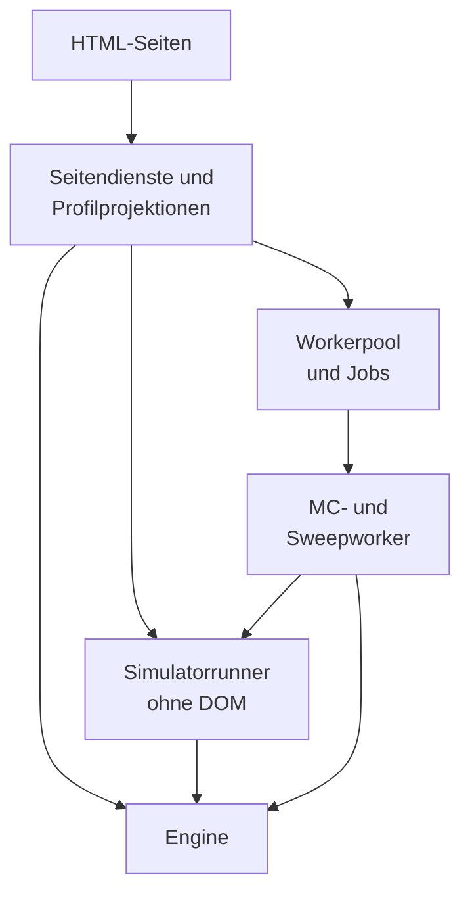
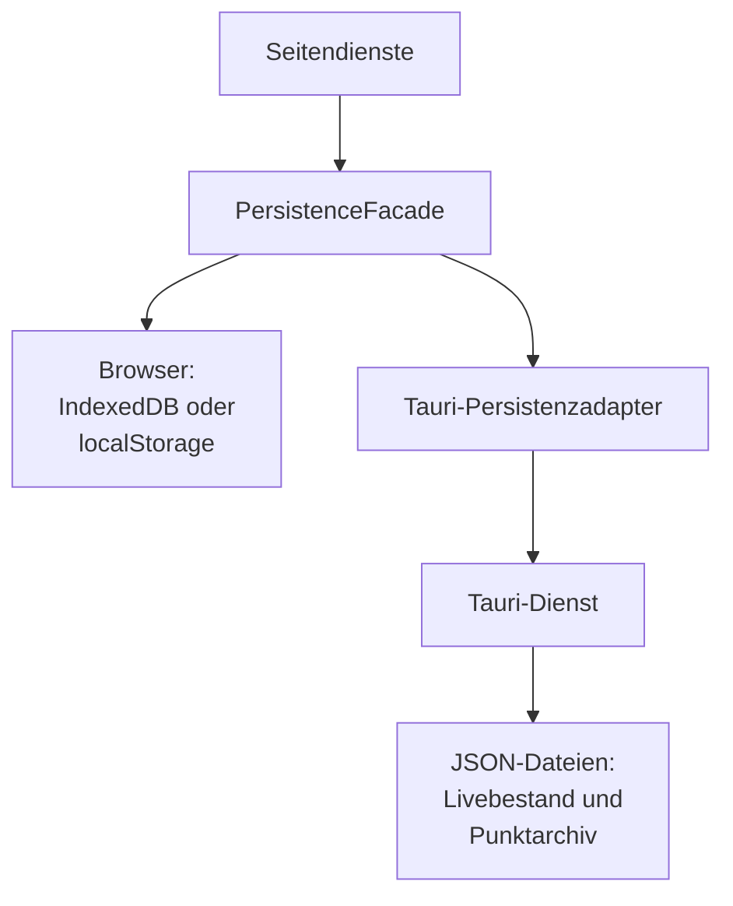
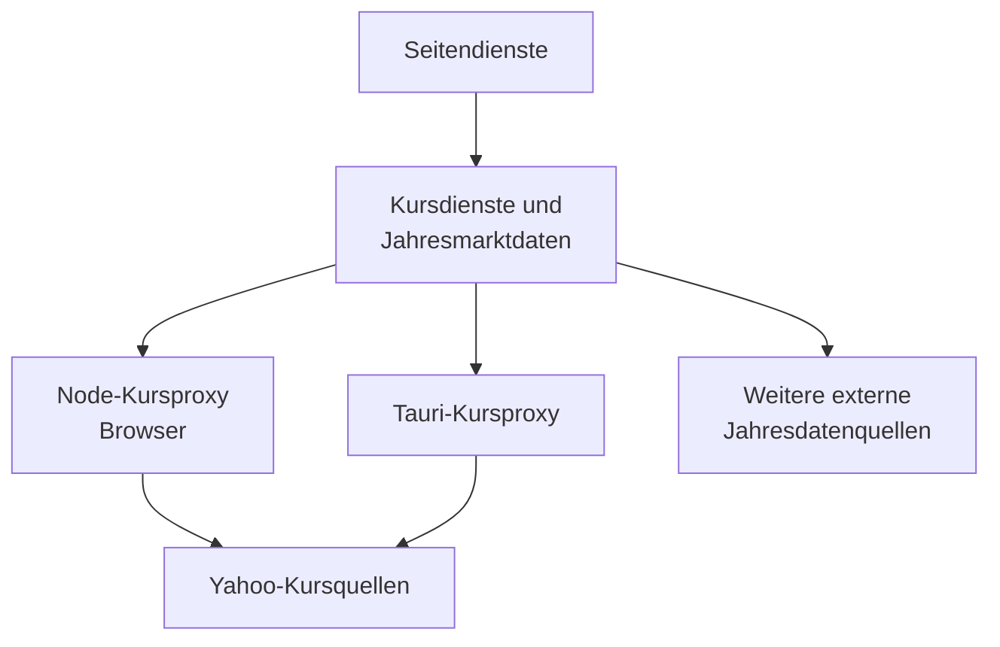

# Technische Architektur

Vermögen & Ruhestand läuft als lokale Browseranwendung oder in einer Tauri-WebView. Beide Laufzeiten laden dieselben HTML-Seiten und nativen ES-Module. Fachrechnungen brauchen keinen Serverdienst; externe Abrufe ergänzen Kurse, Inflation und CAPE.

**Lizenz:** MIT. [Lizenztext](../../LICENSE.md), [npm-Metadaten](../../package.json) und [Cargo-Metadaten](../../src-tauri/Cargo.toml) nennen dieselbe Projektlizenz. Daten und eingebundene Assets haben eigene Herkunfts- und Lizenzangaben.

Das [Fachkonzept](FACHKONZEPT.md) beschreibt Modell und Aussagegrenzen. [Datenverträge](DATENVERTRAEGE.md) führen Speicher- und Austauschformate. Die [Engine-Referenz](../../engine/README.md) führt Aufrufverträge; Prüfwege stehen im [Test-README](../../tests/README.md).

## Schichten und Laufzeiten

| Schicht | Einstieg oder Verzeichnis | Verantwortung |
| --- | --- | --- |
| Seiten | HTML-Dateien an der Repositorywurzel | Statischer Rahmen, Felder und Hosts für Renderer |
| Seitendienste | `app/` | Daten lesen, Nutzeraktionen koordinieren, Ergebnisse anzeigen |
| Fachkern | `engine/` | Jahresbedarf, Marktanalyse, Entnahme, Transaktionsvorschlag, Steuer-Settlement |
| Pfadrechnung | DOM-freie Module in `app/simulator/` | Mehrjahresstate, historische und gezogene Pfade, Lebensereignisse, Aggregation |
| Hintergrundrechnung | `workers/` | Jobs ausführen, Ergebnisse übertragen und Abbruch abwickeln |
| Daten | `app/shared/persistence-*.js` | Cache, Adapter, bestätigte Writes und Migration |
| Desktop | `src-tauri/` | WebView, lokale Dateien, Kursproxy und Fensterabschluss |

Die Seiten laden ES-Module für Seitendienste und Profilprojektionen. Balance ruft die Engine direkt auf; der Simulator verwendet DOM-freie Runner und kann Jobs über den Workerpool ausführen. Worker importieren Runner und Enginequellen selbst. Das erste Diagramm zeigt Seiten und Rechenpfade.

Die PersistenceFacade wählt im Browser IndexedDB oder den localStorage-Ersatz, im Desktop den Tauri-Adapter. Der native Dienst hält WebView, Dateiablage und Desktop-Kursproxy. Die WebView lädt die HTML-Seiten. Der Speicherpfad hat eigene Adapter und Dateiablagen.

Im Browser kann der Node-Kursproxy laufen. Der Desktop-Kursproxy gehört zum nativen Tauri-Dienst. Die Kursdienste rufen den lokalen Proxy auf; die Jahresmarktdaten haben zusätzliche externe Abrufwege.

Quellen: [Balance.html](../../Balance.html), [Simulator.html](../../Simulator.html), [index.html](../../index.html), [depot-tranchen-manager.html](../../depot-tranchen-manager.html), [Ausgaben.html](../../Ausgaben.html), [Daten-Sicherung.html](../../Daten-Sicherung.html) und [Handbuch.html](../../Handbuch.html) für Moduleinstiege; [simulator-monte-carlo.js](../../app/simulator/simulator-monte-carlo.js), [worker-job-runner.js](../../app/simulator/worker-job-runner.js), [worker-pool.js](../../workers/worker-pool.js) und [mc-worker.js](../../workers/mc-worker.js) für Runner-/Workeraufrufe; [persistence-facade.js](../../app/shared/persistence-facade.js) und [persistence-adapter-tauri.js](../../app/shared/persistence-adapter-tauri.js) für Adapter; [src-tauri/src/lib.rs](../../src-tauri/src/lib.rs) und [tauri.conf.json](../../src-tauri/tauri.conf.json) für WebView, Dateien und Desktopproxy; [tranchen-price-service.js](../../app/tranches/tranchen-price-service.js), [annual-marketdata.js](../../app/shared/annual-marketdata.js), [yahoo-proxy.cjs](../../tools/yahoo-proxy.cjs) und [serve.mjs](../../scripts/serve.mjs) für Kursabrufe und Browserproxy.

### Einstiegspunkte

| Seite | Einstieg | Funktion |
| --- | --- | --- |
| Übersicht, `index.html` | `app/overview/overview-main.js` | Vermögen, Budget, Arbeitsstand und Abschlusszugänge |
| Personen & Vermögen, `depot-tranchen-manager.html` | `app/tranches/tranchen-manager-page.js` | Personen, Haushalt & Plan, Tagesgeld, Depot und Verlauf |
| Ausgaben, `Ausgaben.html` | `app/expenses/expenses-main.js` | Personengebundene CSV-Importe, Monats- und Jahresansichten |
| Balance, `Balance.html` | `app/balance/balance-main.js` | Jahresplanung, unterjährige Vorschau und Diagnose |
| Simulator, `Simulator.html` | `app/simulator/simulator-main.js` | Historische und mögliche Zukunftspfade, Werkstatt |
| Daten & Sicherung, `Daten-Sicherung.html` | `app/data/data-page.js` | Vollsicherung, Wiederherstellung, Austausch, Kurs- und Speicherstatus |
| Handbuch, `Handbuch.html` | [handbook.js](../../app/handbook/handbook.js) | Kapitelnavigation, Textsuche und Hilfesprünge ohne Fachschreibzugriff |

Die Seiten sind getrennte Dokumente. Ein Wechsel beendet den Seitenkontext. Persistente Belege verbinden die Seiten; ein DOM-Element, Workerjob oder offener Entwurf gehört seinem aktuellen Dokument. `src-tauri/tauri.conf.json` bindet `dist/` als Frontend ein. Die Startfenstergröße ist 1920×1080; Gestaltungsregeln stehen im [Designsystem](../design/designsystem.md).

Die Übersicht ordnet den nächsten Abschluss vor die Karten für Vermögen, Monatsbudget und Plan. Diese drei Karten ordnen Titel, Hauptwert, Bezug und Navigation gleich an. Personen & Vermögen steht links unter der Vermögenskarte, der Ausgabenstand rechts daneben. Die bisherigen Kartenbreiten bleiben im gespiegelten 5:7-Raster erhalten. Beide stehen vor dem 176 Pixel hohen Verlaufsdiagramm. Der Verlauf auf der Übersicht zeigt zwei Kennzahlen: letzter Tagesabschluss und Veränderung mit Messzeitraum. Bestände nennen das Ansichtsdatum, Budget und Ausgaben ihren Bezugszeitraum. Die vier Jahreskennzahlen zeigen Beschriftung und Wert; fehlende Werte erscheinen als —. Unveränderte Detailtexte stehen im `ds-info`-Popup am Label. `renderOverviewYear` bindet nach jedem Rendern `bindInfoPopovers` für Hover, Fokus, Klick und Escape. `aria-describedby` verbindet den Knopf mit dem Detailtext.

Jahresvergleich und Tagesverlauf lesen verschiedene Quellen: Jahresgrenzstände mit belegtem Umfang beziehungsweise Tageswerte ab dem tatsächlichen Messbeginn. Der Renderer verspricht bei unklarem historischem Umfang keinen Vergleich nach dem ersten Jahresendstand. Zum Verlauf → öffnet den bestehenden Verlaufsreiter. Dort rendert `tranchen-history-closures.js` Aufteilung und fünf Tageskennzahlen in der Gruppe Aus Tageskursen, getrennt von Aus erfassten Ständen. Die Tagesgruppe verwendet die unveränderte Bewertungsprojektion samt Messbeginn und Status. Ihre Zeitraumwahl nutzt `projectProfileWealthHistory`. Neue Erfassungen speichern Haushalt und Personen zusammen in `rs_household_wealth_captures_v1`. `profile-wealth-captures.js` bildet je Mitglied Aktien, Geldmarkt, Gold, Anleihen und Tagesgeld; der Vertrag prüft die Summe zum Haushalt. Beide Jahresabschlusswege und alle manuellen sowie importbedingten Erfassungen schreiben diesen Record in derselben Transaktion wie die bisherige Haushaltskopie im aktiven Profil. Die Kopie behält das alte Format. Die Haushaltsanzeige vereinigt Altlisten aus allen Profilen nach Datum; bei Abweichungen gewinnt der jüngste Zeitstempel, ohne vergleichbare Zeitstempel die Speicherreihenfolge der Profile und Einträge. Das ⓘ nennt die abweichenden Tage. Personen lesen ausschließlich ihre belegten Personenstände; nur diese erweitern ihre Zeichnungsachse. Vollsicherung, Restore und Spielbereich führen den gemeinsamen Record als globale Fachdaten. Die Anzeige schreibt keine Daten. Längere Lesehilfen stehen im ⓘ.

Budgetkarte und Ausgabendiagramm lesen für ihr jeweiliges Jahr den beschlossenen Plan vor der gespeicherten Vorschau. Status und Aktualität kommen aus dem Planvergleich; eine Vorschau erhält eine gestrichelte Budgetlinie. Der gemeinsame Renderer `household-plan-comparison.js` zeigt die Handlungsanweisung kurz mit Erklärung im ⓘ und Einzelbeträgen in geschlossenen Details. Beide Seiten binden die dynamischen Infofenster nach jedem Rendern. `overview-renderer.js` zeigt bei `lastMonth === 0` im laufenden Jahr den ersten Monatsabschluss mit Datum statt eines Ausgabenmangels. Ein fehlender Budget-Prozentwert bedeutet kein fehlendes Budget; maßgeblich ist die Budgetquelle. Der Januar-Rückblick auf das Vorjahr bleibt erhalten. Die Kurspille nennt bei einem Abruffehler zuerst das älteste gespeicherte Kursdatum im gewählten Umfang. Die Zeit des fehlgeschlagenen Versuchs ersetzt diesen Stand nicht. Technische Gründe bleiben im vorhandenen Kursdetailfeld.

Balance zeigt die aktuelle Rechnung neben dem gültigen Jahresplan: Monatsbudget und Vermögensentnahme tragen direkt am Betrag Vorschau heute mit Datum, Planbetrag und Differenz. Das Monatsbudget verwendet bei beiden Referenzbreiten 44 px Newsreader; bei Platzmangel rückt der Planvergleich darunter. `balance-renderer-summary.js` liest dafür den vorhandenen Planvergleich. Die Reichweite verwendet vor und nach dem Vorschlag dieselbe finanzierte Monatsentnahme; `ui.runway.months` ist der Nachherwert vor Auszahlung. Der Haushalts-Flex einschließlich Rentenanteil bleibt von den Netto-Flexwerten der Kürzungstreppe getrennt. Die Engine und die gespeicherten Belege werden durch diese Anzeigeprojektionen nicht verändert.

Die Ausgabenseite gestaltet Jahres- und Personenfilter mit denselben Segmentregeln. Der Monatsrenderer zeigt kurze Aktionshinweise; die Hilfe verwendet `bindInfoPopovers`. `renderExpensesPage` skaliert Kategorienbalken relativ zum größten positiven Kategoriebetrag und erhält die echten Anteile. Der Jahresrenderer zeigt bei einem importierten Jahr eine Zusammenfassung, ab zwei Jahren Säulen mit höchstens 64 Pixel Breite. Die Wertetabelle und die Definition positiver Datenmonate bleiben erhalten. `projectExpenses` trennt verbleibende Kalendermonate von fälligen Monaten ohne vollständige Imports. Jahresbudget minus bestätigte Ausgaben bleibt unverändert. Der Renderer bezeichnet die Differenz im laufenden Jahr als Restbudget, im vergangenen Jahr mit Datenlücken als vorläufige Budgetdifferenz und sonst als Jahressaldo. Fehlende Monate werden namentlich genannt.

### Gemeinsame Daten und Schreibbesitz

`app/profile/` trennt geöffnete Person, aktives Liveprofil und Mitglieder des Haushalts. Balance und Simulator bauen daraus eigene Eingabeprojektionen. `household-plan.js` liefert den gemeinsamen Plan für einen kanonischen Bereich. `profile-context-reader.js` liest den Profilkontext; `profile-person-data.js` leitet Alter und Jahresrente ab. Lesen allein bestätigt keine Personenumstellung und schreibt keinen neuen Bestand.

`profile-person-file.js` migriert ältere Personenangaben vor der Importfilterung mit den reinen Entwurfs- und Übernahmefunktionen aus `profile-person-migration.js`. Diese arbeiten nur auf der Quelldatei. Unklare Angaben verhindern die Vorschau; Zielprofile und Livewerte bleiben dabei unberührt. Datierung und Ablehnungsgründe stehen im [Personendateivertrag](DATENVERTRAEGE.md#personen--und-profilbundle).

Personen & Vermögen setzt die Reiter direkt unter den kompakten Seitentitel. Der Ansichtsrenderer blendet + Person anlegen im Verlauf aus; bei Plan und Person steht der Knopf rechts in der Reiterzeile. Die Kurszeile und ihre ⓘ-Details lesen dieselben gespeicherten Kursstände. Vermögenskarten, offene Bedarfszeile und Weitere Planwerte stehen im Planpanel untereinander. Die Personenansicht verbindet Namen und Kartenaktionen im Kopf von Auf einen Blick; Tagesgeld, Nettorente und sonstige Einkünfte sind direkt bearbeitbar. Weitere Planwerte, Vermögensdetails und die drei Personendetailkarten starten geschlossen; ihre Klappzustände werden nicht persistiert.

Gold und Pflegereserve verbinden Zusammenfassung, Textklappe und Aktivschalter in einer Kopfzeile. Die Schalter liegen außerhalb der Klappknöpfe und bedienen die bisherigen Wertträger. Klappaktionen verwenden ▸ zeigen und ▾ ausblenden; Sprunglinks erscheinen im Messington mit Pfeil. Das Haushaltsraster hebt die gespeicherte aktive Person nicht hervor. Kauf und Verkauf haben im Depotkopf dieselbe sekundäre Knopfrolle. Feldkennungen und Speicherbesitzer bleiben erhalten.

Geldfelder stehen rechtsbündig; der lokale Zahlenadapter gruppiert ihre Anzeige ohne Rundung und entfernt die Gruppierung beim Bearbeiten. Er hält den kanonischen Feldwert getrennt vom Anzeigetext, damit Dezimalpunkte ihre bisherige Bedeutung behalten. Formatierungswechsel erzeugen keine Eingabeereignisse oder Writes.

Die Verantwortung für reale Daten liegt bei Personen-, Tagesgeld-, Tranchen- und Abschlussdiensten. Balance plant Verkäufe auf einer Kopie der Lots. Simulatorrunner arbeiten auf eigenen Portfolios. Weder eine Empfehlung noch ein Simulationsergebnis darf `depot_tranchen` als ausgeführten Verkauf fortschreiben.

Die Zuordnung von Modulen steht in den Referenzen für [Balance und Übersicht](BALANCE_MODULES_README.md), [Simulator](SIMULATOR_MODULES_README.md) und [Personen und Depot](TRANCHEN_MODULES_README.md).

## Seitendienste

### Gemeinsamer Seitenrahmen

[suite-frame.js](../../app/shared/suite-frame.js) verbindet Navigation, Profilanzeige, Hilfe und den Status des aktuellen Bereichs. [profile-navigation.js](../../app/profile/profile-navigation.js) sichert Profilwechsel und Navigation über die Persistenzschicht. [suite-sidebar-preference.js](../../app/shared/suite-sidebar-preference.js) hält die Seitenleistenwahl; sie ist eine Darstellungspräferenz.

Lokale Schrift- und SVG-Dateien liegen unter `assets/`. Formatter in `app/shared/` und in den Features erzeugen die Anzeige. Die Geldbeträge der Rechenverträge bleiben Zahlen; eine deutsche Formatierung ist kein Speicher- oder Rechenformat. Symbol- und Schriftlizenzen stehen in [Assets](../../assets/README-schriften-symbole.md).

### Seitenstart und fachliche Uhr

[probelauf-ui.js](../../app/shared/probelauf-ui.js) und [probelauf-state.js](../../app/shared/probelauf-state.js) koppeln Seitenbereitschaft an den bestätigten Persistenz- und Spielbereichszustand. Eine fremd veränderte Phase sperrt Writes. Ein defekter alter Rückkehrpunkt blockiert die Ablösung des bisherigen Probelaufs. Seiten dürfen daraus keinen leeren Haushalt erzeugen. [probelauf-price-ui.js](../../app/shared/probelauf-price-ui.js) liefert „Testkurse, nicht echt“ und die Erklärung zu künstlichen Kursen, Stückzahlen und Tagesgeld. Das Übersichtsmodell verwendet den Hinweis bei gesetztem Testdatum; der Renderer bindet die vorhandenen ⓘ-Popover. Bei gesetztem Testdatum kennzeichnet der gemeinsame Spielbereichsrahmen die Manager-Kurszeile, ihre bestehenden Details und die Zusammenfassung des Startkursberichts. Ohne Testdatum bleiben die echten Kursanzeigen erhalten. Das Abrufresultat bleibt im Bericht erhalten. Ein auf den Kopfkontext begrenzter Beobachter erhält den Hinweis nach erneutem Rendern. Der Adapter schreibt keine Fachdaten.

[app-clock.js](../../app/shared/app-clock.js) stellt das fachliche Datum bereit. Ein Spielbereich kann es ändern. Technische Zeitmessung und Seedable-RNG werden dadurch nicht zu derselben Uhr. [planning-start.js](../../app/shared/planning-start.js) leitet den ersten Planungsmonat ab; [annual-coordinator.js](../../app/shared/annual-coordinator.js) ordnet den Jahresstatus. Der fachliche Kalender darf auch außerhalb Januar auf einen fehlenden Jahresabschluss hinweisen.

### Navigation und laufende Operationen

[balance-play-execution.js](../../app/balance/balance-play-execution.js) führt erzeugte Handlungsbuchungen ausschließlich im bestätigten aktiven Spielbereich aus, einschließlich Stand heute. Die Bestätigung in [balance-play-execution-ui.js](../../app/balance/balance-play-execution-ui.js) nennt Verkäufe, Steuern, Käufe und Tagesgeld je Person. Die Vorbereitung verwendet `commitTrancheReconciliation`, den mit dem Manager geteilten Kaufwriter und `commitCashPostingConfirmation` auf privaten Stringrecords. Erst danach bestätigt ein gemeinsamer transaktionaler Write die Buchungen. Die konkrete Haushaltsattribution bleibt erhalten; profilpräfixierte Enginekennungen werden auf die ursprünglichen Lots abgebildet. Bestandskurse gelten für vorhandene Instrumente, neue Anlageklassen erhalten gekennzeichnete deterministische Spielkurse ohne Abruf. Die Gutschrift bleibt als Auftrag in der Registry erhalten. Buchungen, Cashprotokoll und Verlaufsmarken tragen die Spielwertherkunft. Die [Datenverträge](DATENVERTRAEGE.md#reconciliation-und-cashnachweis) beschreiben Felder und Speichergrenzen.

[navigation-guard.js](../../app/shared/navigation-guard.js) verwaltet Entwürfe, verfügbare Ergebnisse und Operationen. Eine Operation erhält einen eigenen Lebenszyklus und prüft ihren Kontext vor dem Commit. Rechenläufe können vor einer Navigation abgebrochen werden. Ein bestätigender Write braucht einen anderen Abschluss als ein verworfener Entwurf.

Spielbereichsaktionen schließen offene Seiteneingaben und Rechenläufe vor der Mutation ab. Start, Datumswechsel und Übernehmen bestätigen den ausstehenden Flush im bisherigen Bereich; Verwerfen darf die Spieländerungen verwerfen. Nach erfolgreicher Mutation beendet `finalizeDocument` den alten Guardkontext: keine weiteren Providerabfragen, Subscriber oder Saver beim Entladen. Die Navigation folgt auch dann, wenn sich während der Mutation Eingaben geändert haben. Start und Datum laden die aktuelle Seite neu, Beenden öffnet `index.html`. Die Ausgabenbeobachter auf Balance und Ausgaben lesen während des Wechsels und nach dessen Abschluss keine Fachdaten. Ein gescheiterter Wechsel behält den bisherigen Fehler- und Recoveryweg.

[page-dialog.js](../../app/shared/page-dialog.js) und [page-choice-dialog.js](../../app/shared/page-choice-dialog.js) bieten gemeinsame Seitendialoge. [navigation-guard-dialog.js](../../app/shared/navigation-guard-dialog.js) verbindet den Guard mit deren Darstellung. Die Tauri-Schließanforderung läuft über die Facade und bestätigt den Fensterabschluss erst nach dem Speicherversuch. Ein bloß gestarteter Flush bestätigt noch keine Speicherung.

Personen & Vermögen registriert beim Guard über `registerBeforeLeave` einen Saver für offene Tagesgeldwerte. Er bestätigt den Feldwert vor der Verlustentscheidung für Seitenwechsel und Tauri-Schließen. Personenwechsel sichert ihn über den bestehenden Profilwriter. Im Browser beginnt `beforeUnload` denselben Write synchron; der Commitgrund verhindert das Schließen während des Flushs. Ein Speicherfehler hält den Wiederholungsauftrag auf der Seite.

### Monats- und Jahresabschluss

Der Monatsdialog in [overview-month-confirmation.js](../../app/overview/overview-month-confirmation.js) führt durch Kurse, Ausgaben, Budget und Tagesgeld. Der Jahresdialog in [annual-close-dialog.js](../../app/shared/annual-close-dialog.js) ergänzt Marktdaten und Plan. Beide nutzen dieselbe CSV-Auswahl mit verborgenem Dateifeld, Dateiname und Ersetzenbereich bei vorhandenem Import. [overview-example-expenses.js](../../app/overview/overview-example-expenses.js) bindet den sichtbaren Knopf an den bestehenden Importbesitzer und dessen Sperren. Dateiname und geöffnete Ersetzenbereiche bleiben bei Modellupdates dokumentlokal erhalten. Die gemeinsame CSS-Komponente sperrt das Hintergrundscrollen; nur der Inhalt zwischen Kopf und Abschlussbereich scrollt. Besuche und bestätigte Tagesgeldstände sind eigene Nachweise. Ein Import darf die übrigen Schritte nicht ungesehen abhaken.

Der gemeinsame Budgetinhalt zeigt Ausgaben, Budgetquelle und Abweichung in drei KPI-Kacheln. Tagesgeld beginnt je Person als Lesewert; Stand stimmt bestätigt nur diese Person, Ändern öffnet das vorhandene Feld und Übernehmen bestätigt den Entwurf. Solange ein Feld bearbeitet wird, bleibt der Abschluss gesperrt. Herkunft und Speicherhinweise stehen einmal über den Personen; längere Regeln liegen hinter dem Info-Knopf im Fuß. Der Monatsbeleg zeigt drei Kacheln und eine anfangs geschlossene Herleitung. Die Dialogbindung hält auch die dynamischen Info-Popover an ihrer Lebensdauer.

[overview-cash-proposal.js](../../app/overview/overview-cash-proposal.js) ergänzt Tagesgeld-Vorschläge ausschließlich im bestätigten aktiven Spielbereich, auch bei `testDate === null`. Die Berechnung beginnt nach dem jüngsten Änderungs- oder Bestätigungstag und endet im Monatsdialog heute, im Jahresdialog am 31. Dezember. Ohne Datum gilt der Beginn des Abschlussmonats beziehungsweise Jahres. Rentenbeginn und Altbeginn folgen der Personenprojektion. Monatsbeträge und importierte Ausgaben zählen nach Kalendertagen. Entnahmen stammen zuerst aus dem Jahresbeleg, sonst aus der passenden Vorschau, und werden gleichmäßig auf die Personen verteilt. Fehlende Ausgaben oder Entnahmebeträge zählen mit erklärter Null; negative Vorschläge bleiben zur manuellen Korrektur gesperrt. Der Spielzins beträgt 1 % jährlich auf den Ausgangsstand mit Tagen/365. Nach Ausgabenimporten aktualisiert sich die Herleitung; geänderte angenommene Vorschläge brauchen erneut eine Bestätigung. Manuelle Eingaben bleiben erhalten. `cash.playValues` hält Herkunft und Herleitung im normalen Abschlussauftrag und Monatsbeleg. Der gemeinsame Cashwriter erlaubt diese Kennzeichnung nur im Speicherbereich `spiel` und ergänzt `source: spielwert` an betroffenen Verlaufseinträgen. Jahresprotokoll und Verlaufsanzeige nennen den Spielwert; der automatische Dezemberteil erhält die Herkunft. Berechnung und Abbruch schreiben nichts.

Im Jahresdialog projiziert [annual-plan-editor.js](../../app/shared/annual-plan-editor.js) das bereits berechnete Budget und die Vermögensentnahme vor dem Planvergleich. Die Personenprojektion liefert die Rentenanteile und Bezugsmonate; Altersherleitungen liegen in geschlossenen Berechnungsgrundlagen. [annual-close-result.js](../../app/shared/annual-close-result.js) trennt Monats- und Jahresvollständigkeit. Die lesende Jahresprojektion nennt fehlende Personen je Monat und bewahrt den Rückblick auch in der anschließenden Monatsphase. Haken belegen angesehene Schritte; Datenlücken bleiben sichtbar und ändern keine Abschlussbedingung.

Die Jahresmarktdaten verwenden drei gemeinsame KPI-Kacheln und eine Herkunftszeile. Manuelle, fehlende und veraltete Werte behalten ihre Hinweise und Info-Popover. Der Jahresergebnisrenderer zeigt Erfolg, Handlungsanweisung, Monatsbudget als einzige Leitzahl und zwei Kacheln für Jahresausgaben und Jahresbedarf. Herleitung Plan, Dezember und Abschlussbeleg beginnen geschlossen. Die Belegkarte enthält den bisherigen Wiederherstellungs- und Entnahmehinweis sowie Protokoll anzeigen als zurückhaltenden Knopf; andere Ergebniszustände verwenden dieselbe Kartenform. Die Verkaufsaufstellung mit Person, Wertpapier samt ISIN und Nettoerlös liegt zusammen mit Brutto und Steuer unter Details. Fehlende Personennamen werden über die Personenprojektion zugeordnet; ohne eindeutige Zuordnung bleibt ein Hinweis. Bei bewusster Anpassung liest die Anzeige die Empfehlung aus dem passenden Jahresbeleg mit demselben Festschreibungszeitpunkt und stellt sie dem Beschluss gegenüber. Der Jahresadapter hält Abschlussbedingungen, Belegerläuterung und Protokoll im Inhalt; der feste Fuß zeigt den kompakten Sicherungshinweis, die nächste Handlung und den Abschlussknopf. Die Anzeige verändert keine Belegrecords.

Der Monatsadapter lässt [close-dialog.js](../../app/shared/close-dialog.js) Fortschritt aus den Besuchen anzeigen; Budgetabweichungen bleiben eigene Ergebnisse. [tagesgeld-fields.js](../../app/shared/tagesgeld-fields.js) führt im Monatsdialog Personenhinweise und Bestätigungsknopf mit dem flüchtigen Bestätigungszustand mit. Die Feldbeschriftung nennt den Abschlusstag, entsprechend `storeMonthWithCash` und dessen `localHistoryDate(now())`. Die Entnahme für den laufenden Monat verwendet weiter `summary.monthlyWithdrawal`; das Vergleichsbudget bleibt `expenseBudget`. Dialog und Erfolgsbeleg leiten den Entnahmestatus aus dem passenden Jahresbeleg in `planComparison` ab. Ohne Beleg bleibt die Entnahme vorläufig, auch wenn eine Vorschau vorhanden ist. Der Jahreserfolg nennt den festgeschriebenen Folgejahresplan. Im Marktdatenprotokoll trägt Inflation die Einheit Prozent, der ETF-Schlusskurs Euro und CAPE keine Einheit. Der Erfolg ersetzt die Vorbereitung einschließlich Verwerfhinweis durch den Beleg und den nächsten Termin. Diese Anzeige ändert weder Abschlussbedingungen noch Speicherwege.

Beide Abschlüsse und Verkaufsbuchungen führen Tagesgeld über [profile-cash-update.js](../../app/profile/profile-cash-update.js) und den gemeinsamen `appendCashHistory` fort. Der Verlauf ersetzt nur den geschriebenen Tagesstand. Monats- und Jahresabschluss schreiben außerdem `profile_tagesgeld_confirmed_date` je Person im selben Commit. Dieses optionale Kalenderdatum belegt die ausdrückliche Prüfung auch ohne Wertänderung. Die Übersicht verwendet das spätere Datum aus Bestätigung und letztem Verlaufspunkt für ihre 35-Tage-Frist. Ohne Bestätigungsfeld gilt weiter das Verlaufsdatum; es gibt keine Migration. Profilwechsel, Vollsicherung und Wiederherstellung erhalten das Feld. Abschluss- und Verkaufsaudit behalten ihre eigenen Nachweise unabhängig von späteren Änderungen dieses Tages.

Der Jahresdienst rechnet aus Speicherwerten, ohne eine offene Balance-Seite vorauszusetzen. Vorbereitung und Vorschau entstehen vor dem mutierenden Commit. Bedarfe und Flex-Budget werden ohne Formatierungsumweg fortgeschrieben. Inflation, CAPE und ETF-Schlusskurs behalten ihre Quellpräzision im Plan, den Marktdaten und den Folgejahren. Vorschau und Jahresabschluss rechnen das Monatsbudget mit dem ungerundeten Einkommen. Nur Anzeige und gebuchte Beträge werden gerundet; die fachliche Entnahmequantisierung der Engine bleibt bestehen. Gerundete Altbelege bleiben ohne Migration lesbar. Danach prüft der Koordinator Kontext und Ausgangsbestand erneut. Empfehlung, bewusste Planänderung und beschlossener Plan bleiben unterscheidbar.

Ein Hauptklick kann das Jahr und anschließend den Dezembermonat schließen. Das sind zwei bestätigte Speichergrenzen mit eigenen Wiederherstellungspunkten. Scheitert die Monatsphase, bleibt das bestätigte Jahr erhalten; der Rückweg wiederholt die fehlende Monatsphase. Die konkrete Belegform steht in [Abschlüsse](DATENVERTRAEGE.md#abschlüsse-und-ausgaben), die Fachbedeutung im [Fachkonzept](FACHKONZEPT.md#jahresbeschluss-und-vorschau).

### Planversuche und Ergebnisbesitz

[plan-trial.js](../../app/shared/plan-trial.js), [balance-plan-trial.js](../../app/balance/balance-plan-trial.js) und [simulator-plan-trial.js](../../app/simulator/simulator-plan-trial.js) trennen den gemeinsamen Plan vom Versuch. Eine Rechnung mit abweichenden Werten übernimmt diese nicht automatisch. Eine Übernahme projiziert die gewählten Planfelder zurück in denselben Bereich.

Die Herkunft übernommener Werte steht im Kartenkopf. [field-state.js](../../app/shared/field-state.js) erhält den zugänglichen Grund am Feld und setzt ihn außerhalb eines Einheitenrahmens. `css/components.css` führt dafür den gemeinsamen Stil, `css/tokens.css` die Wertgrößen `--value-lg` und `--value-md`. Balance zeigt Bedarf, Bestände und Marktdaten offen; die weiteren Parameter liegen in einem beim Seitenaufruf geschlossenen Bereich. Der kompakte Balance-Kopf führt den Jahresabschluss; die Marktdatenkarte öffnet mit Marktdaten im Jahresabschluss prüfen denselben Dienst. Der frühere zusätzliche Marktdaten-Kopfzugang entfällt. Die Vorschau-Details bleiben über Details & Drucken erreichbar.

Der Simulator zeigt dieselben Bedarfswerte offen und bündelt die weiteren Planwerte unter Alle Parameter (`simPlanParameters`). Die weiteren Planwerte folgen Weitere Planwerte in Haushalt & Plan: Flex-Budget, Reserven und Entnahme & Umschichten stehen in der ersten Zeile, Dynamik und Marktdaten darunter. Beschriftung und kurzer Hinweis stehen links, Wert und Einheit rechts. Der Kopf fasst die aktuellen Werte zusammen. Voreinstellungen halten die Dynamikdetails geschlossen; Benutzerdefiniert öffnet sie. 3-Töpfe zeigt seine drei Werte in Entnahme & Umschichten. Alle drei Seiten teilen die Karten- und Zeilenregeln in `css/components.css` sowie `app/shared/household-plan-presentation.js` für die Darstellung und Zusammenfassung. In Balance folgen Gold, Steuern, Haushalt mit Profilwahl und Marktdaten-Korrektur abgesetzt darunter. `SIMULATOR_PLAN_FIELD_MAP` bindet Mindest-Liquidität wie die übrigen Planfelder an Formular und Versuch; die Engine bekommt den wirksamen Monatswert, ohne Wert weiterhin 2. `householdWithdrawalMode` bleibt vom Simulatorformular ausgeschlossen. Die Monte-Carlo-Einstellungen liegen in `mcSetupDisclosure` im Reiter Monte-Carlo, mit Simulation, Zeitraum & Daten, Stresstest und Erweitert. Einstellungen anzeigen öffnet und schließt nur diese Klappe; der Reiter bleibt aktiv. Beide Bereiche starten geschlossen. Die Zahlenanzeige aus `simulator-assumptions-ui.js` erfasst nur Felder unter Annahmen, daher bleiben Seed und Blockgröße native Eingaben. Feldkennungen, Speicherwege und Rechnung bleiben erhalten; Sichtzustände ändern keine Records.

[simulator-person-overrides.js](../../app/simulator/simulator-person-overrides.js) hält Personenalternativen im Seitenkontext. Offen stehen unter jeder Namensüberschrift Rentenbeginn und monatliche Rente nebeneinander in festen Spalten mit `--value-lg`. Sonstige Einkünfte werden weder angezeigt noch eingerechnet; vorhandene gespeicherte Einkommensabweichungen werden ignoriert. Beide Renten sind verfügbare Nettobeträge. Alte Rentensteuerquoten bleiben in Profilen und Belegen lesbar, sind wirkungslos und in beiden Personenoberflächen verborgen. Der Abweichungsmodus akzeptiert dafür keine neuen Werte. Weitere Werte und gemeinsame Rentenanpassung liegen in Details zur Person; der Abweichungsschalter öffnet sie. Pflege zeigt Titel, Zusammenfassung, Annahmen zeigen und Schalter in einer Zeile. Reservebetrag und Erhaltungshinweis stehen im `.ds-info` am Schalter; `simCareReserve` bleibt der aktualisierte Werthost. Die native Pflegeklappe startet geschlossen und verteilt Klapptitel und Inhalt über das Kartenraster. Der Lauf erhält einen eingefrorenen `personDataContext`; spätere Eingaben ändern diesen Laufbeleg nicht. Ergebnisdateien verwenden den Beleg des abgeschlossenen Laufs.

## Rechenpfade

### Engine-Einstieg

[engine/index.mjs](../../engine/index.mjs) exportiert `EngineAPI` und `_internal_calculateModel`. [engine/core.mjs](../../engine/core.mjs) normalisiert den Aufruf, validiert Input und Vorstate und koordiniert die Fachmodule. Der Core verbindet Marktanalyse, SpendingPlanner, Transaktionsplanung und finales Settlement. Die Entscheidungsschritte stehen in [ENGINE_DECISION_LOGIC](ENGINE_DECISION_LOGIC.md); Methoden und Fehlerformen im [Engine-README](../../engine/README.md).

[three-bucket-logic.mjs](../../engine/transactions/three-bucket-logic.mjs) finalisiert die Drei-Töpfe-Aktion für Balance und Simulator im Core vor dem Steuerabschluss. Ein schlechtes Jahr wird an Kursrendite minus Inflation gemessen. Die vollständige Umschichtung wird vor der Auszahlung geplant: Geplante Anleihenverkäufe mindern den Bestand, erst danach wird der Rest auf das Ziel aufgefüllt. Der zusätzliche Aktienverkauf nutzt nur den noch freien Sparerpauschbetrag; sein Bruttobetrag wahrt die Aktienreserve. Reicht der Aktienbestand nicht, bleibt die Auffüllung begrenzt. Der Simulator führt auch die geplanten Anleihenkäufe vor der Auszahlung aus; danach folgt keine zweite Auffüllung.

`engine.js` ist im aktuellen Auslieferungspfad ein generierter ES-Modul-Wrapper. Er importiert `engine/index.mjs`, setzt die Browserglobals und exportiert den Legacy-Alias `Ruhestandsmodell_v30`. Fachmodule und Worker importieren die Quellen direkt. Die UI prüft Version und Methoden über ihren Engine-Handshake, bevor sie rechnet.

### Balance-Aktualisierung

[balance-main.js](../../app/balance/balance-main.js), [balance-input-storage.js](../../app/balance/balance-input-storage.js) und [balance-update-pipeline.js](../../app/balance/balance-update-pipeline.js) teilen Eingabebau, Rechnung und Speichermodus. Eine Vorschau verwendet den aktuellen Bestand, ohne den Jahresbeleg zu ersetzen. `PERSIST_INPUTS` und `COMMIT_PERIOD` haben zusätzliche Writegrenzen.

[guardrail-history.js](../../app/shared/guardrail-history.js) enthält die gemeinsame Resetregel für Balance und Simulator. Nur bewusst geänderte Planwerte setzen die Leitplanken zurück; Steuerstände bleiben erhalten. CAPE, Kurse, Bestände, Einkommen und automatische Jahresfortschreibungen zählen nicht als Planänderung. Balance führt die Planbasis im bestehenden `balanceStateLifecycle.planInputEvidence` je Bereich. Die automatische Indexierung verschiebt auch diese Basis; `PERSIST_INPUTS` erhält eine noch offene Planänderung bis zum Jahrescommit. Der Simulator führt seine rohe Planbasis als `guardrailPlanInputs` im Pfadstate und trennt die konfigurierte Dauer von der jährlich berechneten Restdauer. Fehlende Altbelege bleiben lesbar und erzwingen keinen Reset.

[planning-horizon.js](../../app/shared/planning-horizon.js) berechnet für Balance und Simulator die jährliche Restdauer aus Alter, Haushalt, Horizontmethode und Langlebigkeitsoption. [life-expectancy.js](../../app/shared/life-expectancy.js) nutzt dafür dieselbe Sterbetafel. Balance projiziert die zentralen Personendaten über [balance-planning-horizon.js](../../app/balance/balance-planning-horizon.js); die Simulatorrunner behalten ihren bestehenden Importpfad. Berechnete Dauer und Langlebigkeitsdiagnose sind Rechenwerte. `household_plan_v1` behält die konfigurierte Jahreszahl; `guardrailPlanHorizonYears` trennt sie im Aufruf von der Restdauer. Die Profilpersistenz entfernt diese Ableitungen zusammen mit den Plankopien. Dateiexporte behalten ihren bisherigen Vertrag.

`sourceProfileId` bleibt an den Lots des Haushaltspools erhalten. [profilverbund-action-attribution.js](../../app/profile/profilverbund-action-attribution.js) ordnet Quellen, Steuer und Verwendungen zurück zu den Personen. Eine Abweichung jenseits der Centtoleranz blockiert das Ergebnis. Geplante Quellen bleiben vom realen Depot getrennt.

[parity-balance-records.js](../../app/balance/parity-balance-records.js) übersetzt aufgezeichnete Simulatorzustände in private Balance-Records. Sein eingefrorener Speicheradapter wirft bei `setItem`, `removeItem` und `clear`. [parity-balance-replay.js](../../app/balance/parity-balance-replay.js) ruft damit den echten Speicherreader und `evaluateStoredAnnualHousehold` auf. [parity-case.js](../../app/balance/parity-case.js) rechnet zusätzlich das isolierte Simulatorjahr und den privaten Balance-Jahresplan. [parity-year-comparison.js](../../app/balance/parity-year-comparison.js) ordnet den Feldvergleich nach Phasen; [parity-compare.js](../../app/shared/parity-compare.js) wendet Toleranzen und Kanonisierung an. `ParityCaseV1` bewahrt Eingabebeleg, rohe Records, Ableitungen und Messungen für den Einzelreplay. Echte Speicher und normale Seitenläufe erhalten keinen Anschluss an diesen Prüfpfad. Unabhängige Jahresendbuchungen und die Preisumrechnung bei exakt gleichen Steuerquoten begrenzen weiterhin die Paritätsprobe; Einzelheiten stehen im [Replayvertrag](PARITY_REPLAY.md#feldvergleich-und-einzelfall).

### Ein Simulatorjahr

[simulator-household-pension.js](../../app/simulator/simulator-household-pension.js) zahlt eigene Renten und Hinterbliebenenrenten ohne weiteren Abschlag; Teiljahresmonate und Rentenanpassung schreiben die volle Nettobasis fort. [simulator-year-portfolio.js](../../app/simulator/simulator-year-portfolio.js) aktualisiert Allzeithoch und Jahresabstand vor der Entscheidung. [simulator-engine-input.js](../../app/simulator/simulator-engine-input.js) erhält den Abstand 0 bei erreichtem oder neuem Hoch. Die Jahresfortschreibung erhöht den Abstand darunter nur einmal.

[simulator-engine-direct.js](../../app/simulator/simulator-engine-direct.js) führt einen Finanzschritt aus. Der Runner ergänzt Marktjahre, Lebensereignisse und das Ende des Pfads. `simulator-engine-input.js` baut den Engineinput; Portfolio-, Forced-Sale-, Bond- und Steuer-Recompute-Module verändern nur den Simulatorstate.

[simulator-personal-accounts.js](../../app/simulator/simulator-personal-accounts.js) führt Tagesgeld und Geldmarkt je Person in `portfolio.personAccounts`. `simulationPeople` erhält beim Profilmerge Tagesgeldherkunft, Freibetrag, Kirchensteuer und den persönlichen Verlustvortrag aus dem gespeicherten Balance-State. Die Summen `tagesgeld`, `geldmarktEtf` und `liquiditaet` werden aus aktuellen Konten und Lots abgeleitet. Die Auszahlungsverteilung nutzt denselben `calculateWithdrawalDistribution`-Baustein wie Balance, mit den Beständen vor der Transaktion. Je Person wird zuerst Tagesgeld, dann Geldmarkt verbraucht; Geldmarktlots verlieren dabei anteilig Stücke und Kostenbasis. Verkaufserlöse finanzieren Käufe derselben Eigentümer. [simulator-personal-tax.js](../../app/simulator/simulator-personal-tax.js) verwendet `attributeHouseholdAction` aus Balance für die Quellenwahl im gewählten Haushaltsmodus und `settleTaxYear` für die Jahressteuer je Person. Zusätzliche Verkäufe decken persönliche Auszahlungslücken. Tagesgeldzinsen und realisierte Geldmarktgewinne fließen in denselben Jahresabschluss; bloßes Geldmarktwachstum bleibt in der Tranche. Steuerzahlungen aus Geldmarkt realisieren weitere Gewinne, die im selben Abschluss nachgerechnet werden. Freibetrag und Verlustvortrag gelten jeweils einmal pro Jahr und Person. Der Haushaltspool trägt keinen persönlichen Verlust. Ältere Inputs ohne persönliche Steuerparameter behalten ihren bisherigen Rechenweg und werden als unbelegt gekennzeichnet.

Der optionale zehnte Parameter von `simulateOneYear` nimmt einen lesenden [Paritätscollector](../../app/simulator/parity-replay-collector.js) auf. Er kopiert den privaten Jahresanfang, die tatsächlichen Engineargumente vor dem Aufruf und die Entscheidung vor jeder Simulatornachbearbeitung. Der Wrapper reicht den Parameter durch; reguläre Runner aktivieren ihn nicht. [ParityReplayLogV1](PARITY_REPLAY.md) enthält Herkunft, Phasen und explizite Modelllücken. Collector und Validator haben keinen Speicherzugang. Ihre Prüfungen liegen unter `tests/extended/` und laufen getrennt über `npm run test:paritaet`.

Für eine persönliche Steuerlücke verbraucht `settlePersonalTaxYear` zunächst die eigene Liquidität. Danach gilt FR-16 (Nutzerentscheidung vom 15.10.2026): zuerst die Liquidität der anderen Haushaltspersonen, erst danach eigene Anlagen mit dem Notverkaufsbaustein `calculateSaleAndTax`. `calculateWithdrawalDistribution` aus Balance bestimmt auch bei mehr als zwei Personen die Reihenfolge der helfenden Konten; je Person wird zuerst Tagesgeld, dann Geldmarkt genutzt. Dabei entstehende Geldmarktgewinne werden beim Eigentümer nachgerechnet, auch wenn dessen Steuer bereits abgerechnet war. `personalAnnualTaxes[].householdTaxFunding` nennt die finanzierende Person. Ungedeckte Steuer liefert `taxShortfall`; der Jahresadapter beendet den Pfad mit `ruin` und `ruinDetails.taxShortfallNominal`. Ein solcher Pfad erhält keinen als ausgeglichen markierten Steuervertrag. Diese Deckungsregel folgt FR-16: Balance reserviert Verkaufssteuer im Plan, führt aber keine anschließende tatsächliche Jahressteuerzahlung aus.

Das Ergebnis unterscheidet `success`, `ruin` und `technical_error`. Ein ungültiger Engineaufruf darf nicht als wirtschaftlicher Ruin klassifiziert werden. Der Rückgabestate enthält die fortgeschriebenen Bestände und den Inflationsfaktor für das nächste Jahr. Zur Reihenfolge und Geldbasis führt [Zeit und Geld](FACHKONZEPT.md#zeit-und-geld).

### Historischer Backtest

[historical-backtest-contract.js](../../app/simulator/historical-backtest-contract.js) prüft die inklusive Periode und die Jahresrecords vor dem ersten Finanzschritt. Der [Runner](../../app/simulator/historical-backtest-runner.js) rechnet ohne DOM. Fehlende Pflichtjahre erzeugen `incomplete`, ohne mit Ersatzrenditen weiterzurechnen.

UI, Summary und Jahresprotokoll teilen das kanonische Resultat. Der gemeinsame Sitzungsschalter aus `euro-display.js` startet für Backtest und Monte Carlo mit Nominal. [backtest-euro-display.js](../../app/simulator/backtest-euro-display.js) projiziert reale Kennzahlen und Portfolioflächen aus den protokollierten kumulierten Inflationsfaktoren mit Jahresendbezug wie der Log-Analysator. Entnahmen und Steuern werden je Jahr umgerechnet und danach summiert. Die Ergebnisköpfe nennen das eingefrorene Startjahr, etwa Euro von 2000. Beide Schalter stehen in derselben Optik über den Ergebnissen; ihre identischen Info-Popover erklären Kontowert und Kaufkraft. Kennzahlen, Auffälligkeiten, Chart und Jahresprotokoll folgen der Wahl; Rohdatenexporte bleiben nominal. Endvermögen und Gesamtentnahmen zeigen darunter den Gegenwert der anderen Basis mit 14 px. Der Wechsel startet keinen Lauf und verändert keine Ergebnisfelder. Der Backtest rechnet ausschließlich den gewählten Einzelpfad. Rolling Cohorts wurden auf Nutzerentscheid vom 14.10.2026 entfernt; alte Einstellungen lösen keinen Zusatzlauf aus.

Datenbasis und Einordnung verwenden den gemeinsamen `ds-info`-Popupvertrag. Die Zeitraumkarte steht über vier Spalten links neben den Kennzahlen über acht Spalten. Beide Karten sind gleich hoch; Neu rechnen bleibt bei den Feldern. Drei Hauptkacheln stehen offen, die Zusatzwerte unter der anfangs geschlossenen Klappe Weitere Kennzahlen. Der Flex-Hinweis verwendet summary-description als eigene kleine Zeile unter dem Wert. Unter 1200 px Inhaltsbreite stapeln sich beide Karten. Der Ergebniscontainer nimmt mit `display: contents` am gemeinsamen Raster teil; Portfolioverlauf und Protokoll bleiben vollbreit. Echte Laufhinweise und Datenlücken erscheinen zusätzlich als Hinweiszahl im Kennzahlenkopf. Ruin und Fehler bleiben im Hinweisband über beiden Karten sichtbar.

Der Raw-Export enthält Request, Periode, Ergebnis und Provenienz. Seine Portfoliogrenzen sind kein fortsetzbarer Speicherstand.

Der DOM-freie [Log-Analysator](../../app/simulator/log-analysis-events.js) liest das vorhandene Backtestergebnis oder genau einen ausgewählten MC-Pfad. Adapter normalisieren Jahreszeilen und Geldbasis, Phasen trennen Datenlücken und wechselnde Haushalts-Flex-Basen, feste Textbausteine erklären die Belege. Jedes Ereignis enthält Regelversion, Jahr, Zeilenindex, Messwerte und Quellen. Der Baustein rechnet keinen Finanzpfad neu. [backtest-log-analysis.js](../../app/simulator/backtest-log-analysis.js) und [scenario-log-analysis.js](../../app/simulator/scenario-log-analysis.js) übergeben das veröffentlichte Backtestergebnis oder den gewählten MC-Pfad an den gemeinsamen [Kartenbaustein](../../app/simulator/log-analysis-view.js). Er projiziert drei Karten, gebündelte weitere Punkte und einen Text. Jeder neue Lauf ersetzt die Anzeige; Haushaltsinvalidierung entfernt den bisherigen Backtest. Gewöhnliche Eingabeänderungen belassen die Karten beim eingefrorenen Laufbeleg; der Laufkopf zeigt den geänderten Annahmenstand. Ohne geänderte Annahmen rechnen Reiterwechsel nicht neu. Im Reiter Ergebnis kann die bestehende Laufsteuerung einen veralteten Backtest automatisch ersetzen; MC startet nur auf Nutzerwunsch. Fehlende Messwerte bleiben unbekannt; Terminalzeilen liefern keine Finanzminima oder Entnahmejahre. Die Jahreslinks verwenden stabile Backtest- oder Szenarioanker aus dem Protokollrenderer und heben die aktuelle Zeile kurz hervor.

[backtest-chart-annotations.js](../../app/simulator/backtest-chart-annotations.js) wählt aus denselben Belegen Entnahmekürzungsphasen und höchstens fünf wichtige Ereignisjahre für den Backtest-Portfolioverlauf. Wiederholte Arten und Jahre werden gebündelt; Beschriftungen weichen bei Kollisionen auf weitere Zeilen aus. Der Chart zeichnet messingfarbene Bänder unter der bisherigen Zahlenachse und verlinkt Marken über die vorhandene Jahresnavigation. Der anfangs aktive Schalter „Auffälliges einblenden“ steuert nur diese Ergänzungen. Resize ersetzt das SVG und erhält den Schalterzustand; Neuaufbau und Invalidierung lösen alte Bindungen. Vermögensflächen, Zahlenachsen und rote Krisenfenster behalten ihre bisherige Geometrie. Die Ergebnisübersicht bleibt bei ihrem bisherigen Portfoliochart. Die API beschreibt die [Simulatorreferenz](SIMULATOR_MODULES_README.md#ergebnisansichten-protokolle-und-downloads).

`npm run test:paritaet` startet den getrennten [Szenarienlauf](../../tests/extended/parity-scenarios.mjs) für den Muster-Haushalt, vier Dynamikvoreinstellungen und 2000–2025. Jeder protokollierte Entscheidungsstand wird über den Balance-Reader nachgerechnet. Entscheidungen und Personenpläne sind in allen 104 Jahreslagen gleich. Der [Balance-Folgelauf](../../tests/extended/parity-balance-sequence.mjs) startet einmal mit privaten Anfangsrecords und eingefrorenen Marktereignissen. Er verwendet eigene Zustände und Jahresentwürfe. Ihm fehlen persönliche Jahresendbuchungen, daher hält er mit `NICHT_VOLLSTAENDIG_AUSFUEHRBAR` an. Die Kontenregel selbst ist durch FR-10 entschieden. Spätere Jahre erhalten keine erfundenen Entscheidungen. Konsolenzeilen und `zusammenfassung.json` zählen `decisionEqualYears`, `transactionEqualYears` und vollständige `equalYears` getrennt. [parity-residuals.mjs](../../tests/extended/parity-residuals.mjs) ordnet die verbleibenden Befunde nach Status, Grund und Feld einer benannten Klasse zu; unbekannte Befunde setzen den Fehlerexit. Die [Abschlussmessung](PARITY_REPLAY.md#jahresvergleich-und-restklassen) nennt Klassen und Beispielzahlen. Aufrufe, Exitcodes und die getrennte Vorher-/Nachher-Messung stehen im [Test-README](../../tests/README.md#paritätscollector).

### Monte Carlo und Worker

[simulator-monte-carlo.js](../../app/simulator/simulator-monte-carlo.js) besitzt den Laufstatus und verbindet UI, seriellen Runner und Workerpool. [monte-carlo-runner.js](../../app/simulator/monte-carlo-runner.js) berechnet Pfade ohne DOM. [mc-worker.js](../../workers/mc-worker.js) führt Jobs aus, [worker-pool.js](../../workers/worker-pool.js) verwaltet Worker und Generationen.

Unter Szenario-Logs aktualisiert die gemeinsame Pfadauswahl auch „Was im gewählten Pfad auffällt“. Die Karten lesen nur dessen Jahresprotokoll und den eingefrorenen Laufkontext. Vergleichslinks führen zu dieser Ansicht; der Protokolllink und Jahreslinks verwenden denselben Pfad. Die Zeitachse nennt Simulationsjahre, das ⓘ am Jahreslink das gezogene Datenjahr. Pflege und Tod bleiben neutral, beide Personen getrennt. Gesamtanteile bleiben in den Chips von „Pfade vergleichen“. Ein neuer Lauf, eine leere Auswahl oder ein Darstellungsfehler entfernt die alten Karten. Der Euro-Schalter erhält Ereignisse und Pfadidentität; Geldbeträge der Pfadkarten folgen der gewählten Basis.

[monte-carlo-chunk-result.js](../../app/simulator/monte-carlo-chunk-result.js) transportiert typisierte Buffer, Missingness, Outcome-Zähler, Heatmap und benötigte Pfadstatistiken. Bei Mindest-Flex werden Laufstatistiken übertragen; gepoolte Jahresserien sind keine gleichwertige Aggregation.

Die Anzeige stellt Median der Jahresanteile und betroffene Läufe gleichwertig nebeneinander. Deckungswerte nennen Zähler und Nenner; Teilerfolg rundet nie sichtbar auf 100,0 %. Ergänzende Zeilen wiederholen weder Deckungswerte noch Einschränkungsanteile. Verteilungsperzentile stammen aus derselben gewählten Endwertpopulation. Szenarioläufe bleiben getrennt nach nominalem Rang auswählbar. [euro-display.js](../../app/simulator/euro-display.js) hält die dokumentlokale Basis mit Vorgabe `nominal` und bietet den gemeinsamen Schalterbaustein. Alle MC-Geldanzeigen einschließlich Jahresprotokoll, Pflege, Pfadkarten und Vergleichstabelle folgen dieser Wahl. Beim Veröffentlichen jedes neuen Laufs setzt `resetEuroMode` beide Reiter auf Nominal zurück. Die Wahl wird nicht persistiert.

[mc-euro-metrics.js](../../app/simulator/mc-euro-metrics.js) ergänzt Pfadskalare im vorhandenen Lauf: reale Steuern, Steuerersparnis, Reservenutzung und Mindest-Flex-Beträge sowie nominale Lauf-P10-Entnahmen einschließlich Stressfenster. Jahreszahlungen verwenden den Jahresanfangsfaktor, Bestände den Jahresendfaktor. Die typisierten Pfadzusammenfassungen tragen sie durch Worker und Merge. `euroMetrics` aggregiert Quantile je Basis aus Pfadwerten; die bisherigen Felder und die Simulation bleiben unverändert. Der optionale Block wird ohne Rundung in V2 exportiert. Alte Ergebnisse behalten bekannte Werte; fehlende Gegenbeträge bleiben unbekannt.

`results-formatting.js` kürzt Geldbeträge an der Anzeigegrenze. Die Übersicht über Endvermögen und Steuern verwendet ebenfalls gerundete Anzeigewerte aus `results-metrics.js`. Auch Tooltips zeigen ganze Euro. Nur der Median des Endvermögens und die Hauptentnahmekarte erhalten eine 14-px-Zeile mit der anderen Basis. `protocol-columns.js` übersetzt Handlungskürzel ausschließlich für die Anzeige. Das Histogramm zeigt zunächst Median und P25–P75; der native Markenschalter und die Detailklappe behalten ihren Sitzungszustand beim Euro-Wechsel. Die bisherigen Rohwerte und Quantile bleiben unverändert; Exporte erhalten den optionalen Zusatz ohne Anzeige-Rundung.

[scenario-comparison.js](../../app/simulator/scenario-comparison.js) projiziert drei charakteristische Pfade für Tabelle und Vergleichskurven. `scenario-log-view.js` hält deren Auswahl dokumentlokal für die Sitzung und verbindet sie mit Liste, Randmarken und Protokoll. Vorgabe ist P10/Median/P90; jede Spalte bietet alle vorhandenen charakteristischen Pfade. Die nominale Rangwahl bleibt beim Euro-Wechsel erhalten. Gesamtanteile stammen aus Ergebnisinventar und Mindest-Flex-Aggregat, Pflegeannahme und Voreinstellung aus den Laufinputs. Die fünf Aktienrendite-Ratios werden aus vorhandenen Finanzjahren verkettet; fehlende Jahre bleiben unbekannt. Der Vergleichsmodus des vorhandenen SVG-Renderers umfasst alle drei Kurven in einem eigenen Maßstab. „Was hier auffällt“ wählt denselben Pfad und springt zum bestehenden Auswahlkopf.

Ein Workerfehler kann einen seriellen Ersatzlauf auslösen. Ein Nutzerabbruch durchläuft den Abbruchpfad und startet keinen Fallback. [worker-job-runner.js](../../app/simulator/worker-job-runner.js) und der Pool verwerfen die betroffene Generation und erledigen ihre ausstehenden Promises. Alte Ergebnisse dürfen keinen späteren Lauf abschließen. Der Legacy-RNG-Stream läuft seriell; die Pfadidentität der Seedverträge ist Teil der [Simulatorreferenz](SIMULATOR_MODULES_README.md).

### Werkstatt

Stresspfad-Replay verwendet den materialisierten Markt- und Ereignispfad für Vergleichsvarianten. `stress-replay-runner.js` und seine Contract-, Export- und Vergleichsmodule halten diesen Pfad getrennt von neuen Zufallsziehungen. Ein Parameter-Sweep rechnet Varianten über `sweep-runner.js`; Auto-Optimize verteilt Kandidatenbewertungen über seine Workeranbindung und denselben Pool.

Suchraum, Bewertung und Übernahme stehen in [AUTO_OPTIMIZE_DETAILS](AUTO_OPTIMIZE_DETAILS.md). Die Bewertung eines Kandidaten übernimmt ihn nicht in den gemeinsamen Plan. Rechenresultate brauchen ihren eigenen Laufkontext; die Übersicht liest nur die bestätigte Kurzfassung.

## Speicher und Schreibgrenzen

### Facade und Adapter

[PersistenceFacade](../../app/shared/persistence-facade.js) stellt einen synchron lesbaren Seitencache vor einem asynchronen Backend bereit. `setItemSync` und `removeItemSync` markieren vorbereitete Änderungen. Der entprellte Flush schreibt Batches in eine serialisierte Kette. Erfolg ist erst nach der Backendbestätigung belastbar; ein Fehlversuch erhält die offenen Änderungen und den Fehlerstatus.

| Laufzeit | Adapter | Ablage |
| --- | --- | --- |
| Browser | `persistence-adapter-indexeddb.js` | Echt: IndexedDB `ruhestand-suite`; Spiel: `ruhestand-suite-spiel`. Je Version 2 mit `kv`, `metadata`, `snapshots` |
| Browserersatz | `persistence-adapter-localstorage.js` | Echte Stringrecords behalten ihre Schlüssel; Spielrecords und Spielarchiv verwenden `rs_spiel_v1:` |
| Tauri | `persistence-adapter-tauri.js` | Echt: `ruhestand_suite_data.json` und `ruhestand_suite_snapshots.json`; Spiel: `ruhestand_suite_spiel_data.json` und `ruhestand_suite_spiel_snapshots.json`, jeweils im App-Datenordner |

Die Facade wählt den Adapter nach Laufzeit und Verfügbarkeit. Ältere localStorage-Daten werden über Marker und Rückleseprüfung migriert. Ein fehlerhafter Browser-DB-Upgrade oder ein Dateilesefehler ist kein Anlass, Daten still als leer zu behandeln. Browserorigin und Desktopordner sind getrennte Speicherorte; ein Serverportwechsel kann einen anderen Browserbestand sichtbar machen.

[persistence-areas.js](../../app/shared/persistence-areas.js) löst vor dem ersten Backendlesen den aktiven Bereich auf. Die Steuerung enthält Version, Bereich (`echt` oder `spiel`), Quelle und Startzeit. Sie liegt außerhalb der Records: im Browser unter `rs_storage_area_control_v1`, in Tauri in `ruhestand_suite_area_control.json`. Ohne Steuerung gilt `echt`. Ein Fertigmarker in den Spielmetadaten bindet die vollständig geschriebene Kopie an die Steuerung. Ein unlesbarer Steuerdatensatz oder fehlender Fertigmarker verwirft die Spielkopie; die echten Daten bleiben erhalten. Ein Hinweis im bestehenden Seitenrahmen erklärt die Rückkehr, ohne eine echte Speicher-Recovery auszulösen.

[probelauf-state.js](../../app/shared/probelauf-state.js) legt beim Start Records mit Zustandsversion 2 ausschließlich im Spielbereich an. Die Kopie liest echte Records über `readRealRecords()` ohne Migration. `readRealSnapshots()` kopiert vorhandene Sicherungspunkte ebenfalls nur lesend. Max und Erika entstehen als reine Records. Erst nach Readback und Fertigmarker wird der Bereich aktiviert und neu geladen. Startabbruch verwirft halbe Spieldaten. Es entsteht kein echter Sicherungspunkt.

Die Musterwahl lädt den Generator samt Engine erst beim Start; [muster-haushalt-prices.js](../../app/demo/muster-haushalt-prices.js) hält Datumsprüfung und Kursneuaufbau für Kopien ohne Engine-Import verfügbar. [muster-haushalt.js](../../app/demo/muster-haushalt.js) ergänzt mit `evaluateAnnualDraft` und `buildAnnualPlanRecord` einen globalen `annual_plan_record_v1` für den Vorjahresabschluss. Die private Rechnung bewertet dieselben Stücke zum 01.01. des Startjahres und liest den gemeinsamen Bedarf sowie die dann laufenden Renten. Der Beleg trägt „Beispieldaten (Spielbereich)“ in Momentaufnahme und Handlungstitel; Monatsinformationen übernehmen seine Entnahme und sein Budget. Der Planvergleich aller drei Oberflächen liest denselben Beleg. Auch ein Januarstart hat damit einen bestätigten Vorjahresabschluss; spätere Datumssprünge erhalten dessen Bytes.

[probelauf-timelapse-ui.js](../../app/shared/probelauf-timelapse-ui.js) ergänzt den Zeitrafferzugang samt Start-/Endedialog und Anhalten im gemeinsamen Band. Zeitrafferknopf, ⓘ und Anhalten stehen vor Spielbereich beenden; die Fortschrittsanzeige bleibt am Bandende. Die Übersicht wartet vor der Fortsetzung auf Startkurse und Verlauf. [probelauf-timelapse.js](../../app/shared/probelauf-timelapse.js) hält Fortschritt und nächsten Datumstermin ausschließlich im bereichsgebundenen Sitzungsspeicher (`probelauf.timelapse.v1`), mit Spielbereichs-ID und aktiver Person. Datumsschritte verwenden `controller.changeDate` samt regulärem Neustart. Nur ein angekündigter Datumsschritt wird automatisch fortgesetzt; Neuladen während eines Finanzschritts hält an. Bei „Stand heute“ bestätigt der Nutzer den ersten Sprung, der die bestehende Übernahmesperre setzt. Eingaben sind während des Laufs gesperrt, Anhalten bleibt im Band verfügbar. Ein laufender Speicherschritt endet vor der Rückkehr zur Handbedienung.

[overview-timelapse.js](../../app/overview/overview-timelapse.js) erzeugt nur Eingaben: CSV über `generateExampleExpensesCsv` und `importExpenses`, Tagesgeld über `createCashProposals`, Monatsabschluss über `storeMonthProvision`, Jahr über `createAnnualCoordinator` und den normalen Dezemberteil. Jahresmarktdaten kommen nach dem Datumssprung aus dem vorhandenen synthetischen Adapter. Bereits abgeschlossene Monate werden übersprungen. Der Jahreswrite liefert die gerade festgeschriebenen Profilaktionen; ihre Ausführung verwendet die SD-2-Writer samt Gutschrift und die mit dem Balance-Renderer geteilte Cashaufteilung. Unterjährige Vorschauen lösen keine Buchung aus. Jeder Fehler hält mit Ursache an und erhält die bestehenden Wiederherstellungswege. [probelauf-timelapse.test.mjs](../../tests/probelauf-timelapse.test.mjs) belegt den vollständigen Lauf mit Max und Erika sowie bytegleiche echte Daten und vorhandene Sicherungspunkte auf allen drei Produktionsadaptern mit gefälschten Backends.

Datumssprünge und Abschlüsse schreiben nur im Spielbereich. Beenden öffnet für Max und Erika oder nach einem Datumssprung die kurze Bestätigung „Spielbereich beenden?“. Sie zeigt nur den Verwerfhinweis und „Im Spielbereich gemacht“. „Spielbereich beenden“ verwirft die Spieldaten und lädt `index.html`. Kopien ohne Datumssprung öffnen den Vergleich; dort führt „Verwerfen“ zur Startseite. Ein Neustart setzt einen aktiven Spielbereich samt Kursmodus und Band fort. Vollsicherung, Import, Wiederherstellung und Recovery-Download bleiben gesperrt.

Standard ist „Stand heute“ ohne Testdatum (`testDate: null`, `hasDateJump: false` im Steuerrecord `rs_probelauf_state_v1`). Die Erststart-Begrüßung startet Max und Erika ebenso ohne weitere Eingaben. Kopien behalten ihre vorhandenen Kurse. Musterkurse dienen als Startwerte; der Verlauf wird frisch abgerufen. Startkurse, Verlauf und Jahresmarktdaten verwenden die echten Anbieter und speichern ausschließlich im Spielbereich. Erst ein anderes Datum setzt `hasDateJump: true` vor der Kurserzeugung und aktiviert über die Fachuhr `isSyntheticPriceMode`. Dieser Merker bleibt bis zum Verwerfen gesetzt, auch beim Zurückstellen auf heute. Ältere Zustände der Version 2 mit Testdatum bleiben synthetisch. Alle Facheingaben bleiben bedienbar; nur die genannten Sicherungs- und Importwege sind gesperrt. Die interne Personenübernahme eines Altbestands gilt als Fachwrite und arbeitet ebenfalls nur in der Spielkopie.

Der Beenden-Dialog in [probelauf-end-dialog.js](../../app/shared/probelauf-end-dialog.js) unterscheidet vor dem Datenzugriff zwischen kurzer Bestätigung und Vergleich. `probelaufEndNeedsComparison` schließt Max und Erika sowie jeden Datumssprung einschließlich Rücksprung aus. Für diese Sitzungen liest `readEndReview` nur Spielrecords aus dem aktiven Cache; der Review erzeugt weder echte Vorschau noch echte Änderungsdifferenz. Kopien ohne Datumssprung lesen echte Records ausschließlich über `readRealRecords()`. Ein geänderter echter Bestand erhält Vergleich und Sperrgrund oben, aber keinen Übernehmen-Knopf.

[probelauf-comparison.js](../../app/shared/probelauf-comparison.js) lädt die Engine auf Abruf und baut die benötigten Vorschauen aus privaten Rohrecord-Kopien über `buildBalanceEngineInputFromStorage` und `evaluateStoredAnnualHousehold` auf; ein einzelnes aktives Profil nutzt denselben Engine-Jahresaufruf. Die Livewerte des aktiven Profils überlagern auch die private Registry. Der Adapter bietet nur `getItem`; es gibt weder Persistenzwrites noch Fensterveröffentlichungen. Monatsbudget einschließlich Einkommen, Handlungsart und Betrag sowie Liquiditätsdeckung vor Umsetzung kommen aus dieser frischen Rechnung. Abweichende Jahresplanwerte stehen im ⓘ. Der Dialog öffnet vor dem Lesen mit „wird gerechnet …“ und bleibt abbrechbar. Rechenfehler erhalten je Bereich ihren Grund; spätere Ergebnisse eines geschlossenen Dialogs werden verworfen. Monte Carlo bleibt beim gespeicherten letzten Lauf, kopierte Belege zählen nicht als Spiel-Lauf.

[probelauf-records.js](../../app/shared/probelauf-records.js) überlagert das aktive Profil mit den Livewerten und gruppiert fachliche Änderungen. Technische Angaben, Anzeigeprojektionen, Sitzungen und Kurse sind ausgenommen. Der Spiel-Steuerrecord hält `startedAt`, `realDomainChecksum`, `initialMonteCarloRuns` und den anfänglichen Fachstand `initialDomain` fest. Nur `initialDomain` dient als Basis für „Im Spielbereich gemacht“; fehlt der Startstand, steht „nicht erfasst“. Monatsfolgen werden etwa als „Oktober bis Dezember 2026 · Jahr 2026“ dargestellt. Offene Monate und entfernte Abschlussbelege zählen nicht als Abschluss. Dadurch zählen Startdaten des Muster-Haushalts und spätere echte Änderungen nicht als eigene Spieländerungen. Die Prüfsumme umfasst alle Profile und fachlichen globalen Records. Übernehmbar ist nur eine Kopie ohne Datumssprung und mit gleicher echter Fachprüfsumme. Ältere Sitzungen ohne Startprüfung bleiben gesperrt.

„Übernehmen …“ öffnet die Bestätigung aller Änderungen mit vorher und nachher; eine Teilauswahl gibt es nicht. „Zurück“ führt zum Vergleich. „Jetzt übernehmen“ prüft die echte Prüfsumme erneut und verlangt dieselben bestätigten Spieländerungen. `adoptPlayArea` ist der einzige Schreibweg aus dem Spielbereich in den echten Bestand. Er bestätigt den Punkt „Vor Übernahme aus dem Spielbereich“ (`probelauf-transfer-before`) im echten Archiv, bevor er fachliche Records ersetzt. Technische Records, Sitzungen, Kurssitzungen und die Bereichssteuerung werden nicht aus der Kopie übertragen. Die Profilzuordnung berücksichtigt Livewerte und bewahrt die echte Profilauswahl, soweit die Person noch besteht. Erst nach dem Readback wird auf `echt` geschaltet und der Spielbereich entfernt.

Auch ein Fehler beim Löschen nimmt die Übernahme zurück. Der zuvor gelesene Spielbestand samt Archiv, Fertigmarker und Sitzungswerten wird bestätigt wiederhergestellt; die Bereichssteuerung kehrt zu `spiel` zurück. Bis zum Knopf „Zur Startseite“ bleibt die Erfolgsansicht sichtbar und das alte Dokument schreibgesperrt. Bei Fehlern bleibt der Spielbereich bedienbar; der Transaktionsrollback und die Rücknahme der ursprünglichen Backendbytes erhalten die echten Records samt Metadaten. Ein ungeklärter Rollback sperrt weitere Writes und meldet den Fehler.

Zustandsversion 1 dient nur noch der Ablösung alter Probeläufe. Beim Seitenstart werden die Phasen `starting`, `active` und `restoring` einmalig aus dem Punkt „Vor Probelauf“ zurückgeholt. Der bisherige Rückweg bestätigt die Originalrecords bytegleich und entfernt Spielpunkte und Steuerrecord. Erst danach startet die Fachseite und bietet den neuen Spielbereich an. Ein Fehler behält Rückkehrpunkt und Sperren; die Meldung nennt die fehlgeschlagene Ablösung. Neue Starts können den echten Bestand nicht mehr ersetzen.

`activatePlayArea` verlangt bereits gespeicherte echte Eingaben, schreibt die Spielkopie und veröffentlicht erst danach ihre aktive Steuerung. `discardPlayArea` verwirft auch ungespeicherte Spieländerungen. Beide verlangen anschließend einen Dokumentneustart; die bisherige Fassade kann danach nicht mehr schreiben. Ein App-Neustart mit gültiger Spielsteuerung lädt wieder den Spielbereich. `readRealRecords` ist der ausdrücklich lesende Zugang zum echten Bestand; er führt keine Migration, Datenbankaktualisierung oder Quarantäne aus. Archivzugriffe prüfen dieselbe Steuerung wie Fachwrites. Veraltete Seiten dürfen darüber keine echten Altsicherungen migrieren.

[persistence-area-storage.js](../../app/shared/persistence-area-storage.js) trennt außerdem fachliche Sitzungsmerker für Kurse, Kursverlauf und Jahresretry. Migrationen verwenden nur die lokalen Spielschlüssel und Spielmarker; die alte Datenbank `snapshotDB` wird im Spielbetrieb nicht bereinigt. Der alte Zugriff auf Snapshot-Verzeichnishandles bleibt dort gesperrt. Tauri quarantiniert beschädigte Spieldateien unter ihrem eigenen Namen. `delete_play_state` entfernt ausschließlich die beiden Spieldateien und ihre temporären Schreibdateien.

[persistence-location.js](../../app/shared/persistence-location.js) fragt den Desktopordner bei Tauri ab und kann ihn öffnen. Der native Dienst bestimmt das Ziel; die UI übergibt keinen beliebigen Dateipfad. Im Browser gibt es für IndexedDB keine vergleichbare Ordnerauskunft.

### Transaktionale Operationen und Recovery

`replaceRecordsTransactional` verwendet den gemeinsamen Kern in [persistence-transaction.js](../../app/shared/persistence-transaction.js). Auch die Spielbereichsübernahme nutzt ihn mit einem auf den echten Adapter begrenzten Speicherzugang, ohne die aktive Spiel-Fassade umzuschalten. Der Kern vergleicht erwartete Ausgangsrecords, schreibt den zugelassenen Umfang, liest ihn zurück und führt die fachliche Nachprüfung aus. Bei Fehler versucht der Besitzer die Rücknahme und meldet gesondert, wenn sie nicht bestätigt ist. `blockSyncWrites` verhindert dann, dass ein altes Formular die Wiederherstellung überschreibt.

Die Facade und [annual-operation-lock.js](../../app/shared/annual-operation-lock.js) koordinieren mutierende Dienste. Der Probelaufschutz serialisiert Writes mit Web Locks oder seiner Ersatzkette. Eine im Speicher vorhandene Probelaufphase wird mit dem bestätigten Record verglichen, bevor unabhängige Writer fortfahren.

[snapshot-archive.js](../../app/shared/snapshot-archive.js), [snapshot-restore.js](../../app/shared/snapshot-restore.js) und [snapshot-retention.js](../../app/shared/snapshot-retention.js) trennen Capture, Wiederherstellung und Aufbewahrung. Ein Snapshot ist ein lokaler Rückkehrpunkt mit eigenem Umfang. Eine Vollsicherung ist ein extern speicherbarer Export der zugelassenen Apprecords. Formate und Restoregrenzen stehen in [Datenverträgen](DATENVERTRAEGE.md#sicherung-austausch-und-wiederherstellung). [data-snapshot-presentation.js](../../app/data/data-snapshot-presentation.js) bildet Anlassbezeichnungen und die bestehenden Zeilensperren für Liste, Vorschautitel und Verfügbarkeitszählung ab. Gesperrte Punkte verhindern eine grüne Zusammenfassung. Diese Projektion ändert weder Snapshotrecords noch Restoreentscheidungen.

[data-prices.js](../../app/data/data-prices.js) projiziert getrennt den Abrufbefund, brauchbare gespeicherte Kurse und die bestätigten Tageskursintervalle. Alte gültige Kurse zählen als gespeicherter Stand, ohne als aktuell zu gelten. [data-renderer.js](../../app/data/data-renderer.js) zeigt Abruffehler bei brauchbaren Beständen gelb und fehlende oder unlesbare Kursdaten rot. Offene Abrufzeiträume ohne nachgewiesenen Datenfehler bleiben gelb; ungeklärte Wertpapiere verhindern die Meldung vollständiger Tageskurse. Dienstprüfung und Kursabruf behalten getrennte Rückmeldungen. Versuchszeit und rohe Ursachen stehen in den technischen Details.

Der Sicherungsblock zeigt bei gültiger Vergleichsbasis Änderungen an Monatsabschlüssen, Tagesgeld-Einträgen und Tranchen. [data-backup-summary.js](../../app/data/data-backup-summary.js) vergleicht deren Signaturen über alle Profile; Tagesgeld-Basiswerte, Ausgaben und Planannahmen gehören nicht zu diesem Vergleich. Fehlt die passende Basis, entfällt die Änderungszeile. Die Speicherkarte zeigt die bestehende Größenmessung als Gesamtgröße und drei Teilgrößen. Der bestätigte Desktoppfad liegt unter „Speicherort anzeigen“, während „Ordner öffnen“ direkt erreichbar bleibt. Aufbewahrungsregeln sind ebenfalls eingeklappt; Messung, Bridge und Retentionplan bleiben unverändert.

### Native Dateigrenze

[src-tauri/src/lib.rs](../../src-tauri/src/lib.rs) legt Live- und Archivdatei fest. Der Dateiwriter nutzt eine temporäre Datei und ersetzt das Ziel über den nativen Pfad. Eine beschädigte Live-Datei kann über `quarantine_app_state` gesichert werden. Die Quarantäne erhält Rohdaten; sie ist keine automatisch erfolgreiche fachliche Reparatur.

Eine Tauri-Datei bestätigt ihren eigenen Write. Monats- und Jahresbelege sowie Live- und Archivdatei bilden dadurch keine gemeinsame dateiübergreifende Datenbanktransaktion. Recovery und Rückleseprüfung bleiben erforderlich.

## Build und Auslieferung

### Browserstart und Kursdienst

[serve.mjs](../../scripts/serve.mjs) liefert die Dateien über HTTP aus und stellt Buildprovenienz für den Browser bereit. `npm run serve` und `start_suite.cmd` verwenden diesen Pfad. Voraussetzungen und Fehlerhilfe stehen in [Einrichtung und Betrieb](../guides/EINRICHTUNG_UND_BETRIEB.md#im-browser).

Server und Kursproxy binden standardmäßig an `127.0.0.1`, auf Port 8000 und 8787. `npm run serve -- --open` öffnet zusätzlich den Browser; `--port 8001` wählt einen anderen Webserverport und `--no-proxy` unterdrückt den Kursproxy. Die App sucht den Kursdienst weiter auf `127.0.0.1:8787`; `--proxy-port` allein stellt ihre Kursadresse nicht um. Strg+C beendet Server und Proxy zusammen.

Das Doku-Werkzeug [docs-bilder.mjs](../../scripts/docs-bilder.mjs) nutzt denselben Server ohne Proxy auf einem freien Loopback-Port. `npm run docs:bilder` öffnet Playwright Chromium mit vier isolierten Mustermann-Kontexten für Ansichten, Monat, Jahr und Spielbereich-Vergleich, festen Uhren und lokalen Marktdaten. Die 41 PNGs und das Herkunftsmanifest liegen in [docs/ui/](../ui/README.md); der Lauf gehört nicht in `npm test`. Die vorhandenen Bildplätze `simulator-backtest.png` und `monte-carlo-szenario-logs.png` nehmen die Karten „Was im Lauf auffällt“ und „Pfade vergleichen“ auf. Die Vergleichsaufnahme setzt P10, Median und P90, die Backtestaufnahme hält „Weitere“ geschlossen.

[market-price-adapter.js](../../app/shared/market-price-adapter.js) verbindet Quotes mit ihrem Symbol, EUR-Währung, positivem Preis, UTC-Zeit und Quelle. Gespeicherte Kurse ermöglichen Lesen ohne neuen Abruf. Ein fehlender aktueller Kurs wird dadurch nicht zu einem neu bestätigten Marktwert.

Die Desktop-App startet einen eigenen Proxy auf `127.0.0.1:8787`; der Browserbetrieb kann [tools/yahoo-proxy.cjs](../../tools/yahoo-proxy.cjs) nutzen. Inflation und CAPE besitzen gesonderte Quellenketten. Die Tauri-CSP erlaubt die in `tauri.conf.json` genannten Abrufziele. Lokale Verarbeitung bedeutet deshalb nicht, dass jeder Liveabruf ohne Netzwerk auskommt.

### Engine-Wrapper

[build-engine.mjs](../../build-engine.mjs) versucht zunächst einen esbuild-Build. Ohne esbuild schreibt der nicht strikte Pfad den konstanten Modul-Wrapper. Mit esbuild entsteht ein IIFE-Bundle; es hält eine Kopie der Quellen fest und übernimmt spätere Moduländerungen nicht automatisch.

Der bestehende Browser- und Tauri-Vertrag verlangt den Modul-Wrapper. Eine Änderung der Engine-Fachlogik hinter `engine/index.mjs` braucht keinen Neuaufbau von `engine.js`. Neuerzeugung ist bei fehlendem Artefakt oder geändertem Generator, Import-Einstieg, Export- oder Globalvertrag nötig. Ein Bundlewechsel braucht eine eigene Vertragsänderung; der [Wrappertest](../../tests/engine-wrapper-contract.test.mjs) weist ein IIFE auch frisch gebaut zurück.

`npm run build:engine:strict` aktiviert den strikten Build. Auch `ENGINE_BUILD_STRICT` oder `CI` mit `1` oder `true`, ohne Beachtung der Groß-/Kleinschreibung, wirken strikt. Fehlt esbuild, bricht dieser Pfad vor dem Fallback ab. Strict ist keine Voraussetzung für die aktuelle Wrapperauslieferung.

### Commitgebundenes Frontend

[sync-dist.mjs](../../scripts/sync-dist.mjs) liest sämtliche Frontenddateien aus genau einem Git-Commit. Ohne `--rev` wählt es `HEAD`, verlangt einen sauberen getrackten Arbeitsbaum und verbietet unversionierte Laufzeitdateien, auch wenn Git sie ignoriert. Ein bewusst übergebenes `--rev <commit>` baut diesen Commit; lokale Änderungen gehen dabei nicht in `dist/` ein. Die Auswahl gilt für das Frontend; Tauri-Konfiguration und Rust-Quellen liest der anschließende Build aus dem Arbeitsbaum.

Kopiert werden HTML, JS und CSS an der Wurzel sowie `app/`, `engine/`, `workers/`, `types/`, `css/` und `assets/`. Wrapper und Enginequellen stammen aus demselben Commit. Das Skript startet keinen Engine-Build. Die PNGs unter `docs/ui/` und `CHANGELOG.md` werden für das Offline-Handbuch aus demselben Commit mitgeliefert. Fehlende eingebundene Handbuchbilder stoppen den Sync vor dem Schreiben. Sonstige Markdownreferenzen, Tests, Buildskripte, Rohdaten und das Bildwerkzeug gehören nicht zum Kopierumfang.

`__build-provenance.json` nennt `RuntimeBuildProvenanceV1`, `sourceCommit`, `sourceTreeStatus` und `provider`. [runtime-build-provenance.js](../../app/shared/runtime-build-provenance.js) validiert und hält diesen Beleg. Der Browserserver erzeugt die Herkunft für seinen aktuellen Quellstand; die Desktopauslieferung nennt den gewählten sauberen Commit. Ein fehlender Herkunftsbeleg darf nicht als bestätigter Commit ausgegeben werden.

### Desktopauslieferung

Die [Basiskonfiguration](../../src-tauri/tauri.conf.json) bestimmt WebView, CSP, Icons und Paketziele. Sie setzt den Produktnamen „Vermögen & Ruhestand Entwicklung“ und die Kennung `de.vermoegen-ruhestand.entwicklung`. [Cargo.toml](../../src-tauri/Cargo.toml) bestimmt Rust-Abhängigkeiten und den Paketnamen `vermoegen_und_ruhestand`. Beide npm-Buildbefehle synchronisieren zuerst das commitgebundene Frontend nach `dist/`.

| Befehl | Konfiguration und Windows-Ergebnis | Datenbereich |
| --- | --- | --- |
| `npm run build:release` | Tauri-Build mit `--no-bundle --config src-tauri/tauri.release.conf.json`; `src-tauri/target/release/VermoegenUndRuhestand.exe`, ohne Installer | `de.vermoegen-ruhestand.suite`, derselbe Bereich wie die ausgelieferte App |
| `npm run build:desktop` | `tauri:build` mit der Basis; `src-tauri/target/release/vermoegen_und_ruhestand.exe`, Bundle-Artefakte unter `src-tauri/target/release/bundle/` | `de.vermoegen-ruhestand.entwicklung`, eigener Entwicklerbereich |

Die [Release-Zusatzkonfiguration](../../src-tauri/tauri.release.conf.json) setzt `identifier` auf `de.vermoegen-ruhestand.suite`, `productName` auf „Vermögen & Ruhestand“ und `mainBinaryName` auf `VermoegenUndRuhestand`. Der Fenstertitel „Vermögen & Ruhestand“ stammt unverändert aus der Basis. Prüfkandidaten verwenden die Basiskennung mit `.kandidat`, also `de.vermoegen-ruhestand.entwicklung.kandidat`. Release, Entwickler und Kandidaten haben getrennte Datenbereiche. Die frühere `RuhestandSuite.exe` verwendet weiterhin `com.dieter.ruhestandsapp`; ein Datenwechsel erfolgt per Vollsicherung.

Der getrennte Windows-Build-Ordner `VermoegenUndRuhestand` liegt außerhalb des Repos auf dem Windows-Laufwerk, in WSL unter `/mnt/c/…/VermoegenUndRuhestand`. Seine Skripte lesen den Repo-Stand aus `~/repos/VermoegenUndRuhestand`; `~/repos/RuhestandsApp` bleibt als Symlink erreichbar. Der Cargo-Cache liegt unter `%LOCALAPPDATA%\VermoegenUndRuhestand\cargo-target`.

`sync-from-repo.sh` übernimmt die Release-Konfiguration aus demselben Commit, wenn sie dort vorhanden ist. `build.bat` baut standardmäßig produktiv mit dieser Konfiguration und bricht bei fehlender Datei oder abweichender Release-Kennung ab. Es verwendet die frische Ausgabe `release\VermoegenUndRuhestand.exe`, ersatzweise `release\vermoegen_und_ruhestand.exe`, und legt sie als `VermoegenUndRuhestand.exe` sowie unter `release-archive-vermoegen\` ab. `-Kandidat` baut `vermoegen_und_ruhestand.exe` mit der Kandidatenkennung und legt `VermoegenUndRuhestand_KANDIDAT_<datum>_<commit>.exe` unter `pruefkandidaten\` ab. `-AltApp` setzt ausdrücklich die alte Kennung per Override und legt `RuhestandSuite.exe` sowie das Archiv unter `release-archive\` ab; dieser Modus greift auf die alten App-Daten zu.

[package.json](../../package.json) verlangt Tauri-CLI `^2.5.0`; [package-lock.json](../../package-lock.json) legt für `npm ci` Version 2.9.6 fest. Cargo.toml verlangt Tauri `2.9.4` und `tauri-build` `2.5.3`. Das mitgelieferte CLI-Schema erlaubt Umlaut, Leerzeichen und `&` im Produktnamen und unterstützt [mainBinaryName](https://v2.tauri.app/reference/config/#mainbinaryname). Tauri ergänzt die Dateiendung `.exe` selbst; der Dateiname bleibt unabhängig vom lesbaren Produktnamen.

Die [Windows-Ressourcenerzeugung von tauri-build 2.5.3](https://github.com/tauri-apps/tauri/blob/tauri-build-v2.5.3/crates/tauri-build/src/lib.rs) übernimmt `productName` in `ProductName` und `FileDescription` der Versionsinformationen. Das in Cargo.lock festgelegte [tauri-winres 0.3.5](https://docs.rs/tauri-winres/0.3.5/src/tauri_winres/lib.rs.html) unterstützt gültige UTF-8-Texte. Die Release-Konfiguration setzt damit auch dort „Vermögen & Ruhestand“. Eine nachträgliche Umbenennung allein würde diese Metadaten nicht ändern.

Der native Dienst leitet den App-Datenordner mit `app.path().app_data_dir()` aus der Kennung ab. Der Dateiname oder Ablageort der EXE bestimmt den Datenbereich nicht. Release-Selbstbau und ausgelieferte App greifen unter demselben Windows-Benutzer auf dieselben Daten zu; Browser und Entwickler-Build haben getrennte Speicher.

Die EXE bleibt ein lokales Buildartefakt außerhalb des Repositorys. Voraussetzungen stehen unter [Selbst bauen](../guides/EINRICHTUNG_UND_BETRIEB.md#selbst-bauen). Anwendungsquellen werden in ihren Modulen gepflegt, `dist/` wird daraus erzeugt.

## Diagnose und Fehlerpfade

### Rechenfehler

[engine/errors.mjs](../../engine/errors.mjs) definiert strukturierte Validierungs- und Rechenfehler. Balance zeigt sie an, bevor ein ungültiges Ergebnis als neuer Planstand verwendet wird. Simulatorrunner führen technische Fehler getrennt von Ruin; Metriken behalten ihren Missingnessstatus.

Der optionale [Flex-Trace](../../engine/planners/flex-trace.mjs) protokolliert Änderungen in der Policyfolge. [balance-flex-trace.js](../../app/balance/balance-flex-trace.js) projiziert die Erklärung in die Diagnose. Trace und Renderer sollen den Rechenweg erklären; sie berechnen keine zweite Entnahme.

### Speicherfehler und Ersatzpfade

| Reaktion | Bedeutung | Beispiel |
| --- | --- | --- |
| Definierter Ersatzpfad | Berechnung oder Abruf geht mit gekennzeichneter Quelle weiter | serieller MC-Lauf nach Workerfehler |
| Bestand erhalten | Offene Änderungen oder Rohdaten bleiben für Wiederholung und Recovery erhalten | fehlgeschlagener Flush, beschädigter Tranchenrecord |
| Vorgang sperren | Ein Vertrag ist nicht erfüllt; mutierende Aktion bleibt gesperrt | ungültige Profilzuordnung, ungeklärte Rücknahme, fremd veränderter Spielbereich |

Ein alter Kurs, fehlende Messdaten oder ein beschädigter Record dürfen nur nach dem jeweiligen Fachvertrag ersetzt werden. Ein Nullwert ist kein allgemeiner Fehlerersatz.

### Worker-Telemetrie

[worker-telemetry.js](../../workers/worker-telemetry.js) misst Jobs, Laufzeiten, Chunkgrößen, Fehler und Arbeit der Worker. Aktivierung ist über `?telemetry=true` oder den localStorage-Wert `enableWorkerTelemetry=true` möglich. Die Registry liegt auf `globalThis.__workerTelemetryRegistry` und liefert lokale Entwicklungsdiagnosen.

Telemetrie belegt Lauforganisation und Aufwand. Fachparität, Floor-Deckung und Modellgüte brauchen die jeweiligen Rechen- und Evidenzverträge. Belegregister und Validierungsstufen stehen im [Fachkonzept](FACHKONZEPT.md#validierungsstufen).
