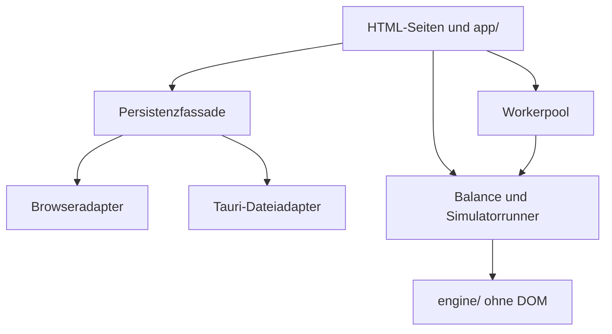
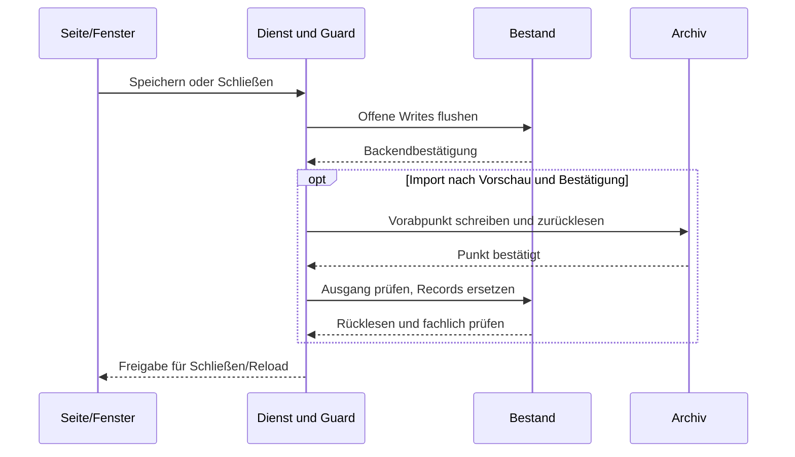

# Technische Architektur

Referenz zu Laufzeiten, Modulbesitz und Ausführungsgrenzen. Stand: 05.11.2026. [Records](DATENVERTRAEGE.md), [Quellen](DATA_SOURCES.md), [Fachthemen](FACHKONZEPT.md), [Engine-API](../../engine/README.md), [Prüfwege](../../tests/README.md).

**Lizenz:** MIT; [Datenbedingungen](../../README.md#lizenz).

## Architektur

### Laufzeiten und Schichten

Browser/Tauri laden dieselben HTML-Seiten und ES-Module. `app/` koordiniert Oberfläche/Daten; `engine/` rechnet ohne DOM/Speicher, Simulatorrunner auf Kopien. `workers/` transportiert Jobs; `src-tauri/` besitzt Fensterabschluss, Dateien und Kursproxy. Fachrechnung braucht keinen Serverdienst.

### Modulaufbau

Zerlegte Module behalten ihren bisherigen Importpfad als Fassade. Sie enthält ausschließlich benannte Re-Exporte, keine eigene Logik und kein `export *`; sie bleibt unter 60 Zeilen. Die Implementierung liegt im gleichnamigen Unterordner, nach Zuständigkeiten geschnitten. Jedes Teilmodul hat höchstens 300 Codezeilen nach der [Größenratsche](#typprüfung). Erlaubte größere Datentabellen stehen mit ihrer Grenze in `typcheck/grosse-dateien.json`.

Innerhalb eines solchen Ordners importieren die Module einander direkt. Rückimporte über die eigene Fassade und neue Importkreise sind verboten. Zugriffe auf andere zerlegte Bereiche führen über deren Fassaden. Modulweiter Zustand, Zwischenspeicher und Listener haben jeweils einen Besitzer; exportierte veränderliche Bindungen bleiben live. Nur der eigene Fassadenvertragstest darf von außen Teilmodule direkt importieren; [Tests und Prüfwege](../../tests/README.md) beschreibt die Prüfung.

Eine Zerlegung verschiebt Code ohne Verhaltensänderung. Exportnamen, Signaturen und Initialisierungsreihenfolge bleiben erhalten. Relative Pfade, dynamische Importe, Worker-URLs und `import.meta.url` werden an die neue Tiefe angepasst. Typkommentare und die Zugehörigkeit zur strengen Typprüfung gehen mit; Ausnahmen dürfen nicht steigen. Quelltexttests prüfen dieselben Stellen am neuen Ort. Verbleibende große Dateien folgen beim nächsten größeren Eingriff der Teilungsregel unter [Typprüfung](#typprüfung).

`profilverbund-balance.js`, `balance-renderer-action.js` und `historical-backtest-contract.js` führen ihre früheren direkten Abhängigkeiten vor den Teilmodulen mit `export {} from …` auf. Die leere Exportliste erhält Ladeebene und Anforderungsreihenfolge, ohne öffentliche Namen oder einen zweiten Modulzustand einzuführen. Diese Fassaden liegen im Importgraphen der Übersicht. Zusätzliche Ladestufen verzögern dort den Kursstart und den anschließenden Abgleich von `profile_wealth_history_lots_v1` im Verlaufsjob; eine frühe Spielbereichswahl kann sonst noch vor diesem echten Startwrite liegen. [facade-loading-order.test.mjs](../../tests/facade-loading-order.test.mjs) sichert die direkten Abhängigkeiten. Die bestehenden Browserfälle prüfen den vollständigen Rückkehrbestand.

Diese Ordner trennen Speicher-, Rechen- und Oberflächenmodule nach Zuständigkeit. Ihre gleichnamigen Dateien mit Endung `.js` bleiben die öffentlichen Fassaden. `engine/core.mjs` bündelt auf dieselbe Weise die Engine-Exporte aus `engine/core/`; die [Engine-Module](../../engine/README.md#module) ordnen sie zu.

| Ordner unter `app/` | Zuständigkeit |
|---|---|
| `shared/persistence-facade/` | Speicherzugang, Bereiche, Haushalte, Spielbereich, Schreibwarteschlange und Wiederherstellungspunkte |
| `shared/persistence-backup/` | Sicherungsformate, Domänenprüfung, Export, Wiederherstellung und Rollback |
| `profile/profile-storage/` | Profilverzeichnis, Auswahl, Bündeltransfer, Startprüfung und Recovery |
| `profile/profilverbund-action-attribution/` | persönliche Aktionszuordnung, Beträge, Liquidität und Steuer |
| `tranches/tranchen-manager-page/` | Seitenzustand, Darstellung, Eingaben, Speicherung und Kurse für Personen & Vermögen |
| `tranches/tranche-reconciliation/` | tatsächliche Verkäufe und Cashbuchungen mit Vorschau, Bestätigung und Verlauf |
| `balance/balance-binder-imports/` | Import-/Exportzugänge, Eingabeprüfung, Migration, Dateiformate und Markt-CSV |
| `simulator/simulator-engine-direct/` | Jahresphasen von Vorbereitung über Markt, Aktionen und Steuer bis zum Protokoll |
| `simulator/monte-carlo-runner/` | Monte-Carlo-Lauf, Jahresphasen, Pfadzustand und Pfadabschluss |
| `simulator/monte-carlo-chunk-result/` | Chunkverträge, Ergebnisprüfung und Zusammenführung |
| `simulator/monte-carlo-contracts/` | Request- und Ergebnisverträge, Kennzahlprojektion und Prüfung |
| `simulator/mc-year-sampling/` | Jahresziehung, Konfiguration, Startjahr und Diagnosen |
| `simulator/monte-carlo-export/` | Exportformate, Szenariorecords, Protokoll und Dateiaktionen |
| `simulator/results-metrics/` | Ergebniskennzahlen, Pflege, Mindest-Flex, Stress und Anzeige |
| `simulator/simulator-monte-carlo/` | Laufzustand, serieller Ablauf, Worker und Ausführung |
| `simulator/historical-backtest-contract/` | Datenvertrag, Zeiträume, Beobachtungen und Jahresrecords |
| `simulator/historical-backtest-runner/` | historische Jahresdaten, Portfoliofortschreibung und Ergebnisse |
| `simulator/sweep-runner/` | Parameterreihen mit Eingaben, Einzelpfaden, Diagnosen und Ausführung |
| `simulator/stress-replay-contract/` | Stresspfadvertrag, Varianten, Vergleich und Arbeitsstand |
| `simulator/simulation-data-inventory/` | Inventar der Markt-, Wirtschafts-, Haushalts- und Regeldaten |
| `simulator/german-gross-wage-growth-chain/` | erzeugte Lohnreihe mit Beobachtungen und Jahreswachstum |
| `simulator/simulator-profile-inputs/` | Profil-, Haushalts-, Pflege- und Trancheneingaben |
| `profile/profilverbund-balance/` | Profilzugriff, Haushaltsaggregation, Steuer und Auszahlungsverteilung |
| `simulator/stress-replay-ui/` | Stresspfadcontroller, Darstellung, Varianten und Dateiaktionen |
| `balance/balance-renderer-action/` | Handlungsanzeige, Details, Cashaufteilung und Transaktionsprojektion |
| `balance/balance-expenses/` | gemeinsamer Ausgabenzustand, Recovery, Darstellung und Monatsaktionen |

### Einstieg

| Seite | Seiteneinstieg | Besitz |
|---|---|---|
| `index.html` | `app/overview/overview-main.js` | Übersicht aus bestätigten Belegen |
| `Balance.html` | `app/balance/balance-main.js`, Wurzelbinder | Vorschau, Diagnose, Abschlussanschluss |
| `Simulator.html` | `app/simulator/simulator-main.js` | Eingaben, Läufe und Ergebnisansichten |
| `depot-tranchen-manager.html` | `app/tranches/tranchen-manager-page.js` | Personen, Plan und reale Bestände |
| `Ausgaben.html` | `app/expenses/expenses-main.js` | Ausgabenimport und Auswertung |
| `Daten-Sicherung.html` | `app/data/data-page.js` | Sicherung, Restore und Speicherdiagnose |
| `Handbuch.html` | `app/handbook/handbook.js` | Suche, Kapitel und Hilferückweg |

`tranchen-manager-profiles.js` liefert Einkommensstufen, `tranchen-manager-renderer.js` gemeinsame Detailgruppen. `tranchen-manager-immobilien.js` baut die aufklappbaren Immobiliengruppen der Anlageformen samt Editor; nach jeder Editoraktion zeichnet `renderPersonAssets` Kacheln, Anzahl und Tabelle aus derselben Immobilienliste neu. Betragsfelder behalten beim Neuaufbau ihren Eingabetext; umgewandelt wird erst beim Speichern. `tranchen-manager-household-plan.js` bindet Zusammenveranlagung; `household-plan-comparison.js` prüft Quellen für Übersichtstabelle und Managerverweis.

Script-Tags binden Einstiege; Rahmen und Profilbereitschaft gehen Fachaktionen voraus. `app-clock.js` trennt Fach-/Testdatum von technischen Zeitstempeln und begrenzt jedes gesetzte Testdatum zentral auf den gleichen Kalendertag im Folgejahr der echten Systemzeit (29.02. → 28.02.). Dialogfelder, Datumssprünge und Zeitraffer verwenden diese Prüfung. Ein gespeichertes Datum außerhalb des Rahmens blockiert den Seitenstart vor Fachberechnungen; der vorhandene Weg zum Beenden bleibt erreichbar. Die Kalender-Untergrenze bleibt 01.01.0001; synthetische Kursintervalle enden am Testdatum.

## Zuständigkeiten

### Balance und Abschluss

`balance-reserves.js`/`SummaryRenderer.renderReserves` projizieren dieselben vorbereiteten `ActionRenderer`-Flüsse vor Auszahlung. `renderAnnualAction` erzeugt Beleg und Centdetails. `data-overview-annual` startet den Abschluss auf der Übersicht; alte Balance-Jahreslinks führen dorthin. [Bedienung](../../Handbuch.html#balance).

| Modul unter `app/` | Aufgabe und Grenze |
|---|---|
| `balance/balance-input-storage.js`, `balance-plan-context.js`, `balance-reader.js` | `buildBalanceEngineInputFromStorage` liest bestätigte Quellen; Bereich und Bezugsjahr gemeinsam mit dem Fingerabdruck auflösen; Formular-/Versuchspatch bleibt lokal |
| `balance/balance-update-pipeline.js`, `balance-file-service.js` | validieren, rechnen, veröffentlichen; `preview`, `persist_inputs`, `commit_period` haben getrennte Schreibrechte |
| `balance/balance-market-preview.js`, `balance-market-preview-runtime.js` | reine Jahresend-Ableitung und Marktprojektion; lesender Adapter rechnet Basis, heutige Regel und Hochreferenz getrennt; Kurse müssen nach dem Bezugsjahresende liegen; unklarer Jahresstand oder Vorschaufehler liefert die Basis und „ohne Kurs“; Übersicht samt Budget und Profilaktionen sowie Eingabenspeicherung behalten die Basis, Jahrescommit umgeht den Tageskurspfad |
| `balance/balance-binder-imports.js` | benannte Re-Exporte der bisherigen Import-/Exportzugänge; Implementierung im gleichnamigen Unterordner |
| `profile/profilverbund-balance.js` | benannte Re-Exporte für Profilzugriff, Haushaltsaggregation und persönliche Auszahlungsverteilung; Implementierung im gleichnamigen Unterordner |
| `profile/profilverbund-action-attribution.js` | benannte Exporte für finale Aktionszuordnung; Implementierung im gleichnamigen Unterordner |
| `balance/balance-action-postprocessor.js`, `balance-renderer-action.js` | finale Aktion anzeigen; Renderer als benannter Re-Export aus dem gleichnamigen Unterordner; interne Transfers getrennt von Verkaufs- und Zugangssummen halten |
| `balance/balance-liquidity-targets.js` | `personalCashTargets`: persönliche Ziele aus Monatsbedarf; [Regel und Rückfälle](HANDLUNGSANWEISUNG.md#tagesgeldanteil) |
| `profile/profile-person-data.js`, `overview/overview-cash-proposal.js` | `projectPersonMonthIncome`: Monatsquelle für Tagesgeldziel/Spielwert; `createCashProposals` liest keinen Entnahmeplan |
| `balance/balance-play-execution.js` | `resolveTargetTagesgeld`, `liquidityInflowRouting`, `priceMoneyMarketTransfers`: gemeinsame Ziel-/Routing-/Steuerprojektion für Anzeige und Spielbuchung |
| `balance/balance-flex-trace.js`, `balance-action-origin.js` | Diagnose und Beschlussherkunft lesend projizieren |
| `balance/balance-annual-orchestrator.js`, `balance-annual-storage-commit.js` | Jahresauftrag, `evaluateAnnualDraft`, `prepareAnnualCommitRecords` und atomarer Jahresbatch |
| `shared/annual-plan-editor.js`, `annual-care-editor.js`, `care-prices.js` | private Entwürfe; Plan und Pflegewerte erst beim Jahresbatch bestätigen; Pflegepreise einmal aus der eingefrorenen Basis fortschreiben, auch für die Vorschau ohne Dialog |
| `shared/tagesgeld-fields.js`, `overview/overview-month-confirmation.js`, `shared/annual-close-dialog.js` | lokale Cashfelder und Vorschau-Neuberechnung |
| `overview/overview-storage.js` | Monatscash und Beleg gemeinsam speichern |
| `balance/balance-expenses-import.js`, `balance-expenses-storage.js` | geprüfte CSV und Monats-/Personenzuordnung schreiben |

`shared/close-dialog.js` besitzt den mittigen Abschlussrahmen mit fester Reiterleiste und Fußleiste. Die Reiter tragen `data-close-dialog-activate` und beim aktuellen Schritt `aria-current="step"`; `data-close-dialog-step` bleibt am zugehörigen Inhalt. Nur dieser Inhalt ist sichtbar und scrollt. Der aktuelle Weiterknopf liegt im Fuß; `nextDisabled` sperrt ihn bei offener Jahresmarktwahl. Besuchsmenge, `onNext` und Schreibbesitz bleiben erhalten. Der Jahresadapter ordnet Pflegewerte vor Marktdaten. Bei verdecktem Bärenmarkt (`isHiddenBearMarket`) hängt er Block und Wahl in den Schritt „Plan“; Marktdaten zeigen nur fehlende Kurse (`hiddenBearCheckUnreliable`). Die offene Wahl steht schon vor dem ersten Besuch am Reiter „Plan“. Ergebnisse verwenden zwei Spalten ohne Reiter; `probelauf-end-dialog.js` verwendet denselben Rahmen mit einspaltigem Inhalt.

`deriveYearEndMarketInputs` verschiebt für Vorschau und Jahresabschluss dieselben sechs Markteingaben. `prepareMarketPreview` wählt ausschließlich gespeicherte EUR-Schlusskurse von VWCE.DE bis zum Fachdatum, bei offenem Vorjahresabschluss höchstens bis Ende des Abschlussjahrs. Auch das Kursalter wird dann gegen dieses Jahresende gemessen. Das Bezugsjahresende folgt derselben Anlassprojektion wie die Balance. Der Kursrecord stammt aus dem aktiven Speicherbereich; im Spielbereich enthält er Spielkurse. Es gibt keinen Abruf und keinen neuen Speicherschlüssel.

`projectMarketPreview` liefert gespeicherte Jahresmarktdaten, Regel- und Hochreferenzlesart mit Herkunft, Marktlage, Monatsbudget, Nettohauptaktion und strenger Bärengrenze. Die Hochreferenz ist das Maximum aus Regelhoch und höchstem gespeicherten VWCE.DE-Schluss seit dem Bezugsjahresende bis zum Vergleichskurs. `stored_ath` bezeichnet die Jahresmarktdaten, `stored_close` einen gespeicherten Schluss. `coverage.first/last` nennen den ersten und letzten gespeicherten Tag bis zum Kurs. Bei Gleichstand zählt das spätere Datum. Nur bei einem echt höheren gespeicherten Schluss ergibt das belegte Datum Tagesdifferenz / 365,2425 als `jahreSeitAth`. Bei gleichem Hochwert bleibt immer das Regelalter, auch bei `stored_ath` mit Datum. Die Engine erhält denselben Ausgangszustand für jede Rechnung. Ohne Kurs läuft nur die Basisrechnung.

`comparison` hält pro Variante Grundbedarf, freigegebenen Flex, Jahres- und Monatsbudget aus der vorhandenen Budgetprojektion sowie Hauptaktion, Steuer und Reserve nach Aktion vor Auszahlung. Die Reserve folgt den fertigen Liquiditätsflüssen der Engine. Das Vergleichsjahresbudget entspricht dem gerundeten Monatsbudget mal zwölf. Liegt das Hochvariantenbudget unter dem Grundbedarf, meldet `changedParts` auch `floor`. `compareMarketBudgets` vergleicht Beträge auf ganze Euro: `same`, `budget_same_action_differs`, `budget_lower` oder `budget_higher`. Die gemeinsame Funktion `classifyMarketPreview` bestimmt intern ruhig (unter 5 % und `same`), Hinweis (ab 5 % und `same`), Warnung (verschiedene Folgen) oder nicht belastbar; angezeigt wird davon seit FR-77 nichts mehr. Sichtbar entscheidet `isHiddenBearMarket`: Die Hochlesart liegt in einer Marktlage aus `FLEX_BUDGET.ACTIVE_REGIMES`, die Regellesart nicht. Die Regelschwelle verwendet das gespeicherte Hoch vor der Fortschreibung; Restabstände beziehen sich auf den Stichtagskurs. `balance-market-history.js` zeichnet die gespeicherte Kurslinie als Inline-SVG mit Tokenfarben. Differenzen nennen Jahres-/Monatsbudget und geänderte Anteile (`floor`/`flex`). Fehlende Kurse, ein Schluss nicht nach dem Bezugsjahresende, mehr als zehn Kalendertage Kursalter, unabgefragte Werktage laut `queried`, unklarer Jahresstand oder Vorschaufehler ergeben `not_reliable` mit Grund. Abgefragte Feiertage und Wochenenden benötigen keinen Schlusskurs.

`balance-next-year-budget.js` bietet `projectNextYearBudget({storage, engineApi, now, annualInflation})` für die Balance-Anzeige. `balance-main.js` verwendet dessen `displayEvaluation` für Budgetkarte, Jahreshochvergleich und Vorschauzeile. `payload.input` enthält dann Folgejahreswerte mit `referenceYear` des Zieljahrs; `payload.currentYear` enthält Eingaben, Ergebnis und Profilaktionen des laufenden Planjahrs für Bedarfskarten, Strategie, Reserven und Diagnose. Die Diagnose erhält auch ihre Aktionszusammenfassung aus dem laufenden Jahr. Eingabefelder, Speicherung und Übersicht verwenden weiter den laufenden Plan beziehungsweise die Jahresbasis. Der Aktionsrenderer erhält die Profilaktionen explizit aus demselben Entwurf. `captureAnnualRecords` und `annualRecordStorage` isolieren die Quellen. Die Anlassprojektion bestimmt das nächste Abschlussjahr; `computeAnnualPlanUpdate` schreibt Bedarf, Alter, Einkünfte und Budgetgedächtnis fort. `evaluateAnnualDraft` rechnet zweimal aus derselben Basis, die Hochvariante ändert nur `ath` und `jahreSeitAth`. Kurswahl und Vergleichszustände folgen der Marktprojektion. Fehler liefern gekapselt `not_reliable` mit Grund; die bisherige Vorschau bleibt unabhängig.

Die Inflation folgt `resolvePlanOverviewRates` mit dem gespeicherten Simulator-Jahreswert oder dessen Reihenmittel. Vor einem offenen Abschluss hat ein passender vorbereiteter oder gespeicherter Jahreswert Vorrang. Es gibt keinen Abruf. CAPE und Vermögensbewertungen stammen aus dem aktuellen Speicherbereich. Für die strengen Abschlussvalidatoren erhalten Kurs und CAPE ausschließlich im privaten Entwurf einen angenommenen Jahresendstichtag; das Ergebnis nennt die tatsächlichen Quelldaten. Restentnahmen werden mangels eindeutiger Zahlungsabgrenzung nicht abgezogen. Die Varianten liefern Zieljahr, Bedarf, Budget, Hauptaktion, Steuer, Annahmen und die drei größten Änderungsbeträge. `components` unterscheidet ungerundete Inflation, Planrundung, laufende Einkünfte, geplante Zahlungsflüsse und Leitplanke/Budgetgedächtnis. Eine Marktwirkung stammt ausschließlich aus dem Budgetunterschied der Varianten. Diese Beträge sind keine additive Budgetzerlegung. Planposten nennen die offene Ausgabenreserve und angekündigte Einmaleinkünfte getrennt. Letztere mindern wie im Jahresabschluss die Reserve nicht. Die Bezugsbasis ist der laufende Jahresbeleg, ersatzweise die gespeicherte Jahresrechnung ohne Fortschreibung. Der Inflationsbetrag verwendet den heutigen Planbedarf als Ausgangsbasis und endet vor der Planrundung; bewusste Planänderungen bleiben davon getrennt. Laufende Belegeinkünfte folgen Budget minus Entnahme plus Sparanteil. Folgejahrseinkünfte stammen aus derselben Personenprojektion wie im Abschluss. [Node-Nachweis](../../tests/fj-1-next-year-budget.test.mjs) und `node scripts/measure-fj1.mjs` prüfen Parität, Schreibfreiheit und Laufzeit mit synthetischen Haushalten.

`balance-market-preview-renderer.js` zeigt das Jahreshoch in Balance nur bei verdecktem Bärenmarkt, als Block „Bärenmarkt, den die Jahresregel nicht sieht“ aus `createHiddenBearBlock` (`shared/annual-todo-view.js`) in der Karte „Was zu tun ist“. Der Block nennt Abstand, Ende Vorjahr, Jahreshoch und heutigen Kurs, die Tabelle „Was das für ‹Jahr› heißt“ und zugeklappt „Kursverlauf ‹Jahr›“ (`data-market-history-details`). Aktualisierungen erhalten die Klappenstellung dieses Verlaufs; gleiche Ergebnisse behalten ihre DOM-Knoten. Die Zusatzzeile „Mit Hoch vom …“ beim Monatsbudget erscheint nur bei abweichendem Budget. Ohne verdeckten Bärenmarkt meldet `hiddenBearPriceProblem` zu alte (`stale`) oder fehlende und lückenhafte Kurse (`missing`) als eine Zeile mit Kurslink; in den ersten zehn Tagen nach dem Jahresende ohne neuen Kurs gibt es keine Zeile. Im Jahresabschluss zeigt `createAnnualMarketReadings` im Schritt „Marktdaten“ nur den Grund fehlender Kurse; Block und Wahl stehen im Schritt „Plan“. Titel und Quellen nennen das Zieljahr und den tatsächlichen Stand. Die Grundzeile „Warum anders als ‹Jahr›“ zeigt bis zu drei Änderungen ab einem Euro mit Wirkungsart, ohne Gesamtsumme.

`balance-annual-market-preview.js` nutzt dieselbe Hochreferenz seit Ende des Vorjahrs und denselben Budgetvergleich mit der vorbereiteten Jahresendquote. Fachdatum für das Kursalter ist das Abschlussjahresende. Der Abrufkurs ersetzt als `quoteOverride` den gespeicherten Schluss seines Tags nur im Entwurf. Die Abdeckung nennt gespeicherte Tage; der Abruf schließt keine früheren Lücken. Im Marktdatenreiter rechnet der Vergleich mit den vorgeschlagenen Folgejahresbedarfen sowie den Tagesgeld- und Pflegewerten des Dialogs. `shared/annual-market-choice.js` zeigt bei verdecktem Bärenmarkt im Schritt „Plan“ die beiden Lesarten ohne Vorauswahl. Die bestätigte Jahreshochwahl ergänzt `yearHigh` im Übergabevertrag und wird im privaten Jahresentwurf angewendet. Altbestand und Jahresendregel bleiben ohne Zusatzfeld gültig; Strategiekacheln, Provenienz und Übersicht behalten bis zum Abschluss die Jahresbasis.

`preview` beginnt mit bestätigtem Vorstate; `persist_inputs` schreibt nur Eingaben, `commit_period` den geprüften Periodenkandidaten. `readBalancePlanContext` bindet Fingerabdruck und Eingaben an denselben Bereich, dasselbe Jahr und dieselben Ausgabennachweise. `guardrail-history.js` setzt bei bewussten Planänderungen Leitplanken zurück, erhält aber Steuerstates. Nur der Jahresabschluss schreibt `annual_plan_record_v1`.

Unter `app/balance/balance-renderer-action/` besitzt `renderer.js` die Klasse `ActionRenderer` und ihren Instanzzustand. Ihre Methoden delegieren Detaildarstellung an `details.js`, Cash-Umschichtung an `cash-rebalance.js` und Transaktionsprojektion an `transaction.js`; alle arbeiten mit derselben Instanz. Texte, Tabellen, Kopiertext und Popoverbindungen behalten ihre Reihenfolge.

Unter `app/balance/balance-expenses/` besitzt `context.js` den gemeinsamen Zustand samt DOM-Referenzen, Adaptern, Importgeneration und Entscheidungssperre. `helpers.js` liest Speicher und Profile und liefert die bisherigen Meldungs- und Transaktionshilfen. `recovery.js` führt Export, Bestätigung und Reset aus; `view.js` zeichnet Jahresauswahl, Matrix, Kennzahlen und Monatslupe. `actions.js` verarbeitet Import, Beispiele und Monatslöschung. `entry.js` verbindet diese Funktionen einmal, bindet die bisherigen Ereignisse bei der Initialisierung und exportiert die öffentlichen Zugänge. Recovery und Darstellung erhalten ihre gegenseitigen Aufrufe bei dieser Verbindung ohne Importkreis. Änderungsrückrufe behalten ihren freien Aufruf.

Die Dateiverträge und UI-Handler liegen unter `app/balance/balance-binder-imports/`. Interne Importe verbinden die Module direkt. Schemaobjekte und Fehlerklassen entstehen jeweils einmal. Der bestehende Binder besitzt weiterhin die Ereignisbindung; die Handler behalten ihren Navigations- und Wiederherstellungsablauf. `balance-file-service.js` besitzt Recovery, Replace, Nachprüfung und Rollback.

| Modul | Zuständigkeit |
|---|---|
| `schema.js` | Exportkennung, Versionen, Eingabefelder und Legacy-Verträge |
| `validation-core.js` | gemeinsame Objektprüfung, JSON-Kopie und Importfehlerklassen |
| `input-validation.js` | skalare und verschachtelte Eingaben gegen das Schema prüfen |
| `state-validation.js` | Vermögensverlauf, Vorstate und Marktdatenkonsistenz prüfen |
| `market-provenance.js` | Datum, CSV-Abdeckung, Fensterhoch und Herkunft prüfen |
| `migration.js` | Legacy- und aktuelle Eingaberepräsentationen migrieren |
| `documents.js` | Balance-Dokument erzeugen, Format erkennen und normalisieren |
| `market-csv.js` | historische Markt-CSV ohne DOM parsen |
| `manual-market-import.js` | historischen CSV-Payload an Periode, Stichtag und Quelle binden |
| `handlers.js` | JSON-Dateiaktionen, UI-Wiederherstellung und Fehlermeldungen |

Die Aktionszuordnung verwendet die folgenden Module unter `app/profile/profilverbund-action-attribution/`. Interne Importe verbinden die Module direkt. `tax.js` besitzt den Vorschaucache einmal; die Aufrufhülle setzt dessen live importierte Bindung über `setPreviewTermsScope` und stellt den äußeren Cache auch bei Fehlern wieder her.

| Modul | Zuständigkeit |
|---|---|
| `amounts.js` | Beträge, Verwendungen, Centverteilung und Betragsvergleich |
| `tax.js` | persönliche Steuerparameter, Rohsummen, Vorschaucache und Steuerverteilung |
| `liquidity.js` | Cashquellen verteilen, Liquiditätskennzahlen und Drei-Töpfe-Diagnose abgleichen |
| `candidates.js` | Besitzer und konkrete Tranchen als Verkaufskandidaten bestimmen; Kaufdatumcache einmal halten |
| `asset-plan.js` | Quellen gewichten oder steuerlich auswählen, Nettoziel bisektieren und Deckungslücke behandeln |
| `attribution.js` | Aufrufhülle und endgültige Haushaltsaktion mit persönlichen Aktionen zusammensetzen |

Der Jahreskoordinator prüft Periode/Quellen, bestätigt den Vorabpunkt und liest den Jahresbatch zurück. `resolveAnnualTargetYear` bindet Dialog, Abruf, Entwurf und Dezemberbeleg ans nächste offene Jahr. `evaluateAnnualDraft` übernimmt Cashentwürfe über `prepareHouseholdCash`; `createCloseCashFields` hält sie lokal und formatiert gültige Eingaben bei `change` mit Tausenderpunkten. `computeAnnualPlanUpdate` schreibt Inflation einmal je Planjahr in alle Haushaltskopien. Dezember hat eine eigene Speichergrenze; Wiederholung ergänzt nur die fehlende Phase. Im Spielbereich berechnet `calculateCashProposal` Ausgangsstand + Rente + Einkünfte − Ausgaben + Zins, ohne Entnahmeabzug; eigene Feldwerte erhalten kein `playValues`. [Belegverträge](DATENVERTRAEGE.md#jahr-und-monat).

Ausgabenseite und Abschlussdialog teilen Budgetquelle, `memberPlanScope` und Importpräsenz aus `balance-expenses-metrics.js`; der Personenfilter ist getrennt. Lade-, Restore- und Schreibgrenze verwenden denselben [Kategorien-/Zahlungsvertrag](DATENVERTRAEGE.md#plan-und-geplante-ausgaben). Der Controller liefert Kennzahl und Jahresdiagramm dieselbe `projectExpenses`-Hochrechnung; der Renderer projiziert sie ohne eigene Prognose. Die Gesamthochrechnung nutzt den Mittelwert positiver, vollständiger und abgelaufener Ausgabenmonate × 12. Floor/Flex verwenden davon nur Monate mit Aufteilung; ihre Verbraucher zeigen Kennzahlen und Diagramme, ohne Plan-, Abschluss- oder Enginebeträge abzuleiten.

`demo/muster-haushalt.js` ergänzt vorbereitete Monatsausgaben um `categoryNeeds`. `demo/beispielausgaben-needs.js` verteilt den Beispiel-Floor centgenau bei unveränderten Kategoriesummen; `demo/beispielausgaben.js` erzeugt CSV mit Bedarfsspalte. Ausgabenseite, Übersicht und `overview-timelapse.js` lesen dafür den gemeinsamen Grundbedarf. Der Ziel-Floor liegt 6 % darüber, begrenzt auf die vorhandene Beispielsumme; das ist ausschließlich synthetische Datenerzeugung. `demo/muster-steckbrief.js` liefert die Übung bis zur Ist-Auswahl im Jahresabschluss.

`parseCategoryCsv` erhält die enumerierbare Kategorienmap; das Symbol `EXPENSE_CSV_CATEGORY_NEEDS` liefert optional die signierte Aufteilung. Nur der getrimmte, kleingeschriebene Kopf `bedarf` aktiviert die Aufteilung. Kategorie/Betrag bleiben Teilstringsuchen, ausgenommen der Bedarfsspaltenindex. Der gemeinsame Import speichert `categoryNeeds` und zeigt die Vorschau auf beiden Importwegen. Ungültige Aufteilungen bleiben beim Laden und Speichern erhalten; die Haushaltskarte zeigt den Neuimporthinweis. `computeHouseholdNeedsStats({ yearData, profileIds, forecastMonths })` berechnet ohne DOM und Speicher je importiertem Monat Floor/Flex und Zahlungsabzug. Alle Haushaltspersonen müssen importiert sein und eine gültige Aufteilung haben. Zahlungen gehen zuerst vom Haushalts-Flex ab, der Rest vom Floor. `forecastMonths` begrenzt die Hochrechnung auf abgelaufene Monate; nur vollständige Monate mit positivem Budgetverbrauch zählen wie in `computeYearStats`. Floor/Flex mitteln davon die aufgeteilten Monate; `total` mittelt alle gezählten Monate. Nullmonate zählen nicht. Ohne aufgeteilte Monate bleiben Floor/Flex null. Bei gemischtem Bestand nennt die Anzeige N von M Monaten; Floor + Flex entspricht Gesamt nur bei durchgehender Aufteilung. `expenses/expenses-needs.js` verwendet diesen Kern für Haushaltskacheln, Monatstabelle sowie Monats- und Jahresdialog. Der Jahresbeleg liefert Grundbedarf und Jahresbudget, ersatzweise der aktuelle Plan und die bestehende Budgetquelle. Kategorien behalten Geplante Ausgaben und kennzeichnen ungeteilte Monate separat. Die Anzeige folgt Kennzahlen, Personenmatrix/Kategorien, Floor-/Flex-Karte mit flüchtiger Monatsklappe, Jahresvergleich. Beide Kennzahlenreihen nutzen `createCloseTiles` bzw. dessen Klassen. `prepareExpensesHistoryMetrics` liefert mit `includeSegments` lesend Floor, Flex und Restbetrag pro Jahr; die Beträge enthalten geplante Zahlungen. Nur die Haushaltsansicht fordert diese Segmente an. `renderExpensesDetails` validiert die optionale Aufteilung mit `hasCategoryNeeds` und zeigt vier Spalten mit Summenzeile oder den passenden Neuimporthinweis. Alle Beträge der Monatslupe verwenden wie die Importvorschau den Centformatter aus `shared-formatting.js`. Kategorien, Floor, Flex und Summenzeile zeigen das umgekehrte Speichervorzeichen: Ausgaben positiv, Erstattungen negativ. Bezahlte geplante Ausgaben erscheinen als positiver Betrag. Die Kategorienfußzeile lässt Nullanteile weg und entfällt ohne Aufteilung; die aufgeklappte Monatstabelle bleibt linksbündig auf 56 rem begrenzt. Die Personenansicht erhält die Aufteilung ausschließlich in der Monatslupe. Die Monatszusammenfassung ergänzt bei lesbarer Aufteilung Floor und Flex. `annual-needs-review.js` projiziert den Vorjahresvergleich mit vorzeichenrichtigen Abweichungen und die Inflationsvorschläge; `annual-plan-editor.js` rundet beide Vorschläge und Mindest-Flex auf volle Tausender auf. Der vorausgewählte Planvorschlag fließt über den bestehenden Planpatch in die Vorschau und den Beschluss. Unter jedem Jahresbedarfsfeld folgt die Herkunft sofort der Vorschlagswahl oder eigenen Eingabe. Ein Ist-Vorschlag schreibt erst nach bewusster Auswahl und Abschluss; keine neue Speicherung.

### Personen und Depot

| Modul unter `app/` | Aufgabe und Grenze |
|---|---|
| `profile/profile-registry.js`, `profile-live-storage.js`, `profile-storage.js` | Registry und aktive Liveprojektion, bestätigter Profilwechsel |
| `profile/profile-person-data.js`, `profile-income.js`, `profile-immobilien.js` | zentrale Personendaten, Einkünfte und Immobilien |
| `profile/household-plan.js`, `household-planned-expenses.js`, `household-partnership.js` | kanonischer Bereich, Posten und Partnerschaft/Testament |
| `profile/profile-partnership-migration.js` | fehlenden alten Testamentvorrang beim Seitenstart transaktional speichern, auch nach Restore; Snapshot-Bytes erhalten |
| `shared/bmf-lifetime-use-2026.js`, `life-expectancy.js` | amtliche Wohnrechtfaktoren nach vollendetem Alter/Geschlecht; Vorschau heute, Simulation am 1. Juli des Todesjahrs, getrennt von Simulationssterblichkeit |
| `profile/profile-asset-values.js`, `asset-strategy.js` | Vermögens-/Goldprojektion; Strategie nur nach Nutzeraktion aktivieren |
| `tranches/tranchen-manager-page.js`, `tranchen-manager-page/` | Seitenfassade; gemeinsamer Zustand, Darstellung, Eingaben, Speicherung und Navigation |
| `tranches/tranchen-manager-state.js`, `tranchen-recording.js` | Lots normalisieren, Bestand und Kauf erfassen |
| `tranches/tranchen-manager-sale-dialog.js`, `tranche-reconciliation.js` | reale Ausführung bestätigen; Fassade für Verkauf und getrennten Cashnachweis |
| `tranches/tranchen-price-service.js`, `tranchen-history-store.js` | Kurse und Abfrageabdeckung |
| `profile/profile-wealth-history.js`, `profile-wealth-captures.js` | persönliche Historie und bestätigte Messpunkte; Muster schreiben gemeinsame Haushaltsstände mit Personenanteilen |
| `tranches/tranchen-history-model.js` | Tagesbewertung für Manager, Übersicht und Balance; `historyRange` begrenzt Alles, laufendes Jahr, zwölf Monate, Monat und sieben Kalendertage auf gestern und den Aufzeichnungsbeginn |
| `tranches/tranchen-history-ui.js` | Positionsdetails verwenden `historyRange` für fünf hostlokale Zeiträume, begrenzt auf den ersten gespeicherten Kurs. `bindHistoryDayInteraction` erhält eigene Kurs-/Verkaufszeilen; Vermögenszeilen bleiben Standard. Das Kursfeld erhält über die SVG-Klasse eine Inhaltsbreite von 120 bis 340 px; Vermögensfelder bleiben 340 px breit. Resize erhält Zeitraum und Tageswahl. Kurze Kursachsen schließen den Kaufpreis aus und zeigen ihn außerhalb als Hinweis; die Fußzeile nennt die Kaufpreislinie nur bei gezeichneter Linie und folgt dem Zeitraumwechsel. Kopfzeile, Abdeckung und Verkaufsliste bleiben vollständig |
| `tranches/tranchen-history-svg.js`, `overview/overview-history.js`, `tranches/tranchen-history-closures.js` | Vermögens- und Kursachse wählen Schritte aus 1 · 2 · 2,5 · 5 × 10ⁿ, Grenzen als Vielfache und 4–7 Rasterlinien; die engste gültige Achse zielt auf mindestens 80 % Datenfüllung außerhalb von Nullstart und kleinen Schwankungen; kleine Schwankungen behalten mindestens 1 % Luft je Seite. Übersicht: 260 px, Manager: 420 px. Die Übersicht nennt Messbeginn nur bei Alles oder einer gegenüber dem Zeitraum verkürzten Messbasis. Kurze Auswahlen filtern Abschlussrauten, gespeicherte Standtabelle bleibt vollständig; Renditezeiträume bleiben getrennt |

`tranchen-manager-page.js` re-exportiert die bisherigen benannten Seitenzugänge aus `tranchen-manager-page/startup.js`. `state.js` besitzt den gemeinsamen Seitenzustand einschließlich Verwaltungs- und Ansichtsreservierungen. `startup.js` initialisiert die Seite und bindet Ereignisse weiterhin einmal je Dokument. Ein dort einmal gesetzter `initializePage`-Rückruf im Zustand erlaubt `people.js` den bisherigen In-place-Neustart, ohne Importkreis. `helpers.js` liefert DOM-, Speicher- und Signaturhilfen; `controls.js` und `persistence-status.js` steuern Sperren und Status. `rendering.js` und `reconciliation-view.js` zeichnen Bestände und Verkaufsvorschau. `profile-values.js`, `tranches.js`, `cash-posting.js` und `reconciliation.js` behalten die bisherigen Schreibabläufe. `history.js`, `quotes.js` und `recovery.js` führen Verlauf, Kursabruf und Wiederholung aus; `bindings.js` bindet die Bedienung, `views.js` wählt Ansichten und prüft Sprungziele.

`profile-manager-bindings.js` besitzt Personen-/Haushaltsänderungen. Einzelne Tranchen löscht der Tranchenmanager. `profile-storage.js` re-exportiert die bisherigen benannten Profilfunktionen aus `profile/profile-storage/`. Dort führt `live-storage.js` Livekeys, Registry und Ladebasis beim Speichern zusammen. Balance und Simulator lesen Mitgliedschaft nur.

`tranche-reconciliation.js` re-exportiert die bisherigen benannten Bindungen aus `app/tranches/tranche-reconciliation/`. Die Vorschau bleibt lesend. Der Verkaufscommit schreibt Bestand, Profilkopie und Audit gemeinsam; Cashbestätigung und Korrektur schreiben absoluten Tagesgeldstand, Historie und Audit zusammen.

| Modul unter `app/tranches/tranche-reconciliation/` | Zuständigkeit |
|---|---|
| `schema.js` | Version, Ereignistypen, Statuswerte, Grenzen und gemeinsame Fehlerklasse |
| `validation.js` | Ausführungsfelder normalisieren, stabile IDs für Cashnachweise ableiten |
| `history-records.js` | Verkaufs-, Bestätigungs- und Korrekturrecords prüfen |
| `history.js` | Registry und Verlauf lesen, Cashstatus projizieren, Audit anhängen |
| `sale-preview.js` | Bestand, Ausführung, Wiederholung und Abweichung ohne Write prüfen |
| `persistence.js` | Profilkontext, Flushbestätigung und Rückschreiben prüfen |
| `sale-commit.js` | Bestand und Stammdatenkopie mit Profil und Verkaufsaudit speichern |
| `cash-preview.js` | Zielverkauf und lineare Bestätigungs-/Korrekturkette vor dem Write prüfen |
| `cash-commit.js` | Tagesgeld, Cashhistorie und Cashnachweis transaktional bestätigen |

| Modul unter `app/profile/profile-storage/` | Zuständigkeit |
|---|---|
| `balance-ownership.js` | Balance-State nach Personen-/Haushaltsbesitz trennen, Capture und Merge samt Altschlüsseln |
| `live-base.js` | Ladebasis vergleichen, vormerken und mit genau einem Flushbeobachter verfolgen |
| `storage-access.js` | Speicherkennungen, gemeinsame Recoveryfehlerklasse und geschützter Einzelzugriff |
| `load-guards.js` | Identität und ladbare Profilfelder prüfen, Recoveryursache zuordnen |
| `registry-context.js` | Registrykontext und aktive Kennung lesen, Profilmetadaten und Mitgliedschaft verwalten |
| `live-storage.js` | Livebestand sichern/laden mit Rollback; Kursausschnitte in inaktiven Originalrecords speichern |
| `profile-selection.js` | Profilwechsel und Löschen samt Ersatzprofil koordinieren |
| `bundle-transfer.js` | Bundleein-/ausgabe mit Live-Save und Profil-Ladefunktion verbinden |
| `recovery-document.js` | Recoverydokument erzeugen und gegen unveränderte Rohdaten prüfen |
| `bootstrap-recovery.js` | Start und bestätigten Reset ausführen; letztes Bootstrapresultat zentral halten |

`validateProfileManagementRecords` in `persistence-backup.js` prüft Registry, Kennungen und betroffene Personen einschließlich Ladefallback inhaltlich, die Ladebasis nur auf Stringform, ohne JSON-/Prüfsummenprüfung. Unveränderte gemeinsame Domänen sperren nicht. `profile-manager-bindings.js` kontrolliert Haushaltsuntergrenze und unveränderte Dialogbasis; `profile-management-recovery.js` bestätigt den vollständigen Vorabpunkt vor dem Write. Die Personendatei enthält keine Ausgaben; ein zusätzliches `expenses` wird beim Import ignoriert und der Ausgabenstore bleibt unverändert. Eigene Exporte haben keine Import-Haushaltsgrenze. [Recordvertrag](DATENVERTRAEGE.md#person-und-restore).

Editoren in `tranchen-manager-income*.js`, `tranchen-manager-planned-expenses.js` und `tranchen-manager-household-plan.js` besitzen Entwürfe und Autosave. Profilwechsel oder fremde Mutation entwertet eine alte Dialogbasis. Renderer reparieren keine beschädigten Records.

`designsystem-info-popover.js` positioniert ⓘ bei Scrollen/Resize innerhalb des Fensters. `wealth-display.js` liefert Anlageklassennamen, Aufteilung und Sichtbarkeit optionaler Bestände.

### Projektionen für Balance und Simulator

`profilverbund-balance.js` und `simulator-profile-inputs.js` exportieren die bisherigen Zugänge aus ihren gleichnamigen Unterordnern. Die aktive Liveprojektion überlagert nur ihren Registrybesitzer. Finanzaggregation erzeugt keine neue Person und schreibt keine echten Lots. Demografie bildet höchstens zwei Personen ab.

| Unterordner | Modulbesitz |
| --- | --- |
| `app/simulator/simulator-profile-inputs/` | `values.js`: Feldleser und Standardwerte; `care.js`: Pflegekonfiguration und einzige Zuordnung heutiger Pflegezustände zu ihren Quelldaten; `tranches.js`: Detailbestände und Herkunft; `aggregate-values.js`: Summen und Gewichte; `profile.js`: Einzelprojektion; `household.js`: Haushaltsprojektion |
| `app/profile/profilverbund-balance/` | `values.js`: Normalisierung und Vermögenssummen; `tranches.js`: Klassifikation mit einzigem Cache, Bestandsteilung und Besitzerzuordnung; `tax.js`: Steuerkennzahlen und Verkaufsauswahl; `profiles.js`: Profile lesen; `household.js`: Bedarf und Vermögensübersichten; `withdrawal.js`: persönliche Auszahlung und Liquiditätsabgleich |

Die Teilmodule importieren einander direkt. Einzelprojektion und Haushaltsprojektion teilen die Pflegequellen; Klassifikation, Verkaufsauswahl und Vermögensübersichten teilen den Tranchencache. Die Standardwerte und die Reihenfolge der Überschreibungen bleiben in den Projektionsfunktionen erhalten.

`calculateProfileGoldStrategy` verwendet reconciliierte Bestände ohne gesperrte Reserve; Euroziele werden vor Haushaltsquoten summiert. Der Simulator gliedert die summierte Rücklage nach dem Finanzmerge aus und verwendet die erste aktivierte Konfiguration. Lotkopien behalten `sourceProfileId`; fehlende Herkunft erzeugt keine Ersatzlots.

### Simulator und Worker

| Modul unter `app/simulator/` oder `workers/` | Aufgabe |
|---|---|
| `simulator-input-dom.js`, `simulator-input-validation.js` | Eingabegrenzen und Prüfung |
| `simulator-profile-inputs.js` | benannte Re-Exporte der Plan-/Personenprojektion; Implementierung im gleichnamigen Unterordner |
| `simulator-person-overrides.js`, `simulator-run-assumptions.js` | flüchtige Alternativen und eingefrorene Laufannahmen |
| `simulator-engine-direct.js` | benannte Re-Exporte des direkten Jahreseinstiegs und der bisherigen Hilfen |
| `simulator-year-portfolio.js`, `simulator-portfolio-tranches.js` | Renditen und Lotbuchung auf Kopien |
| `simulator-fixed-income.js`, `simulator-household-pension.js`, `simulator-survivor.js` | jährliche Einkünfte und Hinterbliebenenprojektion |
| `mc-life-events.js`, `simulator-engine-helpers.js`, `simulator-care-today.js` | Pflege-/Todesereignisse, feste heutige Pflege und Preisabschluss |
| `target-mortality.js`, `german-cohort-life-table.js` | FR-75: Zieltafel (Kohorte V2 je Geburtsjahr, Periodentafel ohne Geburtsjahr) und exakte Grundsterblichkeit ohne Pflege je Person; die Tafeldaten sind ein erzeugtes, abhängigkeitsfreies Modul |
| `monte-carlo-duration.js` | FR-75: leeres Feld „Maximale Dauer“ = automatisch 110 − Alter der jüngsten Person; gespeicherte 35 gilt beim Lesen als automatisch |
| `../shared/care-needs.js`, `../shared/care-cost-resolver.js`, `simulator-care-projection.js` | Reine Bedarfsbestandteile, lesende Preisvorgaben und Folgejahresbedarf für das Liquiditätsziel |
| `simulator-home-sale.js`, `simulator-inheritance.js`, `simulator-residence-tax.js` | Verkäufe, Nachlass und Wohnrechtsteuer außerhalb des Enginebudgets |
| `simulator-personal-tax.js`, `simulator-tax-recompute.js` | persönliche Jahresbücher und Steuerdeckung |
| `simulator-forced-sale.js`, `simulator-health-bucket.js` | zusätzliche Deckungswege |
| `historical-backtest-contract.js`, `historical-backtest-runner.js` | benannte Re-Exporte für manifestgebundene Periodenvorprüfung und Backtest |
| `simulator-monte-carlo.js`, `monte-carlo-runner.js` | benannte Re-Exporte für Dokumentlauf bzw. DOM-freie Laufbereiche |
| `stress-replay-ui.js` | benannte Re-Exporte für Controller, Einstieg, Banner und Schrittanzeige; Implementierung im gleichnamigen Unterordner |
| `mc-run-context.js`, `mc-log-builder.js` | Pfadstart und Jahreslogs |
| `mc-year-sampling.js` | benannte Re-Exporte für Startjahr, Jahresziehung und Samplingdiagnostik |
| `simulator-year-result.js`, `simulator-log-order.js` | Jahresergebnis und feste öffentliche Reihenfolge der Protokollfelder |
| `simulator-crises.js`, `backtest-euro-display.js` | gemeinsame Gesamtvermögensprojektion für Chart und Krisen; Euro-Schalter auf Ergebnis, Backtest und Monte-Carlo teilen `euro-display.js`; real mit kumuliertem Jahresend-Preisfaktor auf „Euro von [Startjahr]“ |
| `simulator-portfolio-display.js` | lesende Startkacheln mit getrenntem Geldmarkt und optionalem Gold/Anleihen; bisherige Recheneingaben bleiben erhalten |
| `simulator-heatmap.js`, `simulator-visualization.js` | Heatmaps und Pareto nach gemessener Inhaltsbreite; Neuzeichnung über `bindBalanceDisplaySize`, Sensitivitätsbalken in Prozent |
| `monte-carlo-chunk-result.js`, `monte-carlo-aggregates.js` | benannte Re-Exporte der Chunkverträge bzw. Aggregation |
| `worker-pool.js`, `mc-worker.js`, `worker-telemetry.js` | Generation, Transport, Abbruch und lokale Messung |

Unter `stress-replay-ui/` hält `entry.js` den einzigen aktiven Controller. `controller.js` besitzt je Controller die lebenden Zustandsbindungen und reicht sie über Zugriffsfunktionen weiter. `presentation.js` aktualisiert Anzeige und Editor, `variants.js` berechnet und speichert Varianten, `capture.js` fixiert Ursprungsläufe und `workspace-actions.js` übernimmt Import, Export und Verwerfen. `lifecycle.js` hält Initialisierung und Ereignisbindungen hinter derselben einmaligen Sperre. `workspace-view.js` zeigt Banner und Schritte, `values.js` hält Formatierung und Leerzustände, `defaults.js` die vorhandenen Lauf-, Kompatibilitäts- und Downloadadapter. Die injizierten Funktionen behalten ihren freien Aufruf ohne Empfängerobjekt.

Unter `historical-backtest-contract/` hält `schema.js` Kennungen und Zuordnungsinventar, `values.js` Kopien, Einfrieren, kanonische Darstellung und SHA-256. `validation.js` prüft Manifest und Rohdaten; `observations.js` erstellt Beobachtungen mit Qualitätsstatus. `year-record.js` erstellt und prüft Jahresrecords, `period.js` prüft Perioden samt Anfangshistorie. `provider.js` besitzt den einzigen Provider-Cache und baut die unveränderlichen Datenzugänge einschließlich Batchvorprüfung.

Unter `historical-backtest-runner/` hält `schema.js` Laufkennungen und Fehlercodes. `entry.js` prüft Abhängigkeiten und Periode, kopiert Eingaben und initialisiert den Lauf. Anschließend übernimmt `years.js` denselben Laufzustand und führt die bisherige Jahresrechnung einschließlich Ruin und technischer Fehler aus. `run-values.js` hält Kopien und Einfrieren, `year-data.js` die Provider- und Jahresdatenadapter, `portfolio.js` beide Vermögensrechenwege. `provenance.js` erstellt Daten- und Engineherkunft; `results.js` bereitet Fehler, Summary und kanonische Kennzahlen auf. Laufzustand und Akkumulatoren bleiben lokal je Aufruf; es gibt keinen modulweiten Runnerzustand.

Unter `mc-year-sampling/` hält `schema.js` Kennungen und zulässige Verfahren. `samplers.js` erstellt und kopiert Sampler und zieht aus ihrer Verteilungsfunktion; `configuration.js` baut die Jahresbestände und Gewichtungen. `contract.js` prüft Regime-, CAPE- und Stressvorrang, `start-year.js` zieht das Startjahr. `runtime.js` initialisiert den Pfadzustand und zieht Folgejahre; nur dort liegt der gemeinsame WeakMap-Cache für historische Jahresindizes. `diagnostics.js` zählt, prüft und vereinigt die Ziehungsdiagnosen. Die Reihenfolge der Zufallsaufrufe bleibt erhalten; Teilmodule importieren einander direkt.

Unter `simulator-monte-carlo/` besitzt `state.js` den aktiven Lauf als live exportierte Bindung, den Generationszähler und die dokumentbezogenen Navigationsregistrierungen jeweils einmal. `entry.js` startet den Lauf und setzt die Bindung über den einzigen Schreibzugang; `state.js` bricht ihn ab. `serial.js` führt den seriellen Lauf und Protokoll-/Replaynachläufe aus. `workers.js` besitzt den wiederverwendeten Workerpool samt Größe und führt Workerjobs aus; seine URL zeigt weiterhin auf `workers/mc-worker.js`. `helpers.js` hält Abbruchprüfung, Zeitformatierung und Arrayhilfen. `execution.js` enthält den bisherigen UI-Ablauf einschließlich Vergleich, Fallback, Veröffentlichung und Cleanup unverändert als eine Funktion. `execution-dependencies.js` bündelt dessen benannte Abhängigkeiten und reicht die aktive Laufbindung live weiter; interne Importe bleiben kreisfrei. `result-memory.js` merkt das veröffentlichte Ergebnis im bereichsbezogenen `sessionStorage` unter `rs_simulator_mc_result_v1`, mit Fingerabdruck der Eingaben, ohne Szenariozeilen und mit kompaktem Export; über etwa 3 Mio. Zeichen oder bei vollem Speicher merkt es nichts. Nichts davon gelangt in Persistenz, Sicherung oder Export. `result-restore.js` vergleicht beim Seitenstart den Fingerabdruck, rechnet die Szenariozeilen aus der Laufnummer nach und veröffentlicht Anzeige, Export und Übersichtslauf neu. Ein gemerktes Ergebnis ist kein Verlustgrund im Navigationswächter, bis eine Eingabe außerhalb der Ergebnisansicht folgt; danach fragt der Wächter wieder.

Das Simulatorjahr führt Ereignisse/Einkünfte/Immobilienverkauf → Renditen → Marktfenster/Horizont → Engine → Verkäufe/Deckung/Käufe/Auszahlung → Zinsen/Steuer/Nachlass aus. Vor Ruin darf es mit weiteren einzelnen Immobilienverkäufen vom Jahresanfang wiederholen; nur der endgültige Versuch erreicht den Collector.

Die Implementierung liegt unter `app/simulator/simulator-engine-direct/`. `year-entry.js` besitzt Jahreswiederholung und Collectorweitergabe; `annual-sequence.js` führt die Phasen in der bisherigen Reihenfolge aus. Ein lokaler Jahreskontext reicht dieselben Portfolio-, Aktions- und Diagnoseobjekte weiter. Es gibt keinen veränderlichen Modulzustand; Teilmodule importieren einander direkt.

| Modul im Unterordner | Aufgabe |
|---|---|
| `year-preparation.js` | Engineverfügbarkeit, Haushalts-/Pflegezustand, Immobilien und Zuflüsse vorbereiten |
| `year-market.js` | Wohnrechtsteuer, Renditen, Marktfenster und Ansparzweig ausführen |
| `engine-decision.js` | Renten und feste Einkünfte, Engineeingabe, Leitplanken und Jahresentscheidung |
| `action-plan.js` | geplante Aktion, Steuervertrag, Drei-Töpfe-Finalisierung und persönliche Zuordnung prüfen |
| `action-execution.js` | reguläre Verkäufe und Kaufmittel buchen |
| `withdrawal-coverage.js` | Pflegekapital, persönliche Deckung und Notverkäufe ausführen |
| `year-payout.js` | Käufe, Ruinprüfung, Auszahlung und geplante Ausgaben buchen |
| `year-tax-inheritance.js` | Zinsen, Jahressteuer und Nachlass abrechnen |
| `year-protocol.js` | ausgeführte Verkäufe zusammenführen, Jahresprotokoll und Folgezustand erstellen |
| `action-contracts.js`, `engine-boundary.js` | Aktions-/Steuerprüfung und Wiederherstellung der Enginegrenze |
| `outcomes.js`, `year-diagnostics.js` | gemeinsame Ergebnisarten, Ruin-/Fehlerergebnisse und Bilanzphasen |

`simulator-inheritance.js` bewertet beide Vermögen vor Erbaufteilung. Anfangsbestände stammen aus `initializePortfolio(inputs)` samt Immobilien; `applyPlannedInflows` ergänzt `portfolio.equalizationInflows` in Startkaufkraft. `equalizationAllowance` und `inheritancePersonalAllowance` aus `household-partnership.js` sind gemeinsame Quellen für Vorschau, Rechnung und Erbe-ⓘ. [Steuerregeln](STEUERN.md#erbe).

`survivorLiquidityTarget` kombiniert Folgejahresbedarf, fortgeschriebene Renten, `nextFixedIncomeWageFactor` und `plannedExpensesForYear`. `calculateTargetLiquidityBalanceLike` delegiert an `TransactionEngine.calculateTargetLiquidityDetails`; `payPersonalExtraCost`/`fundPersonalCash` finanzieren die Steuer mit [Reserveschutz](TOD_UND_ERBE.md#zahlung). Der Ansparpfad übergibt sein Kalender-Rentenergebnis und behält seinen Lohnfaktor. `endResidenceRights` läuft vor Anspar-/Entnahmezweig; `simulator-residence-tax.js` prüft erneut vor Vorauszahlung.

Monte Carlo hält Lebensereigniszustände je Pfad; Backtest zieht keine neuen Ereignisse. Der unverheiratete Zahlungsweg deaktiviert Zusammenveranlagung. Explizites Ansparen mit geplanten Ausgaben wird vor Rechnung abgewiesen. `initialAccumulationState` setzt die erste Sparrate; später folgt Indexierung. Einzelpersonen nutzen das persönliche Steuerbuch, aggregierte Mehrpersonen-Alteingaben `beginAggregateTaxYear`/`settleAggregateTaxYear`. Beide Wege erfassen Zinsen, realisierte Geldmarktgewinne und Steuerdeckungsverkäufe.

`mc-euro-metrics.js` erfasst über `recordEuroHealthBucketYear` auch die Ruinzeile; `buildEuroAggregates` trennt Nutzungs- und Bestandsgruppen. `mc-run-metrics.js` sammelt alle aktivierten Zinsläufe; `applyHealthBucketInterest` begrenzt negative Zinsen auf den Bestand. `buildHealthBucketSummary` sucht rückwärts die letzte aktivierte Zeile. [Felder/Preiszeitpunkte](DATENVERTRAEGE.md#simulatorabweichungen), [Bedeutung](SIMULATION_LESEN.md#pflege). Heutige Pflege erhält die Pflegeparameter in den Laufannahmen.

Worker und Hauptthread rechnen `runMonteCarloChunk`; Generation/Datenversion sperren fremde Fortsetzungen. Fehler erlauben seriellen Ersatz, Abbruch nicht. Alle offenen Promises müssen enden.

`monte-carlo-runner.js`, `monte-carlo-chunk-result.js`, `monte-carlo-contracts.js`, `sweep-runner.js`, `stress-replay-contract.js`, `simulation-data-inventory.js` und `german-gross-wage-growth-chain.js` enthalten ausschließlich benannte Re-Exporte. Ihre Implementierungen bleiben DOM-frei. Die Teilmodule importieren einander direkt. Veränderlicher Zustand entsteht je Chunk oder Pfad; das Sweep-Register historischer Jahresindizes liegt einmal in `sweep-runner/fingerprint.js`.

| Unterordner und Module unter `app/simulator/` | Aufgabe |
|---|---|
| `monte-carlo-runner/chunk.js`, `simulation.js` | Chunkvorbereitung, Fortschritt und Laufabschluss bzw. vollständigen Lauf aggregieren |
| `monte-carlo-runner/path-state.js` | Pfadzustand anlegen und Jahresphasen, Fortsetzung sowie Abschluss ausführen |
| `monte-carlo-runner/annual-life.js` | Marktjahr ziehen, Stress anwenden und Pflege-/Todesereignisse fortschreiben |
| `monte-carlo-runner/annual-decision.js` | Todesabschluss, Pflegebedarf, Horizont und Jahresadapter ausführen |
| `monte-carlo-runner/annual-result.js`, `annual-success.js` | Ruin bzw. erfolgreiche Finanzjahre, Kennzahlen und Protokoll erfassen |
| `monte-carlo-runner/post-ruin.js`, `replay-records.js` | Nullentnahmen und Replayschattenpfad fortsetzen bzw. Replaybelege erstellen |
| `monte-carlo-runner/path-completion.js`, `batch.js` | Pfadkennzahlen und terminale Outcomes bzw. technische Inventare und Modellverträge erstellen |
| `monte-carlo-chunk-result/schema.js`, `outcomes.js` | Feldregister, Versionswerte und disjunkte terminale Outcomes |
| `monte-carlo-chunk-result/path-buffers.js`, `path-record.js` | typisierte Pfadpuffer samt Transferaliasen anlegen und Pfadzusammenfassungen erfassen |
| `monte-carlo-chunk-result/validation-primitives.js`, `assert-result.js`, `assert-financial-path.js` | Puffer, Diagnosen, Chunkpopulation und finanzielle Pfadwerte prüfen |
| `monte-carlo-chunk-result/accumulator.js`, `accumulator-finalization.js` | disjunkte Chunks übernehmen und in globaler Laufreihenfolge finalisieren |
| `monte-carlo-contracts/schema.js`, `validation-primitives.js`, `portable-json.js` | Versionswerte und gemeinsame Prüfungen halten, portable JSON-Werte, Fingerprints und eingefrorene Kopien erstellen |
| `monte-carlo-contracts/request.js` | Laufrequest erstellen und prüfen, Replayargumente und Alias-Telemetrie ableiten |
| `monte-carlo-contracts/kpi-projection.js`, `result-v1.js` | KPIs projizieren, Missingness und Diagnosen erfassen, V1-Ergebnis erstellen und prüfen |
| `monte-carlo-contracts/measurement-v2.js`, `result-v2.js` | Beobachtungen, Drawdowns, Heatmap und Einheiten für V2 abbilden, V2-Ergebnis projizieren und prüfen |
| `sweep-runner/inputs.js`, `runway.js` | Kombinationen prüfen, erlaubte Overrides anwenden und gemessene Reichweite lesen |
| `sweep-runner/provenance.js`, `fingerprint.js`, `household-risk.js` | gemeinsame Zufallsbasis, Jahresfolge und Haushalts-/Pflege-/Extremrisikodiagnosen belegen |
| `sweep-runner/chunk.js`, `simulation.js`, `execution.js` | Kombinationen koordinieren, Einzelpfade rechnen und synchron oder asynchron mit Fortschritt und Abbruch ausführen |
| `stress-replay-contract/schema.js`, `values.js`, `variant-whitelist.js` | Replayversionen, Feldregister, Fingerprints und gemeinsame Prüfungen halten |
| `stress-replay-contract/source-projection.js`, `source-identity.js`, `path.js` | Quellzeilen projizieren, Quellidentitäten und fixierte Jahrespfade prüfen |
| `stress-replay-contract/variant-patch.js`, `variant-result.js`, `comparison.js`, `workspace.js` | Strategieänderungen anwenden, Varianten, Ergebnisse, Vergleiche und Arbeitsstände prüfen |
| `simulation-data-inventory/schema.js`, `entry-builders.js`, `inventory.js` | Evidenzklassen und Eintragsformen halten, Inventar einmal zusammensetzen und einfrieren |
| `simulation-data-inventory/historical-markets.js`, `historical-german-economy.js` | Aktien-, Gold- und CAPE-Belege bzw. deutsche Inflations-, Zins- und Lohnbelege halten |
| `simulation-data-inventory/household-data.js`, `policy-data.js`, `validation.js`, `source-gate.js` | Haushalts- und Modellbelege halten, Inventar und Quellenfreigaben prüfen |
| `german-gross-wage-growth-chain/chain.js`, `observations.js`, `annual-growth.js` | Erzeugte Lohnmetadaten mit unveränderten Jahresbeobachtungen und Jahresraten verbinden |

### Monte-Carlo-Laufzeit

`mc-run-metrics.js` ermittelt `runMeta.equityCagr` ohne Zusatzlogs; `scenario-analyzer.js` wählt daraus den typischen Marktpfad. Dessen Log-Nachzug ergänzt höchstens einen Lauf. [Metadaten und Rangfolge](DATENVERTRAEGE.md#ergebnisdateien).

Samplingzustände enthalten nur kopierbare Daten; `nextYearSample(state, rng)` erhält Zufall getrennt. Das ermöglicht Jahreswiederholungen nach Immobiliennotverkauf. `per-run-seed` bindet Zufall an Seed/globalen Laufindex unabhängig vom Chunk; `legacy-stream` rechnet seriell.

Unveränderliche Leitplankenwerte entstehen einmal je Paket; ohne festen Horizont wird jährlich projiziert. Veränderbare Inputs werden nicht nach Identität gecacht. Nur private eingefrorene Tranchen erlauben wiederverwendete Normalisierung mit eigener Ergebniskopie. Paritätsreplays erhalten fehlende/vorhandene Schlüssel. `simulator-log-order.js` erhält die öffentliche Feldreihenfolge für direkte Jahre, Backtest und protokollierte MC-Jahre.

`npm run perf:mc` misst mit [synthetischen Inputs](../../tests/fixtures/pe-1-max-erika.json), Seed 12345, `regime_markov`, Block 5, Paketen zu 100 und ohne Logs: Median dreier Node-Prozesse mit je 1.000 Pfaden. [Gegenproben](../../tests/pe-1-mc-performance.test.mjs) schützen Kopien ohne Zeitgrenzwert.

Die [optionale Prüfkonfiguration](../../src-tauri/tauri.pe-1-perf.conf.json) setzt `--js-flags=--invocation-count-for-turbofan=300`, erhält Wry-Standardargument/Fensterwerte und verwendet Kandidatenkennung/Datenordner. Sie ist in keinem normalen Build aktiv. Nach Kandidaten-Sync: `npm run tauri -- build --no-bundle --config src-tauri/tauri.pe-1-perf.conf.json`. Annahme des internen V8-Schalters und Workergewinn bleiben per vollständig neu gestarteter Prüf-EXE ohne/mit Schalter zu messen; Aktivierung entscheidet die Steuerung.

### Planübersicht

`simulator-plan-overview.js` baut in `buildPlanOverview` einen lebenden Haushalt aus heutigem Pflegekontext. `careFormForPerson` berücksichtigt den Partnerausfall, `careAllowanceAnnual` liefert eigene Einkommensgruppen. Zusätzliche Pflegekosten fehlen in dieser [Planprojektion](PFLEGE.md#planübersicht-und-backtest).

`resolvePlanOverviewRates` verwendet eigene Inflations-/Lohnwerte einschließlich 0 %, sonst das 25-Jahres-Mittel ausschließlich für die Anzeige. [Annahme und Zeitbasis](SIMULATION_LESEN.md#gleiche-vergleichsannahmen); keine Speicherung oder Runnerweitergabe.

### Werkstatt und Vergleich

`decision-comparison.js` hält gemeinsame Markt-/Todesziehungen, getrennte Pflege-Forks und Eingabebelege. `target-budget-search.js` prüft Kandidaten im 50-€-Raster und bestätigt mit voller Laufzahl; rasterfremde Ausgangswerte bleiben Vergleichsbasis. Keine Suche schreibt den zentralen Plan. [Suchverfahren und Grenzen](SIMULATION_LESEN.md#zielwertsuche).

`stress-replay-runner.js` materialisiert den Pfad; `sweep-runner.js` variiert Overrides mit getrenntem Plan-/Jahreshorizont. Replay prüft Geldendwert, `health_bucket_end`, `portfolio_total_end` und V2-Quellidentität. Auto-Optimize: `auto_optimize.js` → `auto-optimize-param-meta.js` → `auto-optimize-evaluate.js`/`auto-optimize-worker.js` → `auto-optimize-metrics.js` → `auto-optimize-apply.js`.

[Suchparameter, Metrikfelder und Constraints](DATENVERTRAEGE.md#optimizerrequest) beschreiben den Requestvertrag.

Auto-Optimize filtert mit höchstens 200 Läufen/zwei Train-Seeds, bewertet bis zu 50 Kandidaten, verfeinert fünf und bestätigt drei; je 1–20 Train-/Test-Seeds, bis zu vier parallele Kandidaten. `AutoOptimizeModelStatusV1` bleibt experimentell; Custom-Evaluatoren erben keine eingebauten Belege. [Methodische Grenzen](SIMULATION_LESEN.md#werkstatt).

Singleflight-Abbruch wartet auf Kandidaten, Seeds und Cleanup; späte Ergebnisse veröffentlichen nichts. `applyChampionToForm` prüft `AutoOptimizeRequestFingerprintV2` samt Dynamic-Flex-Modus vor und nach Rücklesen, vor jeder Übernahme. Sie braucht gültigen Plan und lokalen Versuch. „Gegenüber aktuell“ bewertet unveränderte Ausgangseingaben; ein gescheiterter Folgelauf erhält den älteren Champion.

### Engineaufruf

`engine/index.mjs` exportiert `EngineAPI`; `core.mjs` bleibt die Fassade mit benannten Re-Exporten einschließlich `default`. Unter `engine/core/` koordiniert `annual-model.mjs` Normalisierung → Bedarf → `SpendingPlanner` → Aktion → Drei Töpfe → Steuer → Flussprüfung → Folgestate. `api.mjs` hält das gemeinsame API- und Default-Objekt. Eingaben, Bedarf, VPW-Safety, Aktionsprüfung, Steuerverteilung, Reichweite und Ergebnis haben eigene Module. [Modulbesitz, API und Fehlerformen](../../engine/README.md).

Aufrufer importieren die Fassade. Teilmodule verwenden direkte Importe untereinander. `tests/module-boundaries.test.mjs` schützt Fassaden mit gleichnamigem Unterordner in `app/`, `engine/`, `workers/` und `types/`. Nur `tests/<name>-contract.test.mjs` darf für Bindungsprüfungen die Teilmodule seiner eigenen Fassade direkt importieren.

Die Aktion ist ein Vorschlag. Balance attribuiert ihn; Simulator führt ihn auf Kopien aus; reale Verkäufe bestätigen die Tranchendienste. `three-bucket-logic.mjs` finalisiert vor der Auszahlung, `net-action.mjs` saldiert je Person/Anlageklasse mit erneuter Steuerprüfung. `taxSettlementDeferred` verschiebt die Finalisierung ausdrücklich; vorläufige Sale-Steuer darf nicht zusätzlich zur endgültigen Jahressteuer abgebucht werden.

## Datenwege

### Speicher und Schreibgrenzen

`persistence-facade.js` re-exportiert die benannten Speicherfunktionen und das gemeinsame Objekt `PersistenceFacade`. Die Implementierung unter `shared/persistence-facade/` trennt synchronen Cache und bestätigten Backendbestand. Schlüsselversionen erhalten während Replace eingetroffene Eingaben; nur unveränderte bestätigte Schlüssel verlassen den Puffer. `persistence-transaction.js` vergleicht Ausgangsbytes, ersetzt, liest zurück und validiert. Fehler brauchen bestätigten Rollback; sonst `blockSyncWrites`.

| Modul unter `app/shared/persistence-facade/` | Zuständigkeit |
| --- | --- |
| `state.js` | einziger veränderlicher Zustand, Schreibsperren und Flushbeobachter |
| `record-format.js` | Stringrecords, lokales Archivformat und Adaptermethoden |
| `legacy-migration.js` | zugelassene Altschlüssel beim Lesen und Migrationsmarker |
| `initialization.js` | Adapterstart, Bereichsauflösung und Reloadsperre |
| `batch-flush.js` | Debounce und Flush eines Batches im privaten Schreibbesitz |
| `writes.js` | Web Locks, Ersatzwarteschlange, Probelaufbesitz und Flushreihenfolge |
| `cache.js` | synchroner Cachezugriff und Vormerkung geänderter Schlüssel |
| `exchange.js` | Export, Import, Backend-Readback und transaktionaler Bestandsaustausch |
| `snapshots.js` | Wiederherstellungspunkte lesen, schreiben, löschen und migrieren |
| `lifecycle.js` | Eingabe-/Entladebeobachtung und Tauri-Schließprotokoll |
| `maintenance.js` | Status, Metadaten, Browserpräferenzen und Test-Rücksetzung |
| `play-area.js` | echten Bestand lesen, Spielbereich aktivieren, verwerfen und übernehmen |
| `households.js` | Haushalte anlegen, wechseln, umbenennen, löschen und lesend vergleichen |
| `api.js` | öffentliche Objekte mit denselben Funktionsreferenzen zusammensetzen |

Module importieren ihre Abhängigkeiten direkt. `api.js` setzt einmal die Rückverweise für Flush, Lifecyclebindung und das öffentliche Objekt in `state.js`; dadurch bleiben die statischen Importe ohne Kreis. Die Rücksetzung ersetzt den Speicherzustand, erhält aber diese Verdrahtung und die Identität der öffentlichen Objekte.

`persistence-backup.js` re-exportiert die bisherigen benannten Vollsicherungszugänge aus `app/shared/persistence-backup/`. Die Teilmodule importieren einander direkt. Schlüsselsets und die gemeinsame Fehlerklasse liegen jeweils einmal vor; es gibt keinen veränderlichen Modulzustand. Der bestehende Importkreis über `profile-person-migration.js` bleibt bestehen. Die Prüf- und Wiederherstellungsreihenfolge bleibt: Format und Domänen prüfen, Vorabpunkt schreiben und zurücklesen, Livebestand vergleichen, transaktional ersetzen und fachlich zurücklesen; Fehler laufen durch denselben Rollback.

| Modul unter `app/shared/persistence-backup/` | Zuständigkeit |
|---|---|
| `schema.js` | Formatkennungen, Versionen, gesperrte Schlüssel, Meldungen und gemeinsame Fehlerklasse |
| `records.js` | Recordmaps erfassen und vergleichen, Speicheradapter und gemeinsame Prüfungen |
| `profile-validation.js` | Profilfelder, Registry, Kennungen und aktive Liveprojektion prüfen |
| `domain-validation.js` | vollständigen Fachbestand und eingeschränkte Personenverwaltung prüfen |
| `format.js` | Voll- und Recoverysicherung erzeugen, Dateinamen bilden und Schema 1/2 normalisieren |
| `guard.js` | Vollsicherung und Import bei Spielbereich oder unlesbarem Steuerzustand sperren |
| `download.js` | Dateiausgabe und gemeinsame Bestätigung von Sicherungszeit und Vergleichsbasis |
| `restore.js` | Vorabpunkt bestätigen, Livebestand vergleichen und transaktionalen Import ausführen |
| `bindings.js` | Sicherungs- und Importknöpfe, Bestätigung, Status und geschützten Reload binden |

Mehrere Haushalte teilen sich eine Installation. `household-registry.js` prüft das Haushaltsverzeichnis, das außerhalb aller Haushaltsbereiche liegt und keine Finanzdaten enthält. `persistence-areas.js` löst daraus den Speicherbereich des geöffneten Haushalts und seines Spielbereichs auf; Haushalt 1 bleibt an den bisherigen Orten. Anlegen und Wechseln schreiben nur das Verzeichnis und erhöhen dessen Generation, danach lädt jede Seite neu. Jeder native Write nennt die erwartete Generation; Rust weist ihn bei Abweichung mit `HOUSEHOLD_CONTEXT_CHANGED` ab. `household-switcher.js` bindet den Umschalter im Kopf, `household-transfer.js` die Übergabedatei, `data/data-households.js` die Verwaltung auf Daten & Sicherung. Schlüssel, Dateinamen und Formate stehen in den [Datenverträgen](DATENVERTRAEGE.md#schlüssel-und-adapterhüllen).

Tauri synchronisiert `.tmp` und ersetzt die Hauptdatei per `rename`. Fehlt sie, gilt eine vollständige Objektdatei aus `.tmp`, sonst `.bak`; unlesbare Rettungsdateien sperren Leerstart/Writes. JavaScript validiert Domänen. IndexedDB öffnet nach dem Altkey-Cursor frische Snapshottransaktionen; Migrationsfehler erreichen den Aufrufer. [Migrationsmarker](DATENVERTRAEGE.md#person-und-restore) und [Fehlerfolgen](SICHERUNG.md#wiederherstellung).

### Navigation und laufende Operationen

„Neu beginnen“ entfernt die app-eigene Übergabe aus `window.name`. Der bereichsbezogene Sitzungsmerker `rs_profile_handoff_reset_v1` sperrt ihren automatischen Altimport auch nach abgebrochener Navigation; erst eine neue Profilübergabe hebt ihn auf.

`profile-navigation.js`/Guards warten bei Suite-Links, Tauri-X und geführtem Neuladen den Flush ab. Balance übernimmt wartende Formulare über `registerProfileInputFlush` vor dem Personen-Snapshot. Bei `beforeunload`/`pagehide` sichert das nur den Dokumentspeicher; der asynchrone Adapterwrite ist nicht garantiert. Simulator schreibt Livewerte sofort, den Snapshot nach 250 ms/spätestens beim Entladen. Der Bundleexport sichert den Personenstand auch bei offenem Profiltimer. `annual-operation-lock.js` schützt Abschlüsse einschließlich Tauri-Schließen.

Eine fehlgeschlagene Eingabesicherung wird als Verlustgrund mit Ursache gemeldet, auch bei den Ausgaben- und Vermögensverlauf-Hashzielen der Balance. „Bleiben“ erhält die Eingabe; „Trotzdem schließen/wechseln“ überspringt die fehlgeschlagene Sicherung und ihren erneuten Personen-Snapshot bzw. Bundleexport für diesen Versuch. Der abschließende Adapterflush bereits übernommener Schlüssel läuft weiter. Scheitert er, bleibt die Seite mit einer Fehlermeldung offen. Eine neue Eingabe entwertet die Zustimmung. Balance hält ungesicherte Eingaben in `unsavedInput` statt in einer gelöschten Timer-ID fest.

BFCache sperrt das zurückgekehrte Dokument mit `blockDocumentWrites` bis zum Neustart: Formulare, wartende Flushes, Archiv-/Bestandswrites und Spielaktionen. Bleiben oder fehlgeschlagener Reload heben die Sperre nicht auf. `reload-required-notice.js` zeigt außerhalb des Statushosts den dauerhaften Hinweis mit „Jetzt neu laden“, ebenso beim Bereichswechsel. Der Knopf ruft `location.reload()` auf. Begonnene Adapterwrites behalten ihren Besitzer.

Im Browser arbeitet je Ursprung nur ein Tab. `app-tab-lock.js` startet im gemeinsamen Seitenstart `initializeProfilePage` (auch das Handbuch zählt wie jede Seite) und fragt die Web-Lock-Sperre `rs-app-tab` einmal an (`ifAvailable`). Ein Tab, der vorher selbst Besitzer war (Merker im sessionStorage), wartet bis zu 2 s auf die Freigabe seiner Vorgängerseite. Bis zur Entscheidung warten `init()` und dauerhafte Writes über `holdWritesUntil`. Ein weiterer Tab sperrt sich mit `blockDocumentWrites`, zeigt einen Seitendialog mit dem Knopf „Erneut versuchen“ (Seite neu laden), wartet nicht und wechselt nie selbst, und kommt über `init()` nicht hinaus: keine Bereichsauflösung, Reparatur oder Altdatenübernahme. Seine Writes scheitern sofort, ohne die gemeinsame Schreibsperre `rs-probelauf-operation` zu nehmen. Eine Übernahme gibt es nicht; eine laufende Speicherung samt Rücknahme endet so immer im eigenen Tab. Seitenwechsel im selben Tab erkennt der Merker `app-tab-owner` im `sessionStorage`. Die Folgeseite wartet höchstens zwei Sekunden auf die Freigabe, die ihre Vorgängerseite bei `pagehide` abgibt. Wartende Tabs bewerben sich nacheinander über `rs-app-tab-wait`; wer die Sperre bekommt, lässt einer Folgeseite des bisherigen Tabs zwei Sekunden lang den Vortritt. Ohne Web Locks oder `sessionStorage` und in der EXE bleibt das bisherige Verhalten.

`probelauf-ui.js` startet die Erststartoption direkt mit `HANDBOOK_MUSTER_DATE` (23.10.2026). Der Startdialog bietet echte Kurse nur für Kopien; gespeicherte Beispiele mit `testDate: null` behalten ihren bisherigen Ablauf. Die allgemeinen Simulator-Knopfregeln gelten nur innerhalb von `.simulator-surface`, ohne zusätzliche Selektorspezifität. Gemeinsame Dialoge am `body` verwenden ihre Komponentenregeln.

`tranchen-startup-prices.js` beendet leere Bestände vor Abruf, Timer und Sitzungsreservierung mit `empty` ohne Abrufzeit. Dieser neutrale Sitzungsbefund ersetzt alte Fehlerberichte und blockiert keinen späteren Start mit Depot; `overviewPriceLabel` und die Warnmarkierung bleiben ohne Depot neutral. Die automatischen Runden verwenden denselben Einstieg, der Manager prüft bereits seine Tranchenzahl. Mit Depot reserviert `tranchen-startup-prices.js` den Startabruf; Abbruch gibt synchron frei. `started`/`cancelled`-Altmerker erlauben Wiederholung, bestätigte Berichte verhindern sie. Reservierungsidentität weist späte Fremdantworten ab.

### Isolation und Recovery

`persistence-areas.js` und `persistence-area-storage.js` trennen `echt` und `spiel`, einschließlich Archiv und Sitzungsmerkern. `probelauf-state.js` besitzt den Controller; `persistence-facade.js` die Bereichsoperationen. `readRealRecords()` liest ohne Migration oder Quarantäne. Nur `adoptPlayArea` überträgt eine Kopie ohne Datumssprung nach Prüfsummenvergleich, bestätigtem echtem Vorabpunkt und Readback. Ein fehlgeschlagener Bereichswechsel stellt Spielkopie und echten Vorher-Stand wieder her; ungeklärter Rollback sperrt Writes.

Personen-/Planmigrationen benötigen bestätigte Vorabpunkte und erhalten beschädigten Rohtext. `profile-partnership-migration.js` schreibt nur echt; Fehler brechen den Start nicht ab. Einkünfte-/Pflegemigrationen verwenden den aktiven Bereich. Fehlender Güterstand bleibt [Lesevorgabe](DATENVERTRAEGE.md#immobilien-und-nachlass). `snapshot-restore.js` und `data-new-beginning.js` besitzen Replace und geschützten Reload; Archiv und Livebestand sind getrennte Transaktionen.

### Wiederherstellungsarchiv

`data-renderer.js` sperrt Vollsicherung, Sicherungsimport und Aufräumen auf Daten & Sicherung im Spielbereich sichtbar mit grauer Begründung und ersetzt den Vollsicherungsrat durch den Hinweis auf unveränderte echte Daten. `data-snapshot-presentation.js` gruppiert Punkte ohne Labelwrites und liefert `snapshotBlockReason` für Zähler und Aktionen; `probelauf-runtime.js` denselben Grund für Rückfragen. Beendete Spielbereichspunkte haben keine Restoreaktion.

`data-model.js` projiziert den Löschplan aus gelesenen Archivpunkten und allen bestätigten Records über `projectSnapshotRetention`; die Darstellung liest das Archiv nicht erneut. Nur `remove` oder `individualRemove` erhalten einen Löschknopf, andere Punkte den Aufbewahrungsgrund. `data-exchange.js`/`snapshot-retention.js` prüfen Identität, Referenzen und Deckung erneut. Vier Rückholpunktarten altern nach 30 Tagen; Ganzbestand, Profilumfang und unterschiedliche Ganzbestand-Keypolicies bleiben getrennt. `data-snapshot-feedback.js` hält Knopfsperren, lokale Meldungen und Einzelpunkt-Löschquittungen ausschließlich im Dokument, auch über Listenrefreshs. [Archivverträge](DATENVERTRAEGE.md#person-und-restore), [Bedienung](../../Handbuch.html#sicherung-punkte).

### Ergebnisbesitz

`simulator-run-assumptions.js`/`personDataContext` frieren den [Laufbeleg](DATENVERTRAEGE.md#simulatorabweichungen) für Renderer/Downloads ein. Neue Eingaben entwerten Ergebnisse; Versuche bleiben dokumentlokal. Die Übersicht liest bestätigte Kurzfassungen, keine restartfähigen Portfolios.

### Simulationskennzahlen und Codebesitz

| Quelle unter `app/simulator/` | Geschützter Ergebnisvertrag |
|---|---|
| `monte-carlo-chunk-result.js` | disjunkte Outcomes; technische Fehler sperren Erfolgsquote |
| `minimum-flex-metrics.js` | vollständige Entnahmejahre, positive Mindestgrenze; beobachtete Null bleibt |
| `results-metrics.js`, `historical-backtest-metrics.js` | Depoterschöpfung und Backtest-KPIs, getrennte Vermögensbasen |
| `mc-euro-metrics.js` | Zahlungsfaktor Jahresanfang, Bestandsfaktor Jahresende |
| `wealth-display.js`, `wealth-distribution.js` | Gesamtvermögen aus Pfadsummen vor Quantilen; Szenariorang weiter Geldvermögen |
| `monte-carlo-aggregates.js`, `mc-run-metrics.js` | Missingness, Pflegegruppen und ungepaarte Mediane |
| `historical-backtest-export.js`, `monte-carlo-export.js` | unveränderte Rohwerte, Laufbeleg und Einheiten |

`results-metrics.js` re-exportiert die bisherigen Anzeigezugänge aus `results-metrics/`. `display-values.js` hält gemeinsame Preisbasis-, Missingness- und Rundungshilfen. `minimum-flex.js` projiziert die eingefrorene Mindest-Flex-Messung, `summary.js` erstellt Zusammenfassung und Kernantworten. `dashboard.js` setzt das Viewmodel mit den bisherigen operativen, Drawdown-, Risiko- und Tail-Karten zusammen. `stress.js` und `care.js` bereiten Stress- bzw. Pflege-/Reservekarten auf. Reihenfolge, Rundung und Lesebasis bleiben erhalten; die Module verändern keine Laufergebnisse.

Unter `monte-carlo-export/` liegen Kennungen und Feldlisten in `schema.js`, gemeinsame Hüllenprüfung, Fingerprints und Engineherkunft in `envelope.js`. `export-v1.js` liest, erstellt und prüft V1; `export-v2.js` übernimmt V2, den versionsabhängigen Leser und die Downloaddatei. `scenario-record.js` projiziert einzelne Protokollzeilen, `scenario-log.js` erstellt und prüft das Szenariodokument samt Einheiten. `scenario-io.js` liest Szenariodateien und serialisiert JSON und CSV. Die Fassade erhält alle bisherigen Namen und Formate; es gibt keinen veränderlichen Laufzustand im Modul.

[Simulationsergebnisse lesen](SIMULATION_LESEN.md) definiert Nenner und Bedeutung; [Ergebnisdateien](DATENVERTRAEGE.md#ergebnisdateien) führen Schemata. Immobilien ergänzen die Anzeige; Ruin, Deckung, Rendite und Strategiequoten bleiben Geldvermögen.

## Diagnose

### Bedarf und Flex-Trace

`SpendingPolicyOrderV2` bindet `alarm → guardrails → minimum_flex → flex_budget → final_smoothing → safety_cap`. Vorbereitende B2–B7 und Rundung gehören nicht zur Sechserliste. Alarm überspringt B2–B7; die schwere Notlage prüft den normal begrenzten, gerundeten Kandidaten ohne zweiten Pipeline-Durchlauf. `finalLimitingPolicy` benennt die letzte Grenze.

`flex-trace.mjs` zeichnet nur auf Anforderung eingefrorene Schritte auf; nicht endliche Diagnosezahlen werden `null`. Die stärkste Ratensenkung liefert den Kürzungsgrund auch ohne Momentaufnahmen. Trace endet beim Netto-Flex aus Vermögen, verändert keine Entscheidung und gehört weder in Persistenz noch Ergebnisexporte.

### Namen in Treppe und Log

| Trace-Schlüssel | Name in der Treppe | Grund im Log | Stufe |
| --- | --- | --- | --- |
| `previous_rate` | Vorjahresanker | Vorjahresbezug | [B0](JAHRESBUDGET.md#b0) |
| `alarm` | Alarmgrenze | Alarm / Guardrail (Alarm) | [B1](JAHRESBUDGET.md#b1) |
| `raw_target` | Bärenmarkt | Tiefer Bär / Tiefer Bär (vermögensadj.) | [B2](JAHRESBUDGET.md#b2) |
| `internal_smoothing` | Glättung | Glättung | [B3](JAHRESBUDGET.md#b3) |
| `annual_change_limit` | Änderungsgrenze | Glättung (Anstieg); Policy auch Glättung (Abfall) | [B4](JAHRESBUDGET.md#b4) |
| `flex_share_curve` | Begrenzung nach Flex-Anteil / S-Kurve für dynamischen Flex | Flex-Anteil (S-Kurve) | [B5](JAHRESBUDGET.md#b5) |
| `bear_cap` | Bärenmarkt-Obergrenze | Guardrail (Bären-Cap) | [B6](JAHRESBUDGET.md#b6) |
| `runway_cap` | Liquiditäts-Obergrenze | Guardrail (Runway-Cap) | [B7](JAHRESBUDGET.md#b7) |
| `guardrails` | Leitplanken | Guardrail (Vorsicht) / Guardrail (vermögensadj.) / Budget-Floor | [B8](JAHRESBUDGET.md#b8) |
| `minimum_flex` | Mindest-Flex | Mindest-Flex | [B9](JAHRESBUDGET.md#b9) |
| `flex_budget` | Flex-Budget | Flex-Budget (Cap) / Flex-Budget (Min-Rate) | [B10](JAHRESBUDGET.md#b10) |
| `final_smoothing` | Letzte Änderungsgrenze | Glättung (Final-Guardrail) | [B11](JAHRESBUDGET.md#b11) |
| `safety_cap` | Sicherheitsgrenze / Schwere Flex-Notlage | Safety-Obergrenze / `Safety-Cap (<Quelle>)` / Safety-Cap (schwere Flex-Notlage) | [B12](JAHRESBUDGET.md#b12) |
| `quantization` | Rundung auf volle Schrittweite in € / Rundung | Rundung | [B13](JAHRESBUDGET.md#b13) |

`trace.strongestReduction(Endrate)` bestimmt den Kürzungsgrund; fortgeschriebene Gründe müssen keine neue Senkung darstellen. A1–A5 liefern Bedarfseingaben und `ui.vpw`, keine eigenen Trace-Zeilen. Verbindliche Text-/Vorrangzuordnung: [Flex-Trace](../../engine/planners/flex-trace.mjs), [Balance-Projektion](../../app/balance/balance-flex-trace.js).

### Jahreszustand

[Statefelder und Bedeutung](DATENVERTRAEGE.md#jahreszustand) stehen im Datenvertrag. `guardrail-history.js` besitzt den bewussten Reset; Steuerstates bleiben erhalten.

### Paritätsreplay

`parity-replay-collector.js` kopiert als optionaler zehnter Parameter von `simulateOneYear` Anfang, Engineeingang und Entscheidung. `VOR_TRANSAKTION` enthält Renditen, keine Ausführung/Cashzinsen. Aufrufer liefern Quellhash und Planjahr. [Belegformen](DATENVERTRAEGE.md#paritätsbelege).

`parity-balance-records.js` sperrt Writes; `parity-balance-replay.js` nutzt echten Reader/`evaluateStoredAnnualHousehold`, `parity-case.js` isoliert Simulatorjahr/Jahresentwurf. `parity-year-comparison.js` vergleicht über `parity-compare.js` mit Toleranzen/Lotzuordnung. Fehlende Herkunft bleibt `FEHLT_LOG`/`FEHLT_MODELL`, nicht anwendbar zählt nicht als gleich.

`valid`, `engineReplayable` und Haushaltsparität bleiben getrennt. `PARTIAL_BALANCE_REPLAY` hält `replayable`/`comparisonEligible` falsch; Pflege, Hinterbliebene, Ansparen und temporärer Flex bleiben ausgeklammert. Steuerlich gleiche Quellen mit ULP-Unterschieden begrenzen persönliche Auszahlungsvergleiche, nicht Haushaltssummen. Ohne persönlichen Jahresendadapter bleibt der Folgelauf `NICHT_VOLLSTAENDIG_AUSFUEHRBAR`; Nachtransaktions-/Auszahlungs-/Jahresendphasen sind unbelegt.

`tests/extended/parity-residuals.mjs` weist Unbekanntes/technische Fehler ab. Restklassen: `MARKTZEIT_HERKUNFT_FEHLT`, `QUELLREVISION_FEHLT`, `JAHRESENDE_NUR_SIMULATOR`, `FOLGELAUF_AUSFUEHRUNG_FEHLT`, `QUELLREIHENFOLGE_STEUERGLEICH`, `TRANSAKTIONSUMFANG_VERSCHIEDEN`. Reproduzierbarkeit und historische Messungen sind keine aktuelle Paritätsfreigabe. [Prüfkommandos](../../tests/README.md#paritätscollector).

### Fehlertypen und offene Grenzen

`ValidationError` und Rechenfehler aus `engine/errors.mjs` liefern keinen bestätigten State. `BALANCE_UPDATE_STATUS` trennt `success`, `validation_error`, `engine_error`, `blocked`. Simulator unterscheidet finanzielle Unterdeckung von `technical_error`; fehlende Messung ist keine Nullrendite.

| Kennung | Grenze und Codebesitz |
|---|---|
| B2 | `transaction-action.mjs`: 69-%-Aktivierung liegt unter 75-%-Kritikgrenze; normaler C5-Zweig unerreichbar |
| F5/F9 | `transaction-opportunistic.mjs`/`core/input-normalization.mjs`: Rundungsrest ist keine Zielquotenprüfung; fehlendes Abschöpflimit 0, direkte Module mit eigenen Ersatzwerten |
| F6/F10 | `balance-renderer-action.js`: Cashergänzung auf Anzeigekopie nach persönlichen Zielabständen; fehlender Geldmarkteinstand sperrt die automatische Eintragung |
| D-10/D-11 | `tax-settlement.mjs`: vereinfachter Satz; `flex-rate-policy.mjs`: Alarmstärke für nicht negative Unterdeckung konstant 10, andere Funktion unbeschlossen |
| D-12/D-13 | `balance-expenses-metrics.js`: saldierter Nettoabfluss; `annual-marketdata.js`: konservative Fensterhoch-Untergrenze |
| D-14/D-19 | disjunkte Outcomes, fehlend und beobachtete 0 getrennt; `monte-carlo-aggregates.js` |
| D-15/D-16/D-18 | reale Ausführung getrennt vom Erlösstand; Finanzaggregation ohne Mehrpersonendemografie; Optimizer erbt Samplingvertrag, keine externe Validierung |
| PD-01/PD-02/PD-03 | `simulator-year-result.js`, `simulator-input-care.js`, `results-metrics.js`: einmal deflationieren, Drift einmal normalisieren, Erschöpfungsbasis ausdrücklich nennen |

Annahmen A-01–A-13 und Risiken MR-01–MR-12 sind unter [Modellgrenzen](DATA_SOURCES.md#modellgrenzen-und-validierung) zugeordnet. V1 Contract, V2 Rechenregression und V3 Pfadparität können lokale Tests belegen; V4 historische Plausibilität, V5 externe Kalibrierung und V6 persönlicher Entscheidungsabgleich folgen daraus nicht. Ein Testlauf erneuert keinen externen Reviewstatus.

### Lebensereignisse und Steuer belegen

| Grenze | Quelle unter `app/` | Bestehende Prüfungen unter `tests/` |
|---|---|---|
| Tod, Rentenmonate, Hinterbliebenenbedarf | `simulator/mc-life-events.js`, `simulator-household-pension.js`, `simulator-survivor.js` | `care-death-year.test.mjs`, `survivor-needs.test.mjs`, `simulator-household-pension.test.mjs` |
| Testament, Nettoerbe, persönliche Steuerdeckung | `profile/household-partnership.js`, `household-inheritance-sale.js`; `simulator/simulator-inheritance.js`, `simulator-personal-tax.js` | `et-1-testament.test.mjs`, `inheritance-net.test.mjs`, `simulator-personal-tax-liquidity.test.mjs`, `ar-1b-regressions.test.mjs` |
| Wohnrecht, amtliche Faktoren, Härteausgleich und Jahreszahlung | `profile/household-partnership.js`; `shared/life-expectancy.js`, `bmf-lifetime-use-2026.js`; `simulator/simulator-home-sale.js`, `simulator-residence-tax.js` | `et-2-residence-tax.test.mjs`, `h-1-residence-tax.test.mjs`, `ar-1-festigung.test.mjs`, `ar-1b-regressions.test.mjs`, `qs-b-regressions.test.mjs`; `scripts/check-bmf-lifetime-use.mjs` ab Repositorywurzel vergleicht alle 202 PDF-Werte |
| Pflege-Flex nach Tod | `simulator/simulator-survivor.js`: `resolveSurvivorFlexFactors`; Jahresvorbereitung in `simulator-engine-direct/year-preparation.js` | `care-death-year.test.mjs`, `survivor-needs.test.mjs` |
| Rücklagenstatistik, negative Zinsen, Planübersicht-Pflegegeld | `simulator/mc-euro-metrics.js`, `mc-run-metrics.js`, `historical-backtest-runner.js`, `simulator-health-bucket.js`, `simulator-plan-overview.js` | `qs-d-regressions.test.mjs`, `plan-view-income.test.mjs` |
| Heutige Pflege, Fortschritt, Partnerausfall, Preise | `shared/care-benefits.js`, `care-needs.js`, `care-cost-resolver.js`; `simulator/simulator-engine-helpers.js`, `simulator-care-today.js` | `pfa-1-care-needs.test.mjs`, `pfa-1-contracts.test.mjs`, `care-today.test.mjs`, `pa-1-partner-care.test.mjs`, `pa-1b-regressions.test.mjs`, `care-price-continuation.test.mjs` |
| Heim-/Notverkauf, Wohnmiete und Erlösnachlass | `simulator/simulator-home-sale.js`, `simulator-inheritance.js` | `simulator-emergency-home-sale.test.mjs`, `simulator-home-sale-inheritance.test.mjs`, `he-4-heimpflege-rechnung.test.mjs` |
| Heimpflege ersetzt den Grundbedarf, Heimkosten, Netto-Pflegekennzahl und Protokoll | `shared/household-care-values.js`; `simulator/simulator-residential-care.js`, `simulator-survivor.js` (`composeYearNeed`, `savedHomeFloorShares`), `simulator-care-log.js`, `protocol-cashflows.js` | `he-2-heimpflege.test.mjs`, `he-3-amtlich-ziehung.test.mjs`, `he-4-heimpflege-rechnung.test.mjs`, `he-4-heimpflege-anzeige.test.mjs` |
| Kapitalsteuer und Partnerverrechnung | `engine/tax-settlement.mjs`, `engine/transactions/sale-engine.mjs` ab Repositorywurzel | `tax-settlement.test.mjs`, `transaction-tax.test.mjs`, `ff-d-regression.test.mjs` |

## Betrieb und Werkzeuge

### Start

`npm run serve` startet `scripts/serve.mjs` auf 127.0.0.1:8000 samt Kursproxy 8787. `--open`, `--port 8001`, `--no-proxy` sind Optionen; `--proxy-port` stellt die Appadresse nicht um. Strg+C beendet beide Dienste. [Betrieb](../guides/EINRICHTUNG_UND_BETRIEB.md) und [Livequellen](DATA_SOURCES.md#live-daten) führen Voraussetzungen und Netzgrenzen.

### Engine-Wrapper

`engine.js` bindet `engine/index.mjs` als generierter Modulwrapper. Neuerzeugung nur bei fehlendem Artefakt oder geändertem Generator/Import-/Global-/Exportvertrag. `build-engine.mjs` liefert ohne esbuild den Wrapper, mit esbuild ein eingefrorenes IIFE; dieses verletzt `engine-wrapper-contract.test.mjs`. Ein Bundlewechsel braucht Vertragsprüfung.

`build:engine:strict`, `ENGINE_BUILD_STRICT` oder `CI` mit 1/true machen den Build strikt; ohne esbuild scheitert er vor Fallback. Der Modulwrapperpfad braucht Strict nicht.

### Typprüfung

`npm run check:types` prüft JavaScript mit TypeScript 5.9.3 über JSDoc und die Typdateien unter `typcheck/`. `checkJs: true` in `tsconfig.json` erfasst alle Dateien unter `app/`, `engine/`, `workers/` und `types/` sowie `engine.js`, auch neu angelegte Module und generierte Datenmodule. Einzelne `// @ts-check`-Zeilen entfallen; `@ts-nocheck` ist verboten. `npm test` enthält die Typprüfung als paralleles Gate. Es entsteht kein Laufzeitcode; `typcheck/` und `tsconfig*.json` gehören nicht zur EXE.

`typcheck/streng.json` prüft ausgewählte Dateien zusätzlich mit `strict: true`. Die Liste darf gegenüber dem lokalen `HEAD` nur wachsen; `check:types` weist entfernte Einträge zurück. Dafür braucht die Prüfung Git und die eingecheckte Liste. Fehler importierter Dateien außerhalb der strengen Liste zählen nur in ihrer normalen Prüfung. Eine nur streng benötigte `@ts-expect-error`-Direktive darf im Normalmodus unbenutzt sein; tatsächlich unbenutzte Direktiven bleiben Fehler.

`typcheck/ausnahmen.json` hält die erlaubte Zahl echter `@ts-expect-error`-Direktiven je Ordner fest. Mehr Ausnahmen machen `check:types` rot; ein neuer Ordner hat zunächst Grenze null. Weniger sind erlaubt, danach wird der Listenwert gesenkt. Zeichenketten mit Direktiventext zählen nicht. Echte Produktfehler tragen `TP-Befund` und ihre Kennung; bewusste JavaScript-Muster tragen `Muster` und eine Begründung. Die interne Datei `docs/internal/typpruefung-befunde.md` nennt Wirkung und Reparaturvorschlag; die Steuerung entscheidet mit dem Nutzer über einen eigenen Reparaturauftrag.

`npm run check:types -- --karte` schreibt `docs/internal/typpruefung-fehlerkarte.md` für normale und strenge Prüfung aller Quelldateien. `npm run check:code-unchanged -- <commit>` vergleicht den geparsten ausführbaren Code mit einem Commit; Kommentare und JSDoc-Typzusicherungen bleiben außer Betracht. HTML, CSS, Tauri und das Sync-Skript werden byteweise verglichen.

Neue Exporte erhalten JSDoc-Typen für Parameter und Rückgaben. Hat eine Datei mehr als 300 Codezeilen und werden an ihr mehr als etwa 50 Zeilen geändert, wird sie dabei geteilt; die bisherige Datei bleibt als Fassade mit Re-Exporten erhalten.

`npm run check:file-size` zählt Codezeilen der Module unter `app/`, `engine/`, `workers/` und `types/`; reine Kommentar- und Leerzeilen zählen nicht. Neue Dateien dürfen höchstens 300 Codezeilen haben. Bestehende größere Dateien stehen mit ihrer Obergrenze in `typcheck/grosse-dateien.json`. Sie dürfen nicht wachsen und müssen nach Verkleinerung auf höchstens 300 Zeilen oder nach Entfernung aus der Liste gestrichen werden. Auch diese Ratsche läuft mit `npm test`; die Teilung bei größeren Änderungen bleibt eine Arbeitsregel.

`node scripts/check-facade-exports.mjs <commit>` prüft alle damaligen JavaScript-Module unter `app/`, `engine/`, `workers/` und `types/` sowie `engine.js`. Die TypeScript-API löst Re-Exporte in beiden Ständen auf. Dateien und bisherige Exportnamen einschließlich `default` müssen erhalten bleiben; zusätzliche Exporte sind erlaubt.

### Build und Auslieferung

`sync-dist.mjs` übernimmt Frontend, Engine und Leserquellen aus einem Commit. HEAD verlangt sauberen getrackten Baum ohne unversionierte Laufzeitdateien, auch ignorierte; `--rev` wählt den Commit. Rust/Tauri baut aus dem Arbeitsbaum. `__build-provenance.json` belegt `RuntimeBuildProvenanceV1`, Commit, Baumstatus und Provider; fehlende Herkunft bleibt unbekannt.

`npm run build:desktop` synchronisiert `dist/` und baut die Entwicklerkennung `de.vermoegen-ruhestand.entwicklung`; `build:release` verwendet `tauri.release.conf.json`, `--no-bundle`, Produktivkennung `de.vermoegen-ruhestand.suite` und `VermoegenUndRuhestand.exe`. Kandidaten verwenden `.entwicklung.kandidat`, die alte App `com.dieter.ruhestandsapp`. Die Kennung bestimmt den Datenordner, nicht EXE-Name oder Ablageort. Sie bestimmt auch die Startsperre: `single_instance.rs` öffnet vor dem Fensteraufbau eine Sperrdatei je Kennung im Temp-Ordner ohne Schreibfreigabe. Ein zweiter Start derselben Kennung weckt über 127.0.0.1 das offene Fenster und endet; Prüf- und Produktiv-EXE laufen nebeneinander. Die EXE ist ein lokales Artefakt.

### Lokale Leserseiten und Dokuwerkzeuge

`scripts/docs-reader.mjs` rendert freigegebene Markdownquellen über dieselbe Funktion für Server und Commit-Sync. `READER_PAGES` ist die Freigabeliste. HTML ist generiert. Lokale Ziele werden auf ausgelieferte HTML-Dateien umgeschrieben; Entwicklerquellen erscheinen als Repository-Beleg. `buildReaderFiles` prüft erreichbare Ziele, Anker, Bilder, Styles und Schriften. Keine CDN-Abhängigkeit. Die angesprungene Überschrift und ihr Herkunftshinweis werden über `:target` und `:has()` ohne JavaScript sichtbar; `#top` führt zum Seitenkopf. Erzeugte CSS-Selektoren markieren das passende H2-Ziel im Inhaltsverzeichnis.

Mermaid-Blöcke tragen nach der Typzeile `%% docs:diagram` mit `src`, `title`, `alt`, `legend`. Statische SVGs tragen `data-source-sha256` des LF-normalisierten Gesamtblocks ohne letzten Zeilenumbruch. Der Leser zeigt Textalternative/Bildunterschrift und weist fehlende/veraltete SVGs ab. Keine ausgelieferte Diagrammbibliothek.

Für explizite Builds älterer Commits versteht der Leser weiterhin die frühere HTML-Kommentarform mit ihrem damaligen Quellhash. In aktiven Markdown-Dateien weist `docs:pruefen` diese Form zurück.

`docs:parameter`/`docs:beispiele` erzeugen Leserwerte, technische Schutzblöcke und Handbuchzahlen. `docs:evidence` prüft Register/Fristen/Modellmatrix. Inventarquelle: `docs/design/funktionsinventar.json`; `node scripts/generate-funktionsinventar.mjs` erzeugt, `--check` vergleicht. `docs:pruefen` prüft Aktualität, Stil und Offline-Linkkette. [Testgrenzen](../../tests/README.md).

### Belege für Bedienelemente und Bilder

`docs:control` bindet Quellpfad, ID-/Data-Selektor und sichtbaren Text. `docs/ui/manifest.json` enthält Pfad, Maße, Datum, Beschriftung, Musterhaushalt, Auflösung/scale, Ausschnitt, Herkunft, Bytes/SHA-256. `docs:bilder` verwendet isolierte Muster/Fixtures; Sichtabnahme bleibt bei der Steuerung. [Metadaten und Bildablauf](../ui/README.md).

## Technische Rechenbelege

### Stufen und Codebesitz

| Schritt | Aufgabe | Quelle und Funktion |
| --- | --- | --- |
| C1 | Liquiditätsziel. | [Jahresrechnung](../../engine/core/annual-model.mjs): `_internal_calculateModel`; [Hilfen](../../engine/transactions/transaction-utils.mjs): `calculateTargetLiquidityDetails` |
| C2 | Puffer und Deckung. | [Pfadwahl](../../engine/transactions/transaction-action.mjs): `determineAction` |
| C3 | Grundbedarfspuffer. | [Pfadwahl](../../engine/transactions/transaction-action.mjs): `determineAction` |
| C4 | Bären-Notauffüllung. | [Pfadwahl](../../engine/transactions/transaction-action.mjs): `determineAction`; [Hilfen](../../engine/transactions/transaction-utils.mjs): `computeCappedRefill` |
| C5 | Sonstige Notauffüllung. | dieselben Funktionen wie C4 |
| C6 | Reguläre Auffüllung. | [Rebalancing](../../engine/transactions/transaction-opportunistic.mjs): `buildOpportunisticRefill` |
| C7 | Mindesthandel. | `buildOpportunisticRefill`; [Hilfen](../../engine/transactions/transaction-utils.mjs): `computeAppliedMinTradeGate` |
| C8 | Verkaufsbudget. | [Rebalancing](../../engine/transactions/transaction-opportunistic.mjs): `buildOpportunisticRefill` |
| C9 | Überschussanlage. | [Überschuss](../../engine/transactions/transaction-surplus.mjs): `trySurplusRebalance` |
| C10 | Verkaufsreihenfolge. | [Verkauf](../../engine/transactions/sale-engine.mjs): `getSellOrder` |
| C11 | Tranchenerlös und Steuer. | [Verkauf](../../engine/transactions/sale-engine.mjs): `calculateSaleAndTax` |
| C12 | Netto-Mindesthandel. | [Pfadwahl](../../engine/transactions/transaction-action.mjs): `determineAction` |
| C13 | Nettoverwendung. | dieselbe Funktion wie C12 |
| C14 | Anleihen als Ersatzquelle. | [Drei Töpfe](../../engine/transactions/three-bucket-logic.mjs): `applyThreeBucketLogic` |
| C15 | Anleihenauffüllung. | [Drei Töpfe](../../engine/transactions/three-bucket-logic.mjs): `appendBondReplenishment`, `finalizeThreeBucketAction` |
| C16 | Steuerabschluss. | [Aktionsabschluss](../../engine/core/action-settlement.mjs): `settleAnnualAction`; [Steuer](../../engine/tax-settlement.mjs): `settleTaxYear`; [Quellensteuer](../../engine/core/action-source-tax.mjs): `_allocateFinalTaxToActionSources` |
| C17 | Flussprüfung und Folgestate. | [Aktionsverträge](../../engine/core/action-contracts.mjs): `_assertFinalActionReconciliation`; [Jahresergebnis](../../engine/core/annual-result.mjs): `buildAnnualResult` |
| D1 | Persönliche Auszahlung. | [Haushalt](../../app/profile/profilverbund-balance.js): `calculateWithdrawalDistribution` |
| D2 | Persönliche Quellen/Steuer. | [Zuordnung](../../app/profile/profilverbund-action-attribution.js): `attributeHouseholdAction`; [Verkaufsplanung](../../app/profile/profilverbund-action-attribution/asset-plan.js): `planAssetSources`; [Steuer](../../engine/tax-settlement.mjs): `settleHouseholdTaxYear` |
| D3 | Centverteilung und Deckung. | [Centverteilung](../../app/profile/profilverbund-action-attribution/amounts.js): `allocateCentsByWeights`; [Kennzahlen](../../app/profile/profilverbund-action-attribution.js): `reconcileHouseholdLiquidityKpis`; [Haushalt](../../app/profile/profilverbund-balance.js): `reconcileWithdrawalLiquidity` |
| E1 | Jahresbeschluss. | [Abschluss](../../app/balance/balance-annual-storage-commit.js): `evaluateAnnualDraft`, `prepareAnnualCommitRecords` |
| E2 | Interne Cashumschichtung. | [Anzeige](../../app/balance/balance-renderer-action.js): `_integrateProfileCashRebalance`, `_integrateCashRebalance` ; [gemeinsame Rechnung](../../app/balance/balance-play-execution.js): `resolveTargetTagesgeld`, `priceMoneyMarketTransfers`, `liquidityInflowRouting`; Zeitraffer: `ActionRenderer.prepareExecutionEntries` |
| E3 | Kurzfassung. | [Kurzfassung](../../app/balance/balance-action-summary.js): `summarizeBalanceAction` |
| E4 | Beleganzeige. | [Anzeige](../../app/balance/balance-renderer-action.js): `_projectTransaction`, `_renderDetails`; [Herkunft](../../app/balance/balance-action-origin.js): `projectBalanceActionOrigin`; [Beleg](../../app/shared/annual-close-result.js): `createAnnualActionResult` |
| S1 | Jahresvorbereitung. | [Simulatorjahr](../../app/simulator/simulator-engine-direct.js): `simulateOneYear` |
| S2 | Verkaufsausführung. | `simulateOneYear`; [Lotbuchung](../../app/simulator/simulator-portfolio-tranches.js): `applySaleToPortfolio` |
| S3 | Auszahlungsdeckung. | `simulateOneYear`; [Personensteuer](../../app/simulator/simulator-personal-tax.js): `coverPersonalPayout`; [Notverkauf](../../app/simulator/simulator-forced-sale.js): `applyForcedSaleLiquidityCoverage` |
| S4 | Käufe/Auszahlung. | `simulateOneYear`; [Notverkauf](../../app/simulator/simulator-forced-sale.js): `applyPayoutFallbackSale` |
| S5 | Steuerdeckung und Folgejahr. | [Personensteuer](../../app/simulator/simulator-personal-tax.js): `settlePersonalTaxYear`; [Steuerabgleich](../../app/simulator/simulator-tax-recompute.js): `applySimulatorTaxRecompute` |

| Budgetstufen | Codebesitz |
|---|---|
| A1–A5 | [annual-needs.mjs](../../engine/core/annual-needs.mjs), [vpw-return.mjs](../../engine/core/vpw-return.mjs), [fixed-income-budget.mjs](../../engine/planners/fixed-income-budget.mjs), [vpw-return-policy.mjs](../../engine/planners/vpw-return-policy.mjs); Horizont vorab über [planning-horizon.js](../../app/shared/planning-horizon.js) und [dynamic-flex-longevity-horizon.js](../../app/simulator/dynamic-flex-longevity-horizon.js) |
| B0–B4 | [SpendingPlanner.mjs](../../engine/planners/SpendingPlanner.mjs), [wealth-reduction.mjs](../../engine/planners/wealth-reduction.mjs), [alarm-policy.mjs](../../engine/planners/alarm-policy.mjs), [flex-rate-policy.mjs](../../engine/planners/flex-rate-policy.mjs) |
| B5–B10 | [flex-rate-policy.mjs](../../engine/planners/flex-rate-policy.mjs), [spending-guardrails.mjs](../../engine/planners/spending-guardrails.mjs), [minimum-flex-policy.mjs](../../engine/planners/minimum-flex-policy.mjs), [flex-budget-policy.mjs](../../engine/planners/flex-budget-policy.mjs) |
| B11–B13 | [final-rate-policy.mjs](../../engine/planners/final-rate-policy.mjs), [spending-policy-pipeline.mjs](../../engine/planners/spending-policy-pipeline.mjs), [spending-policy-helpers.mjs](../../engine/planners/spending-policy-helpers.mjs) |

### Technische Budgetparameter

<!-- docs:budget-parameter:start -->
| Schlüssel in config.mjs | Wert | Stufe oder andere Referenz |
| --- | --- | --- |
| `SPENDING_MODEL.FLEX_RATE_SMOOTHING_ALPHA` | `0.35` | [B3](JAHRESBUDGET.md#b3) |
| `SPENDING_MODEL.RATE_CHANGE_MAX_UP_PP` | `2.5` | [B4](JAHRESBUDGET.md#b4) |
| `SPENDING_MODEL.RATE_CHANGE_AGILE_UP_PP` | `4.5` | [B4](JAHRESBUDGET.md#b4) |
| `SPENDING_MODEL.RATE_CHANGE_MAX_DOWN_PP` | `3.5` | [B4](JAHRESBUDGET.md#b4) |
| `SPENDING_MODEL.RATE_CHANGE_MAX_DOWN_IN_BEAR_PP` | `6` | [B4](JAHRESBUDGET.md#b4) |
| `SPENDING_MODEL.RATE_CHANGE_RELAX_MAX_DOWN_PP` | `20` | [B4](JAHRESBUDGET.md#b4) |
| `SPENDING_MODEL.RATE_CHANGE_RELAX_UP_WITHDRAWAL_RATE` | `0.025` | [B4](JAHRESBUDGET.md#b4) |
| `SPENDING_MODEL.RATE_CHANGE_RELAX_MAX_UP_PP` | `20` | [B4](JAHRESBUDGET.md#b4) |
| `SPENDING_MODEL.WEALTH_ADJUSTED_REDUCTION.SAFE_WITHDRAWAL_RATE` | `0.015` | [B0](JAHRESBUDGET.md#b0) |
| `SPENDING_MODEL.WEALTH_ADJUSTED_REDUCTION.FULL_WITHDRAWAL_RATE` | `0.035` | [B0](JAHRESBUDGET.md#b0) |
| `SPENDING_MODEL.FLEX_BUDGET.ENABLED` | `true` | [B10](JAHRESBUDGET.md#b10) |
| `SPENDING_MODEL.FLEX_BUDGET.DEFAULT_MAX_YEARS` | `5` | [B10](JAHRESBUDGET.md#b10) |
| `SPENDING_MODEL.FLEX_BUDGET.DEFAULT_RECHARGE_FRACTION` | `0.7` | [B10](JAHRESBUDGET.md#b10) |
| `SPENDING_MODEL.FLEX_BUDGET.ACTIVE_REGIMES.0` | `bear_deep` | [B10](JAHRESBUDGET.md#b10) |
| `SPENDING_MODEL.FLEX_BUDGET.ACTIVE_REGIMES.1` | `recovery_in_bear` | [B10](JAHRESBUDGET.md#b10) |
| `SPENDING_MODEL.FLEX_BUDGET.REGIME_WEIGHTS.bear_deep` | `1` | [B10](JAHRESBUDGET.md#b10) |
| `SPENDING_MODEL.FLEX_BUDGET.REGIME_WEIGHTS.recovery_in_bear` | `0.5` | [B10](JAHRESBUDGET.md#b10) |
| `SPENDING_MODEL.FLEX_BUDGET.REGIME_CAP_MULTIPLIER.bear_deep` | `1` | [B10](JAHRESBUDGET.md#b10) |
| `SPENDING_MODEL.FLEX_BUDGET.REGIME_CAP_MULTIPLIER.recovery_in_bear` | `1.5` | [B10](JAHRESBUDGET.md#b10) |
| `SPENDING_MODEL.FLEX_BUDGET.MIN_RATE_BASE_PCT.bear_deep` | `5` | [B10](JAHRESBUDGET.md#b10) |
| `SPENDING_MODEL.FLEX_BUDGET.MIN_RATE_BASE_PCT.recovery_in_bear` | `5` | [B10](JAHRESBUDGET.md#b10) |
| `SPENDING_MODEL.FLEX_BUDGET.MIN_RATE_FLOOR_SLOPE_PCT.bear_deep` | `60` | [B10](JAHRESBUDGET.md#b10) |
| `SPENDING_MODEL.FLEX_BUDGET.MIN_RATE_FLOOR_SLOPE_PCT.recovery_in_bear` | `60` | [B10](JAHRESBUDGET.md#b10) |
| `SPENDING_MODEL.FLEX_SHARE_MIN_PROTECTED_WITHDRAWAL_RATE` | `0.02` | [B5](JAHRESBUDGET.md#b5) |
| `SPENDING_MODEL.FLEX_SHARE_S_CURVE.ENABLED` | `true` | [B5](JAHRESBUDGET.md#b5) |
| `SPENDING_MODEL.FLEX_SHARE_S_CURVE.K` | `0.8` | [B5](JAHRESBUDGET.md#b5) |
| `SPENDING_MODEL.FLEX_SHARE_S_CURVE.A` | `14` | [B5](JAHRESBUDGET.md#b5) |
| `SPENDING_MODEL.FLEX_SHARE_S_CURVE.B` | `0.52` | [B5](JAHRESBUDGET.md#b5) |
| `SPENDING_MODEL.FLEX_RATE_HARD_CAPS.BEAR_DEEP_MAX_RATE` | `70` | [B6](JAHRESBUDGET.md#b6) |
| `SPENDING_MODEL.FLEX_RATE_HARD_CAPS.FLEX_SHARE_RELIEF_MAX_PP` | `15` | [B6](JAHRESBUDGET.md#b6) |
| `SPENDING_MODEL.FLEX_RATE_HARD_CAPS.RUNWAY_COVERAGE_CAPS.0.maxCoverage` | `1.2` | [B7](JAHRESBUDGET.md#b7) |
| `SPENDING_MODEL.FLEX_RATE_HARD_CAPS.RUNWAY_COVERAGE_CAPS.0.maxRate` | `70` | [B7](JAHRESBUDGET.md#b7) |
| `SPENDING_MODEL.FLEX_RATE_HARD_CAPS.RUNWAY_COVERAGE_CAPS.1.maxCoverage` | `1.05` | [B7](JAHRESBUDGET.md#b7) |
| `SPENDING_MODEL.FLEX_RATE_HARD_CAPS.RUNWAY_COVERAGE_CAPS.1.maxRate` | `60` | [B7](JAHRESBUDGET.md#b7) |
| `SPENDING_MODEL.FLEX_RATE_HARD_CAPS.RUNWAY_COVERAGE_CAPS.2.maxCoverage` | `0.9` | [B7](JAHRESBUDGET.md#b7) |
| `SPENDING_MODEL.FLEX_RATE_HARD_CAPS.RUNWAY_COVERAGE_CAPS.2.maxRate` | `50` | [B7](JAHRESBUDGET.md#b7) |
| `SPENDING_MODEL.FLEX_RATE_FINAL_LIMITS.MAX_UP_PP` | `12` | [B11](JAHRESBUDGET.md#b11) |
| `SPENDING_MODEL.FLEX_RATE_FINAL_LIMITS.MAX_DOWN_PP` | `12` | [B11](JAHRESBUDGET.md#b11) |
| `SPENDING_MODEL.FLEX_RATE_FINAL_LIMITS.MAX_DOWN_IN_BEAR_PP` | `10` | [B11](JAHRESBUDGET.md#b11) |
| `SPENDING_MODEL.FLEX_RATE_FINAL_LIMITS.RELAX_MAX_DOWN_PP` | `20` | [B11](JAHRESBUDGET.md#b11) |
| `SPENDING_MODEL.DYNAMIC_FLEX.RETURN_POLICY` | `legacy_step` | [A2](JAHRESBUDGET.md#a2) |
| `SPENDING_MODEL.DYNAMIC_FLEX.LONG_TERM_INFLATION` | `0.02` | [A2](JAHRESBUDGET.md#a2) |
| `SPENDING_MODEL.DYNAMIC_FLEX.SAFE_ASSET_REAL_RETURN` | `0.005` | [A2](JAHRESBUDGET.md#a2) |
| `SPENDING_MODEL.DYNAMIC_FLEX.GOLD_REAL_RETURN` | `0.01` | [A2](JAHRESBUDGET.md#a2) |
| `SPENDING_MODEL.DYNAMIC_FLEX.MIN_HORIZON_YEARS` | `1` | [A2](JAHRESBUDGET.md#a2) |
| `SPENDING_MODEL.DYNAMIC_FLEX.MAX_HORIZON_YEARS` | `60` | [A2](JAHRESBUDGET.md#a2) |
| `SPENDING_MODEL.DYNAMIC_FLEX.FALLBACK_REAL_RETURN` | `0.03` | [A2](JAHRESBUDGET.md#a2) |
| `SPENDING_MODEL.DYNAMIC_FLEX.MIN_REAL_RETURN` | `0` | [A2](JAHRESBUDGET.md#a2) |
| `SPENDING_MODEL.DYNAMIC_FLEX.MAX_REAL_RETURN` | `0.05` | [A2](JAHRESBUDGET.md#a2) |
| `SPENDING_MODEL.DYNAMIC_FLEX.EXPECTED_RETURN_SMOOTHING_ALPHA` | `0.35` | [A2](JAHRESBUDGET.md#a2) |
| `SPENDING_MODEL.DYNAMIC_FLEX.MAX_GO_GO_MULTIPLIER` | `1.5` | [A3](JAHRESBUDGET.md#a3) |
| `SPENDING_MODEL.DYNAMIC_FLEX_SAFETY.ENABLED` | `true` | [A4](JAHRESBUDGET.md#a4) |
| `SPENDING_MODEL.DYNAMIC_FLEX_SAFETY.MAX_STAGE` | `2` | [A4](JAHRESBUDGET.md#a4) |
| `SPENDING_MODEL.DYNAMIC_FLEX_SAFETY.BAD_SCORE_THRESHOLD` | `2` | [A4](JAHRESBUDGET.md#a4) |
| `SPENDING_MODEL.DYNAMIC_FLEX_SAFETY.SEVERE_SCORE_THRESHOLD` | `5` | [A4](JAHRESBUDGET.md#a4) |
| `SPENDING_MODEL.DYNAMIC_FLEX_SAFETY.ESCALATE_STREAK_YEARS` | `2` | [A4](JAHRESBUDGET.md#a4) |
| `SPENDING_MODEL.DYNAMIC_FLEX_SAFETY.DEESCALATE_STREAK_YEARS` | `2` | [A4](JAHRESBUDGET.md#a4) |
| `SPENDING_MODEL.DYNAMIC_FLEX_SAFETY.HARD_CUT_PCT` | `35` | [A4](JAHRESBUDGET.md#a4) |
| `SPENDING_MODEL.DYNAMIC_FLEX_SAFETY.GOOD_WITHDRAWAL_RATE` | `0.05` | [A4](JAHRESBUDGET.md#a4) |
| `SPENDING_MODEL.DYNAMIC_FLEX_SAFETY.GOOD_DRAWDOWN` | `0.25` | [A4](JAHRESBUDGET.md#a4) |
| `SPENDING_MODEL.DYNAMIC_FLEX_SAFETY.GOOD_CUT_PCT` | `45` | [A4](JAHRESBUDGET.md#a4) |
| `SPENDING_MODEL.DYNAMIC_FLEX_SAFETY.RUNWAY_HEADROOM_MONTHS` | `3` | [A4](JAHRESBUDGET.md#a4) |
| `SPENDING_MODEL.DYNAMIC_FLEX_SAFETY.REENTRY_RAMP_YEARS` | `3` | [A4](JAHRESBUDGET.md#a4) |
| `SPENDING_MODEL.DYNAMIC_FLEX_SAFETY.STAGE2_REQUIRE_CRITICAL_STRESS` | `true` | [A4](JAHRESBUDGET.md#a4) |
| `SPENDING_MODEL.DYNAMIC_FLEX_SAFETY.STAGE2_MIN_FLEX_OF_FLOOR_RATIO` | `0.25` | [A4](JAHRESBUDGET.md#a4) |
| `SPENDING_MODEL.DYNAMIC_FLEX_SAFETY.STAGE2_MIN_FLEX_OF_PREV_DYNAMIC_RATIO` | `0.2` | [A4](JAHRESBUDGET.md#a4) |
| `THRESHOLDS.ALARM.withdrawalRate` | `0.055` | [B1](JAHRESBUDGET.md#b1) |
| `THRESHOLDS.ALARM.realDrawdown` | `0.25` | [B1](JAHRESBUDGET.md#b1) |
| `THRESHOLDS.CAUTION.withdrawalRate` | `0.045` | [B8](JAHRESBUDGET.md#b8) |
| `THRESHOLDS.STRATEGY.stagflationInflation` | `4` | [B0](JAHRESBUDGET.md#b0) |
| `THRESHOLDS.STRATEGY.runwayThinMonths` | `24` | [B1](JAHRESBUDGET.md#b1) |
| `RECOVERY_GUARDRAILS.description` | `Vorsichtige Erhöhung der Flex-Rate während Erholungsphasen, abhängig vom Abstand zum ATH.` | [B8](JAHRESBUDGET.md#b8) |
| `RECOVERY_GUARDRAILS.CURB_RULES.0.minGap` | `25` | [B8](JAHRESBUDGET.md#b8) |
| `RECOVERY_GUARDRAILS.CURB_RULES.0.maxGap` | ∞ | [B8](JAHRESBUDGET.md#b8) |
| `RECOVERY_GUARDRAILS.CURB_RULES.0.curbPercent` | `25` | [B8](JAHRESBUDGET.md#b8) |
| `RECOVERY_GUARDRAILS.CURB_RULES.1.minGap` | `15` | [B8](JAHRESBUDGET.md#b8) |
| `RECOVERY_GUARDRAILS.CURB_RULES.1.maxGap` | `25` | [B8](JAHRESBUDGET.md#b8) |
| `RECOVERY_GUARDRAILS.CURB_RULES.1.curbPercent` | `20` | [B8](JAHRESBUDGET.md#b8) |
| `RECOVERY_GUARDRAILS.CURB_RULES.2.minGap` | `10` | [B8](JAHRESBUDGET.md#b8) |
| `RECOVERY_GUARDRAILS.CURB_RULES.2.maxGap` | `15` | [B8](JAHRESBUDGET.md#b8) |
| `RECOVERY_GUARDRAILS.CURB_RULES.2.curbPercent` | `15` | [B8](JAHRESBUDGET.md#b8) |
| `RECOVERY_GUARDRAILS.CURB_RULES.3.minGap` | `0` | [B8](JAHRESBUDGET.md#b8) |
| `RECOVERY_GUARDRAILS.CURB_RULES.3.maxGap` | `10` | [B8](JAHRESBUDGET.md#b8) |
| `RECOVERY_GUARDRAILS.CURB_RULES.3.curbPercent` | `10` | [B8](JAHRESBUDGET.md#b8) |
| `RECOVERY_GUARDRAILS.getCurb` | `getCurb(athGapPercent)` | [B8](JAHRESBUDGET.md#b8) |
| `ANTI_PSEUDO_ACCURACY.ENABLED` | `true` | [B13](JAHRESBUDGET.md#b13) |
| `ANTI_PSEUDO_ACCURACY.QUANTIZATION_TIERS_MONTHLY.0.limit` | `2000` | [B13](JAHRESBUDGET.md#b13) |
| `ANTI_PSEUDO_ACCURACY.QUANTIZATION_TIERS_MONTHLY.0.step` | `50` | [B13](JAHRESBUDGET.md#b13) |
| `ANTI_PSEUDO_ACCURACY.QUANTIZATION_TIERS_MONTHLY.1.limit` | `5000` | [B13](JAHRESBUDGET.md#b13) |
| `ANTI_PSEUDO_ACCURACY.QUANTIZATION_TIERS_MONTHLY.1.step` | `100` | [B13](JAHRESBUDGET.md#b13) |
| `ANTI_PSEUDO_ACCURACY.QUANTIZATION_TIERS_MONTHLY.2.limit` | ∞ | [B13](JAHRESBUDGET.md#b13) |
| `ANTI_PSEUDO_ACCURACY.QUANTIZATION_TIERS_MONTHLY.2.step` | `250` | [B13](JAHRESBUDGET.md#b13) |
| `ANTI_PSEUDO_ACCURACY.WITHDRAWAL_ROUNDING.phase` | `after_floor_plus_flex_decision_before_final_annual_withdrawal` | [B13](JAHRESBUDGET.md#b13) |
| `ANTI_PSEUDO_ACCURACY.WITHDRAWAL_ROUNDING.monthlyMode` | `floor` | [B13](JAHRESBUDGET.md#b13) |
| `ANTI_PSEUDO_ACCURACY.WITHDRAWAL_ROUNDING.annualizationFactor` | `12` | [B13](JAHRESBUDGET.md#b13) |
| `ANTI_PSEUDO_ACCURACY.WITHDRAWAL_ROUNDING.floorProtection` | `max_floor_annual` | [B13](JAHRESBUDGET.md#b13) |
| `MARKET_VALUATION.DEFAULT_CAPE` | `20` | [A2](JAHRESBUDGET.md#a2) |
| `MARKET_VALUATION.EXPECTED_RETURN_CAPE_POINTS.0.0` | `7.5` | [A2](JAHRESBUDGET.md#a2) |
| `MARKET_VALUATION.EXPECTED_RETURN_CAPE_POINTS.0.1` | `0.08` | [A2](JAHRESBUDGET.md#a2) |
| `MARKET_VALUATION.EXPECTED_RETURN_CAPE_POINTS.1.0` | `22.5` | [A2](JAHRESBUDGET.md#a2) |
| `MARKET_VALUATION.EXPECTED_RETURN_CAPE_POINTS.1.1` | `0.07` | [A2](JAHRESBUDGET.md#a2) |
| `MARKET_VALUATION.EXPECTED_RETURN_CAPE_POINTS.2.0` | `32.5` | [A2](JAHRESBUDGET.md#a2) |
| `MARKET_VALUATION.EXPECTED_RETURN_CAPE_POINTS.2.1` | `0.05` | [A2](JAHRESBUDGET.md#a2) |
| `MARKET_VALUATION.EXPECTED_RETURN_CAPE_POINTS.3.0` | `37.5` | [A2](JAHRESBUDGET.md#a2) |
| `MARKET_VALUATION.EXPECTED_RETURN_CAPE_POINTS.3.1` | `0.04` | [A2](JAHRESBUDGET.md#a2) |
| `MARKET_VALUATION.UNDERVALUED_CAPE` | `15` | [A2](JAHRESBUDGET.md#a2) |
| `MARKET_VALUATION.FAIR_VALUE_CAPE` | `25` | [A2](JAHRESBUDGET.md#a2) |
| `MARKET_VALUATION.OVERVALUED_CAPE` | `30` | [A2](JAHRESBUDGET.md#a2) |
| `MARKET_VALUATION.EXTREME_OVERVALUED_CAPE` | `35` | [A2](JAHRESBUDGET.md#a2) |
| `MARKET_VALUATION.EXPECTED_RETURN_BY_SIGNAL.undervalued` | `0.08` | [A2](JAHRESBUDGET.md#a2) |
| `MARKET_VALUATION.EXPECTED_RETURN_BY_SIGNAL.fair` | `0.07` | [A2](JAHRESBUDGET.md#a2) |
| `MARKET_VALUATION.EXPECTED_RETURN_BY_SIGNAL.overvalued` | `0.05` | [A2](JAHRESBUDGET.md#a2) |
| `MARKET_VALUATION.EXPECTED_RETURN_BY_SIGNAL.extreme_overvalued` | `0.04` | [A2](JAHRESBUDGET.md#a2) |
| `CAPE_CONTINUOUS.DEFAULT_CAPE` | `20` | [A2](JAHRESBUDGET.md#a2) |
| `CAPE_CONTINUOUS.MIN_CAPE` | `0` | [A2](JAHRESBUDGET.md#a2) |
| `CAPE_CONTINUOUS.MAX_CAPE` | `100` | [A2](JAHRESBUDGET.md#a2) |
| `CAPE_CONTINUOUS.MIN_REAL_RETURN` | `-0.015` | [A2](JAHRESBUDGET.md#a2) |
| `CAPE_CONTINUOUS.MAX_REAL_RETURN` | `0.07` | [A2](JAHRESBUDGET.md#a2) |
| `CAPE_CONTINUOUS.MIN_EQUITY_REAL_RETURN` | `-0.03` | [A2](JAHRESBUDGET.md#a2) |
| `CAPE_CONTINUOUS.MAX_EQUITY_REAL_RETURN` | `0.08` | [A2](JAHRESBUDGET.md#a2) |
| `CAPE_CONTINUOUS.EQUITY_PREMIUM_ADJUSTMENT` | `0.015` | [A2](JAHRESBUDGET.md#a2) |
| `CAPE_CONTINUOUS.SAFE_REAL_RETURN_MODE` | `config_or_zero` | [A2](JAHRESBUDGET.md#a2) |
<!-- docs:budget-parameter:end -->

### Technische Handelsparameter

<!-- docs:action-parameter:start -->
| Schlüssel in config.mjs | Wert | Verwendung und Steckbrief |
| --- | --- | --- |
| `THRESHOLDS.STRATEGY.liquidityBufferZonePercent` | `10` | ungenutzt; kein aktives 90-%-Tor; [C7](HANDLUNGSANWEISUNG.md#c7) |
| `THRESHOLDS.STRATEGY.minCashBufferMonths` | `2` | aktiv; [C1](HANDLUNGSANWEISUNG.md#c1) |
| `THRESHOLDS.STRATEGY.minRefillAmount` | `10000` | aktiv; [C4](HANDLUNGSANWEISUNG.md#c4) |
| `THRESHOLDS.STRATEGY.minTradeAmountStatic` | `25000` | aktiv; [C7](HANDLUNGSANWEISUNG.md#c7) |
| `THRESHOLDS.STRATEGY.minTradeAmountDynamicFactor` | `0.005` | aktiv; [C7](HANDLUNGSANWEISUNG.md#c7) |
| `THRESHOLDS.STRATEGY.cashRebalanceThreshold` | `2500` | aktiv; [E2](HANDLUNGSANWEISUNG.md#e2) |
| `THRESHOLDS.STRATEGY.recoveryLiquidityTargetFactor` | `0.85` | ungenutzt für das heutige Ziel; [C1](HANDLUNGSANWEISUNG.md#c1) |
| `THRESHOLDS.STRATEGY.absoluteMinLiquidity` | `10000` | aktiv; [C2](HANDLUNGSANWEISUNG.md#c2) |
| `THRESHOLDS.STRATEGY.runwayGuardrailActivationPct` | `0.69` | aktiv; [C2](HANDLUNGSANWEISUNG.md#c2) |
| `THRESHOLDS.STRATEGY.runwayCoverageMinPct` | `0.75` | aktiv; [C2](HANDLUNGSANWEISUNG.md#c2) |
| `SPENDING_MODEL.THREE_BUCKET.DEFAULT_BOND_TARGET_FACTOR` | `5` | aktiv; [C15](HANDLUNGSANWEISUNG.md#c15) |
| `SPENDING_MODEL.THREE_BUCKET.DEFAULT_DRAWDOWN_TRIGGER` | `-15` | aktiv; [C15](HANDLUNGSANWEISUNG.md#c15) |
| `SPENDING_MODEL.THREE_BUCKET.DEFAULT_BOND_REFILL_THRESHOLD` | `null` | aktiv; [C15](HANDLUNGSANWEISUNG.md#c15) |
| `SPENDING_MODEL.THREE_BUCKET.BOND_NOMINAL_RETURN` | `0.02` | ungenutzter Konfigurationswert; Simulator nutzt seinen Jahresproxy; [C15](HANDLUNGSANWEISUNG.md#c15) |
| `ANTI_PSEUDO_ACCURACY.ENABLED` | `true` | aktiv; [C8](HANDLUNGSANWEISUNG.md#c8) |
| `ANTI_PSEUDO_ACCURACY.HYSTERESIS_MIN_REFILL_AMOUNT` | `2000` | aktiv; [C7](HANDLUNGSANWEISUNG.md#c7) |
| `ANTI_PSEUDO_ACCURACY.QUANTIZATION_TIERS.0.limit` | `10000` | aktiv; [C8](HANDLUNGSANWEISUNG.md#c8) |
| `ANTI_PSEUDO_ACCURACY.QUANTIZATION_TIERS.0.step` | `1000` | aktiv; [C8](HANDLUNGSANWEISUNG.md#c8) |
| `ANTI_PSEUDO_ACCURACY.QUANTIZATION_TIERS.1.limit` | `50000` | aktiv; [C8](HANDLUNGSANWEISUNG.md#c8) |
| `ANTI_PSEUDO_ACCURACY.QUANTIZATION_TIERS.1.step` | `5000` | aktiv; [C8](HANDLUNGSANWEISUNG.md#c8) |
| `ANTI_PSEUDO_ACCURACY.QUANTIZATION_TIERS.2.limit` | `200000` | aktiv; [C8](HANDLUNGSANWEISUNG.md#c8) |
| `ANTI_PSEUDO_ACCURACY.QUANTIZATION_TIERS.2.step` | `10000` | aktiv; [C8](HANDLUNGSANWEISUNG.md#c8) |
| `ANTI_PSEUDO_ACCURACY.QUANTIZATION_TIERS.3.limit` | ∞ | aktiv; [C8](HANDLUNGSANWEISUNG.md#c8) |
| `ANTI_PSEUDO_ACCURACY.QUANTIZATION_TIERS.3.step` | `25000` | aktiv; [C8](HANDLUNGSANWEISUNG.md#c8) |
| `ANTI_PSEUDO_ACCURACY.METRIC_DISPLAY_ROUNDING` | `"descriptor_only_not_applied_to_raw_metric_values"` | ungenutzter Rechenschalter; nur Beschreibung; [E4](HANDLUNGSANWEISUNG.md#e4) |
| `PROFIL_MAP.sicherheits-dynamisch.isDynamic` | `true` | ungenutzt für das heutige Ziel; [C1](HANDLUNGSANWEISUNG.md#c1) |
| `PROFIL_MAP.sicherheits-dynamisch.minRunwayMonths` | `24` | ungenutzt für das heutige Ziel; [C1](HANDLUNGSANWEISUNG.md#c1) |
| `PROFIL_MAP.sicherheits-dynamisch.runway.peak.total` | `48` | ungenutzt für das heutige Ziel; [C1](HANDLUNGSANWEISUNG.md#c1) |
| `PROFIL_MAP.sicherheits-dynamisch.runway.hot_neutral.total` | `36` | ungenutzt für das heutige Ziel; [C1](HANDLUNGSANWEISUNG.md#c1) |
| `PROFIL_MAP.sicherheits-dynamisch.runway.bear.total` | `60` | ungenutzt für das heutige Ziel; [C1](HANDLUNGSANWEISUNG.md#c1) |
| `PROFIL_MAP.sicherheits-dynamisch.runway.stagflation.total` | `60` | ungenutzt für das heutige Ziel; [C1](HANDLUNGSANWEISUNG.md#c1) |
| `PROFIL_MAP.sicherheits-dynamisch.runway.recovery_in_bear.total` | `48` | ungenutzt für das heutige Ziel; [C1](HANDLUNGSANWEISUNG.md#c1) |
| `PROFIL_MAP.sicherheits-dynamisch.runway.recovery.total` | `48` | ungenutzt für das heutige Ziel; [C1](HANDLUNGSANWEISUNG.md#c1) |
| `REGIME_SMOOTHING.TARGETS_ENABLED` | `false` | ungenutzt für das heutige Ziel; [C1](HANDLUNGSANWEISUNG.md#c1) |
| `REGIME_SMOOTHING.RUNWAY_TARGETS.NEUTRAL_REGIME` | `"hot_neutral"` | ungenutzt für das heutige Ziel; [C1](HANDLUNGSANWEISUNG.md#c1) |
| `REGIME_SMOOTHING.RUNWAY_TARGETS.STRESS_REGIME` | `"bear"` | ungenutzt für das heutige Ziel; [C1](HANDLUNGSANWEISUNG.md#c1) |
<!-- docs:action-parameter:end -->

### Vollständige Budgetbeispiele

<!-- docs:budget-examples:start -->
Alle Daten sind synthetisch. Die Musterhaushalte werden mit Datum 17. Oktober 2026 geladen. Der historische Lauf umfasst 2000 bis 2025. Die Zeile eines Jahres zeigt den Beschluss nach dessen Rendite; sie bildet keine damalige Lebensgeschichte ab.

„€ pro Monat“ zeigt den offenen Depot-Flex nach jeder durchlaufenen Stufe. Der Netto-Grundbedarf kommt hinzu. Die Tabelle enthält die unveränderten Trace-Raten; nur ihre Anzeige wird auf zwei Nachkommastellen gerundet.

### Max und Erika im normalen Jahr

Beschluss nach der Jahresrendite 2000. Dynamic Flex ist aus. Grundbedarf 30.000,00 €, Wunsch-Flex 30.000,00 €, Mindest-Flex 7.500,00 € und Rente 27.600,00 € sind Jahreswerte.

Nach der Rente bleiben 2.400,00 € Grundbedarf und 30.000,00 € Wunsch-Flex offen. Die Marktphase heißt „Stabiler Höchststand“.

Beim Beschluss stehen 701.754,79 € Depot und 90.000,00 € freie Liquidität zur Verfügung. Das aktive Geldvermögen beträgt 791.754,79 €. Der Markt liegt 0,00 % unter seinem Hoch; der reale Vermögensrückgang beträgt 0,00 %.

| Bezugsgröße | Quote |
| --- | ---: |
| Quote für den Vermögensfaktor, Ersatz aus aktuellem ungekürztem Bedarf | 4,62 % |
| Vorläufige Depotquote | 4,62 % |
| Geschützte Geldvermögensquote | 1,25 % |
| Geplante tatsächliche Geldvermögensquote | 4,09 % |

| Stufe | Rate vorher | Rate nachher | € pro Monat | Grund |
| --- | ---: | ---: | ---: | --- |
| [B2 Rohziel](JAHRESBUDGET.md#b2) | 100,00 % | 100,00 % | 2.500,00 | ATH-Abstand 0,00 %; Vermögensfaktor 1,00. |
| [B3 Glättung](JAHRESBUDGET.md#b3) | 100,00 % | 100,00 % | 2.500,00 | Anteil des Rohziels 35,00 %; Rest aus Vorjahresanker. |
| [B4 Änderungsgrenze](JAHRESBUDGET.md#b4) | 100,00 % | 100,00 % | 2.500,00 | Höchstens +4,50 / −3,50 Punkte zum Anker 100,00 %. |
| [B5 S-Kurve](JAHRESBUDGET.md#b5) | 100,00 % | 100,00 % | 2.500,00 | Keine Kürzung durch die S-Kurve. |
| [B6 Bären-Obergrenze](JAHRESBUDGET.md#b6) | 100,00 % | 100,00 % | 2.500,00 | Kein tiefer Bär. |
| [B7 Liquiditäts-Obergrenze](JAHRESBUDGET.md#b7) | 100,00 % | 100,00 % | 2.500,00 | Keine Liquiditätsgrenze unterschritten. |
| [B8 Leitplanken](JAHRESBUDGET.md#b8) | 100,00 % | 100,00 % | 2.500,00 | `grund`: „Guardrails“; `kennzahlen.gewaehlteQuelle`: „Profil“. Rate unverändert. |
| [B9 Mindest-Flex](JAHRESBUDGET.md#b9) | 100,00 % | 100,00 % | 2.500,00 | Offenes Ziel 7.500,00 €/Jahr; bereits gedeckt. |
| [B10 Flex-Budget](JAHRESBUDGET.md#b10) | 100,00 % | 100,00 % | 2.500,00 | Ausgeschaltet; Jahresbudget 0 €. |
| [B11 Letzte Änderungsgrenze](JAHRESBUDGET.md#b11) | 100,00 % | 100,00 % | 2.500,00 | Höchstens +12,00 / −12,00 Punkte zum Anker 100,00 %. |
| [B12 Sicherheitsgrenze](JAHRESBUDGET.md#b12) | 100,00 % | 100,00 % | 2.500,00 | Keine schwere Flex-Notlage; geplante tatsächliche Quote 4,09 %. |
| [B13 Rundung](JAHRESBUDGET.md#b13) | 100,00 % | 100,00 % | 2.500,00 | Auf volle 100,00 € abgerundet; nächster Anker 100,00 %. |

Die Vermögensentnahme beträgt 2.700,00 € im Monat. Mit Rente stehen dem Haushalt 5.000,00 € monatlich zur Verfügung.

### Max und Erika 2002

Beschluss nach der Jahresrendite 2002. Dynamic Flex ist aus. Grundbedarf 30.997,80 €, Wunsch-Flex 30.997,80 €, Mindest-Flex 7.749,45 € und Rente 48.356,57 € sind Jahreswerte.

Nach der Rente bleiben 0,00 € Grundbedarf und 13.639,03 € Wunsch-Flex offen. Die Marktphase heißt „Tiefer Bär“.

Beim Beschluss stehen 393.927,22 € Depot und 96.971,30 € freie Liquidität zur Verfügung. Das aktive Geldvermögen beträgt 490.898,52 €. Der Markt liegt 39,61 % unter seinem Hoch; der reale Vermögensrückgang beträgt 39,99 %.

Übernommen werden der kumulierte Inflationsfaktor 1,03326, die reale Vorjahresentnahme 22.507,40 €, der reale Höchststand 791.754,79 € und der Vorjahresanker 100,00 %. Das reale Depot beträgt 381.246,95 €, das reale aktive Geldvermögen 475.096,80 €.

| Bezugsgröße | Quote |
| --- | ---: |
| Quote für den Vermögensfaktor, aus realer Vorjahresentnahme und realem Depot | 5,90 % |
| Vorläufige Depotquote | 3,46 % |
| Geschützte Geldvermögensquote | 0,00 % |
| Geplante tatsächliche Geldvermögensquote | 2,44 % |

| Stufe | Rate vorher | Rate nachher | € pro Monat | Grund |
| --- | ---: | ---: | ---: | --- |
| [B0 Vorjahresanker](JAHRESBUDGET.md#b0) | 100,00 % | 100,00 % | 1.136,59 | Anker vor Rundung; ausgezahlte Vorjahresrate 98,72 %. |
| [B1 Alarm](JAHRESBUDGET.md#b1) | 100,00 % | 90,00 % | 1.022,93 | Neuer Alarm; wirksamer Abzug bei Aktivierung 10,00 Punkte. |
| [B8 Leitplanken](JAHRESBUDGET.md#b8) | 90,00 % | 90,00 % | 1.022,93 | Im Alarm ausgesetzt. |
| [B9 Mindest-Flex](JAHRESBUDGET.md#b9) | 90,00 % | 90,00 % | 1.022,93 | Kein offener Mindest-Flex. |
| [B10 Flex-Budget](JAHRESBUDGET.md#b10) | 90,00 % | 90,00 % | 1.022,93 | Ausgeschaltet; Jahresbudget 0 €. |
| [B11 Letzte Änderungsgrenze](JAHRESBUDGET.md#b11) | 90,00 % | 90,00 % | 1.022,93 | Höchstens +12,00 / −10,00 Punkte zum Anker 100,00 %. |
| [B12 Sicherheitsgrenze](JAHRESBUDGET.md#b12) | 90,00 % | 90,00 % | 1.022,93 | Keine schwere Flex-Notlage; geplante tatsächliche Quote 2,44 %. Sicherheitsgrenze 90,00 %. |
| [B13 Rundung](JAHRESBUDGET.md#b13) | 90,00 % | 87,98 % | 1.000,00 | Auf volle 50,00 € abgerundet; nächster Anker 90,00 %. |

Die Vermögensentnahme beträgt 1.000,00 € im Monat. Mit Rente stehen dem Haushalt 5.029,71 € monatlich zur Verfügung.

B2 bis B7 werden im Alarm übersprungen. B8 bleibt im Trace sichtbar, wird aber ausgesetzt.

### Helga und Werner

Beschluss nach der Jahresrendite 2000. Dynamic Flex ist aus. Grundbedarf 36.000,00 €, Wunsch-Flex 12.000,00 €, Mindest-Flex 6.000,00 € und Rente 33.600,00 € sind Jahreswerte.

Nach der Rente bleiben 2.400,00 € Grundbedarf und 12.000,00 € Wunsch-Flex offen. Die Marktphase heißt „Stabiler Höchststand“.

Beim Beschluss stehen 522.202,99 € Depot und 40.000,00 € freie Liquidität zur Verfügung. Das aktive Geldvermögen beträgt 562.202,99 €. Der Markt liegt 0,00 % unter seinem Hoch; der reale Vermögensrückgang beträgt 0,00 %.

| Bezugsgröße | Quote |
| --- | ---: |
| Quote für den Vermögensfaktor, Ersatz aus aktuellem ungekürztem Bedarf | 2,76 % |
| Vorläufige Depotquote | 2,76 % |
| Geschützte Geldvermögensquote | 1,49 % |
| Geplante tatsächliche Geldvermögensquote | 2,56 % |

| Stufe | Rate vorher | Rate nachher | € pro Monat | Grund |
| --- | ---: | ---: | ---: | --- |
| [B2 Rohziel](JAHRESBUDGET.md#b2) | 100,00 % | 100,00 % | 1.000,00 | ATH-Abstand 0,00 %; Vermögensfaktor 0,69. |
| [B3 Glättung](JAHRESBUDGET.md#b3) | 100,00 % | 100,00 % | 1.000,00 | Anteil des Rohziels 55,22 %; Rest aus Vorjahresanker. |
| [B4 Änderungsgrenze](JAHRESBUDGET.md#b4) | 100,00 % | 100,00 % | 1.000,00 | Höchstens +4,50 / −5,10 Punkte zum Anker 100,00 %. |
| [B5 S-Kurve](JAHRESBUDGET.md#b5) | 100,00 % | 100,00 % | 1.000,00 | Keine Kürzung durch die S-Kurve. |
| [B6 Bären-Obergrenze](JAHRESBUDGET.md#b6) | 100,00 % | 100,00 % | 1.000,00 | Kein tiefer Bär. |
| [B7 Liquiditäts-Obergrenze](JAHRESBUDGET.md#b7) | 100,00 % | 100,00 % | 1.000,00 | Keine Liquiditätsgrenze unterschritten. |
| [B8 Leitplanken](JAHRESBUDGET.md#b8) | 100,00 % | 100,00 % | 1.000,00 | `grund`: „Guardrails“; `kennzahlen.gewaehlteQuelle`: „Profil“. Rate unverändert. |
| [B9 Mindest-Flex](JAHRESBUDGET.md#b9) | 100,00 % | 100,00 % | 1.000,00 | Offenes Ziel 6.000,00 €/Jahr; bereits gedeckt. |
| [B10 Flex-Budget](JAHRESBUDGET.md#b10) | 100,00 % | 100,00 % | 1.000,00 | Ausgeschaltet; Jahresbudget 0 €. |
| [B11 Letzte Änderungsgrenze](JAHRESBUDGET.md#b11) | 100,00 % | 100,00 % | 1.000,00 | Höchstens +12,00 / −12,77 Punkte zum Anker 100,00 %. |
| [B12 Sicherheitsgrenze](JAHRESBUDGET.md#b12) | 100,00 % | 100,00 % | 1.000,00 | Keine schwere Flex-Notlage; geplante tatsächliche Quote 2,56 %. |
| [B13 Rundung](JAHRESBUDGET.md#b13) | 100,00 % | 100,00 % | 1.000,00 | Auf volle 50,00 € abgerundet; nächster Anker 100,00 %. |

Die Vermögensentnahme beträgt 1.200,00 € im Monat. Mit Rente stehen dem Haushalt 4.000,00 € monatlich zur Verfügung.

### Dynamic Flex mit greifender Haushaltsobergrenze

Der synthetische Vergleichshaushalt hat 1.000.000,00 € Depot und 200.000,00 € Liquidität. Grundbedarf 24.000,00 €, Wunsch-Flex 30.000,00 €, Mindest-Flex 30.000,00 € und Rente 30.000,00 € gelten pro Jahr. Der Horizont beträgt 20 Jahre, das Alter 65 und 63 Jahre. Go-Go ist mit Faktor 1,20 angefordert. Inflation ist null; der Markt steht ohne Jahresgewinn am Höchststand. CAPE ist 25, die Fondskosten betragen 0,5 % pro Jahr.

A2: Aktienrendite 6,50 %, nach 0,5 % Fondskosten 5,97 %. Abzüglich 2,00 % Inflation bleiben 3,97 % Aktienrealrendite, Aktiengewicht 83,33 %, sichere Realrendite 0,50 % bei 16,67 % Gewicht. Daraus folgen 3,39 % Portfoliorealrendite, 6,9660 % Annuitätenfaktor und 83.591,93 € Annuität. A3 multipliziert sie mit 1,20 auf 100.310,32 €. Der Netto-Grundbedarf ist null.

A5 begrenzt den Depot-Flex von 100.310,32 € auf 54.000,00 € im Jahr. Die Haushaltsobergrenze beträgt 60.000,00 € einschließlich Rentenanteil.

| Bezugsgröße | Quote |
| --- | ---: |
| Quote für den Vermögensfaktor, Ersatz aus aktuellem ungekürztem Bedarf | 5,40 % |
| Vorläufige Depotquote | 5,40 % |
| Geschützte Geldvermögensquote | 2,00 % |
| Geplante tatsächliche Geldvermögensquote | 3,90 % |

| B5 im direkten Vergleich | Ohne Dynamic Flex | Mit Dynamic Flex und Go-Go |
| --- | ---: | ---: |
| Flex-Bedarf nach A5 in €/Jahr | 24.000,00 | 54.000,00 |
| Geschützte Quote | 2,00 % | 2,00 % |
| Rate vor B5 | 100,00 % | 100,00 % |
| Rate nach B5 | 100,00 % | 44,44 % |
| Depot-Flex nach B5 in €/Monat | 2.000,00 | 2.000,00 |

FR-32 schützt in B5 den offenen Wunsch-Flex. B8 prüft die vorläufige Depotquote aus B0: 5,40 %, gegenüber 2,40 % nach B5. Die Vorsicht begrenzt das Anhebungsziel deshalb auf 4,5 % des Depots (FR-60).

| Stufe | Rate vorher | Rate nachher | € pro Monat | Grund |
| --- | ---: | ---: | ---: | --- |
| [B2 Rohziel](JAHRESBUDGET.md#b2) | 100,00 % | 100,00 % | 4.500,00 | ATH-Abstand 0,00 %; Vermögensfaktor 1,00. |
| [B3 Glättung](JAHRESBUDGET.md#b3) | 100,00 % | 100,00 % | 4.500,00 | Anteil des Rohziels 35,00 %; Rest aus Vorjahresanker. |
| [B4 Änderungsgrenze](JAHRESBUDGET.md#b4) | 100,00 % | 100,00 % | 4.500,00 | Höchstens +4,50 / −3,50 Punkte zum Anker 100,00 %. |
| [B5 S-Kurve](JAHRESBUDGET.md#b5) | 100,00 % | 44,44 % | 2.000,00 | Deckel 44,44 %. Offener Wunsch-Flex geschützt. |
| [B6 Bären-Obergrenze](JAHRESBUDGET.md#b6) | 44,44 % | 44,44 % | 2.000,00 | Kein tiefer Bär. |
| [B7 Liquiditäts-Obergrenze](JAHRESBUDGET.md#b7) | 44,44 % | 44,44 % | 2.000,00 | Keine Liquiditätsgrenze unterschritten. |
| [B8 Leitplanken](JAHRESBUDGET.md#b8) | 44,44 % | 83,33 % | 3.750,00 | `grund`: „Guardrails“; `kennzahlen.gewaehlteQuelle`: „Budget-Floor“. Rate geändert. |
| [B9 Mindest-Flex](JAHRESBUDGET.md#b9) | 83,33 % | 83,33 % | 3.750,00 | Offenes Ziel 24.000,00 €/Jahr; bereits gedeckt. |
| [B10 Flex-Budget](JAHRESBUDGET.md#b10) | 83,33 % | 83,33 % | 3.750,00 | Ausgeschaltet; Jahresbudget 0 €. |
| [B11 Letzte Änderungsgrenze](JAHRESBUDGET.md#b11) | 83,33 % | 88,00 % | 3.960,00 | Höchstens +12,00 / −12,00 Punkte zum Anker 100,00 %. |
| [B12 Sicherheitsgrenze](JAHRESBUDGET.md#b12) | 88,00 % | 88,00 % | 3.960,00 | Keine schwere Flex-Notlage; geplante tatsächliche Quote 3,90 %. |
| [B13 Rundung](JAHRESBUDGET.md#b13) | 88,00 % | 86,67 % | 3.900,00 | Auf volle 100,00 € abgerundet; nächster Anker 88,00 %. |

Ohne Vorjahr gilt der Startanker 100,00 %. Deshalb hebt B11 die Rate aus B5 auf 88,00 %. Nach B13 beträgt die Vermögensentnahme 3.900,00 € monatlich.

Variante mit 1.250.000,00 € Depot, sonst gleichen Eingaben: B0 meldet 4,32 %. B5 senkt auf 44,44 %, B8 hebt nach FR-37 auf 100,00 %. B11 bleibt bei 100,00 %; B13 zahlt 4.500,00 € monatlich.
<!-- docs:budget-examples:end -->

### Vollständige Handelsbeispiele

Geschlossene Gegenprobe für einen steuerpflichtigen Teilverkauf: Brutto = (Netto − P·k) / (1 − g·k). Dabei sind g die steuerlich gewichtete Gewinnquote, P der restliche Pauschbetrag und k der Steuersatz. Sie gilt im steuerpflichtigen Zweig; Quelle: `engine/transactions/sale-engine.mjs`, `calculateSaleAndTax`.

<!-- docs:action-examples:start -->
### Max und Erika mit Auffüllung und persönlicher Steuer

Synthetische Variante von Max und Erika Mustermann für die Vorschau des Jahresabschlusses 2026 und Plan 2027. Alter 65 und 63; stabiler Höchststand, Inflation 0 %, Dynamic Flex und Go-Go aus, Standardstrategie ohne Gold und Pflege-Rücklage. Kirchensteuer und Zusammenveranlagung sind aus.

| Ausgangswert | Max | Erika |
| --- | ---: | ---: |
| Tagesgeld | 14.000,00 € | 14.000,00 € |
| Geldmarkt ohne Buchgewinn | 46.000,00 € | 16.000,00 € |
| Aktien alt Marktwert | 200.000,00 € | 0,00 € |
| Aktien alt Einstand | 60.000,00 € | 0,00 € |
| Aktien neu Marktwert | 10.000,00 € | 490.000,00 € |
| Aktien neu Einstand | 9.000,00 € | 392.000,00 € |
| Rente monatlich | 1.000,00 € | 500,00 € |
| Pauschbetrag | 1.000,00 € | 1.000,00 € |
| Verlustvortrag | 200,00 € | 500,00 € |

Alle Aktienfonds haben 30 % Teilfreistellung. Grundbedarf 24.000,00 €, Wunsch-Flex 18.000,00 €, Mindest-Flex 6.000,00 € pro Jahr; Reichweite 5 Jahre und Abschöpflimit 5 % der Aktien.

| Wert | Ergebnis |
| --- | ---: |
| Jahresentnahme | 24.000,00 € |
| Liquiditätsziel | 120.000,00 € |
| Freie Liquidität vorher | 90.000,00 € |
| Deckung vorher / nachher | 75,00 % / 103,68 % |
| Reichweite vorher / nachher, vor Auszahlung | 45,00 / 62,21 Monate |
| Bruttoquellen / Steuer / Netto | 34.906,10 € / 486,35 € / 34.419,75 € |
| Verwendung Liquidität | 34.419,75 € |

A/B liefern 2.000,00 € monatlich. C1 bemisst das Ziel am Jahresbedarf nach 18.000,00 € Rente. Der Brutto-Mindestpuffer beträgt 7.000,00 €. C6–C8 finden 30.000,00 € Lücke und runden den Probeverkauf auf.

Die C8-Probe liefert 10.000,00 € brutto aus Max Neu und 20.410,79 € aus Erika Neu: zusammen 30.410,79 € brutto bei 410,79 € Plansteuer. Das sind die angeforderten 30.000,00 € netto. C8 rundet auf 35.000,00 € brutto auf. C11 verkauft dafür 10.000,00 € Max Neu und 25.000,00 € Erika Neu. Nach 580,25 € Plansteuer bleiben 34.419,75 € als Nettoziel für D2; der Mehrerlös zur ursprünglichen Lücke geht in C13 zur Liquidität.

| Steuerstand | Brutto | Steuer | Netto für Liquidität |
| --- | ---: | ---: | ---: |
| C10–C16 vor persönlicher Abrechnung | 35.000,00 € | 580,25 € | 34.419,75 € |
| D2 nach persönlicher Abrechnung | 34.906,10 € | 486,35 € | 34.419,75 € |

| Person und Tranche | Brutto | Steuer | Netto |
| --- | ---: | ---: | ---: |
| Max Mustermann · Aktienfonds Neu · 2025-01-01 | 10.000,00 € | 0,00 € | 10.000,00 € |
| Max Mustermann · Aktienfonds Alt · 2010-01-01 | 1.020,41 € | 0,00 € | 1.020,41 € |
| Erika Mustermann · Aktienfonds Erika · 2020-01-01 | 23.885,70 € | 486,35 € | 23.399,34 € |
| Summe | 34.906,10 € | 486,35 € | 34.419,75 € |

| Person | Zufluss Liquidität aus D3 | Steuerersparnis durch Verlustvortrag |
| --- | ---: | ---: |
| Max Mustermann | 11.020,41 € | 52,75 € |
| Erika Mustermann | 23.399,34 € | 131,88 € |

Max Neu liefert 700,00 € steuerlich gewichteten Gewinn. Verlustvortrag plus Pauschbetrag lassen danach 500,00 € frei; deshalb kommt Max Alt hinzu. D2 hält den geplanten Nettozufluss fest und bestimmt dafür Brutto und Steuer neu. Der endgültige Bruttoverkauf ist dadurch nicht mehr glatt.

Die getrennte Auszahlungsverteilung weist Max Mustermann 24.000,00 € zu. Das Tagesgeldziel des Haushalts aus E2 beträgt 24.000,00 €: Max Mustermann 9.000,00 €, Erika Mustermann 15.000,00 €, nach Bedarf der kommenden zwölf Monate mit gleichem Planbudgetanteil als Ausgabenquelle. Der persönliche Mindestanteil bleibt erhalten. Alle Tabellen gelten vor Auszahlung; die Einzelanzeige kann durch Rundung um einen Cent von einer nachgerechneten Summe abweichen.

### Max und Erika im Bärenjahr

Unveränderte Musterprofile im historischen Lauf mit 0,5 % Fondskosten auf Aktien, Marktjahr 2002; der Simulator hat Renditen und Renten bereits angewandt. Die Grundversorgung ist durch Rente gedeckt. Der Bärenpfad schützt die vorhandene Liquidität und wartet; C3 als eigentlicher Auffüllverkauf wird hier nicht ausgelöst.

| Wert | Ergebnis |
| --- | ---: |
| Jahresentnahme | 12.000,00 € |
| Liquiditätsziel | 68.200,00 € |
| Freie Liquidität vorher | 96.971,30 € |
| Deckung vorher / nachher | 142,19 % / 142,19 % |
| Reichweite vorher / nachher, vor Auszahlung | 96,97 / 96,97 Monate |
| Bruttoquellen / Steuer / Netto | 0,00 € / 0,00 € / 0,00 € |

Engineaktion: „Tiefer Bär (Kein Handlungsbedarf)“, Typ NONE. Eine Zielunterdeckung allein würde im Bär ebenfalls keinen opportunistischen Verkauf auslösen.

### Jan und Lena mit Gold über dem Band

Variante der Musterprofile: Die Goldwerte und ihre Einstandswerte sind verdreifacht; je Person kommen 150.000 € Tagesgeld hinzu, damit der Gold-Band-Pfad ohne Notauffüllung sichtbar wird. Die Goldquoten bleiben erhalten. Die Quoteneinstellungen sind 10 % Ziel, 5 % Floor und 20 % Band; nach dem Haushaltsmerge zählt die freie Vermögensbasis. Das Band löst Verkäufe bis zum Ziel aus, der Floor ist eine getrennte Verkaufssperre.

| Wert | Ergebnis |
| --- | ---: |
| Jahresentnahme | 63.000,00 € |
| Liquiditätsziel | 315.000,00 € |
| Freie Liquidität vorher | 360.000,00 € |
| Deckung vorher / nachher | 114,29 % / 115,01 % |
| Reichweite vorher / nachher, vor Auszahlung | 68,57 / 69,01 Monate |
| Bruttoquellen / Steuer / Netto | 140.000,00 € / 0,00 € / 140.000,00 € |
| Verwendung Liquidität | 2.291,26 € |
| Verwendung Aktien | 137.708,74 € |

C7 rundet den Goldverkaufsbedarf 147.708,74 € auf 150.000,00 € Gesamtbedarf auf. Die Differenz 2.291,26 € wird als Liquiditätsbedarf eingeplant, obwohl vorher keine Liquiditätslücke besteht. C8 rundet das Goldverkaufsbudget dagegen auf 140.000,00 € ab. C13 bedient daraus zuerst den Liquiditätsbedarf; für Aktien bleiben 137.708,74 €.

Goldquellen brutto: 140.000,00 €. Zum Vergleich haben die unveränderten Profile 106.253,27 € Gold; ihr Enginevorschlag lautet „Runway-Notfüllung (neutral) (Cap aktiv)“.

### Jan und Lena legen Überschuss an

Variante derselben Musterprofile: Je Person kommen 300.000 € Tagesgeld hinzu; das Abschöpflimit wird auf 5 % gesetzt. Andere Bestände bleiben erhalten. Das ist eine synthetische Sofortanlage, keine vorweggenommene einmalige Einkunft. C9 baut zuerst das Goldziel auf und gibt den verbleibenden Überschuss an Aktien.

| Wert | Ergebnis |
| --- | ---: |
| Jahresentnahme | 63.000,00 € |
| Liquiditätsziel | 315.000,00 € |
| Freie Liquidität vorher | 660.000,00 € |
| Deckung vorher / nachher | 209,52 % / 107,94 % |
| Reichweite vorher / nachher, vor Auszahlung | 125,71 / 64,76 Monate |
| Bruttoquellen / Steuer / Netto | 320.000,00 € / 0,00 € / 320.000,00 € |
| Verwendung Gold | 70.000,00 € |
| Verwendung Aktien | 250.000,00 € |

Enginepfad: „Runway-Überschuss investieren“. Das eingestellte Abschöpflimit beträgt 5 %; auch bei 0 % bleibt dieser Überschusskauf gleich.

### Helga und Werner mit Pflege-Rücklage und drei Töpfen

Musterbestände vom 19. Oktober 2026: proportionale Verteilung und Kirchensteuer 9 %. Der Generator sowie Live-Formularleser und gespeicherter Balance-Leser übergeben die gespeicherte Zusammenveranlagung an den Haushaltsaufruf. Die aktivierte Pflege-Rücklage wird vor der Rechnung aus Geldmarkt und Tagesgeld getrennt. Die Tabellen zeigen die operative Basis nach diesem Abzug.

Liquidität vor Reservierung 100.000,00 €, operative Liquidität 40.000,00 €; reserviert 60.000,00 €. Kirchensteuerfaktor im Modell: 27,995110 %.

| Wert | Ergebnis |
| --- | ---: |
| Jahresentnahme | 14.400,00 € |
| Liquiditätsziel | 72.000,00 € |
| Freie Liquidität vorher | 40.000,00 € |
| Deckung vorher / nachher | 55,56 % / 110,74 % |
| Reichweite vorher / nachher, vor Auszahlung | 33,33 / 66,44 Monate |
| Bruttoquellen / Steuer / Netto | 40.000,00 € / 266,58 € / 39.733,42 € |
| Verwendung Liquidität | 39.733,42 € |

Drei Töpfe: kein schlechtes Aktienjahr; Anleihen vorher 150.000,00 €, Verkauf 40.000,00 €, Nachkauf 0,00 €, danach 110.000,00 €. D2 rechnet den endgültigen Haushaltssteuerstand mit Zusammenveranlagung; die Drei-Topf-Diagnose stammt aus der vorherigen Enginefinalisierung.

### Steuer mit Verlustvortrag

Isolierter synthetischer Jahresabschluss über die Steuerroutine der Engine: 30.000 € Bruttoverkauf, 15.000 € Gewinn und 30 % Teilfreistellung ergeben 10.500 € steuerlich gewichteten Gewinn. Der Pauschbetrag beträgt 1.000 €, Kirchensteuer ist aus.

| Verlustvortrag am Jahresanfang | Steuerbasis nach Verlust und Pauschbetrag | Steuer | Netto aus 30.000 € | Vortrag danach |
| ---: | ---: | ---: | ---: | ---: |
| 0,00 € | 9.500,00 € | 2.505,63 € | 27.494,38 € | 0,00 € |
| 5.000,00 € | 4.500,00 € | 1.186,88 € | 28.813,13 € | 0,00 € |

Gegenprobe zu C11: Bei einem Teilverkauf aus einer vollständig im Gewinn stehenden Tranche mit 30 % Teilfreistellung und 1.000 € Pauschbetrag fordert die Sale-Engine 10.000,00 € netto an und liefert 10.000,00 €. Dafür verkauft sie 11.940,82 € brutto bei 1.940,82 € Steuer auf den tatsächlichen Teilgewinn. Der Pauschbetrag wird dabei nicht proportional verkleinert.

Die Zahlen erzeugt [handlungsanweisung-beispiele.mjs](../../scripts/handlungsanweisung-beispiele.mjs) mit Engine und Haushaltsweg. Der Generator verändert keine gespeicherten Bestände.
<!-- docs:action-examples:end -->
