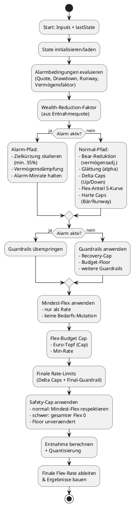

# Technische Dokumentation – Ruhestand-App-Final

Dieses Dokument beschreibt die Architektur und zentrale Datenflüsse der Ruhestand-App. Die Anwendung besteht aus zwei getrennten Oberflächen (Balance & Simulator) und einer gemeinsam genutzten Engine.

**Dokumentrolle:** Operative Entwickler-Referenz für aktuelle Modulzuständigkeiten, Datenflüsse und Laufzeitverhalten.
**Abgrenzung:** Vertiefte fachliche Herleitungen, Marktvergleiche und Forschungsabgleich stehen in `ARCHITEKTUR_UND_FACHKONZEPT.md`.
**Dokumentstand:** 2026-10-10; ergänzt um die lokale Designsystem-Grundlage, die drei Balance-Reiter und den gemeinsamen Managerverlauf, die eigenständige Ausgabenseite und den nativen Handlungs-/Druckdialog.

---

## Architekturüberblick

### Gemeinsamer statischer Rahmen (Paket 2a, Slices 1–3)

Alle sieben Einstiegspunkte liefern `.suite-shell`, Kopf, Hauptnavigation mit echten
HTML-Zielen, `.suite-content` mit `#suiteMain` und den separaten Fehlerhost
`#suiteNavigationStatus` (`role="alert"`) statisch aus. `data-suite-page` benennt
die Seite, `aria-current="page"` den aktiven Link. Alle sieben Hauptlinks stehen statisch bereit. `#suiteContext` fasst Profil und die vorhandenen Seitenstatushosts einmal im Suite-Kopf zusammen; lokale zweite Kontextzeilen entfallen. Die Datenlieferanten und Bindungen bleiben bei den bestehenden Renderern. `.ds-page-head` ordnet Rubrik, Titel, vorhandene Aktionen und vollständigen Lead über das gemeinsame Tokenraster; neue Breitenentscheidungen messen `suite-content`. Der Rahmen
lädt kein HTML; lokale Symbole ergänzen zugängliche Textnamen
asynchron. Symbolfehler behindern weder Links noch Profilinitialisierung.

`profile-navigation.js` besitzt den einzigen delegierten Klickbinder für
`a[href]` zu lokalen HTML-Zielen im selben Tab. Ein angeschlossener Link muss zum gebundenen Root
gehören. Bereits verhinderte Ereignisse, Modifikatoren, Mittelklick, Downloads,
fremde Tabs und Kapitelanker bleiben eigenständig. Übernommene Ereignisse werden
synchron verhindert; bis zum Wechsel gibt es nur eine Übergabe je Dokument.
`initializeProfilePage` bindet vor seinem ersten Wartepunkt und startet je Dokument
einmal Persistenz und den bestehenden Profil-Lifecycle. `whenProfilePageReady`
wartet explizit auf den abgeschlossenen Bootstrap und ist auch für spätere
Empfänger nachlesbar. Startseite und Unterseiten verwenden denselben Binder;
`profile-bridge.js` ruft den gemeinsamen Start auf. Die bestehende Indexinitialisierung
im Profilmanager bleibt idempotent.

Ablauf: versuchsgebundene Schutzentscheidung → alle bestätigten Abbruchenden
→ `beforeHandoff` → Bereitschaft → bestehender Export nur markierter Links
→ bestätigter `PersistenceFacade.flush()` → `afterFlush` → Schlussprüfung
→ genau eine Zuweisung des geprüften Linkziels ohne weiteren Wartepunkt.
Managerziele behalten `export=false`; unmarkierte Karten-/Recoverylinks erhalten
Schutz und Flush ohne neu eingeführten Bundleexport. Hook-`false`, Fehler und
neue Schutzgründe verhindern den Wechsel. Nach einem bereits erfolgten Export
stellt ein gescheiterter Versuch seinen vorherigen `window.name`-Kanal wieder her.
Fehler/Hinweise stehen ausschließlich am Rahmenstatus, Recoveryhosts bleiben erhalten.

`app/shared/navigation-guard.js` ist DOM-frei und hält ausschließlich flüchtigen
Zustand. `createNavigationGuard` registriert Provider über stabile Besitzer und
`read/subscribe/cancel`; alternativ ruft der Besitzer `registration.notify()`.
Zustand: `phase` (`idle/preparing/running/cancelling/commit`), verlustrelevante
`revision`, eindeutige Laufgeneration `operationId`, `dirty`, `result`, optional
`message`. Reine eigene Abbruchphasen behalten Revision/Generation; `cancel`
bestätigt erst nach vollständigem Handlerende. Neue Revisionen, Generationen,
Besitzergründe und auch kurzzeitig gemeldete fremde Commits verwerfen Zustimmung.
Ein fehlendes/unbestätigtes Abbruchende sperrt die Übergabe. `prepare/validate/end`
verbinden bestehende Handoffhooks; `commitNavigation` setzt die einmalige native
Freigabe unmittelbar vor dem Wechsel. Sie verfällt auch bei ausbleibendem Wechsel
im nächsten Timerturn und bei neuen Gründen oder `pageshow`. `reload` bietet
Entscheidung, Bereitschaft, optionalen eigenen Schreibabschnitt, bestätigten Flush
und Schlussprüfung; nur der eigene nachweislich beendete Lease wird quittiert.
Rechnungs- und Jahresbesitzer sowie Vollbackup, Balance-Importe und Snapshotwege
sind zusammen mit Manager-, Verlauf-, Profilwechsel-, Reset- und Recoverywegen
angeschlossen. Ergebnisablage folgt erst in Paket 4.2.

`createNavigationOperationLifecycle` hält einen Besitzer von Datei-/Snapshotlesen
und Vorflush bis zum Handlercleanup. Eine bestätigte Kündigung wartet auch
Hilfswrites (etwa Reader-Migration oder Recoveryarchivierung) und die Rückkehr
zum ursprünglichen PREVIEW ab. Jeder Bestandscommit prüft zuvor den Abbruchtoken.
Ab erstem Write umfasst die Sperre Backendreadback, Postvalidierung, letzte
Flushes und einen eventuell verzögerten kompensierenden Rollback. Verschachtelte
Archiv-/Facadeaufrufe erhalten `options.navigationOperation`; ihr Ende entfernt
keine äußere Sperre. Low-Level-Replaces erhalten den Schutz ausdrücklich über
`options.navigationOperation` oder `options.guard`; bestehende andere
Fachkoordinatoren behalten ihren eigenen äußeren Besitzer. Es gibt keine implizite
Übernahme fremder Commits. Ohne äußeren Besitzer hält ein Archivcreate/-delete einen
eigenen Commitbesitzer. Neue Aktionen werden bei fremdem Commit oder reservierter
Navigation abgewiesen; Schutzstatus, Generationen und Tokens werden nicht gespeichert.

Der Vollimportbinder bereitet Datei, Recoverydownload und verifizierten
Archivsnapshot kündigbar vor. Erst danach reserviert `guard.reload` den
Bestandsreplace und hält einen eigenen Lease durch den letzten Flush. Standardrestore
und Vollimport-Recovery lesen den Snapshot ebenfalls kündigbar und verwenden
anschließend denselben Reloadweg ohne Profilbundleexport. Andere Profile,
technische Keys, Snapshotumfang und archivierte Records behalten ihren bisherigen
Scope. Die transaktionale Bestätigung umfasst jetzt auch Standardrestore und den
initialen Balance-State-Replace. Neue fremde Gründe nach der Navigationsentscheidung
verwerfen den Reload; Fehler laden nicht neu und bewahren die Recoverypunkte.
`observeInputChanges` in der Facade beobachtet hierfür vorübergehend auch normale
`input/change`-Ereignisse ohne Dirty-Provider. Der Capturelistener verwirft
die Reloadzustimmung; am Ende werden beide Listener entfernt. Ein bereits
gespeicherter Snapshotrestore liefert dann `reload_required` statt eines stillen
Erfolgs. Der Snapshotbinder fordert am Aktionsort `snapshots` zum Neuladen auf.
Ab Restorewrite hält die Facade über `blockSyncWrites` eine flüchtige Sperre für
synchrone Balance-State-/Registrywrites (`PERSISTENCE_RELOAD_REQUIRED` vor jeder
Cachemutation). Damit können `PERSIST_INPUTS` und veraltete Profilverbundkopien
den bestätigten Restore nicht überschreiben. Bei ausbleibendem Reload oder
fehlgeschlagenem Rollback bleibt die Sperre bis zum Neuladen erhalten; bestätigter
Reload oder erfolgreicher Rollback gibt den eigenen Besitzer frei. Der
transaktionale Restore-/Rollbackpfad bleibt davon unabhängig. Abgewiesene
JSON-/CSV-/Vollimporte erklären die laufende andere Aktion im eigenen Aktionsort;
Vollimport-Abbruch vor dem Replace beendet auch den Recovery-Fortschrittsstatus
mit einem Hinweis auf unveränderten Bestand und erhaltene Sicherung.
Widerruf einer bereits quittierten Navigation beendet auch
deren Reservierung, etwa bei BFCache-Rückkehr ohne tatsächlichen Dokumentwechsel.
`restoreDocument` entwertet zusätzlich eine eingefrorene noch laufende Zustimmung;
deren Writebesitzer bleibt bis zum echten Handlerende geschützt. Eine späte
Flushantwort darf anschließend keinen alten Zielwrite ausführen. Der BFCache-Anschluss
wartet dieses Handlerende ab und startet anschließend automatisch genau einen neuen
geschützten Reloadversuch mit eigener Entscheidung und bestätigtem Flush.
Eingaben während der Wartezeit beenden die automatische Wiedereinführung mit
ortsfestem Hinweis; auch neue Eingaben während des Reloadversuchs verhindern Reload.

Gezielte Nodebelege: `persistence-write-navigation`, `balance-import-navigation`,
`navigation-guard`, `persistence`, `balance-storage-contract`,
`balance-ui-orchestration` und `balance-annual-navigation`. Die registrierten
Browserfälle `Navigation guard imports`, `Navigation guard imports native` und
`Navigation guard snapshot restore` halten echte Handler in Vorbereitung,
Write und Rollback an, prüfen App-Enter/native Ablehnung und Zustimmung sowie
bestätigten Reload ohne Zusatzflush. Browserausführung ist außerhalb der
Implementierer-Sandbox erforderlich; Registrierung ist keine Browserabnahme.

`navigation-guard-dialog.js` hält einen Kern je Dokument und nutzt den statischen
nativen `#navigationGuardDialog` auf allen sieben Seiten. `showModal()` sperrt den
Hintergrund einschließlich darunterliegender Fachdialoge; Capture-Escape bedeutet
Bleiben, Tab/Shift+Tab bleiben im Dialog, der Auslöser erhält Fokus zurück.
Der zentrale `beforeunload`-Handler existiert nur bei tatsächlichen Verlust- oder
Commitgründen und setzt synchron `preventDefault/returnValue`. Native Browserwege
führen keine abwartbare Abbruch-/Flushtransaktion aus; Browsertext, Nutzeraktivierung
und Recovery bleiben browsergegeben. `installProfilePersistenceHooks` installiert
zusätzlich genau einen dauerhaften, nur speichernden `beforeunload`-Listener. Er
beginnt den synchronen neuesten Profilsnapshot vor seinem ersten Facadebatch,
verändert aber weder `defaultPrevented` noch `returnValue`. Nur der zentrale
Nachfragehandler verhindert bei Verlust-/Commitgründen das Verlassen.
Die Profilsicherung sichert außerdem synchron in der Capture-Phase von
`pagehide` und `visibilitychange=hidden`, vor dem bereits früher registrierten
Bubble-Flush der Facade. Der gemeinsame Node-Nachweis betreibt die echte Facade
mit Adapter und Microtask-Checkpoints zwischen Listenern; die ursprüngliche
Listenerordnung schreibt im ersten Batch noch den alten Snapshot. Das ist eine
Ordnungszusage und früherer Speicherbeginn, keine Garantie für den Abschluss
asynchroner Browser-Unloadwrites. Der gemeinsame Profil-Speicherpfad beginnt bei
Commitgründen des dokumenteigenen Guards oder `PersistenceFacade.hasSyncWriteBlocks()`
weder Saver noch eigenen Flush. Die Abfrage liest nur vorhandene Sperrbesitzer;
Schlüssel-/Präfixschutz, Flushwarteschlange und autorisierte Besitzerflushes bleiben
unverändert. Dirty-/Ergebnisgründe und abgelehnte Navigationen sperren diesen
Speicherpfad nicht. Das Handbuch bleibt ohne Profil-Speicherhooks.
Tranche/Cash vergleichen vollständige Formularwerte einschließlich Checkbox/Select
mit einer Baseline nach Befüllen bzw. bestätigtem Speichererfolg. Rückänderung ist
sauber; Fehler/Download bestätigen keine Baseline. Benutzer-Schließen fragt bei
Dirty nach Verwerfen und prüft echte Commitflags des Pagehandlers auf allen Wegen.
Beim Tranchendialog ignoriert die Hintergrundfläche Klicks mit geänderten
Eingaben und verhindert den Fokusverlust durch Mousedown. Saubere Dialoge lassen
sich dort weiter schließen; bei Dirty bleiben Schließknopf und Escape die
ausdrücklichen Verwerfwege. Programmatische Rahmennavigation fragt weiter nach;
Bleiben/Escape gibt den Fokus an das zuvor fokussierte Feld im offenen Fachdialog
zurück, wenn der Rahmenauslöser außerhalb dieses Dialogs liegt.

Das Handbuch startet die Fassade mit `installLifecycleHooks: false` (Standard sonst
unverändert `true`) und `installTauriCloseHook: true`, ohne Profilbootstrap oder
Hidden-/Pagehide-Speicherhooks. Der separate EXE-Hook gilt auf allen sieben Seiten;
der vollständige Lifecycle-Opt-out bleibt ohne ausdrückliche EXE-Option erhalten.
Expliziter Handoff-Flush bleibt möglich. Alle Seiten installieren den bestehenden BFCache-Reload; der Schutz widerruft alte Freigaben bei Rückkehr. Der geschützte Reloadanschluss folgt in Slice 9.
Es entstehen kein Routing, keine gemeinsame Rechenlaufzeit und keine zusätzlichen
Daten in `window.name`; dieser bleibt der bestehende Profilbundlekanal.

Rahmen- und Inhaltscontainer heißen `suite-shell` und `suite-content`. Die Leiste misst ausschließlich
den äußeren Container: unter 82rem automatisch 4rem, darüber manuell 12 oder 4rem.
`#suiteSidebarToggle` ist auf allen sieben Seiten das erste Element in
`#suiteNavigation`, direkt über Übersicht, auch im kompakten Zustand. Seine feste
Breite und zentrierte Position bleiben in beiden Leistenbreiten gleich.
`app/shared/suite-sidebar-preference.js` liest direktes lokales Gerätestorage; nur
manuelle Aktionen speichern `ui_suite_sidebar_collapsed` (true/false). Resize/Laden
schreiben nichts; Speicherfehler erhalten die Wahl im Dokument und blockieren
keinen Handoff. Fachliche Capture-, Bundle-, Backup- und Snapshotwege bleiben frei davon.
`app/profile/profile-context-reader.js` verwendet nur `loadProfileRegistry` und
lesende aktuelle/aktive IDs. Fehlende, verwaiste oder widersprüchliche Identität
wird nicht ersetzt. `suite-frame.js` wartet auf die wiederholbar lesbare Seiten-/Anzeigebereitschaft
(`whenProfilePageReady`/`whenProfileDisplayReady`); Bootstrap-Recovery erlaubt
keine aktuelle Identitätsanzeige, ohne den Handoff-Bereitschaftsvertrag zu ändern; im Handbuch
genügt Persistenzbereitschaft ohne Bootstrap. Profilmanager-Refresh erneuert den Kopf;
Balance/Simulator liefern ihren bereits bestimmten Haushaltszustand getrennt. Balance misst für seine 1250px-Umschaltung
`suite-content`, Manager Gold/Pflege den Container `manager` (980px), Simulator
Pflege-/Replayspalten `simulator-panel` (1000/899px). Druck blendet nur die Rahmenteile
aus und löst ihre Containerzwänge; bestehende Ergebnis-/Druckanker bleiben bestehen.

Die reine Start-/Rücknavigation B01/S01/V01/H01 liegt vollständig im Rahmen.
Balance behält `.app-header`, Jahresabschluss B08 und Diagnose B36; Balance und
Simulator behalten native Hilfe mit `target="_blank"`. Startkarten I06 und
Manager-Einstiege I05 bleiben eigenständig. Im Manager adressiert das unveränderte
`updateActiveProfileLabel` genau einmal `#managerBackLink` am delegiert gebundenen
Rahmenlink zur Übersicht; `#suiteProfileContext` ist die einzige aktive Profilanzeige im Suite-Kopf. Recoverylinks
bleiben nativ, einschließlich `index.html#fullBackupImportBtn` mit bestehendem
Aufklapp-/Fokusvertrag. Handbuch-h1, Kapitelreiter, TOC und Hash-/Fokusübergabe
bleiben im Inhalt; die alte Navbar und ihre reinen Farbregeln entfallen.

`Suite frame navigation replacement` prüft die endgültige Struktur mit Maus/Enter,
Hilfe im neuen Tab, offenem Flush, Fehlern und gezielten Gegenproben; Druck und
Containerbreiten bleiben eigene registrierte Fälle. Funktionsinventar und erzeugte
Lesefassung bilden statische Anker, tatsächliche Delegation und unveränderte
Erzeuger ab. Node-Nachweise ersetzen keine Browsermessung. Serverstart in der
Implementierer-Sandbox: `listen EPERM`; Browser-/Layout-/BFCache-/EXE-Abnahme ist
offen. BFCache zählt nur nach tatsächlich beobachtetem `pageshow.persisted === true`.
Die vollständige Node-Suite fährt ausschließlich der Orchestrator auf SOURCE.

### Lokale Gestaltungsgrundlage

`Ausgaben.html`, `Balance.html`, `Simulator.html`, `index.html`, `Handbuch.html`,
`depot-tranchen-manager.html` und `Daten-Sicherung.html` laden `css/tokens.css` zuerst, `css/fonts.css`
anschließend und dann `css/components.css`, vor ihren bisherigen externen oder
eingebetteten Seitenstilen.
Kanonische Rollen werden nur im Tokenstylesheet definiert; bisherige Seitenvariablen
bilden eine azyklische Aliasbrücke. Grundflächen sind Stein/Weiß, Hauptaktionen
verwenden hellen Text auf `--text-main`; Überschriften nutzen vorhandene Newsreader-Schnitte.

Alle acht WOFF2-Schnitte liegen unter `assets/fonts/` und verwenden `font-display: swap`.
`app/shared/designsystem-icons.js` lädt ausschließlich freigegebene lokale Lucide-Dateien
relativ zum Modul, prüft SVG-Elemente/Attribute und importiert den geparsten Knoten in
das Dokument des Aufrufers. Der vorhandene Handbuchlink der Startseite erhält additiv
`book-open` als 20-px-Schmucksymbol; bei Ladefehlern bleibt der Linktext erhalten.
Die Tauri-CSP erlaubt weiterhin lokale Fonts/Fetches über `'self'`; ausschließlich
Google-Fonts-Einträge in `style-src` und `font-src` wurden entfernt.
Serve-/Sync-/Engine-Buildpfade bleiben erhalten; vorhandene lokale Assets werden mit ausgeliefert.

`css/components.css` bietet additive Rollen für Aktionen, Eingaben, Karten,
Reiter, Tabellen/Scrollflächen, Hinweise, Badges und Kennzahlleisten. Startseite
und Handbuch nutzen diese Rollen bei unveränderten Funktionsankern und Abläufen.
`app/shared/field-state.js` stellt mit `setFieldState(field, state, reason)` die
bereits entschiedenen Zustände `adopted`, `editable`, `inactive`, `empty`,
`unrated`, `warning`, `error` dar. Sichtbare Gründe haben eindeutige IDs;
`aria-describedby` wird additiv gepflegt. Die Hilfe verändert keine Werte,
Sperren, anderen Inputattribute oder Speicherverträge und leitet keine Zustände ab.

Der Quellvalidator `tests/designsystem-source-contract.mjs` prüft die ausdrücklich
benannten Quellen aller neun Slices einschließlich Renderer, Layout und UI-Ausgabe. Node-Tests
prüfen den tatsächlichen Startseiten-Recoveryrenderer; registrierte Browserfälle
prüfen Dateiauswahl, sitzungsweises Schließen/Reload und Handbuch-Reiter/TOC/Fokus.
Die vollständige Quellmap und einzeln begrenzte Bestandsausnahmen stehen im Validator; Details und
zulässige Kontrastpaare stehen in `docs/design/designsystem.md`. Browser-Smoke und
Offline-/EXE-Abnahme bleiben getrennte Gates außerhalb der Implementierer-Sandbox.
Simulator-Legenden bleiben Paket 4.1, die vollständige Handbuchmigration Paket 6.3.

### Komponenten

| Komponente | Dateien | Zweck |
|------------|---------|-------|
| Balance-App | `Balance.html`, `app/balance/*.js`, `css/balance.css` | Jahresabschluss, Liquiditäts- und Entnahmeplanung, Diagnosen, Ausgabenübersichtslink und geschützte Weiterleitung zum Managerverlauf |
| Ausgaben | `Ausgaben.html`, `app/expenses/*.js`, `css/expenses.css` | CSV/D5-Import, Monatsmatrix, Kategorien, belegbasiertes Budget, Jahresvergleich, Recovery und gemeinsamer Abschlussdialog |
| Simulator | `Simulator.html`, `app/simulator/*.js`, `simulator.css` | Monte Carlo, Backtest, Sweeps, Auto-Optimize, Stationary Bootstrap, Tail-Risk-Stresstest, Pflegefall- und Pflegebucket-Wirklogik |
| Übersicht | `index.html`, `app/overview/*.js`, `css/overview.css` | Gespeicherter Haushalt, Vermögen, Plan, Sicherungszugang und obere Recoveryhosts |
| Profil/Verbund | `depot-tranchen-manager.html`, `app/profile/*.js` | Personenverwaltung, Handoff/Flush, Profilverbund und Pflegebucket-Definition |
| Tranchen | `depot-tranchen-manager.html`, `types/tranche-contract.js`, `app/tranches/*.js` | Kanonischer Lotvertrag, CRUD/Recovery, EUR-Quotes, Consumerstatus, bestaetigter Realbestandsabgleich und append-only Cashnachweis |
| Shared | `app/shared/*.js` | Gemeinsame Formatter, Feature-Flags, CAPE-Helfer, Persistenz-Facade |
| Engine | `engine/` (ESM), `engine.js` als Import-Wrapper | Validierung, Marktanalyse, diskrete und kontinuierliche Regime-Signale, VPW-Rendite-Policy, Spending- und Transaktionslogik |

Die Pfade und Contracts sind normativ; volatile Modul- und Testdateizaehler stehen im Coverage-Inventar statt in dieser Architekturreferenz.

Alle Skripte sind ES6-Module. `engine.js` ist aktuell ein reiner generierter Wrapper, der `EngineAPI` aus `engine/index.mjs` importiert, die Browser-Globals einschließlich Legacy-Alias bereitstellt und beide Namen exportiert. Balance und Simulator laden ihn als Modul; Fachtests und Worker importieren die Engine-Module direkt.

`build-engine.mjs` schreibt ohne `esbuild` im nicht strikten Modus den konstanten Modul-Fallback; mit `esbuild` erzeugt es ein echtes IIFE-Bundle. Ein Bundle enthält kopierte Engine-Logik und übernimmt Quelländerungen nicht automatisch. `tests/engine-wrapper-contract.test.mjs` weist auch ein frisch erzeugtes Bundle ab; der Wechsel benötigt eine eigene geprüfte Vertragsänderung. Andere Buildfehler werden nicht durch einen erfolgreichen Fallback verdeckt.

`npm run build:engine:strict` ist optional für einen bewusst gewählten Bundle-Auslieferungsvertrag. Ohne `esbuild` scheitert Strict vor dem Fallback. Auch `ENGINE_BUILD_STRICT` oder `CI` mit `1`/`true` (Groß-/Kleinschreibung beliebig) machen den normalen Build strikt. Der bestehende Browser-/Tauri-Wrapperpfad verlangt keinen Strict-Build.

### Tauri Desktop-Build und Live-Daten

Die Desktop-App lädt das Frontend direkt aus `dist/` (`src-tauri/tauri.conf.json -> build.frontendDist = "../dist"`). Der Build-Pfad ist plattformneutral:

1. `npm run sync-dist` (`scripts/sync-dist.mjs`) baut `dist/` aus einem Git-Commit. Kopiert werden nur Laufzeitdateien: `app/`, `engine/`, `workers/`, `types/`, `css/`, `assets/` sowie die HTML-, JS- und CSS-Dateien im Wurzelverzeichnis. `data/`, Dokumentation, Tests, Werkzeuge und Agentendateien gelangen nicht in die App. `engine/` und `engine.js` werden aus demselben gewählten Commit übernommen; der Sync führt keinen Engine-Build aus. `__build-provenance.json` hält den Quell-Commit fest.
2. `npm run tauri:build` bettet `dist/` ein und legt die Binary unter `src-tauri/target/release/` ab (Windows: `ruhestand_suite.exe`).

`npm run build:desktop` führt beide Schritte nacheinander aus. Ohne `--rev` verlangt `sync-dist` einen sauberen Stand der versionierten Quellen und blockiert unversionierte Laufzeitdateien; mit `--rev <commit>` und `--out <ordner>` überträgt es einen beliebigen Commit in einen externen Buildordner. Die EXE ist kein Repository-Artefakt; ältere Stände für Regressionsvergleiche werden außerhalb des Repositories archiviert. `tests/dist-runtime-inventory.test.mjs` verfolgt die statischen Verweise der HTML-Einstiege und schlägt fehl, sobald eine referenzierte Datei außerhalb dieser Laufzeitliste liegt.

Wichtig für Live-Daten:

* ETF-Kurse laufen in der EXE über den in `src-tauri/src/lib.rs` gestarteten lokalen Yahoo-Proxy auf `127.0.0.1:8787`.
* Im Jahresprozess kommt das ETF-Zieljahr aus `annualPeriodMetadata.pendingCommit.periodId`. Vor dem Fetch werden Schema-Version, Phase `writes_started`, Snapshot-ID, letzte Commit-Periode und bereits abgeschlossenes Zieljahr validiert. Der Chart-Abruf verwendet das UTC-Fenster 27.12. bis zum exklusiven 01.01. des Folgejahres und akzeptiert nur den letzten VWCE.DE-Schlusskurs von 0,50 bis 100.000 EUR vom 27.12. bis 31.12. des Zieljahres. Marktdateninputs und `annualMarketDataMeta` werden gemeinsam gespeichert; Metadaten führen Preis, ISO-Stichtag, Ticker, Quelle, Zieljahr, Perioden-ID und die stichtagsgleiche ATH-Auswertung. Fehler nach begonnener Marktdatenmutation rollen den lokalen DOM-/State-Schritt zurück, während der Jahres-Coordinator zusätzlich seinen Recovery-Snapshot behält.
* Inflation (ECB, World Bank, OECD) und CAPE (`r.jina.ai` -> Yale/Mirror) laufen in der EXE direkt aus der Tauri-WebView.
* Die dafür nötigen Ziele stehen explizit in `src-tauri/tauri.conf.json` unter `app.security.csp.connect-src`.
* Web-Worker laufen aus dem gebündelten Frontend und bleiben über `worker-src 'self' blob:` erlaubt.
* `dangerousDisableAssetCspModification` ist bewusst gesetzt, damit die handgepflegte CSP aus `tauri.conf.json` unverändert gilt und nicht durch Tauri-Asset-Rewrites erweitert wird. Breite Einträge wie `unsafe-inline`, `unsafe-eval` und Inline-Styles bleiben nur wegen bestehender HTML-/Modul-Patterns erlaubt und sind kein Freibrief fuer neue externe Quellen.
* In der Browser-Variante startet `scripts/serve.mjs` (`npm run serve`, unter Windows `start_suite.cmd`) Webserver und Yahoo-Proxy (`tools/yahoo-proxy.cjs`) in einem Node.js-Prozess.

**Tauri-Yahoo-Proxy-Contract (`src-tauri/src/lib.rs`):**

* Bindet nur auf `127.0.0.1:8787`.
* Endpunkte:
  * `/quote?symbol=...` -> aktueller Preis, bevorzugt Yahoo Chart API, Fallback Quote API.
  * `/search?q=...` -> Yahoo-Suche.
  * `/chart?symbol=...&period1=...&period2=...&interval=...` -> Yahoo Chart API.
* CORS erlaubt Tauri-Urspruenge (`null`, `tauri://localhost`, `https://tauri.localhost`, `http://tauri.localhost`) sowie lokale Entwicklungsurspruenge auf `localhost`/`127.0.0.1`. Externe Origins erhalten `Access-Control-Allow-Origin: null`.
* Fehler werden als JSON gemeldet: fehlende Parameter mit `400`, nicht gefundene Preise mit `404`, Upstream-/JSON-Fehler mit `502`.
* London-Preise in GBp/GBX werden fuer `.L`-Symbole auf Pfund normalisiert.
* Wenn Port `8787` bereits belegt ist, wird der Proxy-Start geloggt abgebrochen; die Tauri-App selbst startet weiter, ETF-Live-Kurse koennen dann aber nicht ueber den integrierten Proxy geladen werden.

**Manuelle Desktop-Smoke-Checks nach einem EXE-Build:**

Nach einem erfolgreichen manuellen EXE-Build sollte die erzeugte `RuhestandSuite.exe` kurz geprueft werden:

1. EXE startet ohne separates lokales Webserver- oder Node-Proxy-Setup.
2. Übersicht lädt; Personenverwaltung ist im Manager erreichbar.
3. Balance-App laedt, fuehrt eine Aktualisierung aus und zeigt keine Asset-/Engine-Fehler.
4. Simulator laedt; ein kleiner Monte-Carlo- oder Backtest-Smoke-Lauf startet ohne Worker-Fehler.
5. Tranchenmanager laedt leere oder synthetische Tranchen ohne Fehler.
6. Handbuch laedt.
7. Optionaler Live-Daten-Check mit Internet: ETF-Kurs via integriertem Proxy, Inflation/CAPE via freigegebene Endpunkte.
8. Optionaler Offline-Check: Ohne Internet darf die lokale App nicht unbenutzbar werden; außerhalb eines bestätigten Jahres-Commits degradieren Live-Daten-Fetches als Fallback/Warnung. Ein bereits begonnener atomarer Jahres-Commit bleibt bei einem erforderlichen fehlgeschlagenen Periodenschritt bewusst im Recovery-Pfad, statt falsche Stichtagsdaten zu übernehmen.
9. Keine Log-/Console-Hinweise auf fehlende `dist`-Assets oder blockierte Worker.

---

## Engine

Die Engine besteht aus zentralen ES-Modulen unter `engine/`; `engine.js` importiert ihren Einstieg `engine/index.mjs`, ohne die Implementierung zu kopieren. Die Reihenfolge entspricht zugleich der internen Verarbeitungskette:

1. **`engine/validators/InputValidator.mjs`** – prüft sämtliche Eingaben auf Vollständigkeit, Wertebereiche und Konsistenz. Liefert strukturierte Fehlermeldungen.
2. **`engine/analyzers/MarketAnalyzer.mjs`** – klassifiziert Marktregime, berechnet Drawdowns und leitet Kennzahlen für Guardrails ab. `marketDataStatus` unterscheidet `missing`, `partial` und `complete`; ohne positive endliche Werte fuer aktuellen Kurs und ATH bleiben ATH-Abstand und `seiATH` `null`, und fehlende Kerndaten verwenden `side_long` statt eines falschen ATH-Signals. CAPE bleibt unabhaengig auswertbar. Additiv liefert `engine/analyzers/regime-signals.mjs` kontinuierliche Signal-Severities fuer Drawdown, CAPE und Runway. Die Stuetzwerte bleiben richtungssensitiv: aufsteigende Skalen wie Drawdown und absteigende Skalen wie Runway duerfen nicht per `Math.min`/`Math.max` sortiert werden.
   - `engine/planners/vpw-return-policy.mjs` kapselt die erwartete VPW-Realrendite. `legacy_step` bleibt Default; `cape_continuous` ist ein expliziter Config-Modus mit robuster CAPE-Normalisierung, separaten Aktien-/Portfolio-Clamps und Diagnosefeldern.
3. **`engine/planners/SpendingPlanner.mjs`** – orchestriert die Entnahmeplanung aus State, Alarm, initialer Flex-Rate, Policy-Pipeline, Entnahmeberechnung, Result und Diagnose. Reine Policy-Helper liegen in `engine/planners/spending-policy-helpers.mjs`, die vermögensbasierte Reduktionsdämpfung in `engine/planners/wealth-reduction.mjs`, Alarm-Aktivierung und Deeskalation in `engine/planners/alarm-policy.mjs`, Flex-Rate/S-Kurve/harte Caps in `engine/planners/flex-rate-policy.mjs`, Mindest-Flex in `engine/planners/minimum-flex-policy.mjs`, Flex-Budget-Cap/Recharge/Min-Rate in `engine/planners/flex-budget-policy.mjs`, Recovery-/Caution-Guardrails und Budget-Floor in `engine/planners/spending-guardrails.mjs`, finale Rate-Limits in `engine/planners/final-rate-policy.mjs`, die stabile Post-Flex-Policy-Reihenfolge in `engine/planners/spending-policy-pipeline.mjs`, finale Diagnose- und Runway-Ziel-Strukturen in `engine/planners/spending-diagnosis.mjs`.

### Flex-Reduktion: Reihenfolge der Caps/Limits

Das folgende Flussdiagramm zeigt die Reihenfolge, in der die Flex-Rate angepasst und begrenzt wird. Entscheidend ist die Abfolge im `SpendingPlanner` (siehe `determineSpending()`):

Die aktuelle Balance-Budgetanzeige fordert am vorhandenen Rechenaufruf
`includeFlexTrace: true` über `createBalanceDisplayEngineApi()` an, auch für
den haushaltsweiten Rechenpfad und unmittelbar bestätigte Balance-Jahresergebnisse.
`app/balance/balance-flex-trace.js` projiziert die gelieferten Netto-Monatswerte,
prüft ihren Bezug zu Bedarf/Kürzung und zeigt nur wirksame Stationen.
Rente und Dynamic Flex werden nicht erneut verrechnet. Der Grundchip verwendet
strukturelle Trace-Ursachen statt Marktphase; technische Safety-Durchsetzung
verdrängt diese nicht. Ohne Trace bleiben die Budgetzahlen erhalten, ohne
fingierte Treppe. `bindBalanceBudgetWhy` in `balance-presentation-controls.js`
bindet den nativen Knopf einmalig und setzt die Ansicht bei jedem Ergebnisrender
auf geschlossen zurück; es gibt keinen Storage-/Profilparameter.

Zusätzlich liest `engine/planners/flex-trace.mjs` dieselbe Rechnung als
`spendingResult.flexTrace`: eine geordnete, eingefrorene Liste von
Momentaufnahmen mit `schritt`, `rateVorher`, `rateNachher` (Prozent),
`gegriffen`, `grund`, primitiven `kennzahlen` mit Einheiten im Namen sowie
`monatsbetragVorher`, `monatsbetragNachher` und `monatswirkungEur` (EUR/Monat).
Die Monatskette beginnt bei `inflatedBedarf.flex / 12`; negative Wirkung kürzt,
positive Wirkung hebt an. Monatswerte beziehen sich auf den finanzierten
Netto-Flex aus dem Vermögen, bei Zwischenraten außerhalb 0–100 auf den
entsprechend begrenzten Betrag. Ohne Netto-Flex bleibt die Wirkung null.
Rohziel, interne Glättung, Änderungsgrenze, S-Kurve, Bären-/Runway-Cap,
Guardrails, Mindest-Flex, Budget, finale Glättung, Safety und Rundung folgen
der bestehenden Reihenfolge. Im Alarmzweig stehen Vorjahresbezug und Alarm
anstelle der normalen Anfangsstationen; eine nicht durchlaufene S-Kurve
wird nicht als wirksam ausgegeben. Safety-Kennzahlen trennen Rohziel,
Policy-Ziel, effektiven Cap, Verschiebung und schwere Notlage. Die Rundung
liest den vorhandenen `quantization`-Vertrag mit `stepMonthly`, Rohbetrag
und Floor-geschütztem Endbetrag; ihr Abschlag berücksichtigt den Floor-Schutz.
Ihr Glättungsanker ist der tatsächlich zurückgegebene neue State-Wert.
`determineSpending(params, { includeFlexTrace: false })` unterdrückt nur
diese interne Diagnose. An den Engine-Einstiegen `EngineAPI.simulateSingleYear`
und `_internal_calculateModel` ist die Erfassung standardmäßig aus; der optionale
dritte Parameter `{ includeFlexTrace: true }` fordert die Liste für `ui.spending`
an. Bestehende Zwei-Argument-Aufrufe in Monte Carlo, Worker, Sweep, Backtest und
Replay erzeugen keinen Collector und reichen keinen Trace in Exportobjekte weiter.
State und Vorjahresanker enthalten keinen Trace. Unbegrenzte Runway/Deckung
bei Bedarf null wird ausschließlich in Diagnosekennzahlen als `null` abgebildet,
damit auch angeforderte Traces die strikte JSON-Normalisierung bestehen.
Node-Nachweis: `tests/spending-flex-trace.test.mjs` vergleicht nach Entfernen
ausschließlich des Trace sämtliche bisherigen Ergebnisse und Eingabedaten exakt.



`applyMinimumFlexFloor()` nutzt nur Spending-Layer-Daten. Der haushaltsweite Mindest-Flex wird zuerst mit dem nach Floor-Deckung verbleibenden Rentenueberschuss reconciliert; nur der offene Rest bestimmt die erforderliche Depot-Flex-Rate. Der Schritt blockiert eine Anhebung bei aktivem Alarm, bei unzureichendem Gesamtvermoegen fuer Netto-Floor plus offenen Depotanteil oder wenn der Mindest-Runway nach dieser Zahlung nicht mehr aus dem Gesamtvermoegen wiederherstellbar waere. Niedrige aktuelle Liquiditaet allein ist kein Blocker, solange der Gesamtvermoegens-Proxy ausreichend ist. Die Jahreszeile reconciliert danach den finalen Mindest-Flex gegen die tatsaechliche Auszahlung und weist eine zusaetzliche Luecke als `limited_by_actual_payout` aus.

`SpendingPolicyOrderV2` bindet Alarm, Guardrails, Mindest-Flex, Flex-Budget,
finale Glaettung und den abschliessenden `safety_cap` durch einen
Laufzeittrace. Die Flexraten-Policy liefert strukturierte Safety-Evidenz fuer
aktiven Alarm, positiven `bear_deep`-Rohcut und bindende Flexraten-Hard-Caps;
die Pipeline ergaenzt einen nur bei echter Ratenreduktion bindenden
 Spending-Guardrail. Das Minimum der endlichen Kandidaten ist das normale
 Policy-Ziel gegen spaetere Aufwaertsglaettung. Die aktuell wirksame Obergrenze
 wird mit denselben jaehrlichen Auf-/Abwaertsgrenzen wie die finale Flexrate
 bestimmt; ein weiter entferntes Ziel wird sichtbar auf Folgejahre verschoben.
 Bei Gleichstand gilt die dokumentierte Quellenprioritaet. Bei rein
 marktbedingten Safety-Caps wird das Policy-Ziel ausserhalb der schweren Notlage
 bis zur erforderlichen
Mindest-Flex-Rate angehoben, sofern kein bestehender Alarm-, Solvenz- oder
Runway-Blocker greift. Der Alarmcut ist eine Basis von 10
Prozentpunkten multipliziert mit dem vorhandenen Entnahmebelastungsfaktor.

Das separate Null-Flex-Gate verlangt exakt `market.sKey === 'bear_deep'`,
einen realen Drawdown des aktiven Gesamtvermoegens von mehr als der
konfigurierten 25-Prozent-Alarmgrenze und eine geschuetzte
Portfolioentnahmequote von mindestens
`WEALTH_ADJUSTED_REDUCTION.FULL_WITHDRAWAL_RATE` (aktuell 3,5 Prozent). Die
Quote ist der Netto-Floor aus dem Portfolio plus der nach Rentenueberschuss
offene Mindest-Flex, geteilt durch das aktive Gesamtvermoegen. Exakt 25 Prozent
Drawdown reicht nicht; `alarmStatus`, der aus der Vorjahresentnahme abgeleitete
Entnahmebelastungsfaktor und dessen Vermoegenssuffizienz bleiben Diagnose und
koennen keine Rueckkopplung durch ein vorheriges Nulljahr erzeugen. Ein
endlicher negativer Vor-Peak-Wert bedeutet ein neues reales Hoch und wird auf 0
normalisiert, fehlende oder nicht-endliche Gatewerte scheitern fail-closed. Im
aktiven Gate ueberstimmt die Rate 0 alle Flex-Aufwaertsfloors einschliesslich
Mindest-Flex und traegt
 `overridden_by_severe_flex_emergency`. Der Floor liegt ausserhalb dieses
 Flexvertrags und bleibt unveraendert. Persistiert werden die tatsaechliche
 Nullrate und getrennt der normale Vor-Gate-Glaettungsanker; dadurch erzwingt
 das Ausnahmejahr in einer anschliessenden Erholung keine mehrjaehrige
 Mindest-Flex-Unterdeckung. `spending-diagnosis.mjs`, Balance-
 Keyparams und Simulator-Jahresrecords projizieren Quelle, Roh-/Effektiv-Cap,
 Anchor, Bindung beziehungsweise Aufschub, Gatewerte, final begrenzende Policy
 und Floor-Schutz getrennt. Die Schwelle fuer die diagnostische
 Alarmunterdrueckung stammt gemeinsam aus `alarm-policy.mjs`.

`engine/core.mjs` haelt zwei Runway-Vertraege auseinander. Vor `determineSpending()` berechnet es `prePolicyRunwayMonths` aus dem noch ungekürzten nominalen Bedarf als Eingang der Spending-Policies. Nach Rueckgabe des Planners ist dessen nach allen Policies und der Monatsquantisierung final geplante Netto-Portfoliojahresentnahme die kanonische Basis fuer Ziel-Liquiditaet, Transaktion und operative Runway-KPIs. Die Dynamic-Flex-Safety bleibt dagegen auf dem vor Slice 17 kalibrierten Rohbedarf und verwendet den Bestand nach der Transaktion; so kann eine Policy-Kuerzung nicht allein durch einen kleineren Nenner eine Deeskalation ausloesen. `types/planned-withdrawal-contract.js` reconciliert `details.endgueltigeEntnahme`, `monatlicheEntnahme * 12` und einen gegebenen Jahresplan innerhalb 0,01 EUR. Fehlende, negative, nicht endliche oder widerspruechliche Werte scheitern an Produktivgrenzen fail-closed; nur ein direkter Legacy-Transaktionsaufruf ohne jedes Spending-Ergebnis verwendet einen explizit diagnostizierten Rohbedarfsfallback.

4. **`engine/transactions/TransactionEngine.mjs`** – leitet Ziel-Liquidität ab, steuert Puffer-Schutz und führt **Gap-basiertes Surplus-Rebalancing** (Investition nur bis Ziel-Allokation) durch.
   - Unterteilt in `engine/transactions/transaction-action.mjs`, `transaction-opportunistic.mjs`, `transaction-surplus.mjs`, `sale-engine.mjs`, `three-bucket-logic.mjs` und `transaction-utils.mjs` für Entscheidungslogik, Rebalancing-Pfade, Verkauf/Steuern, 3-Bucket-Jilge-Bond-Logik und Hilfsfunktionen.
   - `types/liquidity-runway-contract.js` definiert den kanonischen Nutzervertrag `liquidityRunwayYears` mit Default 5, Bereich 1 bis 10 und Schritt 0,5. Nach `determineSpending()` gilt `netRunwayTarget = finalQuantizedNetPortfolioWithdrawal * targetMonths / 12`. Separat gilt `grossEmergencyBuffer = (floorBedarf + flexBedarf) * minCashBufferMonths / 12`; `minCashBufferMonths` ist von 0 bis 12 konfigurierbar und hat Default 2. `transaction-utils.mjs` rundet `max(netRunwayTarget, grossEmergencyBuffer)` auf volle 100 EUR auf. Die Engine-interne harte Mindest-Policy `hardMinimumMonths = min(targetMonths, 24)` ist nicht der Brutto-Puffer. Ziel und Zielerfuellung werden nicht geglaettet. Generische Runway-Deckung und -Monate messen die freie Liquiditaet nach Transaktion und vor Jahresauszahlung (`after_transaction_before_payout`) gegen die final geplante Entnahme; historische Metriken und Monte-Carlo-Logs teilen diese Phase. `safety_runway_pre_months` bezeichnet den post-policy/pre-transaction Wert, `runway_after_transaction_before_payout_months` den kanonischen Wert nach der Transaktion. Der kompatible Alias `safety_runway_after_transaction_before_payout_months` traegt denselben Wert. Das historisch benannte `safety_runway_post_months` transportiert dagegen den post-transaction Dynamic-Flex-Safety-Wert auf Rohbedarfsbasis; `dynamicFlexSafetyRunwayBasis = pre_policy_annual_net_need` macht die Abweichung explizit. `RunwayCoveragePostPayoutEndOfYearPct`, `runway_post_payout_end_of_year_months`, `liq_post_payout_end_of_year`, in der Ansparphase `liq_post_accumulation_end_of_year` und das rueckwaertskompatible `liqEnd` bleiben davon getrennt. Terminale Ruin-/Todeszeilen sind fuer Runway nicht anwendbar.
   - Detailtranchen-Verkaeufe geben `trancheId` und `sourceProfileId` in `breakdown[]` weiter, damit mehrprofilige Tranchen spaeter eindeutig und ohne Cost-Basis-Vermischung reduziert werden koennen.
   - `types/planned-action-contract.js` ist die gemeinsame fail-closed Grenze fuer `NONE`/`TRANSACTION`, Quellen, Verwendungen, Brutto/Steuer/Netto, Cash-Neutralitaet und Lot-Kapazitaet. Bei Detailtranchen bindet sie signierten Gewinn und TQF-Basis an den kanonischen Marktwert/Cost-Basis-Datensatz; bei Legacy-Aggregaten gilt derselbe Vertrag gegen explizit uebergebene Kapazitaets- und Steuer-Metadaten. Unbekannte Keys, doppelte positive Lotquellen, Quellen ohne Inventar, nicht finanzierte Verwendungen und wirtschaftlich unmoegliche Steuerrohwerte werden nicht normalisiert. Das aktuelle interne Steuer-Inventarmodell wird als `proportional_market_value_v1` gefuehrt: Innerhalb eines Lots werden Marktwert und Cost Basis proportional reduziert, und die daraus erneut berechneten signierten Rohwerte muessen mit absoluter Toleranz `1e-7` uebereinstimmen. Das ist keine Kompatibilitaetszusage fuer centgerundete Fremdadapter oder eine spaetere nichtproportionale Lotauswahl; eine solche Policy benoetigt einen neuen Vertragsstand und einen eigenen Slice.
   - Core validiert den rohen TransactionEngine-Plan vor einer 3-Bucket-Finalisierung und die finalisierte Action danach. Der direkte Simulator materialisiert injizierte Actions innerhalb einer geschuetzten Grenze, validiert ebenfalls vor und nach 3-Bucket und prueft die rohe Engine-Steuer samt Settlement-Details und `newState.taxState` gegen `settleTaxYear()`.
   - Der direkte Simulator fuehrt nach Auszahlung, Forced Sales, Bond-Refill und Cashzins einen separaten Ausfuehrungsabschluss. `ui.action.plannedActionFlow` ist der vor Ausfuehrung gepruefte, in sich ausgeglichene Plan. Das kompatible Top-Level-Feld `ui.action.steuer` traegt danach die finale Jahressteuer; `taxSettlement.executedTaxContract` (`SimulatorExecutedTaxContractV1`) prueft und benennt Plan-/Quellenreserve, Ausfuehrungsskalierung, Forced-Reserve, Verkaufssteuer, Zinssteuer, finale Jahressteuer und genau eine Cash-Anpassung. Der Top-Level-Post-Execution-Shape darf deshalb nicht erneut als geplanter Flow interpretiert werden.
   - Explizite Nullwerte fuer `maxEquityBudgetTotal` und `maxSkimPctOfEq` sind harte Verkaufsgrenzen; nur ein fehlendes Gesamtbudget bedeutet unbegrenzt. Goldlots verbrauchen einen gemeinsamen aggregierten Gold-Floor-Headroom.
   - Bond-/Anleihen-Tranchen werden ueber Typ oder Kategorie erkannt und im Modus `3_bucket_jilge` als defensiver Zwischenpuffer fuer schlechte Jahre und Bond-Refill in guten Jahren verwendet. Bereits geplante Lotverkaeufe werden vor dem Refill mit `sourceProfileId:trancheId` profilgenau reserviert; fehlende Provenienz, doppelte Profil-Lots und Ueberbuchung blockieren mit einem handlungsleitenden `FinancialCalculationError`.
5. **`engine/core.mjs`** – orchestriert die oben genannten Module, exponiert `EngineAPI` (Version 31) und erzeugt Diagnose-/UI-Strukturen.
6. **`engine/tax-settlement.mjs`** – zentrale Jahressteuer-Settlement-Logik (Verlusttopf, SPB, finale Steuer).

Der Core reconciled den ersten Asset-Verkauf eines Jahres gegen das finale Jahres-Settlement. `steuerPlanGesamt` und `nettoErlösPlan` sichern die konservative Verkaufsplanung, `steuer` bleibt die finale Jahressteuer, und `taxCashAdjustment` gibt eine nicht benoetigte Steuerreserve genau einmal an `verwendungen.liquiditaet` zurueck. Die finale Steuer wird nach positiver Steuerbasis beziehungsweise Bruttoquelle auf `quellen[]` attribuiert; eine abweichende Plansteuer bleibt dort als `steuerPlan` nachvollziehbar. Jede Quellensteuer ist durch den jeweiligen Bruttoverkauf begrenzt; nach Saettigung einer Quelle wird der Rest auf verbleibende Bruttokapazitaet verteilt. Positive Steuer ohne Bruttokapazitaet oder eine nicht vollstaendig verteilbare Steuer blockiert fail-closed. Die anschliessende Reconciliation von `bruttoVerkaufGesamt - steuer`, `nettoErlös`, Quellen-Netto und Verwendungen laeuft fuer jede Core-Assettransaktion, unabhaengig vom Balance-3-Bucket-Flag. Die Reconciliation zusaetzlicher Simulator-Forced-Sales ist ein separater Mehrfachverkaufs-Contract.

Fuer Balance aktiviert ein nicht persistierter interner Input-Clone die vollstaendige 3-Bucket-Finalisierung vor diesem Settlement. Die reale Aktienrendite wird als Ratio aus `market.perf1Y` minus Inflation abgeleitet; die tatsaechlich entschiedene Jahres-Nettoentnahme steuert das Bondziel. Single Profile settled im Core genau einmal. Der Profilverbund defert nur das Haushaltssettlement, attribuiert danach die bereits finalen Quellen und settled genau einmal je Quellenprofil.
7. **`engine/config.mjs`** – zentrale Konfiguration (Schwellenwerte, Regime-Mapping, Profile). Generiert zur Build-Zeit eine eindeutige Build-ID.
8. **`engine/errors.mjs`** – Fehlerklassen (`AppError`, `ValidationError`, `FinancialCalculationError`).


### Datenfluss innerhalb der Engine

```
Input → InputValidator.validate
      → MarketAnalyzer.analyzeMarket
      → SpendingPlanner.determineSpending
      → TransactionEngine.calculateTargetLiquidity + determineAction
      → tax-settlement (Jahresaggregation von Roh-Steuerdaten)
      → Ergebnisobjekt (UI-Daten, Diagnose, neuer State)
```

`simulateSingleYear()` gibt `{ input, newState, diagnosis, ui }` oder ein
`{ error }`-Envelope mit `ValidationError`/`AppError` zurück. Dieser Vertrag ist
methodenspezifisch: `analyzeMarket()` verwendet im Fehlerfall historisch
`{ error: <string> }`, `calculateTargetLiquidity()` besitzt kein eigenes
Catch-Envelope. Die UIs prüfen den jeweiligen Aufrufvertrag vor Rendering oder
Persistenz.

---

## Balance-App

**Pfadkonvention:** Die Balance-Module liegen unter `app/balance/`. Profilverbund-/Profilmodule liegen unter `app/profile/`, Shared-Utilities unter `app/shared/`.

### Modulübersicht

* `app/balance/balance-config.js` – Konfiguration, Fehlertypen und die DOM-freie gemeinsame Entprellkonstante `BALANCE_UPDATE_DEBOUNCE_MS = 250` für `debouncedUpdate()` und Testbeobachtung.
* `app/balance/balance-utils.js` – Formatierungs- und Hilfsfunktionen (shared-formatting, Threshold-Zugriff).
* `app/balance/balance-storage.js` – Balance-Persistenz ueber `app/shared/persistence-facade.js`, Jahresabschluss-Snapshots sowie bestaetigte `balance-import-recovery`-Punkte mit automatischem Import-Rollback ueber das interne Snapshot-Archiv.
* `app/balance/balance-reader.js` – liest Benutzerinputs aus dem DOM und setzt UI-Side-Effects.
* `app/balance/balance-health-bucket.js` – liest die Profildefinition des Pflegebuckets und erzeugt eine reine Diagnose zu Brutto-Liquidität, Pflege-Zweckbindung, operativer Liquidität, Zieldeckung und Freigabestatus.
* `app/balance/balance-renderer.js` – Fassade für Ergebnisdarstellung (Summary, Guardrails, Entscheidungsdiagnose) und die getrennten Toast-, Berechnungsfehler- und Aktionsfehlerbereiche.
* `app/balance/balance-binder.js` – Event-Hub mit Tastenkürzeln, schema-validiertem Balance-Import/Export, Snapshots und Debug-Modus.
* `app/balance/balance-main.js` – Orchestrator: initiiert Module, bindet beim Start einen kompatiblen Engine-Vertrag und führt `update()` aus.
* `app/balance/balance-update-pipeline.js` / `balance-action-postprocessor.js` – Fail-closed Engine-Handshake und Update-Statusvertrag sowie Pipeline-Helfer fuer Last-State-Vorbereitung, unveraenderte Weitergabe der bereits in der Engine finalisierten Single- und Profilverbund-Actions, Renderer-/Diagnose-Payload, Persistenz und Ausgabenbudget.
* `app/profile/profilverbund-action-attribution.js` – DOM-freie Profilattribution der finalen Haushaltsaktion inklusive globaler profilsteuer-aware Quellenplanung, Provenienzvalidierung, profilbezogenem Steuerabschluss, Quellen-/Verwendungs-Reconciliation und Abgleich der Liquiditaets-KPIs.
* `app/balance/balance-annual-marketdata.js` – Online-Marktdaten für Jahreswechsel: periodengebundener ETF-Jahresendkurs mit fail-closed Yahoo-Validierung und `annualMarketDataMeta` sowie davon unabhängiger CAPE-Fallback-Contract.
* `app/balance/balance-annual-period.js` – reiner Jahresperioden-Contract mit stabiler `calendar-year:<YYYY>`-ID, Legacy-Baseline, Planvalidierung, Doppel-Commit-Schutz und Recovery-Metadaten.
* `app/balance/balance-annual-orchestrator.js` / `app/balance/balance-annual-modal.js` – Jahreswechsel-Pipeline mit explizitem `ok`-/Fehlerergebnis und Ergebnisprotokoll; das Januaralter wird aus der zentralen Person für das Folgeplanungsjahr projiziert, ohne `profile_aktuelles_alter` zu schreiben.
* `app/balance/balance-binder-snapshots.js` – Laufzeit-Coordinator fuer alle Jahreszugänge: nebenwirkungsarme Engine-Vorpruefung, Pre-Mutation-Flush, validierter Recovery-Snapshot, persistierte Phasen `snapshot_confirmed`/`writes_started`/`validating`, fachliche Writes, Post-Write-Validierung und finaler Flush. Ein Pending-Commit blockiert weitere Jahresprozesse bis zum Snapshot-Restore.
* `app/balance/balance-expenses.js` – Controller/Fassade fuer den Ausgaben-Check: Initialisierung, Event-Wiring, CSV-Import-Ablauf, Jahrumschaltung und gesperrte Korruptions-Recovery-UI.
* `app/balance/balance-expenses-storage.js` / `balance-expenses-csv.js` / `balance-expenses-metrics.js` / `balance-expenses-renderer.js` – expliziter `ok`-/`empty`-/`corrupt`-Storagevertrag mit Recovery-Dokument, CSV-Parsing, Kennzahlen und DOM-Rendering des Ausgaben-Checks.

### Bedarf, Jahresdialog und einmaliger Handkurs-Retry

Bedarf & Strategie gliedert sich in Dein Bedarf, Übernommen, Marktdaten, Haushalt und Alle Parameter. Alle Parameter enthält Flex-Budget & Mindest-Flex, Dynamic Flex · Details, Notfallpuffer & Gold, Steuern und 3-Bucket. Bestehende Langlebigkeitsmodi, Freigaben und Mindest-Flex-Validierung bleiben erhalten. Runway bleibt gemäß vorhandenem Vertrag in Jahren; es gibt keine Umrechnung auf die Entwurfsbeispielwerte. Übernommene Bestände und Einkünfte erscheinen als Herkunftszeilen mit geschützten Pflegewegen zu Personen & Vermögen. Ihre nativen Wertträger einschließlich TQF und Kostenbasis bleiben unter bisherigen IDs, Typen, Werten und Sperren dauerhaft verborgen; Laden, Lesen, Speichern und Einheiten ändern sich nicht. Einheitsfelder tragen ihre tatsächlichen Einheiten: Runway in Jahren, Quantile und relative Puffer als Ratios. Entnahmestrategie, Dynamic-Flex-Preset und Haushaltsverteilung sind Segmente über den bestehenden Selects; Detailschalter spiegeln die vorhandenen Checkboxen. Programmgesteuertes Laden aktualisiert die Ansicht ohne weitere Profilreads oder Writes. „Alle Parameter“ ist eine flüchtige native Klappe; ihr Öffnen aktualisiert nur die Detailansicht, ohne neue Speicherkeys. Ein Klick auf „Benutzerdefiniert“ öffnet sie auch bei presetgleichen Werten und fokussiert nach dem nativen Abgleich das erste freigegebene Dynamic-Flex-Detailfeld. Die bestehende Preseterkennung und Sperren bleiben maßgeblich. Marktdaten zeigt sechs Korrekturfelder mit Provenienzuntertitel und Textaktion Protokoll; CAPE liegt bei den Dynamic-Flex-Details. Export, Import, Legacy-Ordnerverbindung und Wiederherstellungspunkte liegen auf Daten & Sicherung; Balance enthält keine eigene Sicherungskarte. Suite-Navigation, Alt+E/Alt+I und Jahres-Recovery führen geschützt zur zentralen Seite. Markt-CSV, manuelles Nachrücken/Undo, Alt+N, Tranchenstatusklappe und Balance-Reset entfallen. Ausgaben-CSV und Simulator-Reset bleiben erhalten.

Die Kopfzugänge, Strategie-/Marktdatenzugänge, der alte Jahreslink und Alt+J öffnen denselben nativen Abschlussdialog (`balanceAnnualClose`) über `balance-close-coordinator.js`. Schritte 1–3 teilen Inhalte mit dem normalen Monatsdialog; Schritt 4 erfasst einmalig Tagesgeld am 31.12. des Abschlussjahres. Marktdaten (5) und Planvorschau (6) lesen nur. Es gibt genau sechs Vorbereitungsschritte ohne Jahres-/Januargruppe und ohne siebten Schritt. Der normale Monatsdialog bleibt vierstufig. Vorbereitung hält den atomaren seitenübergreifenden Jahresbesitz und eine kündbare Dirty-Bindung; die Persistenzwriterlease wird erst kurzzeitig beim Write erworben. CSV-Import und Folgeerfassung bleiben möglich; vor Commit werden beide abgewartet.

`prepareInflation`, `prepareETF` und `prepareCape` benutzen dieselben Quellen-/Fallbackpfade wie die Anwendung, aber keine Formular- oder Metadatenwrites. Erfolgreiche Ergebnisse werden als `preparedMarketData` durch Snapshotbinder und `createAnnualHandlers().prepareAnnualUpdate()` weitergereicht. Retry lädt nur fehlgeschlagene Typen; Handkurs ersetzt nur ETF. Profil-, Scope-, Datums-, Personen-, Cash-, Formular- und Periodenwechsel invalidieren den Entwurf. Die Vorschau verwendet `prepareAnnualNeeds()` mit bestehender Rundung sowie `projectPerson()`/`projectPersonPension()`; sie schreibt kein Personenalter. CAPE-Vorabfehler persistieren keinen Fehlerstatus. Im Probelauf verwenden alle drei Typen den D6a-Adapter ohne Netz.

Erst nach ausdrücklicher Bestätigung läuft `manual.withAnnual`: Vorprüfung → bestätigter vollständiger Recovery-Snapshot → technische `pendingCommit`-Phasen → schreibfreie Jahresvorbereitung → isolierter Jahresentwurf → genau ein fachlicher transaktionaler Abschlusswrite. Parser, Jahresendfenster, Ganz-Euro-ETF-Rundung, Allzeithoch und Recovery bleiben erhalten. Die bestätigte Ansicht zeigt den tatsächlichen Planstand und die echte Dauer. Während Commit, Finalisierung und Restore ist der Dialog unschließbar. Fokusfalle, Rückfokus, oberster Guarddialog und Cleanup gehören der gemeinsamen Komponente. Der alte `updateResultModal`-Container bleibt für kompatible Handlungsdarstellung erhalten.

Bei ETF-Ausfall bleibt der Abschluss unvollständig und sein Recovery-Snapshot erreichbar. „Mit diesem Kurs erneut abschließen“ validiert den Handkurs vor Restore, fragt die bestehende Restorebestätigung ab und führt Restore → Flush → geschützten Reload → einmaligen Abschluss derselben Periode mit dem bereits eingegebenen Kurs aus. Weder erneute Kurseingabe noch Jahresbestätigung sind nötig. Nur der bestehende `StorageManager.restoreSnapshot(..., { reload })`-Callback legt nach bestätigtem Restoreflush `balance.annual-retry.once` in tabgebundenem `sessionStorage` ab. Der Auftrag enthält Kurs, den bestätigten `adoptedPlanPatch`, die bestätigten Jahresend-Cashwerte einschließlich Rohquellen sowie Profil-/Perioden-/Instrument-/Snapshotbindung, Token und Zeit; höchstens fünf Minuten gültig. Beide Seiten geben den bestätigten Beschluss ohne erneute Eingabe an den Koordinator weiter; der Restore ersetzt ihn nicht durch den alten Plan oder Cashstand. `init()` konsumiert und entfernt ihn synchron vor dem ersten `await`. Nach Persistenzinitialisierung, Engine-Handshake, restaurierten Inputs, Profil-/Tranchen-/Haushaltssynchronisierung, Binding und Vorschau werden Kontext, ursprünglicher Snapshot und offene Nicht-Legacy-Periode geprüft. Pending-Recovery, Profil-/Periodenabweichung, verbrauchter Auftrag oder Initialisierungsfehler erlauben keinen automatischen Write. Abbruch, Restore-/Flushfehler und ausgebliebener Reload verwerfen den Auftrag. Ein normaler Snapshotrestore startet keinen Abschluss. Der technische Auftrag gehört weder zu Finanz-/Profilkeys noch zu Export, Backup oder Snapshot.

Der erhaltene Cashhinweis liegt in `#balanceNextSteps` im Überblick. Der unveränderte `getReconciliationCashStatus()` liest denselben aktiven Profilkontext: nur `valid` mit `pendingCount > 0` liefert den nummerierten Schritt „N Realverkauf/Realverkäufe mit offener manueller Cashbuchung“ und den bestehenden geschützten Managerweg. Ein unlesbares Audit warnt; bestätigte, Legacy- oder fehlende Statusdaten erzeugen keinen Cashschritt. Erneutes Rendern ersetzt die Schritte. Die bisherige Tranchen-Input-Synchronisierung und ihr Storage-Listener bleiben ohne Badgehost und Badgetimer erhalten; die Anzeige schreibt weder Cash noch Bestände.

### Balance-Meldungen: Anzeige- und Aktionsgrenzen

Die drei benachbarten Container in `Balance.html` sind getrennt an den Renderer gebunden:

| Container / DOM-Referenz | API und Zuständigkeit |
| --- | --- |
| `#error-container` / `dom.containers.error` | `UIRenderer.handleError(error)` und `clearError()` für Eingabevalidierung, Engine-/Update- und Initialisierungsfehler; Validierungslisten und `input-error`-Feldmarkierungen behalten ihren bisherigen Lebenszyklus. |
| `#toast-container` / `dom.containers.toast` | `UIRenderer.toast(msg, isSuccess = true)`; Standard/`true`: Erfolg (✓), `'info'`: neutraler Hinweis (i), `false`: Fehler (!). `role="status"`, `aria-live="polite"`, `aria-atomic="true"`; Originaltext in `.toast-text`, sechs Sekunden Laufzeit. Symbol, Form und zugängliche Typkennzeichnung („Erfolg: “, „Hinweis: “, „Fehler: “) unterscheiden die Typen zusätzlich zur Farbe. |
| `#action-error-container` / `dom.containers.actionError` | `UIRenderer.handleActionError(error, scope)` und `clearActionError(scope)`; `role="alert"`, `aria-live="assertive"`, `aria-relevant="additions text"`. Je Bereich ein Eintrag mit `data-scope`, `.action-error-text` mit eindeutiger ID und `type="button"`-Schließenknopf. Sein zugängliches Label lautet „Fehlermeldung schließen“, `aria-describedby` verweist auf den Fehlertext; verschiedene Bereiche bleiben gleichzeitig sichtbar. |

Die Aufrufherkunft entscheidet über den Kanal, nicht der Fehlertyp: Ein `ValidationError` aus einer Nutzeraktion bleibt ein Aktionsfehler ohne Berechnungsfeldmarkierung. Die gemeinsame Formatierung erhält Validierungslisten, `AppError`-Präfix, Codes und Recoverytexte; Meldungen werden als Text ausgegeben. `clearError()` und Toastablauf verändern keine Aktionsfehler. Schließen entfernt nur den zugehörigen Eintrag, ohne Datenzugriff, Berechnung oder Recovery; ein alter Schließenknopf kann keinen neueren Fehler desselben Bereichs entfernen. Lange Texte umbrechen mobil; Toast- und Aktionsfehlerbereiche sind im Druck ausgeblendet.

Nur manuelles Schließen übergibt Fokus an den nächsten verbleibenden Schließenknopf, am Listenende an den vorherigen Nachbarn, beim letzten Fehler an `#openDiagnosisBtn`. Automatisches Rücksetzen und veraltete Knöpfe verschieben keinen Fokus. Die Fehlerliste hat höchstens `min(16rem, 30vh)` Höhe mit vertikalem Scrollen und einem Rahmen je Eintrag; der innere `.error-warn`-Rahmen wird nur dort neutralisiert. Texte werden nicht gekürzt. `tabindex="0"` und `aria-label="Aktionsfehler"` gelten am Listencontainer nur bei vorhandenen Einträgen. Alle drei Toasttypen haben lokale, explizite Hintergründe und mindestens 4,5:1 Textkontrast.

Fortschritt, lokale CAPE-Warnungen, bereits angewendete Inflation, bereits abgeschlossene Jahresperioden, abgewiesene parallele Jahresprozesse und Exporte mit Validierungswarnung verwenden explizit `'info'`. Der Typ wird nicht aus dem Text abgeleitet; Originaltexte einschließlich eingebetteter Symbole bleiben erhalten. Bestätigte Erfolge und echte Fehlertoasts behalten ihre Typen.

| Bereich | Rücksetzen beim nächsten passenden Vorgang |
| --- | --- |
| `balance-import` | Neuer Balance-JSON-Import mit tatsächlich ausgewählter Datei; umfasst Ablehnung, Dry-Run-/Replacefehler und Rollbackhinweise. |
| `balance-export` | Beginn eines neuen Balance-JSON-Exports. |
| `annual` | Jahreszugänge in Kopf, Strategie und Überblick verwenden denselben Jahresdialog und Snapshot-/Periodenkoordinator. Rücksetzen nach erforderlicher Bestätigung; No-op bleibt Hinweis. Direkte Jahres-/Inflations-/ETF-/CAPE-Aufrufe sind intern; verschachtelte Schritte bereinigen nicht nochmals. |
| `snapshots` | Ordnerverbindung erst nach Auswahl, bestätigter Schreibberechtigung und Speicherung des Handles; während des Dialogs und bei `AbortError` bleibt der bestehende Fehler erhalten. Restore/Löschen bereinigen erst nach Bestätigung. Ein Verbindungsfehler ersetzt den bisherigen Snapshotfehler. |
| `expenses-wealth` | Neuer optionaler Sicherungsversuch nach bestätigtem Ausgabenimport; Vorschau-, Kontext- und Persistenzfehler bleiben unabhängig vom Import. |
| `expenses-import` | Ausgaben-CSV-Import mit Datei und gültigem Monats-/Profilziel, sofern der Bereich nicht korrupt gesperrt ist. |
| `expenses-recovery` | Ausführbarer Recovery-Export oder nach Export bestätigtes Zurücksetzen korrupter Ausgaben. |

Dateiauswahl ohne Importdatei, abgebrochene Bestätigungen, irrelevante Snapshotlistenklicks und abgewiesene Reentranz entfernen keinen bestehenden Aktionsfehler. Ein neuer Fehler ersetzt nur den Fehler desselben Bereichs; Erfolgstoasts bereinigen keine fremden Bereiche. Die rein rendernde Profil-Recovery-Anzeige in `balance-expenses.js` bleibt im bisherigen Fehlerkanal, die lokale Verlaufsmeldung `#wealthHistoryStatus` behält ihre eigene Zuständigkeit.

`Balance.html` bietet keine separaten Inflations-, ETF- oder CAPE-Abrufknöpfe. `inFlight` im Annual-Orchestrator, `fetchInFlight` im Inflationshandler und `etfInFlight` im ETF-Handler sichern direkte interne Aufrufe ab; ihre Rückgaben und `nested`-Fehlergrenzen bleiben intern. Der gemeinsame Doppelklickschutz aller vier Jahreszugänge sowie Alt+J und der periodengebundene Doppel-Commit-Schutz bleiben maßgeblich für die Bedienung. Die Jahresabschlussmeldung bleibt mindestens 3000 ms sichtbar.

Der Renderer hält Timer, monoton wechselnde Toastidentität und die Aktionsfehler-Map ausschließlich flüchtig. Jeder neue Toast storniert den vorherigen Timer und erhält auch bei identischem Text eine neue volle Frist von 6000 ms. Der Callback prüft Identität und Containerreferenz; `initUIRenderer()` storniert alte Timer und leert alte/neue Meldungscontainer sowie die Map. Ein fehlender Toastcontainer führt zu keiner Ausgabe, nicht zu einem Fallback in den Fehlerkanal. Meldungszustand wird weder gespeichert noch exportiert.

`UIBinder.handleFormInput()` und `handleFormChange()` ignorieren `target.type === 'file'` vor Metadaten, Eingabe-Side-Effects und `debouncedUpdate()`. Die eigenen Importhandler führen weiterhin ihre bestehenden Import-/Registry-/Rollbackschritte aus; normale Eingaben werden unverändert entprellt. Der Anzeigevertrag betrifft nur Balance, ohne neues Fachmodul oder Änderung an Engine, Datenmodell und anderen Seiten.

Nach JSON-Importfehlern bleibt die Reihenfolge: vorhandener Rollbackversuch, Wiederherstellung der Eingabefelder, abgewartetes `update({ mode: BALANCE_UPDATE_MODE.PREVIEW })`, ursprünglicher sicherer Aktionsfehler. `previewRestoredInputs()` bereinigt zuvor ausschließlich Berechnungsfehler samt Feldmarkierungen aus verworfenen Importdaten. Gültige wiederhergestellte Eingaben erneuern KPIs und Handlungsanweisung; echte Fehler dieses Standes bleiben zulässig. Bekannte Grenze: War der Eingabestand schon vor dem Import ungültig, rendert die Vorschau nichts, und sichtbar bleibt das Dry-Run-Ergebnis der abgelehnten Datei (wie auf dem früheren Stand; Folgeauftrag im Backlog). Die Vorschau schreibt keine Daten und erzeugt keinen Ersatz-Commit. Scheitert sie selbst, bleibt der ursprüngliche Import-/Recoveryfehler sichtbar, und `finally` leert das Dateifeld. Fremde Aktionsfehler bleiben erhalten. `post_replace_validation_failed` und `rollback_failed` behalten ihre Bedeutung; bei `rollback_failed` bestätigt die Vorschau keine Reparatur des Speichers. Der Recovery-Snapshot und die bestehende Wiederherstellungsaufforderung bleiben maßgeblich, auch nach Schließen oder Reload.

### Auswertung: lesende Jahresausgaben

`app/balance/balance-expenses-history-renderer.js` verwendet `loadExpensesStoreResult()` und eine injizierbare lokale Uhr. `prepareExpensesHistoryMetrics()` liefert die unveränderten Istwerte aller gespeicherten Profile, unabhängig von der aktuellen Verbundauswahl: Jahressumme, Monate mit Daten (positive Ausgaben, Nullimporte zählen nicht) und Ø pro Monat. Nullimportjahre bleiben sichtbar, reine Auswahlcontainer ohne Import entfallen. Nur das aktuelle Kalenderjahr mit weniger als zwölf Datenmonaten heißt „laufendes Teiljahr“. Ø pro Monat dient dem Vergleich unvollständiger Jahre, ohne Hochrechnung. Der reine Jahresvergleich enthält keine Budget- oder Abweichungsspalten; die gewählte Jahresansicht liest Budgets aus passenden Belegen oder Zusammenfassungen.

Auf `Ausgaben.html` stehen die Jahresausgaben mit zwei fokussierbaren Scrollregionen; Vermögensdiagramm und vollständige Tabelle liegen separat in Verlauf (`tab-history`). Beide Renderer erzeugen SVG/Tabelle ausschließlich bei Sichtbarkeit ihres eigenen Hosts. Inaktiv bleiben Leer-/Fehler-/Datierungsverträge erhalten. Die Jahresausgaben umfassen unverändert alle gespeicherten Profile, ohne historische Budgets oder Volljahreshochrechnung.

`initExpensesTab(dom, { onChange })` ruft nach erfolgreichem CSV-Import, Jahresauswahl/`rollExpensesYear()`, tatsächlicher Löschung und bestätigtem geflushtem Recovery-Reset die lesende Aktualisierung auf. Budgetupdates und wirkungslose/abgebrochene Aktionen benachrichtigen nicht. Der Rückruf ist vom separaten Importerfolgs-/Erfassungspfad getrennt; die aktive Übersicht aktualisiert sich ohne Tabwechsel. Balance-Updates, Balance-Importe und Snapshotaktionen aktualisieren den Vermögensverlauf; Ausgabenaktionen aktualisieren ihren eigenen Jahresvergleich. Der sichtbare Vermögensanlass heißt „Unterjährig“ bei unverändert gespeichertem `manual`, Raute und gestricheltem Rautenmarker. Die automatische Sicherung verwendet einen eigenen `onImportSuccess`-Rückruf nach bestätigt geflushtem Import.

Die Monatszahl zählt jeden Kalendermonat mit positiver Summe genau einmal, auch wenn mehrere gespeicherte Profile beigetragen haben. `avgMonthly = annualUsed / monthsWithData`, bei null Datenmonaten 0. Die lesende Projektion ändert weder `balance_expenses_v1` noch den Verlaufsvertrag. `tests/balance-expenses-history.test.mjs` prüft diese Regeln mit tief eingefrorenen Eingaben sowie aktivem/inaktivem Renderer, sicheren Korruptionshinweisen und Budgetabwesenheit.

### Automatische Sicherung nach Ausgabenimport

`balance-expenses-wealth-capture.js` koordiniert den unabhängigen optionalen Schritt. `balance-main.js` verbindet `initExpensesTab(dom, { onChange, onImportSuccess })` über `UIBinder.handleExpensesImported()` mit dem bestehenden Verlaufsdienst. Datei-/Parser-/Store-/Flushfehler, leere Dateiauswahl und Recovery-Sperren starten keine Sicherung. Gültige Imports laufen seriell je einmal; die Meldung „CSV importiert.“ steht vor dem optionalen Ergebnis. Render-/Sicherungsfehler widerrufen den bestätigten Import nicht.

`afterImport()` hält an dieser Erfolgsgrenze lokale Uhrzeit und Profilkontext vor weiterem Warten fest. `previewWealthHistory()` liefert für automatische und manuelle Erfassung genau eine frische `PREVIEW`; `captureManual()` verwendet denselben bestätigten State-/Registry-Replace mit Tages-ID `manual:YYYY-MM-DD`, `reason: manual`, `periodId: null`. Jahresstände, Ausgaben- und Verlaufsformat bleiben unverändert. Laufende/Pending-Jahresabschlüsse und Profilwechsel blockieren; Quellenänderungen während der Persistenz werden einschließlich anderer Verbundprofile geprüft. Reine parallele Historiewrites bleiben erlaubt. Bekannte Legacy-Metadatenmigrationen des bestehenden Dienstes sind nur als dessen exaktes Schreibziel zulässig.

`readExpensesWealthQuoteEvidence()` liest Preiszeit und Bewertungsnachweis aus den tatsächlich zur PREVIEW beitragenden `detailledTranches`, einschließlich aller Verbundprofile. Positive ETF-Aggregate ohne vollständige Zuordnung und undatierte/synthetische Bestände bleiben unbekannt. `evaluateExpensesWealthQuoteFreshness()` vergleicht gespeicherte UTC-Sekunden (`asOf * 1000`) mit dem festgehaltenen Importzeitpunkt: `EXPENSES_WEALTH_QUOTE_MAX_AGE_MS = 604800000`, exakt sieben Tage frisch, eine Sekunde darüber alt. Fehlende/ungültige/zukünftige Daten geben keine Freigabe; das älteste belegte Kursdatum bestimmt die Meldung. Tagesgeld wird nicht datiert. Gold und separate Anleihen sind kein ETF-Frischegate. `annualMarketDataMeta`, Kaufdatum und Profil-`updatedAt` ersetzen keine Kurspreisprovenienz. Ein erfolgreiches Managerupdate persistiert `asOf` am bewerteten Preis; alle beitragenden ETFs müssen frisch sein.

Erfolg verwendet `toast(text, true)` mit „Vermögensstand gesichert (Kurse vom TT.MM.JJJJ).“ beziehungsweise „Vermögensstand gesichert (keine kursabhängigen Bestände).“. Alte/unbekannte Kurse verwenden `toast(text, 'info')`, ohne Verlaufwrites, und nennen Manager sowie „Stand jetzt erfassen“. Echte Fehler bleiben mit Kontext „Ausgaben importiert; Vermögensstand nicht bestätigt …“ in `expenses-wealth`; nur ein neuer Sicherungsversuch bereinigt diesen eigenen Scope. Beide Auswertungsabschnitte lesen anschließend bestätigte Daten, ohne Tabwechsel; inaktiv bleiben Container leer und das Datum folgt dem maximalen bestätigten Stichtag.

Der produktive Frischepfad beginnt am Kursknopf in `app/tranches/tranchen-manager-page.js`: der bestehende `tranchen-price-service.js` liefert `quote.asOf`, das zusammen mit Preis und Ticker nach bestätigtem Flush in Livebestand und Registry bleibt. Rückkehr zur Balance und Reload lesen denselben Nachweis; Altdaten ohne Kurszeit und manuell geänderte Preise bleiben unbekannt. Ein Teilupdate oder ein einzelner frischer ETF gibt nur frei, wenn sämtliche zur PREVIEW beitragenden Aktien-/Geldmarkt-ETFs vollständig belegt und frisch sind. Der Managerknopf nutzt ebenfalls das bestehende Frischegate. Der Binder injiziert die vorhandenen `UIRenderer.toast()`, `handleActionError()` und `clearActionError()`; es entsteht kein neuer Meldungskanal.

Prüfevidenz: `balance-expenses-wealth-capture.test.mjs` verwendet synthetische Kurszeiten für Grenzen und Konkurrenzfälle. `balance-expenses.test.mjs` prüft den produktiven Manager-/Backend-/Registry-/Reload-/CSV-/Enginepfad mit kontrollierten Kursantworten, `balance-ui-orchestration.test.mjs` dessen Binderkoordination. Das separate Browsergate `Balance automatic expenses capture` prüft denselben erreichbaren Managerweg über einen kontrollierten Proxy und bestätigte IndexedDB-Daten; `Balance expenses history` prüft die lesende Auswertung. Diese produktiven Pfade sind von synthetischer Frischeevidenz zu unterscheiden; die Beschreibung der Assertions behauptet keine Browserausführung in der Agentensandbox.

### Vermögensverlauf: Daten- und Schreibvertrag

Testbeobachtung: `tests/wealth-browser-update-observer.mjs` ist ein unabhängig importierbares Hilfsmodul ohne Browser-/Serverstart. Sein serialisierter Init-Hook erhält `BALANCE_UPDATE_DEBOUNCE_MS` ausdrücklich als Argument und benötigt keine Modul-Closure. Accessors für `setTimeout` und `clearTimeout` beobachten auch nachträgliche Zuweisungen durch `page.clock`; nur Timer mit der übergebenen Entprellzeit halten Idle offen. Die VM-Prüfungen sichern Start/Reload, Idempotenz, Timer-Neuzuweisung, Parameterbindung, Callbackargumente, Cancel, Folgeupdates und Cleanup nach Callbackfehler ab. Tabwechsel vergleichen nach beobachtetem Idle zusätzlich die sortierten Schlüssel und sämtliche Schlüssel/Wert-Paare von `localStorage` und `sessionStorage`; je Speicher müssen `setItem`, `removeItem` und `clear` null Aufrufe haben. Alle Instrumentierungen werden im `finally` zurückgebaut. Der Profilverbund-Startuphelfer bleibt auf Szenarien mit zwei Profilen beschränkt.

* `types/wealth-history-contract.js` definiert und validiert das optionale Top-Level-Feld `wealthHistory` im Balance-State: `{ schemaVersion: 1, entries: [...] }`. Es liegt außerhalb von `inputs` und `lastState` und verwendet den vorhandenen profilbezogenen Balance-Key `ruhestandsmodellValues_v29_guardrails`; es gibt keinen zusätzlichen Storage-Key und keine neue äußere Exportversion. Fehlendes Feld bedeutet leer, Laden erzeugt keine Historie. Vorhandene beschädigte Verläufe werden an State-, Balance-Import-, Profil- und Backupgrenzen abgelehnt, auch in inaktiven Registryprofilen.
* Ein Record enthält `id`, `asOf`, `reason`, `periodId`, `tagesgeld`, `geldmarktEtf`, `depotwertAlt`, `depotwertNeu`, `aktienEtf` und `total`. Nichtnegative endliche Beträge werden ungerundet gespeichert. `aktienEtf = depotwertAlt + depotwertNeu`, `total = tagesgeld + geldmarktEtf + aktienEtf`. Gold, separate Anleihen und simulierte Entnahme-/Verkaufsergebnisse werden nicht addiert. Die Pflegezweckbindung wird weder zusätzlich addiert noch pauschal abgezogen. Summenprüfung toleriert nur Gleitkomma-Rauschen bis `8 * Number.EPSILON * max(1, abs(erwarteteSumme))`.
* `app/balance/balance-wealth-history.js` übernimmt `result.inputData` eines frischen erfolgreichen Balance-Updates nach Profil-/Tranchenaggregation. Die manuelle UI-Koordination hält vor dem Warten das lokale Klickdatum fest und führt synchron `PREVIEW` aus: `manual:YYYY-MM-DD`, `reason: manual`, `periodId: null`. Ein erneuter Tagesklick ersetzt ausschließlich diesen manuellen Record; andere Tage und ein Jahresrecord desselben Datums bleiben eigenständig. Es entsteht kein zusätzlicher `COMMIT_PERIOD`.
* `prepareAnnualCommitRecords()` verwendet die tatsächlichen Eingaben des periodengebundenen Jahresentwurfs und das bestätigte Tagesgeld, ohne geplante Trades als Umsetzung zu buchen: `annual:YYYY`, `asOf: YYYY-12-31`, `reason: annual_close`, `periodId: calendar-year:YYYY`. Er erfasst die dann tatsächlich verwendeten Bestände ohne zusätzliche historische Neubewertung. Beginn ist `2026-01-01`, erster automatischer Abschluss 2026 im Jahr 2027. Jahresprozesse vor 2026 bleiben ohne Verlaufseintrag; alte Perioden werden nicht nachgetragen.
* Eine gemeinsame Warteschlange koordiniert manuell/Jahresabschluss. Der manuelle Verlaufspfad ersetzt weiterhin Balance-State und Registry über den bestehenden Dienst. Der produktive Jahrespfad ruft keinen zweiten `finalizeAnnual()`-Write auf: `commitAnnualPlanUpdate()` bestätigt Verlauf und Tagesgeld gemeinsam mit Plan, Beleg, Profilstates, Summary, Ausgabenjahr und endgültiger Jahresmetadatenbasis. Flush, erwartete Rohrecords, Kontextprüfung, Backend-/Cache-Readback und bestätigter Rollback gehören derselben Transaktion. Ein unbestätigter Rollback sperrt weitere Writes. Wiederholung einer bestätigten Periode ist ein No-op; `incomplete_recovery` verlangt den bestätigten Vorabschluss-Restore vor einem neuen Lauf.
* Der Verlauf gehört nur zum aktiven Profil, auch bei erfasstem Verbundbestand. Andere Profile erhalten keine Kopie, Verbundänderungen wirken nicht rückwirkend. Balance-JSON, Profilbundle, Komplettbackup und Standard-Snapshot-Restore transportieren das Feld über ihre bestehenden Pfade. Replace ohne Feld leert die Historie; Restore stellt den damaligen Verlauf wieder her. Es gilt keine append-only-Garantie über absichtliche Restore-/Replace-Operationen hinweg.
* `balance-wealth-history-metrics.js` sortiert unverändernd nach Stichtag, danach Jahresabschluss vor manuell und anschließend ID. Der Renderer validiert/zählt/datiert inaktiv nur die aktuelle Historie; SVG-/Tabellenaufbereitung erfolgt ausschließlich bei `dom.panel.classList.contains('active')`. Deaktivierung und inaktive Refreshs leeren dynamische Inhalte; jede neue aktive Datenbasis ersetzt sie vollständig, auch bei Legacy-/Fehlerzuständen. Nominale Gesamtlinie mit Fläche, realen Datumsabständen, glatter 1/2/5-Euroachse und Kalenderjahres-/Abschlussmarken ergänzt die unveränderte zugängliche Tabelle mit beiden Teildepots. `prepareWealthHistoryChart()` liefert die reine Geometrie; `prepareWealthHistorySummary()` projiziert letzten Stand, Höchststand und Bestandsänderung zwischen erster/letzter Erfassung im letzten erfassten Jahr. Ohne Vergleich bleibt diese Kennzahl leer. `wealthHistory.metrics` wird wie Grafik und Tabelle bei Inaktivität, Leer- oder Fehlerzustand geleert. Einzel-/Nullstände bleiben gültig; die datenabhängig breite Grafik scrollt intern. Die Linie verbindet gespeicherte Istwerte ohne Zwischenprognose. Keine Rendite, Realwertlinie oder vierte Kennzahl: Der Historienvertrag liefert keine Inflationsreihe/Kaufkraftbasis.
* `Balance.html` besitzt drei Hauptreiter: Überblick, Bedarf & Strategie und Diagnose. Es gibt keine Verlaufhosts mehr; Jahresabschluss und Import-Nacherfassung benötigen diese nicht.
* `tranchen-history-closures.js` liest die bestätigte Balance-Historie des aktiven Profils, übernimmt `summaryMarkup()` und `tableMarkup()` und ergänzt gespeicherte ◆/◇-Marken zur unveränderten Tagesprojektion im Manager. Beide Achsen umfassen beide Quellen; es werden keine Tageswerte erfunden. Resize ersetzt ausschließlich die Zeichnung.
* `balance-wealth-history-preview.js` enthält den gemeinsamen lesenden Vermögensadapter. Die bestehende Overview-Factory bleibt kompatibel. Managercapture verwendet denselben Schreibdienst und dasselbe Sieben-Tage-Gate wie die Import-Nacherfassung; Historienvertrag, Readback und Rollback bleiben unverändert.
* `wealth-history-navigation.js` leitet initiale und spätere alte Balance-Verlaufsanker nach `depot-tranchen-manager.html#verlauf` weiter. Bereitschaft, Profilübergabe, Guard und Flush gehen vor dem Seitenwechsel. Initiale Weiterleitung stoppt Balance vor Engine-Handshake und Planmigration; spätere Weiterleitung führt keine Engineaktion aus. Ausstehende Balanceeingaben verhindern den Wechsel.

Validierung: `tranchen-history-closures.test.mjs`, `tranchen-history-wealth-capture.test.mjs`, `wealth-history-legacy-navigation.test.mjs` und bestehende Historien-/Import-/Jahres-/Profiltests. Die volle normale Node-Suite führt der Orchestrator auf dem endgültigen Stand aus. Der Browser-Smoke liegt außerhalb der Agentensandbox; dieses Paket führt keine neuen Browserfälle ein.

### Ablauf einer Aktualisierung

1. `balance-binder.js` reagiert auf Eingaben (Formular, Tastenkürzel, Buttons) und ruft `debouncedUpdate()` auf.
2. `UIReader.captureStorageDraft()` erfasst und validiert Formularrohwerte und ausdrückliche Planpatches. `PREVIEW` verwendet einen isolierten Rohrecordadapter. Schreibende Modi bestätigen die Eingaben samt `depotLastUpdate` über `stageBalancePlanPatch()` und `StorageManager.saveState()` vor der anschließenden Rechnung. Nichtplan-Rohwerte liegen als optionale `balanceInputFields` im bestehenden Balance-State; diese enthalten nur unterstützte Eingabefelder, bei regulären Personenprofilen keine Personenfelder und bei gültigem H1-Plan keine Planfelder. Im leeren Demo-Bestand stammen Personenwerte weiterhin aus dem Formular und werden ebenfalls als Rohwerte bestätigt. Die unveränderte Speicherbasis für die Verlaufserfassung wird ausschließlich in `PREVIEW` zusätzlich gelesen; ein ungültiger Altstand blockiert dadurch keine gültige Formularkorrektur in schreibenden Modi. Die Rohwerte erhalten die bestehende Parsepräzision gerade eingegebener Werte. Ohne dieses Feld gilt die bisherige gespeicherte Formularprojektion. Es gibt keinen neuen Speicherschlüssel.
3. `buildBalanceEngineInputFromStorage({ scope, storage })` in `balance-input-storage.js` liest ausschließlich den injizierten Adapter. Ein expliziter Bereich muss zur tatsächlichen Auswahl passen. Die Funktion liefert `readerInputData`, vollständiges `inputData`, die tatsächlichen `engineInput`-/`engineLastState`-Argumente, isolierten Basis-/Haushalts-LastState, persistente Basis, Plan, Profile mit Eingaben/States, Resetprojektion und Fingerprints. `loadProfilverbundProfiles({ storage, status })` übernimmt die injizierte Personenbereitschaft ohne Fensterquellen. Explizit leere Haushaltstranchen bleiben leer; defekte beteiligte Bestände bleiben Fehler. Planprojektion, Personenpriorität, CAPE-Gate, Goldstrategie, Haushaltsvermögen und Einkünfte bleiben fachlich unverändert. `UIReader.readAllInputs()` bleibt das unabhängige DOM-Orakel.
4. `balance-update-pipeline.js` prueft den beim Bootstrap gebundenen `EngineAPI.getVersion()`-/`simulateSingleYear()`-Contract und bereitet den Engine-Last-State inklusive Guardrail-Reset und Tax-State-Erhalt vor. Fehlende, inkompatible oder nach dem Handshake ausgetauschte Engines blockieren vor dem Lesen, Berechnen und Persistieren; ein laufender Script-Tag wird nicht nachtraeglich fuer Cache-Busting umgeschrieben.
5. `balance-main.js` reicht die Inputs erst nach erfolgreichem Gate an `EngineAPI.simulateSingleYear()` weiter. Im Multi-Profil-Fall entsteht genau ein Haushaltslauf mit dem profilmarkierten Haushaltstranchenpool; dessen Aktion wird genau einmal durch die Haushalts-3-Bucket-/Bond-Logik finalisiert.
6. `profilverbund-action-attribution.js` attribuiert die finalen Quellen und Verwendungen auf Profile, reconciliert die Profilsteuern und aktualisiert die Liquiditaets-KPIs. Es gibt keine technischen Profil-Engine-Laeufe. `balance-action-postprocessor.js` exponiert die in der Engine bereits finalisierte 3-Bucket-Diagnose und veraendert weder im Single- noch im Profilverbund-Pfad Quellen oder Mengen.
7. `balance-renderer.js` aktualisiert UI-Komponenten und Statusanzeigen mit dem Pipeline-Payload.
8. `balance-update-pipeline.js` kapselt Diagnose-Anreicherung, Persistenzentscheidung und Ausgabenbudget. `update()` gibt maschinenlesbar `success`, `validation_error`, `engine_error` oder `blocked` zurueck; `ok` bleibt als Kompatibilitaetswert fuer bestehende Jahresabschluss- und Importaufrufer erhalten. Die Ergebnis-/LastState-Persistenz liegt nur im `success`-Pfad; vorher bestätigte valide Formulareingaben bleiben auch bei einem Enginefehler bestätigt. `PERSIST_INPUTS` schreibt keinen Engine-Neustate. Vor einem verbindlichen Ergebniswrite werden Rechenumfang, gespeicherte finanzielle Quelle, Formularrohwerte und vorgemerkte Metadaten erneut verglichen. Historische Resetvergleiche stammen aus der Basis vor der Eingabebestätigung und erhalten den bisherigen Verlustvortrag. Die Vorschau bindet auch direkte, noch nicht entprellte Formularänderungen und spätere finanzielle Quellenwechsel; reine Anzeige- und Verlaufswrites ändern diesen Eingabefingerabdruck nicht.

`tests/balance-input-storage.test.mjs` vergleicht sechs synthetische Pflichtbestände (Muster-Haushalt, Einzelprofil, Haushalt mit vorhandener Außenperson, aktive Außenperson bei vorhandenem Haushalt, bisherige synthetische Echtform, bestätigter Altbestand) mit Standard/Drei-Töpfe und CAPE 0/>0. Das unabhängige DOM-Orakel und die tatsächlichen Engine-Aufrufe liefern bytegleiche komplette Eingaben, LastStates und Ergebnisse. `ALT=1 node tests/run-single.mjs tests/balance-input-storage.test.mjs` wiederholt dieselbe Matrix einschließlich bestätigter Altmigration. Zusätzliche Gegenproben sichern leere/fehlende/defekte Tranchen, Bruchteile, Rentenmonate, Kirchensteuer, Planpriorität, Reset und Mindest-Flex. Seitenstart, Metadatenbestätigung und Import-/CSV-/Recoverypfade sind in den vorhandenen fokussierten Tests abgesichert. Browserinstrumentierungen beobachten nun den Formularbesitzer; ein Browserfall sperrt das DOM-Orakel und manipuliert Fensteraggregate während der produktiven Vorschau. Das externe Browsergate und die volle Orchestrator-Suite bleiben erforderlich. Der umfassende transaktionale Jahresabschluss gehört zum folgenden Arbeitspaket.

### Empfehlung und realer Tranchenbestand

Der Schema-2-Tranchenvertrag enthält additiv das optionale persistierte Feld
`asOf`: positive ganzzahlige UTC-Sekunden innerhalb des darstellbaren Date-Bereichs.
V0-/V1-/V2-Daten ohne Feld oder mit `null` bleiben gültig und werden ohne das Feld
normalisiert. Vorhandene Strings, 0, negative, gebrochene, nicht endliche oder
nicht darstellbare Werte erzeugen `TRANCHE_AS_OF_INVALID` mit Feld-/Tranchekontext.
Die Strukturprüfung bewertet kein Alter; alte gültige Zeitpunkte bleiben erhalten.
Der Manager übernimmt exakt `quote.asOf` gemeinsam mit Preis und aufgelöstem Ticker,
auch bei unverändertem Preis und mehreren Lots desselben Symbols. Erst der erfolgreiche
Flush bestätigt Livebestand und Registrykopie; ein Fehlschlag stellt beide zurück.
Formänderungen an Notiz, Anteilen oder Steuerstatus bewahren den Zeitnachweis des
gleichen Kurses und Instruments. Änderungen an Preis, ISIN, Ticker, Kategorie oder
Typ sowie Kaufpreis-Fallback entfernen ihn; Neuanlagen sind undatiert.
Profilbundle und Vollbackup erhalten die Zeit und prüfen ungültige vorhandene Werte
vor Importwrites auch in inaktiven Profilen. Die Profilverbund-/Engineprojektion
bewahrt Preis, Zeit und Eigentümer je realer Tranche. Synthetische Bestände und
Aggregate ohne Tranchenprovenienz bleiben undatiert; Profil-`updatedAt`,
Strategie-ETF-`annualMarketDataMeta` und Exportzeitpunkt ersetzen keine Kurszeit.
Engine-, Steuer-, Bewertungs-, Ausgaben- und Verlaufssemantik bleiben unverändert.

Balance- und Simulatorergebnisse sind beratende Rechenergebnisse. Berechnung,
Rendering, Seitenwechsel und Jahres-Update schreiben niemals Verkaufsempfehlungen
in `depot_tranchen` zurueck. `Balance.html` verweist deshalb nach einer tatsaechlichen
Broker-Ausfuehrung auf den getrennten Bereich Personen & Vermögen.

Der einzige produktive Pfad fuer eine reale Verkaufsfortschreibung liegt in
`app/tranches/tranche-reconciliation.js` und der bestaetigenden UI in
`app/tranches/tranchen-manager-page.js`:

1. Die Eingabe nennt `profileId`, `trancheId` und eine stabile `actionId` explizit;
   Namen, Praefixe und Stringsuffixe werden nicht zur Aufloesung verwendet.
2. Eine reine Vorschau zeigt alten Bestand, tatsaechliche Stueckzahl,
   Bruttoerloes, Kosten, Nettoerloes und resultierenden Bestand. Abbruch und
   identische Wiederholung sind schreibfrei.
3. Erst die separate Dauerbestaetigung reduziert bei einem Teilverkauf
   Stueckzahl, Marktwert und Cost Basis proportional. Ein Vollverkauf entfernt
   genau das gewaehlte Lot; negative Restwerte und Ueberverkaeufe sind blockiert.
4. Vor jedem Write muessen aktives Profil, aktuelles Profil, Profilregistry,
   Live-Tranchenpayload und der bei der Vorschau gelesene Payload zusammenpassen.
   Ein Profilwechsel oder veralteter Stand bricht fail-closed ab.
5. Live-Bestand, profilgebundener Bestand und Idempotenz-/Auditdatensatz werden
   ueber die bestehende `PersistenceFacade` in einem Flush geschrieben. Bei
   Flushfehler werden die vorherigen Cachewerte wiederhergestellt und dieselbe
   bestaetigte Aktion bleibt retryfaehig.

Der datensparsame Verlauf liegt als `trancheReconciliation` auf oberster Ebene
der bestehenden Profilregistry `rs_profiles_v1`. Er enthaelt Action-, Profil- und
Tranche-ID, Ausfuehrungstag, tatsaechliche Menge/Erloes/Kosten, optional die vom
Nutzer erfasste Empfehlungsreferenz, resultierende Stueckzahl und Commit-Zeit.
Tranchennamen, ISIN, Ticker, Notizen oder exportierte Rohdaten werden nicht
dupliziert. Eine identische `actionId` mit denselben Daten ist ein No-op; dieselbe
ID mit abweichenden Daten ist ein Konflikt.

Der Reconcile-Write veraendert ausschliesslich Lot-/Profilbestand und Auditstate.
Er bucht den erfassten Nettoerloes nicht automatisch in die freie Liquiditaet.
Der Default eines neuen `sale_reconciled`-Records ist deshalb
`pending_manual_posting`; nur eine explizite Initialwahl mit Cashstand und
Zeitpunkt speichert `confirmed_already_reflected`. Nach manueller Aktualisierung
der Rahmendaten wird ein offener Verkauf durch ein eigenes
`cash_posting_confirmed`-Event abgeschlossen. Ein falscher Cashstand wird als
`cash_posting_corrected` mit lueckenloser Revision, Rueckverweis, Pflichtgrund
und neuem Cashstand angehaengt. Kein vorhandener Record wird mutiert.
Revision, kanonische Action-ID und Vorgaenger bleiben vom Oeffnen des Dialogs
bis zum Submit stabil. Eine zwischenzeitliche Kettenfortschreibung in einem
anderen Tab blockiert vor der Nutzerbestaetigung, statt still die naechste
Revision abzuleiten. Der finale bisherige Cashstand stammt aus dem beim Submit
frisch validierten Verlauf.

Die Historie bleibt kompatibel auf `schemaVersion: 1` und ist nun heterogen.
Jeder Consumer muss vor einer fachlichen Auswertung nach `eventType` filtern.
Fehlendes `eventType` wird nur im Leser als Legacy-Verkauf mit
`cashStatus: legacy_unknown` projiziert; der persistierte Record bleibt
unveraendert und wird nicht als Cashbestaetigung ausgegeben. Auch Legacy-
Verkaufsrecords muessen `schemaVersion: 1` tragen. IDs sind global
eindeutig. Abschluss- und Korrektur-IDs werden direkt und kanonisch aus Ziel-ID
beziehungsweise Ziel-ID plus Revision abgeleitet; unbekannte Eventtypen,
abweichende Nettoerloese, nichtkanonische IDs, Kettenluecken, Forks und veraltete
Rueckverweise blockieren fail-closed.

Cashabschluss und -korrektur schreiben nur die Profilregistry und laufen ueber
denselben Flush-/Rollback-Vertrag. Fachlich gleiche Retries ignorieren einen neu
erzeugten UI-Zeitstempel und bewahren den zuerst gespeicherten
Nachweiszeitpunkt. Offene Rueckstaende und Legacy-Faelle werden im Manager sowie
in der Tranchenstatusanzeige des Simulators unterscheidbar sichtbar. Balance zeigt offene Cashbuchungen und Auditfehler im Überblick; Legacy-only erzeugt dort keinen Hinweis. Ein unlesbarer Manager-Audit wird als
unvollstaendige Liste statt als leere Historie gerendert. Vor dem ersten Einsatz
wird unter
`index.html > Daten & Sicherung > Backup exportieren` ein Komplettbackup
erstellt, das `rs_profiles_v1` einschliesst.

### Entscheidungsdiagnose (Balance)

Die Balance-App bezeichnet das Diagnose-Panel als `Entscheidungsdiagnose`, um die regelbasierte, pruefbare Logik klar von einer Blackbox-Interpretation abzugrenzen.

* `balance-diagnosis-format.js` normalisiert Guardrail-Zustaende und fuegt Grenzfallhinweise hinzu. Exakt erfuellte Mindestschwellen werden als `ok` behandelt und mit Texten wie `Exakt auf Mindestniveau` erklaert.
* `balance-diagnosis-transaction.js` rendert Transaktionsstatus, Schwellen und Erklaerkarten wie `Warum kein Goldkauf?`, wenn Zielwerte sichtbar sind, aber keine Aktion ausgelöst wird.
* `balance-diagnosis-keyparams.js` trennt Dynamic-Flex-Begriffe in `VPW-Rahmen`, `Statischer Flex-Bedarf`, `Flex freigegeben` und `Nicht genutzter Rahmen`, damit ein hoher VPW-Rahmen nicht als Konsumauftrag missverstanden wird.
* Regime-Smoothing-Felder werden als Erklaerung, nicht als Blackbox-Score gerendert: `runwayTargetSmoothing` zeigt Rohziel, Effektivziel, Drawdown-Severity, Stuetzwerte, Fallback und harte Mindestgrenze. Fallbacks werden nicht als angewandte Glaettung beschriftet.
* `balance-renderer-action.js` zeigt weiterhin Quellen und Verwendungen, ergänzt aber eine aggregierte Sicht `Plan nach Zweck` fuer Liquiditaet, Gold, Aktien, Geldmarkt, Bonds, Steuer und Rest/Puffer.

### Ausgaben (eigenständige Seite)

Der Ausgaben-Check verwendet einen separaten lokalen Datenspeicher (`balance_expenses_v1`) mit Jahrescontainer. Der Seitencontroller liegt in `app/expenses/expenses-controller.js`; er nutzt die gemeinsamen Dienste in `app/balance/balance-expenses.js`. Storage-, CSV-, Metrik- und Rendering-Details sind in `balance-expenses-*` Module ausgelagert:

* `years[YYYY].months[1..12].profiles[profileId]` speichert importierte Kategorien je Monat/Profil.
* `activeYear` liefert das gespeicherte Standardjahr; die Anzeige auf `Ausgaben.html` wählt Jahre lesend und ohne Rückwrite.
* Der Jahresabschluss erhält seine Periode aus dem gemeinsamen Koordinator. Nach erfolgreicher Periodenvalidierung wird `activeYear` auf Abschlussjahr + 1 gestellt, unabhängig von gespeichertem oder angezeigtem Auswahljahr; bestehende Jahresdaten bleiben unverändert.
* JSON-, Schema- und Storage-Lesefehler werden nicht als leerer Store normalisiert. Der Rohinhalt bleibt unveraendert, normale Writes sind gesperrt und die UI nennt Datenbereich sowie aktives Backend.
* Der Reset ist zweistufig: Recovery-Rohdaten exportieren, dann explizit bestaetigen. Erst ein erfolgreicher Persistenz-Flush verlaesst den Recovery-Zustand; bei Flush-/Quota-Fehler wird der korrupte Rohinhalt im aktiven Store wiederhergestellt.

Die Kennzahlen auf der Ausgabenseite berechnen sich wie folgt:

* `Monatssumme`: Summe aller Profil-Ausgaben des Monats.
* `Jahresrest`: `annualBudget - annualUsed`.
* `Hochrechnung`: bei 1 Datenmonat `Ø/Monat * 12`, ab 2 Datenmonaten `Median/Monat * 12`.
* `Soll/Ist`: basiert auf importierten Monaten (`monthlyBudget * monthsWithData`) statt auf Kalendermonaten.

### Jahreswechsel mit Auto-CAPE

Der Jahreswechsel ruft CAPE automatisiert und fehlertolerant ab:

* Quelle/Fallback: Yale (Primary) -> Mirror (`shillerdata`) -> letzter gespeicherter Wert.
* Requests laufen mit eigenem Timeout; Abort-/Timeout-Fehler werden in nutzbare Statusmeldungen übersetzt.
* Persistente Meta-Felder: `capeAsOf`, `capeSource`, `capeFetchStatus`, `capeUpdatedAt`.
* Ein fehlgeschlagener Live-Abruf kann mit dem letzten gespeicherten CAPE-Wert weiterlaufen. Fehlen sowohl eine verfügbare Quelle als auch ein lokaler Wert (`error_no_source_no_stored`), zählt der CAPE-Schritt als Fehler; der Jahresabschluss bleibt unvollständig und erfordert Snapshot-Recovery vor einer Wiederholung.
* Vertragsdetails und Fehlerszenarien: `docs/internal/archive/2026-dynamic-flex/CAPE_AUTOMATION_CONTRACT.md`.

### Pflegebucket-Diagnose (Balance)

Die Balance-App ist aktuell Consumer der Profildefinition, aber nicht der operative Freigabeort des Pflegebuckets. `balance-reader.js` liest die gespeicherte Definition aus `profile_health_bucket`; `balance-health-bucket.js` berechnet daraus Diagnosewerte:

* `grossLiquidity`: operative Liquidität plus gesperrter Pflegebucket.
* `lockedAmount`: als Pflege-Zweckbindung reservierter Betrag.
* `lockedFromMoneyMarket` und `lockedFromCash`: Herkunft der Reserve, soweit aus Profil-/Tranchenwerten ableitbar.
* `operativeLiquidity`: frei verfügbare Liquidität nach Abzug der Zweckbindung.
* `targetInflationAdjusted`, `coveragePct`, `gap`: inflationsbezogene Zieldeckung.
* `releasePolicy: 'diagnostic_only'`, `releaseAllowed: false`, `releasedAmount: 0`: expliziter Contract, dass Balance den Bucket in Version 1 nicht automatisch entsperrt.

Diese Grenze ist fachlich gewollt: Balance kennt derzeit keinen belastbaren aktuellen Pflegegrad-Ist-Zustand. Reale Pflegeausgaben werden weiterhin über Bedarfswerte/Jahresplanung abgebildet; der Bucket bleibt transparent als Zweckbindung sichtbar.

---

## Simulator

**Pfadkonvention:** Die Simulator-Module liegen unter `app/simulator/`. Profil-/Verbundmodule liegen unter `app/profile/`, gemeinsame Utilities unter `app/shared/`, Tranchen-Status unter `app/tranches/`.

### Wichtige Module

* `app/simulator/simulator-main.js` – zentrale Steuerung, Parameter-Sweep-Logik, Self-Tests.
* `app/simulator/simulator-monte-carlo.js` – UI-Koordinator für Monte-Carlo (liest Inputs, setzt Progress, orchestriert Runner/Analyzer) inkl. generationengebundenem Single-Flight-Start/-Abbruch, Worker-Orchestrierung und Erzeugung des versionierten Run-/Result-/Provenienzexports.
* `app/simulator/monte-carlo-parameters.js` – DOM-freier `MonteCarloParametersV1`- und Ressourcenvertrag fuer Runzahl, Mortalitaetshorizont, Blocklaenge, Seed, Enums, Startjahrgewichtung, Workerzahl und Jobbudget. Er liefert ausserdem Run-Jahre, gemessene Ergebnis-Payload-Schaetzung, Speicherklasse und die Grosslastschwelle; UI, direkter Runner, Worker und Auto-Optimize verwenden denselben Validator ohne `parseInt`-Teilannahmen oder stilles Klemmen.
* `app/simulator/mc-run-context.js` – DOM-freie Chunk-Kontext-Erzeugung fuer Monte-Carlo (RunRange, RNG-Modus, Buffers, Progress-Intervall, LogIndexSet und Sampling-Konfiguration).
* `app/simulator/mc-year-sampling.js` – DOM-freier `MonteCarloSamplingContractV1` fuer Startjahr-/CAPE-Praezedenz, methodenspezifische Jahr-1-Regeln, FILTER-/RECENCY-CDF, Estimated-History-Filter sowie kompakte, merge-invariante `MonteCarloSamplingDiagnosticsV1`.
* `app/simulator/mc-life-events.js` – DOM-freie Life-State-Initialisierung fuer Monte-Carlo (Care-Meta, Partnerstatus, Care-RNGs, Alive-Initialwerte, HouseholdContext) sowie gemeinsamer fail-closed Mortalitaets- und Horizon-/Altersgrenzvertrag; per-year Life-Events bleiben aus Performance-Gruenden im Runner-Hot-Path.
* `app/simulator/mc-stress-tracker.js` – DOM-freie Stress-Metrik-Kapselung fuer Monte-Carlo (Stress-Drawdown, Quote-Above-4.5, Cut-Years, runbasierte reale Depotentnahme P10, Recovery-Years). Nach Ruin werden Nullentnahmen im festen Stressfenster fortgeschrieben.
* `app/simulator/simulator-data.js`, `simulator-portfolio-historical.js` und `simulator-portfolio-stress.js` – `HistoricalRegimeClassificationV1` klassifiziert ausschliesslich die kanonische Total-Return-/Inflationsreihe; `prepareHistoricalData()` prueft Verfuegbarkeit, Uebergangszeilen und die erwartete Regimeverteilung zur Laufzeit, damit Datenabweichungen auffangbar bleiben statt bereits den Modulimport abzubrechen. Stresspresets und Provenienz sind tief eingefroren, Cluster folgen lueckenlosen Kalenderjahren, und bedingte historische Pools benoetigen mindestens drei unterschiedliche Jahre.
* `app/simulator/mc-log-builder.js` – DOM-freie Monte-Carlo-Logzeilen-Builder fuer Ruin-, Jahres- und Todesfall-Logs mit zentralen Alive-/Care-Feldern.
* `app/simulator/mc-run-metrics.js` – DOM-freie Run-Ende-Metrikfortschreibung fuer Monte-Carlo (Ergebnisbuffer, Pflege-Listen, Pflegebucket-Listen, Safety-Run-Zaehler, Worst-Runs, `runMeta`).
* `app/simulator/monte-carlo-runner.js` – DOM-freie Simulation (Jahresschleife, Pflege-KPIs) auf Basis von `simulator-engine-wrapper.js`. Unterstützt bei expliziten DOM-freien Requests eine **Ansparphase** mit dynamischem Übergang in die Rentenphase (via `effectiveTransitionYear`) und klassifiziert jeden Run chronologisch genau einmal als `ruin`, `all_dead`, `horizon_exhausted` oder `technical_error`.
* `app/simulator/monte-carlo-chunk-result.js` – `MonteCarloChunkResultV1`, global indexierte Path-Summaries, `MonteCarloOutcomeInventoryV1` und validierte Samplingdiagnostik. Der Contract prueft Outcome-Summe, Ruinzaehler, technische Missingness und Worker-/Chunkparitaet; Dauer und Erschoepfungsalter nutzen `Uint32` sowie eine separate Missingness statt des frueheren 255-Sentinels.
* `app/simulator/monte-carlo-statistics.js` – reine Statistikhelfer fuer binaere Anteilschaetzer mit Wilson-95-Prozent-Intervall und fuer die gleichgewichtete Aggregation eines realen Depotentnahme-P10-Skalars je Run einschliesslich Missingness-Inventar.
* `app/simulator/monte-carlo-contracts.js` – DOM-freie, fail-closed Validatoren und Builder fuer `MonteCarloRunRequestV1` und `MonteCarloRunResultV1`, Replay-Projektion, Einheiten-/Missingnessvertrag sowie Snapshotpolicy. Das befristete Legacy-Read-Aliasregister ist seit Slice 11 leer; entfernte KPI-Keys werden nicht mehr erkannt oder telemetriert.
* `app/simulator/monte-carlo-export.js` – DOM-freier `MonteCarloExportV1`-Serializer/Reader mit kanonischem SHA-256-Fingerprint, Request-/Run-ID, App-/Engineprovenienz, Forward-Policy und sicherem Downloadnamen.
* `app/simulator/dynamic-flex-longevity-contract.js`, `dynamic-flex-longevity-horizon.js` und `dynamic-flex-runner-horizon.js` – DOM-freier Contract, Horizon-Adjustment und Runner-Resolver fuer konservativere Dynamic-Flex-Langlebigkeitsannahmen.
* `app/simulator/monte-carlo-ui.js` – UI-Fassade für semantische Progressbar, Live-Status, Fokusziele, Start-/Cancelzustand, striktes Parameter-Lesen, Kostenschaetzung, einmalige Grosslastbestaetigung und den ausschliesslich nutzergetriggerten V1-JSON-Download; erlaubt Callbacks ohne DOM-Leaks.
* `app/simulator/mc-result-cockpit.js` – alleinige UI-State-Grenze fuer Setup-Zusammenfassung, Laufkopf und die vier MC-Ergebnisansichten. Das Modul initialisiert dokumentbezogen idempotent, verwaltet ARIA-Tabzustand und aktiviert vier MC-Ansichten. Die bidirektionalen Fokuswege öffnen über `simulator-workshop-ui.js` den vorhandenen Replayhost und Werkstatthaupttab bzw. MC-Haupttab mit Szenario-Logs. Der zweite „Neu rechnen“-Button delegiert an den kanonischen `#mcButton`; er ist kein eigener Laufpfad.
* `app/simulator/scenario-analyzer.js` – waehlt waehrend der Simulation bis zu 31 Szenarien (Worst, Perzentile, getrennte P1-/P2-Pflegefaelle, Zufall) aus.
* `app/simulator/stress-replay-contract.js`, `stress-replay-path-materializer.js`, `stress-replay-runner.js` und `stress-replay-variant.js` – versionieren den fixierten exogenen MC-Pfad, materialisieren den opt-in Capture eines absoluten Run-Index und fuehren ihn RNG-frei mit Baseline oder Whitelist-Patch aus. Die gespeicherte `whitelistVersion` dispatcht fail-closed: V1 bleibt unveraendert, V2 ergaenzt Floor, Flex und Mindest-Flex. Leere UI-Felder erzeugen kein Blatt, die Zahl `0` bleibt bis Patchanwendung und Runner erhalten. Effektiver Mindest-Flex oberhalb des effektiven Flex-Bedarfs wird gegen Patch plus Baseline abgewiesen statt geklemmt. Neue `StressReplaySourceIdentityV2`-Zeilen speichern Struktur sowie die Praesenz und exakten Zahlenwerte der begrenzten Reconciliation-Feldliste in einer kanonischen kompakten Kodierung. Originalzeilen und expandierte V2-Zeilen laufen danach durch denselben strukturell exakten und pfadtoleranzgebundenen Abgleich; Fingerprints bleiben Integritaets- und Pfadbindung und ersetzen die numerische Reconciliation nicht. Der Ruinjahresmarkt wird vor dem Post-Ruin-Shadow genau einmal in den kanonischen Folgezustand uebernommen. `ruin` und `all_dead` besitzen symmetrische Terminalzeilen; `terminal_death` bleibt finanziell nicht auswertbar.
* `app/simulator/stress-replay-transactions.js` und `stress-replay-comparison.js` – projizieren nur von echten Simulator-Producern belegte strukturierte Transaktionsklassen. Unbekannte Event- und Breakdown-Geldwerte bleiben mit feldbezogener Missingness erhalten. KPI-Deltas und erste Abweichungsmarker unterscheiden Jahresdifferenzen und Prozentpunkte von absoluten KPI-Formaten. Das Ergebnis bleibt ein gepaarter Gegenfakt auf genau einem Pfad; allgemeines Strategie-Ranking und Asset-Allokations-Gegenfakten sind vertraglich gesperrt.
* `app/simulator/stress-replay-persistence.js` und `stress-replay-export.js` – speichern regulär genau einen lokalen Workspace unter `sim.stressReplay.active.v1` ueber den produktiven transaktionalen Facade-Pfad mit Readback und Rollbackfehlern und schreiben/lesen `StressReplayComparisonExportV1`. Bei tatsächlichen Personenabweichungen bleibt der Workspace einschließlich Varianten/importierter Kontexte dokumentlokal; expliziter Export ist möglich. Eine von den originalen ScenarioLog-Zeilen getrennt gebildete Herkunftsidentitaet wird im regulären Workspace persistiert und ueber Reload sowie Import wiederverwendet. V1-Identitaeten bleiben unveraendert validier- und exportierbar, werden mit `source_identity_refix_required` aber nur lesbar klassifiziert und weder migriert noch aus dem materialisierten Pfad rekonstruiert. V2 enthaelt fuer den gebundenen Source-Praefix die tatsaechlich vorhandenen Reconciliation-Werte je Zeile, darunter Vermoegen, Renten, Flex-Erfuellung und Jahresentnahme. Das erweitert die lokale und exportierte Klartext-Finanzdatenflaeche gegenueber dem reinen V1-Zeilenhash; die bestehende Privacy-Liste schliesst weiterhin vollstaendige Source-Scenario-Logs, lokale Dateipfade, Secrets und unbeteiligte Speicherrecords aus. Reproduzierbare Jahresresultate werden nicht unnoetig persistiert; Pfad und Envelope besitzen 1-MiB-/2-MiB-Grenzen. Der Replay-Key ist von allgemeinen Snapshot-Capture-/Restore-Pfaden ausgeschlossen. Der gemessene 60-Zeilen-Referenzexport hat 109.472 Byte bei einem relativen Limit von 110.655 Byte und damit nur 1.183 Byte (rund 1,1 Prozent) Reserve. Die Kompaktkodierung darf daher nicht unbemerkt aufgeweicht werden; jede Erweiterung von `SOURCE_IDENTITY_V2_RECONCILIATION_FIELDS` erfordert eine neue Messung des relativen Budgets.
* `app/simulator/stress-replay-ui.js` und `stress-replay-renderer.js` – koordinieren Fixieren, Ersetzen, Verwerfen, Import/Export, Varianteneditor, Banner, Vergleichs- und Jahrestabellen. Jeder asynchrone Status-, Banner-, Vergleichs- oder Fixierfokus aktiviert ueber `mc-result-cockpit.js` zuerst die Replay-Ansicht. Der Haupteditor zeigt Name und die drei Bedarfsfelder mit getrennten EUR-Baselinewerten; die 17 bisherigen Parameter liegen in einem nicht persistierten, tastaturbedienbaren Expertenbereich. Ein expliziter Vergleichszustand trennt `idle`, `success` und `error`; Fehlercode und sanitizierte Meldung bleiben alert-semantisch sichtbar, und erfolgreiche Workspace-/Variantenmutationen werden nicht als erfolgreiche Vergleichsrechnung ausgegeben. Der Renderer erzeugt bei jedem Vergleichsrerender die delegiert bedienbaren Unteransichten Kennzahlen, Delta-Timeline und Jahresverlauf neu. Davor waehlt er je Alternative hoechstens eine bereits berechnete materielle Abweichung nach fester KPI-Prioritaet, ohne Ranking oder neue Fachmetrik. Ein controllerweiter Busy-Vertrag blockiert konkurrierende Mutationen und Aktionen bis zum Abschluss der jeweiligen Promise. Inkompatible importierte Workspaces bleiben nur lesbar und koennen nicht ausgefuehrt werden.

* `app/simulator/simulator-engine-wrapper.js` – Facade für Engine-Aufrufe (verwendet `simulator-engine-direct.js`).
* `app/simulator/simulator-engine-direct.js` – Direkte Anbindung an die EngineAPI; nutzt den Pflegebucket vor Forced-Sale-Liquiditätsdeckung und spiegelt den kanonischen App-Inflationsfaktor in den Engine-Jahresstate.
* `app/simulator/simulator-health-bucket.js` – DOM-freie Pflegebucket-Logik für Trigger, Deckungsbedarf, Bucket-Verbrauch, Verzinsung und inflationsindexierte Diagnosen.
* `app/simulator/simulator-year-portfolio.js` / `simulator-household-pension.js` / `simulator-engine-input.js` / `simulator-accumulation-year.js` / `simulator-tax-recompute.js` / `simulator-forced-sale.js` / `simulator-bond-refill.js` / `simulator-year-result.js` – DOM-freie Hilfsmodule fuer Markt-/Portfoliofortschreibung, Renten-/Haushaltsberechnung, EngineAPI-Input-Mapping, Ansparjahre, Tax-Recompute, Forced-Sale-Liquiditaetsdeckung inklusive Payout-Fallback, Bond-Refill und finalen Rueckgabe-/Logdatenaufbau innerhalb eines Simulationsjahres. `simulator-accumulation-year.js` führt den App-Inflationsfaktor auch ohne Entnahme fort; `simulator-year-result.js` deflationiert die effektive Entnahme mit dem aktuellen Faktor und erzeugt den genau einmal fortgeschriebenen Folgejahresstate sowie die flachen Entnahme-/Payout-/VPW-Logfelder.
* `app/simulator/simulator-portfolio.js` – Initialisierung, Portfolio-Berechnungen, Stress-Kontexte.
* `app/simulator/simulator-results.js` – Aggregiert MC-Ausgaben und delegiert an `results-metrics.js` / `results-renderers.js` / `results-formatting.js`.
  `displayMonteCarloResults()` ersetzt bei jedem Lauf nur den Inhalt des stabilen `#scenarioSelector` im Logs-Panel; Gruppen und eine Listbox verwenden denselben Auswahlbinder. Derselbe Auswahl-/Resetpfad projiziert Label, Endvermoegen beziehungsweise `FAILED` und Pflegemarkierung lesend in Replay-Schritt 1, ohne einen zweiten Auswahlzustand einzufuehren. Die Ergebnisprojektion aktiviert nach Erfolg den Cockpit-Ueberblick und blendet keine inaktive Ansicht eigenmaechtig ein.
* `app/simulator/simulator-sweep.js` – Sweep-Logik inkl. Whitelist/Blocklist, Heatmap und Worker-Orchestrierung.
* `app/simulator/sweep-runner.js` – DOM-freier Sweep-Runner (kombinierbar in Worker-Jobs).
* `app/simulator/simulator-optimizer.js` – Auto-Optimize-Kernlogik; Kandidatensuche und Bewertung laufen mehrphasig über LHS-Kandidaten, Quick-Filter, volle Evaluation, lokale Verfeinerung und Validierung.
* `app/simulator/auto_optimize.js` – Auto-Optimize-Orchestrator inkl. Worker-Parallelisierung, Kandidatenbewertung und Champion-Auswahl. Ergebnisse fuehren `AutoOptimizeModelStatusV1` mit Evaluation-Modellversion, Hashes des vollstaendigen Datenuniversums, effektiver Datenauswahl, Experimentstatus sowie getrennten technischen, internen und externen Validierungsstatuswerten. Ein injizierter Test-/Custom-Evaluator erbt weder die Datenhashes noch den technischen beziehungsweise internen Status des eingebauten MC-Evaluators.
* `app/simulator/auto-optimize-{evaluate,metrics,utils}.js` – `AutoOptimizeMetricResultV1` poolt kanonische Run-Rohverteilungen ueber Train- bzw. Bestaetigungsseeds. Endvermoegen P1 bis P99 und MC-Drawdown P90 verwenden lineare Interpolation bei `(n-1)q`. `MonteCarloFinancialRunDistributionV1` schliesst technische Pfade aus Finanzverteilungen aus und inventarisiert `sampleSize`, `excludedRuns` sowie `missingness.technical_error`; der Optimizer weist einen Batch mit technischer Missingness fail-closed ab. `MedianWithdrawalRateD14V1` bildet die arithmetische mittlere realisierte Entnahmequote je auswertbarem Run und danach den Median ueber Runs; Beobachtungszahl und Missingness bleiben getrennt von echter 0. Das tatsaechlich berechnete finale Ruinjahr verwendet ausschliesslich die tatsaechlich ausgezahlte `jahresEntnahmeEffektiv` als Zaehler und den Depotwert vor Auszahlung als Nenner; ein Ruin vor dem Auszahlungsschritt traegt deshalb eine beobachtete Auszahlung von 0. Der Nenner umfasst Aktien-, Anleihen- und Goldtranchen, nicht Liquiditaet oder Pflegebucket. Objective, aktive Constraints, Dynamic-Flex-Safety-Penalty und Tiebreaker akzeptieren nur endliche primitive Zahlen aus explizit versionierten Resultaten und schlagen sonst fail-closed fehl.
* `app/simulator/auto_optimize_ui.js` und `app/simulator/auto-optimize-{presets,param-meta,config-ui,renderer,apply}.js` – Auto-Optimize UI-Fassade, Preset-Konfigurationen, Config-Parsing, Ergebnis-Rendering und Champion-Apply-Flow (1–7 dynamische Parameterblöcke aus sechs unterstützten Parameterarten).
* `app/simulator/simulator-heatmap.js` – SVG-Rendering für Parameter-Sweeps inkl. Warnhinweise bei Verstößen.
* `app/simulator/simulator-utils.js` – Zufallszahlengenerator, Statistikfunktionen, Parser (Formatierung über `app/shared/shared-formatting.js`).
* `app/shared/shared-formatting.js` – gemeinsame Formatter für Balance und Simulator (Währung, Prozent, Monate).
* `app/shared/persistence-facade.js` – synchrone In-Memory-Persistenz-Fassade mit Runtime-Adapter-Aufloesung, debounced/serialisiertem Flush, Legacy-Migration und Statusauskunft.
* `app/shared/persistence-adapter-localstorage.js` – Legacy-Adapter, der localStorage an das Adapter-Interface anbindet.
* `app/shared/persistence-adapter-indexeddb.js` – Browser-Adapter fuer Phase 2; im Browser ist IndexedDB die lokale Source of Truth, sofern verfuegbar.
* `app/shared/persistence-adapter-tauri.js` – Tauri-Dateiadapter fuer Phase 3; liest/schreibt `ruhestand_suite_data.json` ueber Custom Rust Commands.
* `app/shared/persistence-key-policy.js` – Allowlist fuer Erstmigration, Restore und Import aus Legacy-/Fremdquellen.
* `app/shared/persistence-backup.js` – Zentrales Modul fuer Komplett-Export und Komplett-Import der Persistenzdaten mit Prototype-Pollution-Haertung.
* `app/shared/runtime-env.js` – Laufzeiterkennung fuer Browser/Tauri-Featureauswahl.
* `app/simulator/global-equity-research-chain.js` – deterministisch erzeugte,
  tief eingefrorene 1925-2025-Aktien-Forschungsproxykette aus den separat
  lizenzierten JST-/OECD-/EZB-Eingaben; kein Anbieterindex. Das Buildskript
  rekonstruiert die gefilterten Inputs aus den paketierten Originaldateien,
  fuehrt 1950 noch vollstaendig im USD-Proxy und beginnt die deutsche
  Anlegerwaehrung mit dem Return 1951.
  Zeilenendensensitive paketierte Originalquellen werden in `.gitattributes`
  pfadgenau als `binary` gefuehrt. Dadurch speichert und checkt Git die exakt
  per SHA-256 gepinnten Download-/Extraktionsbytes aus; normale Quellmodule und
  gefilterte CSV-Eingaben bleiben weiterhin LF-normalisiert. Ein neuer
  Originalquellpfad darf diesen Vertrag nur erhalten, wenn sein Builder einen
  bytegenauen Rohquellhash prueft und ein isolierter Frisch-Checkout-Witness
  die Reproduzierbarkeit belegt.
* `app/simulator/german-cpi-chain.js` – deterministisch erzeugte, tief
  eingefrorene 1925-2025-Kette der deutschen
  Jahresdurchschnitts-Verbraucherpreisinflation. JST-R6-Levelaenderungen
  bilden den Proxy 1925-1949; gepinnte Destatis-Langreihen und die aktuelle
  Jahrestabelle bilden die amtlichen Segmente ab 1950. Gebiets- und
  Haushaltskonzeptwechsel 1950/1963/1992 sowie der 2025-Quellwechsel sind
  maschinenlesbar; HICP/HVPI ist ausgeschlossen. Die Integer-Quantisierung
  1925-1948, Preisstopp-/Kriegsphase 1936-1948 und der 1949er
  Waehrungsreform-Splice samt 8,0878-pp-Abstand zur amtlichen Alternative sind
  als Proxyqualifikation im Artefakt hinterlegt. Zusaetzlich trennt die
  Metadatenqualifikation den CPI-basierten Kaufkraftverlust von rund 36,9 %
  vom nominalen 100:6,5-Schnitt grosser Reichsmark-Bar- und Bank-/Sparguthaben
  (93,5 %); die Reihe ist kein durchgehender Geldvermoegensdeflator ueber
  1948. Ein zweiter Testreader
  rekonstruiert alle 101 Raten unabhaengig vom Generator.
* `app/simulator/german-cash-money-market-chain.js` – deterministisch
  erzeugte, tief eingefrorene 1925-2025-Kette fuer den deutschen
  Cash-/Overnight-Geldmarkt-Bruttoertragsproxy. JST `DEU.stir` bildet
  1925-1944 ab; 1945-1948 ist ein expliziter 1944-Carry-forward; die
  Bundesbank-Langreihe liefert Frankfurt-Tagesgeld/FIBOR, EONIA und EURSTR ab
  1949. Das Build-Gate liest die gepinnte PDF selbst mit Poppler
  `pdftohtml` ab der kompatiblen Mindestversion 25.07.0 und verlangt fuer alle
  77 PDF-Jahre exakte
  Uebereinstimmung mit dem getrennten Layout-Extrakt; nur JST und PDF gehen
  in den Primaerquellenhash ein. Die Jahre 1949-1996 sind wegen der nicht
  amtlich festgesetzten oder quotierten Eingangssaetze als `proxy`
  klassifiziert; Umstellungen der Meldergruppe 1970, der Zinstagemethode
  1990, auf FIBOR 1997 und auf EURSTR 2019 sind explizit. Die Kette deklariert
  ausserdem, dass die Runtime die 1948er-Geldvermoegensabschreibung nicht
  abbildet. Der bestehende `cashBondReturn` gilt gemeinsam fuer Cash,
  Geldmarkt und Anleihetranchen; Duration, Laufzeitpraemie, Kreditrisiko und
  Mark-to-Market von Anleihen bleiben unmodelliert. Negative Raten bleiben
  signiert; das Datenartefakt enthaelt keine zusaetzliche Aufzinsung,
  Produktkosten, Bankmarge oder Steuer. Der geforderte EZB-
  Administratorhinweis fuer EURSTR ist in den Datenmetadaten und der
  Lizenzbeilage verlinkt.
* `app/simulator/gold-german-investor-chain.js` – deterministisch erzeugte,
  tief eingefrorene 1925-2025-Gold-Bruttorenditekette in deutscher
  Anlegerwaehrung. Die Segmente sind als US-Jahresend-Policypreis mal
  JST-Jahresend-FX 1925-1932 und 1934-1944, offizieller RFC-Jahresendpreis
  1933, explizite Schaetzbruecke 1945-1950, Policypreis mal JST-Jahresend-FX
  1951-1967, Bundesbank-Frankfurt-Fixing 1968-1998 und World-Bank-Goldpreis
  geteilt durch Bundesbank-USD/EUR 1999-2025 getrennt. Die Regimebrueche
  1933/1934, 1961, 1968, 1971/1973 und 1999 sind maschinenlesbar; fehlende und nicht endliche Werte schlagen
  fail-closed fehl. Alle zwoelf literal verbleibenden Nullreturns tragen eine
  quell- oder modellseitige Erklaerung. Produktaufschlag, Spread, Verwahrung,
  Steuer und Tracking sind nicht Bestandteil der Reihe. Die Nullbruecke ist
  nominal und damit bei positiver Inflation real negativ; Proxy- und
  Brueckenjahre bleiben im Legacy-Monte-Carlo-Pool und koennen dessen
  modellierte Goldvolatilitaet druecken.
* `app/simulator/simulator-data.js` – Historische Datenprojektion mit
  generiertem `global_equity_research_index`, `inflation_de`, `zinssatz_de`,
  `lohn_de`, `gold_eur_perf` und `cape`, tief eingefrorenes
  `HistoricalDataManifestV1`, Re-Exports des
  Demografie-/Pflege-/Hinterbliebenenvertrags und Stress-Presets.
* `app/simulator/german-demography-care-survivor-contract.js` –
  deterministisch erzeugter, tief eingefrorener Vertrag aus der
  Destatis-Periodensterbetafel 2023/2025 und der Pflegestatistik 2023.
  Amtliche `qx` fuer Mann/Frau 18-100, Modellrand 101-110, die
  Modellableitung `divers`, amtliche Pflege-Bestandsquoten nur zur
  Validierung sowie getrennte Pflegeeintritts-, Progressions- und
  Dauermodelle sind maschinenlesbar. Der Hinterbliebenenblock dokumentiert
  die vereinfachte Nutzer-Cashflow-Grenze. Build und schreibfreies Verify
  laufen ueber `build:german-demography-data` beziehungsweise
  `verify:german-demography-data`.
* `app/simulator/historical-backtest-contract.js` – DOM-freier, im Produktbacktest aktivierter Manifest-/SHA-256-/`HistoricalYearRecordV1`-Contract. Validiert das Dataset einmal je Revision/Hash einschliesslich geordneter, eindeutiger und begrenzter Reihendiskontinuitaeten, liefert immutable Records und prueft Einzelpfad- bzw. Cohort-Batch-Perioden vor der Rechenschleife. Die aktive Zeitachse `realized_t_decision_t_minus_1_v1` verwendet realisierte Markt-/Makrowerte aus `t`; CAPE exportiert die Dezember-Beobachtung `t-1`, den As-of-Stand `t-1` und das Entscheidungsjahr `t` getrennt und wird ohne zweiten Lag konsumiert.
* `app/simulator/simulation-data-inventory.js` – DOM-freier
  `SimulationDataInventoryV1`-Evidenzvertrag fuer alle sechs historischen
  Reihen sowie Demografie-, Pflege-, Hinterbliebenen-, Steuer-/Tranchen-,
  Renten-/Sozial-, Stress-/Regime- und Default-/Fallbackklassen. Eigene
  Reihen-Segmente und kanonische SHA-256-Wertfingerprints sichern
  Reproduzierbarkeit; Aktienproxy, deutsche VPI-, Geldmarkt- und Goldkette
  sowie Lohn- und CAPE-Kette besitzen aufgeloeste Quell-/Lizenz- oder
  Nutzungsgrenzen, bleiben als Ganzes aber `not_validated`. Der Lohnpfad ist
  ein explizit qualifizierter und nach JST-/Destatis-, Gebiets-, Praezisions-
  und Methodensegmenten getrennter Bruttoverdienst-Proxy. Sein Nahtvertrag
  markiert 1925 als Startnormalisierung, 1945 als geschaetzte
  Kriegs-/Nachkriegsbruecke ohne Marktlohnbeobachtung, 1947 als
  JST-/Destatis-Quellennaht und 1948 als Waehrungsreformkontext. CAPE trennt die
  interpolationsbetroffenen Entscheidungsjahre 1925-1935 als `estimated` von
  1936-2025 als `backtested` und bleibt eine US-Reihe ohne
  nachgewiesene offene Redistributionserlaubnis; beide Gates blockieren
  externe Validierungs- und Datenersatzbehauptungen, nicht den reproduzierbaren
  Runtime-Backtest.

Browser-Persistenz seit Phase 2:

* App-Einstiegspunkte rufen `PersistenceFacade.init()` vor fachlichen Storage-Reads auf.
* Im Browser wird automatisch IndexedDB genutzt; beim ersten Start migriert die Facade erlaubte Legacy-Keys aus `localStorage`.
* IndexedDB nutzt die Datenbank `ruhestand-suite` in Version 2 mit den Stores `kv`, `metadata` und `snapshots`. Live-Daten liegen in `kv`; Jahresabschluss-Snapshots liegen im separaten Store `snapshots`.
* Das optionale File-System-Verzeichnis-Handle liegt getrennt in `ruhestand-suite-snapshot-handles`/`handles`. Beim ersten Zugriff wird ein vorhandenes `snapshotDirHandle` aus der historischen `snapshotDB` kopiert und die Legacy-Verbindung vor deren Archiv-Cleanup geschlossen.
* Nach erfolgreicher Migration markieren `ruhestandsapp_migrated_to_target`, `ruhestandsapp_migration_completed_at` und `ruhestandsapp_migration_checksum` den Legacy-Stand.
* Ist IndexedDB spaeter leer, obwohl der Marker vorhanden ist, wird nicht still aus altem `localStorage` zurueckmigriert; die Facade setzt stattdessen eine Migration-Warnung.
* Nach `PersistenceFacade.init()` wird `persistence:initialized` gesendet, damit frueh instanziierte Module wie Feature-Flags aus dem aktiven Backend neu laden koennen.
* Persistenz-Record-Maps werden defensiv als Null-Prototyp-Objekte gefuehrt, damit Daten-Keys wie `__proto__` nicht auf Objekt-Prototypen wirken.
* Tauri nutzt seit Phase 3 JSON-Dateien im App-Datenverzeichnis. Live-Daten liegen in `ruhestand_suite_data.json`; Jahresabschluss-Snapshots liegen getrennt in `ruhestand_suite_snapshots.json` und werden ueber das Adapter-Target `snapshots` geladen/gespeichert. Die Rust-Seite stellt `load_app_state`, `save_app_state`, `quarantine_app_state` und `confirm_app_close` bereit.
* Beim ersten Tauri-Start migriert die Facade erlaubte Legacy-Keys aus der WebView-`localStorage`-Ablage in die JSON-Datei und setzt denselben Migrationsmarker mit Target `tauri-json-file`.
* Beim nativen Fensterschluss reserviert Rust einen monotonen Versuch unter einem gemeinsamen Lock für Kennung, Phase und einmalige Freigabe. `ruhestand://close-requested` trägt `{ attemptId: "<Dezimalkennung>" }`; das unveränderte Commandinventar nutzt `confirm_app_close` mit `{ attemptId, response }` und boolescher Bestätigung. `hold` übernimmt vor jeder JS-Verarbeitung, `reject` beendet ohne Close, `allow` reserviert die finale Freigabe. Doppelte aktive CloseRequested-Ereignisse erzeugen keinen zweiten Versuch.
* Nur ein **unübernommener** Versuch darf nach drei Sekunden ohne JS schließen, auch auf Fehlerseiten oder bei ausstehender Listenerinstallation. Die Frist beruht auf monotoner Zeit; Übernahme und Timeout prüfen Kennung und Phase atomar unter demselben Lock. Verspätete Übernahme beginnt weder Nachfrage noch Flush. Nach bestätigter Übernahme gibt es **keinen Timeoutclose**, auch bei später ausgefallenem JS.
* Beim nativen Seitenladebeginn (`on_page_load`, `PageLoadEvent::Started`) verwirft Rust die offene Reservierung des alten Dokuments, ohne das Fenster zu schließen; die Kennungssequenz bleibt erhalten. Damit kann ein neues Dokument auch nach Renderer-Ausfall oder verlorener Ablehnung einen neuen Schließversuch übernehmen. Alte Antworten und Timer bleiben ungültig. Eine bereits zuvor atomar reservierte Schließfreigabe bleibt für den anschließenden CloseRequested-Rückruf genau einmal verbrauchbar. JS beendet seine eigene Nachfrage bei `pagehide` und lehnt den Versuch bestmöglich ab; ein abgelehnter `beforeunload`-Hinweis beendet keine Nachfrage. Der Pagehide-Schließcleanup installiert keinen Profilspeicherflush im Handbuch und erhält die Bindung für BFCache-Rückkehr.
* Schlägt die kennungsgebundene `reject`-IPC fehl, wiederholt die Facade ausschließlich diese Ablehnung im Abstand von 250 ms bis zur Antwort. Eine bereits ungültige Kennung beendet die Wiederholung ebenfalls; Wiederholungen alter Kennungen beeinflussen keine neueren Versuche. Unbind/Reset entfernen die eigenen Wiederholungstimer und den Pagehide-Schließlistener. Weder diese Wiederherstellung noch eine Ablehnungswiederholung erzeugt eine Schließfreigabe oder einen Timeoutclose für eine lebende Nachfrage.
* `bindTauriClose` in der Facade führt den echten Seitenschutz aus: Schutzentscheidung → bestätigte Abbruchenden → bestätigter Flush → Schlussprüfung → kennungsgebundenes `allow`. Jahrescommit meldet „Jahresabschluss schreibt – bitte warten“ am `#suiteNavigationStatus`, ohne Verlustdialog. Bleiben, Sperre, Flush-`false`, Ausnahme und neue Providergründe senden keine Freigabe; Sperrende schließt niemals automatisch. Fehler bleiben am Rahmenstatus, ein neuer expliziter Versuch kann erneut schließen.
* Alte Antworten und Timer können keinen neueren Versuch freigeben oder entsperren. Vor dem Warten auf die IPC-Antwort auf `reject` löst JS seine alte Reservierung: Rust kann dann bereits eine neue Kennung senden, ohne dass JS sie als Doppelereignis ignoriert. Close wird außerhalb des Rust-Locks über die reservierte einmalige Freigabe angefordert; ein Closefehler verwirft sie und erlaubt einen neuen Versuch. Asynchrone Listenerinstallation bleibt singleflight; Unbind/Reset widerrufen alte Bindungen, eigene Nachfrage und eigene Reservierung. Eine spätere Antwort der alten Bindung startet keinen neuen Flush oder Close.
* `tests/tauri-close-protocol.test.mjs` betreibt echte Facade-/Guardhandler mit einem kontrollierten Tauri-Doppel; native Zustands- und Renntests stehen in `src-tauri/src/lib.rs`. Der registrierte Browserfall `Navigation guard tauri protocol` verwendet ebenfalls ein Doppel und ist keine EXE-Abnahme. `cargo` fehlt in der Implementierer-Sandbox; Rustprüfung und Browserlauf erfolgen extern durch die Steuerung.
* Korruptes Tauri-JSON wird quarantiniert; die Facade startet mit leerem Cache und Recovery-Warnung statt eine stille Rueckmigration oder einen White-Screen zu erzeugen. `Balance.html` rendert `getPersistenceStatus().migrationWarning` beim Start mit betroffenem Gesamtspeicher, Backend und Recovery-Hinweis, ohne den lokalen Quarantaenepfad auszugeben.

Snapshot-Archiv seit Jahresabschluss-Snapshot-Slice:

* `app/shared/snapshot-archive.js` definiert das kanonische Schema `persistence-records-v1` mit `schemaVersion`, `id`, `kind`, `createdAt`, `label`, `activeProfileId`, `recordCount`, `records` und `restoreScope`.
* `listSnapshots()` liefert nur Indexdaten ohne `records`; Vollpayloads werden erst per `readSnapshot(id)` gelesen.
* Capture schliesst alte Snapshot-Keys aus, damit Archivdaten nie in neue Live-Snapshots eingebettet werden.
* Standard-Restore schreibt nur erlaubte Live-Keys zurueck, erhaelt Profil-Registry und Snapshot-Historie, setzt das aktive Profil und bricht ab, wenn `snapshot.activeProfileId` in der aktuellen Registry nicht mehr existiert.
* Legacy-Snapshots mit Prefix `ruhestandsmodell_snapshot_` werden in das kanonische Archiv migriert. Eintraege ohne eindeutige aktive Profilzuordnung bleiben lesbar, werden aber nicht als Standard-Restore-faehig angezeigt.
* Das anschliessende Loeschen der historischen `snapshotDB` ist begrenzt: Ein `onblocked` beendet den Lauf mit einem retry-faehigen Report statt `listSnapshots()` oder den Jahresprozess aufzuhalten; erst ein erfolgreicher Delete schreibt den Cleanup-Marker.

Balance-JSON-Import und kompatible historische Markt-CSV-Verträge seit Hardening-Slices 08 und 12 (Markt-CSV-Bedienung seit 05.10.2026 entfernt):

* Das aktuelle Dateiformat verwendet `appId: "ruhe-stand-suite.balance"`, `schema: "balance-state"`, `schemaVersion: 2`, `inputSchemaVersion: 2`, die informative `appVersion`, `exportedAt` und `payload`. Domainabweichungen eines strukturell exportierbaren Livezustands werden unter `validationWarnings` mit Code und Feldmeldung gesichert; strukturelle Fehler blockieren mit unverkuerztem Code.
* `BALANCE_IMPORT_INPUT_SCHEMA_V2` inventarisiert alle importierbaren Top-Level-Eingaben mit Typ, Requiredness, Bounds und Enums; verschachtelte `decumulation`-, `healthBucket`- und Tranchenwerte besitzen eigene Validatoren. Unbekannte Felder, widerspruechliche CAPE-/Health-Bucket-Aliase sowie ungueltige Runway-/Mindest-Flex-Grenzen blockieren vor DOM und Persistenz. Aktuelle Daten verwenden nur `liquidityRunwayYears` (1 bis 10, Schritt 0,5) und das Goldband `rebalancingBand` (0 bis 100). Der benannte `balance-state`-V1-/Legacy-Migrator priorisiert bei fehlendem kanonischem Wert `runwayTargetMonths`, danach `runwayMinMonths`. Ganzzahlige Werte der alten UI-Domains werden auf das naechste Sechsmonatsraster aufgerundet und erst danach in Jahre umgerechnet; die Migration verkuerzt keinen alten Puffer. Der Migrator entfernt die nicht mehr fachlich gueltigen Felder `targetEq` und `rebalBand`; bestehende Prozent- und CSV-Migrationen bleiben erhalten.
* Das aktuelle Schema akzeptiert in Booleanfeldern ausschliesslich echte Booleans. `UIReader.applyStoredInputs()` verwendet fuer Checkboxen und den Rentenmodus ebenfalls den exakten Vergleich `=== true`, sodass Strings wie `"false"` oder `"0"` keine Funktion aktivieren.
* Explizite Legacy-Migration existiert fuer `balance-state` V1 sowie die frueher exportierten Envelopes v21.1 und v22.0 mit passender App-ID. Nur diese benannten Pfade normalisieren historische Boolean-Strings/-Zahlen symmetrisch und reparieren historische Inflations-/Tax-State-Fehlwerte; unbekannte Werte oder Versionen blockieren.
* JSON-Ablauf: Datei parsen und normalisieren -> importierte Eingaben temporaer anwenden -> `update({ mode: PREVIEW })` muss `ok: true` liefern -> Recovery-Snapshot schreiben und bestaetigen -> Balance-State ersetzen -> `update({ mode: PERSIST_INPUTS })` muss erfolgreich sein. Ein spaeter Fehler stellt den vollstaendigen Recovery-Snapshot und den vorherigen DOM-Zustand wieder her.
* Manuelle Markt-CSVs werden DOM-frei geparst und danach an `current` oder `historical`, ein explizites Zieljahr, einen erwarteten ISO-Stichtag, Instrument und Dateiquelle gebunden. `current` muss die vom Jahresperiodenvertrag erwartete Planperiode treffen; `historical` muss ausdruecklich gewaehlt werden und vor ihr liegen. Der letzte CSV-Punkt muss Zieljahr und Stichtag exakt treffen.
* CSV-Abdeckung, Zeilenzahl, Instrument, Quelle, Importzeit und `highScope` werden unter `annualMarketDataMeta` atomar mit den Marktinputs persistiert und nach dem Abschlusswrite bytegleich bestaetigt. Ohne nachgewiesene Vollhistorie wird nur `windowHigh` gespeichert und `verifiedAllTimeHighAvailable` bleibt `false`. Nach Nutzerentscheidung D-13 verwendet der Engine-Pfad das Fensterhoch gerichtet als konservative ATH-Untergrenze: nur `windowHigh > letzter Kurs` wird angewendet, Gleichstand bleibt ATH-neutral. `engineReference.policy = "window_high_as_conservative_ath_lower_bound"` und `engineReference.applied` trennen Policy, tatsaechliche Nutzung und Quellenbehauptung maschinenlesbar.
* Reload, sichtbarer Provenienzstatus, Diagnose-Schluesselparameter und Balance-JSON-Export konsumieren dieselben persistierten Metadaten.
* Snapshot-/Quota-/Adapterfehler blockieren vor dem Balance-Replace. Fehlermeldungen verwenden feste Ursachen und Handlungsoptionen; Rohpayloads und Parserdetails werden nicht angezeigt.
* Der Reject-Rollback restauriert Werte normaler Inputs, aber nie einen nichtleeren Wert eines Datei-Inputs. Der Browser darf `#importFile` nur auf den leeren Wert zuruecksetzen; dadurch bleibt die sichere Fehlermeldung auch bei nativem File-Input-Verhalten erreichbar.

### Dynamic-Flex (VPW) Pipeline

Dynamic-Flex ist entlang der Simulator-Pipeline konsistent aktiviert:

* UI/Profile: `app/simulator/simulator-main-dynamic-flex.js`, `app/simulator/simulator-profile-inputs.js`.
* Input-Layer: `app/simulator/simulator-portfolio-inputs.js` normalisiert `dynamicFlex`, `horizonYears`, `horizonMethod`, `survivalQuantile`, `goGoMultiplier` sowie die Longevity-Felder `longevityMode`, `longevityQuantileShift`, `longevityRelativePct` und `longevityBufferYears`.
* Backtest/MC: `app/simulator/historical-backtest-contract.js` stellt den aktiven, gecachten Backtest-Daten-/Jahrescontract mit abgeleiteten Bounds und vollstaendigem Perioden-/Lookback-Preflight bereit. `app/simulator/historical-backtest-runner.js` baut `yearData` ausschliesslich aus diesen validierten Records, fuehrt die historische Jahresschleife DOM-/Persistenz-frei mit injiziertem `simulateOneYear()` und eigenen kanonischen Laufkopien aus und liefert bei Datenluecken vor dem Loop `incomplete`; `app/simulator/simulator-backtest.js` bleibt UI-/Projektionsadapter. Signierte Cashzinsen gehen in `simulator-tax-recompute.js` gemeinsam mit Verkaufsgewinnen in das Jahres-Settlement ein und bleiben in `simulator-engine-direct.js` und `simulator-year-result.js` einschliesslich Steuerzahlung oder Erstattung signiert, damit der Balance-Trace und `portfolio_flow_delta` mit der bilanziellen Liquiditaet uebereinstimmen. Monte Carlo, Sweep und Worker konsumieren diesen Backtestrecord nicht. `app/simulator/mc-run-context.js` bereitet den Chunk-Kontext vor; `app/simulator/mc-life-events.js` initialisiert den Life-State; `app/simulator/mc-stress-tracker.js` kapselt Stress-Metriken; `app/simulator/mc-log-builder.js` baut Monte-Carlo-Logzeilen; `app/simulator/mc-run-metrics.js` schreibt Run-Ende-Metriken fort; `app/simulator/monte-carlo-runner.js` berechnet den Raw-Horizont pro Simulationsjahr neu (Alter steigt im Loop) und wendet Longevity-Adjustment danach genau einmal auf den finalen Haushalts-Horizont an.
* Backtest-Metriken/Cohorts: `app/simulator/historical-backtest-metrics.js` definiert 24 versionierte Metriken mit Einheiten, Nennern, Missingness-, Outcome- und Rohquellenregeln und leitet sie ohne Displayrundung aus dem kanonischen Resultat ab. `app/simulator/historical-backtest-cohorts.js` erzeugt feste inklusive Fenster ueber einen einzigen Batch-Preflight, inventarisiert Outcomes und Ausschluesse getrennt und kennzeichnet die ueberlappenden Fenster als historische In-sample-Diagnose ohne Erfolgswahrscheinlichkeitsaussage.
* Backtest-Export: `app/simulator/historical-backtest-export.js` ist DOM-frei und serialisiert ausschliesslich `BacktestRunResultV1`. `HistoricalBacktestExportV2` (`schemaId=de.ruhestandsapp.historical-backtest.raw`) fuehrt Request-/Run-ID, inklusive Kalenderperiode, Dataset-Content-/Manifest-Hash und Revision, Temporal-Konvention, Engine-Build, exakten Source-Commit, Config-Fingerprint, Quantisierungs- und Eingabesemantik, Outcome, sichere Fehlerdaten, Historical-Year-Records, Rohjahreszeilen, Metriken und optional ein Cohort-Inventar. Interne Portfolio-Snapshots fehlen bereits im kanonischen Runnerresultat; `HistoricalBacktestPortfolioBoundariesV2` reconciliiert finanzielle Start-/Endsummen gegen einen zweiten, von der primaeren Portfolio-Totalfunktion unabhaengigen Rechenweg in erster und letzter Jahreszeile und ist explizit nicht restartfaehig. `totalComposition` benennt aktives Portfolio plus Pflegebucket und markiert den separat ausgewiesenen Pflegebucket als bereits in der Gesamtsumme enthalten. `app/shared/runtime-build-provenance.js` liest `RuntimeBuildProvenanceV1` vor dem Lauf ueber den relativen Same-Origin-Endpunkt `./__build-provenance.json`; Modulimport und beschreibbare Globals koennen keine Provenienz einschleusen, und eine Auslieferung unter einem Anwendungsunterpfad bleibt moeglich. Fehlender Commit, dirty Quellbaum, ein unvollstaendiger Quantisierungsvertrag oder widerspruechliche Endsumme stoppen Raw-JSON fail-closed mit stabilem UI-Code. JSON und CSV teilen dieselbe kanonische Run-ID; die CSV-Projektion besitzt zusaetzlich einen eigenen Byte-Fingerprint und bleibt von der Raw-Provenienzpruefung unabhaengig. JSON-Dateinamen tragen Run-Token und Result-Fingerprint, CSV-Dateinamen Run-Token und CSV-Byte-Fingerprint. `sync-dist` liest die Laufzeitdateien ausschliesslich aus einem Git-Commit, prueft ohne `--rev` vorab den sauberen Stand der versionierten Quellen, verwirft unversionierte Dateien in Runtime-Quellpfaden mit einer handlungsleitenden Meldung und verlangt das Runtime-Provenienzmodul als exakten Dist-Pfad; alle Pruefungen laufen, bevor `dist/` ersetzt wird. Unversionierte Scratchdateien ausserhalb der Runtime-Quellpfade werden weder kopiert noch als Dirty-Ursache behandelt. Ein plattformunabhaengiger Ausfuehrungstest startet das echte Node-Skript in einem Git-Fixture und prueft Erfolg, Pflichtdateien, Scratch-Ausschluss, saubere Provenienz, `--rev`/`--out` und die Rejectpfade. Der SHA-256-Result-Fingerprint verwendet kanonisches JSON und ist als V2-Golden gepinnt; `exportedAt`, IDs, Exportmetadaten und interne `diagnostics` sind ausgeschlossen. UI, Summary, Tabelle und Export teilen dieselbe tief eingefrorene Result-/Row-Instanz.
* Das Slice-13-Referenzgate erzeugt seine Testprovenienz nicht aus Literalen, sondern misst `git rev-parse HEAD` und `git status --porcelain`. Der 2000-2025-Result-Request muss diese Werte tragen. Ein Dirty-Tree muss mit `HISTORICAL_EXPORT_SOURCE_TREE_DIRTY` scheitern; auf einem sauberen Commit muss derselbe Test einen fingerprintgebundenen Raw-Export erzeugen. Laufzeitabhaengige Git- und Exportwerte werden in der Integrationsfixture durch explizite Platzhalter gekennzeichnet und durch getrennte Assertions abgesichert.
* Die Slice-13-Integrationsreferenz
  `tests/fixtures/backtest-data-integration-slice-13-v1.json` verbindet acht
  feste Zeitfenster ab 1930, die unveraenderlichen Slice-2-bis-10-Evidenzhashes
  und den vollstaendigen Kalenderlauf 2000-2025. Dieser Zeitraum ist inklusiv
  und umfasst exakt 26 Jahre; er ist weder eine 30-Jahres-Projektion noch ein
  restartfaehiger Endzustand. Der Kandidat darf erst nach externem Review und
  Commit als Raw-JSON mit `sourceTreeStatus=clean` finalisiert werden.
* Monte-Carlo-Export: `MonteCarloRunRequestV1` friert normalisierte Szenarioeingaben, Seed, Sampling-/Stressvertrag, Datenfingerprint sowie die tatsaechlich verwendete Worker-/Chunkkonfiguration ein. Neue Writer ergaenzen den V1-Stressvertrag additiv um `provenance` und `pool`; der Leser akzeptiert zur V1-Rueckwaertskompatibilitaet auch fruehere Requests ohne diese beiden Felder, validiert vorhandene Metadaten jedoch strikt. `MonteCarloRunResultV1` projiziert das disjunkte Outcome-Inventar, explizit benannte Nominal-/Real-EUR-KPIs, Stichprobengroessen, Missingness, Unsicherheit, Sampling-/Ausfuehrungsdiagnostik und sanitizierte technische Fehler. `MonteCarloExportV1` (`schemaId=de.ruhestandsapp.monte-carlo.run`) ergaenzt App-, Engine- und Snapshotprovenienz; sein SHA-256-Run-Fingerprint schliesst nur Exportzeit, IDs und reine Export-/Privacy-Metadaten aus. Unbekannte Zusatzfelder werden nach erfolgreicher V1-Pflichtfeldpruefung inventarisiert, unbekannte Schemaversionen und Fingerprintabweichungen fail-closed abgewiesen. Seit Slice 11 schreiben und lesen produktive V1-Consumer ausschliesslich kanonische KPI-Felder; das Legacy-Read-Aliasregister ist leer.
* Die oeffentliche `currentReference` ist `null`, solange kein extern freigegebener Nachfolger vorliegt. Der getrennte CPI-Messkandidat `post-backtest-data-03-v1` bleibt `pending` und steht ausschliesslich im Delta-Ledger. Der veraenderliche Referenzzeiger ist kein Bestandteil der eingefrorenen Ergebnisprojektion; dadurch wird der Kandidat weder selbstreferenziell noch wegen einer reinen Zeigeraenderung dupliziert. Fruehere Backtest-Datenkandidaten und `post-suite-data-11-v1` bleiben unveraenderliche historische Referenzen. Fester Seed, Inputs, Runtime und Workerlayout bleiben gleich; Datenfingerprint, Regimeinventar und davon abhaengige Finanzpfade werden je Daten-Slice als getrenntes Delta eingefroren.
* Backtest-CSV: `HistoricalBacktestCsvV2` verwendet 34 feste technische Header mit der fuehrenden, Raw-JSON-identischen `run_id`, Einheiten, Semikolon, Punkt als Dezimaltrenner, LF und leere Missingness-Zellen. Die neue Versionskennung macht die gegenueber V1 positionsveraendernde Erweiterung explizit. Textfelder erhalten Formel-Injektionsschutz und RFC-artiges Quote-/Delimiter-/Newline-Escaping. Displayformatter und der Detailtoggle werden nicht konsumiert. Der Download bleibt eine explizite Nutzeraktion ohne automatische Persistenz oder Uebertragung.
* Backtest-UI/A11y: `app/simulator/historical-backtest-ui.js` kapselt manifestabgeleitete Periodengrenzen, feldnahe Integer-/Bounds-Validierung, sanitizierte Statusprojektion, Datenqualitaets-/In-sample-Hinweise, das immutable Cohort-Inventar sowie den Kompatibilitätsadapter zur gemeinsamen sicheren Protokolltabelle. `simulator-backtest.js` injiziert im Browser-Gate Provider und Jahresadapter, ohne den produktiven Runnervertrag zu umgehen. Der Status unterscheidet `running`, `completed`, `ruin`, `incomplete`, `technical_error` sowie reine `validation_error` und verschiebt den Fokus nur nach explizitem Lauf oder auf das erste fehlerhafte Feld. Der Startbutton wird ausschliesslich per Modulhandler gebunden; Inline-`onclick` existiert nicht mehr.
* Worker-Parität: `workers/mc-worker.js` erhält dieselben Dynamic-Flex Inputs; Seed/Chunking bleiben deterministisch.
* Longevity-Modi: `none` ist Default; `quantile_shift`, `relative_horizon_buffer` und `buffer_years` sind explizite konservative Modi. Bei Paaren wird erst der Joint-Horizon bestimmt und danach einmal gepuffert. Beim Joint-to-Single-Uebergang kann eine lineare Floor-Glaettung grosse Horizontspruenge im MC-Lauf dämpfen und diagnostizieren.
* Sweep/Heatmap: `app/simulator/simulator-sweep.js` waehlt fuer Lauf und Grid-Zaehler dieselben wirksamen Ranges: fuenf allgemeine Dimensionen, `survivalQuantile` nur bei Dynamic Flex mit `survival_quantile`, `goGoMultiplier` nur bei Dynamic Flex und Go-Go. Inaktive VPW-Eingaben bleiben gespeichert, werden aber nicht als Overrides gesendet. Der Zaehler wird nach dem Persistenzladen und bei Strategie-/Presetwechsel aktualisiert; das Limit bleibt 300. `app/simulator/sweep-runner.js` validiert Invariants; invalid Kombinationen werden markiert statt gerechnet. Longevity-Werte werden aus den Basisinputs geerbt, aber in Version 1 nicht als Sweep-Variationsparameter zugelassen.
* Sweep-Laufzeit: Das eigene UI-Feld `sweepRuns` hat 500 Simulationen je Kombination als Standard und ist unabhaengig vom Monte-Carlo-Laufzahlfeld `mcAnzahl`. `initSweepDefaultsWithLocalStorageFallback()` speichert und laedt den Wert ueber `sim.sweep.runs`; ein leerer oder ungueltiger gespeicherter beziehungsweise eingegebener Wert wird nicht still auf 500 korrigiert und verhindert den Start mit Validierungsfehler. Der nominelle Aufwand ist Kombinationen × Sweep-Laeufe × maximale Dauer in Jahren. Erst bei mehr als 5.000.000 Laufjahren wird vor dem Start bestaetigt. Worker-Jobs und der serielle Runner melden sichtbaren Zwischenfortschritt bereits innerhalb einer Kombination beziehungsweise eines Worker-Blocks. `cancelParameterSweep()` bricht die aktive Generation ab, beendet ihren Worker-Pool und stoppt den seriellen Runner an der naechsten Yield-Grenze. Nur vollstaendige Ergebnisse mit erfolgreich gerenderter Heatmap werden gemeinsam mit `window.sweepExecution` veroeffentlicht; Abbruch und Fehler bewahren das vorherige vollstaendige Ergebnis. Bis zur Veroeffentlichung bleibt der Fortschritt bei hoechstens 99 %; 100 % erscheinen erst nach erfolgreichem Abschluss.
* VPW-Return-Policy: `CONFIG.SPENDING_MODEL.DYNAMIC_FLEX.RETURN_POLICY` akzeptiert `legacy_step` und `cape_continuous`. Der Default bleibt `legacy_step`; Continuous wird nicht ueber Profile oder Auto-Optimize optimiert und muss bewusst per Config aktiviert werden. Die erwartete Portfoliorendite gewichtet Aktien, Gold und Liquiditaet anhand des tatsaechlich uebergebenen Portfolios; `targetEq` ist kein Eingabe- oder Renditeparameter mehr.
* Auto-Optimize: Die sechs interaktiven Dimensionen sind `liquidityRunwayYears`, `goldTargetPct`, `goldRebalancingBand`, `maxSkimPct`, `survivalQuantile` und `goGoMultiplier`. Die maximale Bear-Refill-Quote bleibt eine reine Sweep-Dimension. Longevity-Felder bleiben fixe Sicherheitsparameter und werden weder als Parameteroption noch per Champion-Apply ueberschrieben.
* Diagnose: `result.ui.vpw` enthaelt neben Rate und Flex-Betrag auch `returnPolicy`, `expectedReturnSource`, `capeInputStatus`, `expectedRealReturnRaw`, `expectedRealReturnClamped`, `safeRealReturn`, `safeRealReturnSource`, `horizonYearsRaw`, `longevityMode`, angewandte Shifts/Puffer, Clamp-Grund und Transition-Smoothing-Hinweise.

**Monte-Carlo Startjahr-Sampling**
* Die Headline „Floor-Deckung im gewaehlten Horizont“ verwendet bei fehlerfreiem Batch `all_dead + horizon_exhausted` ueber alle angeforderten Runs. `horizon_exhausted` bleibt als zensierter Pfad sichtbar. Sobald ein `technical_error` vorliegt, sind Headline und spaeteres Intervall `null`; das disjunkte Outcome-Inventar bleibt diagnostisch erhalten.
* Der binaere Floor-Schaetzer exportiert Zaehler, Nenner, Runzahl und ein Wilson-95-Prozent-Intervall. Unter 1.000 Runs warnt die UI vor hoher Stichprobenunsicherheit. Das Intervall quantifiziert Simulationsfehler, nicht Modellrisiko.
* Die Jahreschronologie priorisiert einen Ruin im bereits begonnenen Finanzjahr vor einem spaeteren Todesflag. Tod vor der naechsten finanziellen Verpflichtung ist `all_dead`; widerspruechliche Adapterflags werden als technischer Contractfehler abgewiesen.
* Fuer `realWithdrawalP10` beginnt jeder Run mit der ersten geplanten Dekumulationsverpflichtung. Ein sofortiger Ruinversuch wird als 0 beobachtet; spaetere Verpflichtungen werden bis Tod aller Personen oder Horizont ebenfalls mit 0 aufgefuellt. Technische Fehler und Tod vor der ersten Verpflichtung bleiben nullable mit eigenem Missingness-Code. Die Aggregation gewichtet genau einen P10-Skalar pro auswertbarem Run und weist P10, P50, `sampleSize` und Ausschluesse aus; fuer dieses Quantil wird kein Konfidenzintervall behauptet.
* Monte Carlo, der Life-Event-Helfer und Sweep verwenden ausserhalb der Mortalitaetstabelle gemeinsam Todeswahrscheinlichkeit 1. Horizon-/Alterssummen werden vor dem Lauf gegen den `Uint32`-Zaehlerbereich validiert und nie still begrenzt.
* `MonteCarloParametersV1` begrenzt neue Monte-Carlo-Laeufe zusaetzlich auf den geprueften Mortalitaetshorizont `110 - juengstes Haushaltsstartalter + 1`. Der sichtbare Default ist 10.000 Runs; bis 100.000 gilt der interaktive Normalbereich, darueber bis zur harten Grenze 1.000.000 ist pro Start eine Grosslastbestaetigung erforderlich. Die Ressourcenschaetzung verwendet seit Suite-Datenintegritaet Slice 11 gerundete 978 Worker-Result-Bytes je Run; die Standardmessung mit 100.000 Runs ergab 977,62585 Byte je Run. Auto-Worker bleiben auf 32 begrenzt und das Jobbudget auf 50 bis 5.000 ms.
* Default ist uniformes Sampling über alle historischen Startjahre.
* Optional: `FILTER` (harte Startjahr-Grenze) oder `RECENCY` (Half-Life-Gewichtung).
* Die feste Praezedenz lautet: Estimated-History-Ausschluss, CAPE oder Startjahrgewichtung, Samplingmethode, bedingter Stress-Override, Tail-Risk-Overlay.
* Vor Fortschrittsanzeige und Workerdispatch wird der wirksame Vertrag inklusive bedingtem Stresspool aufgeloest. Unvereinbare Filter-/Stresskombinationen und zu kleine Pools werden mit deutscher Handlungsmeldung abgewiesen; Worker und serieller Pfad werden dann nicht gestartet.
* CAPE-Sampling hat Vorrang; bei wirksamer CAPE-Kandidatenmenge werden FILTER/RECENCY im Start- und Folgejahrsampling ignoriert und als `ignoredOptions` diagnostiziert. Fehlt ein nutzbarer CAPE-Wert oder Kandidat, bleibt die angeforderte Gewichtung aktiv und der Vertrag meldet den Fallback als Warnung.
* Das gezogene Startjahr ist das erste tatsaechlich simulierte Marktjahr: Fixed-Block setzt dort den vollstaendigen ersten Block fort, Stationary Bootstrap prueft seine Wiederanlaufwahrscheinlichkeit erst ab dem Folgejahr, Markov startet mit dem Regime dieses Records und IID zieht erst ab Jahr 2 unabhaengig.
* FILTER und Estimated-History-Ausschluss sind auch fuer Regimeziehungen hart: Fehlt ein erreichbares Regime im wirksamen Pool, gibt es keinen Rueckfall auf die ungefilterte Historie.
* `MonteCarloSamplingDiagnosticsV1` zaehlt Startjahre, historische Jahre, Quellen, Regime, Stationary-Neustarts und Tail-Risk-Wirkung. Datenfingerprints und der eingebettete Samplingvertrag muessen beim Chunk-Merge identisch sein; Zaehler werden unabhaengig von Chunk- und Workerreihenfolge summiert.
* `MonteCarloSnapshotPolicyV1` haelt `pre-hardening-v1` unveraenderlich, fuehrt semantische Post-Slice-Referenzen getrennt und nennt `monte-carlo-v1-final` nur als extern noch nicht freigegebenen Abschlusskandidaten. Derselbe Runtime-/Worker-/Chunkvertrag muss exakt reproduzieren; Toleranzen duerfen nach einem Fehler nicht erweitert werden.

**Tail-Risk-Overlay**
* Das optionale Fat-Tail-/Crash-Overlay ist im Simulator ein explizites Opt-in und bleibt im Default deaktiviert. Version 1 nutzt Ereignis-Injektion pro Run mit validierten Grenzen: Wahrscheinlichkeit 0-5% p.a., Aktien-Schock -60% bis 0%, Inflationsschock 0-15%, Dauer 1-5 Jahre und Cooldown 0-20 Jahre.
* `app/simulator/tail-risk-contract.js` normalisiert und validiert die Parameter; `tail-risk-overlay.js` erzeugt pro `runIdx`/Run-Seed eine deterministische Schedule. `monte-carlo-runner.js` wendet das Overlay nicht-mutierend auf die gezogenen Jahresdaten an.
* Anti-Doppelpessimismus: Historische Krisenjahre (Aktienrendite <= -25%, Inflation >= 8% oder Regime `bear_deep`/`crash`/`stagflation`) erhalten keinen zusaetzlichen Return-Schock. Effektive Aktienrendite ist auf mindestens -65%, effektive Inflation auf maximal 15% begrenzt.
* Aggregation: `mc-run-metrics.js` sammelt aktive/applizierte/skipped Tail-Jahre log-unabhaengig; Worker-/Chunk-Merge summiert die Totals; `monte-carlo-aggregates.js` stellt `extraKPI.tailRisk` bereit. Die UI zeigt diese Kennzahlen nur bei aktiviertem Overlay.
* Beispielvergleich: Standardlauf und Tail-Risk-Lauf sollten mit gleicher Run-Zahl, Seed, Methode, CAPE-/Startjahr-Einstellung und Portfolioannahmen verglichen werden. Zu dokumentierende Felder sind Floor-Deckung im gewählten Horizont samt Wilson-Intervall, terminale Outcomes, P10/P50/P90-Endvermoegen, Max Drawdown, die runbasierte `realWithdrawalP10` sowie `runActiveRatePct`, `runAppliedRatePct`, aktive/applizierte Jahresanteile und historische Krisen-Skips. Der fruehere Deflationsbefund PD-01 ist seit Korrektur-Slice 6 behoben; Slice 07 ersetzt zusaetzlich die laengenverzerrte Jahresstichprobe durch einen gleichgewichteten realen P10-Skalar je Run. Erwartung: Standardlauf hat Tail-Risk-KPIs 0; Tail-Risk kann Floor-Deckung und Perzentile verschlechtern und muss als Stressannahme, nicht Prognose, interpretiert werden.

### Worker-Architektur (Monte Carlo, Sweep, Auto-Optimize)

Die Parallelisierung basiert auf Web-Workern und einer gemeinsamen Pool-Schicht:

* `workers/worker-pool.js` verwaltet einen Pool fester Worker-Instanzen, verteilt generationengebundene Jobs und ersetzt defekte Worker. `cancelGeneration()` verwirft Queue und aktive Jobs, terminiert die zugehoerigen Worker und laesst die Slots bis zum naechsten expliziten Start leer; `dispose()` ist idempotent und weist offene Jobs kontrolliert ab.
* `workers/mc-worker.js` hostet die DOM-freien Runner fuer Monte Carlo und Sweep (`monte-carlo-runner.js`, `sweep-runner.js`) und verarbeitet Job-Typen (`init`, `job`, `sweep-init`, `sweep`). Monte-Carlo-Antworten spiegeln `generationId`; der Szenariocache ist auf acht Eintraege begrenzt und wird bei einer geaenderten oder unpassenden `dataVersion` geleert beziehungsweise fail-closed abgewiesen.
* `app/simulator/worker-job-runner.js` ist die gemeinsame adaptive Job-/Stall-Orchestrierung. Sein Watchdog bleibt die einzige Job-Level-Timeoutquelle; Abort und Fehler brechen genau die betroffene Generation ab, bevor der Aufrufer ueber Fallback oder Fehler entscheidet.
* `simulator-monte-carlo.js` orchestriert die Worker-Jobs, führt Chunking (Zeitbudget) durch und aggregiert Ergebnisse. Worker-Stall/-Fehler darf genau einmal seriell fallbacken; ein Nutzerabbruch wird getrennt erkannt und startet keinen seriellen Lauf. Fortschritt und Resultat werden nur fuer die aktive Generation publiziert.
* `simulator-sweep.js` verteilt Parameter-Kombinationen auf Worker-Chunks und aggregiert Sweep-Metriken (Fallback seriell).
* `auto_optimize.js` bewertet Kandidaten in Promise-Batches; `auto-optimize-worker.js` nutzt denselben `workers/mc-worker.js`-Jobtyp `job` wie Monte Carlo, merged MC-Buffers/Heatmap/Totals/Listen selbst und faellt bei Worker-Fehlern auf seriell zurueck.

**Cockpit-, Responsive- und Druckvertrag**

* Die MC-Navigation verwendet ausschließlich `.mc-view-*` und damit weder die Klassen noch die Ereignissteuerung der fünf Simulator-Haupttabs. `activateMonteCarloResultView()` ist der zentrale Aktivierungsweg fuer View-IDs und enthaltene Fokusziele; andere Module manipulieren `hidden`, `aria-selected` oder den Roving-Tabindex der Ergebnisansichten nicht direkt.
* `#scenarioSelector` ist ein stabiler Einzelknoten in „Szenario-Logs“ unmittelbar vor der gesteuerten Logausgabe. Ein neuer MC-Lauf darf seine Gruppen/Optionszeilen neu binden, aber weder den Replay-Workspace noch die Navigation neu erzeugen. Replay-Schritt 1 zeigt dieselbe aktuelle Auswahl nur lesend. Beide Rueckverweise aktivieren vor dem Fokus das Zielpanel; Logs fokussieren den sichtbaren Replay-Fixier-/Projektionsbereich, Replay öffnet die schmale Auswahl und fokussiert die aktuelle Option oder vor einem Lauf den sichtbaren Logs-Rueckverweis.
* `#mcSetupDisclosure` bleibt ein natives `details`. Der separate `#mcSettingsToggle` ändert dessen Offenzustand und synchronisiert „Einstellungen ausblenden“/„Einstellungen anzeigen“ sowie `aria-expanded`, auch nach nativem `toggle`. Der erfolgreiche Lauf schliesst es weiterhin, waehrend Eingabewerte und die Reiterbedienung von `#mcButton` in „Einstellungen“ erhalten bleiben.
* Bei hoechstens 899 CSS-Pixeln stapeln Replay-Variantenliste und Editor. Inhaltscontainer, Karten und lokale Tabellen-Scroller verhindern Seitenoverflow bis 320 Pixel; bei breiteren Layouts bleibt der Editor zweispaltig.
* `simulator.css` ist die alleinige Drucksteuerung: MC-/Werkstattahnen, Replaywerkzeug auch bei hidden, Setup-Disclosure, alle vier MC-Panels, Replay-Diagnosedetails und alle drei Vergleichssektionen werden unabhaengig vom Bildschirmzustand sichtbar. Sweep (`#tab-sweep`) und Auto-Optimize (`#tab-auto-optimize`) werden einschließlich vorhandener Heatmap/Pareto beziehungsweise Championausgabe auch mit `hidden` und bei inaktiver Werkstatt gedruckt. Replay-Expertenfelder bleiben im Druck vollständig zugänglich. Werkzeugwahl und Fokus werden nicht geändert. Werkzeugkarten, Tablisten, reine Umschaltaktionen und Sticky-Verhalten entfallen; feste Hoehen und abschneidendes Overflow sind deaktiviert. Der eindeutige `#print-footer` bleibt am Ende des MC-Bereichs. Es gibt keinen JavaScript-Print-State und keine Aenderung fachlicher Daten.

**Determinismus/Seeding**
* Jeder Run erhält einen deterministischen Seed (`per-run-seed`), damit Chunking/Worker keine Ergebnisse verändert.
* `legacy-stream` bleibt seriell, da Chunking dort den RNG-Stream verändern würde.

**Logs und Szenarioauswahl**
* Worker-Läufe sammeln nur aggregierte Daten; detaillierte Logs werden in einem zweiten, seriellen Pass für ausgewählte Runs erstellt.
* `ScenarioAnalyzer` wählt Worst-/Perzentil-/Pflege- und Zufalls-Szenarien aus.
* Monte-Carlo-Scenario-Logs und Backtest-Logs nutzen dieselben additiven Entnahme-/Payout-/VPW-Felder (`entnahme_plan`, `entnahme_effektiv`, `vpw_total`, `vpw_dynamic_flex`, `static_flex_baseline`, `liq_before_payout`, `liq_after_payout`, `liq_after_interest`, `portfolio_total_before_payout`, `portfolio_total_end`). Der gemeinsame Protokollkatalog zeigt die kuratierte Normalansicht und erhält sämtliche bisher angebotenen Diagnosen im anwendbaren Detailmodus.
* Im detaillierten Logmodus werden VPW-Return-Policy-Felder synchron angezeigt: `RetPol`, `RetSrc`, `CAPESt`, `ERRaw`, `ERClamp`, `SafeR`, `SafeSrc`. Damit sind Legacy- und Continuous-Renditeherleitung in Backtest und Scenario-Log vergleichbar.
* Monte-Carlo-Scenario-Log-Exports schreiben die Row-Struktur unverkuerzt als JSON bzw. mit allen vorhandenen Row-Keys als CSV. Tail-Risk-Felder (`tailRiskActive`, `tailRiskApplied`, Event-ID/-Typ, historische und effektive Return-/Inflationswerte, Skip-Grund) sind dadurch im Export enthalten, sobald ein Scenario-Log aus einem Tail-Risk-Lauf exportiert wird.

**Performance-Details**
* Chunk-Größe wird über ein Zeitbudget dynamisch angepasst (glatt gefiltert), um kurze und lange Jobs auszugleichen.
* Stall-Detection nutzt Progress-Timestamps und skaliert das Timeout mit der zuletzt gemessenen Chunk-Dauer.

### Worker-Telemetrie (Dev-only)

Die Worker-Pools bieten ein opt-in Telemetrie-System für lokale Performance-Analyse. Aktivierung:
* URL-Parameter `?telemetry=true` oder
* `localStorage.setItem('enableWorkerTelemetry','true')` + Reload
* Dev-Panel via `?dev=true` (Toggle + Print/Export JSON).

**Was liefert der Report (Console)?**
* **Jobs:** `total/completed/failed/successRate%` – Stabilität der Jobs.
* **Performance:** `avg/min/max JobTime` + `throughput (jobs/sec)` – Zeitbudget-Treffer & Effizienz.
* **Chunking:** `avg/min/max/current` – Adaptives Chunking, ob sich die Größe stabilisiert.
* **Workers:** pro Worker `jobsCompleted`, `totalTime`, `idleTime`, `utilization%` – Lastverteilung/Idle-Anteile.
* **Memory:** nur wenn `performance.memory` verfügbar ist.

**Interpretation (Beispiel)**
* `successRate=100%` → keine Worker-Fehler.
* `avgJobTime ≈ timeBudget` → Chunking trifft das Ziel.
* `currentChunk` nahe `maxChunk` → System hat sich eingependelt.
* Große Unterschiede bei `utilization%` → einzelne Jobs dauern länger (normal bei MC).

**Beispielwerte (8 Worker, 500 ms Budget)**
* `avgJobTime ~302 ms`, `min/max ~58/515 ms`
* `chunk avg/current ~392/399`
* `utilization ~76–99%`, `jobVariance CoV ~0.28`

### Parameter-Sweep & Auto-Optimize

`Simulator.html` bündelt Stresspfad-Replay, Parameter-Sweep und Auto-Optimize
in **Werkstatt**. Drei Einstiegskarten öffnen einen vorhandenen Host in voller
Breite; `simulator-workshop-ui.js` schaltet ausschließlich Sichtbarkeit,
Werkzeugauswahl, Kartenmarkierung und Fokus. Alle drei Auswahlkarten bleiben
sichtbar; nur die aktive Karte ist messing getönt und ihr Knopf heißt „Schließen“.
Pfeile/Home/End wechseln über die Kartenknöpfe; Schließen führt den Fokus zur Karte zurück. Hosts, Controller,
Suchparameter und letzte Ergebnisse werden dabei nicht neu angelegt.
`#sweepRanges` enthält genau sieben echte Eingaben in einer `ds-table`;
die fail-closed Testfixture erfasst diesen Host. `#ao_cancel_btn` verwendet
denselben `cancelAutoOptimize()`-Pfad wie der Navigationsschutz und sperrt nach
Handlercleanup. Speicher-, Export-, Parser- und Rechenverträge bleiben erhalten.

#### Schutzmechanismen

* **Whitelist** (`SWEEP_ALLOWED_KEYS`) beschränkt veränderbare Parameter.
* **Blocklist** verhindert Änderungen an sensiblen Feldern (z. B. Rente Person 2).
* **Deep-Clones** (`structuredClone`-Fallback) isolieren jeden Sweep-Case.
* **Rente-2-Wächter** markiert Heatmap-Zellen mit ⚠, wenn die zweite Rente variiert.
* **Self-Test** (`runSweepSelfTest`) prüft Whitelist/Clone-Mechanismen.

#### Auto-Optimize-Funktionen
* **Mehrphasige Optimierung:** Latin Hypercube Sampling → Quick-Filter → volle Evaluation → lokale Verfeinerung → Final Verification für deutlich weniger Kandidaten als ein exhaustiver Sweep.
* **Dynamische Parameter-UI:** Unterstützt 1–7 frei konfigurierbare Parameterblöcke aus sechs Parameterarten mit individuellen Bereichen.
* **Preset-Konfigurationen:** Vordefinierte Optimierungsszenarien (konservativ, moderat, risikobereit, etc.) für schnellen Einstieg.
* **Champion-Config-Output:** Detaillierte Ausgabe der optimalen Parameterkombination mit allen relevanten Metriken.
* **Constraint-basierte Filterung:** Automatische Verwerfung von Konfigurationen, die definierte Mindestanforderungen nicht erfüllen (z.B. Erfolgsquote, Erschöpfungsrate).
* **Dynamic-Flex-Modus:** `inherit`, `force_on`, `force_off`; Dynamic-Flex-Parameter sind nur bei effektiv aktivem Dynamic-Flex zulässig.
* **Safety-Guards:** Zusätzliche Zielstrafen verhindern überaggressive Dynamic-Flex-Lösungen in Top-Ergebnissen.
* **Longevity-Grenze:** Langlebigkeitsparameter sind in Version 1 bewusst keine Optimizer-Variablen. Auto-Optimize bewertet Kandidaten mit den aktuellen Basiswerten, darf `longevityMode`, `longevityQuantileShift`, `longevityRelativePct` und `longevityBufferYears` aber nicht selbst verändern.
* **Validierungsgrenze:** Sweep-Rankings sind experimentelle Punktschaetzer. Auto-Optimize ist ein experimentelles Szenariovergleichsverfahren; der Champion ist weder ein globales Optimum noch eine fachlich validierte Empfehlung.

### Ergebnisdarstellung

* KPIs (P10/P50/P90) und Worst-Run-Logs.
* Entscheidungskritische Monte-Carlo-EUR-KPIs einschliesslich der
  P10/P50/P90-Endvermoegens-Summary werden aus den validierten
  `aggregatedResults` ohne Grobstufenrundung centgenau projiziert. Untercent-
  Nutzenwerte werden abwaerts, Kostenwerte aufwaerts quantisiert. Nominaler
  und realer Maximum-Drawdown werden nicht in der UI neu berechnet, sondern als
  getrennte positive Verlustbetraege mit Preisbasis und Domaene 0 bis 100
  Prozent angezeigt; weitere Dezimalstellen werden zur sichtbaren
  Hundertstel-Prozentpunktgrenze aufwaerts quantisiert. Ungueltige, fehlende
  oder nicht anwendbare Werte scheitern fail-closed mit Grund statt als
  numerische 0. Eine Beobachtungszahl wird nur angezeigt, wenn sie im Aggregat
  vorhanden ist, andernfalls als `unbekannt`; bei mehreren Missingness-
  Ursachen entscheidet der groesste aggregierte Zaehler.
* **Heatmap (Renten-Fokus):** Die Heatmap visualisiert die Verteilung der Entnahmeraten. Um bei aktivierter Ansparphase (0% Entnahme) keine leeren Spalten zu zeigen, beginnt die Aufzeichnung der Heatmap erst mit dem ersten Jahr der Rentenphase.
* Die bestehende 4,5-Prozent-Auswertung misst die realisierte Entnahmequote und
  ist eine Berichtsreferenz, keine Alarm- oder Guardrail-Schwelle. Ergebnis-
  und Auto-Optimize-KPI verwenden strikt `> 4,5 %`; die Heatmap umfasst wegen
  ihrer Klassenbildung das bei 4,5 Prozent beginnende Bin und bezeichnet es
  deshalb als `>= 4,5 %`.
* Pflegefall-Szenarien mit zusätzlichen Kostenverläufen.

### Suite-Datenintegritaet: Abschlussvertrag

`tests/fixtures/suite-data-integrity/oracle-traceability-v1.json` ist das
maschinenlesbare Abschlussinventar fuer O-01 bis O-22. Es bindet jedes Orakel
an eine konkrete Testdatei, einen Witness-Marker und das richtige Node- oder
Browsergate. Der zugehoerige Integrationscontract prueft ausserdem die
Paritaetsachsen Single-/Multi-Profil, Main-/Worker, MC-/Ein-Zellen-Sweep und
Optimizer-Evaluate/-Apply sowie die unveraenderten Slice-07-Eingangsfixtures
und die getrennten Slice-08-Messfixtures fuer Backtest und Monte Carlo.

Im Browser werden Preview/Commit, 3-Bucket mit echter Engine-Rendite,
Hybridprofil-Blocker, Import/Recovery, Sweep-Provenienz und
Optimizer-Apply-Fingerprint mit synthetischen Daten ausgefuehrt. Der
interaktive Sweep bietet sieben moegliche, bedingt wirksame Dimensionen mit geprueftem kanonischem
Datenpfad: Liquiditaets-Runway, Gold-Rebalancing-Band, maximale Skim- und
Bear-Refill-Quote, Goldziel, Survival-Quantil und Go-Go-Multiplikator. Nur der direkte Horizont bleibt
ein programmatisches Requestfeld, weil die Browseroberflaeche ihn aktuarisch
bestimmt. Die Matrix prueft Zuordnung, Consumer und Provenienz, nicht
eigenstaendig KPI-Wirkung oder fachliche Modellguete.

Der V8-Coverage-Report misst nur die Node-Suite. Browser-only Module koennen
dort trotz bestandenem Playwright-Witness 0% aufweisen; Coverage bleibt daher
eine Risikomessung und niemals ein Korrektheits- oder Freigabebeweis.

### Pflegebucket / Health Bucket

Der Pflegebucket ist eine gesperrte Geldmarkt-/Cash-Reserve, die als Selbstversicherungsbaustein gegen schwere Pflegefälle modelliert wird. Die Core-Engine bleibt dabei unverändert: Sie erhält nur operative Liquidität. Die zweckgebundene Reserve wird außerhalb der Engine im Simulator-State geführt.

**Profildefinition**

Die dauerhafte Definition liegt im Profil-Key `profile_health_bucket`:

```js
{
  enabled: false,
  initialAmount: 150000,
  assetSource: 'money_market_first_then_cash',
  triggerMinGrade: 4,
  triggerMode: 'OR',
  coverageMode: 'care_additional_floor_only',
  returnMode: 'cash_return',
  targetMode: 'inflation_indexed_diagnostic'
}
```

Im Profilverbund ist das Primary-Profil die Source of Truth. Sekundäre Profile dürfen abweichen, werden aber nicht gemischt; `combineSimulatorProfiles()` erzeugt dafür Warnungen.

**Datenfluss**

```
Profilpflege (`profile_health_bucket`)
  -> simulator-profile-inputs.js
  -> aggregierte Haushaltsinputs
  -> simulator-portfolio-init.js
  -> Portfolio-State mit `healthBucketGeldmarkt`
  -> simulator-engine-input.js
  -> EngineAPI nur mit operativer Liquidität
  -> simulator-health-bucket.js vor Forced Sale
  -> Jahreslog, Backtest, Monte Carlo, Sweep/Optimize-Metriken
```

**Portfolio-State**

Der Simulator führt folgende zusätzliche Felder:

* `healthBucketGeldmarkt`: aktueller reservierter Bucket-Betrag.
* `healthBucketTranches`: aus Geldmarkt-Tranchen ausgegliederte Lots mit anteiliger Cost Basis.
* `healthBucketCashAmount`: Bucket-Anteil aus Tagesgeld/Cash.
* `healthBucketMeta`: Initialbetrag, verwendete Quelle, Kappung, fehlender Betrag und Warnungen.

Der Carve-Out erfolgt nach dem Profilverbund-Merge auf dem aggregierten Haushaltsportfolio. Die Quellenreihenfolge ist deterministisch:

1. `depotTranchesGeldmarkt` per FIFO nach Kaufdatum.
2. Ungültige oder fehlende Kaufdaten erhalten einen stabilen Fallback und destabilisieren die Sortierung nicht.
3. Ungetranchter `geldmarktEtf`.
4. `tagesgeld`/Cash.

Aktien, Gold und Bond-Tranchen werden für Version 1 nicht herangezogen. Reichen Geldmarkt/Cash nicht aus, wird der Bucket auf den verfügbaren Betrag gekappt und `healthBucketMeta.warnings` protokolliert.

**Engine-Air-Gap**

`simulator-engine-input.js` baut `aktuelleLiquiditaet` ausschließlich aus operativer Liquidität. `healthBucketGeldmarkt` und `healthBucketTranches` werden nicht an die Engine als frei verfügbare Liquidität oder normale Detailtranchen weitergereicht. Damit sinken VPW-Basis, Runway und Ziel-Liquidität um die zweckgebundene Reserve.

**Jahreslauf**

`simulator-engine-direct.js` ruft `simulator-health-bucket.js` nach der Engine-Entscheidung und vor `applyForcedSaleLiquidityCoverage()` auf. Der Trigger nutzt `householdContext.care.p1` und `.p2`, Mindestpflegegrad und `OR`/`AND`-Modus. Der genutzte Betrag erhöht temporär die operative Liquidität und reduziert den Forced-Sale-Shortfall. Der Restbucket wird in Entnahme- und Ansparjahren mit `rC` verzinst.

Die Coverage-Modi sind:

* `care_additional_floor_only`: Standard; deckt nur pflegebedingte Zusatzlücken.
* `floor_when_care_active`: deckt bei aktivem Pflege-Trigger den gesamten Floor-Shortfall.

Der inflationsindexierte Zielwert ist eine Diagnosegröße. Version 1 führt kein automatisches Refill und keine automatische Umschichtung zurück in den Bucket aus.

**Steuer-Contract**

Der Bucket-Verbrauch ist in Version 1 als cash-like Modellvereinfachung implementiert. Ausgegliederte Geldmarkt-Tranchen behalten zwar Herkunft und anteilige Cost Basis für Nachvollziehbarkeit, die spätere Nutzung erzeugt aber noch keine eigenen Tax-Aggregate im Jahres-Settlement. Eine steuerlich exakte Bucket-Verkaufslogik wäre ein separater Folgeschritt.

**Ergebnis- und Worker-Contracts**

Jahreslogs führen Start, Nutzung, Zins, Ende, Zielwert, reale Zieldeckung, Ziellücke, Trigger und Warnung. Monte Carlo aggregiert Nutzungsquote, Erschöpfungsquote, Median-/P90-Nutzung, Restbucket, Zieldeckung, Ziellücke und Zinsen. Worker-, Sweep- und Auto-Optimize-Merge-Pfade übernehmen dieselben Zähl- und Listenmetriken.

### Rentensteuerung & Witwenlogik

* `getCommonInputs()` bündelt sämtliche Rentenfelder inklusive gemeinsamer Indexierung, Hinterbliebenen-Optionen (Modus, Prozentsatz,
  Mindest-Ehejahre) und Partner:innen-spezifischer Parameter. Ältere Felder wie `r2Brutto` werden automatisch migriert, Pflege-
  Konfigurationen parallel gelesen und als strukturierte Inputs zurückgegeben.【F:simulator-portfolio.js†L57-L174】
* Der UI-Default `percent`/55 ist nur eine frei konfigurierbare
  Szenarioannahme. Anspruchsvoraussetzungen, kleine/grosse
  Witwen-/Witwerrente, Einkommensanrechnung, Sterbevierteljahr,
  Wiederheirat und Sonderregeln werden nicht gesetzlich berechnet.
* `computeRentAdjRate()` und `computePensionNext()` sorgen dafür, dass beide Rentenstränge dieselbe Anpassungslogik (fix, Lohn,
  CPI) nutzen und dass Erstjahre sauber von Folgejahren getrennt bleiben.【F:simulator-portfolio.js†L285-L332】
  - bis zu 16 charakteristische Szenarien: Vermögens-Perzentile (Worst, P5-P95, Best), Pflege-Extremfälle (längste Dauer, hoechster realer Mehrbedarf, fruehester Eintritt P1 und P2), Risiko-Szenarien (längste Lebensdauer, maximale Kürzung)
  - 15 zufällige Szenarien: gleichmäßig über alle Runs verteilt für typisches Verhalten
* Gruppen und Listbox mit Endwert/Ruin und Personenereignissen pro Szenario
* Checkboxen für Pflege-Details und detailliertes Log, JSON/CSV-Export; detaillierte Logs enthalten zusaetzlich die konsistenten Entnahme-/Payout-/VPW-Felder fuer Monte-Carlo-Scenario-Log und Backtest.【F:simulator-results.js†L269-L427】【F:simulator-main.js†L1039-L1129】

---

## Multi-Profil Simulator

### Architektur

Die Simulator-Eingaben können aus mehreren Profilen aggregiert werden:

**Module:**
- `app/profile/profile-storage.js` – Profil-Registry und Persistenz-Fassade
- `app/profile/profile-key-policy.js` – Erkennung profilbezogener Persistenz-Keys fuer Snapshot, Clear und Restore
- `app/profile/profile-registry.js` – Registry-Parsing, Current-Profile-Key, Profil-Metadaten, CRUD und Profildaten-Merge
- `app/profile/profile-live-storage.js` – Snapshot, Clear, Load und Live-Data-Erkennung fuer profilbezogene Persistenz-Keys
- `app/profile/profile-bundle-io.js` – Bundle-Import/-Export, globale Profil-Transfer-Keys und `window.name`-Handoff
- `app/tranches/tranchen-manager-profiles.js` – gemeinsame Ansichtsreiter und Verwaltung im Manager; `profile-manager.js` bleibt der separat geprüfte Bestandsbinder
- `app/simulator/simulator-profile-inputs.js` – Profilaggregation und Simulator-Input-Mapping

### Datenfluss

```
Profile (PersistenceFacade; Browser IndexedDB / Tauri JSON / Legacy-Fallback) → app/profile/profile-storage.js
                        ↓
          buildSimulatorInputsFromProfileData()
                        ↓
          profileInputs[] (pro Profil)
                        ↓
          combineSimulatorProfiles() → Combined Inputs
                        ↓
          getCommonInputs() → MC/Backtest/Optimize
```
- Eine gemeinsame Simulation mit kombinierten Inputs
- Tranchen aller Profile werden zusammengeführt
- Hauptperson und höchstens ein Partner behalten individuelle Renten-/Demografiepfade; Partneraktivierung folgt der Auswahl von maximal zwei Profilen.

**Profilverbund (Simulator):**
- Gemeinsame Simulation mit kombinierten Inputs
- Tranchen der aktiven Profile werden zusammengeführt, mit Profilpräfix eindeutig gemacht und behalten `sourceProfileId`
- Engine-Verkaufsaufschluesselungen behalten diese Herkunft in `breakdown[].sourceProfileId`; Portfolio-Reduktion erfolgt ueber die eindeutige profilbezogene `trancheId`.
- Valide Detailtranchen bestimmen das kombinierte Startvermögen zusammen mit Liquidität und ersetzen ueberlappende Aggregate. Korrupte, doppelte oder widerspruechlich klassifizierte Profilpayloads blockieren fail-closed.
- Die Tranchenzustaende `absent`, explizit `empty`, `valid` und `corrupt` bleiben getrennt. Sobald irgendein Profil eine Detailrepraesentation besitzt, blockiert ein weiteres Profil mit positiven Depot-/Geldmarkt-Aggregaten ohne Details mit `SIMULATOR_PROFILE_ASSET_PROVENANCE_MISSING`; Aggregate-only Haushalte bleiben zulaessig.
- Vor Haushaltsmerge und Portfolioinitialisierung entstehen tiefe Kopien; simulierte Verkaeufe und `simlot:`-Kaeufe schreiben nie in den profilgebundenen Realbestand zurueck.
- Personen/Renten werden aus der Profilwahl abgeleitet (kein separater Partner-Tab)

### Profilverbund-Verteilung (Balance-App)

Floor, Flex, Dynamic Flex, Renten, sonstige Einkuenfte und die strategische Transaktionsentscheidung werden genau einmal im Haushalts-Engine-Lauf verarbeitet. Der Lauf erhaelt einen vollstaendigen, nicht mutierend kopierten Tranchenpool mit `sourceProfileId`. Profile ohne Detailtranchen werden am Profiladapter als synthetische Schema-2-Lots materialisiert: Aktien behalten ihre konfigurierte TQF, Gold nutzt `tqf: 0` und das explizite `goldSteuerfrei` als `taxExempt`, Geldmarkt ist explizit nicht steuerbefreit. Damit gelangen auch Aggregate-only-Profile ohne stille Engine-Migration durch denselben strikten Steuervertrag. 3-Bucket und Bond-Wiederauffuellung laufen innerhalb dieses Engine-Laufs vor dem deferierten Haushalts-Steuerabschluss genau einmal auf Haushaltsebene. Das so finalisierte Haushaltsresultat ist die einzige gerenderte Handlungsempfehlung; das Balance-Postprocessing exponiert es nur noch und veraendert keine steuerrelevante Quelle.

Profilaktionen sind anschliessend reine Attributionen dieser Haushaltsaktion. Sie duerfen weder neue Kauf-/Verkaufszwecke noch gegenlaeufige Transaktionen erzeugen. Jede Verkaufstranche behaelt ihre Profilherkunft; je Profil wird aus dem finalen Rohaggregat genau ein Steuerabschluss berechnet. Die Haushaltssteuer ist die Summe der Profilsteuern. Quellen, Steuer und Nettoverwendungen muessen innerhalb 0,01 EUR reconciliert sein, sonst blockiert der Pfad fail-closed. Die Liquiditaetsdeckung und Runway-Diagnose werden aus dem Cashflow der finalen Aktion abgeleitet. Haushalts-Guardrail-State und profilbezogener Steuer-State werden getrennt gespeichert.

Die Persistenz folgt dabei einem asymmetrischen Ownership-Vertrag. Die
Profilregistry speichert nur profilbezogene Inputs, `lastState` und Steuer-State;
Perioden-, Lifecycle-, Inflations- und Marktmetadaten gehoeren ausschliesslich
dem aktiven Haupt-State. Dieser wird ueber `StorageManager.loadState()` inklusive
Migration geladen und modusabhaengig gepatcht: `persist_inputs` schreibt nur
Inputs und Haushaltsinputs, `commit_period` zusaetzlich fachliche
Profil-/Haushalts-States und Lifecycle. Profil-Verlustvortraege bleiben
autoritativ; der nicht autoritative Haushalts-Verlustvortrag besitzt beim Commit
bewusst nullwertige Semantik.

Der Profilwechsel verwendet denselben Ownership-Vertrag. Beim Capture werden
haushaltsweite Metadaten nicht in die Profilregistry gespiegelt. Beim Laden
eines Zielprofils bleiben aktuelle Perioden-, Lifecycle-, Inflations- und
Marktmetadaten des Haupt-States erhalten; nur profilbezogene Inputs und States
werden ersetzt. Bereits kontaminierte Altprofile werden dabei kanonisch
bereinigt und in der Registry aktualisiert.

**Verteilungsmodi:**
- `tax_optimized`: geeignete Verkaufstranchen werden global nach aktueller marginaler Profilsteuer gewählt; Verlusttopf, Pauschbetrag, Kirchensteuer, Kostenbasis und Teilfreistellung bleiben dem Eigentuemer zugeordnet
- `proportional`: Quellenattribution nach Vermögensanteil (Default)
- `runway_first`: Quellenattribution nach Runway-Ziel
- Die Modi beeinflussen die Quellenattribution und die reine Anzeigeaufteilung, nicht die Haushaltszwecke.
- Entnahmen nutzen Cash/Geldmarkt vor Tranchenauswahl; Asset-Summaries verwenden Detailtranchen statt aggregierte Depotwerte, wenn Detailtranchen vorhanden sind. Synthetische Fallback-Tranchen bleiben profilmarkiert.

### Goldstrategie im Profilverbund

`calculateProfileGoldStrategy()` berechnet Goldziel und Gold-Floor zuerst je Profil als Eurobetrag. Grundlage ist das genau einmal reconciliierte Profilvermoegen aus Depot inklusive Gold und operativer Liquiditaet. Ein aktiver Pflegebucket wird bis zur vorhandenen operativen Liquiditaet von dieser Basis abgezogen.

Die absoluten Profilziele werden summiert; nur fuer bestehende Engine-/UI-Vertraege entsteht daraus adapterseitig eine Haushaltsquote. `initializePortfolio()` priorisiert den absoluten `goldZielBetrag`, damit die Portfolioinitialisierung das Ziel nicht erneut auf einer abweichenden Prozentbasis berechnet. Die Diagnostik transportiert Profilbasis, Bucket-Abzug, Ziel, Floor, Band und Steuerstatus. `buildProfilverbundAssetSummary()` liefert denselben Vertrag an Balance; `updateProfilverbundGlobals()` ueberschreibt damit Goldwerte aus dem aktuell geoeffneten DOM-Profil.

### Risiko-Budget

Optional können Limits für:
- Max-Drawdown (P90)
- Max-Depot-Erschöpfung
- Min-Success-Rate

definiert werden. Ergebnisse werden gegen diese Limits geprüft und als OK/Verletzt markiert.

---

## Build- und Laufzeit-Hinweise

* Engine-Fachlogik, Versionswerte und API-Methoden hinter demselben Import unter `engine/` anpassen; Fachtests und Vertragsprüfungen bleiben verpflichtend. Ein unveränderter Wrapper ist erwartbar, eine Größen-/Bundlekontrolle nach jeder Fachänderung ist nicht erforderlich.
* `engine.js` niemals manuell editieren. Neuerzeugung über `npm run build:engine` nur bei fehlendem Artefakt oder geändertem Generator, Import-Einstieg oder Wrapper-/Global-/Exportvertrag; Generator, Artefakt und Wrappertest gemeinsam prüfen. Varianten und optionaler Strict-Vertrag stehen im Architekturüberblick und in [engine/README.md](../../engine/README.md#build-prozess).
* Desktop-Build → `npm run build:desktop` (führt `npm run sync-dist` und `npm run tauri:build` aus). Wer `npm run tauri:build` einzeln startet, muss vorher `npm run sync-dist` ausführen, damit `src-tauri/tauri.conf.json` den aktuellen `dist/`-Stand lädt.
* Nach einer Revision der historischen Forschungsdatenkette ist ein
  vorhandenes `dist/` ausdruecklich veraltet, bis `npm run sync-dist`
  ausgefuehrt wurde. Ein Release oder Desktop-Smoke gegen den alten Stand ist
  unzulaessig.
* Dateiimporte/-exporte benötigen Browser-Datei-/Download-Unterstuetzung. Jahresabschluss-Snapshots liegen intern im aktiven Persistenzadapter: Browser `IndexedDB` Store `snapshots`, Tauri `ruhestand_suite_snapshots.json`, localStorage-Fallback `rs_snapshot_archive_v1`.
* Tests/Smoketests:
  * `npm test` fuehrt die schnelle Node-Standardsuite aus.
  * `npm run test:coverage` erzeugt die V8-Coverage-Baseline fuer `app/`, `engine/`, `workers/` und `types/`.
* `npm run test:browser` ist ein eigenstaendiges Pflicht-Gate neben `npm test` und fuehrt isolierte Playwright-Contexts fuer alle HTML-Einstiege sowie Balance-Contracts aus. Der Simulatorfall prueft neben den bestehenden Ergebnisvertraegen den fokussierten Stress-Replay-Editor, Experten-Toggle samt ARIA und Werterhalt sowie die deutschsprachige Anzeige des echten Mindest-Flex-Relationsfehlers. Inflation, Yahoo-Proxy und CAPE werden deterministisch geroutet; andere externe Requests sind blockiert.
  * Der Stress-Replay-Durchstich liegt in `tests/stress-replay-e2e.test.mjs`: opt-in MC-Capture, 60-Jahres-Materialisierung, Baseline-Reconciliation, V2-Bedarfswirkung, Mindest-Flex-Diagnostik, Nullwert-Export/Import und erneut ausgefuehrter V1-Roundtrip werden mit der echten Engine verkettet. Ein zusaetzlicher synthetischer 35-Jahres-Fall fuehrt 90.000/30.000 EUR Baseline-Flex/Mindest-Flex ueber Vorschau, Variantenerzeugung und Patchanwendung exakt auf 28.000/12.000 EUR, rechnet beide Arme und einen vollstaendigen Vergleich auf demselben Pfad und reconciliert die exportierte/importierte V2-Identitaet erneut. Die V1-Kompatibilitaetsfixture bleibt ein separates Golden-Importorakel und belegt den Nur-Lesen-/Refix-Grund. Die Performance-Messung umfasst weiterhin nur Baseline plus eine Alternative, damit ihr bestehendes relatives Budget vergleichbar bleibt.
  * Bei Aenderungen an `src-tauri/` ist zusaetzlich ein echter Tauri-/Rust-Build erforderlich, typischerweise `npm run tauri:build` oder der Windows-Release-Pfad.

---

## Weiterführende Dokumente

* **BALANCE_MODULES_README.md** – Detailtiefe zur Balance-App.
* **SIMULATOR_MODULES_README.md** – Detaillierte Modulübersicht des Simulators.
* **TRANCHEN_MODULES_README.md** – Kanonischer Tranchen-, Persistenz-, Quote-, Consumer- und Reconcile-Vertrag.
* **engine/README.md** – Engine-spezifische Informationen inkl. Build-Beschreibung.
* **tests/README.md** – Test-Suite-Dokumentation mit Standard-, Coverage-, Browser- und Tauri-Gates.
* **docs/reference/PROFILVERBUND_FEATURES.md** – Profilverbund-Design und -Module.
* **docs/internal/archive/2026-dynamic-flex/CAPE_AUTOMATION_CONTRACT.md** – CAPE-Quelle, Fallback-Vertrag und Jahreswechsel-Fehlerszenarien.
* **docs/internal/archive/2026-dynamic-flex/DYNAMIC_FLEX_ROLLOUT.md** – interner Rollout-Abschluss inkl. finaler Testmatrix.

### Additive UI-Anzeigeverträge (Designsystem, Slice 8)

`app/shared/designsystem-number-format.js` lokalisiert ausschließlich sichtbare
Zahlen/ISO-Tage. Einheiten Ratio/Prozentwert, Währung, Preis pro Stück, Jahre und
Monate sind explizit; Null, fehlend, nicht anwendbar und zulässiges Unendlich sind
getrennte Zustände. `shared-formatting.js`, Parser, Engine, numerische Inputs,
SVG-Geometrie, Speicher-/Exportverträge bleiben kompatibel. MiniSummary und
Manager nutzen diese Hilfe; fachliche Metriken werden unverändert konsumiert.

`designsystem-selection-text.js` zeigt nativen Optionsvolltext sichtbar und
umbrechend. Profilmanager und Manager-Optionsrefresh rufen die Hilfe an
bestehenden Renderstellen auf. `aria-describedby` wird additiv ergänzt, ohne
Profilwechsel, Handoff, Sperre oder Speicherung neu zu entscheiden.

Benannte CSS-Inline-Size-Container auf Startseite, Balance-Formular und Manager
sowie schrumpfbare Spalten begrenzen Überbreiten. Ausgabenmatrix, Tabellen und
datenabhängig breite Verläufe behalten eigene Tastatur-Scrollregionen und
sichtbare Fortsetzung. Handbuch nutzt eine Tabellenkapsel. Globale
Überlaufverdeckung wird nicht verwendet; bestehende Druckreihenfolge/-ausblendung
bleibt erhalten, reine Scrollhinweise entfallen im Druck.

Quell-/Gegenproben: `tests/designsystem-layout.test.mjs`; Daten-/Skalierungs- und
Mutationsnachweise: `tests/designsystem-data-display.test.mjs`; registrierte
Browsermatrix: `Designsystem data layout` mit synthetischen Daten bei
1366/1920/2560 px. Browserstart scheitert in der Agentensandbox mit `listen EPERM`;
die gesteuerte Sitzung führt dieses Gate außerhalb vor Merge aus.


### Simulatoranzeige und Scrollregionen (Designsystem Slice 9)

Die Simulatorpanels verwenden `simulator-panel / inline-size`; neue Spalten
beziehen sich auf die Panelfläche und besitzen schrumpfbare Kinder.
Heatmap, Portfolio, Sensitivität und Pareto behalten ihre Koordinaten/Mindestbreiten
in benannten Tastaturregionen. Logs sowie Optimierer-/Replaytabellen scrollen
lokal. Druck öffnet wie bisher die Ergebnis-/Replaypanels und
blendet nur die neuen Fortsetzungshinweise aus.

Die gemeinsame Volltexthilfe `app/shared/designsystem-selection-text.js` hält
`<id>-fulltext` synchron bei jeder programmatischen Auswahländerung aktuell:
Nach der Bindung delegieren instanzbezogene `value`- und `selectedIndex`-Accessoren
an die ursprünglichen DOM-Accessoren und lesen den tatsächlich ausgewählten
Optionstext. Initialisierung und Optionsrefresh erfassen Werte vor der Bindung;
`change` und der MutationObserver bleiben für Benutzereingaben und Optionsänderungen.
`option.selected` in `profile-manager.js` wird durch den bestehenden expliziten
Refresh am Ende von `renderProfiles` erfasst. Der Reset von `reconciliationForm`
führt über `clearReconciliationPreview` und `renderReconciliationState` zum
bestehenden expliziten Refresh in `renderReconciliationOptions`. Die anderen
Formular-Resets (`trancheForm`, `stressReplayVariantEditor`) treffen keine Selects
mit Volltext; der Varianteneditor vergibt auch nachträglich keine Select-IDs.
Leere Auswahl ergibt leeren Volltext. Globale DOM-Prototypen, Fachwerte,
Optionsentscheidungen, Sperren, Speicher und fremde `aria-describedby`-Bezüge
bleiben erhalten; die Hilfe erzeugt keine künstlichen `input`-/`change`-Events.
Node-DOM-Tests sichern die Produktpfade und scheiternde Settergegenproben ab;
die registrierten Browserfälle prüfen native Setter samt Indexgegenprobe,
Profilwechsel/Reload, Preset/Custom und den Reset nach Abgleichbestätigung.

Die additive UI-Grenze `formatDisplayFixed` ersetzt den Dezimalpunkt erst nach
der bestehenden `toFixed`-Rundung. `formatDisplayScalar` rundet Parameter nicht.
SVG-Koordinaten, Inputwerte, Parser und technische Exporte bleiben numerisch.
Fehlende Sweepzellen zeigen — statt des Palettenminimums; Null, N/A/Grund,
kleine Anteile <0,1 % und vorhandene ∞-Intervallgrenzen bleiben getrennt.
Konservative Cent-/Drawdownwerte, Einheiten, Laufzahlen und Warnungen bleiben gleich.
Portfolio nennt nominale Euro und den Pflegebucketausschluss am vorhandenen Host.

Der abgeschlossene Quellvertrag erfasst alle sieben Seiten und benannten Renderer;
Bestandsausnahmen sind einzeln in `docs/design/designsystem.md` begründet.
Nodebelege: `designsystem-layout`, `designsystem-data-display`, `designsystem-charts`,
`designsystem-tools`, `simulator-heatmap`, `results-renderers`, `stress-replay-renderer`
sowie die unveränderten Parser-/Exporttests. Die registrierten Browserfälle
`Designsystem simulator layout`, `Designsystem tools` und
`Designsystem simulator results` messen 1366/1920/2560 px mit Fokus und Druck.
Ihre Ausführung liegt außerhalb der Agentensandbox; Registrierung ist keine Abnahme.

Der kurze Werkzeug-Browserfall kann eine konstante Sensitivitätsmetrik liefern.
In diesem Fall füllt ausschließlich die Sensitivitätsanzeige eine synthetische
Varianzfixture; echte Sweepdaten, Ranking und Übernahme bleiben unverändert.

Dynamische `.ao-param-key`-Selects erhalten eine stabile additive ID und ein
zugeordnetes Label für den Auswahlvolltext. Bestehende Klassen, `data-param-id`,
Domainlistener und numerische Min-/Max-/Stepwerte bleiben erhalten.

## Reset-, Profil- und Historienabschluss (Paket 2b)

Managerdialoge zeigen Persistenzfehler direkt am live angekündigten Fehlerhost.
Die nativen Aktionen `retryTrancheDialogSaveBtn` und `retryCashPostingSaveBtn`
stehen außerhalb dieser ersetzbaren Hosts und verwenden denselben
`retryPendingCommit`-Einstieg wie der Seitenknopf. Der Auftrag behält gespeicherte
Daten, IDs, erwartete Registry und Zeitpunkte; konkurrierender Submit ersetzt
keinen Pending-Auftrag. Write-/Rollbackbesitz und fremde Commits bleiben wirksam.
Öffnungsidentität und vollständige Formularsignatur sind reine UI-Metadaten in
Page/Modal, keine Änderung am Persistenzformat. Erfolg bestätigt/schließt nur
den unveränderten Ursprungseditor. Jüngere Eingaben bleiben unbestätigt geschützt,
eine neue Instanz bleibt offen. Der Tranchenseitenhandler bindet Folgeeingaben an
die bestätigte ID; ein bestätigter Cashentwurf startet keinen Folgeauftrag.

`reloadGuardedPage` verbindet `guard.reload` mit temporären Capturelistenern für
`input/change`, auch ohne Dirtyprovider. Reihenfolge: bestehende destruktive
Bestätigung/Recoveryexport → Schutzentscheidung → alle Abbruchenden → Bereitschaft
→ eigener Commit → Mutation → bestätigter Flush → Schlussprüfung → ein Reload.
Kein Profilbundle wird exportiert. Auch ein reiner Recoveryretry/BFCache-Flush
besitzt bis zur Antwort einen Commit. Neue Eingaben oder fremde Commits entwerten
die Zustimmung, geben aber einen begonnenen Write nicht vorzeitig frei. Flush-false
und Ausnahmen verhindern Reload; am vorhandenen Reset-/Recoveryhost bleibt der
Fehler sichtbar und ein erneuter Versuch erreichbar. Es gibt keine neue
Rollbackgarantie. Nach erfolgreich ausgeführtem Recoveryreset bestätigt ein Retry
die bereits mutierten Daten, statt erneut den alten Rohinhalt vorauszusetzen.

Balance- und Simulatorreset nutzen `createResetReloadController` mit dem optionalen
`returnResult`-Vertrag von `guard.reload`; bestehende boolesche Reloadaufrufer bleiben
kompatibel. `cancelled` bezeichnet die Phase vor eigener Mutation und erhält den
Rahmenabbruchhinweis. Insbesondere `NAVIGATION_CANCEL_FAILED` startet keinen Resetflush
und keine neue Schreibsperre. `failed` bezeichnet Mutation-/Flushfehler, ohne Erfolg
oder Rollback zu behaupten. Nach bestätigtem Flush verhindert entwertete Zustimmung
oder ein Reloadcallbackfehler nur den Dokumentwechsel: `reload_required` mit sichtbarem
„Reset gespeichert; nicht neu geladen“-Hinweis, Reloadaufforderung und Warnung vor nicht
gespeicherten Eingaben. Zuständiger Host: Balance `suiteNavigationStatus`, Simulator
`simProfileStatus`. Nach Schreibbeginn behauptet der Guard keinen Resetabbruch;
ein noch offener Write wird erst nach seiner Antwort beurteilt.

`saveCurrentProfileFromLocalStorage({ deletedKeys: [] })` behält ohne Löschziele
den gewöhnlichen Mergevertrag: Fehlende Livefelder sind keine Löschanweisung,
explizite Null-, false- und Leerwerte bleiben Werte. Ein Löschauftrag benennt nur
konkrete profilbezogene Schlüssel; Registry-/Identitätskeys, globale Einstellungen,
bloße Präfixe und Wildcards werden vor Writes abgewiesen. Für nichtleere Löschlisten
werden vorhandene Registry, Identität und Capture ohne Defaultanlage geprüft.
Nach Merge werden benannte Ziele entfernt, anschließend Besitz-/Personensanitierung
und Kandidatenvalidierung ausgeführt. Auch leerer Capture und wiederholte identische
Löschung erhalten alle übrigen Daten. Der Saver schreibt ausschließlich die Registry.
`simulator-main-reset.js` übergibt seinen bisherigen nicht personenbezogenen
Live-Schlüsselsatz vor `removeItem()` als Löschauftrag. Personen-/Ansparausnahmen
bleiben erhalten. Registrylöschung, Live-Löschung und Haushaltsbedarfsreset bilden
denselben synchronen Abschnitt vor Schreibsperre und gemeinsamem Flush. Nach
Flushfehler bestätigt ein Retry den gesamten Batch ohne erneute Mutation; eine
unvollständige Mutation bleibt auch beim Retry ohne Erfolgsreload und erfordert
Neuladen/Recovery. Preserve-Bootstrap, Indexstart und Profilwechsel können die
gelöschten Registrywerte nicht wiederherstellen. Es entsteht keine neue allgemeine
Live-Lösch- oder Rollbackgarantie für andere Aufrufer.

Generische Reloadmeldungen setzen keinen Schreibschutz voraus. Suite-Navigation
unter einer Reloadschreibsperre erhält den phasengerechten Neuladehinweis; die Balance-Resetbedienung ist inzwischen entfernt.
`saveProfileRegistry` und der `window.name`-Exporter reichen
`PERSISTENCE_RELOAD_REQUIRED` samt Nachricht unverändert bis zum Navigationsaufrufer
weiter; der Standardhost zeigt diesen Text statt eines Profilübergabe-/Retryfehlers.
Nach bestätigtem Flush bleibt `RESET_RELOAD_REQUIRED_MESSAGE` erhalten, nach
fehlgeschlagenem Flush bleibt der Speicherabschluss unbestätigt. Wiederholte
Suite-Klicks verändern weder Registry in Cache/Backend noch `window.name` und
navigieren nicht. Gewöhnliche Registry-/Exportfehler behalten ihre bisherigen
`false`- beziehungsweise Recoveryfehlerverträge; injizierte `onFailure`-Hooks
erhalten weiterhin den ursprünglichen Fehler und den Link.

Die synchrone Resetmutation installiert unmittelbar danach die Facadesperre, auch
bei teilweiser Mutationsausnahme. Balance schützt State, Migrationsflag und Registry;
Simulator schützt den gesamten Präfix `sim_` einschließlich neuer Keys, Haushaltsmarker
und Warnungsquittierung. `blockSyncWrites(keys, message, { prefixes })` schützt Set
und Remove mit `PERSISTENCE_RELOAD_REQUIRED`. Der Meldungstext darf auch als Funktion
übergeben werden: erst ein bestätigter Reset meldet Speicherung, ein offener oder
gescheiterter Flush bleibt unbestätigt. Exakte Altaufrufe und unabhängig
freigebbare überlappende Besitzer bleiben kompatibel. Writes außerhalb des Umfangs
bleiben möglich. Der Simulatorautosave behandelt diese Sperre ohne unbehandelte
Ausnahme oder persistierte Erfolgsbaseline. Der Haushaltsmarker bleibt
`profile_default`/`reset`, die Warnungsquittierung entfernt. Ein weiterer Flush
kann den bestätigten Resetbestand nicht mit alten Eingaben überschreiben.

Nach Mutationsbeginn bleibt die Sperre für die gesamte alte Dokumentgeneration
bestehen, auch nach dem Reloadcallback und bei Speicherfehlern. Eine erneute explizite
Bestätigung (einschließlich einer neuen gültigen Schutzentscheidung) bestätigt nur
den ausstehenden Flush und versucht Reload, ohne nochmals zu mutieren. Ein echter
Dokumentwechsel lädt frische Module und den bestätigten Bestand. Keine zusätzliche
Rollbackgarantie. Gezählte Nodeprüfungen: `navigation-guard-reload`,
`persistence-write-navigation`, beide UI-Orchestrationstests. Browserfall
`Navigation guard resets and recovery` prüft Dokumentidentität, sichtbaren Hinweis,
nachfolgende geschützte Eingabe, historische Suite-Linkprüfungen unter der inzwischen entfernten Balance-Resetbedienung
gegen Cache/IndexedDB und den Reset-Retry ohne zweite Mutation nach Reload; Sandboxbeschränkungen
ersetzen keine externe Browserabnahme.

`profile-manager.js` schützt Auswahlwechsel ab der ersten Registry-/Profilmutation
mit `createNavigationOperationLifecycle` durch Flush und UI-/Fehlerfortsetzung.
Erstellen, Speichern, Umbenennen und Löschen nutzen denselben Schreibbesitzer.
Die lokale Identität darf vor dem Adapterabschluss B zeigen; Erfolg wird erst nach
bestätigtem Flush gemeldet. Zweitwechsel und Navigation dürfen diesen Write nicht
überholen. Profil- und Haushaltsformate bleiben unverändert.

`installProfileBfcacheRefresh` widerruft alte native Freigaben und alte erfolgreiche
Handoffreservierungen, prüft wiederhergestellte Provider und lädt ausschließlich
nach erneutem Schutz/Flush. `pageshow.persisted === true` ist erforderlich für
einen BFCache-Beleg; normale Historienrückkehr ist kein solcher Nachweis.

| Einstieg/Ausführer | Schutz bis Abschluss |
| --- | --- |
| Alle sieben Seiten: `bindProfileNavigationHandoff` | Entscheidung, Abbruchenden, Profilübergabe, Flush, Schlussprüfung |
| Balance: Jahresphasen, Import/Restore, Verlaufqueue | Vorbereitung kündigbar, Commit durch Readback/Rollback/Handlerende |
| Simulator: MC, Sweep, AO, Backtest | Kündigung bis Cleanup; vorhandene Ergebnisse bleiben Verlustgrund |
| Manager: Datei, Abgleich, Kurse, Tranche/Cash, Profilfortsetzungen | Alle Batchenden beziehungsweise Speicher-/Retryabschluss |
| Balance-/Simulatorreset; Profil-Recoveryreset/-retry | `reloadGuardedPage`, eigener Commit durch Flush, einmaliger Reload |
| Startseite: Profilaktionen | Registry-/Livewrite und Flush bis Erfolg/Fehlerende |
| BFCache auf allen sieben Seiten | Neue Schutzentscheidung, geschützter Flush, Reload ohne Bundle |
| EXE auf allen sieben Seiten, einschließlich Handbuch | Übernommener Versuch ohne Timeout; Fallback nur vor Übernahme |

Audit der Appreloads: der einzige direkte Reset-/Recoveryaufruf ist der Callback
in `reloadGuardedPage`; BFCache reicht seinen Callback an diesen Schutz weiter.
Snapshotrestore und Vollimport verwenden bereits `guard.reload`. Der einzige
App-Linkzielwrite liegt nach `commitNavigation` im delegierten Handoff. Kapitel,
Downloads und explizite neue Tabs behalten ihren eigenständigen Vertrag.
Native Browserhistorie/Reload/Tabclose bleibt eine begrenzte Nachfrage nach
Aktivierung; keine zusätzliche Browser-/Betriebssystemkürzelsperre und kein
bestätigter Unloadflush. Erzwungenes Ende erfordert bestehende Recovery.
Die Ergebnisablage folgt erst mit 4.2. SOURCE-Browser-, Rust- und Kandidaten-EXE-Abnahme
stehen extern aus; registrierte Doppelprüfungen sind keine EXE-Abnahme.

### Balance-Überblick nach Entwurf (Slice 1)

Die sieben Karten stehen in der Reihenfolge Monatsbudget, Handlungsanweisung, Und jetzt?, Bedarf, Reserven, Markt, Vorher/Nachher. Ab 2300 px nutzbarer `balance-page`-Inhaltsbreite stehen Markt, Bedarf und Reserven gemeinsam in dieser Reihenfolge. Das Budget ist eine Projektion vorhandener fester Einkünfte und finanzierter Entnahme; Dynamic Flex und Marktregime bleiben Engineentscheidungen. Vorher/Nachher zeigt nur gelieferte Deckungswerte. Die zusammenhängende dreispaltige Kennzahlenleiste zeigt Liquiditätsdeckung, Ist-Runway und Netto-Floorreichweite. Nachher-Runway fehlt ausdrücklich mit Erläuterung; es wird kein Wert erfunden. Die Netto-Floorreichweite nach Umsetzung wird ausschließlich aus bekannten Liquiditätsquellen und -verwendungen abgeleitet; fehlen diese, steht neben dem Istwert ein ausdrücklich fehlender Nachherwert. Fehlende Jahresmetadaten ergeben keinen fingierten Abschluss. `renderContext` stellt Berechnungsumfang, Planungsjahr und Marktdatenmetadaten im gemeinsamen Suite-Kopf sowie persistentes Pending-Recovery auch vor einer gültigen Berechnung bereit. Die aktive Identität kommt ausschließlich aus `suiteProfileContext`.

Die unabhängigen Fehler-/Toast-/Aktionsfehlerkanäle liegen unter den Reitern, mit vorhandener Scopebereinigung, Toastfrist und Diagnose-Rückfokus. `handlungsanweisung` bleibt der ersetzbare Detailhost im nativen `actionDetailsDialog`; Kopier-/Druckcontrols und Kontextfuß bleiben stabile Hosts. Die Cashintegration und Haushaltstranchen werden unverändert dargestellt. Infozustände, Reiterwahl und Dialogzustände bleiben flüchtig; Finanz-/Profil-/Exportverträge ändern sich nicht. Externe Browser-/Entwurfs-/Druckabnahme und das Orchestrator-Gesamtgate sind offen. Bestehende Browserfälle nutzen die erhaltenen Reiter- und Dialoganker.

### Balance-Ausgabenkarte und Recoveryumfang

Auf der Ausgabenseite bleibt `expensesYearSelect` als verborgenes natives Wertcontrol erhalten. `bindBalanceYearSegments()` spiegelt dessen vollständige Optionsliste, Wert und Sperre in `expensesYearSegments`; nur ein Segmentklick dispatcht das bisherige `change` zu `setYear()`. Jahresrendern und Rollover aktualisieren Auswahl und Beschriftung, Recovery sperrt beide Darstellungen. `expensesImportCard`, `expensesImportTitle`, `expensesImportMonth`, `expensesImportProfiles` und `renderExpensesImportProfiles()` entfallen; ausschließlich die Profil-/Monatszellen in `expensesTable` delegieren an `handleTableClick()`. Monat/Profil werden beim Klick, Jahr und Optionen bei Dateiauswahl fixiert. Parser, Kategorien, Storekeys, Flush, Importqueue und automatische Sieben-Tage-Erfassung bleiben erhalten. Die Matrix ergänzt Budget und Abweichung aus denselben Monatssummen, ohne historische Budgets zu behaupten. Recovery ersetzt die Matrix und alte Kennzahlen; Reset leert nach Rohdatenexport und Bestätigung alle Jahre und Profile. Jahresausgaben rendern ausschließlich im sichtbaren Ausgabencontroller, Vermögen ausschließlich im aktiven `tab-history`. Info-Tasten nutzen die bestehende zugängliche Popoverbindung. Kennzahlenleisten und Diagramm-/Tabellenflächen folgen 05/06 bei 1920/2560 px; SVG-Datenkoordinaten, Mindestbreite, Marker und Datumsabstände bleiben erhalten. Nominale Vertragsausnahme: drei vorhandene Vermögenskennzahlen, keine Realwertlinie, Kaufkraft- oder neue Renditekennzahl.


### Diagnose-Reiter und Abschlussbereinigung

Die Diagnose beginnt sichtbar mit Statuschips. Nummerierte Entscheidungsschritte
zeigen Beschreibung, Wirkung und Ergebnis-Chip; Schrittzahl und Filter bleiben
von den tatsächlichen Daten abhängig. Die Transaktion zeigt kuratierte Zeilen
mit Auslösung, Blockierung, Betrag, Tranchenauswahl und Aktien-/Goldgrenzen.
„Geplante Aktion“ nutzt ausschließlich die flüchtige Kurzfassung des tatsächlichen
Handlungsrenderers einschließlich materiellem Haushalt und Cashintegration.
`UIRenderer.getActionSummary()` stellt dieselbe Quelle für Copy bereit;
Initialisierung und Null-/fehlende Aktionen verwerfen alte Kurzfassungen.
Hypothetische Handelswerte bleiben getrennt in den initial geschlossenen
„Technischen Details“. Diese Klappe enthält die vollständige lesende
Transaktionsprojektion mit deutschen Schlüssel- und Regelbezeichnungen.
Copy liest alle Daten unabhängig vom Klappenstatus; Filtersemantik (`inactive`
bei Schritten, `ok` bei Leitplanken), Einheiten und Detailpräzision bleiben erhalten.
Die Leitplanken haben getrennte Karten-/Copywerte und Status-Chips; alle
Kennzahlen stehen in drei Spalten, unter 1180 px in einer Spalte, mit ihren Metadaten.

Der Handlungsdialog ist zentriert (bis 1080 px, Radius 20 px, Innenabstand
26/34/32 px) mit Kurzband, Quellen-/Verwendungs- und Zweckzeilen. Druck und
Schließen stehen oben, Copy außerhalb des ersetzbaren Handlungshosts.
Der Jahresdialog nutzt dieselbe rechte native Abschlusskomponente wie der Monatsdialog (bis 42 rem, schmal bildschirmfüllend). Kopf und Fuß bleiben außerhalb des Scrollbereichs; die sechs Vorbereitungsschritte sind durchgehend nummeriert. Der letzte Schritt hat keinen Weiterknopf. Der Titel nennt den tatsächlichen Vormonat und das offene Jahr, auch bei verspätetem Abschluss. Vorbereitete Daten sind keine gespeicherten Jahresergebnisse. Erst die bestätigte Finalisierung setzt den Ergebnisstatus. Die Ergebnisansicht ersetzt alle Entwurfsfelder, damit Hooks eindeutig bleiben. `annualConfirmBtn`, `annualHandPrice`, `annualRetryBtn`, `annualShowLog` und `[data-tagesgeld-person]` bleiben am dynamischen Jahresadapter erhalten. `annualResults`, `annualCloseBtn` und `annualMarketRetryBtn` ergänzen den Vertrag; `annualProgress` entfällt zugunsten der gemeinsamen Schrittanzeige. Nach Jahresreadback folgt der bestehende Monatswriter automatisch und anschließend das gemeinsame Ergebnis.

Ohne bestätigtes Vorbereitungspaket schützt die Binder-Bindung von `confirmAnnual`
mit ausdrücklicher Meldung und `null` vor einem Dialog ohne Marktdaten-Koordinator.
Der Fallback setzt `preparationFirst`, damit auch Legacy-Metadaten bis zu diesem
Schutzabbruch unverändert bleiben. Reguläre Zugänge prüfen nach dem Abruf neben
der Sichtbarkeit auch die aktivierte Bestätigung; der Node-Regressionstest führt
den echten Binder bei Recovery-Projektion und READY-/Legacy-Periodenplanung aus.

Die UI-Grenze in `balance-binder-snapshots.js` klassifiziert nur bekannte
Periodenvorbedingungen als konkrete `createBalanceValidationHint()`-Meldungen.
Status und Codes bleiben erhalten; technische Fehler bleiben Fehler. Beim Mismatch
trägt der optionale Aktionsknopf ein typisiertes Zieljahr. Rendereridentität und
Profil-/Perioden-/Jahres-/Navigationsprüfungen verhindern stale Wirkung.
`UIBinder.openExpensesYear()` respektiert Controlsperren und schließt einen offenen
Jahresdialog über dessen bestehenden sicheren Weg. Dann führt die geschützte Navigation mit dem Zieljahr auf `Ausgaben.html`.
Dort übernimmt der vorhandene Ausgabencontroller die lesende Jahresauswahl
und aktualisiert Tabelle und Segmente ohne vorgeschalteten Speicherwrite.
Kein direkter Speicherwrite oder Jahresautostart aus dem Hinweiszugang.

`bindBalanceInfoPopups` bindet statische und dynamische Erläuterungen einmal je
Host. Warn-/Blocknotizen und Kennzahlenmetadaten bleiben sichtbar. Ersetzte
Panel-/Fieldset-/Formularraster-, Ergebniskasten- und Handlungskastenstile sind
entfernt; gemeinsame Suiteconsumer bleiben erhalten. Bekannte ältere Abruftexte
werden nur am Jahresbutton beziehungsweise am zuständigen Anzeigehost deutsch
und ohne Emojis dargestellt, ohne Fach- oder Speichertexte umzuschreiben.
Sicherung, Vertragsinputs, Meldungskanäle, Entwicklerbereich und offener
Cashschritt mit geschütztem Managerweg bleiben angeschlossen.

Gezielte Node-Prüfungen sichern die bestehenden Fach-/Dialogverträge; neue
Prüfinhalte betreffen die gemeinsame Aktionsquelle und den gebundenen Mismatch-Jahreswechsel (Punkt 15). Volle Suite
durch den Orchestrator, Browser-Smoke, Bildvergleich 07/08/09 und Abschlussrundgang
01–09 bei 1920/2560 px sowie Kandidaten-EXE durch die Steuerung bleiben getrennt.


### Balance: Schriftskala und Handlungskurzfassung

Alle drei Balance-Reiter und Dialogüberschriften konsumieren die lokalen
`--balance-*`-Tokens aus `css/tokens.css`. h1/h2/h3 sind 30/22/18 px;
Monatsbudget 52/60 px, Handlungsverb 28/30 px und Handlungsbetrag 38/44 px
(Standard/ab 2300 px nutzbarer `balance-page`-Inhaltsbreite). Unter 1180 px
bleiben höchstens die Standardwerte. Die vollständige Skala und Consumer stehen
in `docs/design/designsystem.md`; allgemeine Suite-Tokens bleiben unverändert.

`summarizeBalanceAction` in `balance-action-summary.js` projiziert nach der unveränderten Cashintegration die dargestellten Ströme: Aktienverkauf vor
Goldverkauf/-kauf, Aktienkauf, reiner Cashumschichtung und Nichts-tun. Der Aktienkaufbetrag entspricht ausschließlich der Aktienverwendung; ein gemischter Gold-/Aktienkauf behält den Goldvorrang. Sonstige materielle
Transaktionen zeigen „Handlung prüfen“. Materielle Profilaktionen ersetzen die
Gesamtaktion, externe Nettoquellen schließen Cashtransfers aus.
`UIRenderer` hält die zurückgegebene Kurzfassung nur für den aktuellen Renderzyklus und reicht sie als zweiten Anschluss an den Diagnoserenderer und über `getActionSummary()` an den Copyhandler. Initialisierung, fehlende oder ungültige Aktion und fehlender Detailhost verwerfen die alte Übergabe.
`#balanceActionTransfer` nennt zusätzliche dargestellte interne Umschichtungen
einmalig; getrennte Profilströme werden nicht zu einem Transfer kombiniert.
Alltagssätze folgen vorhandenen Verwendungen bzw. Blockgründen. Der vollständige,
gegebenenfalls durch Cashintegration ergänzte Titel sowie sämtliche bestehenden
Detail-, Haushalts- und Steuerzeilen bleiben in Details, Copy und Druck erhalten.

`UIUtils.formatBalanceCurrency` zeigt alle regulären sichtbaren Balance-Geldbeträge
in ganzen Euro: Karten und Nebenzeilen, Monats-/Jahrestabellen, Ausgabendetails,
SVG-Titel, Transaktionskurzfassung und alle Kennzahlen einschließlich Metazeilen.
Genau bleiben Diagnosecopy und andere Kopierwege, technische Details,
Exporte und Eingaben. Der vollständige Handlungsplan im Dialog „Details & Drucken“
und sein Druck zeigen ganze Euro; seine getrennte Kopierprojektion erhält alle
Planinformationen centgenau.
Die Anzeige formatiert Rohwerte erst nach Summe und Differenz; gespeicherte,
weitergereichte und Enginewerte bleiben ungerundet. Prozent, Ratios, Jahre und
Monate behalten ihre bisherigen Einheiten und Genauigkeiten. Leitplanken erhalten
über `withGuardrailCardValues` getrennte Kartenwerte; Copy liest weiterhin die
unveränderten `value`-/`threshold`-Felder.
Die Provenienz ist eine kleine Zeile der Marktdatenkarte mit unverändertem
Text-/Datasetvertrag; fehlende Provenienz allein sperrt nichts. `peak_hot` ist
wie der Höchststand positiv in Chip und Karte; der positive Überblick bleibt neutral und auch die Skala zeigt heiß gelaufen grün, bei unveränderter
Phase und unabhängigen Alarmwarnungen. Jahres-/Recovery-/Schreibschutz,
Profil-Handoff, Cashhinweis, Import und Capture behalten ihre bisherigen Besitzer.

Die bestehenden Browser-Grundbedienungsproben prüfen die Skala und Provenienz
zusätzlich; keine neuen Browserfälle und kein geänderter Jahresablauf.
Volle Suite durch den Orchestrator, Browser-/Optik-/Kandidaten-EXE-Abnahme durch
die Steuerung bleiben gesonderte Prüfungen.


### Balance-Feinschliff: Überblick und Parameteransicht

Das Monatsbudget zeigt feste Einkünfte und finanzierte Entnahme ausschließlich
als Betrag. Eine positive bekannte Monatskürzung ergänzt die dritte Legende;
der rote Satz verwendet die gelieferte finale Flex-Rate. Ohne Kürzung oder
fehlende Vergleichswerte verschwinden diese Zusatzanzeigen. Die Bedarfskarte
enthält vier Zeilen mit kleinen Einheiten; finanzierter Flex und der belegte
Inflationsanpassungsstatus sind Zusätze. Der alte Jahresbedarfhost `neuerBedarf`
bleibt verborgen und gepflegt. „Dein Bedarf“ zeigt keine Vermögensersatzzeilen:
Ohne Profilbedarfsdaten im vorhandenen Profilvertrag bleibt `#balanceNeedProfiles`
leer und verborgen. Eine nicht gelieferte individuelle Bedarfsaufteilung wird
nicht erfunden.

`balanceActionPurpose` und `balanceActionCoverage` trennen den Erklärungssatz aus
den dargestellten Aktionen von der gelieferten Nachherdeckung. Dadurch erhält
der nachfolgende Handlungsrenderer den Deckungszusatz. `balanceActionFootnote`
unterscheidet offene, abgeschlossene, ungeklärte und unterbrochene Perioden.
Die Kontextwerte liegen in eigenen fetten Textknoten neben dekorativen SVGs;
`balanceNextAnnualLabel` hält den Jahresbezug aktuell, ohne das Kalendersymbol
zu ersetzen. Der eine Knopf nutzt weiterhin die bestehende Jahresdelegation.
Phasengründe bleiben am gefüllten Marktchip zugänglich; der Zusatz verwendet nur
bekannte Alarm-/Kürzungsdaten. `peak_hot` bleibt auch in der Skala grün.

In Balance ist „Alle Parameter zeigen“ der sichtbare Detailzugang.
`dynamicFlexShowAdvanced` bleibt als verborgener flüchtiger Ansichtsanschluss;
`dynamicFlexAdvancedToggleRow` als leerer verborgener Controlleranschluss.
Aktivierung, Horizont, Go-Go, Langlebigkeit und CAPE stehen gemeinsam im
Dreispaltenraster `dynamicFlexConfigGroup`. Native Werte und fachliche Sperren
bleiben unverändert. Bei ausgeschaltetem Dynamic Flex projiziert allein das
obere Presetsegment „Aus“, auch wenn nativ `custom` gespeichert ist. Echte
Segmentklicks verwenden den bisherigen Presetweg; eine Anzeigeprojektion führt
kein Formular-change und keinen Finanzwrite aus. Ein Customklick merkt die
Öffnungsabsicht unabhängig von der Preseterkennung und fokussiert nach dem
Detailabgleich das erste freigegebene native Detailfeld. Gesperrte Presetcontrols
werden weder geändert noch fokussiert; ausgeschaltete Details bleiben gesperrt.

Der Balance-Adapter ersetzt ausschließlich exakt gleiche Ausschaltgründe in
`aria-describedby` durch `balanceDynamicFlexOff`, einschließlich sichtbarer
Segmentgruppen. Er merkt ursprüngliche Ziele, solange deren Nodes bestehen,
und erhält andere Hilfs-, Fehler- und Nichtanwendbarkeitsziele. Die weiterhin
vom gemeinsamen Feldbesitzer gepflegten Kopien sind mit höherer CSS-Spezifität
als das Feldrahmenpadding auf 1 px abgeschnitten, ohne Padding oder Rand.
Idempotente Änderungen verhindern Observer-Schleifen. Haushaltscheckboxen
bleiben schlichte, bedienbare Mitgliedschaftszeilen ohne Vorgabe für das aktive
Profil. Die Sicherungskarte nennt den jeweiligen lokalen Speicher in
Alltagssprache; kleiner Leerzustand und bestehende Fehler-, Export-, Import-,
Ordner- und Restorewege bleiben erhalten.

Browser-Smoke, Bildvergleich 01–04 bei 1920/2560 px und Einstellungsprüfer mit
Ziel 0 Fehler bleiben externe Abnahmen; die volle Suite führt der Orchestrator aus.

### Balance-Feinschliff: Ausgaben, Verlauf und Diagnose

Die Monatsmatrix zeigt neutrale rahmenlose Aktionen links vom rechtsbündigen Wert,
Monatsnamen normal und vollständige Gesamtwerte fett ungefärbt. Gültige Nullimporte
sind `0 €`, fehlende Importsätze `—`, teilweise vorhandene benötigte Profilimporte
kursiv „unvollständig“. Abweichungen brauchen vollständige sichtbare Profilimporte
und ein vorhandenes Budget: Rohwert Ist minus Budget, ganze Euro mit „−“/„+“,
negativ grün, positiv messing, null neutral. Jahresmetriken bleiben davon getrennt:
Sie umfassen alle gespeicherten Profile und zählen weiterhin positive Datenmonate.

Die Jahresgrafik zeigt rahmenlose Säulen ohne y-Achse oder Raster: vergangene
Kalenderjahre grau-grün, laufendes Kalenderjahr messing. Fette Jahreslabels,
SVG-Beschreibung, alle importierten Jahre einschließlich Nulljahren und interne
Pixelgeometrie bleiben erhalten. Die fünf Tabellenspalten sind Jahr, Status,
Ausgaben gesamt, Monate mit Daten und Ø pro Monat. „Laufendes Teiljahr“ folgt
weiterhin `isCurrentPartialYear`, ohne behauptete fehlende Monatsnamen.

Der Verlaufskopf verbindet „Vermögensverlauf · aktives Profil …“ zu einer h2 mit
Untertitel. Rechts stehen Capture und Automatikhinweis; `wealthHistoryCount` und
`wealthHistoryDate` bleiben visuell verborgen gepflegte Anschlüsse, Datum weiterhin
als höfliche Live-Ankündigung. Beim KPI „Zuletzt erfasst“ steht das Datum klein.
Nur die Tabellenkopie wird umgekehrt: neueste Zeile zuerst, ganze Euro, Summe fett,
alle nominalen Spalten einschließlich Alt-/Neu-Depot. Diagramm, Kennzahlen und
persistierte Reihenfolge bleiben chronologisch bzw. unverändert.

Captions bleiben zugänglich und werden mit der spezifischen Balance-Regel
`.balance-page .ds-table > caption` auf eine abgeschnittene 1-px-Fläche ohne
Padding/Rand begrenzt. `bindBalanceTableOverflow` beobachtet echte Tabellenbreite
und Inhalt: Matrix sowie `expensesHistoryScrollHint`/`wealthHistoryScrollHint`
zeigen Hinweise nur bei `scrollWidth > clientWidth` und positiver Breite.
Inhaltstausch, Resize und Taböffnung aktualisieren dieselbe Bindung ohne Writes.
Leere aktive Regionen bleiben benannt/fokussierbar; inaktive Panels bleiben hidden.

Leitplankenchips nutzen `ds-chip-success`/`warning`/`error`. Nur der belegte
Inflations-Cap mit `details.capBinding === true` erhält „Löst aus“ und leichte
Kartentönung; fehlende Aktivitätsdaten und bloße Nähe begründen keine Auslösung.
Fachstatus, Schwellen, Filter und Copy bleiben erhalten. Cap-Hilfe steht im Kopf,
Pflichtwarnungen bleiben sichtbar. Werte sind lokale Serif 26 px regular; sechs
Karten stehen bei 1920 px in 3 × 2 und bei 2560 px in 6 × 1, anhand der verfügbaren
Balance-Inhaltsbreite (2100-px-Containergrenze), darunter gleichmäßig schmaler.

Abnahme außerhalb der Sandbox bleibt offen: bestehender Browser-Smoke,
Grundbedienung 10/10, Einstellungen & Strategie mit 0 Fehlern und Bildvergleich
gegen Referenzen 05–08 bei 1920/2560 px. Statische Prüfungen ersetzen diese Abnahme
nicht; die volle Node-Suite führt der Orchestrator aus.


### Balance-Restpunkte: Parameter und Handlungsdialog

Der Darstellungsadapter bündelt Property-, Toggle-, Observer- und öffentliche
Refreshaufrufe in einem Microtask. Erst nach dem synchronen Feldbesitzerdurchlauf
wird `dynamicFlexShowAdvanced.checked` bei tatsächlicher Abweichung an
`balanceAllParameters.open` angeglichen. Danach werden native Sperren und Gründe
projiziert. Aus bleibt Aus, An/Benutzerdefiniert bleibt nach erneutem Öffnen
bearbeitbar; die aktuarische Nichtanwendbarkeit des direkten Horizonts wird weiterhin
nur als `inactive` samt Grund dargestellt, ohne neue fachliche Sperre. Klappenwechsel
senden kein Formularereignis, starten keine Engine und schreiben keine Finanzdaten;
ein echter Segmentklick behält genau ein natives `change`.

Der Handlungsdialog zeigt unter seiner Überschrift genau eine kleine Kontextzeile:
vollständiger Aktionstitel mit vorhandener Cashergänzung und verfügbarer Marktphase.
Der redundante generierte Zwecksatz entfällt; Nichtstun-, Mindesthandels-, Schutz-
und Umschichtungshinweise bleiben erhalten. Quellen nennen Namen und/oder deutsches
Kaufdatum (volles Datum oder Kaufmonat), ohne technische IDs oder FIFO-Zusatz.
Instrumentinformationen, Quellenreihenfolge und autoritative Brutto-/Steuer-/Nettosummen
bleiben erhalten; fehlende Beträge bleiben fehlend. Profilzuordnungen in Tabellen
erscheinen nur im Haushalt, der aktive Profilkontext bleibt im Fuß.

Eine eigene Steuerkarte entsteht nur mit zusätzlicher Settlement-/Verlusttopf-
oder Profilsteuerinformation. Reine Brutto-/Steuersummen wiederholen keine Box;
die bestehende finale/geschätzte Kennzeichnung steht weiterhin in der Tabelle.
„Wohin es fließt“ vereint alle bestehenden Verwendungen und Zielinformationen als
Kartenzeilen. Liquiditätszufluss zeigt `+` und bei bekanntem Ziel die Monate
Nettoentnahme; „Danach · laut Berechnung“ zeigt ausschließlich die gelieferte Deckung.
Es entsteht weder eine neue Tagesgeldzuweisung noch ein Nachher-Eurobetrag oder
Nullersatz. Interne Umschichtungen bleiben mit Richtung und Betrag getrennt.
Zwecklabels haben keinen abschließenden Doppelpunkt. Dialog und Druck zeigen ganze
Euro; die eigene Kopierprojektion erhält Quellen, Verwendungen, relevante Steuer-
und Transferdetails, Zweckwerte und Kontext centgenau. Berechnung und Export bleiben genau.

Alle bestehenden schließbaren Aktionsbänder verwenden `ds-icon-button` mit
`balance-message-close`. CSS ordnet × rechts neben der optionalen Jahresfolgeaktion;
der Schließknopf bleibt DOM-Kind 1 und damit der bisherige Nachbar-Fokusbesitzer.
ARIA, Scopebereinigung und Stale-Schutz bleiben erhalten. Jahres-Eyebrow: uppercase,
`.08em` Laufweite; Handkurshilfe: gedämpfte 14 px direkt unter dem Feld. Jahresprozess,
Parser, Retry und Commit-/Recovery-Sperren bleiben beim bisherigen Besitzer.

Aktive Kürzel sind Alt+J, Alt+E und Alt+I bei vorhandenen Buttons und ohne Aktionssperre.
Reiter verwenden Klick/Enter/Leertaste sowie Pfeiltasten/Home/End. Markt-CSV, separates
Nachrücken/Undo, Alt+N, Tranchenstatusklappe und Balance-Reset sind entfallen;
Ausgaben-CSV, Simulator-Reset, interner Guardrail-Reset und historische Provenienz
bleiben erhalten. Die vollständige Inventur der 44 Balance-Module samt Exporten und
Imports steht in `docs/reference/BALANCE_MODULES_README.md`.

Nodebelege: `designsystem-balance`, `balance-renderer-action`, `balance-messages` und
`designsystem-start-handbook`. Die bestehenden Browserfälle `Balance.html` und
`Balance annual commit` bleiben erhalten und sind um die Restpunkte ergänzt.
Volle Suite durch den Orchestrator; Grundbedienung 10/10, Druck/Browser und der
Dialogbildvergleich gegen 08/09 bei 1920 und 2560 px bleiben externe offene Abnahmen.


### Simulator-Ergebnisrahmen (06.10.2026, Paket 4 / Slice 1)

Die fünf Hauptreiter verwenden `ergebnis`, `annahmen`, `backtesting`, `montecarlo`, `werkstatt`. Ergebnis ist initial aktiv; Annahmen besitzt fünf unabhängige Schritte, Werkstatt die getrennten Replay-/Sweep-/Optimize-Hosts. Eine einzige Reiterleiste und die Kontextanzeige folgen dem jeweiligen Seitenkopf. Monte-Carlo startet in der Ergebniskarte oder in der Einstellungenkarte; die Kopfaktionen sind entfernt. Replay liegt in `#workshopReplayPanel`; MC besitzt vier vollständige Tab-/Panelpaare. `openWorkshopReplay()` und der vorhandene Haupttabadapter übernehmen beide Replayzugänge ohne Controllerneuanlage. Operative-/Risiko-/Tail-/Stress-Karten liegen unter Risiko und Verteilung. Druck öffnet MC-Setup, vier Ergebnisse und drei Replayvergleiche auch bei inaktiver Werkstatt; Sweep-/Optimize-Werkzeuge samt vorhandenen Ausgaben werden auch mit `hidden` gedruckt. Bestehende Controls und Delegationshosts behalten ihre eindeutigen IDs; Werkzeuge sind keine `.tab-panel`-Hauptreiter mehr.

Die Main-Fassade wartet Persistenz und Profilbereitschaft vor vollständiger Appinitialisierung ab. `simulator-auto-backtest.js` startet dokumentbezogen einmal nach Recovery-, Engine-, Provider- und Eingabeprüfung. Zeitraum: 2000 bis `min(Vorjahr, provider.bounds.endYear)`; `preparePeriod()` behält Lookback-/Lückensemantik. Zwei rAF-Callbacks lassen den Laufzustand zeichnen. Provenienzvorbereitung und Frame bleiben über den vorhandenen Backtest-Guard abbrechbar. Der automatische Pfad deaktiviert Cohorts nur für diesen Aufruf; die manuelle Auswahl wird nicht verändert. Es gibt keinen automatischen MC-Start.

`simulator-result-overview.js` liest kanonische Resultate, `simulator-crises.js` leitet ausschließlich Darstellung ab. Summary-Endvermögen enthält Reserve; Chart/Krisen verwenden Aktien einschließlich Bondpuffer, Gold und Liquidität ohne Reserve. Laufköpfe und wirksame Revisionen in `simulator-run-assumptions.js` bleiben ausschließlich im Arbeitsspeicher und erweitern keine Fach-/Exportschemata. Das Ergebnisanzeigen beansprucht jede neue Backtestrevision einmal; MC wird nur veraltet markiert. Letzter MC-Erfolg bleibt während Ersatzlauf, Fehler und Abbruch bestehen. Typografie nutzt lokale `--balance-*`-Tokens; der Container `simulator-content` misst die nutzbare Inhaltsfläche und schaltet ab 2300 px auf 8/4 sowie 7/5 und vier Krisenkarten.

Bei einer wirksamen Haushaltsauswahländerung ersetzt `simulator-result-overview.js` die Kontextrevision und ruft synchron `invalidateBacktestForHousehold()` im Backtestadapter auf. Dieser verwirft `window.globalBacktestData`, Summary, Jahreslog, Portfoliochart, Protokollpersonenbeleg, Cohorts, Hinweise und den bisherigen Perioden-/Erfolgsstatus; JSON und CSV sind sofort gesperrt. Detailwechsel und erneute UI-Initialisierung können den Altbestand nicht wiederherstellen. Ein ausstehender, wegen Personendaten/Recovery gesperrter oder technisch fehlgeschlagener Ersatz bleibt ohne aktuelle Backtestquelle; gemeldete Vorbereitungs-, Sperr- und Fehlerphasen werden auch im Backtest-Reiter angezeigt. In der Übersicht darf der bisherige Lauf weiter sichtbar bleiben, aber Urteil, Beträge, Chart, Krisen und Personenlaufkopf sind ausdrücklich als veraltet gekennzeichnet. Haushaltsrevision und Laufgeneration weisen überholte Vorbereitung und verspätete Summary-Ablage ab. Mehrere Auswahlwechsel während einer offenen Vorbereitung führen zu einem Ersatz für die neueste Auswahl, auch nach Rückkehr zu denselben Zahlen; unwirksame Wiederholungen erhalten das aktuelle Resultat. Erst ein erfolgreicher Ersatz veröffentlicht eine gemeinsame immutable Quelle für Summary, Tabelle, Chart und Exporte mit den aktuellen Profil-IDs. Die neuen Veraltetkennzeichnungen gelten ausschließlich bei einer Abweichung von `metadata.householdContextRevision` zur aktuellen `contextRevision`. Gewöhnliche Annahmenänderungen erhalten das bisherige Erfolgs-/Ruinurteil und den Hinweis „Annahmen seitdem geändert“; eine Rückänderung entfernt diesen Hinweis nach dem bisherigen Wertevergleich. Rechen- und Exportschemata ändern sich nicht.

`startSimulatorDocument()` in `simulator-auto-backtest.js` startet die Main-Initialisierung einmal pro Dokument nach DOM-Bereitschaft, auch bei verspätetem Modulimport. Der überschreibbare `window.onload`-Slot entfällt. Weder Initialisierung noch Reiterwechsel besitzen einen Reload- oder Handoffpfad. Das ersetzt keine externe Ursachenmessung der gemeldeten Browserkontextfehler.

`simulator-assumptions-ui.js` bindet Wer und womit, Bedarf, Strategie, Personen und Rente sowie Pflege. Die fünf nativen Schrittknöpfe arbeiten unabhängig; Detailklappen ändern keine Eingabewerte oder Speicherkeys. Eine Klappe ohne weitere freigegebene Controls ist verborgen; Zählung und Observer berücksichtigen fachlich verborgene Untergruppen, Sperren und Freigaben und zeigen sie bei verfügbaren Feldern wieder. Insbesondere öffnet die Strategieklappe die vorhandenen Dynamic-Flex-Details ohne den gespeicherten Advanced-Schalter zu setzen. Segmentbuttons bedienen echte Selects mit deren bestehendem change-Event und übernehmen deren disabled-Zustand. Profilübernahme aktualisiert Segmente und bisherigen Füllstatus explizit. Partner-, Renten- und 3-Bucket-Anwendbarkeit bleiben bei den vorhandenen Controllern. Pflege aus sperrt Details ohne Wertverlust; die Reserveanzeige in der Pflegelogik-Schalterzeile zeigt nur einen vorhandenen kanonischen Backteststart. Partnerrollen bleiben einzeilig; das Dynamic-Flex-Presetsegment nutzt die volle Kartenbreite. Die nativen Checkboxen liegen unmittelbar vor ihrem Slider, visuell auf 1 px abgeschnitten statt die Zeile zu überlagern. Vom gemeinsamen Feldbesitzer erzeugte Sperr-/Übernahmegründe werden hinter das Schalterlabel umgesetzt; ARIA-Ziel und Text bleiben erhalten, checked/focus-Selektoren weiterhin wirksam. Die drei Übersichts-Backtestkennzahlen teilen Label-, Wert- und Hilfezeilen über ein lokales Subgrid; der Kürzungsseriensatz hat keinen Hinweisrahmen. Der Resetblock überschreibt die Spaltenrichtung der Basiskarte in breiten Ansichten mit einer Zeile. Der Portfoliohost nutzt die volle Backtestkartenbreite; SVG-Serien, native Textgröße und interner Überlauf bleiben erhalten. Der Reset am Ende verwendet unverändert Bestätigung, Schutzentscheidung, Flush und Reload.

Die Backtestkarte zeigt kanonischen Start-/Endbetrag, Entnahmen, Kürzungsjahre und Steuern; Laufanlass stammt aus Öffnungs-/Automatik-/Manuellmetadaten. Krisenkarten verwenden ganze Anzeigeprozente mit echtem Minuszeichen; Rohdaten bleiben unverändert. Kalendercharts bemessen den linken Rand nach formatierten Euroeinheiten, beschriften erreichte Krisen und zeigen alle vier Assetreihen samt explizitem Reserveausschluss. Die Annahmenkarten stehen unter 2300 px zweispaltig mit Pflege über voller Breite; darüber Schritte 1–3 je vier, Schritte 4–5 je sechs Rasterspalten.

Bereitschaft, Krisen, wirksame Revisionen sowie Detail-/Feldzustände sind gezielt mit Node geprüft. Referenzvergleich 01–09 bei 1920/2560 px, die zehn Browsergrundfälle, Diagrammtexte im Browser und die volle Orchestrator-Suite bleiben externe Abnahmen; Backtest-/MC-Details und Werkstattgestaltung sind in Fortsetzungsslices 2–3 umgesetzt; die Endabnahme umfasst zusätzlich Referenzen 16–18 und den Gesamtvergleich bei 1920/3440 px.

### Werkstatt: Darstellungs- und Abnahmegrenze

Die Werkstatt verwendet `ds-plan-card`, `ds-field`, `ds-field-grid`, `ds-segment`,
`ds-note` und benannte lokale Tabellen-/Chartregionen. Dynamische Optimizefelder
behalten `ao-param-*`, `data-param-id`, die unveränderten Min/Max/Schrittwerte
und zugehörige Labels. Die sieben Presets setzen dieselben Ziele, Seeds und
Nebenbedingungen. Championparameter, Testmetriken, Deltas, Stabilitätsgrenzen
und Modellstatus kommen weiterhin aus dem bestehenden Resultat.
Werkstatt-Infofenster nutzen `ds-info` mit Hover/Fokus, Klick, Escape/Rückfokus
und Außenklick. Diagrammtexte verwenden `--balance-help` (14 px); native
Mindestbreiten und Scrollregionen verhindern Verkleinerung am Bildschirm.

Druck öffnet weiterhin MC-Setup, vier MC-Ergebnisse und drei Replayvergleiche
auch bei geschlossener Werkstatt oder aktivem Sweep/Optimize. Auswahlkarten,
Aktionsknöpfe und Infofenster werden ausgeblendet; Sweep/Optimize und vorhandene
Ausgaben werden unabhängig von der Werkzeugwahl gedruckt. Parity unter Backtest, Sweep-Selbsttest/Demo
und Telemetrie bleiben an ihren bisherigen Entwicklerzugängen. Es gibt keine
neue Ergebnis-Persistenz; der bestehende Replay-Arbeitsstand bleibt getrennt.

Die externe Steuerung prüft Referenzen 16–18 bei 1920/2560 px, den Gesamtvergleich
bei 1920/3440 px und die zehn Grundbedienungsfälle. Volle Orchestrator-Suite,
Browser-/Druck-/Bildabnahme und Kandidaten-EXE sind eigene Nachweise; Node-Tests
belegen diese Freigaben nicht. Der Slicebericht führt weitere Browserfälle und
Härtungspunkte separat.

### Simulatorgestaltung nach Referenzen 11–18 (Paket 4e)

Die fünf Hauptreiter behalten eine einzige bewegte Leiste und Aktionsgruppe.
Auswahl wird durch Unterstrich und kräftige Schrift angezeigt, Fokus separat.
Die MC-Einstellungen-Karte bündelt Zusammenfassung, Feldklappe, Start, Abbruch,
Fortschritt und Fehler. Beide Startaktionen führen auf denselben Controller;
`syncMonteCarloRunControls()` blendet Start und Einstellungenzugang in der Ergebniskarte
während des Laufs aus und danach wieder ein; der Starthinweis entfällt bei Vorbereitung und Rechnung.
JSON-Export ist erst beim veröffentlichten Erfolg erreichbar. Vier Ergebnisansichten
und vollständige Druckerklärungen erhalten die bestehenden Zahlenpräzisionen.

Werkstattlead und Hinweisband erläutern Vergleiche, Parametersuche und veraltete
Ergebnisse nach Übernahme. Drei dauerhaft sichtbare Karten öffnen höchstens eine
bestehende Fläche darunter; beim Wechsel oder Schließen wird kein Controller
neu angelegt, beendet oder zurückgesetzt. Replay verwendet drei nummerierte
Abschnitte innerhalb der äußeren Karte. Sweep-Felder und dynamische Optimizefelder
haben Feldrollen, Labels und Einheiten aus der bestehenden Parameterregistrierung.
Rechen-, Parser-, Speicher- und Exportverträge bleiben unverändert.
Browser-, Druck- und Bildprüfung bei 1920/2560 px erfolgen extern durch die Steuerung.

## Personen & Vermögen – Seite und Personenwechsel (Paket 5, Slice 1)

Der Dateieinstieg bleibt `depot-tranchen-manager.html`. `tranchen-manager-profiles.js` projiziert eine bereits geladene Registry über reine Profil-/Tranchenleser: Haushaltssummen nur bei vollständigen gültigen Mitgliedern, Reiter für alle Profile. Kein Defaultbootstrap und kein Schreiben in inaktive Profile. Marktwert plus Tagesgeld, Bestandsbuchgewinn und Pflegereserve-Ziel bleiben getrennt. `tranchen-manager-renderer.js` erzeugt die Karten und Reiter; `css/personen-vermoegen.css` nutzt bestehende Typografietokens und Inhaltscontainer.

`switchManagerProfile` schließt den bestehenden Saver vor der Verlustentscheidung ab. Der gemeinsame Guard beendet vorbereitete Kursjobs und besitzt anschließend Wechselmutation und Flush. Bei Flushfehler werden die ursprünglichen profilbezogenen Keys, Registry und beide Kennungen unabhängig zurückgeschrieben und der Rückschreibflush geprüft. Erst der bestätigte Wechsel ruft `initTranchenManagerPage({ profileId })` auf, schließt verworfene Editoren, lädt Formulare/Bestand und erneuert Anzeigen sowie Baselines. Wiederholte Klicks teilen eine laufende Promise; Initialisierung bindet Listener nur einmal je Dokument. Späte Kursantworten besitzen keinen gültigen Batch mehr.

`profile-recovery-ui.js` enthält den gemeinsam genutzten DOM-parametrierten Recoveryrenderer mit Export, bestätigtem Reset und geschütztem Retry/Reload. `startTranchenManagerPage` prüft Bootstrapfehler unabhängig von erfolgreicher Identitätsbereitschaft; der Manager importiert keinen Startseitenbootstrap. Blockierende Profil-/Tranchenfehler bleiben außerhalb der zugeklappten Technik sichtbar. `suite-frame.js` aktualisiert ausschließlich die bestehenden Managerlinks mit Titel, zugänglichem Namen und Untertitel; statische Altbezeichnungen anderer Seiten bleiben dokumentierter Fallback.

Inventar: I02 und I09 besitzen zusätzliche Manager-Orte mit eigener Selektor-, Funktions-, Host- und Prüfevidenz. Kanonische Kennungen und historische Provenienz bleiben erhalten; aktuelle Zielpakete 6.1/5.1/5.2 sind zu 5 zusammengeführt, I12 bleibt Startseite/6.3. Die Browser-/Bildabnahme und `npm test` liegen bei Steuerung beziehungsweise Orchestrator.

### Obere Manageransicht und Browserwege (Paket 5b, Slice 1)

Die äußere `.container` besitzt keine `ds-card`-Rahmenwirkung. `#managerPageTitle` folgt der Profilanzahl mit Einzel-/Mehrprofiltext; Kopfaktionen behalten ihre IDs und Speicherhandler. Der gemeinsame Suite-Kopf enthält `#suiteProfileContext`, `#managerQuoteContext` und den Speichermodus; eine zweite Profilanzeige entfällt. Der Profilname wird im Kopf nicht angezeigt; `data-profile-id`, `data-profile-name`, Rahmen-Handoff und `#managerTechnicalProfile` bewahren die Identität. `renderManagerQuoteContext()` liest den bestehenden Sitzungsbericht rein lesend. „automatisch“ verlangt erfolgreiche, exakt passende Profil-/Tranchen-/asOf-Belege für alle dargestellten einheitlichen und nicht alten Kurse; fehlende, gemischte und alte Kursdaten behalten ihre ehrliche Anzeige.

`renderManagerProfiles()` erzeugt Haushaltskarte, Initialavatars, drei Personenkennzahlen, Allokationsbalken und Ansichtsreiter. Zahlen und Vollständigkeitsprüfung bleiben bei der bisherigen Projektion. Der lesende Hauptprofilbezug folgt dem ersten Haushaltsmitglied und ist unabhängig von der aktiven Auswahl; keine neue Rollenpersistenz. Identisches Karten-/Reitermarkup ersetzt das DOM nicht erneut. `#managePeopleBtn` liegt außerhalb von `#managerSectionNav`; `[data-manager-people]` delegiert über `#managerHousehold` an denselben geschützten Verwaltungsdialog. Der echte Öffner beziehungsweise sein Ersatz derselben Profil-ID erhält Rückfokus. Sperren, Autosaveabschluss, Verwerfentscheidung, Singleflight und bestätigter Flush bleiben beim bestehenden Controller.

Der Browser-Testaufbau setzt ohne explizite `quoteFixtures` vor Appstart einen festen leeren Bericht unter `STARTUP_PRICE_SESSION_KEY`; explizite Kursfälle behalten ihre Requests und Fehlererfassung. `acceptBacktestNavigation()` wartet nach CSV-Export und Verlustentscheid auf den Ursprung/Pfad des übergebenen Linkziels, einschließlich Managerweg. `runTranchesSmoke()` öffnet vor der Ausführungs-Kennung den Verkaufsdialog und misst Bestand-/Registry-/Auditschreibfreiheit der Vorschau sowie Kartenmenüöffnung und Rückfokus. Inventarquelle und Lesefassung sichern aktuelle Hosts/Erzeuger; inklusive Grenzen: 1.500.000/225.000/20.000 Byte. Nodeprüfungen ersetzen keine reale Browserabnahme: vollständige Suite durch Orchestrator, Browserwege und Bildvergleich 01–03/09 bei 1920/2560 px durch die Steuerung.


## Personen & Vermögen – Depot und Kauf/Bearbeiten (Paket 5, Slice 2)

Der Depotbereich besitzt einen statischen Kopf und die bestehenden `#stats`-/`#tranchenTable`-Hosts. Der Renderer bildet lokale Gruppen nach Bestandstyp (Aktien/ETFs, Geldmarkt, Gold, Anleihen); Kaufdatumssortierung verändert weder Objekte noch Speicherreihenfolge. Gruppen- und Depotbewertung stammen aus den vorhandenen abgeleiteten Lotwerten. Zeilenaktionen benutzen `data-tranche-id`, die der Seitenhandler im aktuellen Bestand auflöst. Einzellöschung behält native Bestätigung und expliziten Persistenzweg.

Lokales Kursdatum neben dem Centpreis und belegter Kursstand in der Kennzahlenleiste stammen ausschließlich aus `asOf`. Unbekannte und gemischte Stände erhalten keinen Ersatzzeitpunkt und keine Frischebehauptung. `taxExempt` bestimmt den Steuerfreiheitschip unabhängig von TQF oder Altbestand. `setTrancheDialogMode` und `renderTrancheFormPreview` ergänzen Präsentation im bestehenden Modal: alle IDs/Vertragsfelder, Segmentbinder über nativen Selects und Kategorie-/Typmatrix, Preisprovenienz, ID-Erhalt, Feldfehler, Guard, Retry und Flush bleiben erhalten. Die Vorschau benutzt nur die kanonische Werteableitung, ohne Write oder neue ID; Schließen im Kopf verwendet denselben geschützten Weg. Nach Editrender findet der Rückfokus den neuen Zeilenbutton derselben ID.

`css/personen-vermoegen.css` gestaltet Depotkarte, Bewertungsleiste, Gruppen-/Zahlspalten und kompaktes Dialograster mit bestehenden Typografietokens; schmale Tabellen scrollen intern, Dialogfelder wechseln auf eine Spalte. V08–V15/V24/V25 besitzen aktuelle Hosts/Erzeugerbelege. Browser-/Bildabnahme 01–05 bleibt bei der Steuerung, die volle Suite beim Orchestrator.

## Personen & Vermögen – Verkaufsschritte und Personenverwaltung (Paket 5, Slice 3)

`tranchen-manager-sale-dialog.js` bindet das vorhandene Abgleichformular in drei Schritten: Ausführung, Cash, Vorschau. Alle Feld-IDs und der fachliche Preview-/Commitvertrag bleiben erhalten. Der Controller erzeugt eine leere Ausführungs-Kennung einmalig ohne Write, prüft Kollisionen in der Registry und erhält vorhandene Kennungen bei Rückkehr/Retry. „Ja“ verlangt Cashstand; „Nein“ bleibt manuell offen. Native Feldvalidierung betrifft nur die jeweiligen Schritte; separate Confirmaktion und Fachmodul prüfen Duplikat, Konflikt, Überverkauf, Bestand und Profilbesitz weiter.

Statische Sale-/Personenhosts teilen über `modalSpecs` und `bindManagerAuxiliaryDialog` die bestehenden Formularbaselines, Verwerfentscheidung, Commit-/Retrybesitzer, Escape, Overlay und Fokus. Der Seitencontroller besitzt die Finanzentwürfe weiterhin. Schluss nach erfolgreichem Verkauf erfolgt unter dem eigenen Operationsbesitz; Fehler behalten Auftrag und Kennung. Die Cashliste liegt unabhängig vom Verkaufsdialog auf der Seite. Unlesbares Audit bleibt als unvollständige Liste sichtbar. Cashkorrektur verwendet weiterhin erwartete Revision, Vorgänger und Pflichtgrund; der neue Aktionsknoten desselben Verkaufs erhält nach Rerender den Rückfokus. Globale Sperren berücksichtigen abschließend auch leeren Bestand und Previewstatus.

`profile-manager-bindings.js` enthält gemeinsame Namensprüfung, Löschbestätigung/Defaultschutz und synchrone Speicheraktionen. Startseite und Manager verwenden diese ohne zweiten Indexbootstrap. `bindManagerPeopleDialog` besitzt einen delegierten Binder und Singleflight. `manageManagerPerson` validiert und beendet den aktiven Autosave vor der Finanzentwurf-Verwerfentscheidung; Verwaltung, Flush und nötiges Rückschreiben besitzen den bestehenden Navigationsschutz. Nach bestätigtem Anlegen/Löschen lädt `initTranchenManagerPage({ profileId: getCurrentProfileId() })` die tatsächlich gewählte Person samt Formularen, Bestand und Baselines. Metadatenaktionen schreiben keine Finanzdaten inaktiver Profile. Bootstrapausnahmen und Fehler nach bestätigtem Write zeigen geschützte Recovery.

Inventar: zusätzliche I03/I04-Orte und Dialogbezug I02, unabhängiger I09-Ort sowie aktuelle V16–V24-Hosts. I12 bleibt auf der Startseite. Gleiche wiederholte Langtexte werden zur Einhaltung des Quellgrößengates als Textdefinitionen referenziert; kanonische IDs und Ausgangsprovenienz bleiben erhalten. Node-, Inventar- und Syntaxprüfungen laufen fokussiert, volle Suite beim Orchestrator; Browser/Bildvergleich 06–09/12/13 bleibt extern.

## Startseitenspezifischer Kursabruf (Paket 5, Slice 4)

`app/tranches/tranchen-startup-prices.js` trennt `bindStartupPrices()` vom DOM-freien `runStartupPriceRefresh()`. Der Binder teilt `initializeProfilePage()` und wartet `whenProfileDisplayReady()` ab; Bootstrap-Recovery führt zu keinem Request. `rs_startup_prices_session_v1` liegt ausschließlich im Tab-`sessionStorage`, wird vor dem ersten Request gesetzt und enthält anschließend den unten beschriebenen Sitzungsbericht. Nicht verfügbarer Sitzungsspeicher verhindert den Start; derselbe Merker verhindert nach Rückkehr einen zweiten Lauf.

`sessionReport()` begrenzt die Berichtshülle auf `status`, `updated`, `retrievedAt`, `restored` und die Ergebnisliste `results`: Statuszusammenfassung, Erfolgsanzahl, Abrufzeit und gegebenenfalls Rückschreibstatus. Je Ergebnis sind ausschließlich `profileId`, `trancheId`, `profileName`, `trancheName`, `status`, `code`, `message` und `asOf` zulässig, soweit vorhanden. Kursbeträge, Finanzwerte, vollständige Quotes, Jobs, Profil-/Tranchenobjekte und Rohbestände werden nicht in den Merker kopiert; es entsteht keine neue Registry-, Backup- oder Exportpersistenz.

Der Startstatus ordnet jede Ergebniszeile lesbar Person und Tranche über `profileName` und `trancheName` aus `meta.name` beziehungsweise `tranche.name` zu. Namen sind reine, personenbezogene Anzeigemetadaten; technische IDs bleiben Zuordnungsschlüssel. Namen dienen weder als Identitäts- noch als Suchschlüssel. Gebündelte Instrumente behalten die Namen des jeweiligen Jobs. Vollerfolg zeigt eine Zusammenfassungszeile ohne Fehlerliste; Fehlerzeilen zeigen ausschließlich betroffene Tranchen mit Grund, lokalem gespeichertem Kurszeitpunkt oder ehrlichem Ersatztext und Managerlink; Abrufzeit ersetzt keinen Kurszeitpunkt. Die Ausgabe verwendet `textContent` und Ersatzbezeichnungen wie „Unbenannte Person“, „Unbenannte Tranche“ beziehungsweise „Bestand“.

Nach Rückkehr oder Reload derselben Sitzung zeigt `bindStartupPrices()` den vorhandenen Bericht ohne erneuten Kursabruf und ohne Writes wieder an. `restoreReportNames()` ergänzt fehlende Namen in Altberichten und gespeicherte Kurszeitpunkte für Fehlerzeilen ausschließlich lesend aus der aktuellen geprüften Quelle: Personen über `profileId`, Tranchen eindeutig über stabile `trancheId` beziehungsweise Legacy-`id`, niemals über Namen oder Arrayposition. Vorhandene Namen bleiben erhalten; fehlende oder nicht mehr auflösbare Daten behalten die Ersatzbezeichnungen. Weder der Sitzungsmerker noch Kurs-/Registrydaten werden dabei geändert; gespeicherte Kurszeitpunkte bleiben erhalten und kein neuer Kursstand wird behauptet.

Der Startlauf hat zwei Runden mit höchstens drei parallelen Instrumentgruppen: Runde 1 quotiert ausschließlich den gespeicherten `ticker`. Erst nach Abschluss aller direkten Gruppen durchlaufen Fehlschläge und Tranchen ohne Ticker den bestehenden `resolveTrancheQuote()` mit Suche und ISIN-Fallback. Der gemeinsame Batchcache teilt erfolgreiche und fehlgeschlagene Quotes sowie Suchrequests profilübergreifend, unabhängig von Anzeigenamen; eine fehlgeschlagene direkte Tickerquote wird in Runde 2 nicht neu angefragt. Aktive und inaktive Patches speichern das aufgelöste `quote.symbol` ausschließlich im vorhandenen `ticker`-Feld. Ein erneuter Quellen-Capture verwendet diese bestätigten Symbole direkt; ein zusätzliches `resolvedSymbol`-Feld entsteht nicht.

`STARTUP_PRICE_TIMEOUT_MS = 15000` umfasst Warteschlange, Headers, JSON-Body, Suche, Rückoff, Retry und Commitstart. Jeder Startrequest bekommt höchstens das verbleibende Budget als Timeout; Rückoff ohne verbleibende Retryzeit entfällt. Deadlineprüfung und Promise-Race verhindern nachlaufende Bodylesung, Fallbacks, Progress und Writes auch bei Abort ignorierenden Antworten. Sobald irgendein Erfolgskandidat vorliegt, direkt oder erstmals während der Fallbackrunde, setzt der Koordinator deren lokalen Leseschluss auf `deadline - 1000`. Die direkte Runde wird nicht verkürzt. Nach deren Ende aktiviert ein vorhandener Erfolg die Reserve; jeder angenommene Fallbackerfolg prüft sie erneut. Ein erster Erfolg an oder nach Reservebeginn schließt die Fallbackrunde sofort, nach Übernahme des Ergebnisses und ohne weitere Requests. Ohne jeden Erfolgskandidaten bleibt das volle globale Budget verfügbar. Der lokale Schluss bricht offene Leser ab und beendet ihre Runde per Race; fertige Kurse und abgeschlossene spezifische Fehler bleiben erhalten. Nur offene beziehungsweise wegen Reserve nicht begonnene Auflösungen erhalten `STARTUP_FALLBACK_TIMEOUT`. Reserve- und Globaltimer werden vor dem einmaligen gemeinsamen Commit entfernt; nur die tatsächliche globale Deadline verhindert dessen Start, nicht ein einzelner Requestfehler mit `STARTUP_TIMEOUT`. Ohne rechtzeitig begonnenen Commit bleiben bei echtem Globalablauf Backend und Cache bytegleich, `updated` ist 0. Fertige direkte und Fallbackkurse werden gemeinsam durch genau einen Erfolgsflush bestätigt. Vor Deadline begonnene Commits werden vollständig bestätigt oder kompensiert; der Schreibabschnitt hat keinen Deadline-Abbruch. Navigation verwirft alle Ergebnisse der Vorbereitung.

Die letzte tatsächliche Anfragedauer wird je Gruppe und geteilter Anfrage flüchtig erfasst und pro Tranche in der geschlossenen Technikklappe innerhalb des vorhandenen Kursdetailhosts angezeigt. Sie ist unabhängig von Abrufzeit und Kursstichtag. Fehler-, Erfolgs- und Timeoutfälle zeigen die Messung, alte Sitzungsberichte oder nie gestartete Anfragen zeigen „unbekannt“. Die Session-, Registry-, Quote- und Exportformate bleiben unverändert; Dauer erzeugt weder zusätzliche Persistenzwrites noch neue Sessionfelder. Nach echtem Dokumentreload ist die flüchtige Messung unbekannt. Teilberichte nennen neutral „nicht aktualisiert“. Reine `REQUEST_TIMEOUT`-/`PROVIDER_TIMEOUT`-Berichte heißen „Kursantwort nicht rechtzeitig erhalten“; nur reine `PROXY_UNREACHABLE`-Berichte heißen „Kursdienst nicht erreichbar“. `PROVIDER_TIMEOUT`, `PROVIDER_UNAVAILABLE` und `PROVIDER_RATE_LIMITED` erhalten eigene verständliche Fehlerzeilen. „Zeitlimit für Instrumentauflösung erreicht“ unterscheidet den lokalen Schluss vom globalen „globales Zeitlimit erreicht“; gemischte fachliche Fehler behaupten keinen Dienstausfall. Alle Texte verwenden `textContent`, die bisherige Fehlerliste und der Manager-Handoff bleiben erhalten.

Der lokale Tauri-Proxy verwendet `dispatch_proxy_requests()` mit einem eigenen Handlerthread je angenommener Anfrage, ohne feste Handlerobergrenze. Der Dispatcher überträgt die Anfrage an `thread::spawn` und wartet weder auf Handlerabschlüsse noch auf einen freien Worker; auch vier auf Yahoo wartende Handler halten weitere angenommene Anfragen nicht auf. Die drei parallelen Instrumentgruppen des JS-Startlaufs sind eine separate Grenze. `/quote`, `/search`, `/chart`, OPTIONS, CORS und Fehler-/Quoteformen bleiben erhalten. Die manuellen Managerabrufe behalten ihren bisherigen Headertimeout und das Warten auf das Abbruchende; nur der Startlauf übergibt das gemeinsame Deadlinebudget.

Die Rustprobe `yahoo_proxy_dispatcher_overlaps_handlers_and_rejects_sequential_control` hält vier Handler mit einer kontrollierten Freigabe blockiert und bietet erst nach deren bestätigtem Eintritt eine fünfte Anfrage an. Ihr Eintritt muss vor jeder Freigabe beobachtet werden. Dieselbe Probe verfehlt diesen Nachweis im sequentiellen Kontrollmodell; beide Modelle geben alle fünf Handler frei und warten begrenzt auf deren Abschlussmeldungen. Die Abnahme beruht auf synchronisierten Eintrittsmeldungen und dem Zustand der Freigabe, nicht auf Gesamtdauer oder Quelltext. Der externe Offline-Lauf `cargo test --manifest-path src-tauri/Cargo.toml --offline --locked yahoo_proxy_ -- --nocapture` muss mindestens die Dispatcher-, CORS- und lokale Routenprobe erfolgreich ausführen. Null gefilterte Tests erfüllen die Abnahme nicht. Die Node-Quellanker in `tauri-csp` ersetzen diesen nativen Lauf nicht.

Der bestehende `createNavigationOperationLifecycle()` hält Vorbereitung, Commit, Flush und kompensierendes Rückschreiben zusammen. App-Navigation wartet das Abbruchende; `pagehide`/`unload` entwerten das Dokument, Profilverwaltungsereignisse beenden den Abruf vor ihrem bestehenden Writehandler. Vor Commit werden vollständige Registry-Rohquelle, aktiver Livebestand und beide Profilkennungen verglichen. Fremde Bestands-/Verwaltungsänderungen führen zu keinem Kursschreiben. Während Commit ist Profilwechsel gesperrt.

Aktive Kurse benutzen `saveTranchesToStorage()` und `saveCurrentProfileFromLocalStorage()`. `patchInactiveProfileQuotes()` prüft Originalindex und Identität, patcht nur `currentPrice`, `asOf`, `ticker` und bewahrt String-JSON, Zusatz-/Legacyfelder, inaktive Metadaten und Audit. Die durch den aktiven kanonischen Save gegebenenfalls lesend normalisierten inaktiven Registryeinträge werden aus der geprüften Originalquelle erhalten. Genau ein bestätigter Erfolgsflush schließt alle Patches ab; Fehler schreiben Live-/Registryrohwerte kompensierend zurück, melden aber keinen Erfolg. Ohne erfolgreichen Kurs entsteht kein Write. Unterseiten haben keinen Startbinder oder Hintergrundschreiber; Simulator-/Engineverträge bleiben unverändert.

Nodebelege: `tranchen-startup-prices.test.mjs` misst neun Gruppen in 3000 ms mit kontrollierter Uhr/Fake-Fetch, beide Runden, acht direkte Erfolge plus hängende Such-/ISINgruppe (16 bestätigte Tranchen bei 14000 ms), dynamische erste Fallbackerfolge bei 2000/14000/14500/14999 ms (zwei bestätigte Tranchen) und den echten persistierten Symbolweg sowie Grenzen 14999/15000/15001 ms und geschützten verzögerten Flush. `profile-storage.test.mjs` und bestehende Preis-/Manager-/Navigationsprüfungen sichern die erhaltenen Verträge. Rust enthält die synchronisierte Vier-plus-eins-Probe des produktiven Dispatchers mit sequentieller Gegenprobe und geprüftem Aufräumen sowie lokale Routen-/CORS-/Fehlerprüfungen. Alle drei Tests tragen den Präfix `yahoo_proxy_`. `tauri-csp.test.mjs` prüft nur Quellanker; das ersetzt keine Rust-Ausführung. Die Rust-Toolchain fehlt in der Agentensandbox, daher bleiben `cargo test --manifest-path src-tauri/Cargo.toml --offline --locked yahoo_proxy_ -- --nocapture` mit mindestens drei erfolgreichen Tests, Browser und Kandidaten-EXE externe offene Nachweise. Browser-Smoke, Bildvergleich und EXE-Abnahme führt die Steuerung außerhalb der Sandbox aus; die volle Suite führt ausschließlich der Orchestrator aus.

### Felder, Depot und kompakter Startstatus (Paket 5b, Slice 2)

`bindManagerProfileControls()` bindet die drei lokalen `ds-toggle`-Checkboxen mit
`role="switch"` einmal pro Dokument. Die verborgenen Selects behalten IDs und
boolesche Stringwerte. Ein Benutzerwechsel dispatcht genau ein vorhandenes
`change`; `syncManagerProfileControls()` spiegelt nur Wert, Sperre, Fehlerzustand
und Pflege-Chip. Der Seitencontroller synchronisiert bei Eingabe, Laden,
Speicherrückschreiben und Retry; nach bestätigtem Retry projiziert er den
bestätigten Satz nur bei unveränderten Eingaben zurück ins Formular. Keine
zusätzlichen Saves. Der abgeleitete Rentenstatus bleibt gesperrt, seine
vollständige Fachhilfe assistiv erhalten und lokal durch kurze Infohilfe ergänzt.
Native deutsche Zahleneingabe (`lang="de"`, `inputmode="decimal"`) und
`ds-unit-frame` ändern weder Parser noch Validierung oder numerische Wertträger.

`formatMoney()` im Manager ist ein reiner Ganz-Euro-Ausgabeformatter; Einzelpreise
und exakte Cashnachweise benutzen weiterhin zwei Dezimalstellen. Gewinnprozent
werden mit einer Stelle aus Rohwerten gebildet. Die fünf Depotkennzahlen sind
gleich breite Rasterfelder; `#managerDepotCount` steht im Kopf außerhalb des
Rasters. Zusätzliche Kauf-/Verkaufsöffner und `#profileManagePeopleBtn` teilen
Handler, Guards und Fokusweg mit den vorhandenen Öffnern. Reguläre Loadtexte
verbergen allein die Ladekarte; Fehler-, Speicher- und Retrybänder bleiben sichtbar.

Die Startstatusdarstellung liest Originalrecords ohne `normalizeTranches()`:
Profil-ID plus eindeutige `trancheId`/Legacy-`id` liefern gegebenenfalls den
vorhandenen `asOf`. Dieser zusätzliche Anzeigewert gelangt niemals in
`sessionReport()` oder die Persistenz. Abrufzeit (`retrievedAt`, Millisekunden)
und gespeicherte Kurszeit (`asOf`, UTC-Sekunden) bleiben getrennt. Fehlende,
beschädigte, entfernte oder mehrdeutige Records erhalten „Kursdatum unbekannt“.
Nur Fehlzeilen haben einen Managerlink mit bestehendem Profil-Handoff. Unbekannte
Fehlercodes/Protokolldetails erscheinen nicht sichtbar. Koordinator, Deadline,
Bündelung, Quoteprüfung, Commit, Flush und Rückschreiben bleiben unverändert.

## Übersicht (Paket 6, Slice 1–2)

`index.html` lädt `css/overview.css` und `app/overview/overview-main.js` nach den
bestehenden Designsystem-/Rahmenquellen. `initOverview` benutzt den vorhandenen
Profilbootstrap, Handoff und die bestätigte Anzeigebereitschaft. Der Startkursbinder
bleibt erhalten; sein `onReport` aktualisiert die lesende Übersicht. Technische
Werkzeuge und Workertelemetrie bleiben erreichbar.

`overview-model.js` projiziert die vorhandenen Manager-Haushaltsableitungen mit
Livewerten des aktiven Profils und Registrywerten der übrigen Personen. Vermögen
ist Depotmarktwert plus Tagesgeld. Summaries werden nach Jahr und sortiertem
Einzel-/Haushaltsumfang gewählt, niemals addiert. Fehlender Verlauf bleibt als
fehlender Vergleichsstand beschriftet. `asOf` wird gemäß Tranchenvertrag als
UTC-Sekundenwert interpretiert; unbekannte Zeiten erzeugen kein heutiges Datum.
`overview-renderer.js` besitzt Darstellung, Recoverybanner und Hashöffner.

`overview-storage.js` definiert `overview_balance_summary_v1` (profilbezogene
versionierte Einträge je Jahr/Umfang) und `overview_last_full_backup_v1` (globaler
ISO-Zeitpunkt). Nach erfolgreichem `balance-main.update` schreibt nur der neue
Anzeigeeintrag auch beim Preview. Identitätsprüfung und Writes erfolgen ohne
asynchronen Zwischenpunkt; ein eigener Commitbesitzer hält Navigation bis Flush.
Inputs, Enginezustand, Jahresmetadaten, Fingerprints und Periodenpersistenz folgen
weiter dem bisherigen Vertrag. Der Leser gleicht „fest“ mit dem bestätigten
Vorjahresabschluss ohne `pendingCommit` aller Mitglieder ab.

Nur erfolgreicher `downloadFullPersistenceBackup` setzt nach Dateiausgabe und
Flush den globalen Zeitpunkt. Die Datei erhält denselben Exportrecord vor dem
Download, mit aktuellem Zähler und bestehendem `localStorage`-Alias. Vorflush-,
Download- und Bestätigungsfehler melden keinen Erfolg; Recovery-/Builderpfade
setzen die Zeit nicht. Der Browser bestätigt keinen späteren Nutzerspeichervorgang.
Alle drei Übersichtsschlüssel stehen explizit in der Backupallowlist. Summary
und `overview_month_provision_v1` folgen Profilwechsel und fachlichem Snapshot,
der globale Sicherungszeitpunkt nicht. Alte Backups ohne neue Schlüssel bleiben
lesbar. Keine Engine-, Wrapper-, Build- oder Desktopvertragsänderung.

`deriveOverviewPlanningStart` liest den frühesten belegten Planungsjahrwert
`firstPlanningYear` über alle ausgewählten Personen: gültige Periodenjahre aus
Abschluss-/Pending-Metadaten, Ausgabenmonate 1–12 mit gültigem Kategorienrecord
für `scope.ids`, validierten `readWealthHistory`-Verlauf nach lokalem `asOf`-Jahr
und über `readOverviewSummary` validierte Summaries des aktuellen Umfangs nach
gespeichertem `year`. Ein Nullimport zählt, leere Container, `activeYear`, fremde
Profile/Scopes und beschädigte Belege nicht. Ohne Beleg gilt das injizierte
laufende Jahr. Belege und Quellenfehler bleiben getrennt im Modell. Die
Kopfpillenfunktion `planningYear` und die Plan-/Budgetjahreswahl bleiben getrennt.

`deriveOverviewOccasion` prüft zuerst die Zugehörigkeit des lokalen Vorjahrs zur
Planung. Vor dem Beginn gibt es keinen Jahresanlass oder Januar-Rückblick;
Vormonat und bestätigte Bereitstellung bestimmen Monatsanlass bzw. ruhigen Anlass `play`.
Bei belegtem Vorjahr haben Recovery/Pending, fehlende Profildaten und
widersprüchliche Metadaten Vorrang. Bestätigung aller Personen gibt den
Monatsanlass frei. Der erste reguläre Abschluss des Startjahrs ist bei lediglich
fehlenden Metadaten und ohne ältere Abschlussbelege, Quellenfehler oder
unmarkierte Jahresabschluss-Verlaufsbelege offen. Altbestand oder ein
Jahresendstand ohne passenden Abschlussvermerk bleiben klärungsbedürftig:
„Für 2025 gibt es Daten, aber keinen Abschlussvermerk. Bitte in der Balance
einmal bestätigen.“ Widerspruch und beschädigte Belege haben eigene Gründe.
Quellenfehler verhindern nur diese Ausnahme bei `legacy_confirmation_required`.
Bei `ready` oder `ready`/`already_committed` bleibt ein regulärer Folgeabschluss
trotz solcher Fehler offen; die Fehler bleiben separat im Planungsmodell sichtbar.
Diese Ausnahme ist rein lesend; der originale Balance-Preflight verlangt
weiterhin `legacy_confirmation_required`, keine Metadaten werden konstruiert.

Fokusausgaben sind nach denselben Personen gefiltert. Vor dem Beginn liegen
keine fehlenden Personenmonate vor, aber auch kein erfundener Nullimport oder
Erledigthaken. Schritt 2 erklärt diesen Monat. Innerhalb des Startjahrs bleiben
fehlende Monate fehlend. Der Renderer fasst identische zusammenhängende Lücken
zu einem Bereich zusammen; eine einzelne Lücke nennt die betroffene Person.
Unterschiedliche/zerstückelte Mengen und große Haushalte erhalten höchstens
einen kurzen Anzahlhinweis. Genaue `missingMonths` bleiben im Modell; der
bestehende Importlink wählt weiterhin den ersten relevanten fehlenden Monat.
Personennamen bleiben escaped, lange Namen werden im Hinweis gekürzt.
`renderOverviewFocus` zeigt Datenhaken nur aus diesen Quellen. Sicherungswarnung
ab 30 Tagen und Fokusempfehlung nach mehr als sieben Tagen sind getrennt.
Der Kursschritt und die Pille verwenden denselben bestehenden `onReport`;
Datum bleibt das echte gespeicherte `asOf`, kein neuer Abrufbesitzer.

`storeMonthProvision` speichert versionierte Erledigtzeiten nach
`[YYYY-MM, scope.key]` in genau den beteiligten Profilen. Vorflush,
Mitgliedschafts-/Identitätsprüfung, Commitbesitzer, Doppelklicksperre und
Abschlussflush sichern den Write. Fehler nehmen eigene Records zurück;
Cash, Enginezustand und Jahresmetadaten werden nicht berührt. Die Oberfläche
wertet den Livecache-Kandidaten während dieses Flushs nicht als erledigt.

`parseOverviewTarget` akzeptiert nur die festen Balance-, Simulator- und
Managerhashes. Balanceparameter `year` (1900–9999) und `month` (1–12, mit Jahr)
werden auf Format, Kontext und Mehrfachnennung geprüft. Die Ausgaben-Jahreswahl
beim Einstieg ist reine Ansicht: `expensesPageStorage` unterdrückt nur während
dieser synchronen Zielauswahl deren bestehenden activeYear-Write. Nutzeraktionen
behalten ihre Persistenz. Jahresvorbereitung beginnt vor der möglichen
Legacybestätigung; vor ausdrücklicher Zustimmung gibt es keinen Metadatenwrite,
Snapshot oder Commit. Simulator aktiviert nach Bereitschaft nur einen Tab;
der bisherige einmalige Startbacktest bleibt erhalten. Jahresband: lesende Projektion aus Slice 3.

Die gemeinsame Infohilfe liegt in `designsystem-info-popover.js`; Balance und
Manager verwenden denselben Hover-/Fokus-/Escape-/Außenklickbinder.
`tranchen-manager-decimal-input.js` adaptiert ausschließlich DOM-Zahlen für
Profilfelder, Kauf, Verkauf und Cash, ohne kanonische Fachparser zu ändern.
Fokuskarte, Jahresband und Erststart sind im Quellenstand von Slice 1–3 umgesetzt. `npm test`, Browser-Smoke
und Bildabnahme stehen bis zur externen Bestätigung offen.

### Jahresband und Erststart (Paket 6, Slice 3)

`projectOverviewYear` liest zwölf Monate aus `balance_expenses_v1`, ausschließlich
nach `scope.ids`. `projectFocusExpenses`/`computeSpent` bewahren Nullimporte und
Vorzeichen. Offene Monate werden auch bei vorliegenden Einträgen nicht summiert.
Teilmonate liefern nur belegte Ausgaben, mit sichtbarer Unvollständigkeit.
`computeYearStats` erhält einen rein lokalen, gefilterten Bestand vollständiger
Monate für die vorhandene Median-/Durchschnittshochrechnung. Ohne vollständige
positive Datenmonate oder einen vollständig belegten Nullzeitraum ist die
Hochrechnung unbekannt. Kein anlegender Storehelfer, kein Storewrite.

Ein Budgetrecord muss Bandjahr und exakten Umfang treffen; Haushaltsmitglieder
müssen denselben Record besitzen. Ohne passenden Record fehlen Linie,
Prozentvergleich und Überbudgetanzahl. Budgetgleichheit zählt nicht als
Überschreitung. „Stand vom“ nennt ausschließlich das lokale Lesedatum.

`projectOverviewWealth` validiert `readWealthHistory`, die aktuelle Umfangsauswahl
und die Jahresgrenzen (bestätigtes Vorjahresende oder 1.-Januar-Stand, im Rückblick
zusätzlich bestätigtes Jahresende). Diese Prüfungen belegen keine Herkunft:
Profilgebundene Einträge können Haushaltssummen enthalten, und Schema 1 trägt
weder damaligen Umfang noch Mitgliedschaft. Eine passende Plan-Summary belegt
nur den Plan. Deshalb bleiben `delta` und `percent` auch bei vollständigen Grenzen
und heutigem Einzelumfang `null`, einschließlich ausgeschlossener oder gelöschter
früherer Mitglieder. Der Grund lautet „Kein eindeutiger Vergleichsstand für diesen
Profil-/Haushaltsumfang“. Ungültige Verläufe, fehlende Jahresgrenzen und Gold/Anleihen
behalten spezifische Gründe. Beide Rendererstellen zeigen den fehlenden Vergleich,
die Vermögenskennzahl `—`; es gibt keine Schemaerweiterung, Migration oder
Verlaufsänderung. Die laufende Karte verwendet weiterhin die volle
`projectManagerProfiles`-Summe.
`projectOverviewSales` liest bestehende Reconciliationactions und Cashprojektion:
Filter nach Profil und tatsächlichem Ausführungsjahr, keine zukünftigen Verkäufe,
eine tatsächliche Action-ID je Verkauf. Bestätigtes Netto wird je Zielverkauf
einmal addiert; Empfehlung, Bestätigung und Cashkorrektur sind keine Verkäufe.
Ungültige Verkaufsdaten liefern unbekannte Kennzahlen.

Der Erststart prüft alle verfügbaren Profile auf vorhandenen fachlichen Bestand,
Historie, Plan oder Ausgaben; ein leeres Defaultprofil genügt nicht. Beschädigte
Daten und Recovery werden nicht als Willkommen maskiert. `overviewWelcomeImport`
delegiert an `fullBackupImportBtn`, der Personenlink öffnet den bestehenden
Managerdialog mit `#personen`. Kurse und Backup behalten ihre bisherigen Besitzer.
`overviewWelcomeDemo` wird von `bindProbelaufUI()` gebunden und nur mit `controller.demoAvailable` ohne vorhandenen Probelauf gezeigt; der Klick nutzt `controller.start()` mit Quelle `demo` und dessen heutigem App-Datum direkt ohne Auswahl-/Datumsdialog, einschließlich unverändertem Snapshotreadback und Reload. Der Kopfstart behält seinen Dialog.
Der Januar-Rückblick setzt einen planzugehörigen Jahresanlass voraus. Bei
bestätigtem Vorjahr oder im ersten Planungsjahr bleibt das laufende Jahresband.
Nodeprüfungen: `overview-model.test.mjs`, `overview-ui.test.mjs`; Browserfälle
werden im vorhandenen `index.html`-Fall ergänzt, ohne neue Registrierung.


### Gemeinsamer Protokollbaustein (P7, Slice 1)

`app/simulator/protocol-columns.js` ist der einzige aktive Anzeigekatalog für
MC- und Backtestprotokolle: Kennung, deutsche Bezeichnung, Erklärung, Gruppe,
Rohwerteinheit, Format und quellspezifischer Zugriff. Ratio, Prozentpunkte,
Vorzeichen beim Handel sowie Vor-Entnahme-Monate bleiben getrennte Verträge.
`protocol-renderer.js` erzeugt DOM-frei sichere Tabellen, Gruppenköpfe, Jahr-/Alterzellen,
Randmarken, Chips und Legende. Alle Daten und Attribute werden escaped;
fehlende Zahlen werden nicht zu Null. Gold und Bonds folgen der gerechneten Strategie.
Gruppengrenzen werden in Einzelköpfen und Datenzellen fortgesetzt. Die Normalansicht
nennt „Flex-Rate“, „Renten“, „Liquidität reicht“, „Steuern“, „Aktien/ETF“ und „Vermögen“.
MC-`failed=false` trägt den Anzeigechip „Kein Ruin“, keinen erfundenen vollständigen
Lebensabschluss; vorhandene Todesrecords und Ruin bleiben gesondert erkennbar.

MC erhält das Kalenderstartjahr separat aus `overviewToken.metadata.startedAt` in
`simulator-monte-carlo.js`; der Anzeigekontext wird nicht in Rohzeilen oder Exporte
geschrieben. Backtest liest Kalenderperiode und Startalter aus dem gespeicherten
Runnerrequest. Das historische MC-Samplingjahr steht bei der Marktphase.
`Person1Alive`/`Person2Alive` markieren Tod mit †, ein deaktivierter Partner bleibt weg.

Die vier Download-IDs sind unverändert eindeutig und liegen im Protokollkopf.
MC exportiert weiterhin über `projectScenarioLogV2`, `serializeScenarioLogExportV2`
und `serializeScenarioLogCsvV2`, Backtest über `createHistoricalBacktestDownload`.
Der nicht aktive Rohspaltenzweig in `simulator-main-helpers.js` bleibt für alte
Formatierungs-/Exporthilfen bytekompatibel; Produktdownloads verwenden ihn nicht.
MC ersetzt Schalterlistener je Batch und invalidiert alte Export-/Replayauswahl bei
Leerauswahl, Renderfehler und neuem Batch. Präferenzkeys und Legacyfallback bleiben
unverändert. Replay nutzt denselben Geldformatter, behält aber seinen Variantenvergleich.

Die bestehende dokumentbezogene MC-Registrierung besitzt auch `resultAvailable` und
`revision`. Der modulweite Singleflight-Controller wird nur in seinem zugehörigen
Dokument als aktive Phase gelesen. Start und Veröffentlichung ändern ausschließlich
dessen Revision und benachrichtigen dessen Guard. Erst eine erfolgreiche Darstellung
setzt den Ergebnisverlustgrund; Abbruch oder Fehler eines Folgelaufs erhalten ihn.
Ein neues Dokument erbt weder Ergebnis noch Revision. Die Gegenprobe läuft zusätzlich
zum unveränderten Erstabbruchtest nach dem echten Exportvertrag im selben Prozess.


### Lesende Vermögensansichten (P7, Slice 2)

`scenario-log-view.js` bündelt die MC-Auswahl über Gruppen/Listbox, Navigation und SVG;
`scenario-wealth-chart.js` erzeugt die behaltenen Jahresverläufe ohne Simulation,
RNG oder Chartbibliothek. Der Anfangswert kommt aus demselben Portfolioinitializer
und derselben Summenfunktion wie im Runner. Jahrespunkte lesen `portfolio_total_end`.
Der Renderer teilt Realpunkte unabhängig vom Fächer durch den Jahresendfaktor
`inflation_factor_cum * (1 + inflation / 100)`. Fehlende oder ungültige Inflation
erzeugt reale Lücken, keine Jahresbeginn- oder Nullinflationsersatzwerte; nominale
Rohwerte bleiben nutzbar. Direkte Legacy-Helferaufrufe behalten ihre bisherige
Jahresbeginnbasis. Tod hat keine neue Finanzmessung, Ruin einen expliziten Nullendpunkt.

`monte-carlo-aggregates.js` reicht die bereits vorhandenen beiden vollständigen
realen Pflege-Endwertlisten als `wealthView.realValues` weiter. `wealthView.realByRun` reicht als nicht serialisierter Ansichtszusatz die
vorhandenen realen Pfadzusammenfassungen mit globalem Laufindex weiter; Liste und
`scenarioEndWealth` lesen `realByRun[absoluteRunIndex]` desselben Quelllaufs wie
die Linie. Bei vollständigen Beobachtungen stimmen deren reale Endwerte überein;
technische Pfade liefern keine Marken. Auch Tod vor dem ersten Finanzjahr braucht so keinen
erfundenen Inflationsfaktor. Die bestehende
nominale Verteilung und alle KPI-/Exportfelder bleiben unverändert.
`wealth-distribution.js` verlangt dieselbe Beobachtungszahl für beide Maßstäbe,
weist technische Fehler separat aus und trennt Outcome-Ruin von erfolgreichem
Nullendvermögen. Reguläre Bins, Ruinbalken und obere Restklasse ergeben die vollständige
Population. Nur die Histogrammachse nutzt P97,5 der positiven Endwerte im
gewählten Maßstab und mindestens 1.000 €; ohne positiven Endwert ebenfalls 1.000 €.
Restbalken und „Oberhalb …“ erscheinen nur bei echtem Rest. P10 = 0 erhält den
beauftragten Alltagssatz statt einer Null-Mindestbetragsaussage.
Marken/Leiter behalten neun nominal ausgewählte Quellläufe; interpolierte
Satzperzentile werden davon ausdrücklich unterschieden. Modus ist reine Sitzung,
kein persistierter Finanzparameter. Fehlende alte Realbeobachtungen zeigen einen
Hinweis; bei fehlenden kompatiblen Jahreszählern zeigt der Jahresfächer einen Platzhalter.

Die große Szenariofläche teilt Diagramm und Liste im Verhältnis 2:1, mit 470 px
Diagrammhöhe und ausschließlich zur Anzeige gekürzten deutschen Y-Ticks ohne Cent.
P16c Slice 1 verwendet native Host-Inhaltsbreite × 470 ohne Skalierungsfaktor und
SVG-Rahmenmehrbreite. Ab 768 px passt die Grafik, schmal bleibt sie lokal scrollbar.
Die rechte Liste kann die Kartenhöhe nicht bestimmen; sie scrollt innerhalb von
Grafik samt Legende, mit Fokus und Scrollhinweis. Werte und Namen stehen in der
Erstzeile, Personendetails umbrechen separat; redundante Pflegezusätze entfallen.
Basis-y-Maximum: beobachteter P95-Pfad, ersatzweise übrige Vermögenspfade ohne Best,
P95-Jahresbänder, vorhandener Start beziehungsweise sicherer Maßstab 1. Jeder
gewählte Pfad kann erweitern; Rückwahl reduziert. Ungewählte Ausreißer haben
anklickbare Randmarken mit echtem Maximum/Euro/Name in einem eigenen scrollbaren
foreignObject; Plot samt Fächer, Endmarken und Trefferflächen ist beschnitten.
Gewählte Linie zuletzt/kräftig, andere gedämpft; Muster folgen Gruppenschlüsseln.
Resize zeichnet ausschließlich die Grafik, auch beim Sichtbarwerden. Rebind und
Dispose entfernen Observer und Fensterlistener. Die einzige Auswahl ist die gruppierte Listbox.
Kleine Breiten stapeln beide Bereiche; Grafik und Tabelle bleiben lokal scrollbar.
Bis zu 15 Stichproben stehen als gleichwertige Optionszeilen mit vollständigen
Quellnamen und nominal aufsteigender Anzeigereihenfolge. Native Schalter „Detailliert“ und „Pflege-Spalten“ sowie
JSON/CSV stehen kompakt am Protokollkopf; Rohquelle und Downloadspalten bleiben
unabhängig von der Anzeige. Die 4,5-%-Berichtsreferenz steht im Überblick als
Zeile in „Weitere Kennzahlen“; der Risiko-Host erzeugt keinen zweiten Hinweis.

Listener werden pro Dokument ersetzt. Leerauswahl, neuer Batch und Protokollfehler
invalidieren Export- und Replayquelle; Serializer bleiben die bestehenden V2-Funktionen.
Inventar und Bedienbeschreibung sind synchron. Gezielte Nodeprüfungen und offene
externe Browser-/Bild-/Druckgates dokumentiert `docs/design/p7-protokolle-validierung.md`.


### Zusatzaggregator und Großlaufhinweis (P7, Slice 3)

Der kanonische MC-Ergebnispfad aktiviert `collectWealthFan: true` ausdrücklich
im seriellen Runneraufruf und als oberstes Feld jeder MC-Jobnachricht.
Der gemeinsame Worker prüft `message.collectWealthFan === true`: fehlendes Feld,
`false` und nicht boolesche Werte erzeugen und übertragen keinen Fächer.
Unveränderte Optimize-Jobs optieren nicht ein; Sweep bleibt ebenfalls ohne Fächer.
`wealth-fan-aggregation.js` zählt Jahresendvermögen in festen `WealthFanV1`-
Integerklassen, real und nominal getrennt; keine RNG-Abfrage und keine zusätzliche
Jahressimulation. Haushaltstod beendet die Finanzmessung; Ruinfolgejahre stammen
ausschließlich aus der bestehenden Lebensfortsetzung. Temporäre Horizontpfade
werden erst nach fachlichem Abschluss übernommen. Technische Fehler und fehlende
Inflation sind weder Ruin noch erfundene Nullwerte. Lognachrechnung, Replay-
Schattenpfade und Sweep/Optimize beobachten nicht erneut.

Klassen: Null separat, Unterlauf 0–1 Euro, positive Klassen mit Verhältnis 1,01
bis mindestens 10^12 Euro, eigener Überlauf; ungültige Werte separat fehlend.
Quantile interpolieren die Nachbarränge nach (n−1)*p einschließlich Klassengrenzen.
Unter-/Überlaufquantile bleiben ohne Schätzung. Feste Zusatzbytes:
`(Horizont+1)*(2*Klassen+4)*4`; eine Gesamtmatrix, keine zurückgehaltene Matrix pro
Chunk. Der Workerconsumer gibt nach erfolgreicher Kopie die Quellmatrix im
Chunkcontainer frei; aufgelöste Race-/Poolpromises behalten keine Zusatzmatrix.
Speicher ist nur für diesen Zusatzaggregator unabhängig von der Laufzahl.
Der versionierte Chunkzusatz wird dimensions-/einheits-/klassen-/summenvalidiert,
mit Integeraddition reihenfolgeunabhängig gemergt und mit eindeutigen Buffern
transferiert. Bestehende Chunk-/Outcome-/Exportverträge bleiben erhalten.

`wealth-fan-chart.js` und `scenario-wealth-chart.js` verwenden dieselben Jahres-
positionen und den gewählten Real-/Nominalmaßstab; Realjahresenden nutzen den
fortgeschriebenen Jahresendpreisfaktor, Logfaktoren selbst bleiben Jahresbeginn-
faktoren. Die reale Linienbasis gilt auch ohne `wealthFan` und bei inkompatiblem
Fächer, unabhängig von `fan.available`; fehlende Inflation bleibt eine Lücke.
Der Fächer endet strikt unter 5 % lebenden gültigen Haushalten. Fehlende
oder inkompatible Fächerdaten ergeben einen Platzhalter, ohne die Linienbasis zu ändern.
`wealthFan` ist am Anzeigeaggregat nicht serialisiert; bestehende JSON-/CSV-Projektionen bleiben unverändert.

`monte-carlo-run-hint.js` verwendet ab 100.000 Läufen, verstärkt ab 1.000.000,
vergleichbare erfolgreiche flüchtige Messdaten oder zeigt unbekannte Dauer.
Das 95-%-Wilsonintervall nutzt den bestehenden Statistikvertrag; unbekannte
Deckung wird ausdrücklich mit konservativen 50 % geschätzt. `monte-carlo-ui.js`
bindet einmalig den bisherigen Startknopf und den reinen Laufzahlreset; kein
zusätzlicher Controller, kein neues Persistenzschema, Maximum weiterhin 1.000.000.
Abbruch/Fehler überschreiben keine Messgrundlage. Vorher-/Nachher-Messungen und
offene echte Worker-/Browser-/Bild-/EXE-Prüfungen stehen im P7-Validierungsbericht.

### Monatsabschluss und Werkstatt: Paket 4f, Slice 1

`bindOverviewMonthClose()` in `overview-main.js` besitzt den langlebigen Monatsauftrag.
Der einzige Kartenknopf „Abschluss starten“ öffnet `requestOverviewMonthConfirmation()`
mit der schreibfreien Komponente `createCloseDialog()`: vier aktualisierbare Schritte,
Kopf/Fuß außerhalb des Scrollinhalts und native Fokus-/Escapegrenzen. CSV- und
Beispielbinder binden dieselbe Dialogwurzel. Bestätigte CSV-Ausgaben sowie unabhängig
bestätigte Vermögenspunkte bleiben bei Cashverwerfen erhalten; der bestehende
Balance-Erfassungscontroller behält Frischeprüfung und Folgefehlerkanal.

Die Monatslease meldet im Editor `idle` plus tatsächlichen Dirty-/Revisionszustand,
beim Store `commit`. Deutsche finanziell gleiche Eingaben und Rückänderung sind sauber;
invalid geänderter Text bleibt ein Entwurf. Lokales Schließen verwendet bei Dirty
`guard.prepare({ owners: [owner], intent: 'discard' })`, validiert und beendet den
Versuch vor dem Abbruchcleanup. Kein Schließrückruf wartet innerhalb der Guardzustimmung
auf sein eigenes `finished`. Vor Storeaufruf sind Import- und Erfassungsjobs beendet;
eigene/fremde Commits sperren Schließen. Links behalten Profil-Handoff und Seitenguard.
Kontextbindung umfasst Profil, Haushaltsumfang, Abschlussmonat und lokales Fachdatum.

`storeMonthProvision({ month, scope, expectedProfileId, cash })` bleibt unverändert:
Vorflush, Snapshot, begrenzter Replace und Backendreadback bestätigen gemeinsam
Monatshaken, Cashänderungen, Historien und Registry. Der Kandidat bleibt bis Readback
als offener Anlass projiziert. Erfolg setzt die Dirtybasis sauber und zeigt in derselben
Instanz `[data-overview-month-result]`: Ausgaben mit ehrlichen Lücken, Budget/Vergleich,
exakte gespeicherte Personenwerte und Cashsumme, passender Folgemonatsbetrag und Datum.
„Alles gespeichert“ und `#overviewMonthStatus` „<Monat> abgeschlossen ✓“ entstehen
erst danach. `[data-overview-month-done]` ergänzt den erhaltenen Acceptknopf für
„Fertig“, der keine weiteren Writes auslöst. Ein Refresh entfernt die Ergebnisinstanz
nicht; fremder Kontext beendet sie ohne fremde Erfolgsanzeige.

Fehler erhalten den Entwurf in derselben Instanz. `[data-overview-month-retry]` markiert
„Erneut versuchen“ am erhaltenen Acceptknopf. Vorflush-/Snapshotfehler erklären ihre
Grenze, nicht bestätigte Transaktionen bleiben ohne Erfolg. `rollback_failed` setzt
den lokalen Recoverybedarf und sperrt Retry, auch wenn der unbestätigte Kandidat den
Monat scheinbar erledigt hat. Identische Retries benutzen den ursprünglichen Snapshot;
Doppelklick und Wiederholung erzeugen keine zusätzlichen Cash-/Monatsbelege.
Öffnungsfehler bereinigen Host, Listener, Öffnungssperre und Rückfokus und melden außen
„Monatsrückfrage konnte nicht geöffnet werden. Bitte erneut versuchen.“.

Nodeprüfungen verwenden produktive Dialog-, Import-, Erfassungs- und Speicherdienste
mit getrenntem Backend/Cache; Browsergeometrie, Optik und nativer Fokus bleiben bis
zur tatsächlichen Steuerungsausführung offen. Jahreskarte und Balance-Jahresweg mit
Periodenprüfung, Snapshot und Fachfinalisierung bleiben bestehen.

Werkzeugwahl aktiviert den vorhandenen Werkstatthauptreiter, bevor Replay,
Sweep oder Optimize sichtbar wird. Die drei Hosts bleiben direkte Geschwister;
Controller werden weder neu angelegt noch gestartet/abgebrochen. Bildschirmwahl
und Ahnen werden vor/nach Druck getrennt geprüft; leere Ergebnis-Hosts sind
kein vorhandenes Ergebnis. Die Druckmatrix prüft Replay passend zur gewählten
Bildschirmfläche; Druck zeigt alle drei
Werkzeuge und vorhandene Ausgaben unabhängig von der Auswahl, ohne DOM- oder
Fokusänderung. README und Modulreferenz nennen die aktuellen fünf Hauptreiter,
Strategie in Annahmen Schritt 3 und beide kanonischen MC-Startknöpfe.
Browsermessung, Bildvergleich und volle Orchestrator-Suite werden gesondert
abgenommen; die statische Prüfung bestätigt keine reproduzierte Browserursache.

Die Szenarioexport-Gegenprobe publiziert B vor `displayMonteCarloResults()` im
gültigen Batch. Nachträglich eingefügte Optionszeilen erweitern den gebundenen Auswahlbestand
nicht. B bleibt nach einem V2-Projektionsfehler aktuelle Rohquelle; JSON und CSV
melden den Fehler vor Blob/Download. Es wird kein `exportDocument` bei Auswahl
zwischengespeichert. Produktionsbinder und Auswahlvertrag bleiben unverändert.

## P8, Slice 1: bestätigte Tageskurs- und Profilhistorien

`app/tranches/tranchen-history-store.js` führt die globalen Records
`rs_wealth_history_start_v1` (`version`, ISO-`startDate`) und
`rs_daily_prices_v1` (`version`, `symbols`). Symbolrecords speichern Währung,
parallele streng sortierte UTC-Tagesnummern/Schlusskurse (`days`, `closes`),
kanonisch vereinigte inklusive `queried`-Intervalle sowie `failures`/`lastError`.
Preise werden nicht zusätzlich gerundet. Fehlend, gültig und beschädigt sind
getrennte Ladezustände; ungültige Records werden nicht durch Defaults ersetzt.
`readDailyPrices()` liefert während eines eigenen Flushes den letzten
bestätigten Record. Verlaufskonsumenten benutzen diesen Leser statt den
vorbereitenden Livecache als bestätigte Abdeckung zu behandeln.

`app/tranches/tranchen-history-fetch.js` wird durch `initOverview()` erst nach
Erfüllung der bestehenden `bindStartupPrices()`-Promise gestartet. Das bisherige
15-s-Quotebudget bleibt unverändert; `HISTORY_FETCH_BUDGET_MS = 20000` gehört dem
eigenen Job. `initializeHistoryData()` bestätigt den fehlenden gemeinsamen
Beginn anhand des bereits nach P6c projizierten `firstPlanningYear` und sichert
vorhandene Stammdaten. Die globale serielle Queue dedupliziert alle Profile,
ordnet älteste Lücken zuerst und verwendet `max(Beginn,Kaufdatum)` bis gestern.
Nur ungeprüfte Werktage erzeugen Lücken; Wochenenden allein und kurslose Tage
innerhalb erfolgreich geprüfter Intervalle tun dies nicht.

HTTP verwendet `/chart?symbol=…&period1=…&period2=…&interval=1d`: Start inklusive,
Ende als exklusiver UTC-Folgetag. Providerzeitstempel werden mit
`exchangeTimezoneName` zum Börsenkalendertag. „Heute“ ist ein einmal fixierter
lokaler Appkalendertag. Headers, Body und Parsing sind von Deadline-/Abort-Races
umfasst; späte Antworten besitzen keinen Writer. Je Intervall schützt der
bestehende `createNavigationOperationLifecycle()` die Vorbereitung und den
kurzen Commit bis Flush oder Rückschreiben. Profilmanagement, Import und
Navigation brechen Vorbereitung ab und warten einen übernommenen Commit ab.
`rs_history_fetch_session_v1` liegt ausschließlich im Sitzungsspeicher.

Vor jedem Kurscommit wird der aktuelle Gesamtbestand neu gelesen und gemergt;
eine Änderung während Flush wird als Konflikt abgewiesen, ohne fremde Bytes
zurückzusetzen. Schlusskurse und Abdeckung stehen im selben Record und Flush.
Providerfehler zählen einmal je fehlgeschlagenem Symbol/Start; Erfolg setzt
zurück. Navigation, Deadline und Speicherfehler erhöhen keinen Providerzähler.
Nach drei echten Fehlern erzeugt `renderHistoryHints()` einen sicheren Texthinweis
im bestehenden Kursstatushost. Fremdwährungen bleiben gespeichert; ohne Wechselkursvertrag ist die historische
EUR-Bewertung unbekannt. Die reine Tagesbewertung ist im folgenden Abschnitt beschrieben.

`app/profile/profile-wealth-history.js` enthält die beiden Profilrecords:

- `profile_cash_history_v1`: `{version:1,baselineValue,entries:[{date,value}]}`.
  Nur der bestätigende Managerpfad ruft `saveProfileAssetValues()` mit
  `recordCashChange:true` auf. Erster Change bewahrt den bisherigen Betrag,
  mehrere Änderungen am selben Tag bleiben geordnet. Historie, scalarer Betrag
  und Registrykopie gehören zum vorhandenen Flush/Rollback; No-op und
  Initialisierung erzeugen keine Historie.
- `profile_wealth_history_lots_v1`: `{version:1,lots:{…}}`. Pro `trancheId` liegen
  eine kanonische `tranche`-Stammdatenkopie, `remainingShares`, `capturedAt` und
  `status` (`present`, `sold`, `unknown`) vor. Erfassungszeit ersetzt Kaufzeit
  niemals. `commitTrancheReconciliation()` kopiert vor Entfernung und bestätigt
  Totalverkaufsrest 0 zusammen mit Bestand, Registry und unverändertem Audit.
  Manuelles Entfernen ist `unknown`, kein erfundener Verkauf. Manageränderungen
  und die nachgeordnete Initialisierung übernehmen wirklich gespeicherte Ticker.

Manuelle Änderungen an Stückzahl, Kaufdatum, Typ oder ISIN und manuelles Entfernen
bleiben unbekannter Bestand, kein Verkauf. Beim Übergang einer zuvor verlässlichen
Kopie wird die früheste mögliche Existenz als optionale
`uncertainty: {fromDate, originalTranche}` gesichert. Frühere Kaufdaten erweitern
diese Grenze; spätere Kaufdaten, weitere Captures und Entfernen verschieben sie
nicht nach hinten. Nur vor dieser gesicherten Grenze zählt die unbekannte Tranche
mit null Beitrag, ab ihr bleibt das Total unbekannt. Alte `unknown`-Records ohne
Metadaten können bereits ein überschriebenes Kaufdatum enthalten: Ihr ursprünglicher
Kaufbeginn ist nicht gesichert, deshalb bleiben sie an jedem Tag unbekannt, auch
bei Live-/Kopiegleichheit oder nach Entfernung. Capture und Projektion ergänzen
keine nachträgliche Herkunft. Die bekannte Summe enthält unabhängig vom unbekannten
Anlageklassentotal alle gültigen Tranchenbeiträge plus bewertbares Tagesgeld;
Haushalt und Person zeigen „Teilabdeckung · bekannter Betrag“, keine Vollsumme.
Filter berücksichtigen bei gesicherter Herkunft sowohl ursprüngliche als auch
aktuelle Anlageform; undatierte Unbekanntheit bleibt in jedem Depotfilter sichtbar.
Die Preispräfixregel überspringt keine Bestandsunsicherheit. Speicherkeys,
Recordversion 1 und Verkaufs-/Cashaudit bleiben unverändert.

Im Profil-Assets-Manager bietet die aktive Personenkarte für unbekannte Bestände
zwei ausdrücklich bestätigte Wege: Bei vorhandener Tranche zuerst ihre Stammdaten
über „Bearbeiten“ korrigieren, dann „Korrigierten Bestand für den Verlauf bestätigen“.
Die Nachfrage bestätigt Kaufdatum, Typ, ISIN und Stückzahl als rückwirkend gültig;
berechenbare Vermögenskennzahlen bleiben wegen dieser manuellen Annahme vorläufig.
Ein bewusst späterer Nachkauf gehört in eine neue Tranche. Bei bereits entfernter
Tranche entfernt „Fehleingabe aus dem Verlauf verwerfen“ nur die Verlaufskopie als
nie gültigen Bestand. Dabei entstehen weder Verkaufsmarke noch Entnahme, und Depot
sowie Tagesgeld bleiben unverändert. Für tatsächliche Verkäufe die bestehende
Verkaufsabstimmung verwenden. Bestätigte Verkaufsbelege sperren beide Aktionen;
beschädigte Records/Audits oder widersprüchliche Profilkopien erlauben keine Reparatur.
Das gilt auch für alte unbekannte Kopien ohne gesicherten Kaufbeginn: Erst die
Bestätigung hebt die Unsicherheit auf. Abbrechen schreibt nichts; nach einem
Speicherfehler dieselbe Aktion erneut bestätigen. Reload erhält die Reparatur.

`tranchen-history-recovery.js` projiziert Kandidaten schreibfrei und hält Registry-,
Profilkennungs-, Depot- und Lotquellbytes vor der Nachfrage fest. Vor Writeaufnahme
werden sie samt Dokument-/Profilkontext erneut geprüft. `commitHistoryRecords()`
bestätigt ausschließlich den aktiven Lotkey und seine Registrykopie mit Flush und
kompensierendem Rollback unter dem Manager-Navigationsbesitz. Fremde Profile und
`trancheReconciliation` bleiben unverändert. `correctWealthLot()` übernimmt die
aktuellen kanonischen Stammdaten mit `status: present`, löst `uncertainty` auf und
setzt das validierte lokale ISO-Datum `manualCorrectionAt`; Verwerfen entfernt
nur die unbekannte, nicht mehr vorhandene Lotkopie. Keine ursprüngliche Datierung
wird rekonstruiert. Weitere Captures erhalten die Bestätigung. Die gemeinsame
`projectProfileWealthHistory()` markiert darauf beruhende berechenbare Kennzahlen
als `provisional`, auch nach Reload und in der Übersicht. Native Buttons liefern
Enter/Leertaste, nach Rerender erhält der verbleibende Aktionsknopf oder der
Ergebnisstatus den Fokus. Wiederholung einer abgeschlossenen Reparatur ist No-op.

Der reguläre Subseitenbootstrap sichert bei passender aktiver/aktueller Kennung
die Livewerte mit `saveCurrentProfileFromLocalStorage()` in `rs_profiles_v1` und
aktualisiert `meta.updatedAt`. Bereits sichtbare Reparaturknöpfe beweisen keinen
bestätigten Backendstand: Die Facade bestätigt diesen Ladebatch asynchron.
Die Controllergegenprobe in `tranchen-manager-profiles.test.mjs` hält den echten
Registrybatch für beide undatierten Altvarianten an, mit und ohne abgebrochene
Reparatur. Ausschließlich `rs_profiles_v1` wechselt beim Ladeflush; Fokus,
Kontrollrender, Kandidatenprojektion und Nachfrageabbruch erzeugen null Writes.
Das Browserorakel wartet vor seiner Byteaufnahme auf `whenProfilePageReady()`
und den bestätigten regulären Flush. Es liest Registry, Depot, Lotkopie,
Cashhistorie und Tagesgeld gemeinsam in einer IndexedDB-Lesetransaktion und
wartet nach Abbruch auf freien Manager-Lifecycle samt Rückfokus. Kein zusätzlicher
Flush nach der Aktion verdeckt einen Reparaturwrite. Die externe Browserabnahme
bleibt ein eigenes Gate.

`mergeWealthLots()` in `profile-wealth-history.js` führt Kopien und Livebestand
rein zusammen; `projectOverviewHistory()` delegiert die gesamte Personenprojektion
an `projectProfileWealthHistory()`. `evaluateWealthHistory()` summiert `known`
aus einzelnen endlichen Beiträgen vor der Klassenaggregation. Ein Klassenwert
`null` verwirft damit keine gültige Tranche derselben Klasse oder anderer Personen.
Datierte Bestandsfehler sind Tagesqualität (`unknown-stock`), undatierte Altfehler
`unknown-stock-undated`; Profil-/Audit-/Stückkettenfehler bleiben sperrend.
Optionale Herkunft verlangt ein gültiges Datum, dieselbe Tranche-ID, gültige
Originalstammdaten und eine Grenze höchstens am ursprünglichen und aktuellen
Kaufdatum. Ungültige optionale Metadaten werden bereits beim Lesen und Bundle-
Preflight abgewiesen; gültige alte V1-Records ohne sie bleiben lesbar.

Beide Profilkeys sind in den festen Capture-/Loadlisten von `profile-state.js`
und `persistence-key-policy.js`; die globalen Keys bleiben außerhalb der
Profilcaptures. Profilbundle führt globale Keys separat. Vollbackup-/Bundle-
Preflight validiert alle vier neuen Records einschließlich inaktiver Profile
vor dem ersten Write. Die bisherigen Backup-, Profil-, Tranchen- und
Auditversionen bleiben erhalten; das separate Snapshotarchiv ist keine
Voraussetzung für diese Datengrundlage.

Fokussierte Gates: `tranchen-history-store`, `tranchen-history-fetch`,
`profile-wealth-history`, `tranche-reconciliation`, `persistence`,
`tranchen-manager-page`, `simulator-workshop-ui`, `stress-replay-ui` und
`mc-result-cockpit`, jeweils über `node tests/run-single.mjs tests/<name>.test.mjs`.
Die synthetische Größenprobe mit zehn Symbolen und allen 261 Werktagen 2026
misst 34.655 B UTF-8 und 69.310 B konservativen UTF-16-Stringbedarf für den
implementierten Record, deutlich unter der begründeten 100.000-B-UTF-8-Grenze.
Inventarquelle und erzeugte Lesefassung belegen Writer, Initialisierer,
Hinweiserzeuger und Tests. Browser-Smoke und volle Suite bleiben externe Gates
der Steuerung; keine Browserausführung wird durch Node-Evidenz behauptet.

## P8, Slice 2: reine Tagesbewertung und integrierte Übersicht

`tranchen-history-model.js` enthält die DOM-freie, speicherfreie Bewertung:
`reconstructHistoryShares` rekonstruiert den Anfangsbestand aus Reststückzahl
plus bestätigten Verkäufen und prüft jede before/remaining-Kette mit
Stücktoleranz. Am Ausführungstag gilt der reduzierte Bestand, vor Kauf und nach
belegtem Totalverkauf null. Nur `sale_reconciled` zählt; gleiche actionIds werden
in der reinen Eingabe dedupliziert, widersprüchliche Belege sind Fehler. Die
kanonische Registry bleibt durch `readReconciliationHistory` validiert.

`historyPriceAt` sucht binär den letzten echten Schlusskurs am oder vor dem
Bewertungstag. Nullstückbestand benötigt keinen Kurs. Positiver Bestand ohne
Vorgängerkurs ist unbekannt; Kaufpreis und aktuelle Quote sind kein Ersatz.
Geprüfte kurslose Tage werden fortgeschrieben; nur ungeprüfte Werktage tragen
einen Lückenstatus. Fremdwährung bleibt ohne Wechselkursvertrag unbekannt.
`historyCashAt` liest datierte Stufen, bei gleichdatigen Einträgen den letzten;
vor dem ersten Eintrag bleibt die Basis rückwirkend angenommen. Ohne Record ist
der aktuelle Betrag nur angenommene Basis, keine belegte Entnahmehistorie.

`evaluateWealthHistory` selektiert Haushalt (`belongsToHousehold !== false`),
Person oder Anlageform und liefert Tagespunkte mit allocation, byProfile, total,
known, quality, gap und assumedCash sowie Ereignisse und Kennzahlen. Unbekannte
Beiträge ergeben `total: null`, die bekannten Teile bleiben separat. Verkaufsbelege
mit verlorenen Stammdaten und manuell verschwundene Bestände verhindern eine
scheinbar vollständige Historie. Der ab P8 erhaltene Totalverkauf wird dagegen
aus derselben Stammdatenkopie einschließlich null Restbestand bewertet.
`historyRange` verwendet ganze UTC-Tage bei explizitem lokalem today: Beginn,
1. Januar des aktuellen Jahres oder gestern minus zwölf Kalendermonate, mit
Schaltjahrkappung und jeweils am Beginn begrenzt. Am 1. Januar hat das laufende
Jahr noch keinen abgeschlossenen Tag. Es gibt keine Simulationshorizontgrenze.

`historyMetrics` bleibt streng: unbekannte Punkte sperren die Kennzahlen.
`evaluateWealthHistory` darf ausschließlich einen führenden Abschnitt mit
fehlenden Erstkursen aus der Messreihe ausnehmen. Andere Qualitätsfehler,
unbekannte Stücke und unbekannte Zwischen-/Endpunkte sperren weiterhin die
Berechnung. Die vollständige Chartreihe bleibt unverändert einschließlich
`total: null` vor der Basis. `measurementStart` ist der erste vollständig
bewertbare UTC-Tagesindex oder `null` bei nicht verfügbarer Messreihe.
Ein verschobener Beginn ergibt stets `metrics.status: 'provisional'` und wird
in Übersicht und Personenkarten als tatsächlicher „Messbeginn“ ausgewiesen.
Die Regel gilt für `all`, `year` und `12m`, auch im ersten Aufzeichnungsjahr.

Kennzahlen verwenden alle täglichen Punkte ab diesem Messbeginn. Veränderung ist V1−V0,
Prozentänderung (V1−V0)/V0 bei positiver Basis und mindestens zwei Punkten.
Entnahmen sind die Summe `max(vorherigerTagesstand - letzterTagesstand, 0)` der
Cash-Tagesnettorückgänge nach dem ersten bewertbaren Tagesabschluss bis
einschließlich des letzten Tagesabschlusses. `historyWithdrawals` betrachtet
aus der validierten datumssortierten Liste nur den letzten bestätigten Eintrag
je Kalendertag; Bestätigungsreihenfolge entscheidet innerhalb desselben Tags.
Die Projektion verändert weder Eintragsliste noch Speicherbytes und gilt für
bestehende und neue Historien. Ausgangsstand ist `baselineValue`; vollständige
intratägige Erholung ergibt 0, Einzahlungen erzeugen keine negativen Entnahmen.
Die Grenze ist `measurementStart < day <= range.end`; ohne Messreihe bleibt
die Entnahmeauswertung an `range.start` begrenzt. V0 enthält bereits alle Einträge am ersten
Tag; deren Rückgänge zählen deshalb nicht nochmals als Entnahmen. Das gilt für
„Seit Beginn“, „Laufendes Jahr“ und „12 Monate“, auch bei mehreren Einträgen am
Starttag. Ein Rückgang am zweiten Tag zählt vollständig; Änderungen vor oder
am Starttag bestimmen weiterhin den vorherigen Cashstand für spätere Rückgänge.
Spätere Einträge nach `range.end` zählen nicht. Die Berechnung erfolgt je Person
vor der Haushaltssummierung; eine fremde Einzahlung kompensiert keine Entnahme.
Verkäufe und Monatshaken werden nicht zusätzlich addiert. Transfers können
enthalten sein; die Kennzahl misst keine Bruttoabflüsse.
„Ohne Entnahmen gerechnet“ ist V1−V0+E; fehlende Cashhistorie
liefert kein E. Höchststand und Hoch-/Tiefpaar beim größten Rückgang bevorzugen
die frühesten Gleichstände. Innerhalb der Messreihe werden unbekannte Tage nicht übersprungen;
Kurslücken und angenommene Cashbasis kennzeichnen berechenbare Werte vorläufig.

`projectOverviewHistory` liest neue globale Records und die bereits nach dem
Overviewvertrag überlagerte Registry. Aktive Livekeys ersetzen Registrykeys,
inaktive Profile bleiben unverändert. Aktuelle Tranchen und erhaltene Kopien
werden nach trancheId zusammengeführt; Identitäts-/Stückwidersprüche und
unbelegtes Verschwinden sind unbekannt. `overview-history.js` bindet native
Zeitraumknöpfe mit aria-pressed, projiziert Status, Legende und fünf Kennzahlen.
Während des bereits vorhandenen Jobs liest ein dokumentlokaler 500-ms-Timer nur
bestätigte Kursrecords über `readDailyPrices`; dessen pending-Schutz verbirgt
Flushkandidaten. Nur geänderte Records lösen ein Refresh aus. Abschlussbericht
und pagehide entfernen den Timer. Umschalten startet weder Write noch Abruf.

`tranchen-history-svg.js` rendert ohne Bibliothek oder Netz gestapelte Flächen,
Gesamtlinie, Kalender-/Ereignismarken, genaue Werktagsschraffur und zugängliche
Titel/Beschreibungen mit eindeutigen Muster-/Clipkennungen. Die vollständige
Tagesreihe bleibt Berechnungs- und Skalenbasis. Nur die Zeichnung wird mit
`selectHistoryDrawingIndices` aus Originalindizes ausgedünnt: regulär höchstens
Plotbreite bzw. 200 Kleinverlaufspunkte plus separat gezählte Pflichtpunkte.
Extrema, Segment-/Lückengrenzen, Kauf-/Verkaufstage und Bestands-/Cashstufen
bleiben erhalten; gestapelte Grenzen verwenden dieselben Indizes. Unbekannte Abschnitte
besitzen keine erfundene Fläche. Gemeinsame Sparkline- und Kursdetailbausteine
sowie `evaluateHistoryCourse` werden auch vom Manager verwendet; Kursentwicklung hängt
nicht von Verkaufsstückzahlen ab, die Kaufpreislinie erweitert die Detailachse.
`css/wealth-history.css` verwendet lokale Fonts und separate semantische
history-Tokens; globale Chartfarben behalten ihre Bedeutung. Die vorhandene
Vermögenskennzahl steht mit Monatsbudget und Plan in `overviewMetrics` nach
`overviewFocus`; der eigenständige `overviewHistory` folgt über die volle
Gridbreite. Seine 294-px-CSS-Fläche wird vom unveränderten `bindHistoryChartSize`
in tatsächliche SVG-Pixelmaße übersetzt. Danach folgen Jahresband, Allokation/Personen
und vollständiger Planvergleich. Es entsteht keine zweite Vermögenshauptzahl.
`renderOverview` übernimmt das Budget aus derselben `planComparison`-Zeile wie
die Detailansicht: gültiger Plan zuerst, andernfalls gekennzeichnete Vorschau
oder Leerstand. `renderOverviewFocus` hält die Reihenfolge auch für play/start;
offene Schritte sind Zeilen, erledigte stehen einmal im nativen Details mit Anzahl.
Die lokale Öffnung bleibt bei Refresh erhalten, ohne neue Fachwrites.
Monats-/Jahresstart behalten ihre Delegationsanker und stehen im Kartenkopf.

Gezielte Nodebelege liegen in tranchen-history-model, tranchen-history-svg,
overview-model, overview-ui, overview-month-close und funktionsinventar.
Der bestehende index.html-Browserfall ergänzt persistierte synthetische
2026-/2028-Reihen, Tastatur, schreibfreie Auswahl, 1920-/2560-Geometrie und
Nachlade-/Lückenstatus. Seitenfehlerprüfungen bleiben erhalten. Volle Suite,
Browserausführung und Vorlagenbildvergleich 01–04/07 gehören der Steuerung.


## P8, Slice 3: Personen-, Depotverläufe und bestätigter Beginn

`projectProfileWealthHistory` in `profile-wealth-history.js` ist eine reine
Projektion der validierten Cashhistorien, aktuellen Tranchen und erhaltenen
Stammdatenkopien. Ihre Zusammenführung folgt derselben Identitäts-/Stückregel
wie `projectOverviewHistory`; synthetische Mehrprofiltests vergleichen beide
Tagesreihen direkt. `projectManagerProfiles` erstellt eine Haushaltsreihe und
je Person eine eigene Reihe einschließlich Außenprofilen. Mitgliedschaft
begrenzt die Haushaltssumme unabhängig von der aktiven Auswahl. Lesende
Projektion und Kartenrendern erzeugen weder Registry- noch Historienwrites.

`tranchen-history-ui.js` liest bestätigte globale Kursrecords über
`readDailyPrices`, validiert Beginn und Audit und projiziert je Depotzeile
`evaluateHistoryCourse`. Ein gespeicherter EUR-Schlusskurs am oder vor der
Zeitraumgrenze (`max(Beginn,Kaufdatum)`, gegebenenfalls Kalendergrenze) erlaubt
die ursprüngliche Basis. Fehlt ausschließlich dieser Erstkurs, wird der erste
tatsächlich bewertbare Kurs zur vorläufigen Basis. `measurementStart` ist dessen
UTC-Tagesindex; Zusammenfassung und Detail nennen ihn und „vorläufig“.
Der Nenner ist niemals Kaufpreis oder heutiger Quote. Ohne Kurs bleibt
`status: 'unavailable'`, bei Einzelpunkt oder Nullbasis `percent: null`.
Unbekannte Werte innerhalb der Messreihe bleiben sperrend. Der Abruf bleibt
ohne Rückblick ab `max(Beginn,Kaufdatum)` bis gestern begrenzt; die Projektion
startet weder Abrufe noch Writes. Offene Werktage kennzeichnen
berechenbare Prozente als vorläufig. Verkaufsketten werden mit
`reconstructHistoryShares` geprüft; Detailmarken folgen den bestätigten
Ausführungstagen und Stückzahlen. Der Kaufpreis erweitert im gemeinsamen
SVG-Baustein die tatsächliche Achse. Details trennen heutigen Bestandswert
von historischem Schlusskurs und Kursdatum bis gestern.

Die Abdeckungsleiste wird aus den tatsächlichen `queried`-/`gap`-Tageszuständen
gebildet. Geprüfte kurslose Feiertage bleiben geprüft; ungeprüfte Wochenenden
sind neutral, ausschließlich ungeprüfte Werktage schraffiert. Leere Reihen,
fehlender Ticker, fehlender Anfangskurs, beschädigter Audit-/Kursrecord und
nicht unterstützte Währung bleiben unterschiedliche Hinweise. Drei echte
Providerfehler zeigen den gespeicherten Grund; Navigation, Budgetende und
Speicherfehler zählen dafür nicht.

`bindTrancheHistoryUI` hält nur dokumentlokal die aufgeklappte trancheId und
Profilkennung. Ein delegierter Klick am `tranchenTable` liest
`data-history-toggle`; native Buttons liefern Enter/Leertaste ohne zusätzlichen
Tastaturhandler. `aria-expanded`, `aria-controls`, eindeutige SVG-Kennungen und
Rückfokus auf den ersetzten Knopf bleiben nach lesendem Rerender erhalten.
Profilwechsel oder entfernte Tranche verwerfen die Auswahl. Die vorhandene
`data-action`-Delegation für Bearbeiten/Löschen bleibt separat.

`saveManagerHistoryStart` bindet die an der Haushaltskarte erzeugte Form über
`managerHousehold` (submit/input). Ein Datumsentwurf ist Teil des bestehenden
Manager-Navigationsgrunds; eine abgelehnte Navigation bestätigt ihn nicht.
`confirmManagerHistoryStart` prüft reale Kalenderdaten und die Zukunftsgrenze,
übernimmt den vorhandenen `createNavigationOperationLifecycle`-Besitz und
schreibt ausschließlich `rs_wealth_history_start_v1` über
`commitHistoryRecords`. Kurz vor Writeaufnahme werden Operation, Dokument und
Profil geprüft. Während Flush/Rollback sind konkurrierende Manageraktionen und
Navigation gesperrt. Fehlflush erhält bestätigte Bytes, Rückschreibfehler bleiben
als Speicherfehler sichtbar. Erfolgreiche Bestätigung projiziert alle Karten und
Depotreihen neu; Kurse werden weder gelöscht noch abgerufen. Neue Soll-Lücken
werden erst im nächsten regulären Overview-Startjob bearbeitet. Die vier
Recordformate, Schlüsselklassen, Backupvalidierung und das 20-s-Zeitbudget aus
Slice 1 gelten unverändert; kein weiterer Persistenzkey für Auswahl oder UI.

Alle Tagespunkte bleiben in der Berechnung erhalten. Speicherbedarf wächst
linear mit tatsächlichen Kursen bzw. erhaltenen Tranchen und Cashänderungen;
es gibt keine automatische Löschung oder Begrenzung auf ein Simulationsjahr.
Die synthetische Kursgrößenprobe aus Slice 1 misst 34.655 B UTF-8 (zehn Symbole,
261 Werktage). Eine zusätzliche Hilfsrecordprobe für zehn synthetische Tranchen
und 261 Cashänderungen wird im Slice-Nachweis gemessen; keine lokalen Exporte
oder Finanzdaten dienen als Beispiele. Das separate Snapshotarchiv ersetzt
keine Verlaufsstammdaten. Vor P8 entfernte Totalverkäufe ohne Stammdaten bleiben
unvollständig. Entnahmen beruhen allein auf erfassten Tagesgeld-Tagesnettorückgängen
nach dem tatsächlichen ersten Messabschluss, getrennt je Person; Transfers sind
nicht unterscheidbar und Bruttoabflüsse werden nicht gemessen. Fehlende
Cashhistorie erlaubt keine scheinbar belegte Nullentnahme.

Gezielte Gates: profile-wealth-history, tranchen-history-ui,
tranchen-manager-profiles, tranchen-manager-renderer, tranchen-manager-page,
tranchen-manager-navigation, persistence und funktionsinventar. Der bestehende
Browserfall `depot-tranchen-manager.html` ergänzt eine synthetische
Haushalts-/Außenprofilreihe, Kursdetail, Tastatur/Fokus, echte Pausenlücke,
Beginncommit, Reload und Personenwechsel bei 1920/2560. Die bisherigen
Grundbedienungs- und Seitenfehlerorakel bleiben erhalten. Browserausführung,
Vorlagenvergleich 05/06/08 und Erst-/Folgestarts in der Kandidaten-EXE bleiben
bei der Steuerung; die volle Node-Suite führt allein der Orchestrator aus.

### P8b: Personenverläufe und Pixelgeometrie im Kursdetail

Personen-/Haushaltskarten zeigen die farbige Veränderung direkt unter der
Vermögenshauptzahl und danach den 60-px-Kleinverlauf in voller Innenbreite.
Fehlende Historie besitzt einen ruhigen Platzhalter, belegte Nullwerte bleiben
neutral. Messbeginn, Zeitraum, Entnahmen und Qualitätsgründe bleiben lesbar.
Kurslinien verwenden den vorhandenen Messingakzent; Centextrema stammen aus
der Vollreihe, das Kaufdatum aus der Tranche. Der Detailkopf trennt historischen
Schlusskurs und heutigen Bestandswert weiter unverändert.

`bindTrancheHistoryChart` hält nur die bereits berechnete vollständige Projektion
flüchtig. `bindHistoryChartSize` misst den sichtbaren 290-px-Host und zeichnet
sein SVG mit Pixel-viewBox neu; Auswahl, Fokus und Fachbestand bleiben erhalten.
Der Tabellenrenderer meldet vor Kinderersatz ab, Entfernung und Seitenende
räumen Größen-/Entfernungsbeobachter und Frames auf. Kein Resizewrite oder Abruf.

`wealth-history-render-performance.test.mjs` misst den echten Managerpfad mit
100 Tranchen × 3.650 Tagen, zwei Personen, Haushalt und einem offenen Detail:
separate Aufwärmprobe und drei Messläufe, jeweils unter 10.000 ms. Berichtet
werden Median/Maximum, Zeichnungspunkte/Pflichtpunkte und HTML-Umfang; Node
belegt Projektion/HTML, nicht Layout. Der registrierte Manager-Browserfall
misst denselben synthetischen Aufbau bis zum gezeichneten Frame separat mit
derselben Grenze. Browser-/Bildabnahme bei 1366/1920/2560 und Grundbedienung
10/10 gehören der Steuerung; `npm test` führt im Lauf der Orchestrator aus.


## Zentrale Personendaten: Quellen, Umstellung und Rechengrenze

`app/profile/profile-person-data.js` besitzt reine ISO-Kalenderprüfung, Januaralter, Referenzjahr und die Projektion in bestehende numerische Fachparameter. `profile-person-migration.js` übernimmt belegte Altdaten; `page-choice-dialog.js` besitzt den dokumentlokalen modalen Auswahldialog. Die Registryversion bleibt 1. Je Profil bestätigt `profile_person_schema_version = 1` den Personenvertrag. Alle neuen Schlüssel gehören zu den beiden zentralen Keypolitiken und bleiben in Capture, Profilwechsel, Handoff, Bundle, Vollbackup und Recovery enthalten.

Für die zentrale Rentenprojektion gelten die Monats- und Migrationsregeln aus [Rente ab Rentenbeginn (Paket 10d)](#rente-ab-rentenbeginn-paket-10d). Der Jahresoffset bestimmt den Startindex, nicht eine ganzjährige Auszahlung im Beginnjahr; der bestätigte Beginnmonat zählt vollständig mit (Juli = sechs Monate).

`personDisplayAge(data, now = appNow())` liefert nur für die Anzeige vollendete Jahre am lokalen App-Kalendertag. `describePersonDates` ergänzt `todayAge`/`todayAgeStatus`; Identitätstext, Karten und Startseitenmitglieder zeigen heute, im Probelauf das Testdatum. `projectOverview({ now })` projiziert diese Anzeigefelder auf Ansichtskopien mit dem injizierten Datum. Die Detailzeile benennt dagegen die Planung zum 01.01. und das Folgejahr. `age`, `values.alter`, `profileAlter` und `startAlter` bleiben Planungswerte; Anzeigeprojektion schreibt nichts und verändert keine Speicher-, Export- oder Belegformate. Planungsalter sind am 1. Januar vollendete Lebensjahre. Eine Geburt am 01.01. zählt bereits im betreffenden Jahr; andere Geburtstage wirken erst im Folgejahr. ISO-Daten werden ohne zeitzonenabhängigen Date-Parser validiert. Referenzjahr ist wie in der Übersicht das lokale Kalenderjahr oder das Folgejahr der bereits abgeschlossenen/offenen Jahresperiode. Ein belegtes Altalter bleibt als fester Fallback unverändert, bis ein vollständiger Geburtstag ergänzt wird. 67/2026 erzeugt ausschließlich den Geburtsjahrvorschlag 1958; es wird kein Datum erfunden. Ohne Datum und belegtes Altalter blockiert die Rechnung; die zentrale Eingabe bleibt möglich.

Vor der ersten Modellmutation wartet die Migration den Facade-Flush ab und legt einen dauerhaft wieder gelesenen `person-data-migration-recovery`-Snapshot mit vollständiger Registry, Außenprofilen und Livealtkeys an. Unklare Partneridentitäten und konkurrierende Quellen verlangen eine explizite Seitendialogauswahl. Eine bisher im Profilmerge unwirksame abweichende P2-Steuerquote wird gegen die bisherige Nullbasis angeboten und niemals still übernommen. Registry/Livewerte, Altkeylöschung und je Profil Abschlussmarker werden zusammen über `replaceRecordsTransactional` mit `expectedRecords` bestätigt. Die Facade prüft den dauerhaft gelesenen Ausgangsbestand vor dem Write; Fehler führen zu Readback/Rollback statt bestätigter Teilmigration. Bei unbestätigtem Rollback bleiben Writes bis Reload/Recovery gesperrt. Doppelstarts teilen ein Promise; eine neue Sitzung prüft den Bestand erneut und überspringt aktuelle Profile. Ein Altbundle oder Recovery-Restore wird beim neuen Seitenstart erneut gesichert geprüft.

Unter **Daten & Sicherung > Wiederherstellungspunkte** lässt sich dieser Recovery-Punkt tatsächlich vollständig wiederherstellen (`replace-all-rollback` für Registry und Livewerte); der geschützte Reload beendet die alte UI. Der Migrationsdialog verwendet `showModal`, Fokusumlauf, Escape, AbortSignal und Cleanup, niemals `confirm` oder `prompt`. Browserbedienung und externe Plattformabnahme bleiben separat.

Balance speichert keine eigenen Personeninputs mehr. Alte Ergebnis-/Snapshotbelege bleiben erhalten; entfernte Inputkopien werden als `personInputEvidence` lesend bewahrt. Der Balance-JSON-Vertrag akzeptiert deshalb Inputs ohne eigenes Alter sowie weiterhin validierte alte Personenfelder. Der Simulator projiziert Haupt-/Partnerprofile und persistiert ausschließlich verbleibende Modellannahmen. Die jährlichen Runner erhalten weiterhin Startalter plus Jahresindex; RNG, Steuer-/Rentenformeln, Reserve und Haushaltsaggregation ändern sich nicht. Der Jahresabschluss projiziert das Folgeplanungsjahr und schreibt kein Profilalter. Inflationsfortschreibung und Bedarfsanpassung werden durch `lastInflationAppliedAtYear` beziehungsweise `needsAdjustedForInflationYear` gesperrt, unabhängig vom festen Altalter-Fallback. Die Sitzungsklappen und Verbraucherlinks sind angeschlossen; Simulatoralternativen bleiben dokumentlokal (siehe unten).

### Feldvertrag und unveränderte Simulatorannahmen

| Feld / bisherige Quelle | Klasse und Ziel | Übernahme / Rechengrenze |
| --- | --- | --- |
| Geburtsdatum, bisher nicht vorhanden | Person: `profile_geburtsdatum` | Gültiges vollständiges ISO-Kalenderdatum `YYYY-MM-DD`; niemals aus Alter einen erfundenen Tag/Monat speichern. |
| `profile_aktuelles_alter`, Balance `inputs.aktuellesAlter`, `sim_p1StartAlter`, `sim_r2StartAlter`; verstecktes `startAlter` | Person: bestehender Schlüssel nur Übergangs-Fallback | Nach vollständigem Geburtsdatum nur abgeleitete Anzeige/Runparameter, kein unabhängiger Altersspeicher und kein Jahreswrite. |
| `sim_p1Geschlecht`, `sim_r2Geschlecht`; Alias `geschlecht` | Person: `profile_geschlecht` | `m`, `w`, `d` bleiben die vorhandenen Werte; Sterbetafelzuordnung für `d` unverändert. |
| `profile_rente_monatlich`, Balance `inputs.renteMonatlich`, `sim_p1Monatsrente`, `sim_r2Monatsrente`; Alias `renteMonatlich` | Person: `profile_rente_monatlich` | Bestehender Betrag und bestehende Einheiten bleiben; Anzeige erläutert bei Legacy-Bruttobestand dessen Basis. Kein neuer Steueralgorithmus. |
| `profile_sonstige_einkuenfte`, Balance `inputs.sonstigeEinkuenfte` | Person: bestehender Schlüssel | Bestehende Einkommenssummierung unverändert; nicht ungeprüft in Rentenbetrag hineinmigrieren. |
| `profile_rente_aktiv`, Balance `inputs.renteAktiv` | Person: bestehender abgeleiteter Schlüssel | Kein editierbarer Schalter; bisherige Einkommensableitung bleibt. |
| `sim_p1StartInJahren`, `sim_r2StartInJahren`; Alias `renteStartOffsetJahre` | Person: `profile_rentenbeginn` | ISO-Datum; unbekannte alte Tages-/Monatsangabe als solche kennzeichnen. Jahresoffset bleibt `max(0, Rentenbeginnjahr − Referenzjahr)`; zusätzlich Startjahresanteil einschließlich Beginnmonat, danach volle Jahresbasis. |
| `sim_rentAdjMode`, Alias `sim_renteIndexierungsart` / verstecktes `renteIndexierungsart` | Person: `profile_rentenanpassung_art` | Bestehende Modi `wage`, `cpi`, `fix`; „keine“ wird ohne neuen Rechenmodus als `fix` mit 0 abgebildet. Legacy `fest` wird nach bestehender Bedeutung auf `fix` übersetzt. |
| `sim_rentAdjPct`, Alias `sim_renteFesterSatz` / `renteFesterSatz`, `sim_r2Anpassung` | Person: `profile_rentenanpassung_pct` | Prozent p.a.; `r2Anpassung` ist Altalias der gemeinsamen Anpassung, kein heute wirksamer eigener Partneralgorithmus. |
| `sim_p1KirchensteuerPct`, `sim_r2KirchensteuerPct`; Alias `kirchensteuerSatz`; Balance-Steuersatz falls tatsächlich gespeichert | Person: `profile_kirchensteuer_pct` | Prozent in Profil/UI; P1-Engineparameter `kirchensteuerSatz` weiterhin Verhältnis, P2 `kirchensteuerPct` Prozent. Keine doppelte Division. |
| Balance `inputs.sparerPauschbetrag`, `sim_p1SparerPauschbetrag`, `sim_r2SparerPauschbetrag`; Alias `startSPB` | Person: `profile_sparer_pauschbetrag` | Euro pro Person, 0 gültig. Im Haushalt bestehende Aggregation verwenden; gespeicherte Haushaltssummen nicht jedem Mitglied zuweisen. |
| `sim_r2Steuerquote` | Person: `profile_rente_steuerquote_pct` | Legacy-Prozentparameter zur bestehenden Partner-Rentenrechnung; standardmäßig 0, wenn früher im Profilmerge unwirksam. Übernahme eines abweichenden alten Werts nur mit sichtbarer Auswahl und Basisangabe. Keine neue P1-Besteuerung und keine Netto-/Brutto-Umrechnung nach freier Formel. |
| `sim_r2Brutto` | Person: kein zweiter kanonischer Betrag; Herkunft in `profile_person_migration_v1` | Alte Jahresrente als Quelle für Monatsbetrag nach vorhandenem `Math.round(Jahresbetrag / 12)`; bei konkurrierendem Monatsbetrag Auswahl im Personendialog. Der alte Rohbetrag bleibt im Recovery. |
| `sim_partnerAktiv`, ggf. Altalias `sim_chkPartnerAktiv` | Personenverbund: bestehendes `meta.belongsToHousehold` | Haushaltsidentität/Mitgliedschaft hat Vorrang; keine zweite gespeicherte Aktivierung und keine automatische Mitgliedschaftsänderung durch alte Schalter. |
| `profile_tagesgeld`, `sim_tagesgeld`, Balance `inputs.tagesgeld` | Vermögen: bestehender Profilwert | Bestehende Vermögensquellen bleiben; kein neues Personenfeld und keine pauschale Entfernung vermögensbezogener `sim_*`-Keys. |
| `profile_gold_aktiv`, `profile_gold_ziel_pct`, `profile_gold_floor_pct`, `profile_gold_steuerfrei`, `profile_gold_rebal_band` | Vermögen: bestehende Schlüssel | Goldlogik unverändert; UI wird zuklappbar. |
| `profile_health_bucket`: `enabled`, `initialAmount`, `assetSource`, `triggerMinGrade`, `triggerMode`, `coverageMode`, `returnMode`, `targetMode` | Profilgebundene Pflegereserve: bestehendes Objekt | Keine Umbenennung/Neuberechnung; Altersbezug derselbe Stichtagswert. Bestehende Hauptprofilregel im Haushalt bleibt sichtbar. |
| `sim_widowPensionMode`, `sim_widowPensionPct`, `sim_widowMarriageOffsetYears`, `sim_widowMinMarriageYears` | Nur Simulator: bestehende Schlüssel | Hinterbliebenenmodell, Ehebeginn-Offset und Mindest-Ehedauer bleiben Modellannahmen; nicht als Personendaten löschen. |
| Sterbetafel-/Langlebigkeitsfelder `longevityMode`, `longevityQuantileShift`, `longevityRelativePct`, `longevityBufferYears`; Pflegefelder `pflegefallLogikAktivieren`, `pflegeModellTyp`, `pflegeStufeNZusatz/FlexCut/Mortality`, `pflegeMaxFloor`, `pflegeRampUp`, `pflegeMinDauer`, `pflegeMaxDauer`, `pflegeKostenDrift`, `pflegeRegionalZuschlag`, `pflegeKostenStaffelPreset` | Nur Simulator: bestehende Speicherverträge | Modellannahmen und historische Datengrundlage bleiben. N steht für die bereits unterstützten Pflegegrade, kein neuer Schlüsselumfang. |
| Bedarfe `startFloorBedarf`, `startFlexBedarf`, `minimumFlexAnnual`; Flexbudget-/Strategie-/Dynamic-Flex-/Go-Go-/Runway-/Stress-/Sampling-/MC-/Sweep-/Ansparparameter sowie Kosten-/Depot-/Tranchenparameter | Nur Simulator bzw. bereits zentraler Bedarf/Vermögensvertrag: bisherige Schlüssel | Die vorhandenen Haushaltsbedarf-, Vermögens- und Parameterverträge bleiben bestehen. Vor Entfernung mit der expliziten Personen-Keyliste abgleichen, niemals `sim_*` insgesamt löschen. |
| Migration / Jahrbezug, bisher nicht vorhanden | Profilmetadatum: `profile_person_schema_version`, `profile_person_migration_v1` | Je Profil Abschlussversion 1 und Herkunft/Referenzjahr/ergänzungsbedürftige Angaben. Bestandteil Capture/Bundle/Backup/Restore; kein globaler Marker, der später importierte alte Profile überspringt. |
| Simulatorabweichung | Kein Speicherschlüssel | Dokumentlokaler Zustand und eingefrorene Ergebnis-/Exportmetadaten, niemals Profilbundle, `sim_*`, Sessionstorage oder `window.name`. |
| Kartenklappen | Kein Profilwert | Ausschließlich Sitzungs-UI, pro Person und Karte; sessionStorage oder dokumentlokaler Zustand mit Sitzungsdauer. In fachlichen Backups/Bundles nicht enthalten. |

Die explizite Altaliasliste in `profile-person-migration.js` begrenzt die Bereinigung auf Personenwerte. Registry und aktive Livequellen werden bei Konflikten getrennt angeboten; Fachannahmen und archivierte Belege bleiben erhalten.

### Einzelinventar der unveränderten Modellannahmen

| Feld | Klasse | Gelesene Quelle | Ziel-Schlüssel / Vertrag |
| --- | --- | --- | --- |
| `accumulationDurationYears` | Historischer Bestand | Kein UI-Schreibpfad; DOM-/Profiladapter ignorieren Altwerte | `sim_accumulationDurationYears` unverändert aufbewahrt |
| `accumulationPhaseEnabled` | Historischer Bestand | Kein UI-Schreibpfad; DOM-/Profiladapter ignorieren Altwerte | `sim_accumulationPhaseEnabled` unverändert aufbewahrt |
| `accumulationSparrate` | Historischer Bestand | Kein UI-Schreibpfad; DOM-/Profiladapter ignorieren Altwerte | `sim_accumulationSparrate` unverändert aufbewahrt |
| `bondRefillThreshold` | Gemeinsamer H1-Plan; Altquelle nur vor Umstellung | `household-plan.js`, `simulator-plan-trial.js` | Nur bestätigte Übernahme: `household_plan_v1`; alte `sim_*`-/Bedarfskopie nach Bestätigung keine Quelle |
| `bondTargetFactor` | Gemeinsamer H1-Plan; Altquelle nur vor Umstellung | `household-plan.js`, `simulator-plan-trial.js` | Nur bestätigte Übernahme: `household_plan_v1`; alte `sim_*`-/Bedarfskopie nach Bestätigung keine Quelle |
| `depotwertAlt` | Bestehender Vermögens-/Strategievertrag | `simulator-profile-inputs.js` | `sim_depotwertAlt` unverändert |
| `drawdownTrigger` | Gemeinsamer H1-Plan; Altquelle nur vor Umstellung | `household-plan.js`, `simulator-plan-trial.js` | Nur bestätigte Übernahme: `household_plan_v1`; alte `sim_*`-/Bedarfskopie nach Bestätigung keine Quelle |
| `dynamicFlex` | Gemeinsamer H1-Plan; Altquelle nur vor Umstellung | `household-plan.js`, `simulator-plan-trial.js` | Nur bestätigte Übernahme: `household_plan_v1`; alte `sim_*`-/Bedarfskopie nach Bestätigung keine Quelle |
| `dynamicFlexPreset` | Simulator-Darstellung; nach bestätigter Planumstellung seitenlokal | `simulator-main-input-persist.js`, `simulator-main-dynamic-flex.js` | `sim_dynamicFlexPreset` nur vor bestätigter Planumstellung; danach seitenlokal ohne Persistenz |
| `dynamicFlexShowAdvanced` | Simulator-Darstellung; nach bestätigter Planumstellung seitenlokal | `simulator-main-input-persist.js`, `simulator-main-dynamic-flex.js` | `sim_dynamicFlexShowAdvanced` nur vor bestätigter Planumstellung; danach seitenlokal ohne Persistenz |
| `einstandAlt` | Bestehender Vermögens-/Strategievertrag | `simulator-profile-inputs.js` | `sim_einstandAlt` unverändert |
| `entnahmeStrategie` | Gemeinsamer H1-Plan; Altquelle nur vor Umstellung | `household-plan.js`, `simulator-plan-trial.js` | Nur bestätigte Übernahme: `household_plan_v1`; alte `sim_*`-/Bedarfskopie nach Bestätigung keine Quelle |
| `flexBudgetAnnual` | Gemeinsamer H1-Plan; Altquelle nur vor Umstellung | `household-plan.js`, `simulator-plan-trial.js` | Nur bestätigte Übernahme: `household_plan_v1`; alte `sim_*`-/Bedarfskopie nach Bestätigung keine Quelle |
| `flexBudgetRecharge` | Gemeinsamer H1-Plan; Altquelle nur vor Umstellung | `household-plan.js`, `simulator-plan-trial.js` | Nur bestätigte Übernahme: `household_plan_v1`; alte `sim_*`-/Bedarfskopie nach Bestätigung keine Quelle |
| `flexBudgetYears` | Gemeinsamer H1-Plan; Altquelle nur vor Umstellung | `household-plan.js`, `simulator-plan-trial.js` | Nur bestätigte Übernahme: `household_plan_v1`; alte `sim_*`-/Bedarfskopie nach Bestätigung keine Quelle |
| `geldmarktEtf` | Bestehender Vermögens-/Strategievertrag | `simulator-profile-inputs.js` | `sim_geldmarktEtf` unverändert |
| `goGoActive` | Gemeinsamer H1-Plan; Altquelle nur vor Umstellung | `household-plan.js`, `simulator-plan-trial.js` | Nur bestätigte Übernahme: `household_plan_v1`; alte `sim_*`-/Bedarfskopie nach Bestätigung keine Quelle |
| `goGoMultiplier` | Gemeinsamer H1-Plan; Altquelle nur vor Umstellung | `household-plan.js`, `simulator-plan-trial.js` | Nur bestätigte Übernahme: `household_plan_v1`; alte `sim_*`-/Bedarfskopie nach Bestätigung keine Quelle |
| `goldAllokationAktiv` | Bestehender Vermögens-/Strategievertrag | `simulator-profile-inputs.js` | `sim_goldAllokationAktiv` unverändert |
| `goldAllokationProzent` | Bestehender Vermögens-/Strategievertrag | `simulator-profile-inputs.js` | `sim_goldAllokationProzent` unverändert |
| `goldFloorProzent` | Bestehender Vermögens-/Strategievertrag | `simulator-profile-inputs.js` | `sim_goldFloorProzent` unverändert |
| `goldSteuerfrei` | Bestehender Vermögens-/Strategievertrag | `simulator-profile-inputs.js` | `sim_goldSteuerfrei` unverändert |
| `horizonMethod` | Gemeinsamer H1-Plan; Altquelle nur vor Umstellung | `household-plan.js`, `simulator-plan-trial.js` | Nur bestätigte Übernahme: `household_plan_v1`; alte `sim_*`-/Bedarfskopie nach Bestätigung keine Quelle |
| `horizonYears` | Gemeinsamer H1-Plan; Altquelle nur vor Umstellung | `household-plan.js`, `simulator-plan-trial.js` | Nur bestätigte Übernahme: `household_plan_v1`; alte `sim_*`-/Bedarfskopie nach Bestätigung keine Quelle |
| `liquidityRunwayYears` | Gemeinsamer H1-Plan; Altquelle nur vor Umstellung | `household-plan.js`, `simulator-plan-trial.js` | Nur bestätigte Übernahme: `household_plan_v1`; alte `sim_*`-/Bedarfskopie nach Bestätigung keine Quelle |
| `longevityBufferYears` | Gemeinsamer H1-Plan; Altquelle nur vor Umstellung | `household-plan.js`, `simulator-plan-trial.js` | Nur bestätigte Übernahme: `household_plan_v1`; alte `sim_*`-/Bedarfskopie nach Bestätigung keine Quelle |
| `longevityMode` | Gemeinsamer H1-Plan; Altquelle nur vor Umstellung | `household-plan.js`, `simulator-plan-trial.js` | Nur bestätigte Übernahme: `household_plan_v1`; alte `sim_*`-/Bedarfskopie nach Bestätigung keine Quelle |
| `longevityQuantileShift` | Gemeinsamer H1-Plan; Altquelle nur vor Umstellung | `household-plan.js`, `simulator-plan-trial.js` | Nur bestätigte Übernahme: `household_plan_v1`; alte `sim_*`-/Bedarfskopie nach Bestätigung keine Quelle |
| `longevityRelativePct` | Gemeinsamer H1-Plan; Altquelle nur vor Umstellung | `household-plan.js`, `simulator-plan-trial.js` | Nur bestätigte Übernahme: `household_plan_v1`; alte `sim_*`-/Bedarfskopie nach Bestätigung keine Quelle |
| `marketCapeRatio` | Gemeinsamer H1-Plan; Altquelle nur vor Umstellung | `household-plan.js`, `simulator-plan-trial.js` | Nur bestätigte Übernahme: `household_plan_v1`; alte `sim_*`-/Bedarfskopie nach Bestätigung keine Quelle |
| `maxBearRefillPctOfEq` | Gemeinsamer H1-Plan; Altquelle nur vor Umstellung | `household-plan.js`, `simulator-plan-trial.js` | Nur bestätigte Übernahme: `household_plan_v1`; alte `sim_*`-/Bedarfskopie nach Bestätigung keine Quelle |
| `maxSkimPctOfEq` | Gemeinsamer H1-Plan; Altquelle nur vor Umstellung | `household-plan.js`, `simulator-plan-trial.js` | Nur bestätigte Übernahme: `household_plan_v1`; alte `sim_*`-/Bedarfskopie nach Bestätigung keine Quelle |
| `mcAnzahl` | Nur Simulator | `simulator-main-input-persist.js` | `sim_mcAnzahl` unverändert |
| `mcBlockSize` | Nur Simulator | `simulator-main-input-persist.js` | `sim_mcBlockSize` unverändert |
| `mcDauer` | Nur Simulator | `simulator-main-input-persist.js` | `sim_mcDauer` unverändert |
| `mcExcludeEstimatedHistory` | Nur Simulator | `simulator-main-input-persist.js` | `sim_mcExcludeEstimatedHistory` unverändert |
| `mcMethode` | Nur Simulator | `simulator-main-input-persist.js` | `sim_mcMethode` unverändert |
| `mcSeed` | Nur Simulator | `simulator-main-input-persist.js` | `sim_mcSeed` unverändert |
| `mcStartYearFilter` | Nur Simulator | `simulator-main-input-persist.js` | `sim_mcStartYearFilter` unverändert |
| `mcStartYearHalfLife` | Nur Simulator | `simulator-main-input-persist.js` | `sim_mcStartYearHalfLife` unverändert |
| `mcStartYearMode` | Nur Simulator | `simulator-main-input-persist.js` | `sim_mcStartYearMode` unverändert |
| `mcWorkerBudget` | Nur Simulator | `simulator-main-input-persist.js` | `sim_mcWorkerBudget` unverändert |
| `mcWorkerCount` | Nur Simulator | `simulator-main-input-persist.js` | `sim_mcWorkerCount` unverändert |
| `minimumFlexAnnual` | Gemeinsamer H1-Plan; Altquelle nur vor Umstellung | `household-plan.js`, `simulator-plan-trial.js` | Nur bestätigte Übernahme: `household_plan_v1`; alte `sim_*`-/Bedarfskopie nach Bestätigung keine Quelle |
| `pflegeKostenDrift` | Nur Simulator | `simulator-profile-inputs.js`, `simulator-main-input-persist.js` | `sim_pflegeKostenDrift` unverändert |
| `pflegeKostenStaffelPreset` | Nur Simulator | `simulator-main-input-persist.js` | `sim_pflegeKostenStaffelPreset` unverändert |
| `pflegeMaxDauer` | Nur Simulator | `simulator-profile-inputs.js`, `simulator-main-input-persist.js` | `sim_pflegeMaxDauer` unverändert |
| `pflegeMaxFloor` | Nur Simulator | `simulator-profile-inputs.js`, `simulator-main-input-persist.js` | `sim_pflegeMaxFloor` unverändert |
| `pflegeMinDauer` | Nur Simulator | `simulator-profile-inputs.js`, `simulator-main-input-persist.js` | `sim_pflegeMinDauer` unverändert |
| `pflegeModellTyp` | Nur Simulator | `simulator-profile-inputs.js`, `simulator-main-input-persist.js` | `sim_pflegeModellTyp` unverändert |
| `pflegeRampUp` | Nur Simulator | `simulator-profile-inputs.js`, `simulator-main-input-persist.js` | `sim_pflegeRampUp` unverändert |
| `pflegeRegionalZuschlag` | Nur Simulator | `simulator-profile-inputs.js`, `simulator-main-input-persist.js` | `sim_pflegeRegionalZuschlag` unverändert |
| `pflegefallLogikAktivieren` | Nur Simulator | `simulator-profile-inputs.js`, `simulator-main-input-persist.js` | `sim_pflegefallLogikAktivieren` unverändert |
| `rebalancingBand` | Bestehender Vermögens-/Strategievertrag | `simulator-profile-inputs.js` | `sim_rebalancingBand` unverändert |
| `rngMode` | Nur Simulator | `simulator-main-input-persist.js` | `sim_rngMode` unverändert |
| `runwayMinMonths` | Nur Simulator | `simulator-profile-inputs.js` | `sim_runwayMinMonths` unverändert |
| `runwayTargetMonths` | Nur Simulator | `simulator-profile-inputs.js` | `sim_runwayTargetMonths` unverändert |
| `simStartVermoegen` | Bestehender Vermögens-/Strategievertrag | `simulator-profile-inputs.js` | `sim_simStartVermoegen` unverändert |
| `sparrateIndexing` | Historischer Bestand | Kein UI-Schreibpfad; DOM-/Profiladapter ignorieren Altwerte | `sim_sparrateIndexing` unverändert aufbewahrt |
| `startFlexBedarf` | Gemeinsamer H1-Plan; Altquelle nur vor Umstellung | `household-plan.js`, `simulator-plan-trial.js` | Nur bestätigte Übernahme: `household_plan_v1`; alte `sim_*`-/Bedarfskopie nach Bestätigung keine Quelle |
| `startFloorBedarf` | Gemeinsamer H1-Plan; Altquelle nur vor Umstellung | `household-plan.js`, `simulator-plan-trial.js` | Nur bestätigte Übernahme: `household_plan_v1`; alte `sim_*`-/Bedarfskopie nach Bestätigung keine Quelle |
| `stressPreset` | Nur Simulator | `simulator-profile-inputs.js` | `sim_stressPreset` unverändert |
| `survivalQuantile` | Gemeinsamer H1-Plan; Altquelle nur vor Umstellung | `household-plan.js`, `simulator-plan-trial.js` | Nur bestätigte Übernahme: `household_plan_v1`; alte `sim_*`-/Bedarfskopie nach Bestätigung keine Quelle |
| `tagesgeld` | Bestehender Vermögens-/Strategievertrag | `simulator-profile-inputs.js` | `sim_tagesgeld` unverändert |
| `useCapeSampling` | Nur Simulator | `simulator-main-input-persist.js` | `sim_useCapeSampling` unverändert |
| `widowMarriageOffsetYears` | Nur Simulator | `simulator-profile-inputs.js` | `sim_widowMarriageOffsetYears` unverändert |
| `widowMinMarriageYears` | Nur Simulator | `simulator-profile-inputs.js` | `sim_widowMinMarriageYears` unverändert |
| `widowPensionMode` | Nur Simulator | `simulator-profile-inputs.js` | `sim_widowPensionMode` unverändert |
| `widowPensionPct` | Nur Simulator | `simulator-profile-inputs.js` | `sim_widowPensionPct` unverändert |


Pflegegradfelder (jeweils Nur Simulator; Quelle `simulator-profile-inputs.js`/`simulator-main-input-persist.js`/`simulator-ui-pflege.js`; Ziel unverändert):

- `sim_pflegeStufe1Zusatz`
- `sim_pflegeStufe1FlexCut`
- `sim_pflegeStufe1Mortality`
- `sim_pflegeStufe2Zusatz`
- `sim_pflegeStufe2FlexCut`
- `sim_pflegeStufe2Mortality`
- `sim_pflegeStufe3Zusatz`
- `sim_pflegeStufe3FlexCut`
- `sim_pflegeStufe3Mortality`
- `sim_pflegeStufe4Zusatz`
- `sim_pflegeStufe4FlexCut`
- `sim_pflegeStufe4Mortality`
- `sim_pflegeStufe5Zusatz`
- `sim_pflegeStufe5FlexCut`
- `sim_pflegeStufe5Mortality`

### Personenalternativen an lesenden Verbrauchern

Der Simulator hält Personenalternativen ausschließlich dokumentlokal in `simulator-person-overrides.js`. Baseline und Entwurf werden je tatsächlicher Profil-ID vor dem vorhandenen Haushaltsmerge projiziert. SPB-Summe, Kirchensteuergewichtung, gemeinsame Rentenanpassung und numerische Engineparameter bleiben unverändert. Moduswechsel aus, Profilwechsel, Reset und Reload verwerfen den Entwurf; zentrale Profile, `sim_*`, Sessionstorage und Profilbundles erhalten keine Alternative.

Der additive `personDataContext` Version 1 enthält Referenzjahr, Januarregel, tatsächliches Abweichungsflag und je ID/Rolle geänderte Feldnamen mit Profil-/wirksamem Wert, Altersstatus und gemeinsame Rentenanpassung. Er wird außerhalb des numerischen Requests eingefroren. Jeder MC-/Backtest-/Sweep-/Optimizerlauf und fixierte Replayworkspace besitzt seinen eigenen Beleg. Neue Entwurfswerte verändern fertige Ergebnis-/Protokollhinweise und exportierte Inhalte nicht. JSON-Exportfingerprints berücksichtigen den Kontext; Altdateien ohne Zusatz bleiben lesbar. CSV ergänzt `personDataReferenceYear`, `personDataDeviationApplied`, `personDataChanges` ohne Verlust alter Finanzspalten. Abweichende Replayworkspaces werden einschließlich Varianten/importierter Kontexte ausschließlich im Dokument gehalten und können explizit heruntergeladen werden.

Balance zeigt den zentralen SPB lesend, mit bisheriger Haushaltsaggregation und Handoff zur aktiven zentralen Karte. Der Jahresdialog stellt das Folgeplanungsalter am Januarstichtag dar; ein Altalter-Fallback bleibt unverändert und ergänzungsbedürftig. Backendreadback-/Schreibrekordertests sichern die Speichergrenze zusätzlich zu DOM-Sperrprüfungen. Browser-Smoke 05/06 und Bildvergleich werden von der Steuerung außerhalb der Agentensandbox ausgeführt.


### Eigentümer und Abnahmegrenzen des Personenworkflows

| Grenze | Eigentümer / Vertrag |
| --- | --- |
| Fachwerte und Kalender | `profile-person-data.js`, `profile-asset-values.js`, `profile-state.js` und die Persistenz-Keypolitiken; vollständige ISO-Daten, Prozent-/Euroeinheiten gemäß obiger Feldtabelle |
| Sichere Erstumstellung | `profile-person-migration.js`, `page-choice-dialog.js`, `profile-navigation.js`; Snapshotreadback vor Auswahl/Write, `expectedRecords` vor Transaktion; per Profil `profile_person_schema_version`, Herkunft und Ergänzungsbedarf in `profile_person_migration_v1` |
| Karten / Ergänzung | `tranchen-manager-person-cards.js` nur Sitzungs-UI (`rs_manager_person_cards_session_v1`); `tranchen-manager-page.js` besitzt bestätigten Autosave, Geburtstagsergänzung, Baseline, Rückschreiben und Personenwechsel |
| Balance / Jahresabschluss | `balance-main-profile-sync.js`, `balance-reader.js`, Jahresorchestrator/-plan/-postcheck; keine eigenen Personeninputs, SPB gesperrt, Folgeplanungsjahr ohne Alterswrite; `personInputEvidence` bleibt historischer Beleg |
| Simulator / Lauf | `simulator-person-overrides.js`, Inputreader, `simulator-run-assumptions.js`; WeakMap-Bindung an numerische Inputs, eingefrorener Kontext am Lauf statt am aktuellen Formular |
| Exporte / Restore | MC-/Szenario-, Backtest-/Kohorten- und Replayexporter validieren additive Kontexte; `balance-storage.js` erkennt vollständige Migrations-Recovery (`replace-all-rollback`); Fachbackups enthalten zentrale Werte, keine Klappen oder Alternativentwürfe |

`personDataContext.ageRule` ist `january-1-completed-years`; `schemaVersion` ist 1. `deviationApplied` beschreibt tatsächliche wirksame Änderungen, nicht nur einen eingeschalteten Modus. Pro Person stehen `profileId`, `role`, `ageStatus`, `profileAgeStatus` und `changes` mit `field`, `profileValue`, `effectiveValue`. `sharedPensionAdjustment` nennt das Hauptprofil sowie Modus und nur bei `fix` den wirksamen Satz. Dormante Sätze und Partneranpassungen werden nicht als wirksame Abweichung ausgegeben.

Exports behalten ihre bestehenden Versionen, Pflichtfelder, Einheiten und vollständigen Finanzspalten: `MonteCarloExportV2` neben lesbarem V1 mit Kompatibilitätswarnung, `ScenarioLogExportV2`, `HistoricalBacktestExportV2`/`HistoricalBacktestCsvV2` einschließlich Kohorten und `StressReplayComparisonExportV1`. Kontextlose Altdateien bleiben lesbar. Beim Szenario-CSV bleibt der Header die sortierte Vereinigungsmenge der Finanz-/Terminalrecordschlüssel plus Personenfelder; Backtest-CSV erhält seine bisherigen 34 Spalten, Replay-CSV weiterhin `workspace`/`comparison`. Die drei additiven CSV-Felder enthalten Jahr, Abweichungsflag und JSON der Personenänderungen. Ergebnisdownload, Szenario-Rebind und spätere Entwürfe dürfen keinen fremden Laufkontext verwenden. Pflichtfelder-/Einheiten- und Vollständigkeitsorakel der Fachtests bleiben maßgeblich, keine neue Baseline ersetzt sie.

Abnahme wird getrennt protokolliert: gezielte Node-/Dokugates und Syntax durch den Implementierer, volles `npm test` durch den Orchestrator auf dem geprüften Stand, Browser/WebView mit zehn Bedienabläufen und Bildvergleich 01–07 bei 1366/1920/2560 px durch die Steuerung. Windows-EXE, schmale Breite, lange Namen, gleiche synthetische Daten/Schrift/Zoom und win32/x64/Node-v25.2.1-Charakterisierung bleiben eigene Gates. Eine registrierte Browserassertion gilt nicht als ausgeführter Plattform- oder Bildnachweis.

### Bereitschaft und Präsentation nach Paket 10b

`app/shared/person-data-status.js` prüft DOM-frei über `personAge()` den tatsächlichen Rechenumfang. `readHouseholdPersonStatus()` betrachtet den ausgewählten Simulatorhaushalt. `readBalancePersonStatus()` betrachtet unabhängig von der geöffneten Person die angehakten Haushaltsmitglieder; nur ohne Auswahl wird die geöffnete Person allein geprüft. `calculationProfileId` benennt eine Basisperson innerhalb dieses Umfangs (geöffnete Person, falls beteiligt, sonst stabile Profil-ID). Persönliche Projektionen und Steuerattribution bleiben je Mitglied; ein einzelnes fremdes Mitglied nutzt seinen eigenen Balance-Stand und Summary-Scope. Fehlende Daten ungewählter Personen sperren diese Rechnung nicht. Die geöffnete Profilidentität bleibt unverändert. Der Vertrag unterscheidet `complete`, `legacy-age`, `missing`, `deferred`, `corrupt` und den leeren Dokumentstandard `demo`. Beschädigte Registry/Identität, ungültige Zahlen/Daten und fehlerhafte JSON-Metadaten bleiben technische Fehler. Fachliche Unvollständigkeit liefert Profil-ID, Name, Begründung und `depot-tranchen-manager.html#personendaten`. Ein festes Altalter bleibt rechenfähig. Die Prüfung schreibt keine Records und enthält keine Finanzformeln.

Die Simulatorinitialisierung stellt den Profil-/Personenkontext vor dem ersten gemeinsamen Rechenleser bereit. Die Startportfolioanzeige liest ausschließlich Vermögens-/Strategie-/Tranchenwerte. Fehlende Personenangaben werden vor strikter Projektion abgefangen: `readPensionInputs()` liefert dann `startAlter: null` plus `personDataStatus`; `getCommonInputs()` verhindert daraus einen Rechenrequest. Der Öffnungskoordinator beendet diesen Fall als `skipped`, ohne Engine/Worker oder technischen Öffnungsfehler. Balance prüft vor Inputprojektion/Engine und lässt vorhandene Ergebnisstände und Records unverändert.

`profile-navigation.js` behandelt Migrationsstatus `cancelled` als dokumentlokalen Aufschub: Navigationsbereitschaft ohne Bootstrap, Profilcapture oder Bundleexport; keine persistente Aufschubkennung. Fremde Navigationsprovider bleiben bestehen. Die nächste Seite prüft denselben Altbestand erneut. `page-choice-dialog.js` rendert Konflikte als Radiokarten, erforderliche Partnerzuordnung weiter als explizite Auswahl; Fokusumlauf, Pfeile, Escape, Abort, Rückfokus und Cleanup gehören zum Baustein. Anzeigen verwenden deutsche Namen/Einheiten, gespeicherte Kandidaten und Auswahlindizes bleiben unverändert. `showPageNotice()` ist nichtmodal und registriert keinen Navigationsprovider. Der produktive Migrationsabschluss zeigt ihn nur nach ausdrücklicher Zustimmung und bestätigter Transaktion für betroffene Personen ohne Geburtstag/Altalter.

Kalenderkonvertierung erfolgt rein an der Managerformulargrenze (`personDateInputToIso`, `personDateDisplay`); Speicherformat und Januarregel bleiben identisch. Neu erzeugte Herkunftsmetadaten enthalten das vom Importvertrag verlangte `referenceYear`; vorhandene Herkunft bleibt erhalten. Geschlechtsherkunft nutzt ausschließlich `profile_person_migration_v1.sources.geschlecht`: `angenommen` beziehungsweise nach bestätigtem Managercommit `bestätigt`. Bewusste Auswahl desselben Werts zählt, andere Feldänderungen und Rendering nicht; Readback/Rollback umfassen die Metadaten gemeinsam mit den Profilwerten. Renten-/Kirchensteuersegmente erhalten `cpi`, dormante Sätze und fremde gültige Altwerte ohne Renderwrite.

`showConfirmedPersonMigrationNotice()` registriert die betroffenen Namen erst nach ausdrücklich bestätigtem erfolgreichem Transaktionsabschluss in einer dokumentgebundenen `WeakMap` in `person-data-status.js`. `showPersonDataStatus()` verbindet diesen Folgehinweis mit der jeweils aktuellen Sperrbegründung und gegebenenfalls dem Altalterhinweis im gemeinsamen `personDataNotice`. Die Bereitschaftsanzeige in `initOverview()` und `initSimulatorProfileSelection()` entfernt damit keinen bestätigten Außenpersonenhinweis; reine veraltete Bereitschaftshinweise verschwinden weiterhin. Wiederholtes Rendering oder Ersetzen des Hinweis-DOM erhält Namen und Ergänzungslink. Ein frisches Dokument erbt keinen Zustand. Die Anzeige bleibt ohne Recordwrites, zusätzliche Snapshots oder Navigationsprovider. Automatische Migration, aktueller Bestand, Abbruch und fehlgeschlagene Transaktion registrieren keinen bestätigten Hinweis. Der vollständige Haushalt bleibt unabhängig davon rechenbereit; Speicherformat, Mitgliedschaft und Engine-/Finanzsemantik ändern sich nicht.

Belege: `tests/simulator-person-readiness.test.mjs`, `tests/profile-person-migration.test.mjs`, `tests/page-choice-dialog.test.mjs`, `tests/balance-person-data-readonly.test.mjs`, `tests/profile-asset-values.test.mjs` und `tests/tranchen-manager-page.test.mjs`. Die Browserfälle „Person data migration“ und „Person data readiness“ sind in `tests/browser-smoke.test.mjs` registriert; tatsächliche Browser-/Bildabnahme erfolgt außerhalb der Agentensandbox.

## Rente ab Rentenbeginn (Paket 10d)

Bei fehlendem Rentendatum ist ein positiver migrierter Versatz an `profile_person_migration_v1.referenceYear` gebunden: Beginn ist der 01.01. des Referenzjahres plus ursprünglichem Versatz. `projectPerson()` liefert `max(0, referenceYear + renteStartOffsetJahre - year)`, vor Beginn null Rentenmonate/-betrag und ab Beginn zwölf Monate. Positive Versätze ohne gültige datierte Herkunft werden kontrolliert abgewiesen. Fehlender oder nullwertiger Versatz bleibt mit laufender Zwölfmonatsrente kompatibel; sonstige Einkünfte wirken stets unabhängig ganzjährig. Projektion verändert keine Profil- oder Migrationbytes.

Der Simulator erhält die originale Monatsrente, den im jeweiligen Planjahr wirksamen Versatz und zwölf Startmonate. Referenzjahr 2026 mit Versatz 2 ergibt 2026/2027/2028/2029 die Versätze 2/1/0/0 und Balance-Jahresrenten 0/0/12.000/12.000 bei 1.000 monatlich. Ein bloßer Januarvorschlag ersetzt kein bestätigtes Datum. Ein expliziter Beginn hat Vorrang, einschließlich Juli-Teiljahr mit sechs Monaten. Kalender- und Betragsfehler bleiben kontrollierte Fehler.

`profile-person-data.js` leitet mit `deriveAnnualPension` die Rentenmonate des Planungsjahres rein aus dem ISO-Kalenderdatum ab: Bei bestätigtem Datum gelten vor dem Beginnjahr null Monate, im Beginnjahr `13 − Beginnmonat`, nach dem Beginnjahr zwölf Monate. Der Beginnmonat zählt vollständig, auch bei Beginn am 15. Juli (Juli = sechs Monate). Ohne Datum liefert diese Kalenderfunktion zwölf Monate; bei datiertem Migrationsbeginn setzt `projectPerson` Monate und Jahresrente nur vor dem Startjahr auf null, danach gelten zwölf Monate. Ungültige Kalenderdaten und Beträge werden abgewiesen. Der gespeicherte Monatsbetrag bleibt die erwartete Nettorente in heutigen Werten nach Kranken- und Pflegeversicherung.

Die Balance verwendet den wirksamen Jahresbetrag und zeigt dessen Monatsdurchschnitt. Sonstige Einkünfte bleiben unabhängig ganzjährig im Budget. Sync, Reader, Haushaltsaggregation, Verteilung und Summary rechnen mit demselben Anteil; Statushinweise nennen in Haushalten die Person. Profilwechsel und ein abgeschlossenes Planungsjahr aktualisieren die rein abgeleitete Anzeige ohne Profilwrite.

Der Simulator transportiert `renteStartMonate` für Hauptperson und Partner zusätzlich zum Jahresoffset. Ohne Zusatz gelten zwölf Monate. Die volle Jahresbasis wird weiterhin ab Index 0 angepasst; im Entnahmejahr wird nur die Eigenrentenauszahlung am Startindex anteilig, danach vollständig verwendet. Partnersteuerquote und Hinterbliebenenregeln bleiben erhalten. In jedem Ansparjahr sind `rente1`, `rente2`, `renteSum` und `pension_annual` exakt null, auch bei belegtem Kalenderbeginn: Die tatsächlichen externen Wertflüsse bleiben Cashzins und Sparrate. Cash am Jahresende entspricht Anfangscash plus Cashzins und Sparrate abzüglich Aktien- und Goldkäufen. `renteKalenderbeginn` wirkt in der Ansparphase ausschließlich auf das Liquiditätsziel und damit auf die Cash-/Kaufverteilung. Dafür zählen die zeitanteiligen, voll fortgeschriebenen Eigenrentenbasen; beim Partner gilt `rente2BruttoEigen` vor seiner Steuerquote. Bei vollem Kalenderfaktor entspricht diese Zielbasis dem Altpfad, auch mit positiver Partnersteuerquote. Historische Requests ohne Kalendermarker behalten ihre bisherigen Ziele und Wertflüsse. Die Nullspalten kürzen keine Rentenbasis: Das erste Entnahmejahr verwendet die unverändert fortgeschriebene volle Basis und die bisherigen Renten-/Steuerregeln. Protokoll sowie JSON-/CSV-Exporte übernehmen die tatsächlichen Jahreswerte einschließlich der Ansparnullen ohne erneute Kürzung oder Ersatzwerte. Ein späterer Personenentwurf verändert fertige Laufbelege nicht.

Bei der gesicherten Umstellung bleibt die Profilquelle grundsätzlich vorgeschlagen. Nur Profilbetrag null oder altes explizites Nein zusammen mit positiver Simulatorrente und Startoffset größer null erhält den Vorschlag „künftige Rente aus dem Simulator“. Betrag und Offset müssen derselben Person und Live-/Registryquelle entstammen. Vorschlag, Dialogvorauswahl und unveränderte Übernahme stimmen überein; explizite Profilwahl und Abbruch bleiben möglich. Ein gültiges vorhandenes Datum bleibt erhalten; bei fehlendem Datum bleibt Januar des Referenzjahres plus Offset lediglich der gekennzeichnete Vorschlag, kein erfundener Juli.

Node-Nachweise: `profile-person-data.test.mjs` (Kalenderregel, Zeitzonen und vollständiger synthetischer Altpfad-Bytevergleich), `balance-person-data-readonly.test.mjs` (produktive Eingänge, Engine, Summary und Bestandsschutz), `simulator-household-pension.test.mjs` (Eigenrenten, Anpassung, Partner, Ansparen und Monte Carlo), `historical-backtest-export.test.mjs` (realer Backtest, Protokoll und Export), `profile-person-migration.test.mjs` (Vorschlag, Readback, Reload und Abbruch). Browserfälle „Rentenbeginn Kalenderbudget“ und „Künftige Rentenquelle Umstellung“ sind registriert; Browserausführung und externe Bild-/Bedienabnahme bleiben bis zur tatsächlichen Ausführung offen. Das separate gepinnte Charakterisierungsgate bleibt unverändert und wird auf Linux nicht ausgeführt.

## Übersicht: Abschlussprojektion und gemeinsame Pflichtschritte (Paket 13)

Im Anlass `play`/`start` rendert `renderOverviewFocus` im bestehenden Host nur
schlichte Abschlusstermine und gegebenenfalls Tagesgeldwarnungen, keine Karte und
keine Simulatorlinks. Überschrift, Lead und offene Schrittlinks bleiben erhalten;
Monats- und Jahreskarten bleiben unverändert. `projectOverview` lädt keine
Simulationszusammenfassungen mehr. Der Simulator bleibt über die Seitenleiste
zugänglich; Speicher-, Fingerprint- und Sicherungsverträge bestehen weiter.

`app/overview/overview-simulation-summary.js` ist DOM-frei und importiert keine
Engine/Runner/Worker. Kanonisches JSON und SHA-256 stammen aus dem bestehenden
historischen Datenvertrag. `overview_simulation_summary_v1` ist ein fester
Profilkey in beiden Katalogen; `{version: 1, entries}` enthält je kanonischem
Einzel-/Haushaltsumfang und Art (`backtest`, `montecarlo`, `workshop`) genau den
letzten erfolgreich gespeicherten Eintrag. Schlüssel: JSON aus `[scope.key, kind]`.
Jeder Eintrag enthält `scope`, `kind`, ISO-`completedAt`, begrenzte `statement`,
`priceBasis`, `metrics`, `fingerprintVersion`, SHA-256-`sourceFingerprint` und
`runFingerprint` sowie `deviationApplied`. Keine Jahreszeilen, Rohinputs, Logs,
Populationen oder personenbezogenen Alternativwerte werden abgelegt.

Fingerabdruckversion 1 projiziert wirksame Balanceinputs, finanzielle Tranchenfelder,
Personen-/Pflege-/Strategiedaten, Mitgliedschaft und Haushaltsbedarf. Der aktive
Livebestand ersetzt Registrydaten. Namen, technische Anzeige-/Log-/Workeroptionen,
Übersichtsrecords, Sicherungszeitpunkte und dormante Annahmen bleiben ausgeschlossen.
MC-Einstellungen wirken nur auf MC; die Balance-Schrittbasis ignoriert
Simulatorannahmen. Der Lauffingerabdruck belegt zusätzlich normalisierte tatsächliche
Inputs und Laufparameter. Quellen werden am Laufbeginn eingefroren. Eine Änderung
während des Laufs wird nicht als neue Ausgangsbasis umetikettiert. Fehlende,
beschädigte oder unbekannt versionierte Vergleichsbasis belegt keine Aktualität.

`simulator-overview-summary.js` erstellt nur nach bestätigtem fachlichem Abschluss
eine kurze Projektion. Backtest erlaubt `completed` und `ruin`, Zeitraum/Fehljahr
und `wealth_end_real_eur` (real, Preise zum Backteststart). MC verlangt vollständiges
Outcomeinventar ohne technischen Fehler; Erfolg bleibt `all_dead + horizon_exhausted`
und die vorhandene Floor-Deckungsquote. Median/P5 werden mit `quantile()` aus allen
nominalen Endwerten gebildet, einschließlich Ruin und erfolgreicher Nullwerte, ohne
Pflegebucket. Fehlende Endbeobachtungen bleiben `null`. Der MC-Schreibweg folgt
Nachlauf, `finishProgress` und letzter Abbruch-/Generationsprüfung. Werkstatt verwendet
die zuletzt bearbeitete vergleichbare Alternative, sonst die letzte vergleichbare
Alternative der `variantOrder`, gegen Baseline auf einem fixierten hypothetischen
Pfad; daraus wird keine MC-Wahrscheinlichkeit abgeleitet.


Werkstattabschlüsse entstehen nur durch einen expliziten erfolgreichen Vergleich
mit vergleichbarer Alternative und passendem Herkunftsbeleg. Dieser dokumentlokale
Beleg wird am Beginn des ursprünglichen Monte-Carlo-Laufs an dessen Inputs gebunden
und erst nach erfolgreichem Fixieren dem Arbeitsstand zugeordnet. Vor dem Vergleich
müssen Fingerabdruckversion, Profilidentität, Haushaltsumfang und Quellenbasis noch
passen; Änderungen während des Vergleichs erhalten die eingefrorene Basis und
machen den gespeicherten Abschluss veraltet. Ein neuer MC-Kontext etikettiert keinen
alten Arbeitsstand um. Öffnen und Import rechnen den Vergleich weiter, ersetzen
aber weder Abschlusszeitpunkt noch Quellenfingerabdruck. Nach Reload/Import fehlt
der Beleg: Auch „Neu berechnen“ und Variantenänderungen erhalten dann den letzten
Übersichtserfolg. Für einen neuen Übersichtseintrag einen neuen MC-Lauf fixieren und
eine Alternative vergleichen. Replay, Exporte und Persistenzfelder bleiben gleich.
Bereits früher falsch gestempelte Einträge werden nicht repariert, da ihre
ursprüngliche Quellenbasis nicht zuverlässig rekonstruierbar ist.

`overview-storage.js:storeSimulationSummary()` prüft Identität, Mitgliedschaft,
Schreibsperre und Generation vor Writes und nach Flush. Ein eigener Navigationsbesitzer
hält die Ablage bis zur Bestätigung. Haushaltseinträge werden identisch in allen
Mitgliedsprofilen abgelegt und beim Lesen einmal übernommen, niemals addiert.
Fehler nehmen nur den eigenen Eintrag zurück und erhalten fremde neuere Werte.
Ablagefehler entwerten kein Fachresultat. Profilwechsel, Profilbundle, Vollbackup und
fachlicher Snapshot erhalten den festen Schlüssel; Domainvalidierung prüft auch
inaktive Profile vor Importwrites. Ohne neuen Schlüssel bleibt der alte Importweg.

`balance-next-steps.js:deriveBalanceNextSteps()` liefert stabile offene Kennungen
`annual`, `monthly`, `expenses`, `cash` mit Titel/Link. Grundlage ist dieselbe
Planungsbeginn-/Anlassprojektion in Balance und Übersicht. `done`/`not_applicable`
sind keine Jahrespflicht. Handlungsanweisungen und Vorschauaktualität erzeugen
keine offenen Schritte; die Planprüfung im Jahresdialog bleibt erhalten. Die Balanceanzeige speichert minimale
`actionBasis` mit Quellenfingerabdruck und `liquidityBefore`/`liquidityAfter` aus
`deckungVorher`/`deckungNachher`. Alte oder veraltete Grundlagen kennzeichnen nur
die Vorschauaktualität im Planvergleich. Monatsstatus und Cashaudit werden aktuell gelesen.
`balance-action-origin.js:projectBalanceActionOrigin()` projiziert denselben
validierten Jahresbeleg für Startseite und Balance, mit passendem Planjahr/Scope
und tatsächlichem `committedAt`. Nur `adopted.action` wird im lesenden Jahresblock
via `createAnnualActionResult` dargestellt. Die heutige Rechnung bleibt unabhängig
vorläufig für den nächsten Jahresabschluss; Details und Copy behalten ihre Werte.
Das Anlassmodell bestimmt dessen Abschlussjahr, getrennt vom Planjahr des Belegs:
bei offenem Vorjahr dieses Vorjahr, nach Abschluss das laufende Jahr. Im Erstjahr
bleibt der erste Termin Anfang des Folgejahrs sichtbar. Die Balance-Fassade reicht
die Herkunftsprojektion der Karte an Dialog und Kopie weiter.
Kein zusätzlicher Engineaufruf, Persistenzschlüssel oder Umsetzungsnachweis.

Der bestehende `#overviewFocus` bleibt bei allen Anlässen am Anfang
des Rasters; Listener, Monatsdelegation und `#kursdetails` bleiben erhalten. Sticky
Navigation begrenzt ihre Höhe am Fenster; das schmale obere Band setzt Sticky zurück.
Browserkonturen prüfen dekodierte Koordinaten immer, native SVG-Längenabtastung nur
wenn beide Pfade höchstens 5.000 px lang sind (gemessene Browserfehler: 0,08 px bei
40.000 px und 0,45 px bei 234.000 px). Kurze Pfade behalten die 0,05-px-Grenze.
Browser-/Bildabnahme und sandboxgesperrte Unterprozesse bleiben externe Gates.

Der gemeinsame Handlungs-/Planlink `Balance.html#handlungsanweisung` ist ein
explizites lesendes Ziel ohne Jahres-/Monatsparameter. Nach Profilbereitschaft
öffnet `balance-main.js` den bestehenden Überblick und Handlungsdialog; die
Zielauswahl unterdrückt die vorhandene Darstellungsautospeicherung wie andere
Übersichtseinstiege. Recovery und Schreibsperren verhindern das Öffnen.


### P16, Slice 1: vereinfachte Simulator-Eingaben

Monte-Carlo startet direkt in der Ergebniskarte „Reicht das Vermögen?“ oder mit `mcButton`
in der Karte „Einstellungen“ des Monte-Carlo-Reiters, auch bei geschlossenen Optionen.
Beide Knöpfe heißen zunächst „Monte-Carlo rechnen“, nach erfolgreichem Lauf „Monte-Carlo neu rechnen“.
`initializeResultOverview()` delegiert beide Starts an denselben `runMonteCarlo` ohne Reiterwechsel;
nur „Einstellungen ändern“ in der Ergebniskarte öffnet den Monte-Carlo-Reiter. Der bestehende
Run-Guard verhindert Doppelläufe. Beide Hosts spiegeln Vorbereitung, Prozentfortschritt,
fertig gerechnete Läufe, Auswertung, Abbruch und Fehler aus einem dokumentlokalen UI-Zustand.
Der Zähler stammt aus fertig gerechneten Läufen beziehungsweise abgeschlossenen Workerchunks;
Auswertung und seriell/paralleler Vergleich werden als Phase bezeichnet und nicht in Läufe umgerechnet.
Ein Neurender der Ergebniskarte erhält Bedienung und Zustand. Abbruch oder Fehler erhalten den
letzten erfolgreichen Ergebnisstand; Änderungen der Annahmen markieren ihn wie bisher als veraltet.
Nicht berechenbare Backtest-Kürzungen nennen den Grund, etwa „Nicht vergleichbar: Entnahmebasis
wechselt“. Ein Zweiprofilhaushalt allein ist kein Fehler; gemischte Flex-Basen bleiben unauswertbar.
`mcSetupDisclosure` und `mcAdvancedDisclosure` beginnen bei jeder Initialisierung geschlossen,
ohne Speicherwrite für Klappzustände. „Einstellungen anzeigen“/„Einstellungen ausblenden“
synchronisieren ARIA. Erweitert enthält RNG, Workerzahl, Zeitbudget, Vergleich und Telemetrie;
die Kurzzeile meldet nur Abweichungen von per-run-seed, 8 Prozessen, 500 ms und ausgeschalteten Diagnosen.
Ungültige Werte öffnen die nötigen Klappen und fokussieren das konkrete Feld.

Personenkarten zeigen übernommene Werte als deutsch formatierte Liste. Erst der flüchtige
Abweichungsmodus versetzt dieselben Editor-Knoten aus dem verborgenen Cache in die Karten.
IDs und Listener bleiben einmalig; Ausschalten, Reset, Profilwechsel und Reload verwerfen den Entwurf.
Die gemeinsame Rentenanpassung folgt dem Hauptprofil; fertige Ergebnisse behalten ihren Laufbeleg.

Die Ansparbedienung samt Init-, Sperr- und Speicherwirkung ist entfernt. Die vier alten Schlüssel
`sim_accumulationPhaseEnabled`, `sim_accumulationDurationYears`, `sim_accumulationSparrate`
und `sim_sparrateIndexing` bleiben bei Laden, Import und Reset unverändert erhalten.
DOM-/Profiladapter liefern Ansparen aus, Dauer/Sparrate/Übergangsjahr 0 und Übergangsalter gleich Startalter.
Explizite DOM-freie Ansparrechnungen bleiben unverändert. Merker für eine spätere Neukonzeption:
noch arbeitende Person mit Sparrate und Rentenbeginn aus Personen & Vermögen.

Browserfälle warten beim Verlaufsresize auf SVG-Ersetzung und passende reale Hostmaße;
die Pflegemessung aktiviert ausdrücklich Annahmen. Der gewollte Ergebnisstart bleibt erhalten.
Node-Prüfungen und Browserregistrierung ersetzen keine Browserabnahme. Browser-Smoke,
Personenkartenbilder bei 1366/1920/2560 und das Plattformgate sind extern offen;
die volle Node-Suite führt im orchestrierten Lauf der Orchestrator aus.


### Protokolle und Kernantworten

In der Ergebnisansicht stehen die beiden vorhandenen MC-Kernantworten neben dem Backtest oben; der MC-Detailreiter behält sie vor Kennzahlen und Grafiken. Die Antworten lauten „Ist mein Grundbedarf gedeckt?“
und „Muss ich mich einschränken?“. Die großen Werte übernehmen die bestehende Deckungsquote
und `cutYearSharePct.p50` als Prozentanteil der Jahre; der Satz ergänzt `kpiMaxKuerzung.p50`.
Der Anteil zählt abgeschlossene Entnahmejahre mit Flex-Kürzungen ab 10 %; sein Nenner
sind abgeschlossene Entnahmejahre mit endlicher Kürzungsentscheidung. Flex-Bedarf meint
frei planbare Ausgaben. Beide p50-Werte sind Mediane und können aus unterschiedlichen
Läufen stammen. Zeitraumende ist kein nachgewiesenes Lebensende. Nur ein vollständiger
simulierter Todpfad erlaubt die entsprechende Lebensendaussage. Technische Fehler sind
nicht auswertbar, fehlende Angaben bleiben „—“; Legacy-Ergebnisse tragen den fehlenden
Endzustandsbeleg ausdrücklich. Rechnung, Ergebnis-/Exportverträge und Finanzwerte bleiben gleich.
Nach wirksamer Annahmenänderung zeigen beide Antworten denselben Hinweis „Annahmen seitdem geändert“
wie das MC-Ergebnis. Reiter-/Klapp-/Detailwechsel erhalten Zahlen und Laufbeleg; erst ein
neuer vollständiger Run ersetzt Antworten und Status gemeinsam. Das verfügbare Backtest-Endjahr und fehlende Vorjahresabdeckung stehen vollständig im bestehenden Backtest-ⓘ. Entnahmen, Kürzungsjahre und Steuern sind kompakter angeordnet; Fehlgründe und Datenwarnungen bleiben erhalten.

MC- und Backtestprotokolle gliedern sich in Jahr / Alter, Personen, Entnahme und Rente,
Strategie, Marktphase, Handlung, Vermögen am Jahresende und Pflege. Die MC-Personenspalten
verwenden Profilinitialen mit vollständigem Namen in der Erklärung; der Backtest zeigt keine
Personenspalten. „Detailliert“ erweitert sichtbare Spalten; „Pflege-Spalten“ wirkt nur im MC
bei zugleich aktivierter Detailansicht. Der Backtest zeigt nie Pflege. Gold bleibt modulabhängig,
Bonds bleiben 3-Bucket-abhängig. Die vorläufige Entnahmequote erscheint nur unter Details.
58 interne Rechenspuren sowie die sechs bisherigen Personen-Einzelspalten sind ausschließlich
im vollständigen Export enthalten. Standard-/Detailansicht und Downloads lesen dieselbe
unveränderte Ergebnisquelle; kein Schalter verändert Rohwerte oder Exportvollständigkeit.

Die Node-Nachweise und registrierten Browserfälle sind getrennt von ausgeführter Browserabnahme.
Extern offen bleiben Grundbedienung Ziel 10/10, MC-Bilder bei 1920/2560 px und
„Simulator · Annahmen“ bei 1366/1920/2560 px, einschließlich Abweichungsmodus und Partnerfall.
Die Bildabnahme verlangt kein „abgeschnitten“; `mc-bilder.mjs` bleibt ein externes Werkzeug
ohne Repositoryänderung. Browser-/WebView-/Druckabnahme und das gepinnte
win32/x64/Node-v25.2.1-Charakterisierungsgate bleiben eigene Nachweise. Unter Linux wird
`tests/simulator-backtest-characterization.test.mjs` nicht separat ausgeführt; weder Baseline
noch Runnerpolicy ändern sich. Die abschließende volle `npm test`-Suite führt ausschließlich
der Orchestrator außerhalb der Sandbox auf dem fertigen Stand aus. Sandboxverbote für
Browser, Ports oder Kindprozesse sind weder Produktfehler noch ein positives Gate.

## Fachliche Uhr und Kopie-Probelauf (Paket D, Slice 1)

`app/shared/app-clock.js` ist DOM-/persistenzfrei. `appNow()` liest ohne Probelauf
bei jedem Aufruf die unveränderte Systemzeit und liefert ein frisches Dateobjekt.
Ein bestätigtes Testdatum wird strikt als lokales Kalenderdatum validiert und
repräsentiert lokale 12 Uhr. Kalenderfortschritte ersetzen keine Millisekunden-
addition über Sommerzeitgrenzen; explizite Referenzparameter bleiben vorrangig.

`probelauf-runtime.js` erlaubt Start, Fortsetzung und Recovery in erkannten
Tauri-Laufzeiten und Browsern über http, https und file. Identifier und URL-Parameter
sind keine Freischaltung; `app.getIdentifier()` liefert nur optionale Information.
Tauri-Merkmale haben auch bei fehlender API oder IPC-Fehlern Vorrang; unbekannte
Laufzeiten bleiben gesperrt. `initializeProfilePage()` wartet zwischen
Facadeinit und Profilbootstrap auf `initializeProbelaufPage()`, auch im Handbuch.
Importzeitige Ausgabenjahre werden erst bei Initialisierung bestimmt.

`probelauf-state.js` koordiniert Snapshotreadback, Auswahl, dauerhafte Phasen
`starting`/`active`/`restoring`, Kalenderwechsel und transaktionale Wiederherstellung.
Der Rohkey `rs_probelauf_state_v1` liegt außerhalb von Import-, Profil-, Backup-
und Snapshotpolicies; `exportAllSync()` lässt ihn ausdrücklich aus.
`probelauf-before` verwendet einen eigenen Rohrecordumfang inklusive Registry,
Selektoren, Kursstore, Verlaufsbeginn, Backupdatum und relevanten Einstellungen.
Die Standard-Snapshotpolicy wird nicht erweitert. Bytegleichheit wird im Backend
und Cache geprüft. Nur zusätzliche Testarchivpunkte werden entfernt; ursprüngliche
Punkte und **Vor Probelauf** sind geschützt. Das LocalStorage-Archiv ist ein eigener
Container und von diesem Recordvergleich ausgenommen.

`persistence-backup.js` sperrt Vollbackup, Import und Recoverydownload vor dem
ersten vorbereitenden Flush. `assertFullBackupAllowed()` prüft Fachuhr, optionalen
Dokumentkoordinator (`state`/`busy`/`blocked`) und jeden vorhandenen Steuerrecord
im Cache sowie im bestätigten Backend; beschädigte Records und Lesefehler geben
keine Aktion frei. Die Prüfung erfolgt nach Backendlesen, Dateilesen, Bestätigung
und Vorflush erneut, vor Download, Recoverycallback, Snapshoterzeugung und Replace.
Auch ein übergebener `preparedRecovery` umgeht sie nicht. `initOverview()` reicht
den initialisierten Koordinator an beide Binder weiter. Gesperrte Aktionen öffnen
die Sicherungskarte mit einem sichtbaren Probelaufhinweis, auch der delegierte
Fokusweg `[data-overview-backup]`. Kein Sicherungszeitwrite, Erfolgsereignis,
Recoverydownload, zusätzlicher Importsnapshot, Replace oder Reload entsteht bei
der Vorabablehnung. Reine Builder, Schema 1/2, Filter und der normale Recovery-/
Rollbackvertrag bleiben erhalten. Der URL-Parameter allein sperrt nicht; nach
bestätigter Rückkehr und neuem Initialisieren gelten wieder die normalen Aktionen.
Der Koordinator verwendet eigene Archiv-/Restorepfade für **Vor Probelauf** und
Rückkehr, keine Vollbackup-Import-API. Die gezählten Nachweise liegen in
`tests/probelauf-workflow.test.mjs`; `runProbelaufMuster` im Browser-Smoke prüft
sichtbare Sperren, ausbleibende Downloads und bytegleiche Archiv-/Zeitrecords.
Das Browsergate führt die gesteuerte Sitzung vor dem lokalen Merge aus.

Der Navigationsguard beendet Jobs/dirty-Dialoge vor der Mutation und verweigert
konkurrierende Commits. Die Monatsbestätigung hat einen eigenen Guardprovider.
Schreibsperren bleiben nach bestätigtem Replace bis zum Dokumentwechsel bestehen.
Wo verfügbar serialisieren Web Locks Koordinator und Backendwrites über Seiten;
BroadcastChannel/Storage-/BFCache-Ereignisse sperren veraltete Dokumente.
Backendwrites prüfen den bestätigten Steuerzustand erneut. Nach bytegleichem
Readback in Backend und Cache werden Steuerzustand, Testdatum sowie alle
`PROBELAUF_SESSION_KEYS` entfernt, ohne alte Kurssitzungen wiederherzustellen.
Die Rückkehr führt über `location.replace('index.html')` in die Übersicht; dort
sind normale Startwrites und neue echte Kursabrufe erlaubt. Ein aktiver LocalStorage-Probelauf wird nicht automatisch
in einen leeren anderen Backendtyp migriert.

`probelauf-ui.js` bindet sechs anfangs versteckte Bandhosts und je einen zunächst
gesperrten `#probelaufStart` in `.suite-header`. Nach sicherer Initialisierung wird
der Kopfknopf bedienbar; vorhandener Zustand zeigt das Band mit seinen vier Aktionen.
`#probelaufStatus` steht auf jeder Seite außerhalb von details unter der Kopfzeile
und zeigt Fortschritt, Wartephasen, Ablehnung und Fehler. Fremde Statusmeldungen
bleiben erhalten. Der zugängliche Datum-/Quellendialog und idempotente Bindung bleiben.
Der Standardloader `app/demo/muster-haushalt.js` aktiviert die Musteroption erst
nach Snapshotreadback. `market-price-adapter.js` ersetzt bei aktiver bestätigter
Fachuhr Wertpapierkurswege sowie Jahresinflation und CAPE durch `probelauf-prices.js`. Engine-, Worker- und historische Datenjahresverträge
bleiben unverändert. Node-Nachweise: Uhr-, Runtime-, Zustands- und UItests sowie
bestehende Persistenz-, Snapshot-, Navigations-, Perioden- und Frischetests.
Browser-/WebView-/Druckprüfung und vollständige Suite erfolgen durch die Steuerung.


### Muster-Haushalt und Kursgeneration (Paket D, Slice 2)

`createMusterHaushaltRecords(testDate)` erstellt deterministische Rohrecords und
prüft sie mit `validatePersistenceDomainRecords()`. Personenschema 1 und
Tranchenschema 2 benötigen keine Recoverymigration. Max und Erika, Liveprofil Max
und beide Selektoren, sechs Lots, Steuerfelder, Cash-/Lot-/Balance-/Kurs-/Ausgabenhistorien
und Haushaltsbedarf gehören zum Datensatz. Kalibrierte Stückzahlen ergeben am Start
700.000 € Aktien, 60.000 € Geldmarkt und 30.000 € Tagesgeld (790.000 € gesamt),
ohne Reserve-Doppelsumme. Persönliche Werte: Tagesgeld 18.000/12.000 €, Geldmarkt
36.000/24.000 €, Altaktien 180.000/160.000 €, Neuaktien jeweils 180.000 €.
Floor/Flex/Mindest-Flex sind in persönlichen/Haushaltsinputs und Simulator-Override
30.000/30.000/7.500 €; der Haushaltsbedarf wird nicht addiert.

Referenzjahr ist 2026, Versatz Δ = Startjahr − 2026. Geburtsdaten
1958-03-14 / 1961-08-22, Rentenbeginne 2023-01-01 / 2027-07-01 und jüngere
Käufe werden einmalig um Δ verschoben. Altaktien behalten 2016-06-15;
Steuerstichtage und synthetische Kursepoche bleiben absolut. Die kanonischen
Personendaten liefern Januaralter 67/64. `inputs.aktuellesAlter` wird nicht erneut
persistiert: Der bestehende Migrationsvertrag erkennt es als Legacyangabe.
Nettorenten 2.300/1.600 € ergeben im Startjahr 27.600/0 €, im Folgejahr
27.600/9.600 €, danach 27.600/19.200 €. Der feste Startjahrplan hat 5.000 € Budget
und 2.700 € Entnahme; relative Folgejahresstufen sind 1.900 € und 1.100 €,
vor der jeweiligen Modellentscheidung.

Für jeden zulässigen Start ab 2026-01-01 ist das Vorjahr in beiden Profilen bestätigt
(`lastCommittedPeriod = calendar-year:<Startjahr − 1>`, `pendingCommit = null`).
Vier Jahresendkurse beginnen im Vorjahr, ATH ist deren Maximum. Historische
Bewertungen verwenden die Startstückzahlen mit damaligen synthetischen Kursen und
Cashwerten. Immer vorhanden ist ein manueller Januarstand; ab Startjahr 2027 zusätzlich
`annual:<Vorjahr>` zum 31.12. mit `reason = annual_close`. Der unveränderte Verlaufvertrag
verbietet einen Jahresstand 2025, daher enthält Startjahr 2026 keinen solchen Eintrag.
Der Verlauf beginnt am 01.01. des Vorjahres. Ausgaben enthalten das vollständige
Vorjahr und die abgelaufenen Startjahrmonate, `activeYear` ist das Startjahr.

`previousOverviewMonth()` bestimmt den bestätigten Vormonat, im Januar Dezember
des Vorjahres. Beide Profile erhalten denselben Haushalts-Scope-Beleg über den
bestehenden Monatsrecordvertrag. `completedAt` ist lokal der erste Tag des Startmonats
um 12 Uhr. Die Cashhistorie enthält dort den aktuellen Stand, im Januar ohne doppelten
Tagespunkt. Alle spiegelnden Live-A-Keys stammen aus Registry-A. `projectOverview()`
liefert unmittelbar `play`, `annualState = done`, `monthCompleted = true` und einen
festen Plan ohne Planungsbelegfehler oder veraltetes Tagesgeld. Ein Datumsschritt im
selben Monat bleibt ruhig; danach greifen unveränderte Monats-/Jahresanlässe.

`tests/muster-haushalt.test.mjs` prüft Starts bis 2060, historische Quellen,
Validatoren, Determinismus und echte Balancewege. Frische Starts am 15.06.2026,
15.06.2027, 02.11.2031 und 15.06.2060 liefern jeweils 2.400 € Monatsentnahme,
144.000 € Liquiditätsziel und 62,5 % Deckung mit strukturierter finaler Aktion.
Ein 2026 gestarteter, nach Juni/Juli 2027 fortgesetzter Bestand behält Erikas sechs
Rentenmonate und liefert 1.650 € Monatsentnahme und 99.000 € Liquiditätsziel;
die Deckung folgt dem tatsächlichen Kursbestand. UIReader, Sync, Profilverbund,
Engine und Attribution sind produktiv, nur DOM und Backend-I/O sind Attrappen.
`probelauf-workflow` prüft 15.12.2026 → 02.01.2027, echten Jahreskoordinator,
anschließenden Dezemberabschluss, Reload/Readback und vollständige Rückkehr.

`rebuildSyntheticPriceRecords()` erneuert den Quote-/Tageskursbestand bei beiden
Startquellen und jedem Datumssprung. Der originale Rohbestand bleibt im speziellen
Snapshot; bestätigte Abschlüsse und Cash-/Lots werden nicht gelöscht. Ein
Datumswechsel bestätigt zuerst `starting`, ersetzt die Generation transaktional
und bestätigt dann `active` mit neuem Datum. Fehler bleiben wiederherstellbar.
Alle übrigen Steuerkey-/Snapshot-Ausnahmen und Bytegleichheitsregeln gelten weiter.

Die DOM-/netzfreie Kurve benutzt einen festen Symbolhash und die Epoche 2016-01-01.
Bekannte ISINs haben feste Aliase; andere gültige Kennungen eigene stabile Kurven.
Werktage sind Montag–Freitag, feste Quotezeit ist 00:00 UTC des letzten Werktags.
Chartintervalle bestätigen Wochenenden ohne Kurspunkt und enden einschließlich
Testdatum. Quote, Chart, Jahresendfenster 27.–31. Dezember und ATH-Fortschreibung
verwenden dieselbe Quelle. Im Normalmodus bleiben Provider, Retry, Fristen, Abbruch,
Speicherschutz und das Verlaufsende gestern erhalten. Jahresinflation und CAPE
werden im aktiven Probelauf lokal synthetisch erzeugt und weiterhin validiert;
der Node-Jahresdurchstich verwendet die produktiven Handler ohne Erfolgsstubs.

`projectOverviewFromRecords()` liest haushaltsweite Balancefelder aus dem Livebestand
in die rein lesende Übersichtprojektion ein. Profilwechsel entfernt diese Felder
nach bestehendem Eigentumsvertrag aus Registrykopien; es entstehen keine neuen
Perioden-, Alters- oder Rentenregeln. Node-Nachweise: `muster-haushalt`,
`probelauf-prices`, `probelauf-workflow`, `probelauf-state`, `probelauf-ui` sowie
History-/Startup-/Marktdaten-Vertragstests. Registrierter Browserfall
`runProbelaufMuster`; Browser-/Bild-/Druck-/Kandidaten-EXE-Abnahme extern offen.
Die volle Suite führt nach dem Slice der Orchestrator aus, kein Agenten-Build.


### Verlässlicher gemeinsamer Seitenstart (Paket D-Folge, Slice 2)

`app/profile/profile-navigation.js` reserviert genau eine Initialisierung je Dokument.
`lockProfileStartupControls()` sperrt vorhandene Profil-/Personenfelder vor Start-I/O;
`completeProfilePageReadiness()` stellt ihre vorherige Freigabe ausschließlich nach
bestätigter Profilbereitschaft wieder her. Vorher gesperrte Felder bleiben gesperrt;
Fehler, aufgeschobene Umstellung und Recovery erlauben keine Feldfreigabe.
`migratePendingPersonData()` prüft den bestehenden Personenentwurf rein lesend.
Ein aktueller Bestand wartet auf den Vorflush, benötigt aber keine schreibende
Migrations-Lease. Ein früher `idle`-/`result`-Seitenguard kann deshalb sofort fragen
und nach Zustimmung auf Bereitschaft warten, ohne den Bootstrap zu blockieren.
Für echten Altbestand bleibt `migratePersonData()` samt Quellwahldialog, Snapshot,
Transaktion, Readback und Rollback unverändert zuständig. Auch Tauri-Unterseiten
nutzen diesen Pfad; unbekannte Identifier und IPC-Fehler ändern die Tauri-Freigabe
nicht und führen zu keinem Browserfallback.

Der früh installierte Probelaufschutz wartet vor seiner Zustandsprüfung auf dieselbe
Initialisierung; er vergleicht keinen aktiven Backendrecord mit einem noch ungelesenen
lokalen Nullzustand. `persistence-facade.js` gibt seinen internen Folgewritern einen
privaten `flushOwned`-Callback. Dieser flusht innerhalb des gehaltenen Locks, ohne
auf einen unabhängigen Lifecycleflush zu warten, der denselben Lock erst erwerben
muss. Es gibt keinen globalen Verschachtelungszähler als Besitzersatz. Der Koordinator
reicht seinen privaten `probelaufOwner` auch an `flush(options)` weiter.
`withProbelaufOperation()` nutzt Web Locks und ohne diese eine gemeinsame lokale
Writerwarteschlange. Fremde Writes übernehmen weder Callback noch Koordinatorbesitz;
Batchbildung erfolgt erst im Writerabschnitt. Leere Flushes schreiben nichts und
brauchen keine Zustandsprüfung, behalten aber ihre Writerreihenfolge.

Ein vom Reloadguard als `failed` geliefertes Transaktionsfehlerergebnis setzt den
Koordinator ebenfalls auf Recovery. Sein `blockReason` erhält den konkreten Fehler
auch beim abschließenden Rendering. `probelauf-ui.js` erklärt gesperrte Bandknöpfe
über `title` (laufende Aktion, Laufzeitgrenze oder Recovery). `initOverview()` bindet
Vollsicherung/Import mit dem Koordinator vor einem Fehler-Return; die vorhandene
Sicherungs-API verhindert Datei-, Archiv- und Persistenznebenwirkungen.

Node-Regressionsnachweis: `tests/probelauf-page-start.test.mjs` mit getrenntem
Backend/Cache, FIFO-Web-Locks, freigebbarer I/O, echtem Seitenguard und echten
Dialogereignissen. Browser-Smoke, BFCache-/WebView-Bedienung und Kandidaten-EXE
bleiben externe Abnahme; die Nodefälle ersetzen diese Prüfung nicht.


### Gemeinsamer Jahresstatus und erster Planungsmonat (Paket 12, Slice 1)

`app/shared/planning-start.js` besitzt die DOM-freie P6c-Regel: Perioden-, Vermögens-, passende Summary- und Ausgabenbelege sowie die eng begrenzte Vorjahresinitialisierung bestimmen den Beginn. Quellfehler bleiben sichtbar. `deriveOverviewPlanningStart()` ist der kompatible Datenadapter; Startseite, Balanceüberblick und Abschlusskoordinator verwenden dieselbe Regel und die fachliche App-Uhr.

Der Periodenstand wird getrennt von den Haushaltsmitgliedern über seine Profilidentität projiziert: Liveüberlagerung beim geöffneten Writer, sonst Registry. Eine eindeutige bestehende Abschlussablage genügt auch ohne persönlichen Balance-Stand jedes Mitglieds; identische Kopien dürfen übereinstimmen, widersprüchliche Ablagen verlangen Klärung. Fremde bestätigte Quellen benötigen eine Anzeige für den exakten Umfang. Pending bleibt Recovery, beschädigte Quellen bleiben gesperrt. Der gemeinsame Plan passt ausschließlich zu Jahr und Scope und wird niemals aus Haushaltsergebnissen aufsummiert. Es werden keine neuen Abschlussmarker angelegt oder Periodenmetadaten auf Personen verteilt.

Liegt der Vormonat vor dem ersten Planungsjahr, zeigt die Startseite den ruhigen Zustand `start`, keinen Dezemberabschluss und keine Bereitstellung. Balance zeigt „Erstes Planungsjahr 2026 · erster Jahresabschluss Anfang 2027“. Der Kopfknopf öffnet einen schreibfreien Hinweis; alter Jahreslink und Ausgabenjahrkorrektur umgehen die Grenze nicht. Ab Februar wird Januar angeboten, ab Anfang 2027 der erste Abschluss 2026. Vorjahresbelege, Legacyprüfung, Recovery und Finalisierungsreadback behalten ihren Schutz.

Paket 12c erhält den ruhigen Hinweis nach Ende des vollständigen Kopfhandlers und beim alten Jahreslink, auch wenn der Überblickszugang fachlich deaktiviert ist. Technische Sperren bleiben wirksam. Eine gültige leere Vorjahresinitialisierung mit offenem ausgewähltem Periodenstand zählt eigenständig: Eine später automatisch gespeicherte Summary oder Vermögensanzeige 2027 verdrängt den Beginn 2026 nicht. Das Minimum früherer gültiger Belege bleibt maßgeblich; beliebiges `activeYear`, fremder Umfang und beschädigte notwendige Quellen erzeugen keinen Beginn. Der echte Balance-Summarywriter bleibt aktiv.

Die Browserfälle „Stabiler Planungsbeginn nach Balanceöffnung“, „Household annual source“ und „First planning year“ sind registriert. Ihre tatsächliche Ausführung und die externe Browser-/WebView-Abnahme bleiben offen; Nodebelege ersetzen sie nicht. Der bestehende Fall „Suite frame profile context“ bleibt unverändert.

## Personenübernahme und Depotzugänge (Paket 12)

Nach „Später“ oder Escape zeigt der Suitekopf „Umstellung der Personendaten ausstehend“.
„Jetzt übernehmen“ öffnet dieselbe Quellenentscheidung erneut. Aufschub schreibt keine
Personen-/Fachdaten; Rechner und Profilfelder bleiben gesperrt. Erst dauerhaft bestätigte
Übernahme und geschützter Neustart stellen reguläre Bereitschaft her. Technische
Read-/Flushfehler bleiben „Profil nicht verfügbar“ und erfordern Klärung/Recovery.
`requestPageChoice({ onConfirm })` besitzt eine optionale asynchrone Bestätigungsphase. Migration sammelt Quellen-/Partnerentscheidungen in einer Dialogsitzung und führt dort die bestehende snapshotgesicherte `replaceRecordsTransactional()`-Transaktion aus. Auswahl, Escape und Später sind währenddessen gesperrt; Dialogfokus und Speicherstatus bleiben sichtbar. Erfolgsschluss folgt erst auf Readback von `profile_person_schema_version`, `profile_person_migration_v1` und allen Registrykopien. Technische Fehler lehnen ab und bleiben sichtbar; bestätigter Rollback erhält Fachbytes, unbestätigter Rollback behält Recovery-/Schreibsperre. Andere Dialogaufrufer ohne `onConfirm` behalten ihren bisherigen Vertrag.

Der dokumentlokale Wiederholungsweg behält nach Erfolg den Besitzer bis zum Dokumentwechsel und gibt alte Felder/Rechner nicht frei. Normaler Start reloadet nicht; BFCache reloadet geschützt ausschließlich bei `pageshow.persisted`. Die dialoglokale Optionsregel überstimmt die Balance-Kompaktregel; Basis/Beschreibung/Optionen 16 px, Titel 32 px, Knöpfe 14 px verwenden bestehende Tokens.

Der dokumentlokale Wiederholungsweg teilt Doppelklicks; Navigation und Probelauf behalten
ihre bestehenden Guard-Leases. Der gemeinsame Dialog besitzt eigene Zentrierung,
Designsystemschrift und einen lokalen Aktionsabstand auch bei schmalem Viewport.

Kauf und Verkauf sind ausschließlich im Depotkopf über `#depotAddTrancheBtn` und
`#depotOpenSaleEntryBtn` erreichbar; der Seitenkopf enthält nur „Kurse aktualisieren“.
Dialog, Profilbindung, Verwerfen, Speichern und Rückfokus verwenden dieselben bisherigen
Verträge. Direkt unter Rentenbeginn steht genau ein Kalenderhinweis. Ohne Datum bei
positiver Rente: „Ohne Rentenbeginn zählt die Rente als bereits laufend. Läuft sie noch
nicht, bitte Beginn eintragen.“ Bei Rente 0 entfällt dieser Hinweis. Unter Rentenanpassung
steht kein weiterer Rentenstatus. Balance benennt je Person den wirksamen Start, laufende
Rente oder Teiljahr mit genau einer Budgetangabe.

Fehlt die bestätigte Cashhistorie bei bekannter Tagesgeldbasis, nimmt der Vermögensverlauf
sie rückwirkend als konstant an: Entnahmen sind für diese Person vorläufig 0. Die Summe
behält bestätigte Abnahmen anderer Haushaltsmitglieder. Beschädigte Quellen oder eine
unbekannte Cashbasis ergeben keine bekannte Null. Tagesendaggregation und positive
Auffüllungen behalten ihre Semantik; die Projektion bleibt rein lesend.

### Musternamen und Fokus des Erstjahrhinweises (P12d)

Neu erzeugte Musterrecords nennen `muster_a` Max (`m`) und `muster_b` Erika (`w`).
Registry, persönliche Balanceinputs und Haushaltsinputs verwenden denselben Namen;
bestehende Profile werden nicht migriert. Der produktive Overview-Renderer ergibt
M/E ohne Änderung der Initialenregel. Nodebelege stehen in
`tests/muster-haushalt.test.mjs`, `tests/overview-ui.test.mjs` und
`tests/probelauf-workflow.test.mjs`; IDs und Fachwerte bleiben unverändert.

Der Binder erfasst den Jahresöffner synchron aus `currentTarget`, einer expliziten
Option oder dem Eintrittsfokus und reicht ihn über den Snapshotkoordinator an
`showPlanningStart` weiter. Der alte Jahreslink wählt den sichtbaren
`#overviewFocusTitle` (programmatisch fokussierbar), ersatzweise den Kopfknopf.
Eine geeignete explizite Öffneroption bleibt erhalten. Das DOM-Element ist nur
flüchtiger Dialogzustand. `not_applicable`, Recovery-/Commit-Sperren und der
schreibfreie Erstjahrvertrag bleiben unverändert.
`tests/balance-annual-navigation.test.mjs` und
`tests/balance-annual-workflow-contract.test.mjs` halten die Vorbereitung am echten
Manualhandler mit einer Promisebarriere an und ändern vor der Dialogöffnung den
Fokus. Danach prüfen sie Dialogschluss, Rückkehrziel, Speicherbytes und Freigaben.
Die Browserfälle „Probelauf Muster-Haushalt“ und „First planning year“ ergänzen
Namen, Initialen und Linkfokus; Ausführung und Bilder nimmt die Steuerung extern ab.


## Heutiges Monatseinkommen im Manager (Paket 12e)

`projectPersonPension(data, year)` kapselt die bestehende Rentenableitung einschließlich datierter Migrationsherkunft, Jahresanteil und Startoffset altersunabhängig. `projectPerson` delegiert nach seiner unveränderten Schema-/Personenvalidierung; seine Rückgabefelder und Jahressemantik bleiben erhalten. Der Manager verwendet den Helfer nur lesend, ohne Schema-/Alterspflicht für die Vermögensanzeige.

`projectManagerProfiles` liest einmal `appNow()` und trennt heutigen Monat vom Planungsjahr der Abschlussmetadaten. `currentIncome` enthält Betrag, laufenden/künftigen Rentenstatus, Fehlhinweis und ausschließlich bestätigten positiven Zukunftsbeginn; `income` und `incomeSteps` liefern dieselbe Basis für Haushalt und Einzelprofil. Beginnmonate zählen vollständig, sonstige Einkünfte unabhängig. Stufen werden nach Beginnmonat gruppiert und kumuliert; Außenprofile sind aus Haushaltssummen ausgeschlossen. Ungültige Kalender-/Herkunftsangaben bleiben unvollständige Profile ohne scheinbare Vollsumme. Die Projektion verändert keine Fachbytes.

`renderManagerProfiles` verwendet ausschließlich projizierte Einkommenswerte. `renderManagerIncomeSteps` zeigt höchstens zwei Stufen; `renderManagerIncomeHelp` erzeugt eindeutige Hilfe-/Knopfanker für weitere Stufen. Der bestehende Info-Popover-Binder wird beim Refresh verwendet. `renderManagerPersonData` übernimmt den heutigen Rentenstatus statt des jährlichen Budgetstatus. Formatter und sichere Textausgabe bleiben erhalten.

`bindManagerPersonCards` liest vor Klickentscheidungen die tatsächlich vorhandenen Körper und deren `hidden`. Eine Gesamtaktion wird vollständig angewandt, dann unter `rs_manager_person_cards_session_v1` gemerkt. Gesamttext sowie Einzel-/Gesamt-ARIA werden gemeinsam aktualisiert; Wiederherstellung je Profil bleibt getrennt. Initialisierung schreibt keinen Sitzungswert. Engine, Balance, Simulator, Datenformate, Runner und Wrapper bleiben unverändert. Browserfall „Einkommen heute und Gesamtklappen“ ist registriert; Ausführung, Bilder und Bedienabnahme sind extern offen.

### Tagesgeld bei bestätigten Abschlüssen

`app/profile/profile-cash-update.js` bereitet ausschließlich `profile_tagesgeld`
und `profile_cash_history_v1` über den bestehenden Profilwriter in privaten
Recordkopien vor. `app/shared/tagesgeld-fields.js` liefert schreibfreie,
namentlich zugeordnete Felder mit dem gemeinsamen Dezimalparser. Monatshaken,
Cashstände und Registry werden in einem begrenzten `replaceRecordsTransactional()`
mit Rohbyte-Vorbedingung und dauerhaftem Readback bestätigt; zuvor entsteht ein
geprüfter Monats-Wiederherstellungspunkt. Die Jahresfinalisierung nimmt dieselben
Cashrecords in die vorhandene Periode-/Verlaufstransaktion auf und behält den
ursprünglichen Jahressnapshot auch bei Retry. Cashnachtrag und Korrektur
bestätigen den absoluten Stand gemeinsam mit dem append-only Audit. Ungespeicherte
Profilfelder, ausstehender Autosave oder Profilretry blockieren den Cashnachtrag
vor jedem Write mit sichtbarem Dialoghinweis; Entwurf und Dirty-Baseline bleiben erhalten. Duplikate
setzen neuere Stände nicht zurück. Die bestehende P8-Tagesnettoauswertung bleibt bestehen.

Der Cashdialog erhält den aktuellen Betrag aus `captureCashPeople()` und den
letzten Auditbetrag separat als `historicalAuditBalanceEur`. Nur die aktuelle,
validierte Quelle belegt das Feld vor; fehlende, explizit nullwertige oder
beschädigte Quellen bleiben ohne historische Ersatzvorbelegung sichtbar unbekannt.
`expectedCashRecords` bindet beide Live-Rohrecords an die Dialogöffnung.
`commitCashPostingEvent()` prüft sie vor und nach dem Vorflush; die begrenzte
Transaktion schützt beide Cashkeys auch beim reinen Auditappend durch Backend-
und Cachevergleich. Konflikte werden als `RECONCILIATION_PREVIEW_STALE` sichtbar,
ohne Domainwrite und ohne blockierenden Retryauftrag; ein neuer Dialog ist nötig.
Technische Fehler behalten Editor und ursprünglichen Auftrag für Retry.
Identische Bestätigungs-/Korrekturwiederholungen werden vor dieser Vorbedingung
als vollständige No-ops erkannt und erhalten den ersten Auditzeitpunkt.
Der explizite Submit übernimmt einen absoluten aktuellen Tagesgeldstand,
ergänzt bei einer Änderung die Cashhistorie und hängt genau einen Auditrecord an.
Unveränderte Beträge erhalten beide Cashrecords bytegleich. Das flüchtige Commit-Ergebnis
liefert `cashRecordsChanged`: bei `applied` der tatsächliche Rohbytevergleich der
vorbereiteten `CASH_KEYS` gegen die gebundene Quelle, bei `duplicate` immer `false`.
Audit- und Registryänderungen zählen nicht als Cashänderung. Status- und
Persistenzmeldung nennen bei reinem Auditappend ausschließlich den Nachweis;
nur geänderte Cashrecords melden den übernommenen neuen Tagesgeldstand.
Es entstehen weder zusätzliche Storagekeys noch Auditfelder.

Eine beschädigte oder widersprüchliche Öffnungsquelle (`currentCashError`)
erscheint sofort in `cashPostingFormError`. Der flüchtige Modalzustand sperrt
Submit auch nach Rendern; `readCashPostingForm()` liefert keinen Auftrag.
Abbruch mit Dirty-Wache bleibt erreichbar, die übrigen Managerkontrollen bleiben
nach Abbruch bedienbar. Gültiges Wiederöffnen löscht Fehler und Submit-Sperre.
Eine fehlende Quelle ohne Fehler bleibt ausdrücklich eingebbar, numerische Null gültig.
Im Domaincommit folgt nach erfolgreicher Rohbytebindung vor und nach dem
Vorflush die Prüfung der aktiven Quelle aus `captureCashPeople()`; ungültige
Quellen liefern `RECONCILIATION_CASH_SOURCE_INVALID` mit `retryable: false`
ohne Transaktion oder Reparatur. Rohbytekonflikte bleiben vorrangig Stale,
identische Duplikate frühe No-ops. Nur retryfähige `RECONCILIATION_PERSISTENCE_FAILED`
halten den ursprünglichen Cashauftrag samt Zeitpunkt fest; Quellenfehler zeigen
keinen Retry und behaupten keine Wiederherstellung. Der lesende Export
`getManagerCashPostingDiagnostics()` liefert ausschließlich einen eingefrorenen
Snapshot mit `pendingCashPosting: null` oder dem Marker `'pending'`, ohne Auftrags-/Finanzdaten.

Der SOURCE-Seitentest
führt Märzbestätigung 10000 → Aprilprofilwrite 8000 → Maikorrektur aus und prüft
Öffnen, Abbruch, 8000/8000,00/10100 samt beiden Meldungen, Quellenablehnung, Konflikte, technischen Retry und Neustart getrennt
in Cache und Backend. Die entsprechenden Browser-Smokes sind extern auszuführen.

Gezielte Nachweise: `tests/profile-cash-update.test.mjs`,
`tests/tagesgeld-fields.test.mjs`, `tests/overview-month-close-integration.test.mjs`,
`tests/balance-wealth-history.test.mjs` und `tests/tranche-reconciliation.test.mjs`.
`tests/overview-model.test.mjs` prüft die produktive A+B-Projektion mit abweichenden
aktiven Livebelegen und ausgeschlossenem Außenprofil C. Der Monatsintegrationstest
führt diese projizierten `cashPeople` durch Dialog und Store bis zum Backendreadback.
`tests/tranchen-manager-page.test.mjs` prüft die Verweigerung bei fremden Profilentwürfen
für Cashbestätigung und Korrektur. Cache und Backend werden getrennt geprüft. Browserfälle für Monatsstart, Wiederöffnung und Schrittaktivierung,
Abbruch, Escape, zwei Personen, unveränderte Werte und Doppelklick sowie Jahres-
und Cashnachtragfelder liegen in `tests/browser-smoke.test.mjs` und benötigen
externe Ausführung. Das gepinnte Windows-Charakterisierungsgate bleibt unverändert.

### Beispielausgaben im Probelauf

`app/shared/designsystem-icons.js` liefert das konstante lokale Lucide-Kopiersymbol
für Ausgabenmatrix, Monats-/Jahresdialog und Startseiten-Renderer synchron.
Einzelaktionen verwenden `ds-icon-button` mit vollständigem Tooltip/Bezeichner
(Monat und Person); der Sammelknopf heißt „Beispiele für alle“ mit demselben Symbol.
Nur die Darstellung ändert sich, Datenattribute und Importwege bleiben erhalten.

Die DOM-freie CSV-Quelle `app/demo/beispielausgaben.js` prüft den initialisierten
Probelaufkoordinator und die bestätigte Fachuhr. Ein URL-Parameter schaltet sie nicht
frei. Die einmalige Haushaltsbasis kommt aus passendem Budget für Jahr/Personenumfang,
sonst aus gemeinsamem gespeicherten Floor-/Flexbedarf / zwölf; beschädigte oder
nicht positive Quellen werden verweigert. Personenreihenfolge verändert die Ausgabe
nicht, Restcent werden stabil verteilt, die Haushaltssumme bleibt bei 85–110 Prozent.

`app/balance/balance-expenses-import.js` ist der gemeinsame Parser-, Vorschau- und
Speicherweg für echte Dateien und generierte Texte. Die Warteschlange bindet Ziele
und Kontext vor dem ersten Await. Abbruchsignal, Navigation-Guard, unveränderte
Sitzung im dauerhaften Backend sowie Persistenzschutz sichern die Schreibgrenze.
Alle Sammel-CSVs werden zuerst geprüft, danach pro Person gespeichert und geflusht;
Teilfehler sind sichtbar, ohne einen neuen atomaren Haushaltsvertrag einzuführen.
Ausgabenwrites verwenden ausschließlich `saveExpensesStore`, keinen Direktimport.

Balance und `app/overview/overview-example-expenses.js` bieten nur im aktiven
unblockierten Probelauf Aktionen an. Die Übersicht verwendet `scope.ids` und
`expenses.year/month`, beim Jahresanlass nur Dezember. Weitere Jahresmonate bleiben
über Balance erreichbar. Optionales `source: 'probelauf-example'` betrifft nur die
Anzeige in Monatswert, Details und Jahresverlauf; echte CSV entfernt die Herkunft.
Die vorhandene Version 1 und Rückkehrrecords bleiben erhalten. Vollbackup-/Snapshot-
Wiederherstellungen bleiben gesperrt; reguläre Ausgaben-Fachimporte sind zugelassen.
Monatshaken und Jahrescommit entstehen ausschließlich in vorhandenen Koordinatoren.


### Probelauf: synthetische Inflation und CAPE

Die reinen Generatoren `syntheticAnnualInflation(year, testDate)` und
`syntheticAnnualCape(year, testDate)` validieren ganzzahlige Jahre 1900–9999 und
verlangen ein abgeschlossenes Jahresende. Inflation in Prozentpunkten:
`1.5 + (((year % 16) + 16) % 16) / 10`, auf eine Nachkommastelle normalisiert.
CAPE: `20 + 15 * r / (1 + r)` mit `r` als ungerundeter VWCE-Jahresendkurs geteilt
durch den Jahresendkurs 2016, auf eine Nachkommastelle gerundet. Die bestehende
Preis-/Chartkurve bleibt unverändert; CAPE ist bei steigendem Kurs nicht fallend.
Jahresdatenstände hängen ausschließlich vom Jahr ab, nicht von Profil oder Abruftag.

Der Adapter aktiviert diese Wege ausschließlich bei `getAppTestDate() !== null`.
Die Balance-Handler verzweigen vor EZB/Weltbank/OECD bzw. Yale/Mirror/Stored.
Ein echter gespeicherter CAPE verdrängt die synthetische Quelle nicht; Fehler und
Abbruch starten keinen echten Fallback. Ohne Testzeit bleiben Quellenreihenfolge,
Stale-/Fehlerstatus, Retry- und Navigationsgrenzen erhalten.
`SYNTHETIC_MARKET_SOURCE` nennt `Probelauf · synthetisch` für Jahresinflation,
Jahres-ETF und CAPE; `SYNTHETIC_PRICE_SOURCE` bleibt für laufende Quotes/Charts erhalten.

Die vollständig validierte Inflation wird additiv und zusammen mit der
Bedarfsmutation unter `annualMarketDataMeta.inflation` gespeichert. Beim ETF-Neuaufbau
bleibt ausschließlich die Meta des passenden `targetYear` erhalten. Keine neue
Persistenzwurzel; bestehende Haushaltszuordnung, Snapshotrestore und Rollback gelten.
`capeMeta` bewahrt den festen `capeAsOf` und getrennten technischen `capeUpdatedAt`.
Inflation/CAPE verwenden `ok_synthetic`. Die vorhandenen Ergebnis-/Protokollrenderer
zeigen die Herkunft ohne zusätzlichen UI-Vertrag.

`tests/probelauf-workflow.test.mjs` verbindet bestätigten Musterstart am 15.12.2026,
Datum 02.01.2027, die produktiven drei Jahresdaten-Handler, Engine-Candidate,
Periodenpersistenz, Snapshotreadback und Vermögensfinalisierung. Geprüft werden
`confirmed: true`, genau ein `annual:2026`, Haushaltsscope Max/Erika, aktuelle Meta,
Wiederholung ohne erneute Mutation, Schreibfehler und vollständige Rückkehr.
`tests/browser-smoke.test.mjs` registriert „Probelauf Jahresabschluss ohne Netz“
mit gezählten und abgewiesenen Datenanfragen ab Startbestätigung, sichtbarer
Abschlussbestätigung, wieder geöffnetem Protokoll und Backendreadback nach Reload.
Dieser Browserfall und die bestehenden Abschlussfälle sind hier nur im Quelltext
gepflegt; Browser-/WebView-Ausführung bleibt der Steuerung vorbehalten.


### Gemeinsamer Abschluss: zwei bestätigte Speichergrenzen

Der Balance-Binder erzeugt `createAnnualMonthSession()` erst nach Rückkehr aus
`manual.withAnnual` und dem Jahres-Snapshotkoordinator. Er wartet auf die frisch
persistierte Plananzeige aus `update(PREVIEW).overviewPersistence`. Feste Summary,
Folgejahr, Scope, Profil, Fachdatum und rohe Cashbelege müssen passen. Pending,
Recovery und fremde aktive Besitzer verhindern die Freigabe. Die Jahresergebnisse
geben zusätzlich die bestätigte Snapshotkennung zurück; kein neuer Finanzkey.

Nach Jahreserfolg bleibt dieselbe `createCloseDialog`-Instanz offen.
`finalizeAnnualMonth()` ruft unmittelbar den bestehenden `storeMonthProvision()`
auf; das Ergebnis zeigt danach Handlungsanweisung, Planstand und MONAT.
Vorbereitungs-Prüfzeilen werden nicht im normalen Ergebnis wiederholt. Die neuen Cashrohbelege werden nach dem Jahr gekoppelt;
die einmal eingegebenen Zahlen bleiben identisch. Der Monatswiederherstellungspunkt
enthält den fertigen Jahresmarker, Jahresendstand und neuen Plan. Normale Monatsfehler
lassen diese Records unverändert und erlauben einen reinen Monatsretry. Bei
`rollback_failed` registriert der Koordinator eine lokale Finanzschreibsperre und
`window.__balanceMonthRecovery`; diese bleibt nach Schließen bestehen. Der vorhandene
Monatsrestore wird erst nach ausdrücklicher Bestätigung des zugehörigen Snapshots
freigegeben. Er nimmt Registry und Monatsrecord für sämtliche Haushaltspersonen
zurück, erhält Jahresstand und Cash und hält die Eingabesperre bis zum geschützten
Reload. Andere Snapshotziele werden in dieser Recovery abgewiesen. Der normale
Standardrestore bleibt unverändert.

Ergebnis C zeigt beide Belege, deutsches Zahlenformat, alle Personen und die neue
Summary. Protokoll, bestehende Handlungsdarstellung und Fertig sind schreibfrei.
Die Jahreskarte übergibt nur per `#abschluss`; `#jahresabschluss` bleibt kompatibel.
`projectAnnualClosePreparation()` trennt im Balance-Dialog tatsächlichen Vormonat
von Jahresauswertung und Jahresendcash; die Startseitenprojektion bleibt erhalten.
Node-Integration verwendet echte Jahreshandler, Cashvertrag, Monatswriter,
Snapshotarchiv und einen dauerhaften Testadapter für Max/Erika. Geprüft sind
Januar, verspäteter Märzabschluss, unveränderte Werte, Flush-/Snapshot-/Replace-
und Rollbackfehler. Browserquellfälle nutzen für neue asynchrone Seitenbedingungen
`waitForPageCondition()`; die tatsächliche Browser-/Bildabnahme ist ein externes Gate.

### Szenarioauswahl P16c, Slice 2

Vier Gruppen („Endvermögen“, „Pflege“, „Risiko“, „Stichprobe“) zählen die vorhandenen
Kennungen ohne Deduplizierung. Eine aktive Listbox bietet gleichwertige Optionen
mit Quellname, Linienfarbe/Strichmuster, rechtsbündigem Moduswert/Ruin und
beobachteten Ereignissen je Person. `scenarioGroupEntries()` sortiert nur die
angezeigte Stichprobe: nominaler Endwert, Quellindex, Kennung; fehlende Werte zuletzt.
`bindScenarioLogView()` hält Kennung, aktive Gruppe und deren letzte Auswahl.
Ein Tab-Einstieg, `aria-selected`, Pfeil/Home/End für Fokus und Enter/Leertaste für
Auswahl sichern die Bedienung. Vorheriges/Nächstes navigieren begrenzt in dieser
Gruppe. Kopf und schmale Zusammenfassung folgen derselben Kennung; der Kopf zeigt
außerdem Startjahr, tatsächliche Logzeilenzahl und Personenereignisse. Bis 1100 px
öffnet ein natives `details` dieselbe Auswahl. Kein paralleles Szenario-Select.
Protokollcallback erhält Kennung und Originalobjekt direkt; Checkboxen behalten
diese Quelle. Modus und Resize ändern weder nominale Rohrecords noch V2-Downloads.
Replay-Rückweg öffnet die Klappe und fokussiert die ausgewählte Option; ein neuer
Batch und Rebind bereinigen alte Handler, Downloads und Replayquellen.
Die externe Browser-/Bildabnahme bleibt offen: Heatmap typography, Simulator.html,
Designsystem tools einschließlich voller Portfolio-Kartenbreite bei 1920 px sowie
Entwurfsvergleich bei 1366/1920/2560/390 px; 768/320 px sichern Bediengrenzen.

### Gemeinsamer Seitendialoglebenszyklus (Paket 9)

`app/shared/page-dialog.js` besitzt mit `runPageDialog` dokumentlokale Modalität, Fokusumlauf, Rückfokus, Signal-/Escapeabbruch und Cleanup. `requestPageConfirmation` liefert ausschließlich bei bewusstem Bestätigen `true`, sonst `false`; `requestPageInput` liefert einen geprüften Wert oder `null`. `showPageAlert` verwendet „Verstanden“ und liefert keine fachliche Zustimmung. Hinweise warten bei Konflikten auf das Ende des aktiven Dialogs; konkurrierende Entscheidungen werden sicher abgebrochen. DOM-/Öffnungsfehler lehnen ab und werden von den Aufrufern kontrolliert behandelt, ohne native Rückfallfunktion.

`page-choice-dialog.js` verwendet denselben Lebenszyklus. Seine Objekt-/null-Rückgaben, dynamischen Radiokarten/Selects, erforderlichen Werte, einmaliges `onConfirm` und die gesperrte Speicher-/Fehlerphase bleiben erhalten. Personenumstellung übergibt „Übernehmen“/„Später“, Probelaufende „Probelauf beenden“/„Weiter testen“, Pareto „Diagramm anzeigen“/„Abbrechen“ ausdrücklich.

Interaktive Aufrufer setzen Pending/Busy vor dem Await und prüfen danach die vorhandene Profil-/Bestands-/Operationsidentität. Simulatorreset nutzt weiterhin denselben Reset-/Flush-/Reloadcontroller und dessen Retry. Sweep erhält eingefrorene Inputs, das nominelle Lastmodell und Worker-/Serialverträge; genau 5.000.000 Laufjahre fragen nicht. Stresspfad hält Busy über Rückfrage und Write, prüft zusätzlich Lauf-/Workspace-/Profil-/Kompatibilitätskontext und lässt abweichende Personenworkspaces dokumentlokal. Öffentliche synchrone Leser und reine Berechnungen bleiben synchron.

Der Scan `tests/native-page-dialog-scan.test.mjs` prüft `app/` einschließlich globaler, optionaler und Aliasreferenzen. Vier konkret belegte lokale `confirm`-Callbacks sind zulässig; kein ganzer Dateipfad ist ausgenommen. Eigenständige Navigation einschließlich `beforeunload`, Fachdialoge, Dateiauswahl und HTML-Inline-Telemetrie gehören nicht zum Baustein. Externe Browser-/Bild-/WebViewabnahme bleibt offen.

## Daten & Sicherung (Paket 14, Slice 1)

Die Suite umfasst sechs Quellseiten: `index.html`, `Balance.html`,
`Simulator.html`, `depot-tranchen-manager.html`, `Handbuch.html` und
`Daten-Sicherung.html`. Der gemeinsame Rahmen führt mit geschützter Profilübergabe
zur Sicherungsseite. Die Startseite erinnert ab 30 Tagen; die getrennte
Jahresvorbereitungsempfehlung nach sieben Tagen bleibt erhalten.

`app/data/data-page.js` verwendet die vorhandenen Vollbackupbinder und zeigt
bestätigte Speicherrecords und Archivpunkte. „Jetzt sichern“ bleibt ausschließlich
in der Vollsicherungskarte (`#fullBackupBtn`); der Probelaufeinstieg liegt in der
Kopfzeile (`#probelaufStart`), ohne zusätzliche Karte. `data-model.js` und
`data-renderer.js` projizieren den Bestand ohne Fachrechnung oder Renderwrites.
Die Wiederherstellungsliste lebt ausschließlich auf „Daten & Sicherung“ und lädt
beim Öffnen sowie über den in `initDataPage` gebundenen Empfänger für
`overview-backup-changed`. Bei Balance-Importfehlern liest der Austauschbinder die
Liste vor der Fehlerausgabe erneut; Vollimporte melden nach begonnener
Recoveryerzeugung auch im Fehlerpfad `overview-backup-changed`. Der produktive
Seitenstart samt Vollimportbinder und Ereignisempfänger wird in
`tests/data-import-recovery-refresh.test.mjs` geprüft. Der Refresh bleibt lesend
und verdrängt weder die ursprüngliche Fehlermeldung noch eine Rollbacksperre.
Balance-Recovery führt über den bestehenden geschützten Handoff
nach `Daten-Sicherung.html?punkt=<kodierte Archiv-ID>#wiederherstellung`;
ohne Kennung bleibt das Kapitelziel gültig. Jahresabschluss, Import und
Ordnerhandlepersistenz benötigen keine Balance-Listenanzeige.
Der Start setzt `dataReady="true"` erst nach bestätigtem abschließendem
`PersistenceFacade.flush()`. `false` und Ablehnung zeigen eine verständliche
Meldung in `#dataRestoreStatus` samt Ursache in `#dataRestoreTechnical`, ohne
Erfolgsmarker oder unbehandelten Reject. Der Vollimport bleibt gebunden.
`data-backup-summary.js` speichert unter `rs_data_backup_summary_v1` eine globale,
versionierte Vergleichsbasis mit SHA-256-Signaturen von Monatsbelegen,
Tagesgeld-Einträgen und Tranchen je Profil. Neue, geänderte und entfernte Einträge
werden getrennt gezählt; Kaufdaten werden nicht zu Aktivitätsbelegen. Ohne passende
Basis ist der Vergleich unbekannt. Normale Snapshot-Restores behalten die Basis.

Nach angestoßener Dateiausgabe bestätigt `persistence-backup.js` Sicherungszeit und
Basis gemeinsam über eine enge Transaktion samt Readback und Rollback. Der Browser
bestätigt keinen Speicherort oder abgeschlossenen Dateidialog. Vollbackup-Versionen
1 und 2 bleiben importierbar; das separate kanonische Archiv ist kein Dateibestandteil.
Vollimport erfordert den bestätigten Recoverypunkt und unveränderten Livebestand;
Probelauf bleibt gesperrt. Die Archivkarte bietet seit Slice 2 die unten beschriebenen Restore- und
Aufräumaktionen. Die übrigen Karten verweisen weiterhin auf bestehende Bedienwege. Die neue Seite ist Pflichtdatei im
Runtime-Sync, ohne Engine- oder Buildartefaktänderung.


## Daten & Sicherung: Wiederherstellung und Aufbewahrung (Paket 14, Slice 2)

`app/shared/snapshot-restore.js` plant DOM-frei aus dem bestätigten Rohbestand.
`previewSnapshotRestore` schreibt nichts; `executeSnapshotRestore` verwendet nach
Vorflush und Identitätsprüfung genau denselben Plan. Balance delegiert seine
Archiv-Restores ebenfalls an diesen Dienst; der interne Importrollback behält
seinen historischen profilfreien Vollfallback ohne zusätzlichen Benutzerpunkt.

Standardpunkte ersetzen nur das zugeordnete Profil, die Live-Profilwerte und
zulässige gemeinsame Snapshot-Fachdaten. Andere Profile, Tageskurse,
Verlaufsbeginn, technische Einstellungen, Sicherungszeit, Vergleichsbasis und
kanonisches Archiv bleiben erhalten. Vollimport-Recovery ersetzt den bisherigen
Import-Keyumfang einschließlich Tageskursen und importierbaren Einstellungen;
Personenumstellungs-Recovery ersetzt dagegen nur den vollständigen Snapshotumfang
und den ganzen Personenverbund. Probelaufpunkte sind hier nicht wiederherstellbar.

Vor dem Zielwrite entsteht genau ein UUID-Punkt `before-restore-recovery` mit Label
„vor Zurückholen“. Der vollständige Snapshot wird vor Mutation zurückgelesen und
verglichen. Standard-Rückkehrpunkte tragen `restore-target-profile` samt
`targetProfileId` und `restore-previous-live`: Sie reparieren das tatsächlich
betroffene Profil und stellen die vorherige Live-Auswahl wieder her, auch wenn
zuvor eine andere Person aktiv war. Vollständige Rückkehrpunkte tragen
`replace-all-rollback` und `liveKeyMode` für den identischen Rücksetzbereich.
Das Snapshotformat bleibt Version 1; die vorhandene erweiterbare `restoreScope`
enthält diese Angaben. Snapshot-/Profil-/Quelländerung verwirft die Bestätigung;
`expectedRecords` schützt zusätzlich den transaktionalen Replace gegen fremde
Writes. Nach Zielwrite oder unbestätigtem Rollback bleibt die alte
Dokumentgeneration schreibgesperrt, auch bei einem Reload-Doppel. Erst die neue
Seite besitzt einen frischen Cache. Ein bestätigter Rollback löst die eigene Sperre.

`app/data/data-restoration.js` bindet die eingebettete, labelsichere Vorschau,
Abbruch mit Rückfokus, Bestätigung und Aufräumdialog. `snapshot-retention.js`
behält die einschließlich betrachteten letzten 30×24 Stunden und ältere
Kalendermonatsvertreter (lokale Kalendergrenzen) je Profil/Standardumfang.
Gleichstände verwenden stabile IDs; eine Löschung braucht zusätzlich einen strikt
jüngeren erhaltenen Punkt mit demselben Umfang. Jahres-, Umstellungs-, Probelauf-,
unbekannte, beschädigte und alle Recoverypunkte bleiben konservativ erhalten.
Auch Referenzen aus verschachtelten Profilrecords schützen benötigte Punkte;
unlesbare Referenzquellen verhindern das Pruning. Das ist bewusst keine harte
Obergrenze für die Punktanzahl. Vorschau und Bestätigung vergleichen Archiv und
Referenzen vor jedem Delete; Readback bestätigt die Entfernung. Ein Fehler stoppt
weitere Löschungen und meldet nur bereits bestätigte Deletes als Teilstatus.

Gezielte SOURCE-Nachweise: `tests/snapshot-restore.test.mjs`,
`tests/snapshot-retention.test.mjs`, `tests/data-restoration.test.mjs` und die
bestehenden Archiv-, Storage- und Navigationsverträge. `runDataPageSmoke` registriert
reale Vorschau/Abbruch/Bestätigung und Rückkehr über den neuen Punkt. Browser- und
Bildabnahme bleiben bis zur externen Ausführung durch die Steuerung offen.

## Daten & Sicherung: Kurse und Speicher (Paket 14, Slice 3)

`app/data/data-prices.js` projiziert bestätigte Livebestände und historische Lots
je eindeutigem Ticker. Aktive Livefelder sind maßgeblich, auch bei Entfernung.
Gespeicherte Anzahl und frühester Kurs sind getrennt vom angeforderten Beginn;
offene Intervalle stammen aus `collectHistoryQueue()`. Erfolgreich leere
Providerantworten bestätigen Feiertagsintervalle, ohne Kurse zu erfinden.
Kurslage und Versuchszeit lesen den bestehenden Startup-Sitzungsreport;
Kurszeit und Frische werden mit dem unveränderten Quotevertrag abgeglichen.
Eine erfolgreiche Dienstprüfung bestätigt Erreichbarkeit, keine neuen Quotes.

„Lücken jetzt nachladen“ verwendet `runHistoryFetch()` mit eigenem 20-Sekunden-
Budget und Navigationsbesitzern pro Initialisierung beziehungsweise Abruf/Commit.
Vorbereitung kann enden; begonnener Flush samt Rollback bleibt geschützt.
Die bestätigte Profil-/Bestandsquelle wird nach Initialisierung und vor jeder
weiteren Antwort geprüft. Späte Providerantworten besitzen keinen Writer.
Automatische Sitzungsmarker werden weder gelöscht noch für diesen Knopf gesetzt.
`probeProxyHealth()` ergänzt den Price-Service um einen strukturierten Befund;
`checkProxyHealth()` erhält den alten Textverbraucher. Im Probelauf verwenden
beide Kurswege ausschließlich den bestehenden synthetischen Adapter.

`app/data/data-storage.js` misst dieselbe UTF-8-Basis für Summe, Kategorien und
Balken: pro erlaubtem Live-Record `JSON.stringify([key, rawString])`, pro
vollständigem kanonischen Archivpunkt `JSON.stringify(point)`. Livekurse sind
eine eigene Kategorie, Kurssicherungen gehören vollständig zu Punkten.
Archivcontainer, Legacykopien und doppelte kanonische Punkt-IDs zählen nicht
nochmals. Leere Bereiche sind null Bytes; defekte/unzugängliche Bereiche sind
unbekannte Teilgrößen, ohne vollständige Gesamtsumme oder Anteilsbalken.
Die Größe ist eine Datengrößen-Näherung, weder Quota noch physische Dateigröße.
Browseranzeigen nennen Backend und Origin, keinen lokalen Datei-/Downloadpfad.

`app/shared/persistence-location.js` ruft `get_app_data_directory` und
`open_app_data_directory` ohne Zielargumente auf. Beide Rust-Kommandos erhalten
nur den injizierten AppHandle und bestimmen das Ziel aus `app_data_dir()`.
Die Dateien bleiben `ruhestand_suite_data.json` und
`ruhestand_suite_snapshots.json`. Auf Windows startet ein festes
`explorer.exe` mit genau einem nativen Ordnerargument, ohne Shellstring,
Plugin oder freie Dateisystemberechtigung. Fehlender invoke und Pfadfehler
sperren den Knopf; Explorerfehler sind sichtbar und wiederholbar. Browser
zeigen eine Erklärung statt des Knopfs.

Node-Gates: `data-prices`, `data-storage`, `persistence-location`,
`tranchen-history-fetch`, `tranchen-startup-prices`, `tranchen-price-service`,
`wealth-history-navigation` und `tauri-csp`. Der Browserfall „Daten Kurse und
Speicher“ registriert reale Knöpfe, Offline/Erreichbarkeit, leere Antworten,
Speicherbasis und Bilder 01/04 bei 1366/1920/2560. Browserausführung,
Bildabnahme, `cargo test --manifest-path src-tauri/Cargo.toml` und Windows-
Ordneröffnung bleiben getrennte Steuerungsgates; Quellprüfungen ersetzen sie nicht.

### P14: Austausch und kompatible Sicherungseinstiege

- `app/profile/profile-person-file.js` begrenzt den vorhandenen Bundlecontainer auf eine
  Person ohne Globals, Haushaltsbelege, Balance-Gesamtwerte oder Simulatorzustände. Vorschau und Bestätigung lesen Backend und Cache; Personenimport
  schreibt ausschließlich `rs_profiles_v1` über `replaceRecordsTransactional`, mit
  Ausgangsbedingung, Readback, Domainvalidierung und Rollback. Neue IDs und Namen werden
  kollisionsfrei vergeben, die Person bleibt außerhalb des Haushalts. Partner-Metadaten
  sowie historische P2-/Partner-Simulatoreingaben werden nicht übernommen. Vorhandene
  Profile und alle übrigen Records bleiben erhalten. Vollbundle und window.name werden
  dadurch nicht umgedeutet.
- `app/balance/balance-file-service.js` enthält die gemeinsame Balance-Dateitransaktion
  sowie den gemeinsamen Engineauswertungspfad. Balance delegiert Import/Export;
  `app/data/data-exchange.js` verwendet den vorhandenen Reader, Profil-Sync,
  Profilverbundlauf, Postprocessor und PREVIEW/PERSIST_INPUTS-Persistenzvertrag.
  Die Sicherungsseite liest die tatsächlichen Eingaben und Defaults aus `Balance.html`
  in ein separates, nicht dargestelltes DOM-Dokument. Es gibt keine zweite Eingabemaske
  oder kopierte Engineformel. Recovery, Replace, Engine-Nachprüfung, Flush und Rollback
  bleiben gemeinsam. Ordner-Handles verwenden die bestehende Handle-Datenbank.
- Dateilesen, Seitendialog und Write besitzen einen Navigationskoordinator. Doppelklick
  startet keinen zweiten Austausch; Navigation kündigt Vorbereitung und wartet deren
  Ende ab, Commit und Rollback bleiben geschützt. Nach unbestätigtem Rollback bleiben
  gewöhnliche Writes im alten Dokument gesperrt.
- Historische Übersichtshashes `#daten-sicherung` und `#fullBackupImportBtn` bedienen
  geschützte Verweise auf die neue Seite. `#kursdetails` bleibt auf Übersicht.
  Profilfehler verhindern den lesenden Einstieg in Daten & Sicherung oder Handbuch
  nicht; dabei wird kein beschädigter Profilbundle exportiert. Fachmutationen am Ziel
  behalten ihre eigenen Validierungen und Probelaufsperren.
- Jahres-Recovery führt mit `?punkt=<Archiv-ID>#wiederherstellung` zum zugeordneten Punkt.
  Einzelnes Punktlöschen benutzt dieselbe konservative Deckungs-/Referenzprüfung wie
  Aufräumen und bestätigt die Löschung durch Archiv-Readback. Handbuch-Direktanker
  `#daten-sicherung` aktiviert Manual, setzt Fokus und bleibt über TOC teilbar.


### P14b: Kurs-, Restore- und Austauschprojektion

`data-renderer.js` gibt fünf Kursspalten, fachliche Lückenangaben, Archivzeilen mit
rechts stehender Textaktion und dauerhafte Jahres-/Umstellungspunkte aus.
`data-restoration.js` projiziert ausschließlich `before`, `records`, `changes`
und `allowKey` des bestehenden Restoreplans. Standard und Personenumstellung
behalten Tageskurse; Vollimport-Recovery setzt sie gemäß Keypolicy zurück.
Technische Ursachen stehen in geschlossenen Details; Hauptmeldungen enthalten
keine Speicherkeys, Profil-IDs oder rohe Fehlercodes.

`previewSnapshotRestore()` bestätigt jetzt `flush()` vor Archiv-/Bestandsread.
`false` oder Reject liefern keinen Plan. Ausstehende Eingaben werden dadurch
vor der Vorschau bestätigt, ohne Recovery oder Restore-Zielwrite. Die Identität
wird weiterhin vor Recovery und transaktionalem Zielwrite erneut geprüft.
NavigationOperation, Readback, Rollback und Reloadsperren bleiben erhalten.
Bei leerem Retentionplan benutzt die Seite `showPageAlert()` und führt keinen
Cleanup aus; alle Löschentscheidungen verbleiben im bestehenden Retentionplan.

`data-page.js` öffnet `?punkt=<Archiv-ID>` ausschließlich einmal beim initialen
Seitenstart nach Rendering und Binderinstallation. `hashchange` bedient nur
Fokus, Scroll und die bisherigen Austauschanker; eine offene Vorschau bleibt
offen und eine geschlossene wird nicht erneut geöffnet.
Der delegierte Einzelpunkt-Löschhandler bleibt in `data-exchange.js` mit demselben
Austauschcontroller und NavigationOperation-Lifecycle. Im Austauschbinder verwendet
dieser Weg wie auch der abschließende Seitenstartflush `reportDataRestoration()` aus `data-restoration.js` für `#dataRestoreStatus` und
`#dataRestoreTechnical`. Dauerhafte oder noch nicht abgedeckte Punkte melden
ihren Schutz dort; Abbruch, Archivänderung und Delete-/Readbackfehler behaupten
keinen Erfolg. „Punkt entfernt.“ mit Statusart `ok` folgt erst nach bestätigtem
Delete, Archiv-Readback und Listenrefresh und entfernt technische Altmeldungen.
Retentionzeitbasis, Referenzschutz und erneute Identitäts-/Entfernbarkeitsprüfung
bleiben unverändert. Alle übrigen Austauschwege behalten ihren Austauschreporter
und bestehende Austauschmeldungen werden durch Einzeldelete nicht überschrieben.

`openBalanceDataTarget()` und `openOverviewBackupTarget()` erstellen kurzlebige
verbundene Links, deren Klick der vorhandene `bindProfileNavigationHandoff()`
übernimmt. Bereitschaft, Guard und Flush bleiben maßgeblich; lokale
Sicherungsziele exportieren keinen Profilbundle. Balance-Hash `#snapshot-management`,
Alt+E/Alt+I und Jahres-Recovery mit `?punkt=` benötigen keine entfernte Karte.
Der echte Balance-Binder übergibt dem Jahresreporter die Recovery-Folgeaktion
auch für vorhandene Pending-Metadaten. Erst ihre Aktivierung führt nach bestätigtem
Handoff-Flush zu `Daten-Sicherung.html?punkt=<kodierte ID>#wiederherstellung`;
fehlt die ID, bleibt das Kapitelziel `Daten-Sicherung.html#wiederherstellung`.
Die Periodenvalidierung und ihre Statuswerte bleiben erhalten. Der Balance-Start
initialisiert Ordnerhandles ohne Listen- oder Statushosts; fehlt die Ordner-API,
wird ein vorhandener Ordnerknopf ausgeblendet.
Übersichtshashes, Erststart- und dynamische Sicherungsaktionen benötigen keine
entfernten Knöpfe. `#probelaufControls` nutzt `requestProbelaufStart()` aus der gemeinsamen UI.
Vor Bindung wird die Anfrage vorgemerkt, danach einmal über den Kopfstartpfad
ausgeführt. Wiederholte Hashereignisse und Bindung verdoppeln keinen Start;
offene Dialoge und aktiver/Recoveryzustand starten nichts Neues. `#overviewTrial`
entfällt. `#persistenceBackupInfo` sowie die ungenutzten Helfer
`getPersistenceBackupInfo()` und `renderPersistenceBackupInfo()` entfallen ebenfalls.
`#fullBackupStatus` bleibt als Meldungsanker erhalten. Speicher-/Backup-Technikangaben
liegen ausschließlich auf `Daten-Sicherung.html`: `readDataModel()` übernimmt
`backend`, `recordCount` und `migrationWarning` aus der Facade; `renderDataPage()`
zeigt sie in `#dataStorageTechnical` innerhalb der technischen Speicherdetails.
Das gilt auch für die Fehlerprojektion bei nicht lesbaren Fachdaten. Handbuchtexte
verweisen für Backend, Ablage und Formate auf die zentrale Seite. Sicherungshinweis
in der Kopfzeile und gelber Fälligkeitsbalken sowie benötigte Fehler-/Recoveryanzeigen
bleiben unverändert.
Es gibt keine Format-, Engine-, Baseline- oder Buildartefaktänderung.

Die Nodeprüfungen belegen echte Pendingwrites, Flushfehler, Scopeanzeige,
Rückfokus, Null-Cleanup, Singular/Plural und die geschützte Navigation ohne
Altanker. Die Steuerung führt `npm test`, Browser-Smoke und Bildvergleich
01–04 bei 1366/1920 px aus; vorbereitete Browserfälle sind kein Ausführungsnachweis.


## H1: gemeinsamer Plan, Jahresbeleg und Simulatorgrenzen

`app/profile/household-plan.js` definiert `household_plan_v1` (Version 1,
`entries[scope.key] = {scope, updatedAt, values}`). Schlüssel beruhen auf
Bereichsart und sortierten, eindeutigen IDs: ein Plan je Haushaltsumfang, eigene
Single-Bereiche für Außenpersonen. Validierung erlaubt nur vollständige bekannte
Felder, endliche Zahlen und gültige Bereiche; Mindest-Flex wird validiert statt
begrenzt. CAPE einschließlich Provenienz und die Drei-Töpfe-Strategie bleiben
verschachtelt. Unveränderte Werte erzeugen keinen neuen Zeitstempel.

Der Umstellungskoordinator vergleicht gespeicherte Rohpräsenz vor Readerdefaults.
Er wählt die kanonische erste Bereichsperson, niemals die aktive Person oder eine
Mitgliedersumme. Konfliktfreie Quellen werden still übernommen; Konflikte,
unlesbare Feldquellen und ungültige gekoppelte Werte führen zur ausdrücklichen
Auswahl. „Später“/Escape lassen den alten Weg aktiv. Vor dem Planwrite müssen
Vorflush, Archivwrite und bytegleicher Readback von „Vor Umstellung Haushalt &
Plan“ bestätigt sein. Optimistische Quellenprüfung und bestätigter Rollback
schützen Abbruch und Kontextwechsel. Alte Rohkeys werden nicht bereinigt.

Der in `balance-main.js:init()` übergebene Migrationswrapper bleibt im
Hinweis-Wiederöffner erhalten. Nach `status === 'migrated'` und erfolgreichem
Seitenstart befüllt er Formular und Bereichsbaseline (`planFormSource`) mit
`UIReader.applyHouseholdPlanInputs()` und führt eine reine `PREVIEW` aus.
Reguläre Erstbefüllung, Bindung und Erstvorschau sind bis zur Bereitschaft
synchron; eine sofortige oder stille Erstmigration greift nicht vor
Readerinitialisierung auf das Formular zu. Später/Escape, Migrationsfehler und
frühe Startabbrüche aktivieren keinen Erfolgsrefresh. Ein Anzeigeproblem ändert
den bereits bestätigten Migrationsstatus nicht. Die neue Baseline sichert den
ersten anschließenden `persist_inputs`-Flexwrite; Vorschau und Wiederöffnung
erzeugen weder Jahresabschluss noch weiteren Planpatch oder Jahresbeleg.

Balance und Simulator projizieren denselben bestätigten Bereich. Im Simulator
werden Planfelder vor Profilvalidierung aus Altkopien ausgeklammert und an der
Aggregationsgrenze genau einmal gesetzt. Vermögen, Einkommen, Tranchen und deren
Provenienz-/Steuerverträge bleiben unverändert. Der Personenalternativenreader
nutzt über die Profiladapter ebenfalls den bestätigten Plan. `getCommonInputs()`
liest im Normalzustand die Planprojektion, im Versuch die validierten effektiven
Werte des Sitzungsbesitzers; unsichtbare Mindest-Liquidität und
Haushaltsentnahmemodus kommen aus dem Plan. `simulator-engine-input.js` reicht
Mindest-Liquidität ohne Zweimonatskonstante weiter; die Engine bleibt unverändert.
Der Startseitenfingerabdruck überspringt alte `sim_*`-Planwerte und den alten
Haushaltsbedarf, sobald ein validierter Plan vorhanden ist.

`stageBalancePlanPatch()` ist der gemeinsame synchrone Formularwrite über die
bestehende Persistenz-Facade und deren Flush in Balance. Simulator-Presets
ändern ausschließlich den flüchtigen Besitzer `simulator-plan-trial.js`; erst
die bestätigte Übernahme nutzt `patchHouseholdPlan`. Initialisierung,
Darstellungswechsel und Simulatorreset erhalten den
Plan. Pflege, Stress, Rendite, Rechenzeiträume, MC-/Samplingparameter und technische
Darstellungsflags bleiben Simulatorannahmen. Vor Bestätigung bleiben alle alten
Reader-/Overrideverträge aktiv. Mitgliedschaftswechsel werden vor Inputübernahme
bereichsweise bestätigt; Außenpläne werden durch Haushaltswrites nicht verändert.

Die Preset-/Detailzweige in `simulator-main-input-persist.js` prüfen neben dem
gültigen Startplan die Live-Bestätigungsgrenze des dokumentlokalen Versuchbesitzers.
Damit gilt die seitenlokale Behandlung von `dynamicFlexPreset` und
`dynamicFlexShowAdvanced` bereits nach späterer Bestätigung ohne Reload oder
erneute Listenerbindung. Im Lesemodus wird das bestätigte Preset zurückprojiziert;
nach ausdrücklichem Versuchsstart wirkt die Presetwahl lokal. Die Details bleiben
lokal bedienbar. Beide Ereignisse erzeugen ab Bestätigung keine weiteren `sim_*`-Writes,
auch nicht nach späterem Planverlust. Unabhängige Nichtplanfelder und der Altweg vor
Erstbestätigung behalten ihren Persistenzvertrag.
`tests/simulator-household-plan.test.mjs` sichert die vollständige Backendbaseline
erst nach transaktionaler Veröffentlichung, produktivem Profilrefresh und Flush.
Synthetische Lesemodusereignisse, aktive Versuchsbedienung und Planverlust erhalten
sämtliche `sim_*`-Schlüssel und Rohwerte sowie die geschützten Plan-/Bedarfs-/Profilbytes.
Der registrierte Browserfall „Simulator Altformular nach Später und Planübernahme
ohne Reload“ ergänzt echte Bestätigung, Versuchsstart, Preset-/Detailbedienung und
Backendreadback. Seine externe Ausführung bleibt ein eigenes Abnahmegate.

Der flüchtige Simulatorbesitzer setzt bei verändertem CAPE den
Versuchswert mit `asOf: null` und `source: null`; Rückänderung erhält die
ausgängliche Herkunft. Nur die bewusste Übernahme schreibt diese Felder.
Nicht-CAPE-Änderungen erhalten vorhandene CAPE-Metadaten. Ungültige Eingaben sind
schreibfrei; bestätigte Balance-Jahres-CAPE-Daten behalten ihre Provenienz.
`tests/simulator-household-plan.test.mjs` und der registrierte Browserfall
„H1 Simulator shared plan crosspage“ belegen Erhalt, Reset und Seitenwechsel.
`tests/balance-household-plan.test.mjs` startet den produktiven Balance-`init()`
und prüft die Wiederöffnung samt erster Flexänderung über echten Dialog, Reader,
Rechnung und Backendreadback. Der registrierte Browserfall „Balance Planübernahme
nach Später ohne Reload“ prüft diese Kernfolge vor ergänzendem Reload; die echte
Browser-/WebView-Abnahme bleibt extern offen.

`annual_plan_record_v1` hält unveränderliche Jahresabschlussbelege für Jahr und
Umfang; der Leser rekonstruiert keinen unbekannten Altbeleg aus heutiger Planung.
Muster und Probelauf führen Plan und Jahresbeleg in Sicherung, Wiederherstellung
und bytegleicher Rückkehr mit. H2 Slice 1 ergänzt die Manager-Planoberfläche und den lesenden Vergleich. H3
(Jahresdarstellung) und H4 (getrennte Annahmenbedienung) bleiben spätere Schritte. Die Tabellen zur historischen
Personen-Keymigration beschreiben den Altbestand; bestätigte H1-Planbereiche
verwenden für alle hier genannten Planfelder ausschließlich `household_plan_v1`.
Nodeintegration und Browserquellen sind ergänzt; echte Altbestands-, Browser-
und WebView-Abnahme bleiben externe Steuerungsaufgaben.


### H2 Slice 1: Manager-Plan und lesender Jahresvergleich

`tranchen-manager-household-plan.js` besitzt die statischen Controls unter
`#managerHouseholdPlan`, 300-ms-Entprellung, bestätigte Werte, feldgenaue Drafts,
Formrevision, Ursprungsperson und Scopegeneration. `assertPlanValues` prüft die
vollständige Kombination; unsichtbare und nullable Werte werden nicht ersetzt.
Der asynchrone Seitenstart wartet auf `initializeHouseholdPlanPage`; das synchrone
`initTranchenManagerPage` behält seinen Rückgabevertrag. Wiederaufnahme nutzt den
bestehenden Umstellungskoordinator. Formularneuzeichnen erfolgt nur ohne Draft
oder nach Bestätigung derselben Revision.

Writes leihen den Manager-Operation-Lifecycle und verwenden ausschließlich
`patchHouseholdPlan` mit transaktionalem Readback, Ausgangsvergleich und
Scopeprüfung. Jüngere Eingaben werden serialisiert nachgeführt. Fehler behalten
den Retryauftrag, stellen ohne jüngeren Draft bestätigte Felder zurück und
respektieren die bestehende Rücknahme-Schreibblockade. Der bestehende
`manager-retry-inputs`-Guard umfasst Planrevision, Dirty- und Writezustand;
Navigationsreservierungen pausieren Timer. Profilwechsel und Personenverwaltung
flushen die Planqueue vor ihrer Bestandsmutation. Die statischen Planfelder liegen
außerhalb der `innerHTML`-Hosts für Haushalt und Ansichtsreiter. Ansichtssteuerung
ist delegiert; `#haushalt-plan` akzeptiert optional genau eine `person`-Kennung.

`household-plan-comparison.js` ist eine DOM-freie, schreibfreie Anzeigeprojektion.
Sie liest `annual_plan_record_v1` für Planjahr und kanonischen Planbereich aus
Livebestand; Registry-Profilkopien sind keine Belegquelle. Die ausdrücklich
belegte Einpersonenhaushaltszuordnung erlaubt die bisherige Overview-Single-
Vorschau ohne Wechsel zum fremden Einzelplan. `adopted` bleibt die Planquelle;
`recommended` bestimmt keine Anzeige. Monatsdeltas entstehen vor Rundung;
Liquidität vergleicht ausschließlich Nachher mit Nachher in Prozentpunkten.
Handlungen werden mit vollständiger Belegquelle/Verwendung dargestellt, ihre
Kurzprojektion liefert nur „geändert“/„unverändert“, kein künstliches Handelsdelta.
Fehlende/abweichende Quellenfingerabdrücke, ein anderer Rechentag oder jüngere Planstände kennzeichnen
veraltete Vorschau und unterdrücken aktuelle Deltas. Beide Renderer verwenden
`householdPlanComparisonHtml`; allein ein gültiger Beleg setzt den Kartenstatus
„festgeschrieben“. Bestehende Abschluss-/Schrittsteuerung bleibt erhalten.

`SNAPSHOT_KINDS.householdPlanMigrationRecovery` verwendet
`household-plan-migration-recovery`. `snapshot-retention.js` schützt zusätzlich
exakt `kind: manual` plus `label: Vor Umstellung Haushalt & Plan`; beide erscheinen
als „Planumstellung · dauerhaft“. Schema, Rohbytes und Restorepfad bleiben kompatibel.

### H2: Simulatorversuch an Formular- und Ergebnisgrenze

`app/shared/plan-trial.js` besitzt je Dokument Scope, Ausgangswerte, effektive
Werte, Revision, Busy-Zustand und feldgenaue Blattdifferenzen. Der Simulatoradapter
registriert diesen Besitzer ausdrücklich; Dynamic-Flex nutzt die Registrierung
statt einer Simulator-DOM-ID. Zusätzliche lokale Profilwerte können am selben
Besitzer hängen, sind aber vom Haushaltsplanpatch ausgeschlossen. Keine Persistenz des Versuchs,
auch nicht in `sim_*`, Profilkopien oder Legacy-Bedarfsrecords. Neue Dokumente
starten lesend. Dieselbe Scopeprojektion erhält den Versuch, echte Wechsel fragen
vor Verwerfen. Rückweg und Simulatorreset projizieren den aktuellen Plan.

Die Ereignisgrenze `updateSimulatorPlanTrial()` projiziert bei abgewiesenen
Lesemodusupdates synchron zurück, bevor programmatische Aufrufer das Formular
zurücklesen. Dynamic-Flex-Listener leiten Preset, Checkboxen, fachliche Sperren und
zugängliche Planherkunft anschließend aus der restaurierten Kombination ab.
Beim Rückweg erfolgt die Ableitung ebenfalls nach der Projektion. Ungültige aktive
Entwürfe werden nicht restauriert: Sie sperren `getCommonInputs()` mit erhaltenem
Validierungsgrund, ohne Planfallback oder Mindest-Flex-Kappung.

Die unveränderte Registryanwendung `applyChampionToForm()` kann abweichende
Plan-Champions im Lesemodus mit `AUTO_OPTIMIZE_APPLY_READBACK_FINGERPRINT_MISMATCH`
abweisen. Bei Go-Go aus greift schon `AUTO_OPTIMIZE_APPLY_SIDE_EFFECT_MISMATCH`,
weil die Planlistener die Faktor-/Checkboxkopplung zurückprojizieren. Identische
Werte dürfen bei gültigem bestätigtem Plan unverändert erfolgreich sein.
`applyChampionToConfig()` liest innerhalb seiner Fehlerbehandlung vor
`applyChampionToForm()` den synchronisierten Zustand mit `getSimulatorPlanTrial().read()`.
Bei `confirmed && !scope` beendet der Handler die Übernahme vor Formularmutation,
Anzeigenrefresh und Erfolgsanhang, auch für identische Champions.
Bei Anwendungsfehlern erklärt der Handler „Nur hier ausprobieren“ anhand von
`confirmed && scope && !active`, unabhängig vom Fehlercode. Bei Planverlust gilt:
Der Hinweis verlangt, den gemeinsamen Plan vor erneuter Championübernahme
wiederherzustellen. Versuchsstart und Laufeingabe bleiben gesperrt; der Hinweis
stellt keinen Plan automatisch her und öffnet keine alten Persistenzwege.
Vor Erstbestätigung und im aktiven Versuch gilt
die allgemeine Fehlerdarstellung; ein Fingerprintfehler allein behauptet keine
Planlesesperre. Erfolgsrefresh und Erfolgsanhang folgen erst nach erfolgreicher
Rücklesung. Nach ausdrücklichem Versuchsstart wirkt derselbe Champion lokal
einschließlich Go-Go-Faktor, Checkbox und `deviationApplied`; weder Planrohbytes
noch alte `sim_*`, Haushaltsbedarfskopie oder Profile werden geschrieben.
`tests/simulator-plan-trial.test.mjs` sichert dies am echten Ereignis-/Registrypfad
und am synthetischen Backend nach `PersistenceFacade.flush()` ab. Für fehlende
und ungültige zuvor bestätigte Pläne werden bei Go-Go an und aus identische und
abweichende Champions ohne injizierten Apply-Fehler geprüft: genau ein Hinweis,
null Apply-/Refresh-/Erfolgsaufrufe und unveränderte Formular-, Cache- und Backendbytes
gegen die jeweilige Verlustbaseline. `readSimulatorHouseholdPlan()` reicht
ungültige Planrecords als Status `invalid` an den Zustandsbesitzer weiter;
`readBalanceHouseholdPlan()` wirft weiterhin den Validierungsfehler. Beide nutzen
dieselbe Bereichsauswahl; die produktive Laufeingabe behält ihren Verlustfehler.
Der registrierte Browserfall „Simulator Planlesemodus und Championübernahme“
prüft den echten Knopf und Seitendialog vor und nach Versuchsstart bei Go-Go an
und aus. Nach Entfernung und Flush werden beide Championvarianten am selben
Dokument gegen unveränderte Planfelder/Sperren und sortierte geschützte
IndexedDB-Rohrecords einschließlich aktueller/aktiver Profilkeys geprüft.
Die isolierte Node-Probe reproduziert die Nebenwirkungsablehnung und sichert die
zustandsabhängige Fehlerdarstellung sowie Formular-/Laufgleichheit ab.
Ausführung: `node tests/run-single.mjs tests/simulator-plan-trial.test.mjs`
und `node tests/browser-smoke.test.mjs --only="Simulator Planlesemodus und Championübernahme"`.
Browserstart und Browser-Gegenprobe bleiben als Pflichtgate außerhalb der Agentensandbox;
Registrierung und Syntaxprüfung belegen keine Browserabnahme. Dieselbe
Ablehnungsassertion ist zusätzlich am produktiven UI-Funktionskörper ausführbar.

Die Übernahme bestätigt genau die aktuellen Differenzen, validiert die gesamte
Kombination ohne Mindest-Flex-Kappung und erhält andere aktuelle Planfelder.
Der bestehende Navigations-Lifecycle und `patchHouseholdPlan` schützen Dialog,
Write, Readback und Rücknahme. Revision, Profil-ID, Scope und Planbasis werden
geprüft; kein Erfolgsstatus vor dauerhafter Bestätigung. Ein verlorener bestätigter
Plan erlaubt keinen Rückfall auf Altkopien im alten Dokument.

Der Abweichungsnachweis hängt per WeakMap am tatsächlichen Eingabeobjekt.
Er ist weder Planfeld noch Engineparameter. Der Ergebnislaufkopf erhält eine
Kopie; `beginSimulationSummary` friert ihn am Start ein. Bei Planabweichung
liefert `buildSimulationSummary` keinen publizierbaren Eintrag und der MC-Start
keine Werkstattprovenienz. Bestehende Zusammenfassungen bleiben bytegleich,
auch nach Rückweg oder Übernahme. Unveränderte Planläufe sowie bestehende
Personen-/Werkstattbelege behalten ihren Vertrag.

Quell- und Testnachweise stehen in der Simulator-Modulreferenz. Die Steuerung
prüft den Browser-Durchstich und den Entwurf bei 390/1366/1920 Pixeln; die volle
Node-Suite fährt im orchestrierten Ablauf der Orchestrator.

### H3: Speicherbasierter Jahresabschluss und Beleg

`computeAnnualPlanUpdate({ targetYear, marketData, scope, storage, now })` in `balance-annual-storage.js` liest ausschließlich gespeicherte Quellen und vorbereitete Marktdaten. `annualRecordStorage()` isoliert sämtliche Zwischenprojektionen; weder DOM/Globals noch Netz oder Livewrites sind Teil der Rechnung. Abschlussjahr und Planungsjahr bleiben getrennt: Inflation und fünf Bedarfswerte, kumulierter Faktor, jährliche Marker, Personenalter zum 01.01., Nachrückkette, ATH und CAPE folgen den bisherigen Präzisionen und Resetregeln. Die Personenquellen und tatsächlichen Tranchen werden nicht aus Empfehlungen fortgeschrieben.

`evaluateAnnualDraft()` rechnet Empfehlung und optionalen `adoptedPlanPatch` von derselben historischen Basis; nur erlaubte Planfelder gelten, Mindest-Flex wird validiert. `prepareAnnualCommitRecords()` erzeugt alle Zielrecords einschließlich `COMMIT_PERIOD`, Ausgabenrollover, tatsächlichem Cash, Verlauf und Summary. `commitAnnualPlanUpdate()` prüft Profil, Umfang, Mitgliedschaft und Rohbestand erneut und bestätigt genau einen fachlichen `replaceRecordsTransactional()`-Write. Snapshot und `snapshot_confirmed`/`writes_started`/`validating` bleiben technische Recoverywrites; `finalizing` gehört zum geschützten Abschluss. Erst bestätigtes Readback erlaubt die DOM-Projektion; Anzeige liest anschließend mit `PREVIEW`, ohne nachlaufenden Annual-Fachwrite.

`buildAnnualPlanRecord()` baut schreibfrei den Beleg unter `[targetYear + 1, scope.key]`: `periodId` ist `calendar-year:targetYear`, `committedAt` stammt aus derselben Abschlussuhr. `recommended` und `adopted` enthalten vollständige Ergebniswerte und Plan-/Inflations-/Altersmomentaufnahme, ohne Patch bytegleich; `adjustedFields` nennt nur tatsächlich geänderte erlaubte Felder. H1-Belege mit gleichjähriger Kennung bleiben unverändert lesbar; andere Jahresabstände bleiben ungültig. Vorschau und gewöhnliche Planänderung erzeugen keinen Beleg. Der vollständige Vorabschluss-Restore entfernt den neuen Beleg und stellt frühere Belegbytes, Plan, Profile, Marker und Verlauf gemeinsam wieder her. H4 ergänzt die Anpassungsbedienung und den Startseiten-Abschluss.

Node-Nachweise: `balance-annual-storage`, `annual-plan-record`, `balance-annual-workflow-contract`, `balance-month-year-close-integration` und `probelauf-workflow`. Die vollständige Suite führt der Orchestrator aus; Browserfälle für Abschluss, Handkurs, Navigation, Tagesgeld, Haushaltsquelle, Erstjahr und Probelauf bleiben externe Abnahme.

### H4, Slice 1: gemeinsamer Jahreskoordinator

`app/shared/annual-coordinator.js` enthält den einzigen produktiven Jahresablauf,
den injizierbaren Guard-Lebenszyklus, vollständigen Snapshotreadback und Retryvalidator.
Die Bestätigung erhält über `captureCashPeople` die Personen des geprüften
Planumfangs aus dem injizierten Speicher. Bewusste Vorbereitungsabbrüche setzen
keinen Jahresfehler; Commitphasen verweigern Navigation und Restore bis zum
vollständigen Handlerende.
`balance-binder-snapshots.js` bindet Bestätigung, Fehlerkanal, geschützten Restore und
UIprojektion an; der Adapter bewahrt die lokale Verlaufssperre mit einem geborgten
Navigationsbesitzer. Der frühere DOM-Jahresablauf liegt ausschließlich eingefroren
unter `tests/helpers/` als unabhängiges Legacy-Orakel.

`annual-marketdata.js` liest ETF/CAPE und kombiniert Inflation, ohne Formulare oder
Livewrites. Die Inflationsleser und Rundungshelfer bleiben in
`balance-annual-inflation.js`; direkte Balanceaktionen projizieren Ergebnisse auf
ihre vorhandenen Controls. `annual-engine-loader.js` bündelt Fälligkeit, Start und
Retry in einem einmaligen Ladeauftrag einschließlich API-Handshake. Kein statischer
Engineimport ist Bestandteil der gemeinsamen Dienstkette. Balance prüft seine aktive
API über denselben Handshake.

`annual-operation-lock.js` erwirbt `rs-annual-operation` exklusiv mit Web Locks und
`ifAvailable`: konkurrierende Starts werden abgewiesen, nicht eingereiht. Die
Erwerbsreihenfolge ist Jahresbesitz → kurzlebiger Persistenz-/Probelaufwriter
`rs-probelauf-operation`. Monatswriter und Probelaufübergänge beachten den Besitz;
Monatssitzungen dürfen nur eine authentische, noch aktive Lease weiterverwenden.
Ohne atomaren Provider verweigert der Jahresstart den Write. Navigation/Reload beendet
den Laufzeitbesitz, ein persistenter Pendingmarker bleibt Recoverygrund.

`annual-close-session.js` verwaltet den flüchtigen Vorbereitungsentwurf und liest
nach Jahresreadback die bestätigte Zusammenfassung für den Monatsteil. Der
Balance-Modulpfad reexportiert diese Dienste zur bestehenden Importkompatibilität.
Jahr und anschließender Monat bleiben zwei getrennte Speichergrenzen mit einer
ausdrücklichen Vorbereitung und zwei Wiederherstellungspunkten; Wiederholungen des bestätigten Jahres sind No-ops.

Der Koordinator schließt Kalenderjahr J unabhängig vom Ausgaben-Ansichtsjahr ab. Der Koordinator
weist ungültige Stores, Personen-/Umfangs-/Periodenquellen und Recovery vor dem ersten
Fachwrite ab. Die Phasen `snapshot_confirmed`, `writes_started`, `validating` und
`finalizing` bleiben erhalten. Fehler in nachgelagerter UIprojektion bewahren den
bestätigten Abschluss; `publishResult` ersetzt Ergebnis und Protokollfreigabe gemeinsam.

Handkurs-Recovery verwendet weiterhin `balance.annual-retry.once`, zusätzlich einen
identischen tabgebundenen Ablagebeleg. Die synchron konsumierte Objektidentität und
unveränderten Tokenbytes, Fünf-Minuten-Frist, Profil/Jahr/Instrument sowie vollständigen
restaurierten Snapshotrecords werden vor Wiederaufnahme geprüft. Restore oder Reload
mit fehlerhafter Sessionablage entfernt den unbrauchbaren Auftrag. Startseite und
Balance teilen den Validator; die Seite wird beim Reload nicht gewechselt.

Neue Node-Gates: `annual-coordinator`, `annual-engine-loader`, `annual-operation-lock`
und `annual-startpage-balance-golden`. Letzteres vergleicht alle sechs H3-Bestandsarten,
beide Strategien und CAPE 0/25 über produktive Dienste mit festen Zeit-/Snapshotquellen:
Engineargumente, gesamte Ergebnisse und sämtliche H3-/Snapshotrecords ohne Feldfilter.
Startseite und Balance nutzen `annual-close-dialog.js` und den flüchtigen `annual-plan-editor.js`.

`overview-annual-close.js` bindet `[data-overview-annual]` direkt an denselben Koordinator und Renderer wie Balance. `projectOverviewFromRecords` liegt als gemeinsame lesende Quellenprojektion im Überblicksmodell: aktuelle haushaltseigene Metadaten werden in die Mitgliederprojektion übernommen; ohne Auswahl wird wie in Balance die geöffnete Person allein gerechnet. Alte Jahreslinks verändern vor Bestätigung kein Ausgaben-Ansichtsjahr.

Bei fälligem Monatsabschluss zeigt `renderOverviewFocus()` nur den Monatsbetrag aus
dem `amountText` des Cashschritts in `projectOverviewMonthSteps()` und den Abschlussstart, ohne zusätzliche Tagesgeldzugänge.
Frischehinweise bleiben zwischen Abschlüssen erhalten. `createOverviewStepContent()` stellt
Dateifeld und Beispiel-Symbol in Monat und Jahr in einer gemeinsamen `.close-dialog-file-row` dar;
ohne Beispiele bleibt das bisherige Dateifeld bestehen.

`annual-plan-editor.js` verwendet die Planfeld-/Validierungsverträge und `evaluateAnnualDraft`; alle Rechnungen bleiben in privatem Speicher. Eingaberevisionen entwerten ältere asynchrone Ergebnisse sofort. Ungültige Werte und laufende Rechnungen sperren Jahresbestätigung. Der bestätigte Patch gelangt als `confirmedPreparation.adoptedPlanPatch` an den einzigen H3-Fachwrite. Ohne Änderungen bleiben Empfehlung und Beschluss bytegleich. Unterjährige Summaries bleiben erneuerbare Vorschauen; `annual_plan_record_v1.adopted` bestimmt feste Anzeige und Monatsfortsetzung. Beim Monatsretry über ein nach Dialogschluss wieder geöffnetes Protokoll erwirbt der Writer den freigegebenen Jahresbesitz neu.

AU1a ergänzt die Zustände des gemeinsamen Jahresrenderers: `entered` bezeichnet
gültige Cashentwürfe mit Haken und ausdrücklichem Speicherhinweis, nicht einen
Cashwrite. `validateAnnualPreparationValue()` und `createManualAnnualValue()` in
`annual-marketdata.js` verwenden die bestehenden Inflations-, ETF- und
CAPE-Plausibilitätsgrenzen und Ergebnisformen. Die Sitzung übergibt dieselben
vorbereiteten Werte an Vorschau und Abschluss, Handwerte mit manueller Herkunft.
Handfelder werden erst bei fehlenden Abrufwerten angeboten. Bereits eingetragene
Handwerte behalten bei später erfolgreichen Abrufen ihren Vorrang.
Ein Teilfehler oder eine ausstehende Planrechnung hält die Bestätigung gesperrt.
Keine zusätzlichen Records, Engineformeln oder Netzdienste entstehen.

`close-dialog.js` besitzt die schreibfreie Monats-Importfortschrittsregel, die Weiterknöpfe
und den gemeinsamen Bereitschaftstext. Teilimport hält Ausgaben geöffnet; vollständige
Personenrecords des Abschlussmonats öffnen Budget, unabhängig von zwölf Jahresmonaten.
`partialSpent` zeigt vorhandene Beträge ohne Änderung der vollständigen `spent`-Semantik.
Der Importbinder erhält den Dialogcontroller: `setImportActive`/`syncReady` überlassen
Freigabe, Besuche, Cash- und Pflichtprüfung dem Dialog. Busy und Recovery bleiben Sperren.

`annual-close-result.js` projiziert ausschließlich die validierte strukturierte Aktion und
Bedarfe aus `planComparison`, gebunden an Umfang und J+1. Beide Binder setzen `actionResult`
vor dem ersten Ergebnisrender und nach Monatsretry. Die flüchtige `displayPreview` wird
vor dem Jahreswrite tief kopiert; Nachherwerte und Anpassungsnachweise kommen aus dem Beleg.
Keine Engineberechnung, Finanzwrites, Umsetzungsbestätigung oder offene Handlungsaufgabe.
Ergebnisreihenfolge: Alles gespeichert, verbindliche Handlung, Planstand, MONAT,
Wiederherstellungspunkte. Cash und Monatsbetrag stehen nur im MONAT-Teil; technische IDs
nur im geöffneten Protokoll. Ein Monatsfehler ersetzt Gesamterfolg durch Teilfehlermeldung
„Jahr J gespeichert. Der <Abschlussmonat>-Abschluss konnte nicht gespeichert werden.“
und reinen Monatsretry. Der Monatsname stammt aus dem gebundenen Monatsauftrag oder
dem Modell; ohne Monatsangabe heißt es neutral „Der Monatsabschluss konnte nicht gespeichert werden.“
`annualShowRecovery` erhält den Sicherungszugang bei Recovery.
Der Vorab-Sicherungshinweis bleibt nach dem Jahreswrite ausgeblendet.
Browser-/Geometrie-/Bildnachweise bleiben externe Gates.

### H5 Slice 1: gemeinsamer Planfeldadapter und geschlossener Jahreseditor

`app/shared/household-plan-fields.js` besitzt die 25 bisherigen bearbeitbaren
Feldbeschreibungen, sechs Gruppen, bedingte Sichtbarkeit, strikte deutsche
Parser/Formatter und die Bindung nativer Controls an Segmente. Der Baustein
kennt weder Persistenz noch Engine. Manager und `annual-plan-editor.js` verwenden
dieselbe UI-/Kanonikgrenze; `ANNUAL_PLAN_FIELDS` und `annualPlanFieldVisible` bleiben
als Weitergaben kompatibel. Anteilfelder skalieren an der Eingabegrenze einmal
mit 100, bestehende Prozentwerte bleiben Prozentwerte. Nullable bleibt allein
`decumulation.bondRefillThreshold`; `horizonYears` bleibt verborgen.

Die Bindung hält kanonischen Wert und projizierten Text getrennt. Fokus/Blur und
Anzeige-Rundung verändern den Wert nicht. Aktive Eingaben werden bei bestätigtem
Autosave nicht ersetzt; Rollback, Verwerfen und Scopewechsel projizieren bewusst
den bestätigten Stand. Native Anker/IDs und Bool-/Select-Werte bleiben erhalten.
Ein Segmentklick erzeugt genau einen Änderungsaufruf, der aktive Knopf keinen.
Feldfehler erhalten `aria-invalid` und einen beschreibenden Fehleranker.

Der Jahreseditor beginnt mit einer Vergleichstabelle (ganze Euro);
`[data-annual-plan-toggle]` öffnet/schließt `[data-annual-plan-panel]` ohne Patch oder Rechnung.
Echte Änderungen zeigen die Anpassungspille, Verwerfen lässt den Bereich offen.
Die bisherige Revisionssperre und Fachwritegrenze bleiben erhalten. Alle
Gruppenstile liegen in `css/components.css` und funktionieren ohne Manager-CSS.
Die Gruppen bleiben im Jahreseditor bei jeder Fensterbreite einspaltig, mit
normalen Wortumbrüchen und auf kleinen Viewports Eingaben unter den Labels.
Nutzungskennzeichen und zusätzliche CAPE-Fußnote werden dort nicht erzeugt;
die CAPE-Herkunft am lesenden Output bleibt erhalten. Lokale Planfeldselektoren
stellen DS-Innenabstand, Radius, Schrift und etwa 38 px Höhe wieder her, ohne
Checkboxen oder versteckte Feldanker zu vergrößern.

Der gemeinsame Adapter erhält die vollständige Auswahl beim Wechsel vom
formatierten Wert zur Fokuszahl; Mausfokus ohne Vollauswahl setzt die Einfügemarke
ans Ende. `assertHouseholdPlanInputValues` validiert jährliche Euroeingaben bis
einschließlich 10.000.000 € vor Autosave bzw. `evaluate`. Die Grenze verändert
weder den Parser noch den Vertrag für gespeicherte Altwerte.

Der Manager leitet das Inflationsjahr aus `annual_plan_record_v1.periodId` ab,
ausschließlich nach gültigem Jahr-/Scope-Readback und kanonischem Snapshotabgleich.
Ein H1-Gleichjahresbeleg bleibt lesbar; fehlende, beschädigte oder abweichende
Belege liefern keinen geschätzten Nachweis. Tests: `household-plan-fields`,
`annual-plan-editor`, `tranchen-manager-household-plan`, die tatsächlichen
Seitenbinder und die unveränderte Goldenmatrix. Externe Browser-/Bildabnahme bleibt
erforderlich, einschließlich Simulator, Balance und Vergleichskarte.

### H5: Planprojektion und optierte Simulator-Zahlengrenzen

`simulator-plan-trial.js` bindet ausschließlich numerische Planfelder aus
`SIMULATOR_PLAN_FIELD_MAP` mit vorhandener gemeinsamer Feldbeschreibung. Native
Zahlenfelder werden für die Einheitenanzeige lokal zu Textfeldern; die Optierung
endet bei einem echten Wechsel in einen unbestätigten Bereich. Planverlust im
bisher bestätigten Bereich hält dagegen die vorhandene Sperre aufrecht.
`readBoundHouseholdPlanField` liefert kanonische Werte einschließlich `NaN` und
nullable `null`; `undefined` kennzeichnet ein ungebundenes Legacyfeld.
`writeBoundHouseholdPlanField` projiziert ausdrücklich kanonische Werte ohne Ereignis
oder Persistenz. `simulator-input-dom.js` und `simulatorPlanFormPatch()` verwenden
diese Grenze; ungebundene Leser behalten ihre bisherigen Verträge.

Presets, Championregistry/-Übernahme und Sweepübernahme benutzen denselben Adapter.
Preseterkennung und Fingerprintreadback lesen die Kanonik. Der 3-Töpfe-Defaultpfad
ersetzt leere optierte Planfelder nicht: ungültige Entwürfe bleiben zur Validierung.
Fokus/Blur erhält volle Präzision; Wiederprojektion schützt aktive Eingaben, während
Rückweg und bestätigte Übernahme den aktuellen Plan vollständig wiederherstellen.
Die getrennte Simulatorwerteliste liest immer den bestätigten Plan.

Die eigene Manager-Vergleichskarte und die Startseite verwenden weiterhin dieselbe
lesende `householdPlanComparisonHtml()`-Projektion. `projectOverview` trennt
die heutige gespeicherte Rechnung (`projectOverview.previewSummary`) von der
festen Startseitenanzeige (`summary`, nach abgeschlossenem Jahr aus `adopted`).
Der Manager liest im Haushaltsbereich ausschließlich `previewSummary`; im
Einzelbereich bleibt der scoped Summaryreader erhalten. Fehlende/ungültige
Vorschau bleibt fehlend, Stale-/Fingerprint-/Delta-Regeln bleiben unverändert.
Die getrennten Plan-/Vorschaublöcke des escaped Renderers behalten semantische
Tabellenköpfe und Statushinweise. Plan, Beleg, Inflationsnachweis und verbindliche
Umsetzungsschritte werden durch diese lesende Quelle nicht verändert.
Die Seitenbinder unterscheiden außerdem
`already_committed` ohne `results` von einem neuen erfolgreichen Abschluss mit
`results`: ausschließlich der erste Fall erhält den Infohinweis aus `periodId`,
ohne Dialog oder Fachwrite. Die externe Browser-/Bildabnahme bei 1366/1920 px
bleibt vor der Kandidaten-EXE erforderlich.


### Eigenständige Ausgaben (AU1)

Die sieben Suite-Einstiege sind `index.html`, `depot-tranchen-manager.html`,
`Ausgaben.html`, `Balance.html`, `Simulator.html`, `Handbuch.html` und
`Daten-Sicherung.html`. Die Navigation folgt dieser Reihenfolge.
`app/expenses/` besitzt den Seiteneinstieg, die lesende Jahres-/Personenprojektion,
Kategorien, Kennzahlen und die Anbindung an den gemeinsamen Monats-/Jahresdialog.
Die Import-, Speicher-, Recovery- und Jahresvergleichsdienste unter
`app/balance/balance-expenses*.js` bleiben gemeinsam importierbar; bestätigte CSV-
und Beispielimporte nutzen ausschließlich D5. Budgets stammen aus passenden
übernommenen Jahresbelegen oder passenden vorläufigen Zusammenfassungen.
Ansicht und Filter schreiben weder Ausgaben noch Jahresplan und benötigen keine
Balanceberechnung.

Balance enthält Überblick, Bedarf & Strategie und Diagnose. Seine
Ausgabenübersichtszeile verlinkt das Planjahr und liest dieselbe Budgetprojektion.
Vermögensverlauf und „Stand jetzt erfassen“ liegen in Personen & Vermögen. Der
Abschlusskontext benötigt keinen Ausgaben-DOM und erhält seine Periode vom
gemeinsamen Jahreskoordinator.
Alte Balanceziele `#ausgaben`, `#ausgaben-import` und gültige `?year=…&month=…`
ohne Hash leiten geschützt auf `Ausgaben.html` weiter; der initiale Altlink wird
vor Berechnung und Planmigration in der Browserhistorie ersetzt. Ungültige und
doppelte Parameter bewirken keine Ausgabenaktion. Abschluss-/Handlungslinks
bleiben Balanceziele. Der bestehende Dist-Sync übernimmt die neue Root-HTML-Datei
und ihre lokalen Module/CSS/Assets automatisch; Tauri besitzt keine Seitenliste.

### Abschlussdialog: lokale Prüfschritte (AU1a, Slice 1)

`close-dialog.js` trennt fachliche Zustände von der geöffneten Ansicht. Schrittköpfe
und Weiter sind schreibfrei; `not_applicable`/`skipped` bleiben neutral. Der gemeinsame
Renderer erhält Kursaktionen über die Seitenbinder. `close-price-actions.js` wartet
auf einen laufenden Startupauftrag und nutzt denselben `runStartupPriceRefresh()`-
Guard-/Commitpfad, ohne den einmaligen Sitzungsmerker zurückzusetzen. Währenddessen
sind Abschlussaktionen gesperrt. Profil-, Umfangs-, Datumswechsel und Abbruch verwerfen
veraltete UI-Fortsetzungen; Entwurfsfelder behalten ihre Identität.

`overviewPricesDone()` verlangt eindeutige relevante Tranchen und gültige, nicht
zukünftige Kurszeiten. Ein vollständiger heutiger Speicherbericht, der letzte
Montag–Freitag-Kalendertag vor heute oder das abgeschlossene Periodenende kann den
Kursstand belegen. Ein fremder Profilfehler wird nicht zur Haushaltslücke. Es gibt
keinen zusätzlichen Börsenfeiertagskalender und keine Änderung der synthetischen Kurve.
Budgetquellen stammen aus `readExpensesBudget()` für den tatsächlichen Abschlussmonat;
fehlend, ungültig und Nullbudget werden getrennt dargestellt. Lokale Ausgabendetails
lesen Personenrecords einschließlich Kategorien. Balance verwendet für seinen Status
wie die Startseite `projectOverviewFromRecords()`; die Erstplanjahresgrenze bleibt erhalten.

Gezielte Node-/DOM-Nachweise liegen in den Abschluss-, Modell-, Kursaktions- und
Importtests. Browserfolgen auf Startseite und Balance sind registriert; die externe
Browser-/Tauri-Abnahme steht noch aus. Die Folgephase des Jahresdialogs gehört zu Slice 2.


## Personen & Vermögen: Dokumentlokale Ansichten (AU1b, Slice 1)

Ohne anerkanntes Sprungziel startet Personen & Vermögen bei Person 1, dem ersten Haushaltsmitglied (ohne Haushalt beim ersten Profil). Die Reiter stehen direkt vor den Inhaltskarten. Haushalts- und Personenkarten bleiben in „Haushalt & Plan“ erreichbar. Die einzige Ansichtsreiterliste zeigt zuerst „Haushalt & Plan“, dann die Haushaltspersonen in ihrer Reihenfolge, Außenpersonen und zuletzt „Verlauf“. Ohne Haushalt heißt der Planreiter „Plan · <Name>“. Die Planansicht zeigt Haushaltsvermögen neben dem Plananfang sowie die bisherigen Personenübersichten und den Planvergleich; die Personenansicht beginnt mit Person & Einkommen, in einer neuen Sitzung geöffnet, danach Tagesgeld & Gold, Pflege, Depot, Verkäufe/Cashstatus und Technik. Ein Depot-Link im Personenansichtskopf erreicht denselben bestehenden Hashzugang. Der ausführliche Vermögensverlauf steht ausschließlich im Reiter „Verlauf“ mit Haushalt-/Personenwahl und Kartenlinks „Verlauf ansehen ›“. „Öffnen“ auf einer Karte und der Personenreiter führen zur selben Ansicht, auch aus dem Planmodus. Links/Rechts und Home/End bewegen den Fokus; Enter oder Leertaste bestätigen die Auswahl. Ein interner Personenwechsel bleibt beim erneuten Rendern erhalten. Die Ansicht wird nicht dauerhaft gespeichert.

Bekannte Sprungziele wie `#haushalt-plan`, `#personendaten`, `#managerProfileValues`, `#managerDepotTitle` und `#profileTagesgeld` wählen das passende Panel und öffnen den benötigten Abschnitt. `?person=<ID>#profileTagesgeld` und der profilbezogene Planlink wählen erst das bestätigte Profil; `#personen` öffnet weiterhin die Personenverwaltung. Spätere Hashwechsel benutzen denselben Ablauf. Unbekannte Ziele sowie leere, doppelte oder ungültige Personenangaben wechseln kein fremdes Profil. Autosave, Rückfragen, Flush, Retry und Rollback bleiben verbindlich: Auswahl und Panel wechseln erst nach Erfolg.

Die Profilidentität bleibt bei `switchManagerProfile`; der Renderer verwaltet davon getrennt die Ansicht in einer dokumentgebundenen WeakMap. `selectManagerView` serialisiert Ansichtsaufträge vor dem ersten Await, wartet Plan-/Profilsicherung und den bestehenden Guard ab und veröffentlicht die Auswahl erst nach bestätigtem Erfolg. Inaktive feste Panelhosts sind `hidden` und `inert`; die CSS-Regel setzt die Layoutgrenze auch gegen Grid-/Flexregeln durch. Genau eine Tablist, roving tabindex, manuelle Tastaturaktivierung und `aria-controls`/`aria-labelledby` verbinden Reiter und Panels. `resolveManagerTarget` verwendet bekannte IDs, keine URL-Selektoren. Start und Hashwechsel laufen nach Bereitschaft über `openManagerOverviewTarget`; Personenkarten und Verwaltung starten keine konkurrierenden Hash-/Fokusaufträge. Der Standardstart wird ausschließlich beim Seitenstart gewählt, nicht bei internen Profilinitialisierungen.

## Gemeinsame Dynamic-Flex-Voreinstellungen

`app/shared/dynamic-flex-presets.js` ist die einzige Presetquelle für Balance,
Simulator, Manager und Abschlusseditor: Aus, Konservativ, Ausgewogen, Offensiv,
Benutzerdefiniert. Sie erzeugt ausschließlich bestehende Dynamikfelder; die
Langlebigkeitsdefaults stammen weiterhin aus
`app/simulator/dynamic-flex-longevity-contract.js`. Die Erkennung ist lesend:
Aus gilt unabhängig von erhaltenen Details; aktive Presets vergleichen sieben
Felder mit Toleranz `1e-9`, sonst gilt Benutzerdefiniert. Inaktive
Langlebigkeits-Unterwerte beeinflussen die Erkennung nicht.

`app/shared/household-plan-dynamic-flex.js` bindet die fünf Segmente in Manager
und Jahreseditor. Feste Presets verbergen die Details und zeigen
„Voreinstellung gilt; Details sind ausgeblendet.“. Aus → Benutzerdefiniert
setzt nur `dynamicFlex = true`, erhält vorhandene Details und validiert auch
noch offene Eingaben im selben Batch. Bei aktiver Dynamik öffnet Benutzerdefiniert
nur die Details; diese Absicht bleibt lokal bis zum Neuladen oder Verwerfen.
Die native An/Aus-Kontrolle ist dort verborgen, Ausschalten erfolgt über Aus.
Sperren, fachliche Feldabhängigkeiten, Retry und Rücknahme bleiben erhalten.

Der Manager bestätigt den gesamten Batch über seinen entprellten Autosave.
Der Simulator liest den bestätigten Plan; Presetänderungen im Versuch bleiben
flüchtig bis zur ausdrücklichen Übernahme. Der Jahresabschluss ändert nur den
Entwurf über `createAnnualPlanDraft.changeBatch`: eine Revision und eine aktuelle
Berechnung, ältere Resultate werden entwertet. Abbruch/Verwerfen speichert nichts;
ausschließlich die vorhandene Abschlussbestätigung übernimmt den
`adoptedPlanPatch`. Es gibt keine neue Presetkennung im Plandatensatz und keinen
neuen Persistenzkey; CAPE-Provenienz und übrige Planfelder bleiben erhalten.

Node-Belege: `tests/dynamic-flex-presets.test.mjs`,
`tests/household-plan-fields.test.mjs`, `tests/tranchen-manager-page.test.mjs`,
`tests/annual-plan-editor.test.mjs`, `tests/simulator-dynamic-flex-persistence.test.mjs`
und `tests/balance-dynamic-flex-gate.test.mjs`. Browserfälle:
„Dynamic Flex Voreinstellungen seitenübergreifend“ und
„Dynamic Flex Voreinstellungen im Abschlussentwurf“.

### Gemeinsame Belegprüfung und automatischer Monatsteil (AU1c, Slice 2)

`annual-close-evidence.js` leitet ohne Writes dieselbe Periode für Übersicht,
Koordinator und geschützten ETF-Retry ab. Bestehende Metadaten einschließlich
Pending bleiben maßgeblich. Bei fehlenden Metadaten zählen validierte Jahresverläufe
für das Abschlussjahr oder endgültige Planbelege für Jahr und Scope; manuelle
Verläufe und Vorschau-Summaries sind kein Erfolg. `reconcilePeriod()` übernimmt
bestätigte Abschlussmetadaten mit Flush und dauerhaftem Readback, ohne Finanzwrite.
Alte `ageAdjustedForInflation`, `lastState.lastInflationAppliedAtAge`, ein bereits
fortgeschriebener `cumulativeInflationFactor`, einzelne jüngere Jahresmarker und
isolierte Vorabpunkte verlangen Klärung vor einer erneuten Anpassung. Der vollständige
Quellsatz wird nach asynchroner Ableitung und Entscheidung nochmals verglichen.
Undatierte Altmarker erlauben `not_committed`: Der Koordinator bestätigt transaktional
nur offene Periodenmetadaten (`lastCommittedPeriod: null`), damit Seitenvorprüfung
und Abschluss dieselbe Klärung verwenden. Zieljahresteilmarker und widersprüchliche
Quellen erlauben diese Freigabe nicht. Jahresvorabpunkte werden aus dem Archiv gelesen;
ein mit der Snapshot-Keypolicy vollständig bytegleich bestätigter aktueller Quellsatz
zählt als offener Vorabstand statt als blockierender Archivpunkt. Andere archivierte
Punkte ändern diesen Nachweis nicht; Zieljahresteilmarker bleiben trotzdem gesperrt.
Klärungsabbruch beendet auch beide Seitenbinder ohne Vorbereitung oder Fehleranzeige.

Beide tatsächlichen Seitenbinder verwenden `finalizeAnnualMonth()`: Jahresreadback,
bestätigte Summary, neue Cashrohbelege, identische Zahlen, separater Monatssnapshot
und Monatsreadback folgen auf den einen Hauptklick. Die Fabrik kann nach einem
Erzeugungsfehler erneut aufgerufen werden; ein Retry schreibt nur den Monat.
`annual-close-recovery.js` projiziert `incomplete_recovery` unabhängig von
Marktergebnisfeldern. Archivlabel/-datum und allgemeiner Ladeknopf bleiben sichtbar,
ETF-Handkurs nur mit Retrykontext, kein Ladeknopf bei `invalid`. Der Monatsrollback
und die bestehende begrenzte Monatsrecovery bleiben maßgeblich.
Die registrierten Browserfälle sind „Jahresabschluss Jahr und Dezember“ und
„Jahresabschluss Altdaten ohne Popup“; Browserausführung erfolgt außerhalb der Sandbox.

Der Monatswriter bildet ohne Haushaltsmitglieder denselben Einzelprofilumfang wie
die Seitenprojektion und prüft diesen vor und nach jedem Wartepunkt. Die Cashprüfung
erhält Profil- und Rohwertschutz; bei Haushalten bleibt die Mitgliedschaftsprüfung
verbindlich. `confirmAnnualMonthSummary()` liest sämtliche passenden Mitgliedsablagen
aus dem Backend, auch wenn eine Außenperson geöffnet ist. Eine alte Anzeige einer
nicht geöffneten Außenperson ist keine aktuelle Haushaltsperiodenquelle; der geöffnete
Writer bleibt mit seinem Pendingstand geschützt.
Der Quellenvergleich des Monatswriters verwendet denselben Snapshot-Keyvertrag
wie der Vorabpunkt. Der eigene LocalStorage-Archivindex darf dadurch wachsen;
abweichende Finanzquellen wie Tagesgeld oder gemeinsamer Plan bleiben abgewiesen.

### Ausgaben-Nachzug und Startseitenlead (AU1c, Slice 3)

Die Ankunft auf Ausgaben übergibt Jahr, Monat und Aktion an den Seitencontroller.
Er wählt lesend und fokussiert nur freigegebene Monatsknöpfe der sichtbaren Person;
datenlose Details fallen auf deren Import zurück. Eine Commitsperre hält den
Fokusauftrag bis zur Freigabe. Neuer Nutzerfokus beendet ihn. Auch der gemeinsame
Probelauf-Matrixaufbau erhält die Identität einer zuvor fokussierten Aktion
(Jahr, Monat, Person), ohne Dateidialog oder Finanzwrite.

`css/expenses.css` reserviert einen rechtsbündigen tabellarischen Betragsslot;
Herkunftstext bricht innerhalb desselben Slots um. Kategorien verwenden gemeinsame
Wertspalten und gleich breite Spuren, am Handy darunter. Positive Anteile unter
0,5 % erscheinen als `< 1 %`; Null und Erstattungen behalten ihre Bedeutung.
Beispielimporte stehen nur im bestätigten Probelauf auf Ausgaben je Person/Jahr/
Monat sowie im Ausgabenschritt des Abschlussdialogs zur Verfügung.

Der Startseitenlead nennt heutige Kurse nur bei vollständigem, gültigem Abrufbericht
mit heutigem Abruf-/Kursdatum. Ein gespeicherter heutiger Stichtag allein genügt
nicht. Kursfrischeprüfung, Pflichtdaten und Rechenregeln bleiben unverändert.
Nodebelege liegen in `expenses-page`, `expenses-navigation`, `overview-ui` und
`designsystem-balance`. Der Browserfall „Ausgaben Monatsaktionen und Kategorien“
misst echte Kanten bei 1366/1920 px und den Handyumbruch bei 390 px, jeweils im
Normalbetrieb und Probelauf. Browser-/Bildabnahme und volle Suite bleiben externe
Prüfungen der Steuerung beziehungsweise des Orchestrators.

### Sichtbare Klärung nach Jahresvorabpunkt und Kurswrite (AU1c-Follow-up, Slice 2)

Nach einem abgebrochenen Jahreslauf oder dem vollständigen Restore eines markerlosen
Jahresvorabpunkts kann ein späterer Kurswrite in `depot_tranchen` und der Registry den
quellgleichen Vorabstand verändern. Der archivierte Vorabpunkt beweist keinen
Jahresabschluss. Startseite und Balance zeigen dann vor der normalen Vorbereitung
„Jahresstatus klären“; Balance kennzeichnet den Jahresstatus zusätzlich als ungeklärt.
Die initiale Archivlesung und das Rendern bleiben lesend und öffnen kein Popup.

Erst die Nutzeraktion öffnet die gemeinsame Jahresklärung. „Noch nicht abgeschlossen“
bestätigt bei einem isolierten markerlosen Vorabpunkt ausschließlich offene
Periodenmetadaten und führt einmal in die vollständige normale Vorbereitung. Der
anschließende Coordinatorabschluss fragt nicht erneut. Abbrechen beendet den Weg ohne
Vorbereitung, Metadatenübernahme, neuen Snapshot oder Fachwrite. Echte Teilmarker des
Zieljahres erlauben weiterhin keine Offenfreigabe; Pending-Recovery hat Vorrang.
Ein vollständig quellgleicher Restore bleibt dagegen ohne diese Zusatzfrage offen.

Beide Seiten verwenden bestätigte Archivpayloads für Profil, Umfang und Abschlussjahr.
Ausstehende oder fehlerhafte Lesungen geben den markerlosen Jahresstand nicht normal
frei; veraltete Antworten nach Kontextwechsel werden verworfen. Aktuelle Finanzrecords
werden bei jeder Projektion erneut klassifiziert, auch bei unveränderter Archivliste.
Ein Nutzerstart prüft das Archiv erneut und erreicht die aktuelle Klärung auch aus
einer veralteten offenen Anzeige. Beide Jahreseinstiege erneuern die gemeinsame
Archivevidenz zusätzlich nach jedem beendeten Versuch (`cancelled`, `invalid`,
`incomplete_recovery` und `already_committed`), auch nach früher Vorbereitung,
Ausnahme oder Wiederaufnahme. Nach der Lesung wird die jeweilige Anzeige automatisch
lesend aktualisiert; ein paralleles `in_flight` beginnt keinen weiteren Versuch.
So kennt die geöffnete Seite einen gerade gespeicherten Vorabpunkt auch dann, wenn
der Versuch vor dem Metadatenstart endet. Ein späterer bestätigter Kurswrite führt
beim reinen Rendern ohne Reload oder weiteren Jahresklick zu „Jahresstatus klären“.
Die Nachlesung öffnet keinen Dialog und schreibt weder Finanzdaten noch Archivpunkte;
sie ersetzt keinen Ergebnisstatus und keine ursprüngliche Ausnahme. Fehlerhafte oder
veraltete Readerantworten geben keine normalen Jahresaktionen aus alten Payloads frei.
Erfolg und begonnener Teilfehler behalten ihren Abschluss- beziehungsweise Recoverystatus.
Snapshot-/Restoreformat, Engine-Semantik, Fachcommit
und geschützter ETF-Retry bleiben unverändert. Der registrierte Browserfall
„Jahresabschluss abgebrochener Vorabpunkt auf derselben Seite“ prüft den Fehler vor
dem Metadatenstart und den Folgewrite auf beiden Seiten;
„Jahresabschluss Vorabpunkt nach Kurswrite“ ergänzt „Jahresabschluss Altdaten ohne Popup“
und „Jahresabschluss Jahr und Dezember“; die Browserausführung erfolgt außerhalb der
Agenten-Sandbox.

`projectOverview()` und `projectOverviewFromRecords()` erhalten Snapshotpayloads als
Argument `snapshots`. Der produktive Anschluss `projectOverviewWithAnnualArchive()`
in `overview-model.js` nutzt den gemeinsamen `annualCloseArchiveReader`, bündelt
laufende Lesungen und informiert die angemeldeten Anzeigen nach einer aktuellen
Antwort. `overview-main.js`, Balance-Summary und Balance-Bindermodell verwenden diesen
Anschluss. Ausschließlich bestätigte Payloads gehen in `deriveAnnualCloseEvidence()`;
Finanzrecords werden nicht im Archivleser gespeichert. Die reine Belegprojektion kann
einen passenden Jahreserfolg anzeigen; seine dauerhafte Metadatenübernahme findet erst
im auf Nutzeraktion gestarteten Koordinator statt.

### AU1d: Kompakte Simulator-Planwerte und Auswahlübernahme

Die eigene Plankarte entfällt. Die Köpfe von „2 Bedarf“ und „3 Reserven & Entnahme“
steuern denselben Versuch außerhalb der Schritttoggles. Ein kompaktes beiges Band
erscheint nur im Versuch; Liquiditäts-Reichweite bleibt ohne Versuch in Karte 3.
`requestPageChoice` zeigt führende Labels, Vorher-/Nachherwerte und pro Blatt
„Übernehmen“/„Im Plan belassen“. Der gemeinsame Besitzer bildet ausschließlich aus
der Auswahl einen Patch und validiert den entstehenden Gesamtplan vor
`patchHouseholdPlan`. Ungültige Mindest-Flex-Teilkombinationen und Abbruch schreiben
nichts. Teilübernahme beendet den Versuch; die Anzeige folgt dem gespeicherten Plan.
Ein geänderter CAPE darf keinen alten Marktbeleg behalten: seine entfallende Herkunft
muss ebenfalls ausgewählt werden. Formular-/Profil-/Scope-Kontextprüfungen und die
transaktionale Backendbestätigung bleiben erhalten.

`household-plan-fields.js` projiziert führende Namen/Optionen auch in statische
Managerlabels und erhält kleine Hilfen/Infoknöpfe. Gemeinsame Kartenbezeichnungen
werden aus den Gruppen abgeleitet. `rebalancingBand` ist als „Gold-Umschichtungsband“
eine zusätzliche Profilanzeige; der lokale Versuch führt seine Differenz und Rückkehr,
aber niemals einen Haushaltsplanwrite. `DYNAMIC_FLEX_OPTIONS` bleibt die Presetquelle.
Der gespeicherte Plan und die Rechenverträge erhalten keine neuen Felder.

## Gemeinsamer Versuch in Balance und Simulator (AU1d, Slice 3)

Beide Seiten verwenden den dokumentlokal registrierten Besitzer aus
`app/shared/plan-trial.js`. `balance-plan-trial.js` und `simulator-plan-trial.js`
projizieren ihre Feld-IDs und Kartenköpfe auf dieselbe Planquelle. Rückkehr/Reload
verwerfen den Entwurf; Auswahlübernahme validiert den gesamten resultierenden Plan
und schreibt nur gewählte Planfelder. Gold-Umschichtungsband bleibt eine lokale
Profilabweichung mit dauerhaftem Ursprung unter Personen & Vermögen.
Dynamic-Flex verwendet den registrierten Seitenadapter; Refresh und Presetwahl
heben die Lesesperre nicht auf und speichern keinen Versuch.

Balance erzwingt für einen Versuch den Vorschaupfad und überspringt Summarywrites
sowie die Veröffentlichung von Profil-Ergebnisaggregaten. Die Startseite und der
Jahresbeleg bleiben beim Plan; der Abschluss beginnt mit bestätigten Planwerten.
Die gemeinsame Inflationsquelle `balance-inflation-source.js` liest Jahreswert,
Bereich und `periodId` aus dem passenden Beleg oder benennt einen gespeicherten
Altstand ohne erfundene Herkunft. Manuelle Ersatzrate und jährliche Fortschreibung
bleiben im Abschlussweg. Parametrische Adapter- und Speicherprüfungen stehen in
`tests/balance-plan-trial.test.mjs`.

### Node-Testläufer

`npm test` startet `tests/run-tests.mjs`: ein asynchroner Node-Prozesspool führt jede entdeckte `*.test.mjs` über `tests/run-single.mjs` isoliert aus. Die Workerzahl beträgt standardmäßig `max(1, os.cpus().length - 4)` und wird durch eine positive ganze Zahl in `TEST_WORKERS` überschrieben. Laufzeitabhängige `separate-gate`-Ausnahmen und dateispezifische Legacy-Assertion-Instrumentierung bleiben erhalten. Ein optionaler Policy-Modus `serial` führt belegte Ressourcenkonflikte nach dem parallelen Teil nacheinander aus; derzeit gibt es keine solchen Einträge. Assertionzahlen und kompakte Fehlerdiagnosen werden per IPC übertragen; stdout/stderr bleiben je Datei gepuffert. Normal erscheint eine Ergebniszeile je Datei mit Zahlen, Dauer und Status, bei Rot zusätzlich Fehlermeldungen und die ersten Stackzeilen beziehungsweise ein kurzer Auszug der Fehlerausgabe bei fehlendem IPC. Bestandene Einzelprüfungen und Logs grüner Dateien werden unterdrückt. `TEST_VERBOSE=1` gibt alle Einzelprüfungen und Dateilogs aus; direkte `run-single.mjs`-Aufrufe bleiben ausführlich. Nach Zusammenfassung, Dauer und zehn langsamsten Dateien folgt zuletzt die kompakte Liste aller roten Dateien mit ihren Fehlerdiagnosen. Zusammenfassung und Exit-Code behalten ihre Bedeutung. Die Jahres-Goldenmatrix verteilt acht Bestandsarten auf acht Dateien; der Inventartest vermeidet wiederholte Scans identischer Quellen mit einem auf seinen Lauf begrenzten inhaltssensitiven Cache im Testvalidator.


## D6: eigener Verlaufsreiter und sichtbarer Produktname

`renderManagerView` steuert drei dokumentlokale Panels: Plan, Person und Verlauf
(`managerHistoryPanel`). Nur der Verlaufsreiter zeigt `managerWealthHistory`.
`managerHistorySwitch` und die Kartenlinks „Verlauf ansehen ›“ delegieren an
`selectManagerView`; eine Personenwahl durchläuft denselben bestätigten
Profilwechsel wie der Personenreiter. Haushalt zeigt die Haushaltslinie und
behält das aktive Profil als Speicherort der erfassten Stände. `#verlauf`,
`#managerWealthHistory` und `#managerWealthTitle` öffnen die neue Ansicht,
auch nach der bestehenden Balance-Weiterleitung. Erklärungen stehen im ⓘ,
das Diagramm ist 420 px hoch und die Tabelle bleibt offen. Ein Wechsel des
Profils, der Ansicht oder des Verlaufsumfangs leert die Statusmeldung; ein
Refresh derselben Ansicht erhält die Erfassungsmeldung. Speicherformat,
Schreibdienst, Sieben-Tage-Gate und Import-Nacherfassung bleiben unverändert.

Alle Seitenköpfe und Seitentitel sowie der Tauri-Fenstertitel heißen
„Vermögen & Ruhestand“. `suiteProfileContext` bleibt als unsichtbarer
Identitätsträger (`data-profile-id`, `data-profile-name`, `data-profile-state`)
erhalten; die Anzeige „Aktives Profil“ entfällt. Migrations- und Recoveryhinweise
bleiben sichtbar. Paket-/Dateinamen, Storagekeys, Tauri-Produktname und
Identifier bleiben unverändert.
