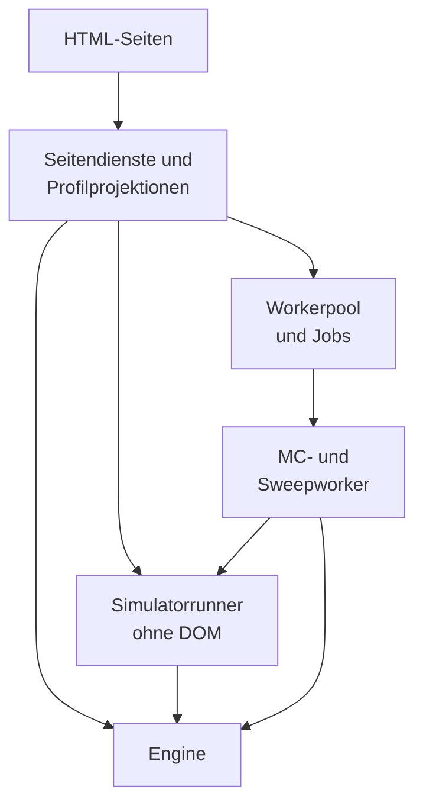
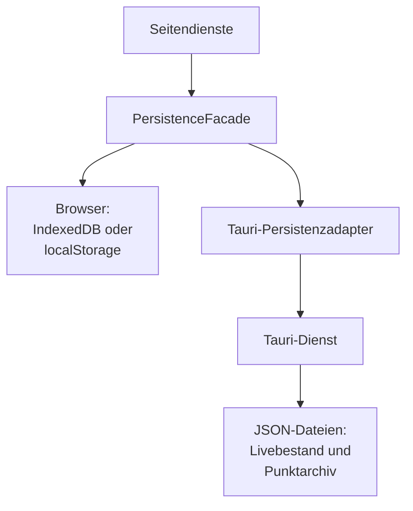
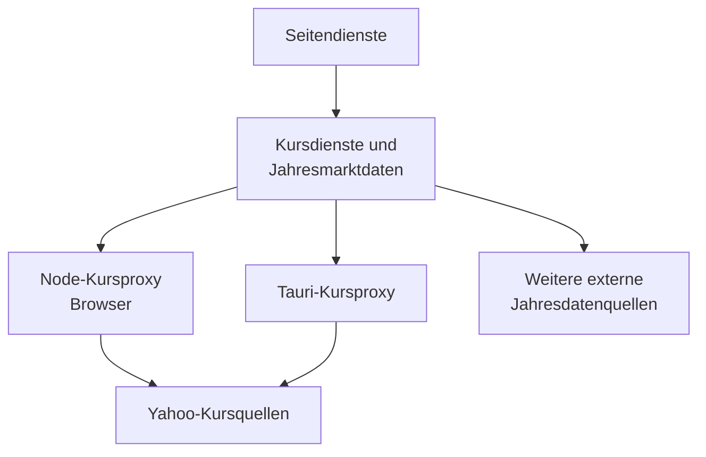

# Technische Architektur

Vermögen & Ruhestand läuft als lokale Browseranwendung oder in einer Tauri-WebView. Beide Laufzeiten laden dieselben HTML-Seiten und nativen ES-Module. Fachrechnungen brauchen keinen Serverdienst; externe Abrufe ergänzen Kurse, Inflation und CAPE.

**Lizenz:** MIT. [Lizenztext](../../LICENSE.md), [npm-Metadaten](../../package.json) und [Cargo-Metadaten](../../src-tauri/Cargo.toml) nennen dieselbe Projektlizenz. Daten und eingebundene Assets haben eigene Herkunfts- und Lizenzangaben.

Das [Fachkonzept](FACHKONZEPT.md) beschreibt Modell und Aussagegrenzen. [Datenverträge](DATENVERTRAEGE.md) führen Speicher- und Austauschformate. Die [Engine-Referenz](../../engine/README.md) führt Aufrufverträge; Prüfwege stehen im [Test-README](../../tests/README.md).

## Schichten und Laufzeiten

| Schicht | Einstieg oder Verzeichnis | Verantwortung |
| --- | --- | --- |
| Seiten | HTML-Dateien an der Repositorywurzel | Statischer Rahmen, Felder und Hosts für Renderer |
| Seitendienste | `app/` | Daten lesen, Nutzeraktionen koordinieren, Ergebnisse anzeigen |
| Fachkern | `engine/` | Jahresbedarf, Marktanalyse, Entnahme, Transaktionsvorschlag, Steuer-Settlement |
| Pfadrechnung | DOM-freie Module in `app/simulator/` | Mehrjahresstate, historische und gezogene Pfade, Lebensereignisse, Aggregation |
| Hintergrundrechnung | `workers/` | Jobs ausführen, Ergebnisse übertragen und Abbruch abwickeln |
| Daten | `app/shared/persistence-*.js` | Cache, Adapter, bestätigte Writes und Migration |
| Desktop | `src-tauri/` | WebView, lokale Dateien, Kursproxy und Fensterabschluss |

Die Seiten laden ES-Module für Seitendienste und Profilprojektionen. Balance ruft die Engine direkt auf; der Simulator verwendet DOM-freie Runner und kann Jobs über den Workerpool ausführen. Worker importieren Runner und Enginequellen selbst. Das erste Diagramm zeigt Seiten und Rechenpfade.

Die PersistenceFacade wählt im Browser IndexedDB oder den localStorage-Ersatz, im Desktop den Tauri-Adapter. Der native Dienst hält WebView, Dateiablage und Desktop-Kursproxy. Die WebView lädt die HTML-Seiten. Der Speicherpfad hat eigene Adapter und Dateiablagen.

Im Browser kann der Node-Kursproxy laufen. Der Desktop-Kursproxy gehört zum nativen Tauri-Dienst. Die Kursdienste rufen den lokalen Proxy auf; die Jahresmarktdaten haben zusätzliche externe Abrufwege.

Quellen: [Balance.html](../../Balance.html), [Simulator.html](../../Simulator.html), [index.html](../../index.html), [depot-tranchen-manager.html](../../depot-tranchen-manager.html), [Ausgaben.html](../../Ausgaben.html), [Daten-Sicherung.html](../../Daten-Sicherung.html) und [Handbuch.html](../../Handbuch.html) für Moduleinstiege; [simulator-monte-carlo.js](../../app/simulator/simulator-monte-carlo.js), [worker-job-runner.js](../../app/simulator/worker-job-runner.js), [worker-pool.js](../../workers/worker-pool.js) und [mc-worker.js](../../workers/mc-worker.js) für Runner-/Workeraufrufe; [persistence-facade.js](../../app/shared/persistence-facade.js) und [persistence-adapter-tauri.js](../../app/shared/persistence-adapter-tauri.js) für Adapter; [src-tauri/src/lib.rs](../../src-tauri/src/lib.rs) und [tauri.conf.json](../../src-tauri/tauri.conf.json) für WebView, Dateien und Desktopproxy; [tranchen-price-service.js](../../app/tranches/tranchen-price-service.js), [annual-marketdata.js](../../app/shared/annual-marketdata.js), [yahoo-proxy.cjs](../../tools/yahoo-proxy.cjs) und [serve.mjs](../../scripts/serve.mjs) für Kursabrufe und Browserproxy.

### Einstiegspunkte

| Seite | Einstieg | Funktion |
| --- | --- | --- |
| Übersicht, `index.html` | `app/overview/overview-main.js` | Vermögen, Budget, Arbeitsstand und Abschlusszugänge |
| Personen & Vermögen, `depot-tranchen-manager.html` | `app/tranches/tranchen-manager-page.js` | Personen, Haushalt & Plan, Tagesgeld, Depot und Verlauf |
| Ausgaben, `Ausgaben.html` | `app/expenses/expenses-main.js` | Personengebundene CSV-Importe, Monats- und Jahresansichten |
| Balance, `Balance.html` | `app/balance/balance-main.js` | Jahresplanung, unterjährige Vorschau und Diagnose |
| Simulator, `Simulator.html` | `app/simulator/simulator-main.js` | Historische und mögliche Zukunftspfade, Werkstatt |
| Daten & Sicherung, `Daten-Sicherung.html` | `app/data/data-page.js` | Vollsicherung, Wiederherstellung, Austausch, Kurs- und Speicherstatus |
| Handbuch, `Handbuch.html` | [handbook.js](../../app/handbook/handbook.js) | Kapitelnavigation, Textsuche und Hilfesprünge ohne Fachschreibzugriff |

Die Seiten sind getrennte Dokumente. Ein Wechsel beendet den Seitenkontext. Persistente Belege verbinden die Seiten; ein DOM-Element, Workerjob oder offener Entwurf gehört seinem aktuellen Dokument. `src-tauri/tauri.conf.json` bindet `dist/` als Frontend ein. Die Startfenstergröße ist 1920×1080; Gestaltungsregeln stehen im [Designsystem](../design/designsystem.md).

Die Übersicht ordnet den nächsten Abschluss vor die Karten für Vermögen, Monatsbudget und Plan. Diese drei Karten ordnen Titel, Hauptwert, Bezug und Navigation gleich an. Personen & Vermögen steht links unter der Vermögenskarte, der Ausgabenstand rechts daneben. Die bisherigen Kartenbreiten bleiben im gespiegelten 5:7-Raster erhalten. Beide stehen vor dem 176 Pixel hohen Verlaufsdiagramm. Der Verlauf auf der Übersicht zeigt zwei Kennzahlen: letzter Tagesabschluss und Veränderung mit Messzeitraum. Bestände nennen das Ansichtsdatum, Budget und Ausgaben ihren Bezugszeitraum.

Jahresvergleich und Tagesverlauf lesen verschiedene Quellen: Jahresgrenzstände mit belegtem Umfang beziehungsweise Tageswerte ab dem tatsächlichen Messbeginn. Der Renderer verspricht bei unklarem historischem Umfang keinen Vergleich nach dem ersten Jahresendstand. Zum Verlauf → öffnet den bestehenden Verlaufsreiter. Dort rendert `tranchen-history-closures.js` Aufteilung und fünf Tageskennzahlen in der Gruppe Aus Tageskursen, getrennt von Aus erfassten Ständen. Die Tagesgruppe verwendet die unveränderte Bewertungsprojektion samt Messbeginn und Status. Ihre Zeitraumwahl nutzt `projectProfileWealthHistory`; Abschlussrauten erweitern nur die Zeichnungsachse. Längere Lesehilfen stehen im ⓘ.

Budgetkarte und Ausgabendiagramm lesen für ihr jeweiliges Jahr den beschlossenen Plan vor der gespeicherten Vorschau. Status und Aktualität kommen aus dem Planvergleich; eine Vorschau erhält eine gestrichelte Budgetlinie. Die Kurspille nennt bei einem Abruffehler zuerst das älteste gespeicherte Kursdatum im gewählten Umfang. Die Zeit des fehlgeschlagenen Versuchs ersetzt diesen Stand nicht. Technische Gründe bleiben im vorhandenen Kursdetailfeld.

Die Ausgabenseite gestaltet Jahres- und Personenfilter mit denselben Segmentregeln. Der Monatsrenderer zeigt kurze Aktionshinweise; die Hilfe verwendet `bindInfoPopovers`. `renderExpensesPage` skaliert Kategorienbalken relativ zum größten positiven Kategoriebetrag und erhält die echten Anteile. Der Jahresrenderer zeigt bei einem importierten Jahr eine Zusammenfassung, ab zwei Jahren Säulen mit höchstens 64 Pixel Breite. Die Wertetabelle und die Definition positiver Datenmonate bleiben erhalten. Restbudget bezeichnet Jahresbudget minus bestätigte Ausgaben.

### Gemeinsame Daten und Schreibbesitz

`app/profile/` trennt geöffnete Person, aktives Liveprofil und Mitglieder des Haushalts. Balance und Simulator bauen daraus eigene Eingabeprojektionen. `household-plan.js` liefert den gemeinsamen Plan für einen kanonischen Bereich. `profile-context-reader.js` liest den Profilkontext; `profile-person-data.js` leitet Alter und Jahresrente ab. Lesen allein bestätigt keine Personenumstellung und schreibt keinen neuen Bestand.

Personen & Vermögen setzt die Reiter direkt unter den kompakten Seitentitel. Der Ansichtsrenderer blendet + Person anlegen im Verlauf aus; bei Plan und Person steht der Knopf rechts in der Reiterzeile. Die Kurszeile und ihre ⓘ-Details lesen dieselben gespeicherten Kursstände. Vermögenskarten, offene Bedarfszeile und Weitere Planwerte stehen im Planpanel untereinander. Die Personenansicht verbindet Namen und Kartenaktionen im Kopf von Auf einen Blick; Tagesgeld, Nettorente und sonstige Einkünfte sind direkt bearbeitbar. Weitere Planwerte, Vermögensdetails und die drei Personendetailkarten starten geschlossen; ihre Klappzustände werden nicht persistiert.

Gold und Pflegereserve verbinden Zusammenfassung, Textklappe und Aktivschalter in einer Kopfzeile. Die Schalter liegen außerhalb der Klappknöpfe und bedienen die bisherigen Wertträger. Klappaktionen verwenden ▸ zeigen und ▾ ausblenden; Sprunglinks erscheinen im Messington mit Pfeil. Das Haushaltsraster hebt die gespeicherte aktive Person nicht hervor. Kauf und Verkauf haben im Depotkopf dieselbe sekundäre Knopfrolle. Feldkennungen und Speicherbesitzer bleiben erhalten.

Geldfelder stehen rechtsbündig; der lokale Zahlenadapter gruppiert ihre Anzeige ohne Rundung und entfernt die Gruppierung beim Bearbeiten. Er hält den kanonischen Feldwert getrennt vom Anzeigetext, damit Dezimalpunkte ihre bisherige Bedeutung behalten. Formatierungswechsel erzeugen keine Eingabeereignisse oder Writes.

Die Verantwortung für reale Daten liegt bei Personen-, Tagesgeld-, Tranchen- und Abschlussdiensten. Balance plant Verkäufe auf einer Kopie der Lots. Simulatorrunner arbeiten auf eigenen Portfolios. Weder eine Empfehlung noch ein Simulationsergebnis darf `depot_tranchen` als ausgeführten Verkauf fortschreiben.

Die Zuordnung von Modulen steht in den Referenzen für [Balance und Übersicht](BALANCE_MODULES_README.md), [Simulator](SIMULATOR_MODULES_README.md) und [Personen und Depot](TRANCHEN_MODULES_README.md).

## Seitendienste

### Gemeinsamer Seitenrahmen

[suite-frame.js](../../app/shared/suite-frame.js) verbindet Navigation, Profilanzeige, Hilfe und den Status des aktuellen Bereichs. [profile-navigation.js](../../app/profile/profile-navigation.js) sichert Profilwechsel und Navigation über die Persistenzschicht. [suite-sidebar-preference.js](../../app/shared/suite-sidebar-preference.js) hält die Seitenleistenwahl; sie ist eine Darstellungspräferenz.

Lokale Schrift- und SVG-Dateien liegen unter `assets/`. Formatter in `app/shared/` und in den Features erzeugen die Anzeige. Die Geldbeträge der Rechenverträge bleiben Zahlen; eine deutsche Formatierung ist kein Speicher- oder Rechenformat. Symbol- und Schriftlizenzen stehen in [Assets](../../assets/README-schriften-symbole.md).

### Seitenstart und fachliche Uhr

[probelauf-ui.js](../../app/shared/probelauf-ui.js) und [probelauf-state.js](../../app/shared/probelauf-state.js) koppeln Seitenbereitschaft an den bestätigten Persistenz- und Probelaufzustand. Ein defekter Rückkehrpunkt oder eine fremd veränderte Phase sperrt Writes. Seiten dürfen daraus keinen leeren Haushalt erzeugen. [probelauf-price-ui.js](../../app/shared/probelauf-price-ui.js) liefert „Testkurse, nicht echt“ und die Erklärung zu künstlichen Kursen, Stückzahlen und Tagesgeld. Das Übersichtsmodell verwendet den Hinweis bei gesetztem Testdatum; der Renderer bindet die vorhandenen ⓘ-Popover. Der gemeinsame Probelaufrahmen kennzeichnet die Manager-Kurszeile, ihre bestehenden Details und die Zusammenfassung des Startkursberichts. Das Abrufresultat bleibt im Bericht erhalten. Ein auf den Kopfkontext begrenzter Beobachter erhält den Hinweis nach erneutem Rendern. Der Adapter schreibt keine Fachdaten.

[app-clock.js](../../app/shared/app-clock.js) stellt das fachliche Datum bereit. Ein Probelauf kann es ändern. Technische Zeitmessung und Seedable-RNG werden dadurch nicht zu derselben Uhr. [planning-start.js](../../app/shared/planning-start.js) leitet den ersten Planungsmonat ab; [annual-coordinator.js](../../app/shared/annual-coordinator.js) ordnet den Jahresstatus. Der fachliche Kalender darf auch außerhalb Januar auf einen fehlenden Jahresabschluss hinweisen.

### Navigation und laufende Operationen

[navigation-guard.js](../../app/shared/navigation-guard.js) verwaltet Entwürfe, verfügbare Ergebnisse und Operationen. Eine Operation erhält einen eigenen Lebenszyklus und prüft ihren Kontext vor dem Commit. Rechenläufe können vor einer Navigation abgebrochen werden. Ein bestätigender Write braucht einen anderen Abschluss als ein verworfener Entwurf.

[page-dialog.js](../../app/shared/page-dialog.js) und [page-choice-dialog.js](../../app/shared/page-choice-dialog.js) bieten gemeinsame Seitendialoge. [navigation-guard-dialog.js](../../app/shared/navigation-guard-dialog.js) verbindet den Guard mit deren Darstellung. Die Tauri-Schließanforderung läuft über die Facade und bestätigt den Fensterabschluss erst nach dem Speicherversuch. Ein bloß gestarteter Flush bestätigt noch keine Speicherung.

Personen & Vermögen registriert beim Guard über `registerBeforeLeave` einen Saver für offene Tagesgeldwerte. Er bestätigt den Feldwert vor der Verlustentscheidung für Seitenwechsel und Tauri-Schließen. Personenwechsel sichert ihn über den bestehenden Profilwriter. Im Browser beginnt `beforeUnload` denselben Write synchron; der Commitgrund verhindert das Schließen während des Flushs. Ein Speicherfehler hält den Wiederholungsauftrag auf der Seite.

### Monats- und Jahresabschluss

Der Monatsdialog in [overview-month-confirmation.js](../../app/overview/overview-month-confirmation.js) führt durch Kurse, Ausgaben, Budget und Tagesgeld. Der Jahresdialog in [annual-close-dialog.js](../../app/shared/annual-close-dialog.js) ergänzt Marktdaten und Plan. Beide nutzen dieselbe CSV-Auswahl mit verborgenem Dateifeld, Dateiname und Ersetzenbereich bei vorhandenem Import. [overview-example-expenses.js](../../app/overview/overview-example-expenses.js) bindet den sichtbaren Knopf an den bestehenden Importbesitzer und dessen Sperren. Dateiname und geöffnete Ersetzenbereiche bleiben bei Modellupdates dokumentlokal erhalten. Die gemeinsame CSS-Komponente sperrt das Hintergrundscrollen; nur der Inhalt zwischen Kopf und Abschlussbereich scrollt. Besuche und bestätigte Tagesgeldstände sind eigene Nachweise. Ein Import darf die übrigen Schritte nicht ungesehen abhaken.

Im Jahresdialog projiziert [annual-plan-editor.js](../../app/shared/annual-plan-editor.js) das bereits berechnete Budget und die Vermögensentnahme vor dem Planvergleich. Die Personenprojektion liefert die Rentenanteile und Bezugsmonate; Altersherleitungen liegen in geschlossenen Berechnungsgrundlagen. [annual-close-result.js](../../app/shared/annual-close-result.js) trennt Monats- und Jahresvollständigkeit. Die lesende Jahresprojektion nennt fehlende Personen je Monat und bewahrt den Rückblick auch in der anschließenden Monatsphase. Haken belegen angesehene Schritte; Datenlücken bleiben sichtbar und ändern keine Abschlussbedingung.

Die Verkaufsaufstellung liest Person, Wertpapier samt ISIN und Nettoerlös aus den bestätigten Quellen der Handlungsanweisung. Fehlende Personennamen werden über die Personenprojektion zugeordnet; ohne eindeutige Zuordnung bleibt ein Hinweis. Brutto und Steuer liegen in geschlossenen Details. Der gemeinsame Ergebnisrenderer nimmt einen Erfolgstext für Dezember, Jahr und festgeschriebene Handlungsanweisung entgegen. Der Jahresadapter hält Abschlussbedingungen, Belegerläuterung und Protokoll im Inhalt; der feste Fuß zeigt den kompakten Sicherungshinweis, die nächste Handlung und den Abschlussknopf. Die Anzeige verändert keine Belegrecords.

Der Monatsadapter lässt [close-dialog.js](../../app/shared/close-dialog.js) Fortschritt aus den Besuchen anzeigen; Budgetabweichungen bleiben eigene Ergebnisse. [tagesgeld-fields.js](../../app/shared/tagesgeld-fields.js) führt im Monatsdialog Personenhinweise und Bestätigungsknopf mit dem flüchtigen Bestätigungszustand mit. Die Feldbeschriftung nennt den Abschlusstag, entsprechend `storeMonthWithCash` und dessen `localHistoryDate(now())`. Die Entnahme für den laufenden Monat verwendet weiter `summary.monthlyWithdrawal`; das Vergleichsbudget bleibt `expenseBudget`. Der Erfolg ersetzt die Vorbereitung einschließlich Verwerfhinweis durch den Beleg und den nächsten Termin. Diese Anzeige ändert weder Abschlussbedingungen noch Speicherwege.

Beide Abschlüsse und Verkaufsbuchungen führen Tagesgeld über [profile-cash-update.js](../../app/profile/profile-cash-update.js) und den gemeinsamen `appendCashHistory` fort. Der Verlauf ersetzt nur den geschriebenen Tagesstand. Abschluss- und Verkaufsaudit behalten ihre eigenen Nachweise unabhängig von späteren Änderungen dieses Tages.

Der Jahresdienst rechnet aus Speicherwerten, ohne eine offene Balance-Seite vorauszusetzen. Vorbereitung und Vorschau entstehen vor dem mutierenden Commit. Danach prüft der Koordinator Kontext und Ausgangsbestand erneut. Empfehlung, bewusste Planänderung und beschlossener Plan bleiben unterscheidbar.

Ein Hauptklick kann das Jahr und anschließend den Dezembermonat schließen. Das sind zwei bestätigte Speichergrenzen mit eigenen Wiederherstellungspunkten. Scheitert die Monatsphase, bleibt das bestätigte Jahr erhalten; der Rückweg wiederholt die fehlende Monatsphase. Die konkrete Belegform steht in [Abschlüsse](DATENVERTRAEGE.md#abschlüsse-und-ausgaben), die Fachbedeutung im [Fachkonzept](FACHKONZEPT.md#jahresbeschluss-und-vorschau).

### Planversuche und Ergebnisbesitz

[plan-trial.js](../../app/shared/plan-trial.js), [balance-plan-trial.js](../../app/balance/balance-plan-trial.js) und [simulator-plan-trial.js](../../app/simulator/simulator-plan-trial.js) trennen den gemeinsamen Plan vom Versuch. Eine Rechnung mit abweichenden Werten übernimmt diese nicht automatisch. Eine Übernahme projiziert die gewählten Planfelder zurück in denselben Bereich.

Die Herkunft übernommener Werte steht im Kartenkopf. [field-state.js](../../app/shared/field-state.js) erhält den zugänglichen Grund am Feld und setzt ihn außerhalb eines Einheitenrahmens. `css/components.css` führt dafür den gemeinsamen Stil, `css/tokens.css` die Wertgrößen `--value-lg` und `--value-md`. Balance zeigt Bedarf, Bestände und Marktdaten offen; die weiteren Parameter liegen in einem beim Seitenaufruf geschlossenen Bereich. Der kompakte Balance-Kopf führt den Jahresabschluss; die Marktdatenkarte öffnet mit Marktdaten im Jahresabschluss prüfen denselben Dienst. Der frühere zusätzliche Marktdaten-Kopfzugang entfällt. Die Vorschau-Details bleiben über Details & Drucken erreichbar.

Der Simulator zeigt dieselben Bedarfswerte offen und bündelt die weiteren Plan- und Monte-Carlo-Einstellungen unter Alle Parameter. `mcSetupDisclosure` bleibt der Wertträgerhost; Einstellungen anzeigen wechselt von Monte Carlo zu Annahmen und öffnet ihn. Sichtzustände ändern keine Records.

[simulator-person-overrides.js](../../app/simulator/simulator-person-overrides.js) hält Personenalternativen im Seitenkontext. Offen stehen unter jeder Namensüberschrift Rentenbeginn und monatliche Rente nebeneinander in festen Spalten mit `--value-lg`. Sonstige Einkünfte werden weder angezeigt noch eingerechnet; vorhandene gespeicherte Einkommensabweichungen werden ignoriert. Weitere Werte und gemeinsame Rentenanpassung liegen in Details zur Person; der Abweichungsschalter öffnet sie. Pflege zeigt Titel, Zusammenfassung, Annahmen zeigen und Schalter in einer Zeile. Reservebetrag und Erhaltungshinweis stehen im `.ds-info` am Schalter; `simCareReserve` bleibt der aktualisierte Werthost. Die native Pflegeklappe startet geschlossen und verteilt Klapptitel und Inhalt über das Kartenraster. Der Lauf erhält einen eingefrorenen `personDataContext`; spätere Eingaben ändern diesen Laufbeleg nicht. Ergebnisdateien verwenden den Beleg des abgeschlossenen Laufs.

## Rechenpfade

### Engine-Einstieg

[engine/index.mjs](../../engine/index.mjs) exportiert `EngineAPI` und `_internal_calculateModel`. [engine/core.mjs](../../engine/core.mjs) normalisiert den Aufruf, validiert Input und Vorstate und koordiniert die Fachmodule. Der Core verbindet Marktanalyse, SpendingPlanner, Transaktionsplanung und finales Settlement. Die Entscheidungsschritte stehen in [ENGINE_DECISION_LOGIC](ENGINE_DECISION_LOGIC.md); Methoden und Fehlerformen im [Engine-README](../../engine/README.md).

`engine.js` ist im aktuellen Auslieferungspfad ein generierter ES-Modul-Wrapper. Er importiert `engine/index.mjs`, setzt die Browserglobals und exportiert den Legacy-Alias `Ruhestandsmodell_v30`. Fachmodule und Worker importieren die Quellen direkt. Die UI prüft Version und Methoden über ihren Engine-Handshake, bevor sie rechnet.

### Balance-Aktualisierung

[balance-main.js](../../app/balance/balance-main.js), [balance-input-storage.js](../../app/balance/balance-input-storage.js) und [balance-update-pipeline.js](../../app/balance/balance-update-pipeline.js) teilen Eingabebau, Rechnung und Speichermodus. Eine Vorschau verwendet den aktuellen Bestand, ohne den Jahresbeleg zu ersetzen. `PERSIST_INPUTS` und `COMMIT_PERIOD` haben zusätzliche Writegrenzen.

`sourceProfileId` bleibt an den Lots des Haushaltspools erhalten. [profilverbund-action-attribution.js](../../app/profile/profilverbund-action-attribution.js) ordnet Quellen, Steuer und Verwendungen zurück zu den Personen. Eine Abweichung jenseits der Centtoleranz blockiert das Ergebnis. Geplante Quellen bleiben vom realen Depot getrennt.

### Ein Simulatorjahr

[simulator-engine-direct.js](../../app/simulator/simulator-engine-direct.js) führt einen Finanzschritt aus. Der Runner ergänzt Marktjahre, Lebensereignisse und das Ende des Pfads. `simulator-engine-input.js` baut den Engineinput; Portfolio-, Forced-Sale-, Bond- und Steuer-Recompute-Module verändern nur den Simulatorstate.

Das Ergebnis unterscheidet `success`, `ruin` und `technical_error`. Ein ungültiger Engineaufruf darf nicht als wirtschaftlicher Ruin klassifiziert werden. Der Rückgabestate enthält die fortgeschriebenen Bestände und den Inflationsfaktor für das nächste Jahr. Zur Reihenfolge und Geldbasis führt [Zeit und Geld](FACHKONZEPT.md#zeit-und-geld).

### Historischer Backtest

[historical-backtest-contract.js](../../app/simulator/historical-backtest-contract.js) prüft die inklusive Periode und die Jahresrecords vor dem ersten Finanzschritt. Der [Runner](../../app/simulator/historical-backtest-runner.js) rechnet ohne DOM. Fehlende Pflichtjahre erzeugen `incomplete`, ohne mit Ersatzrenditen weiterzurechnen.

UI, Summary und Jahresprotokoll teilen das kanonische Resultat. [historical-backtest-cohorts.js](../../app/simulator/historical-backtest-cohorts.js) rechnet feste rollierende Horizonte und erfasst unzureichende, defekte oder abgebrochene Fälle getrennt. Der Raw-Export enthält Request, Periode, Ergebnis und Provenienz. Seine Portfoliogrenzen sind kein fortsetzbarer Speicherstand.

### Monte Carlo und Worker

[simulator-monte-carlo.js](../../app/simulator/simulator-monte-carlo.js) besitzt den Laufstatus und verbindet UI, seriellen Runner und Workerpool. [monte-carlo-runner.js](../../app/simulator/monte-carlo-runner.js) berechnet Pfade ohne DOM. [mc-worker.js](../../workers/mc-worker.js) führt Jobs aus, [worker-pool.js](../../workers/worker-pool.js) verwaltet Worker und Generationen.

[monte-carlo-chunk-result.js](../../app/simulator/monte-carlo-chunk-result.js) transportiert typisierte Buffer, Missingness, Outcome-Zähler, Heatmap und benötigte Pfadstatistiken. Bei Mindest-Flex werden Laufstatistiken übertragen; gepoolte Jahresserien sind keine gleichwertige Aggregation.

Die Anzeige stellt Median der Jahresanteile und betroffene Läufe gleichwertig nebeneinander. Deckungswerte nennen Zähler und Nenner; Teilerfolg rundet nie sichtbar auf 100,0 %. Verteilungsperzentile stammen aus derselben gewählten Endwertpopulation. Szenarioläufe bleiben getrennt nach nominalem Rang auswählbar. Der Euro-Schalter verändert nur Verteilung, Vermögensfächer und Szenarioverläufe samt Auswahl; die übrigen Geldbasen sind sichtbar bezeichnet. `results-formatting.js` kürzt Geldbeträge an der Anzeigegrenze. Das Histogramm zeigt zunächst Median und P25–P75; der native Markenschalter und die Detailklappe behalten ihren Sitzungszustand beim Euro-Wechsel. Rohwerte, Quantile und Exportprojektionen bleiben unverändert.

Ein Workerfehler kann einen seriellen Ersatzlauf auslösen. Ein Nutzerabbruch durchläuft den Abbruchpfad und startet keinen Fallback. [worker-job-runner.js](../../app/simulator/worker-job-runner.js) und der Pool verwerfen die betroffene Generation und erledigen ihre ausstehenden Promises. Alte Ergebnisse dürfen keinen späteren Lauf abschließen. Der Legacy-RNG-Stream läuft seriell; die Pfadidentität der Seedverträge ist Teil der [Simulatorreferenz](SIMULATOR_MODULES_README.md).

### Werkstatt

Stresspfad-Replay verwendet den materialisierten Markt- und Ereignispfad für Vergleichsvarianten. `stress-replay-runner.js` und seine Contract-, Export- und Vergleichsmodule halten diesen Pfad getrennt von neuen Zufallsziehungen. Ein Parameter-Sweep rechnet Varianten über `sweep-runner.js`; Auto-Optimize verteilt Kandidatenbewertungen über seine Workeranbindung und denselben Pool.

Suchraum, Bewertung und Übernahme stehen in [AUTO_OPTIMIZE_DETAILS](AUTO_OPTIMIZE_DETAILS.md). Die Bewertung eines Kandidaten übernimmt ihn nicht in den gemeinsamen Plan. Rechenresultate brauchen ihren eigenen Laufkontext; die Übersicht liest nur die bestätigte Kurzfassung.

## Speicher und Schreibgrenzen

### Facade und Adapter

[PersistenceFacade](../../app/shared/persistence-facade.js) stellt einen synchron lesbaren Seitencache vor einem asynchronen Backend bereit. `setItemSync` und `removeItemSync` markieren vorbereitete Änderungen. Der entprellte Flush schreibt Batches in eine serialisierte Kette. Erfolg ist erst nach der Backendbestätigung belastbar; ein Fehlversuch erhält die offenen Änderungen und den Fehlerstatus.

| Laufzeit | Adapter | Ablage |
| --- | --- | --- |
| Browser | `persistence-adapter-indexeddb.js` | IndexedDB `ruhestand-suite`, Version 2, Stores `kv`, `metadata`, `snapshots` |
| Browserersatz | `persistence-adapter-localstorage.js` | Stringrecords des aktuellen Origins, Archivrecord separat |
| Tauri | `persistence-adapter-tauri.js` | `ruhestand_suite_data.json` und `ruhestand_suite_snapshots.json` im nativen App-Datenordner |

Die Facade wählt den Adapter nach Laufzeit und Verfügbarkeit. Ältere localStorage-Daten werden über Marker und Rückleseprüfung migriert. Ein fehlerhafter Browser-DB-Upgrade oder ein Dateilesefehler ist kein Anlass, Daten still als leer zu behandeln. Browserorigin und Desktopordner sind getrennte Speicherorte; ein Serverportwechsel kann einen anderen Browserbestand sichtbar machen.

[persistence-location.js](../../app/shared/persistence-location.js) fragt den Desktopordner bei Tauri ab und kann ihn öffnen. Der native Dienst bestimmt das Ziel; die UI übergibt keinen beliebigen Dateipfad. Im Browser gibt es für IndexedDB keine vergleichbare Ordnerauskunft.

### Transaktionale Operationen und Recovery

`replaceRecordsTransactional` vergleicht erwartete Ausgangsrecords, schreibt den zugelassenen Umfang, liest ihn zurück und führt die fachliche Nachprüfung aus. Bei Fehler versucht der Besitzer die Rücknahme und meldet gesondert, wenn sie nicht bestätigt ist. `blockSyncWrites` verhindert dann, dass ein altes Formular die Wiederherstellung überschreibt.

Die Facade und [annual-operation-lock.js](../../app/shared/annual-operation-lock.js) koordinieren mutierende Dienste. Der Probelaufschutz serialisiert Writes mit Web Locks oder seiner Ersatzkette. Eine im Speicher vorhandene Probelaufphase wird mit dem bestätigten Record verglichen, bevor unabhängige Writer fortfahren.

[snapshot-archive.js](../../app/shared/snapshot-archive.js), [snapshot-restore.js](../../app/shared/snapshot-restore.js) und [snapshot-retention.js](../../app/shared/snapshot-retention.js) trennen Capture, Wiederherstellung und Aufbewahrung. Ein Snapshot ist ein lokaler Rückkehrpunkt mit eigenem Umfang. Eine Vollsicherung ist ein extern speicherbarer Export der zugelassenen Apprecords. Formate und Restoregrenzen stehen in [Datenverträgen](DATENVERTRAEGE.md#sicherung-austausch-und-wiederherstellung). [data-snapshot-presentation.js](../../app/data/data-snapshot-presentation.js) bildet Anlassbezeichnungen und die bestehenden Zeilensperren für Liste, Vorschautitel und Verfügbarkeitszählung ab. Gesperrte Punkte verhindern eine grüne Zusammenfassung. Diese Projektion ändert weder Snapshotrecords noch Restoreentscheidungen.

[data-prices.js](../../app/data/data-prices.js) projiziert getrennt den Abrufbefund, brauchbare gespeicherte Kurse und die bestätigten Tageskursintervalle. Alte gültige Kurse zählen als gespeicherter Stand, ohne als aktuell zu gelten. [data-renderer.js](../../app/data/data-renderer.js) zeigt Abruffehler bei brauchbaren Beständen gelb und fehlende oder unlesbare Kursdaten rot. Offene Abrufzeiträume ohne nachgewiesenen Datenfehler bleiben gelb; ungeklärte Wertpapiere verhindern die Meldung vollständiger Tageskurse. Dienstprüfung und Kursabruf behalten getrennte Rückmeldungen. Versuchszeit und rohe Ursachen stehen in den technischen Details.

Der Sicherungsblock zeigt bei gültiger Vergleichsbasis Änderungen an Monatsabschlüssen, Tagesgeld-Einträgen und Tranchen. [data-backup-summary.js](../../app/data/data-backup-summary.js) vergleicht deren Signaturen über alle Profile; Tagesgeld-Basiswerte, Ausgaben und Planannahmen gehören nicht zu diesem Vergleich. Fehlt die passende Basis, entfällt die Änderungszeile. Die Speicherkarte zeigt die bestehende Größenmessung als Gesamtgröße und drei Teilgrößen. Der bestätigte Desktoppfad liegt unter „Speicherort anzeigen“, während „Ordner öffnen“ direkt erreichbar bleibt. Aufbewahrungsregeln sind ebenfalls eingeklappt; Messung, Bridge und Retentionplan bleiben unverändert.

### Native Dateigrenze

[src-tauri/src/lib.rs](../../src-tauri/src/lib.rs) legt Live- und Archivdatei fest. Der Dateiwriter nutzt eine temporäre Datei und ersetzt das Ziel über den nativen Pfad. Eine beschädigte Live-Datei kann über `quarantine_app_state` gesichert werden. Die Quarantäne erhält Rohdaten; sie ist keine automatisch erfolgreiche fachliche Reparatur.

Eine Tauri-Datei bestätigt ihren eigenen Write. Monats- und Jahresbelege sowie Live- und Archivdatei bilden dadurch keine gemeinsame dateiübergreifende Datenbanktransaktion. Recovery und Rückleseprüfung bleiben erforderlich.

## Build und Auslieferung

### Browserstart und Kursdienst

[serve.mjs](../../scripts/serve.mjs) liefert die Dateien über HTTP aus und stellt Buildprovenienz für den Browser bereit. `npm run serve` und `start_suite.cmd` verwenden diesen Pfad. Voraussetzungen und Fehlerhilfe stehen in [Einrichtung und Betrieb](../guides/EINRICHTUNG_UND_BETRIEB.md#im-browser).

Server und Kursproxy binden standardmäßig an `127.0.0.1`, auf Port 8000 und 8787. `npm run serve -- --open` öffnet zusätzlich den Browser; `--port 8001` wählt einen anderen Webserverport und `--no-proxy` unterdrückt den Kursproxy. Die App sucht den Kursdienst weiter auf `127.0.0.1:8787`; `--proxy-port` allein stellt ihre Kursadresse nicht um. Strg+C beendet Server und Proxy zusammen.

Das Doku-Werkzeug [docs-bilder.mjs](../../scripts/docs-bilder.mjs) nutzt denselben Server ohne Proxy auf einem freien Loopback-Port. `npm run docs:bilder` öffnet Playwright Chromium mit drei isolierten Mustermann-Kontexten, festen Uhren und lokalen Marktdaten. Die 40 PNGs und das Herkunftsmanifest liegen in [docs/ui/](../ui/README.md); der Lauf gehört nicht in `npm test`.

[market-price-adapter.js](../../app/shared/market-price-adapter.js) verbindet Quotes mit ihrem Symbol, EUR-Währung, positivem Preis, UTC-Zeit und Quelle. Gespeicherte Kurse ermöglichen Lesen ohne neuen Abruf. Ein fehlender aktueller Kurs wird dadurch nicht zu einem neu bestätigten Marktwert.

Die Desktop-App startet einen eigenen Proxy auf `127.0.0.1:8787`; der Browserbetrieb kann [tools/yahoo-proxy.cjs](../../tools/yahoo-proxy.cjs) nutzen. Inflation und CAPE besitzen gesonderte Quellenketten. Die Tauri-CSP erlaubt die in `tauri.conf.json` genannten Abrufziele. Lokale Verarbeitung bedeutet deshalb nicht, dass jeder Liveabruf ohne Netzwerk auskommt.

### Engine-Wrapper

[build-engine.mjs](../../build-engine.mjs) versucht zunächst einen esbuild-Build. Ohne esbuild schreibt der nicht strikte Pfad den konstanten Modul-Wrapper. Mit esbuild entsteht ein IIFE-Bundle; es hält eine Kopie der Quellen fest und übernimmt spätere Moduländerungen nicht automatisch.

Der bestehende Browser- und Tauri-Vertrag verlangt den Modul-Wrapper. Eine Änderung der Engine-Fachlogik hinter `engine/index.mjs` braucht keinen Neuaufbau von `engine.js`. Neuerzeugung ist bei fehlendem Artefakt oder geändertem Generator, Import-Einstieg, Export- oder Globalvertrag nötig. Ein Bundlewechsel braucht eine eigene Vertragsänderung; der [Wrappertest](../../tests/engine-wrapper-contract.test.mjs) weist ein IIFE auch frisch gebaut zurück.

`npm run build:engine:strict` aktiviert den strikten Build. Auch `ENGINE_BUILD_STRICT` oder `CI` mit `1` oder `true`, ohne Beachtung der Groß-/Kleinschreibung, wirken strikt. Fehlt esbuild, bricht dieser Pfad vor dem Fallback ab. Strict ist keine Voraussetzung für die aktuelle Wrapperauslieferung.

### Commitgebundenes Frontend

[sync-dist.mjs](../../scripts/sync-dist.mjs) liest sämtliche Frontenddateien aus genau einem Git-Commit. Ohne `--rev` wählt es `HEAD`, verlangt einen sauberen getrackten Arbeitsbaum und verbietet unversionierte Laufzeitdateien, auch wenn Git sie ignoriert. Ein bewusst übergebenes `--rev <commit>` baut diesen Commit; lokale Änderungen gehen dabei nicht in `dist/` ein. Die Auswahl gilt für das Frontend; Tauri-Konfiguration und Rust-Quellen liest der anschließende Build aus dem Arbeitsbaum.

Kopiert werden HTML, JS und CSS an der Wurzel sowie `app/`, `engine/`, `workers/`, `types/`, `css/` und `assets/`. Wrapper und Enginequellen stammen aus demselben Commit. Das Skript startet keinen Engine-Build. Die PNGs unter `docs/ui/` und `CHANGELOG.md` werden für das Offline-Handbuch aus demselben Commit mitgeliefert. Fehlende eingebundene Handbuchbilder stoppen den Sync vor dem Schreiben. Sonstige Markdownreferenzen, Tests, Buildskripte, Rohdaten und das Bildwerkzeug gehören nicht zum Kopierumfang.

`__build-provenance.json` nennt `RuntimeBuildProvenanceV1`, `sourceCommit`, `sourceTreeStatus` und `provider`. [runtime-build-provenance.js](../../app/shared/runtime-build-provenance.js) validiert und hält diesen Beleg. Der Browserserver erzeugt die Herkunft für seinen aktuellen Quellstand; die Desktopauslieferung nennt den gewählten sauberen Commit. Ein fehlender Herkunftsbeleg darf nicht als bestätigter Commit ausgegeben werden.

### Desktopauslieferung

Die [Basiskonfiguration](../../src-tauri/tauri.conf.json) bestimmt WebView, CSP, Icons und Paketziele. Sie setzt den Produktnamen „Vermögen & Ruhestand Entwicklung“ und die Kennung `de.vermoegen-ruhestand.entwicklung`. [Cargo.toml](../../src-tauri/Cargo.toml) bestimmt Rust-Abhängigkeiten und den Paketnamen `vermoegen_und_ruhestand`. Beide npm-Buildbefehle synchronisieren zuerst das commitgebundene Frontend nach `dist/`.

| Befehl | Konfiguration und Windows-Ergebnis | Datenbereich |
| --- | --- | --- |
| `npm run build:release` | Tauri-Build mit `--no-bundle --config src-tauri/tauri.release.conf.json`; `src-tauri/target/release/VermoegenUndRuhestand.exe`, ohne Installer | `de.vermoegen-ruhestand.suite`, derselbe Bereich wie die ausgelieferte App |
| `npm run build:desktop` | `tauri:build` mit der Basis; `src-tauri/target/release/vermoegen_und_ruhestand.exe`, Bundle-Artefakte unter `src-tauri/target/release/bundle/` | `de.vermoegen-ruhestand.entwicklung`, eigener Entwicklerbereich |

Die [Release-Zusatzkonfiguration](../../src-tauri/tauri.release.conf.json) setzt `identifier` auf `de.vermoegen-ruhestand.suite`, `productName` auf „Vermögen & Ruhestand“ und `mainBinaryName` auf `VermoegenUndRuhestand`. Der Fenstertitel „Vermögen & Ruhestand“ stammt unverändert aus der Basis. Prüfkandidaten verwenden die Basiskennung mit `.kandidat`, also `de.vermoegen-ruhestand.entwicklung.kandidat`. Release, Entwickler und Kandidaten haben getrennte Datenbereiche. Die frühere `RuhestandSuite.exe` verwendet weiterhin `com.dieter.ruhestandsapp`; ein Datenwechsel erfolgt per Vollsicherung.

Der getrennte Windows-Build-Ordner `VermoegenUndRuhestand` liegt außerhalb des Repos auf dem Windows-Laufwerk, in WSL unter `/mnt/c/…/VermoegenUndRuhestand`. Seine Skripte lesen den Repo-Stand aus `~/repos/VermoegenUndRuhestand`; `~/repos/RuhestandsApp` bleibt als Symlink erreichbar. Der Cargo-Cache liegt unter `%LOCALAPPDATA%\VermoegenUndRuhestand\cargo-target`.

`sync-from-repo.sh` übernimmt die Release-Konfiguration aus demselben Commit, wenn sie dort vorhanden ist. `build.bat` baut standardmäßig produktiv mit dieser Konfiguration und bricht bei fehlender Datei oder abweichender Release-Kennung ab. Es verwendet die frische Ausgabe `release\VermoegenUndRuhestand.exe`, ersatzweise `release\vermoegen_und_ruhestand.exe`, und legt sie als `VermoegenUndRuhestand.exe` sowie unter `release-archive-vermoegen\` ab. `-Kandidat` baut `vermoegen_und_ruhestand.exe` mit der Kandidatenkennung und legt `VermoegenUndRuhestand_KANDIDAT_<datum>_<commit>.exe` unter `pruefkandidaten\` ab. `-AltApp` setzt ausdrücklich die alte Kennung per Override und legt `RuhestandSuite.exe` sowie das Archiv unter `release-archive\` ab; dieser Modus greift auf die alten App-Daten zu.

[package.json](../../package.json) verlangt Tauri-CLI `^2.5.0`; [package-lock.json](../../package-lock.json) legt für `npm ci` Version 2.9.6 fest. Cargo.toml verlangt Tauri `2.9.4` und `tauri-build` `2.5.3`. Das mitgelieferte CLI-Schema erlaubt Umlaut, Leerzeichen und `&` im Produktnamen und unterstützt [mainBinaryName](https://v2.tauri.app/reference/config/#mainbinaryname). Tauri ergänzt die Dateiendung `.exe` selbst; der Dateiname bleibt unabhängig vom lesbaren Produktnamen.

Die [Windows-Ressourcenerzeugung von tauri-build 2.5.3](https://github.com/tauri-apps/tauri/blob/tauri-build-v2.5.3/crates/tauri-build/src/lib.rs) übernimmt `productName` in `ProductName` und `FileDescription` der Versionsinformationen. Das in Cargo.lock festgelegte [tauri-winres 0.3.5](https://docs.rs/tauri-winres/0.3.5/src/tauri_winres/lib.rs.html) unterstützt gültige UTF-8-Texte. Die Release-Konfiguration setzt damit auch dort „Vermögen & Ruhestand“. Eine nachträgliche Umbenennung allein würde diese Metadaten nicht ändern.

Der native Dienst leitet den App-Datenordner mit `app.path().app_data_dir()` aus der Kennung ab. Der Dateiname oder Ablageort der EXE bestimmt den Datenbereich nicht. Release-Selbstbau und ausgelieferte App greifen unter demselben Windows-Benutzer auf dieselben Daten zu; Browser und Entwickler-Build haben getrennte Speicher.

Die EXE bleibt ein lokales Buildartefakt außerhalb des Repositorys. Voraussetzungen stehen unter [Selbst bauen](../guides/EINRICHTUNG_UND_BETRIEB.md#selbst-bauen). Anwendungsquellen werden in ihren Modulen gepflegt, `dist/` wird daraus erzeugt.

## Diagnose und Fehlerpfade

### Rechenfehler

[engine/errors.mjs](../../engine/errors.mjs) definiert strukturierte Validierungs- und Rechenfehler. Balance zeigt sie an, bevor ein ungültiges Ergebnis als neuer Planstand verwendet wird. Simulatorrunner führen technische Fehler getrennt von Ruin; Metriken behalten ihren Missingnessstatus.

Der optionale [Flex-Trace](../../engine/planners/flex-trace.mjs) protokolliert Änderungen in der Policyfolge. [balance-flex-trace.js](../../app/balance/balance-flex-trace.js) projiziert die Erklärung in die Diagnose. Trace und Renderer sollen den Rechenweg erklären; sie berechnen keine zweite Entnahme.

### Speicherfehler und Ersatzpfade

| Reaktion | Bedeutung | Beispiel |
| --- | --- | --- |
| Definierter Ersatzpfad | Berechnung oder Abruf geht mit gekennzeichneter Quelle weiter | serieller MC-Lauf nach Workerfehler |
| Bestand erhalten | Offene Änderungen oder Rohdaten bleiben für Wiederholung und Recovery erhalten | fehlgeschlagener Flush, beschädigter Tranchenrecord |
| Vorgang sperren | Ein Vertrag ist nicht erfüllt; mutierende Aktion bleibt gesperrt | ungültige Profilzuordnung, ungeklärte Rücknahme, fremd veränderter Probelauf |

Ein alter Kurs, fehlende Messdaten oder ein beschädigter Record dürfen nur nach dem jeweiligen Fachvertrag ersetzt werden. Ein Nullwert ist kein allgemeiner Fehlerersatz.

### Worker-Telemetrie

[worker-telemetry.js](../../workers/worker-telemetry.js) misst Jobs, Laufzeiten, Chunkgrößen, Fehler und Arbeit der Worker. Aktivierung ist über `?telemetry=true` oder den localStorage-Wert `enableWorkerTelemetry=true` möglich. Die Registry liegt auf `globalThis.__workerTelemetryRegistry` und liefert lokale Entwicklungsdiagnosen.

Telemetrie belegt Lauforganisation und Aufwand. Fachparität, Floor-Deckung und Modellgüte brauchen die jeweiligen Rechen- und Evidenzverträge. Belegregister und Validierungsstufen stehen im [Fachkonzept](FACHKONZEPT.md#validierungsstufen).
