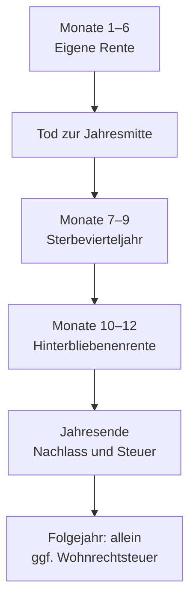

# Tod und Erbe

Wie Tod, Hinterbliebenenbedarf und Nachlass den simulierten Haushalt verändern. Für Nutzer und fachlich Interessierte. Codeprüfung: 29.10.2026; Quellenprüfung: 27.10.2026.

## Auf einen Blick

- Im Simulator liegt ein Todesfall zur Jahresmitte; der Nachlass wird am Jahresende verteilt.
- Erbquote, Mindestbetrag und Höchstanteil bestimmen, wie viel Geld im Haushalt bleibt.
- Wohnrecht und Eigentum auf Lebenszeit haben unterschiedliche Vermögensfolgen.
- Erbschaftsteuer kann zusätzliche Verkäufe auslösen; eine ungedeckte Zahlung führt zu Ruin des Geldvermögens.

## Nach dem Tod

### Sterbejahr

Monte Carlo zieht Todesfälle aus alters- und geschlechtsspezifischen Jahreswahrscheinlichkeiten. Das ist keine Vorhersage des persönlichen Todeszeitpunkts. Der historische Backtest zieht keine Todesfälle; Balance berechnet den eingetragenen heutigen Haushalt.

Stirbt eine Person, zählt ihre eigene Rente im Modell für sechs Monate. Besteht ein eingestellter Hinterbliebenenanspruch, folgen drei Monate volle Rente als Sterbevierteljahr und drei Monate gekürzte Hinterbliebenenrente. Ohne Anspruch bleibt es bei der halben eigenen Jahresrente. Feste sonstige Einkünfte, Pflegegeld und Pflegekosten der verstorbenen Person zählen im Sterbejahr halb und enden danach. Für geerbte Mieten gilt die [Immobilienregel](IMMOBILIEN.md#erlöszuordnung-und-erbe).

### Einkommen und Bedarf

Bei „Nicht verheiratet“ gibt es im Appmodell weder Hinterbliebenenrente noch Sterbevierteljahr. Bei Ehe hängen sie von den eingestellten Rentenannahmen, dem Heiratszeitpunkt und der Mindestdauer ab. Die eigene gesetzliche Nettorente der lebenden Person mindert die Hinterbliebenenrente: 40 % oberhalb von 26,4 aktuellen Rentenwerten, höchstens bis auf null. Das Sterbevierteljahr bleibt ungekürzt. Andere Einkommensarten werden hierbei nicht angerechnet. Die ungekürzte Hinterbliebenenbasis wird fortgeschrieben und die Anrechnung jährlich neu berechnet. Bei unterjährigem Beginn der eigenen Rente zählen nur Überschneidungsmonate mit der Hinterbliebenenrente; im Todesjahr sind das frühestens Oktober bis Dezember.

Die [Deutsche Rentenversicherung](https://www.deutsche-rentenversicherung.de/DRV/DE/Rente/In-der-Rente/Hinterbliebenenrente) erklärt Anspruch, Sterbevierteljahr und die rechtlich weiter gehende Einkommensanrechnung. Die App ersetzt diese Anspruchsprüfung nicht.

Der eingebaute aktuelle Rentenwert beträgt 42,52 € ab 01.07.2026, belegt durch die [DRV-Wertetabelle](https://rvrecht.deutsche-rentenversicherung.de/SharedDocs/rvRecht/07_AktuelleWerte/A-C/awert_aktrtwt.html). Die App führt ihn im Verhältnis zur vollen Rentenbasis fort, auch vor Rentenbeginn.

Grundbedarf, Wunsch-Flex und Mindest-Flex nach dem Tod beziehen sich getrennt auf die inflationierten Paarbeträge:

| Bedarf | Vorgabe allein | Erlaubte Eingabe | Im Todesjahr ohne Pflege |
|---|---:|---:|---:|
| Grundbedarf | 75 % | 40–200 % | 87,5 % |
| Wunsch-Flex | 50 % | 0–100 % | 75 % |
| Mindest-Flex | 50 % | 0–100 % | 75 % |

Im Todesjahr wird je zur Hälfte mit Paar- und Hinterbliebenenbedarf gerechnet. [Pflegekosten und Pflege-Flex](PFLEGE.md#reserve-und-flex) wirken zusätzlich. Mindest-Flex darf den Wunsch-Flex nicht übersteigen. Die nachgelagerte [Wohnmiete](IMMOBILIEN.md#wohnmiete) wird nicht mit dem Hinterbliebenenprozentsatz gekürzt.

### Zeitachse des Sterbejahrs

Rentenabschnitte nach dem Tod gelten nur bei Anspruch.

## Nachlass

### Geldquote und Grenzen

Ausgangspunkt ist das persönliche Geldvermögen nach den Jahresbuchungen: Tagesgeld, Wertpapiere und Pflege-Rücklage. Es wird aus den tatsächlichen Personenkonten ermittelt. Die Ehequote ist getrennt von der Quote bei „Nicht verheiratet“ gespeichert; Vorgaben sind 100 % beziehungsweise 0 %.

Ein Mindestbetrag wird ab seinem eingetragenen Stand mit Inflation fortgeschrieben. Ein Höchstanteil begrenzt ihn auch dann, wenn das Minimum höher wäre:

`Geldanteil = min(Geldvermögen × Höchstanteil, max(Geldvermögen × Erbquote, fortgeschriebener Mindestbetrag))`

Leer bedeutet beim Mindestbetrag 0 € und beim Höchstanteil 100 %. Derselbe tatsächliche Bruchteil überträgt Wertpapierstücke und Anschaffungskosten; Kaufdaten bleiben erhalten. Ohne Geldvermögen gilt für „Wie Geldvermögen“ die Erbquote, begrenzt durch den Höchstanteil. Die Übertragung selbst ist kein Verkauf. Der übrige Nachlass verlässt den Haushalt ohne Verkauf. Die App führt die anderen Erben danach nicht weiter.

### Wohnrecht und Eigentum

Die Immobilienregel bezieht sich auf den Anteil der verstorbenen Person. Eigene Immobilien der lebenden Person bleiben bestehen.

| Wahl | Selbst genutzte Immobilie | Vermietete Immobilie |
|---|---|---|
| Wie Geldvermögen | Tatsächlicher Geldbruchteil wird vererbbares und verkäufliches Eigentum. | Derselbe Bruchteil von Wert und Nettomiete bleibt. |
| Wohnrecht auf Lebenszeit | Andere Erben besitzen das Haus; der Partner wohnt mietfrei. Das Recht zählt nicht als Eigentum zum Gesamtvermögen. | Geht an andere Erben; keine weitere Partnermiete. |
| Eigentum auf Lebenszeit | Der Partner erhält den ganzen selbst genutzten Anteil, danach die Kinder. Der Wert zählt zum Gesamtvermögen. | Geht an andere Erben; keine weitere Partnermiete. |

Aktive Lebenszeitregeln sperren Not- und Heimverkauf der betroffenen Häuser. Bei Heimpflege der berechtigten Person im Todesjahr entsteht kein Wohnrecht: Kapitalwert und Wohnrechtsteuer entfallen, unabhängig vom Pflegegrad. Das gilt in Anspar- und Entnahmejahren. Ein bestehendes Wohnrecht endet bei Tod oder Heimpflege ohne Auszahlung und ohne neue Wohnmiete. Die Erbvorschau berücksichtigt heutige Heimpflege. Eigentum auf Lebenszeit erzeugt im Heim keine Mieteinnahme. Bewertung und Steuer stehen unter [Wohnrechtsteuer](STEUERN.md#wohnrecht-und-jährliche-zahlung).

### Andere Erben und Steuergeld

Bei „Nicht verheiratet“ kann „Immobilien und Steuergeld“ alle Immobilienanteile samt Geld für die Steuer übertragen. Die zusätzliche Geldquote gilt erst für den verbleibenden Geldnachlass. Die App sucht den kleinsten verfügbaren Bruttobetrag, dessen Nettoerlös die Erbschaftsteuer auf Immobilien, Steuergeld und zusätzlichen Geldanteil deckt. Auch die Steuer aus nötigen Wertpapierverkäufen wird berücksichtigt. Zuerst wird Tagesgeld der verstorbenen Person übertragen; ein Rest kommt aus Depot und Pflege-Rücklage. Reicht der Nachlass nicht, bleibt eine Lücke.

Bei früherem Immobilienverkauf wird dessen nominaler Erlös der ursprünglichen Person zugeordnet. Für diese Wahl zählt höchstens ihr noch vorhandenes Geldvermögen als Immobilienerbe. Dieser Betrag wird vor der zusätzlichen Geldquote herausgerechnet und nicht doppelt vererbt.

Die aktive Wahl „Immobilien und Steuergeld“ ersetzt die Testamentgrenzen und die Immobilienregel. Ohne positive eigene Immobilien gelten die Testamentangaben. Die [Bedienung](../../Handbuch.html#partnerschaft-todesfall) erklärt den Wechsel; [Datenverträge](DATENVERTRAEGE.md#immobilien-und-nachlass) den Vorrang in Altständen.

## Steuer

### Zahlung

Die Zahlungsfolge lautet: eigens geerbtes Steuergeld, freie Liquidität oberhalb des Reserveziels, dann Depotverkäufe auch im Bärenmarkt. Tagesgeld und Geldmarkt werden bis zum Reserveziel des Resthaushalts geschützt. Der Schutz erhält den vorhandenen Bestand bis zum Ziel und füllt eine niedrigere Reserve nicht auf. Die Auffüllung übernimmt das Folgejahr. Reicht das Depot nicht, wird auch die verbleibende Liquidität genutzt (FR-67).

Das Ziel nutzt die gemeinsame Auffüllrechnung mit vollem Hinterbliebenenbedarf zu Preisen des Folgejahrs; der Preisfaktor ist die Inflation des Todesjahrs. Renten und Einkünfte zählen mit Beginn, Ende und fortgeschriebenen Beträgen des Folgejahrs. Geplante Ausgaben des Folgejahrs kommen über dieselbe Ausgabenrechnung hinzu. Höhere geplante Auszahlungen durch Dynamic Flex oder Go-Go fehlen im Reserveziel: Sie stehen erst mit der Budgetentscheidung des Folgejahrs fest und können dessen Auffüllziel erhöhen. Verkaufsgewinne gehen in die persönliche Jahressteuerrechnung ein. Erst eine ungedeckte Zahlung führt zu Ruin. Sie gehört nicht zum Jahresbudget und verändert keine Flex-Regel.

Klassen, Freibeträge, Familienheim, Zugewinnausgleich und die Wahl „jährlich (§ 23 ErbStG)“ erklärt [Steuern](STEUERN.md#erbe).

Der Verlustvortrag der verstorbenen Person verfällt bereits beim Tod. Im Sterbejahr bleibt die aktivierte Zusammenveranlagung erhalten; ab dem Folgejahr gelten nur Pauschbetrag und Kirchensteuer der lebenden Person.

## Beispiel und Grenzen

### Max und Erika

Synthetische Rechenvariante, geprüft am 27.10.2026: Max hinterlässt nach den Jahresbuchungen 600.000 € Geldvermögen. Bei einem Drittel Erbquote wären es 200.000 € für Erika. Ein Mindestbetrag von 250.000 € am selben Kaufkraftstand erhöht den Anteil. Ein Höchstanteil von 30 % begrenzt ihn jedoch auf 180.000 €. 420.000 € gehen an andere Erben. Bei Ehe und ohne weiteren Erwerb liegt Erikas Anteil unter dem persönlichen Freibetrag; ohne Ehe ergibt die App 48.000 € Erbschaftsteuer. Verkäufe zur Finanzierung können weitere Kapitalertragsteuer auslösen.

### Wo du es in der App siehst

„Personen & Vermögen“ zeigt unter „Partnerschaft und Todesfall“ die Erbentscheidungen und die Vorschau. Im Simulator stehen die Bedarfsannahmen unter „Hinterbliebene“. Im Jahresprotokoll zeigen „An Erben“, „Erbschaftsteuer“ und das Todesjahr-ⓘ die tatsächlichen Buchungen, getrennte Steuerarten und die Herkunft aus Verkauf, eigener Liquidität und geerbtem Steuergeld. Bei Heimpflege erklärt es das entfallene Wohnrecht. Ein positiver Zugewinnausgleich steht dort als steuerfreier Betrag. Die Vermögenswerte am Jahresende enthalten bereits deren Wirkung. Bedienung: [Handbuch](../../Handbuch.html#partnerschaft-todesfall).

### Modellgrenzen

- Kein Testament wird rechtlich erstellt oder geprüft; Pflichtteile, Scheidung, Nachlass- und Vollstreckerkosten fehlen.
- Die Vorschau verwendet heutige Bestände; ein späterer Nachlass hängt vom gerechneten Pfad ab.
- Tod beider Personen beendet den Lauf; der Nachlass an Außenstehende wird danach nicht geplant.
- Sterbetafel und Hinterbliebenenrente sind Modellannahmen mit [belegten Daten- und Anspruchsgrenzen](DATA_SOURCES.md#lebensereignisse).

Die [technischen Belege](TECHNICAL.md#lebensereignisse-und-steuer-belegen) ordnen Grenzbedingungen dem Code und bestehenden Prüfungen zu.
