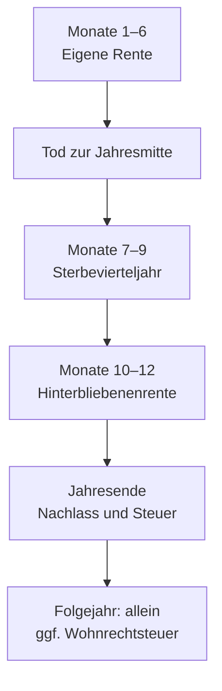

# Tod und Erbe

Wie Tod, Hinterbliebenenbedarf und Nachlass den simulierten Haushalt verändern. Für Nutzer und fachlich Interessierte. Codeprüfung: 23.11.2026; Quellenprüfung: 27.10.2026.

## Auf einen Blick

- Im Simulator liegt ein Todesfall zur Jahresmitte; der Nachlass wird am Jahresende verteilt.
- Bestattungs- und Abwicklungskosten mindern das Geldvermögen vor der Aufteilung. Die Pflichtteil-Sicherung kann den Geldanteil der überlebenden Person weiter kürzen.
- Beim Verkauf im Erbfall erhält die überlebende Person entweder lebenslang Geld für die Miete oder einmalig ein Wohnkapital aus dem Erlös.
- Erbschaftsteuer kann zusätzliche Verkäufe auslösen; eine ungedeckte Zahlung bleibt als Steuerschuld stehen.

## Nach dem Tod

### Sterbejahr

Monte Carlo zieht Todesfälle aus alters- und geschlechtsspezifischen Jahreswahrscheinlichkeiten. Das ist keine Vorhersage des persönlichen Todeszeitpunkts. Der historische Backtest zieht keine Todesfälle; Balance berechnet den eingetragenen heutigen Haushalt.

Stirbt eine Person, zählt ihre eigene Rente im Modell für sechs Monate. Besteht ein eingestellter Hinterbliebenenanspruch, folgen drei Monate volle Rente als Sterbevierteljahr und drei Monate gekürzte Hinterbliebenenrente. Ohne Anspruch bleibt es bei der halben eigenen Jahresrente. Feste sonstige Einkünfte, Pflegegeld und Pflegekosten der verstorbenen Person zählen im Sterbejahr halb und enden danach. Das gilt auch für Heimkosten und eigene Ausgaben im Heim. Ihre eigene Pflege schließt vor der Nachlassverteilung ab, wenn nötig mit [Hilfe zur Pflege](PFLEGE.md#steuerschuld-und-tod); die Pflege der lebenden Person zahlt der Nachlass nicht. Für geerbte Mieten gilt die [Immobilienregel](IMMOBILIEN.md#erlöszuordnung-und-erbe). Verlässt ein Teil des Nachlasses den Haushalt, entscheidet die App Kauf und Auffüllen im Sterbejahr mit dem, was der lebenden Person bleibt: ihre eigene Liquidität plus der geerbte Anteil an der Liquidität der verstorbenen Person nach deren Jahresbuchungen, dazu nur ihre eigenen Wertpapiere. Gekauft wird nur aus ihrer freien Liquidität. Liegt sie unter dem Ziel, füllen die üblichen Auffüllregeln samt Sperren im Bärenmarkt aus ihren Aktien auf, bei Drei Töpfen auch die Anleihen, bei Ehe wie ohne Ehe.

### Einkommen und Bedarf

Bei „Nicht verheiratet“ gibt es im Appmodell weder Hinterbliebenenrente noch Sterbevierteljahr. Bei Ehe hängen sie von den eingestellten Rentenannahmen, dem Heiratszeitpunkt und der Mindestdauer ab. Die eigene gesetzliche Nettorente der lebenden Person mindert die Hinterbliebenenrente: 40 % oberhalb von 26,4 aktuellen Rentenwerten, höchstens bis auf null. Das Sterbevierteljahr bleibt ungekürzt. Andere Einkommensarten werden hierbei nicht angerechnet. Die ungekürzte Hinterbliebenenbasis wird fortgeschrieben und die Anrechnung jährlich neu berechnet. Bei unterjährigem Beginn der eigenen Rente zählen nur Überschneidungsmonate mit der Hinterbliebenenrente; im Todesjahr sind das frühestens Oktober bis Dezember.

Die [Deutsche Rentenversicherung](https://www.deutsche-rentenversicherung.de/DRV/DE/Rente/In-der-Rente/Hinterbliebenenrente) erklärt Anspruch, Sterbevierteljahr und die rechtlich weiter gehende Einkommensanrechnung. Die App ersetzt diese Anspruchsprüfung nicht.

Der eingebaute aktuelle Rentenwert beträgt 42,52 € ab 01.07.2026, belegt durch die [DRV-Wertetabelle](https://rvrecht.deutsche-rentenversicherung.de/SharedDocs/rvRecht/07_AktuelleWerte/A-C/awert_aktrtwt.html). Die App führt ihn im Verhältnis zur vollen Rentenbasis fort, auch vor Rentenbeginn.

Grundbedarf, Wunsch-Flex und Mindest-Flex nach dem Tod beziehen sich getrennt auf die inflationierten Paarbeträge:

| Bedarf | Vorgabe allein | Erlaubte Eingabe | Im Todesjahr ohne Pflege |
|---|---:|---:|---:|
| Grundbedarf | 75 % | 40–200 % | 87,5 % |
| Wunsch-Flex | 50 % | 0–100 % | 75 % |
| Mindest-Flex | 50 % | 0–100 % | 75 % |

Im Todesjahr wird je zur Hälfte mit Paar- und Hinterbliebenenbedarf gerechnet. [Pflegekosten und Pflege-Flex](PFLEGE.md#pflegereserve-und-flex) wirken zusätzlich. Lebt jemand im Heim, zählt der Grundbedarf zu Hause je ein halbes Jahr im Zustand vor und nach dem Tod. Stirbt die Person im Heim und der Partner lebt zu Hause, bleibt es in beiden Hälften beim Hinterbliebenenanteil. Stirbt der Partner zu Hause und bleibt nur die Person im Heim, zählt sein Grundbedarf nur im ersten Halbjahr. Einzelheiten unter [Heim](PFLEGE.md#heimkosten-und-jahresabschluss). Mindest-Flex darf den Wunsch-Flex nicht übersteigen. Die nachgelagerte [Wohnmiete](IMMOBILIEN.md#wohnmiete) wird nicht mit dem Hinterbliebenenprozentsatz gekürzt.

### Zeitachse des Sterbejahrs

Rentenabschnitte nach dem Tod gelten nur bei Anspruch.

## Nachlass

### Geldquote und Grenzen

Ausgangspunkt ist das persönliche Geldvermögen nach den Jahresbuchungen: Tagesgeld, Wertpapiere und Pflegereserve. Es wird aus den tatsächlichen Personenkonten ermittelt. Die Ehequote ist getrennt von der Quote bei „Nicht verheiratet“ gespeichert; Vorgaben sind 100 % beziehungsweise 0 %.

„Bestattungs- und Abwicklungskosten“ trägst du je Erblasser in Kaufkraft zum Planstart ein. Die Vorgabe ist 0 €. Im Todesjahr gehen die mit der Inflation fortgeschriebenen Kosten bis zur Höhe des vorhandenen Geldvermögens aus dem Nachlass ab. Der Rest ist das Nettogeldvermögen.

Ein Mindestbetrag wird ab seinem eingetragenen Stand mit Inflation fortgeschrieben. Der Höchstanteil gilt für das Nettogeldvermögen und begrenzt den Mindestbetrag.

`Geldanteil = min(Nettogeldvermögen × Höchstanteil, max(Nettogeldvermögen × Erbquote, fortgeschriebener Mindestbetrag))`

Leer bedeutet beim Mindestbetrag 0 € und beim Höchstanteil 100 %. Die App überträgt Geldbestände, Wertpapierstücke und Anschaffungskosten im Verhältnis des endgültigen Geldanteils zum ursprünglichen Geldvermögen. Bei „wie Geldvermögen“ gilt für Immobilien die Quote aus dem Nettogeldvermögen vor der Pflichtteilprüfung. Ist kein Nettogeldvermögen vorhanden, gilt die Erbquote, begrenzt durch den Höchstanteil. Die Übertragung selbst ist kein Verkauf. Der übrige Nachlass verlässt den Haushalt ohne Verkauf. Die App führt die anderen Erben danach nicht weiter.

### Pflichtteil der Kinder

Mit „Pflichtteilsberechtigte Kinder vorhanden“ prüft die App, ob den übrigen Erben genug für den gemeinsamen Pflichtteil der Kinder bleibt. Der Schalter ist anfangs aus. Der Nachlasswert umfasst das Nettogeldvermögen und alle Immobilienanteile der verstorbenen Person. In der Simulation der Testamentregeln mindert die offene Steuerschuld den Nachlasswert für die Pflichtteilsprüfung.

| Partnerschaft | Pflichtteil der Kinder zusammen im Modell |
|---|---:|
| Nicht verheiratet | Hälfte des Nachlasswerts |
| Verheiratet in Zugewinngemeinschaft | Viertel des Nachlasswerts |
| Verheiratet in Gütertrennung | Ebenfalls ein Viertel. Für die Hälfte des gesetzlichen Erbteils fehlt der App die Zahl der Kinder. |

Vom Nachlasswert zieht die App den Erwerb der überlebenden Person nach Abzug ihrer anteiligen Steuerschuld ab. Zum Geldanteil kommen je nach Immobilienregel der erworbene Immobilienwert, der steuerliche Kapitalwert des Wohnrechts oder der Rente und der Wohnkapitalbetrag hinzu. Fehlt den übrigen Erben Geld zum Pflichtteil, sinkt der übertragene Geldanteil samt zugehöriger Schuld so weit, bis die Netto-Lücke geschlossen oder der Geldanteil aufgebraucht ist. Dabei kann er den Mindestbetrag unterschreiten. Die Immobilienzuwendung bleibt bestehen. Die Vorschau und das Erbe-ⓘ nennen die Geldkürzung und den noch fehlenden Betrag. Die Erbschaftsteuer berücksichtigt den gekürzten Erwerb. [Erbschaftsteuer](STEUERN.md#erbe)

Bei eingetragenen Kosten oder eingeschalteter Pflichtteil-Sicherung lässt die Kauf- und Auffüllentscheidung im Sterbejahr das Geld der verstorbenen Person bis zur Nachlassverteilung außer Ansatz.

Der Pflichtteil wird mit den Werten im Todesjahr geprüft und das Wohnkapital richtet sich nach dem Hauswert im Verkaufsjahr.

### Wohnrecht und Eigentum

Die Immobilienregel wählst du je Erblasser. Bei „Verkauf, Miete auf Lebenszeit“ und „Verkauf mit Wohnkapital“ gehört nur der Anteil der verstorbenen Person zum Verkauf. Ein eigener Anteil bleibt der überlebenden Person erhalten.

| Wahl | Selbst genutzte Immobilie | Vermietete Immobilie |
|---|---|---|
| Wie Geldvermögen | Der Bruchteil vor der Pflichtteilprüfung wird vererbbares und verkäufliches Eigentum. | Derselbe Bruchteil von Wert und Nettomiete bleibt. |
| Wohnrecht auf Lebenszeit | Andere Erben besitzen das Haus; der Partner wohnt mietfrei. Das Recht zählt nicht als Eigentum zum Gesamtvermögen. | Geht an andere Erben; keine weitere Partnermiete. |
| Eigentum auf Lebenszeit | Der Partner erhält den ganzen selbst genutzten Anteil, danach die Kinder. Der Wert zählt zum Gesamtvermögen. | Geht an andere Erben; keine weitere Partnermiete. |
| Verkauf, Miete auf Lebenszeit | Die anderen Erben erhalten den gesamten Erlös. Ab dem Folgejahr erhält die überlebende Person eine lebenslange Rente. | Anteil und Nettomiete folgen der Geldquote mit Mindestbetrag und Höchstanteil. |
| Verkauf mit Wohnkapital | Die überlebende Person erhält einmalig einen Prozentsatz des Nettoerlöses. Mit „Auszug nach“ legst du fest, wie viele Jahre sie zunächst mietfrei wohnen bleibt. | Anteil und Nettomiete folgen der Geldquote mit Mindestbetrag und Höchstanteil. |

Im Erbfall und in den Folgejahren sperren Wohnrecht und Eigentum auf Lebenszeit den Not- und Heimverkauf der betroffenen Häuser. Bei Heimpflege der berechtigten Person im Todesjahr entsteht kein Wohnrecht: Kapitalwert und Wohnrechtsteuer entfallen, unabhängig vom Pflegegrad. Das gilt in Anspar- und Entnahmejahren. Ein bestehendes Wohnrecht endet bei Tod oder Heimpflege ohne Auszahlung und ohne neue Wohnmiete. Die Erbvorschau berücksichtigt heutige Heimpflege. Eigentum auf Lebenszeit erzeugt im Heim keine Mieteinnahme. Bewertung und Steuer stehen unter [Wohnrechtsteuer](STEUERN.md#wohnrecht-und-jährliche-zahlung).

#### Verkauf und Miete auf Lebenszeit

Beim Tod muss der selbst genutzte Anteil der verstorbenen Person noch vorhanden sein. Ein vorheriger Not- oder Heimverkauf dieses Anteils schließt das Rentenvermächtnis aus. Der Monatsbetrag gilt in Kaufkraft zum Planstart. Aus 1.500 € im Monat werden 18.000 € im Jahr, fortgeschrieben mit der Inflation seit Planstart. Dieselbe Summe geht ungekürzt zum Grundbedarf der überlebenden Person hinzu. Bei dauerhafter Heimpflege endet die Miete. Die Rente läuft auch im Heim weiter, selbst wenn die Person bereits im Todesjahr dort lebt.

Der Kapitalwert zählt zur Erbschaftsteuer, ohne Familienheim-Befreiung. Wähle sofortige Besteuerung im Todesjahr oder jährliche Steuer ab dem Folgejahr. Die Jahressteuer läuft bis zum Tod, auch im Heim. Ausführlich unter [Steuer auf die Rente aus dem Erbe](STEUERN.md#rente-aus-dem-erbe).

#### Verkauf mit Wohnkapital

„Auszug nach“ erlaubt 0 bis 10 ganze Jahre. Bei 0 kommt das Wohnkapital im Todesjahr aufs Tagesgeld. Die Miete beginnt im Folgejahr. Fehlt die Angabe in älteren Daten, gilt 0. Ab 1 bleibt die überlebende Person im Todesjahr und in den eingetragenen Folgejahren mietfrei im Haus. Im nächsten Jahr folgen Verkauf, Wohnkapital, Erbschaftsteuer und Mietbeginn. Bei 1 ist das im zweiten Folgejahr. Während der Wartezeit bleibt der Anteil wie beim Wohnrecht zur Nutzung im Haushalt und ist gegen Heim- und Notverkauf gesperrt. Die App rechnet in dieser Zeit keine Wohnrechtsteuer.

Verkauft wird der noch vorhandene selbst genutzte Anteil der verstorbenen Person. Der Nettoerlös beträgt 90 % des bis zum Ende des Verkaufsjahrs fortgeschriebenen Werts. Davon geht der eingetragene Prozentsatz als Wohnkapital aufs Tagesgeld. Aus dieser Gutschrift zahlt die Person beim späteren Verkauf ihre Erbschaftsteuer. Den übrigen Erlös erhalten die anderen Erben. Lebt die überlebende Person beim vorgesehenen Verkauf bereits dauerhaft im Heim oder stirbt sie vor der Buchung, erhalten die anderen Erben den Hausanteil. Wohnkapital und Miete entfallen. Das gilt auch bei „Auszug nach 0 Jahren“.

Die Miete trägst du in Kaufkraft zum Planstart ein. Sie steigt mit der Inflation seit Planstart, zählt zum Grundbedarf und endet bei dauerhafter Heimpflege. Sobald sie beginnt, belastet sie auch in Ansparjahren das Vermögen der überlebenden Person.

Synthetische Rechenvariante Max und Erika, geprüft am 23.11.2026. Max' Anteil ist 200.000 € wert. Bei 0 Jahren und ohne Inflation bringt er 180.000 € netto. Bei 30 % erhält Erika 54.000 € Wohnkapital, 126.000 € gehen an die anderen Erben. Bei 1 Jahr lebt Erika im ersten Folgejahr mietfrei. Bei 10 % Inflation im ersten und 5 % im zweiten Folgejahr liegen der Anteilswert im Verkaufsjahr bei 231.000 € und das Wohnkapital bei 62.370 €. Die Miete von anfangs 1.200 € im Monat ergibt dann eine Jahresmiete von 15.840 €. Die Steuer steht unter [Wohnkapital](STEUERN.md#wohnkapital).

### Andere Erben und Steuergeld

Bei „Nicht verheiratet“ kann „Immobilien und Steuergeld“ alle Immobilienanteile samt Geld für die Steuer übertragen. Die zusätzliche Geldquote gilt erst für den verbleibenden Geldnachlass. Die App sucht den kleinsten verfügbaren Bruttobetrag, dessen Nettoerlös die Erbschaftsteuer auf Immobilien, Steuergeld und zusätzlichen Geldanteil deckt. Auch die Steuer aus nötigen Wertpapierverkäufen wird berücksichtigt. Zuerst wird Tagesgeld der verstorbenen Person übertragen; ein Rest kommt aus Depot und Pflegereserve. Reicht der Nachlass nicht, bleibt eine Lücke.

Bei früherem Immobilienverkauf wird dessen nominaler Erlös der ursprünglichen Person zugeordnet. Für diese Wahl zählt höchstens ihr noch vorhandenes Geldvermögen als Immobilienerbe. Dieser Betrag wird vor der zusätzlichen Geldquote herausgerechnet und nicht doppelt vererbt.

Die aktive Wahl „Immobilien und Steuergeld“ sperrt Mindestbetrag, Höchstanteil und Immobilienregel. Bestattungs- und Abwicklungskosten gehen vor der Aufteilung vom Geldvermögen ab. Die Pflichtteil-Sicherung prüft den Erwerb aus Immobilien, Steuergeld und Zusatzanteil. Bei einer Lücke kürzt die App den Zusatzanteil bis auf 0 €. Immobilien und Steuergeld bleiben der überlebenden Person erhalten. Eine verbleibende Lücke steht in Vorschau und Erbe-ⓘ. Ohne positive eigene Immobilien gelten alle Testamentangaben. Die [Bedienung](../../Handbuch.html#partnerschaft-todesfall) erklärt den Wechsel. Die [Datenverträge](DATENVERTRAEGE.md#immobilien-und-nachlass) beschreiben den Vorrang in Altständen.

## Steuer

Fehlt der Partnerschaftsstatus, zeigt die Vorschau „Partnerschaftsstatus fehlt“. Die App rechnet dann in Vorschau und Simulator mit 20.000 € persönlichem Freibetrag, ohne Versorgungsfreibetrag und Familienheim-Befreiung. Die [Steuertabelle](STEUERN.md#klassen-und-befreiungsannahmen) nennt Tarif und Abzüge.

### Zahlung

Die Zahlungsfolge lautet: eigens geerbtes Steuergeld, freie Liquidität oberhalb des Reserveziels, dann Depotverkäufe auch im Bärenmarkt. Tagesgeld und Geldmarkt werden bis zum Reserveziel des Resthaushalts geschützt. Der Schutz erhält den vorhandenen Bestand bis zum Ziel und füllt eine niedrigere Reserve nicht auf. Die Auffüllung übernimmt das Folgejahr. Reicht das Depot nicht, wird auch die verbleibende Liquidität genutzt (FR-67).

Das Ziel nutzt die gemeinsame Auffüllrechnung mit vollem Hinterbliebenenbedarf zu Preisen des Folgejahrs; der Preisfaktor ist die Inflation des Todesjahrs. Renten und Einkünfte zählen mit Beginn, Ende und fortgeschriebenen Beträgen des Folgejahrs. Geplante Ausgaben des Folgejahrs kommen über dieselbe Ausgabenrechnung hinzu. Höhere geplante Auszahlungen durch Dynamic Flex oder Go-Go fehlen im Reserveziel: Sie stehen erst mit der Budgetentscheidung des Folgejahrs fest und können dessen Auffüllziel erhöhen. Verkaufsgewinne gehen in die persönliche Jahressteuerrechnung ein. Eine ungedeckte Zahlung beendet den Lauf nicht: Sie bleibt als [Steuerschuld](PFLEGE.md#steuerschuld-und-tod) bei der erbenden Person und ist im Folgejahr fällig. Die Zahlung gehört nicht zum Jahresbudget und verändert keine Flex-Regel.

Hat die verstorbene Person eine offene Steuerschuld, ist sie Nachlassverbindlichkeit. Sie mindert den Erwerb, bevor die Erbschaftsteuer berechnet wird, und geht mit dem Erbanteil auf die lebende Person über; den übrigen Teil tragen die anderen Erben. Das gilt in der Ehe wie ohne Ehe; ohne eigene Nachlassverteilung (alles bleibt im Haushalt) geht die ganze Schuld über.

Klassen, Freibeträge, Familienheim, Zugewinnausgleich, den [Versorgungsfreibetrag](STEUERN.md#versorgungsfreibetrag) und die Wahl „jährlich (§ 23 ErbStG)“ erklärt [Steuern](STEUERN.md#erbe). Eine eingetragene Hinterbliebenenrente kürzt den Versorgungsfreibetrag.

Der Verlustvortrag der verstorbenen Person verfällt bereits beim Tod. Im Sterbejahr bleibt die aktivierte Zusammenveranlagung erhalten; ab dem Folgejahr gelten nur Pauschbetrag und Kirchensteuer der lebenden Person.

## Beispiel und Grenzen

### Max und Erika

Synthetische Rechenvariante, geprüft am 27.10.2026: Max hinterlässt nach den Jahresbuchungen 600.000 € Geldvermögen. Bei einem Drittel Erbquote wären es 200.000 € für Erika. Ein Mindestbetrag von 250.000 € am selben Kaufkraftstand erhöht den Anteil. Ein Höchstanteil von 30 % begrenzt ihn jedoch auf 180.000 €. 420.000 € gehen an andere Erben. Bei Ehe und ohne weiteren Erwerb liegt Erikas Anteil unter dem persönlichen Freibetrag; ohne Ehe ergibt die App 48.000 € Erbschaftsteuer. Verkäufe zur Finanzierung können weitere Kapitalertragsteuer auslösen.

Synthetisch geprüft am 23.11.2026. Von 100.000 € Geldvermögen bleiben nach 20.000 € Kosten noch 80.000 €. Bei einer Quote von 50 % erhält Erika 40.000 €. In einer zweiten Variante sind Max und Erika unverheiratet. Max hinterlässt 100.000 € Nettogeldvermögen und einen Hausanteil im Wert von 400.000 €. Erikas Wohnrecht zählt mit 190.000 €. Erhielte sie zusätzlich den Mindestbetrag von 85.000 €, blieben den Kindern nur 225.000 € bei einem Pflichtteil von 250.000 €. Die App kürzt Erikas Geldanteil um 25.000 € auf 60.000 €.

### Wo du es in der App siehst

„Personen & Vermögen“ zeigt unter „Partnerschaft und Todesfall“ die Erbentscheidungen und die Vorschau. Im Simulator stehen die Bedarfsannahmen unter „Hinterbliebene“. Wähle in den Monte-Carlo-Szenario-Protokollen die Gruppe „Todesfall“, um Pfade mit einem Todesfall und mindestens zwei Folgejahren zu finden. Im Jahresprotokoll zeigen „An Erben“, „Erbschaftsteuer“ und das Todesjahr-ⓘ die tatsächlichen Buchungen, getrennte Steuerarten und die Herkunft aus Verkauf, eigener Liquidität und geerbtem Steuergeld. Bei Heimpflege erklärt es das entfallene Wohnrecht. Nach dem Erbfall-Verkauf findest du „Rente aus dem Erbe“ im ⓘ bei Einnahmen und „Miete aus dem Erbe“ im ⓘ bei Ausgaben. Beim späteren Auszug nennt das Todesjahrprotokoll das Ende der mietfreien Zeit. Im Verkaufsjahr stehen „Wohnkapital … aufs Tagesgeld“ und „Mietbeginn“ in der Handlungsspalte. „Miete nach Verkauf im Erbfall“ steht dann im Ausgaben-ⓘ. Bei 0 Jahren nennt das Todesjahr „Hausanteil verkauft“ und „Mietbeginn im Folgejahr“. Neben dem Geld für die anderen Erben steht dort auch der übrige Hauserlös, ebenso im Erbe-ⓘ. Bei dauerhafter Heimpflege erklären Vorschau und Protokoll, warum das Wohnkapital entfällt. Das ⓘ zur Erbschaftsteuer nennt den steuerpflichtigen Erwerb, auf volle 100 € abgerundet. Ein positiver Zugewinnausgleich steht dort als steuerfreier Betrag. Bleibt bei Ehe nach den übrigen Abzügen ein steuerpflichtiger Erwerb, nennt es auch den Versorgungsfreibetrag. Die Vermögenswerte am Jahresende enthalten bereits deren Wirkung. Bedienung: [Handbuch](../../Handbuch.html#partnerschaft-todesfall).

### Modellgrenzen

- Die App schätzt den Pflichtteil für die Planung. Sie erstellt und prüft keine Testamente. Pflichtteilsergänzung, Schenkungen zu Lebzeiten, Scheidung und eine detaillierte Zugewinnausgleichsrechnung liegen außerhalb des Modells.
- Die App rechnet die Rente aus dem Erbe als volle Einnahme ohne Abzug von Einkommensteuer.
- Die Vorschau verwendet heutige Bestände; ein späterer Nachlass hängt vom gerechneten Pfad ab.
- Tod beider Personen beendet den Lauf; der Nachlass an Außenstehende wird danach nicht geplant.
- Sterbetafel und Hinterbliebenenrente sind Modellannahmen mit [belegten Daten- und Anspruchsgrenzen](DATA_SOURCES.md#lebensereignisse). Seit FR-75 gilt die Kohortentafel V2 des Geburtsjahrs; wer ohne Pflegegrad startet, lebt im Mittel wie die Tafel.

Die [technischen Belege](TECHNICAL.md#lebensereignisse-und-steuer-belegen) ordnen Grenzbedingungen dem Code und bestehenden Prüfungen zu.
