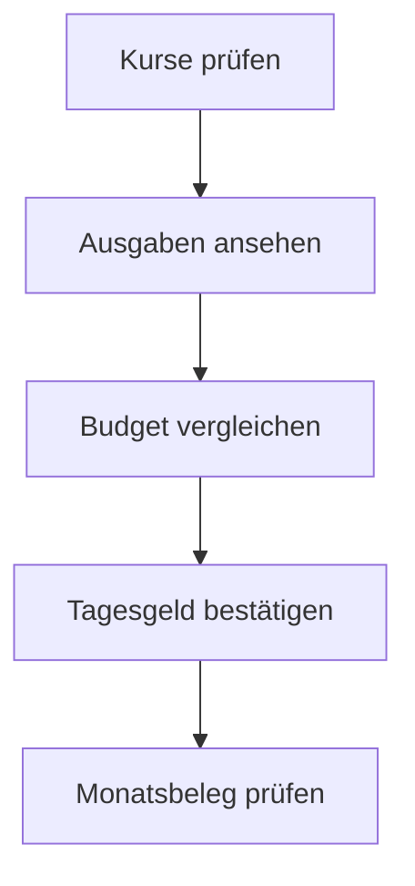
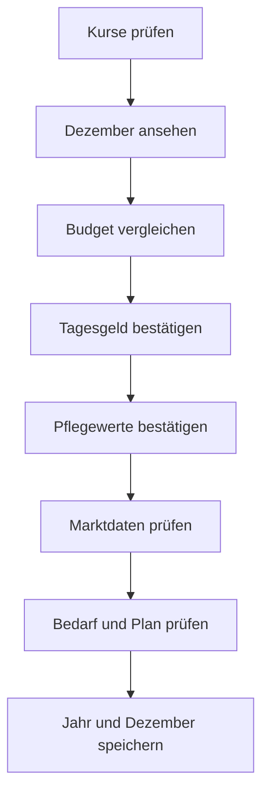
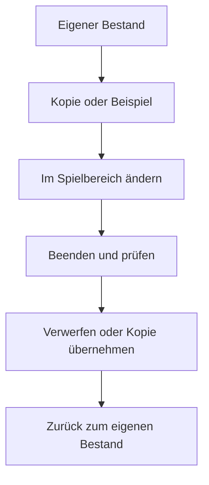

# Abläufe im Handbuch

Mermaid-Quellen und statische SVGs für die Offline-Hilfe. Stand: 27.10.2026. Pfeile zeigen den nächsten Bedienabschnitt. Die Farben folgen dem Designsystem „Stein & Messing“; Messing markiert den Abschluss beziehungsweise die Rückkehr.

## Monat abschließen

## Jahr abschließen

## Spielbereich und Rückkehr

